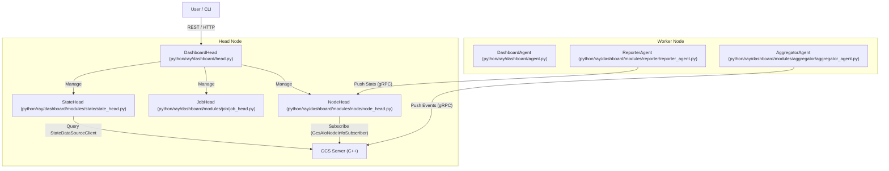
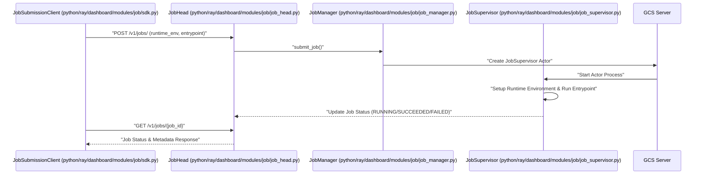

<!-- source: DeepWiki mcp.deepwiki.com · repo ray-project/ray · page 2.6 Observability: Dashboard, Metrics, and State API · fetched 2026-10-21 -->

# Observability: Dashboard, Metrics, and State API

Relevant source files

The following files were used as context for generating this wiki page:

- [.github/CODEOWNERS](.github/CODEOWNERS)
- [doc/source/cluster/metrics.md](doc/source/cluster/metrics.md)
- [doc/source/data/images/dataset_mixing/per_block_mix.png](doc/source/data/images/dataset_mixing/per_block_mix.png)
- [doc/source/data/images/dataset_mixing/random_mix.png](doc/source/data/images/dataset_mixing/random_mix.png)
- [doc/source/data/mixing-data.rst](doc/source/data/mixing-data.rst)
- [doc/source/data/scaling-collation-functions.rst](doc/source/data/scaling-collation-functions.rst)
- [doc/source/ray-observability/reference/system-metrics.rst](doc/source/ray-observability/reference/system-metrics.rst)
- [doc/source/serve/llm/images/serve_llm_dashboard.png](doc/source/serve/llm/images/serve_llm_dashboard.png)
- [doc/source/train/user-guides.rst](doc/source/train/user-guides.rst)
- [doc/source/train/user-guides/local_mode.rst](doc/source/train/user-guides/local_mode.rst)
- [doc/source/train/user-guides/monitor-your-application.rst](doc/source/train/user-guides/monitor-your-application.rst)
- [python/ray/_private/log_monitor.py](python/ray/_private/log_monitor.py)
- [python/ray/_private/metrics_agent.py](python/ray/_private/metrics_agent.py)
- [python/ray/_private/ray_constants.py](python/ray/_private/ray_constants.py)
- [python/ray/_private/resource_isolation_config.py](python/ray/_private/resource_isolation_config.py)
- [python/ray/_private/runtime_env/agent/main.py](python/ray/_private/runtime_env/agent/main.py)
- [python/ray/_private/telemetry/metric_cardinality.py](python/ray/_private/telemetry/metric_cardinality.py)
- [python/ray/_private/telemetry/metric_types.py](python/ray/_private/telemetry/metric_types.py)
- [python/ray/_private/telemetry/open_telemetry_metric_recorder.py](python/ray/_private/telemetry/open_telemetry_metric_recorder.py)
- [python/ray/dashboard/agent.py](python/ray/dashboard/agent.py)
- [python/ray/dashboard/client/src/type/node.d.ts](python/ray/dashboard/client/src/type/node.d.ts)
- [python/ray/dashboard/consts.py](python/ray/dashboard/consts.py)
- [python/ray/dashboard/dashboard.py](python/ray/dashboard/dashboard.py)
- [python/ray/dashboard/dashboard_metrics.py](python/ray/dashboard/dashboard_metrics.py)
- [python/ray/dashboard/head.py](python/ray/dashboard/head.py)
- [python/ray/dashboard/http_server_agent.py](python/ray/dashboard/http_server_agent.py)
- [python/ray/dashboard/http_server_head.py](python/ray/dashboard/http_server_head.py)
- [python/ray/dashboard/modules/aggregator/aggregator_agent.py](python/ray/dashboard/modules/aggregator/aggregator_agent.py)
- [python/ray/dashboard/modules/aggregator/constants.py](python/ray/dashboard/modules/aggregator/constants.py)
- [python/ray/dashboard/modules/aggregator/multi_consumer_event_buffer.py](python/ray/dashboard/modules/aggregator/multi_consumer_event_buffer.py)
- [python/ray/dashboard/modules/aggregator/publisher/__init__.py](python/ray/dashboard/modules/aggregator/publisher/__init__.py)
- [python/ray/dashboard/modules/aggregator/publisher/async_publisher_client.py](python/ray/dashboard/modules/aggregator/publisher/async_publisher_client.py)
- [python/ray/dashboard/modules/aggregator/publisher/configs.py](python/ray/dashboard/modules/aggregator/publisher/configs.py)
- [python/ray/dashboard/modules/aggregator/publisher/metrics.py](python/ray/dashboard/modules/aggregator/publisher/metrics.py)
- [python/ray/dashboard/modules/aggregator/publisher/ray_event_publisher.py](python/ray/dashboard/modules/aggregator/publisher/ray_event_publisher.py)
- [python/ray/dashboard/modules/aggregator/tests/test_aggregator_agent.py](python/ray/dashboard/modules/aggregator/tests/test_aggregator_agent.py)
- [python/ray/dashboard/modules/aggregator/tests/test_multi_consumer_event_buffer.py](python/ray/dashboard/modules/aggregator/tests/test_multi_consumer_event_buffer.py)
- [python/ray/dashboard/modules/aggregator/tests/test_ray_event_publisher.py](python/ray/dashboard/modules/aggregator/tests/test_ray_event_publisher.py)
- [python/ray/dashboard/modules/dashboard_sdk.py](python/ray/dashboard/modules/dashboard_sdk.py)
- [python/ray/dashboard/modules/data/data_head.py](python/ray/dashboard/modules/data/data_head.py)
- [python/ray/dashboard/modules/event/event_agent.py](python/ray/dashboard/modules/event/event_agent.py)
- [python/ray/dashboard/modules/event/event_consts.py](python/ray/dashboard/modules/event/event_consts.py)
- [python/ray/dashboard/modules/event/event_head.py](python/ray/dashboard/modules/event/event_head.py)
- [python/ray/dashboard/modules/job/cli.py](python/ray/dashboard/modules/job/cli.py)
- [python/ray/dashboard/modules/job/job_agent.py](python/ray/dashboard/modules/job/job_agent.py)
- [python/ray/dashboard/modules/job/job_head.py](python/ray/dashboard/modules/job/job_head.py)
- [python/ray/dashboard/modules/job/job_log_storage_client.py](python/ray/dashboard/modules/job/job_log_storage_client.py)
- [python/ray/dashboard/modules/job/job_manager.py](python/ray/dashboard/modules/job/job_manager.py)
- [python/ray/dashboard/modules/job/job_supervisor.py](python/ray/dashboard/modules/job/job_supervisor.py)
- [python/ray/dashboard/modules/job/sdk.py](python/ray/dashboard/modules/job/sdk.py)
- [python/ray/dashboard/modules/job/tests/test_cli.py](python/ray/dashboard/modules/job/tests/test_cli.py)
- [python/ray/dashboard/modules/job/tests/test_cli_integration.py](python/ray/dashboard/modules/job/tests/test_cli_integration.py)
- [python/ray/dashboard/modules/job/tests/test_job_agent.py](python/ray/dashboard/modules/job/tests/test_job_agent.py)
- [python/ray/dashboard/modules/job/tests/test_job_manager.py](python/ray/dashboard/modules/job/tests/test_job_manager.py)
- [python/ray/dashboard/modules/job/tests/test_utils.py](python/ray/dashboard/modules/job/tests/test_utils.py)
- [python/ray/dashboard/modules/job/utils.py](python/ray/dashboard/modules/job/utils.py)
- [python/ray/dashboard/modules/log/log_manager.py](python/ray/dashboard/modules/log/log_manager.py)
- [python/ray/dashboard/modules/metrics/dashboards/common.py](python/ray/dashboard/modules/metrics/dashboards/common.py)
- [python/ray/dashboard/modules/metrics/dashboards/data_llm_dashboard_panels.py](python/ray/dashboard/modules/metrics/dashboards/data_llm_dashboard_panels.py)
- [python/ray/dashboard/modules/metrics/dashboards/data_llm_grafana_dashboard_base.json](python/ray/dashboard/modules/metrics/dashboards/data_llm_grafana_dashboard_base.json)
- [python/ray/dashboard/modules/metrics/dashboards/default_dashboard_panels.py](python/ray/dashboard/modules/metrics/dashboards/default_dashboard_panels.py)
- [python/ray/dashboard/modules/metrics/dashboards/serve_dashboard_panels.py](python/ray/dashboard/modules/metrics/dashboards/serve_dashboard_panels.py)
- [python/ray/dashboard/modules/metrics/dashboards/serve_deployment_dashboard_panels.py](python/ray/dashboard/modules/metrics/dashboards/serve_deployment_dashboard_panels.py)
- [python/ray/dashboard/modules/metrics/dashboards/serve_llm_dashboard_panels.py](python/ray/dashboard/modules/metrics/dashboards/serve_llm_dashboard_panels.py)
- [python/ray/dashboard/modules/metrics/dashboards/serve_llm_grafana_dashboard_base.json](python/ray/dashboard/modules/metrics/dashboards/serve_llm_grafana_dashboard_base.json)
- [python/ray/dashboard/modules/metrics/default_impl.py](python/ray/dashboard/modules/metrics/default_impl.py)
- [python/ray/dashboard/modules/metrics/grafana_dashboard_factory.py](python/ray/dashboard/modules/metrics/grafana_dashboard_factory.py)
- [python/ray/dashboard/modules/metrics/install_and_start_prometheus.py](python/ray/dashboard/modules/metrics/install_and_start_prometheus.py)
- [python/ray/dashboard/modules/metrics/metrics_head.py](python/ray/dashboard/modules/metrics/metrics_head.py)
- [python/ray/dashboard/modules/metrics/templates.py](python/ray/dashboard/modules/metrics/templates.py)
- [python/ray/dashboard/modules/node/datacenter.py](python/ray/dashboard/modules/node/datacenter.py)
- [python/ray/dashboard/modules/node/node_consts.py](python/ray/dashboard/modules/node/node_consts.py)
- [python/ray/dashboard/modules/node/node_head.py](python/ray/dashboard/modules/node/node_head.py)
- [python/ray/dashboard/modules/node/tests/test_node.py](python/ray/dashboard/modules/node/tests/test_node.py)
- [python/ray/dashboard/modules/reporter/reporter_agent.py](python/ray/dashboard/modules/reporter/reporter_agent.py)
- [python/ray/dashboard/modules/reporter/reporter_head.py](python/ray/dashboard/modules/reporter/reporter_head.py)
- [python/ray/dashboard/modules/reporter/reporter_models.py](python/ray/dashboard/modules/reporter/reporter_models.py)
- [python/ray/dashboard/modules/reporter/tests/test_reporter.py](python/ray/dashboard/modules/reporter/tests/test_reporter.py)
- [python/ray/dashboard/modules/state/state_head.py](python/ray/dashboard/modules/state/state_head.py)
- [python/ray/dashboard/modules/tests/test_head.py](python/ray/dashboard/modules/tests/test_head.py)
- [python/ray/dashboard/modules/tests/test_metrics_integration.py](python/ray/dashboard/modules/tests/test_metrics_integration.py)
- [python/ray/dashboard/modules/usage_stats/usage_stats_head.py](python/ray/dashboard/modules/usage_stats/usage_stats_head.py)
- [python/ray/dashboard/optional_utils.py](python/ray/dashboard/optional_utils.py)
- [python/ray/dashboard/state_aggregator.py](python/ray/dashboard/state_aggregator.py)
- [python/ray/dashboard/state_api_utils.py](python/ray/dashboard/state_api_utils.py)
- [python/ray/dashboard/subprocesses/handle.py](python/ray/dashboard/subprocesses/handle.py)
- [python/ray/dashboard/subprocesses/module.py](python/ray/dashboard/subprocesses/module.py)
- [python/ray/dashboard/subprocesses/tests/test_e2e.py](python/ray/dashboard/subprocesses/tests/test_e2e.py)
- [python/ray/dashboard/subprocesses/tests/utils.py](python/ray/dashboard/subprocesses/tests/utils.py)
- [python/ray/dashboard/subprocesses/utils.py](python/ray/dashboard/subprocesses/utils.py)
- [python/ray/dashboard/tests/test_dashboard.py](python/ray/dashboard/tests/test_dashboard.py)
- [python/ray/dashboard/utils.py](python/ray/dashboard/utils.py)
- [python/ray/data/_internal/execution/dataset_state.py](python/ray/data/_internal/execution/dataset_state.py)
- [python/ray/data/_internal/metadata_exporter.py](python/ray/data/_internal/metadata_exporter.py)
- [python/ray/data/tests/test_state_export.py](python/ray/data/tests/test_state_export.py)
- [python/ray/includes/stream_redirection.pxd](python/ray/includes/stream_redirection.pxd)
- [python/ray/tests/resource_isolation/test_resource_isolation_config.py](python/ray/tests/resource_isolation/test_resource_isolation_config.py)
- [python/ray/tests/resource_isolation/test_resource_isolation_integration.py](python/ray/tests/resource_isolation/test_resource_isolation_integration.py)
- [python/ray/tests/test_dashboard.py](python/ray/tests/test_dashboard.py)
- [python/ray/tests/test_get_or_create_actor.py](python/ray/tests/test_get_or_create_actor.py)
- [python/ray/tests/test_logging.py](python/ray/tests/test_logging.py)
- [python/ray/tests/test_metric_cardinality.py](python/ray/tests/test_metric_cardinality.py)
- [python/ray/tests/test_metrics_agent.py](python/ray/tests/test_metrics_agent.py)
- [python/ray/tests/test_metrics_agent_2.py](python/ray/tests/test_metrics_agent_2.py)
- [python/ray/tests/test_metrics_head.py](python/ray/tests/test_metrics_head.py)
- [python/ray/tests/test_network_failure_e2e.py](python/ray/tests/test_network_failure_e2e.py)
- [python/ray/tests/test_open_telemetry_metric_recorder.py](python/ray/tests/test_open_telemetry_metric_recorder.py)
- [python/ray/tests/test_state_api.py](python/ray/tests/test_state_api.py)
- [python/ray/tests/test_state_api_log.py](python/ray/tests/test_state_api_log.py)
- [python/ray/tests/test_state_api_summary.py](python/ray/tests/test_state_api_summary.py)
- [python/ray/tests/test_submission_client_auth.py](python/ray/tests/test_submission_client_auth.py)
- [python/ray/tests/unit/test_get_system_metric.py](python/ray/tests/unit/test_get_system_metric.py)
- [python/ray/tests/unit/test_log_monitor.py](python/ray/tests/unit/test_log_monitor.py)
- [python/ray/util/metrics.py](python/ray/util/metrics.py)
- [python/ray/util/state/common.py](python/ray/util/state/common.py)
- [python/ray/util/state/state_manager.py](python/ray/util/state/state_manager.py)
- [src/ray/common/ray_config_def.h](src/ray/common/ray_config_def.h)
- [src/ray/gcs/actor/gcs_actor_manager.cc](src/ray/gcs/actor/gcs_actor_manager.cc)
- [src/ray/gcs/actor/gcs_actor_manager.h](src/ray/gcs/actor/gcs_actor_manager.h)
- [src/ray/gcs/actor/tests/gcs_actor_manager_test.cc](src/ray/gcs/actor/tests/gcs_actor_manager_test.cc)
- [src/ray/observability/metric_interface.h](src/ray/observability/metric_interface.h)
- [src/ray/observability/open_telemetry_metric_recorder.cc](src/ray/observability/open_telemetry_metric_recorder.cc)
- [src/ray/observability/open_telemetry_metric_recorder.h](src/ray/observability/open_telemetry_metric_recorder.h)
- [src/ray/observability/tests/open_telemetry_metric_recorder_test.cc](src/ray/observability/tests/open_telemetry_metric_recorder_test.cc)
- [src/ray/protobuf/dependency.proto](src/ray/protobuf/dependency.proto)
- [src/ray/protobuf/event.proto](src/ray/protobuf/event.proto)
- [src/ray/protobuf/export_dataset_metadata.proto](src/ray/protobuf/export_dataset_metadata.proto)
- [src/ray/protobuf/gcs.proto](src/ray/protobuf/gcs.proto)
- [src/ray/rpc/metrics_agent_client.cc](src/ray/rpc/metrics_agent_client.cc)
- [src/ray/rpc/metrics_agent_client.h](src/ray/rpc/metrics_agent_client.h)
- [src/ray/rpc/tests/metrics_agent_client_test.cc](src/ray/rpc/tests/metrics_agent_client_test.cc)
- [src/ray/stats/BUILD.bazel](src/ray/stats/BUILD.bazel)
- [src/ray/stats/metric.cc](src/ray/stats/metric.cc)
- [src/ray/stats/metric.h](src/ray/stats/metric.h)
- [src/ray/stats/stats.h](src/ray/stats/stats.h)
- [src/ray/stats/tag_defs.cc](src/ray/stats/tag_defs.cc)
- [src/ray/stats/tag_defs.h](src/ray/stats/tag_defs.h)
- [src/ray/stats/tests/BUILD.bazel](src/ray/stats/tests/BUILD.bazel)
- [src/ray/stats/tests/metric_with_open_telemetry_test.cc](src/ray/stats/tests/metric_with_open_telemetry_test.cc)
- [src/ray/util/internal/BUILD.bazel](src/ray/util/internal/BUILD.bazel)
- [src/ray/util/internal/tests/BUILD.bazel](src/ray/util/internal/tests/BUILD.bazel)
- [src/ray/util/stream_redirection_options.h](src/ray/util/stream_redirection_options.h)

Ray provides a comprehensive observability stack designed to monitor distributed applications, query cluster-wide state, collect performance metrics, and manage jobs asynchronously. The architecture is split into a centralized control plane (`DashboardHead`) and distributed agents (`DashboardAgent`, `AggregatorAgent`, `ReporterAgent`) running across cluster nodes.

## 1. Dashboard Architecture

The Ray Dashboard is a multi-process system providing a web UI and REST APIs for cluster monitoring. It consists of a central `DashboardHead` process (typically on the head node) and a `DashboardAgent` on every node [python/ray/dashboard/head.py:49-70](), [python/ray/dashboard/agent.py:35-56]().

### 1.1 Dashboard Head
The `DashboardHead` coordinates module loading, aggregates cluster state, and exposes REST endpoints [python/ray/dashboard/head.py:49-70](). 
* **Process Management**: It uses `SubprocessModule` handles and a `ThreadPoolExecutor` constrained by `RAY_DASHBOARD_DASHBOARD_HEAD_TPE_MAX_WORKERS` to execute heavy background tasks without GIL contention [python/ray/dashboard/head.py:41-46]().
* **Data Aggregation**: Subcomponents like `NodeHead` subscribe to GCS node updates, actor states, and resource usage using `GcsAioNodeInfoSubscriber` and `GcsAioActorSubscriber` [python/ray/dashboard/modules/node/node_head.py:189-201]().
* **HTTP Server**: `HttpServerDashboardHead` manages the `aiohttp`-based REST API routing and static frontend file serving [python/ray/dashboard/head.py:146-164](), [python/ray/dashboard/http_server_head.py]().

### 1.2 Dashboard Agent
The `DashboardAgent` runs locally on every node [python/ray/dashboard/agent.py:35-56]().
* **Reporter Module**: `ReporterAgent` leverages `psutil` to sample node-level CPU, memory, disk, and network stats [python/ray/dashboard/modules/reporter/reporter_agent.py:80-82]().
* **Hardware Profiling**: Specialized profiling managers (`GpuProfilingManager`, `JaxProfilingManager`, `CpuProfilingManager`, `MemoryProfilingManager`) capture runtime profiles [python/ray/dashboard/modules/reporter/reporter_agent.py:65-75]().
* **Metrics Export**: Exposes metrics endpoints for Prometheus and OpenTelemetry, persisting endpoint ports via `persist_port` [python/ray/dashboard/modules/reporter/reporter_agent.py:45-51]().

Title: "Dashboard Data Flow and Process Architecture"

Sources: [python/ray/dashboard/head.py:49-70](), [python/ray/dashboard/agent.py](), [python/ray/dashboard/modules/node/node_head.py:146-201](), [python/ray/dashboard/modules/reporter/reporter_agent.py:35-82]()

## 2. State API

The State API provides a programmatic interface (`ray.util.state`) and CLI commands to query cluster resources (Tasks, Actors, Objects, Nodes, Placement Groups) [python/ray/tests/test_state_api.py:62-77]().

### 2.1 State Aggregation Architecture
The `StateAPIManager` coordinates data retrieval across distributed sources using `StateDataSourceClient` [python/ray/dashboard/state_aggregator.py:57-60]().
1. **GCS Metadata**: Queries cluster-wide persistent records such as `GcsNodeInfo`, `ActorTableData`, and placement groups [python/ray/tests/test_state_api.py:119-124]().
2. **Raylet Query**: Pulls real-time scheduler state and resource loads via `node_manager_pb2`.
3. **Core Worker Query**: Inspects object references (`ObjectRefInfo`) and worker task states [python/ray/tests/test_state_api.py:256-261]().

### 2.2 Query Execution and Filtering
Queries are issued via `StateApiClient` or `ray_list` / `ray_get` CLI wrappers [python/ray/util/state/state_cli.py:90-95]().
* **Filtering**: `convert_filters_type` translates user-supplied predicates (`=`, `!=`) into server-side filter filters [python/ray/dashboard/state_api_utils.py:58-60]().
* **Summarization**: Functions like `summarize_tasks`, `summarize_actors`, and `summarize_objects` aggregate counts and states across the cluster [python/ray/tests/test_state_api.py:74-76]().

Sources: [python/ray/dashboard/state_aggregator.py:57-110](), [python/ray/util/state/state_manager.py:97-100](), [python/ray/tests/test_state_api.py:61-77]()

## 3. Metrics Collection and Monitoring

Ray's metrics subsystem exports telemetry via OpenTelemetry (OTLP) and Prometheus.

### 3.1 Metric Definitions and Gauges
Metrics are registered via `METRICS_GAUGES` and counters across components [python/ray/dashboard/modules/reporter/reporter_agent.py:132-140]().
* **Node Metrics**: `ray_node_cpu_utilization`, `ray_node_mem_used`, `ray_node_disk_usage` [python/ray/tests/test_metrics_agent.py:67-72]().
* **Raylet / GCS**: `ray_scheduler_tasks`, `ray_gcs_actors_count` [python/ray/tests/test_metrics_agent.py:104-114]().
* **Core Worker**: `ray_object_store_memory`, gRPC server latency distributions [python/ray/tests/test_metrics_agent.py:78-90]().

### 3.2 Export Mechanisms
1. **Prometheus Service Discovery**: `PrometheusServiceDiscoveryWriter` generates a JSON discovery file (`prom_discovery.json`) to allow Prometheus scrapers to discover node endpoints dynamically [python/_private/metrics_agent.py:28-34]().
2. **OpenTelemetry Exporter**: Controlled by `RAY_ENABLE_OPEN_TELEMETRY`, metrics are recorded and flushed via `OpenTelemetryMetricRecorder` [python/ray/dashboard/modules/reporter/reporter_agent.py:39-41](), [python/ray/_private/telemetry/open_telemetry_metric_recorder.py]().

### 3.3 Grafana Dashboards
Ray provides embedded dashboard definitions and panel factories:
* **Default Dashboard Panels**: Configured in `default_dashboard_panels.py` to track cluster CPU, memory, node count, and OOM events [python/ray/dashboard/modules/metrics/dashboards/default_dashboard_panels.py:42-114]().
* **Serve and LLM Panels**: Specialized dashboards in `serve_llm_dashboard_panels.py` tracking request throughput, queue latency, and vLLM KV-cache utilization [python/ray/dashboard/modules/metrics/dashboards/serve_llm_dashboard_panels.py:78-81]().

Sources: [python/ray/dashboard/modules/reporter/reporter_agent.py:132-232](), [python/ray/dashboard/modules/metrics/dashboards/default_dashboard_panels.py:42-133](), [python/_private/metrics_agent.py:26-34]()

## 4. Event Aggregator

The event aggregation subsystem collects structured `RayEvent` messages across tasks, jobs, and actors.
* **AggregatorAgent**: Runs on nodes to receive local events via gRPC (`EventAggregatorServiceStub`) and batch-export them via HTTP or GCS publishers [python/ray/dashboard/modules/aggregator/aggregator_agent.py:49-52](), [python/ray/dashboard/modules/aggregator/tests/test_aggregator_agent.py:38-40]().
* **Metrics**: Tracks ingestion and drop rates via metrics such as `ray_aggregator_agent_events_received_total` and `ray_aggregator_agent_queue_dropped_events_total` [python/ray/tests/test_metrics_agent.py:156-165]().

Sources: [python/ray/dashboard/modules/aggregator/aggregator_agent.py](), [python/ray/tests/test_metrics_agent.py:155-165]()

## 5. Job Submission API

The Job Submission API allows users to submit, monitor, and manage Ray jobs asynchronously over HTTP REST endpoints [python/ray/dashboard/modules/job/job_head.py]().

* **`JobHead`**: Exposes `/v1/jobs/` REST routes inside the dashboard head [python/ray/dashboard/modules/job/job_head.py]().
* **`JobManager`**: Coordinates lifecycle actions including packaging runtime environments and spawning supervisors [python/ray/dashboard/modules/job/job_manager.py]().
* **`JobSupervisor`**: An isolated actor managing the execution of the user's entrypoint process [python/ray/dashboard/modules/job/job_supervisor.py]().
* **`JobSubmissionClient`**: Python SDK client communicating with `JobHead` [python/ray/dashboard/modules/job/sdk.py]().

Title: "Job Submission Pipeline"

Sources: [python/ray/dashboard/modules/job/job_head.py](), [python/ray/dashboard/modules/job/job_manager.py](), [python/ray/dashboard/modules/job/sdk.py](), [python/ray/dashboard/modules/job/job_supervisor.py]()

## 6. Key Observability Configurations

| Configuration Key | Default | Description |
| :--- | :--- | :--- |
| `RAY_DASHBOARD_REPORTER_AGENT_TPE_MAX_WORKERS` | `1` | Max worker threads for the reporter agent executor [python/ray/dashboard/modules/reporter/reporter_agent.py:104-106]() |
| `RAY_DASHBOARD_NODE_HEAD_TPE_MAX_WORKERS` | `1` | Max worker threads for the node head executor [python/ray/dashboard/modules/node/node_head.py:54-56]() |
| `RAY_DASHBOARD_DASHBOARD_HEAD_TPE_MAX_WORKERS` | `1` | Max worker threads for the dashboard head executor [python/ray/dashboard/head.py:44-46]() |
| `GCS_RPC_TIMEOUT_SECONDS` | `3.0` | Timeout threshold for dashboard GCS RPC requests [python/ray/dashboard/consts.py:60]() |
| `event_stats` | `true` | Enables Ray event statistics collection [src/ray/common/ray_config_def.h:24-25]() |

Sources: [python/ray/dashboard/modules/reporter/reporter_agent.py:104-106](), [python/ray/dashboard/modules/node/node_head.py:54-56](), [python/ray/dashboard/head.py:44-46](), [python/ray/dashboard/consts.py:60](), [src/ray/common/ray_config_def.h:24-25]()

---

