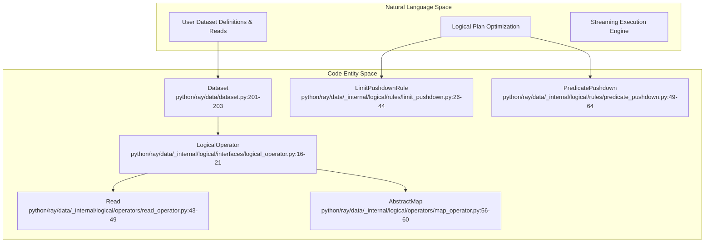
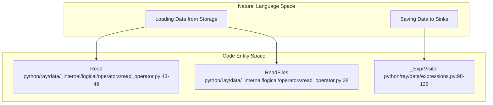

<!-- source: DeepWiki mcp.deepwiki.com · repo ray-project/ray · page 3 Ray Data · fetched 2026-10-21 -->

# Ray Data

Relevant source files

The following files were used as context for generating this wiki page:

- [.vale/styles/config/vocabularies/Data/accept.txt](.vale/styles/config/vocabularies/Data/accept.txt)
- [ci/lint/check-documentation-style.sh](ci/lint/check-documentation-style.sh)
- [doc/source/data/aggregating-data.rst](doc/source/data/aggregating-data.rst)
- [doc/source/data/api/expressions.rst](doc/source/data/api/expressions.rst)
- [doc/source/data/api/from_other_data_libs.rst](doc/source/data/api/from_other_data_libs.rst)
- [doc/source/data/batch_inference.rst](doc/source/data/batch_inference.rst)
- [doc/source/data/comparisons.rst](doc/source/data/comparisons.rst)
- [doc/source/data/data-internals.rst](doc/source/data/data-internals.rst)
- [doc/source/data/how-to-avoid-ooms.md](doc/source/data/how-to-avoid-ooms.md)
- [doc/source/data/joining-data.rst](doc/source/data/joining-data.rst)
- [doc/source/data/key-concepts.rst](doc/source/data/key-concepts.rst)
- [doc/source/data/loading-data.rst](doc/source/data/loading-data.rst)
- [doc/source/data/performance-tips.rst](doc/source/data/performance-tips.rst)
- [doc/source/data/quickstart.rst](doc/source/data/quickstart.rst)
- [doc/source/data/saving-data.rst](doc/source/data/saving-data.rst)
- [doc/source/data/shuffling-data.rst](doc/source/data/shuffling-data.rst)
- [doc/source/data/transforming-data.rst](doc/source/data/transforming-data.rst)
- [doc/source/data/user-guide.rst](doc/source/data/user-guide.rst)
- [doc/source/data/working-with-images.rst](doc/source/data/working-with-images.rst)
- [doc/source/data/working-with-pytorch.rst](doc/source/data/working-with-pytorch.rst)
- [doc/source/data/working-with-tensors.rst](doc/source/data/working-with-tensors.rst)
- [doc/source/data/working-with-text.rst](doc/source/data/working-with-text.rst)
- [python/ray/data/_internal/datasource/range_datasource.py](python/ray/data/_internal/datasource/range_datasource.py)
- [python/ray/data/_internal/execution/util.py](python/ray/data/_internal/execution/util.py)
- [python/ray/data/_internal/logical/interfaces/__init__.py](python/ray/data/_internal/logical/interfaces/__init__.py)
- [python/ray/data/_internal/logical/interfaces/logical_operator.py](python/ray/data/_internal/logical/interfaces/logical_operator.py)
- [python/ray/data/_internal/logical/operators/all_to_all_operator.py](python/ray/data/_internal/logical/operators/all_to_all_operator.py)
- [python/ray/data/_internal/logical/operators/count_operator.py](python/ray/data/_internal/logical/operators/count_operator.py)
- [python/ray/data/_internal/logical/operators/from_operators.py](python/ray/data/_internal/logical/operators/from_operators.py)
- [python/ray/data/_internal/logical/operators/input_data_operator.py](python/ray/data/_internal/logical/operators/input_data_operator.py)
- [python/ray/data/_internal/logical/operators/join_operator.py](python/ray/data/_internal/logical/operators/join_operator.py)
- [python/ray/data/_internal/logical/operators/map_operator.py](python/ray/data/_internal/logical/operators/map_operator.py)
- [python/ray/data/_internal/logical/operators/n_ary_operator.py](python/ray/data/_internal/logical/operators/n_ary_operator.py)
- [python/ray/data/_internal/logical/operators/one_to_one_operator.py](python/ray/data/_internal/logical/operators/one_to_one_operator.py)
- [python/ray/data/_internal/logical/operators/read_operator.py](python/ray/data/_internal/logical/operators/read_operator.py)
- [python/ray/data/_internal/logical/operators/streaming_split_operator.py](python/ray/data/_internal/logical/operators/streaming_split_operator.py)
- [python/ray/data/_internal/logical/operators/write_operator.py](python/ray/data/_internal/logical/operators/write_operator.py)
- [python/ray/data/_internal/logical/rules/limit_pushdown.py](python/ray/data/_internal/logical/rules/limit_pushdown.py)
- [python/ray/data/_internal/logical/rules/predicate_pushdown.py](python/ray/data/_internal/logical/rules/predicate_pushdown.py)
- [python/ray/data/_internal/logical/rules/projection_pushdown.py](python/ray/data/_internal/logical/rules/projection_pushdown.py)
- [python/ray/data/_internal/planner/exchange/split_repartition_task_scheduler.py](python/ray/data/_internal/planner/exchange/split_repartition_task_scheduler.py)
- [python/ray/data/_internal/planner/plan_expression/expression_evaluator.py](python/ray/data/_internal/planner/plan_expression/expression_evaluator.py)
- [python/ray/data/_internal/planner/plan_expression/expression_visitors.py](python/ray/data/_internal/planner/plan_expression/expression_visitors.py)
- [python/ray/data/_internal/planner/plan_udf_map_op.py](python/ray/data/_internal/planner/plan_udf_map_op.py)
- [python/ray/data/dataset.py](python/ray/data/dataset.py)
- [python/ray/data/datasource/datasource.py](python/ray/data/datasource/datasource.py)
- [python/ray/data/expressions.py](python/ray/data/expressions.py)
- [python/ray/data/tests/test_execution_optimizer_limit_pushdown.py](python/ray/data/tests/test_execution_optimizer_limit_pushdown.py)
- [python/ray/data/tests/test_map.py](python/ray/data/tests/test_map.py)
- [python/ray/data/tests/test_predicate_pushdown.py](python/ray/data/tests/test_predicate_pushdown.py)
- [python/ray/data/tests/test_projection_fusion.py](python/ray/data/tests/test_projection_fusion.py)
- [python/ray/data/tests/test_read_datasource.py](python/ray/data/tests/test_read_datasource.py)
- [python/ray/data/tests/test_repartition_e2e.py](python/ray/data/tests/test_repartition_e2e.py)
- [python/ray/data/tests/unit/test_logical_plan.py](python/ray/data/tests/unit/test_logical_plan.py)

## Purpose and Scope

Ray Data is Ray's distributed data processing library that provides scalable data loading, transformation, and output capabilities. The core abstraction is the `Dataset` class [python/ray/data/dataset.py:201-203](), which represents a distributed data collection produced by a pipeline of blocks. Ray Data enables memory-efficient processing through streaming execution and backpressure control, allowing datasets larger than cluster memory to be processed seamlessly across distributed nodes.

This page covers a high-level overview of Ray Data's core architecture, including the Dataset API, execution planning, data sources/sinks, streaming execution, and LLM-specific capabilities. For deep technical details, refer to the child pages:
- [Dataset API and Transformations](#3.1)
- [Data Sources and Sinks](#3.2)
- [Streaming Execution and Resource Management](#3.3)
- [Ray Data for LLMs](#3.4)

Sources: [python/ray/data/dataset.py:201-203](), [python/ray/data/_internal/logical/interfaces/logical_operator.py:16-21]()

## Architecture Overview

Ray Data uses a multi-stage compilation pipeline that translates high-level user API calls into a `LogicalPlan` [python/ray/data/_internal/logical/interfaces/logical_operator.py:16-21](), applies optimizer rules (such as predicate and limit pushdown), and lowers the plan into physical operators executed by the `StreamingExecutor`.

Diagram: Natural Language to Code Entity Space for Ray Data Compilation

Sources: [python/ray/data/dataset.py:201-203](), [python/ray/data/_internal/logical/interfaces/logical_operator.py:16-21](), [python/ray/data/_internal/logical/operators/read_operator.py:43-49](), [python/ray/data/_internal/logical/operators/map_operator.py:56-60](), [python/ray/data/_internal/logical/rules/limit_pushdown.py:26-44](), [python/ray/data/_internal/logical/rules/predicate_pushdown.py:49-64]()

## Dataset API and Transformations

The `Dataset` API provides core transformation primitives like `map`, `map_batches`, `filter`, `project`, and `repartition`. Transformations are lazily evaluated: operations build up a logical plan that is optimized and compiled only when an execution trigger (such as `take()`, `iter_batches()`, or a write operation) is invoked.

For details on creation methods, advanced transformations, logical/physical planning, optimizer rules, operator fusion, checkpointing, and block/Arrow integration, see [Dataset API and Transformations](#3.1).

Sources: [python/ray/data/dataset.py:201-203](), [python/ray/data/_internal/logical/operators/map_operator.py:56-60]()

## Data Sources and Sinks

Ray Data includes an extensible I/O system supporting reading from and writing to various file formats, object stores, and catalogs (Parquet, CSV, JSON, Iceberg, Delta, Lance, Kafka, ClickHouse). The I/O subsystem handles file indexing, partitioning, metadata management, and pushdown optimizations directly at the datasource boundary.

Diagram: Natural Language to Code Entity Space for Data Ingestion

For details on datasource abstractions, read/write APIs, catalog integration, and metadata providers, see [Data Sources and Sinks](#3.2).

Sources: [doc/source/data/loading-data.rst:1-241](), [doc/source/data/saving-data.rst:1-186](), [python/ray/data/_internal/logical/operators/read_operator.py:43-49]()

## Streaming Execution and Resource Management

The physical execution engine relies on the `StreamingExecutor`, which schedules tasks across task pools or actor pools (`TaskPoolMapOperator`, `ActorPoolMapOperator`). It manages object reference passing, memory accounting via `ResourceManager`, and dynamic backpressure propagation to prevent out-of-memory errors on large datasets.

For details on the scheduling loop, physical operators, metrics collection, and batch iteration, see [Streaming Execution and Resource Management](#3.3).

Sources: [python/ray/data/_internal/logical/operators/map_operator.py:56-60](), [python/ray/data/_internal/logical/rules/limit_pushdown.py:26-44]()

## Ray Data for LLMs

Ray Data provides specialized integration for large language model (LLM) workloads via the `ray.data.llm` module. This includes native support for high-throughput batch inference engines like vLLM and SGLang, pre-processing processor pipelines with chat templates, and scalable HTTP request orchestration.

For details on LLM capabilities and integration patterns, see [Ray Data for LLMs](#3.4).

Sources: [python/ray/data/dataset.py:201-203]()

---

