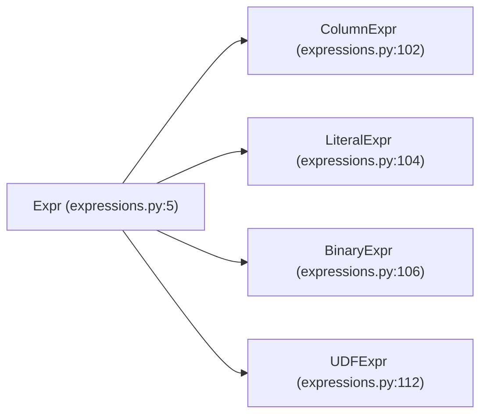
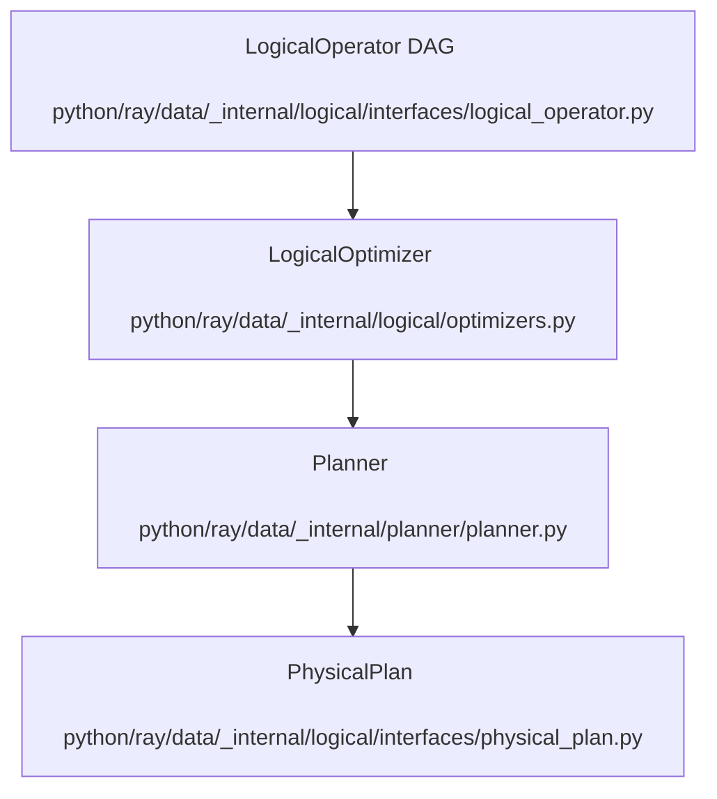

<!-- source: DeepWiki mcp.deepwiki.com · repo ray-project/ray · page 3.1 Dataset API and Transformations · fetched 2026-10-21 -->

# Dataset API and Transformations

<details>
<summary>Relevant source files</summary>

The following files were used as context for generating this wiki page:

- [ci/lint/pyrefly-excluded-files.txt](ci/lint/pyrefly-excluded-files.txt)
- [doc/source/data/api/checkpoint.rst](doc/source/data/api/checkpoint.rst)
- [doc/source/data/api/expressions.rst](doc/source/data/api/expressions.rst)
- [python/ray/data/BUILD.bazel](python/ray/data/BUILD.bazel)
- [python/ray/data/_internal/datasource/range_datasource.py](python/ray/data/_internal/datasource/range_datasource.py)
- [python/ray/data/_internal/execution/operators/hash_aggregate.py](python/ray/data/_internal/execution/operators/hash_aggregate.py)
- [python/ray/data/_internal/execution/operators/hash_shuffle.py](python/ray/data/_internal/execution/operators/hash_shuffle.py)
- [python/ray/data/_internal/execution/operators/hash_shuffle_v2.py](python/ray/data/_internal/execution/operators/hash_shuffle_v2.py)
- [python/ray/data/_internal/execution/operators/join.py](python/ray/data/_internal/execution/operators/join.py)
- [python/ray/data/_internal/execution/operators/shuffle_operators/__init__.py](python/ray/data/_internal/execution/operators/shuffle_operators/__init__.py)
- [python/ray/data/_internal/execution/operators/shuffle_operators/shuffle_map_operator.py](python/ray/data/_internal/execution/operators/shuffle_operators/shuffle_map_operator.py)
- [python/ray/data/_internal/execution/operators/shuffle_operators/shuffle_reduce_operator.py](python/ray/data/_internal/execution/operators/shuffle_operators/shuffle_reduce_operator.py)
- [python/ray/data/_internal/execution/operators/shuffle_operators/shuffle_tasks.py](python/ray/data/_internal/execution/operators/shuffle_operators/shuffle_tasks.py)
- [python/ray/data/_internal/execution/util.py](python/ray/data/_internal/execution/util.py)
- [python/ray/data/_internal/gpu_shuffle/__init__.py](python/ray/data/_internal/gpu_shuffle/__init__.py)
- [python/ray/data/_internal/gpu_shuffle/hash_shuffle.py](python/ray/data/_internal/gpu_shuffle/hash_shuffle.py)
- [python/ray/data/_internal/gpu_shuffle/rapidsmpf_backend.py](python/ray/data/_internal/gpu_shuffle/rapidsmpf_backend.py)
- [python/ray/data/_internal/logical/interfaces/__init__.py](python/ray/data/_internal/logical/interfaces/__init__.py)
- [python/ray/data/_internal/logical/interfaces/logical_operator.py](python/ray/data/_internal/logical/interfaces/logical_operator.py)
- [python/ray/data/_internal/logical/operators/__init__.py](python/ray/data/_internal/logical/operators/__init__.py)
- [python/ray/data/_internal/logical/operators/all_to_all_operator.py](python/ray/data/_internal/logical/operators/all_to_all_operator.py)
- [python/ray/data/_internal/logical/operators/count_operator.py](python/ray/data/_internal/logical/operators/count_operator.py)
- [python/ray/data/_internal/logical/operators/from_operators.py](python/ray/data/_internal/logical/operators/from_operators.py)
- [python/ray/data/_internal/logical/operators/input_data_operator.py](python/ray/data/_internal/logical/operators/input_data_operator.py)
- [python/ray/data/_internal/logical/operators/join_operator.py](python/ray/data/_internal/logical/operators/join_operator.py)
- [python/ray/data/_internal/logical/operators/map_operator.py](python/ray/data/_internal/logical/operators/map_operator.py)
- [python/ray/data/_internal/logical/operators/n_ary_operator.py](python/ray/data/_internal/logical/operators/n_ary_operator.py)
- [python/ray/data/_internal/logical/operators/one_to_one_operator.py](python/ray/data/_internal/logical/operators/one_to_one_operator.py)
- [python/ray/data/_internal/logical/operators/read_operator.py](python/ray/data/_internal/logical/operators/read_operator.py)
- [python/ray/data/_internal/logical/operators/streaming_split_operator.py](python/ray/data/_internal/logical/operators/streaming_split_operator.py)
- [python/ray/data/_internal/logical/operators/write_operator.py](python/ray/data/_internal/logical/operators/write_operator.py)
- [python/ray/data/_internal/logical/optimizers.py](python/ray/data/_internal/logical/optimizers.py)
- [python/ray/data/_internal/logical/rules/__init__.py](python/ray/data/_internal/logical/rules/__init__.py)
- [python/ray/data/_internal/logical/rules/limit_pushdown.py](python/ray/data/_internal/logical/rules/limit_pushdown.py)
- [python/ray/data/_internal/logical/rules/operator_fusion.py](python/ray/data/_internal/logical/rules/operator_fusion.py)
- [python/ray/data/_internal/logical/rules/predicate_pushdown.py](python/ray/data/_internal/logical/rules/predicate_pushdown.py)
- [python/ray/data/_internal/logical/rules/projection_pushdown.py](python/ray/data/_internal/logical/rules/projection_pushdown.py)
- [python/ray/data/_internal/logical/rules/set_read_parallelism.py](python/ray/data/_internal/logical/rules/set_read_parallelism.py)
- [python/ray/data/_internal/planner/checkpoint/__init__.py](python/ray/data/_internal/planner/checkpoint/__init__.py)
- [python/ray/data/_internal/planner/checkpoint/plan_read_files_op.py](python/ray/data/_internal/planner/checkpoint/plan_read_files_op.py)
- [python/ray/data/_internal/planner/checkpoint/plan_read_op.py](python/ray/data/_internal/planner/checkpoint/plan_read_op.py)
- [python/ray/data/_internal/planner/checkpoint/plan_write_op.py](python/ray/data/_internal/planner/checkpoint/plan_write_op.py)
- [python/ray/data/_internal/planner/exchange/split_repartition_task_scheduler.py](python/ray/data/_internal/planner/exchange/split_repartition_task_scheduler.py)
- [python/ray/data/_internal/planner/plan_all_to_all_op.py](python/ray/data/_internal/planner/plan_all_to_all_op.py)
- [python/ray/data/_internal/planner/plan_expression/expression_evaluator.py](python/ray/data/_internal/planner/plan_expression/expression_evaluator.py)
- [python/ray/data/_internal/planner/plan_expression/expression_visitors.py](python/ray/data/_internal/planner/plan_expression/expression_visitors.py)
- [python/ray/data/_internal/planner/plan_udf_map_op.py](python/ray/data/_internal/planner/plan_udf_map_op.py)
- [python/ray/data/_internal/planner/planner.py](python/ray/data/_internal/planner/planner.py)
- [python/ray/data/checkpoint/__init__.py](python/ray/data/checkpoint/__init__.py)
- [python/ray/data/checkpoint/checkpoint_filter.py](python/ray/data/checkpoint/checkpoint_filter.py)
- [python/ray/data/checkpoint/checkpoint_writer.py](python/ray/data/checkpoint/checkpoint_writer.py)
- [python/ray/data/checkpoint/interfaces.py](python/ray/data/checkpoint/interfaces.py)
- [python/ray/data/checkpoint/load_checkpoint_callback.py](python/ray/data/checkpoint/load_checkpoint_callback.py)
- [python/ray/data/checkpoint/util.py](python/ray/data/checkpoint/util.py)
- [python/ray/data/context.py](python/ray/data/context.py)
- [python/ray/data/dataset.py](python/ray/data/dataset.py)
- [python/ray/data/datasource/datasource.py](python/ray/data/datasource/datasource.py)
- [python/ray/data/expressions.py](python/ray/data/expressions.py)
- [python/ray/data/grouped_data.py](python/ray/data/grouped_data.py)
- [python/ray/data/tests/conftest.py](python/ray/data/tests/conftest.py)
- [python/ray/data/tests/test_checkpoint.py](python/ray/data/tests/test_checkpoint.py)
- [python/ray/data/tests/test_execution_optimizer_advanced.py](python/ray/data/tests/test_execution_optimizer_advanced.py)
- [python/ray/data/tests/test_execution_optimizer_basic.py](python/ray/data/tests/test_execution_optimizer_basic.py)
- [python/ray/data/tests/test_execution_optimizer_limit_pushdown.py](python/ray/data/tests/test_execution_optimizer_limit_pushdown.py)
- [python/ray/data/tests/test_gpu_shuffle.py](python/ray/data/tests/test_gpu_shuffle.py)
- [python/ray/data/tests/test_groupby_e2e.py](python/ray/data/tests/test_groupby_e2e.py)
- [python/ray/data/tests/test_hash_shuffle.py](python/ray/data/tests/test_hash_shuffle.py)
- [python/ray/data/tests/test_hash_shuffle_v2.py](python/ray/data/tests/test_hash_shuffle_v2.py)
- [python/ray/data/tests/test_iter_torch_batches_gpu.py](python/ray/data/tests/test_iter_torch_batches_gpu.py)
- [python/ray/data/tests/test_join.py](python/ray/data/tests/test_join.py)
- [python/ray/data/tests/test_map.py](python/ray/data/tests/test_map.py)
- [python/ray/data/tests/test_operator_fusion.py](python/ray/data/tests/test_operator_fusion.py)
- [python/ray/data/tests/test_predicate_pushdown.py](python/ray/data/tests/test_predicate_pushdown.py)
- [python/ray/data/tests/test_projection_fusion.py](python/ray/data/tests/test_projection_fusion.py)
- [python/ray/data/tests/test_randomize_block_order.py](python/ray/data/tests/test_randomize_block_order.py)
- [python/ray/data/tests/test_repartition_e2e.py](python/ray/data/tests/test_repartition_e2e.py)
- [python/ray/data/tests/test_shuffle_diagnostics.py](python/ray/data/tests/test_shuffle_diagnostics.py)
- [python/ray/data/tests/unit/test_logical_plan.py](python/ray/data/tests/unit/test_logical_plan.py)
- [python/ray/data/tests/unit/test_ranker.py](python/ray/data/tests/unit/test_ranker.py)
- [python/ray/train/BUILD.bazel](python/ray/train/BUILD.bazel)

</details>


## Purpose and Scope

This page provides a high-level overview of Ray Data's `Dataset` API, transformation operations (`map`, `filter`, `groupby`, `join`, `sort`), expression system, logical and physical planning pipelines, optimizer rules (limit, predicate, and projection pushdown), operator fusion, and dataset checkpointing. 

For deep technical details on the underlying data structures, Arrow integration, tensor extension types, batching, aggregation functions, and the built-in preprocessors library, see [Blocks, Arrow Integration, and Aggregations](#3.1.1). For information about data sources and sinks, see [Data Sources and Sinks](#3.2). For details on execution and resource management, see [Streaming Execution and Resource Management](#3.3).

Sources: [python/ray/data/dataset.py:1-40]()

---

## Overview: Dataset Transformation Pipeline

Ray Data implements a lazy execution model where user-facing transformations build a logical plan. When data consumption is triggered, the plan goes through logical optimization, physical planning, physical optimization (including operator fusion), and execution via the streaming execution engine.

```mermaid
graph TB
    subkey ["User API Layer"]
    UserAPI["Dataset.map_batches() <br/> python/ray/data/dataset.py:202"]
    
    sublogical ["Logical Planning & Optimization"]
    LogicalPlan["LogicalPlan <br/> python/ray/data/_internal/logical/interfaces.py:66"]
    LogicalOpt["Logical Optimizer <br/> python/ray/data/_internal/logical/optimizers.py:57"]
    
    subphysical ["Physical Planning & Optimization"]
    Planner["Planner <br/> python/ray/data/_internal/planner/planner.py"]
    PhysicalOpt["Physical Optimizer & FuseOperators <br/> python/ray/data/_internal/logical/rules/operator_fusion.py:63"]
    
    subexec ["Execution Engine"]
    Executor["StreamingExecutor <br/> python/ray/data/_internal/execution/streaming_executor.py"]

    UserAPI --> LogicalPlan
    LogicalPlan --> LogicalOpt
    LogicalOpt --> Planner
    Planner --> PhysicalOpt
    PhysicalOpt --> Executor

    classDef default fill:none,stroke:#000,stroke-width:2px;
```

**Pipeline Stages**
1. **User API**: Transformations on `Dataset` record operations [python/ray/data/dataset.py:202]().
2. **Logical Planning**: Constructs a DAG of `LogicalOperator` instances [python/ray/data/_internal/logical/interfaces.py:66]().
3. **Logical Optimization**: Applies pushdown rules (predicate, projection, limit) [python/ray/data/_internal/logical/optimizers.py:57-65]().
4. **Physical Planning**: Translates logical operators into physical counterparts (e.g., `MapOperator`, `ShuffleReduceOp`) [python/ray/data/_internal/planner/planner.py:1-100]().
5. **Physical Optimization**: Fuses compatible adjacent operators using rules like `FuseOperators` [python/ray/data/_internal/logical/rules/operator_fusion.py:63-90]().
6. **Execution**: Processes data through the streaming executor loop [python/ray/data/_internal/execution/streaming_executor.py:1-50]().

Sources: [python/ray/data/dataset.py:202](), [python/ray/data/_internal/logical/interfaces.py:66](), [python/ray/data/_internal/logical/optimizers.py:57-70](), [python/ray/data/_internal/logical/rules/operator_fusion.py:63-90]()

---

## Dataset Creation and Lazy Execution

Datasets can be created from various sources, including file paths (`read_parquet`, `read_csv`), memory (`from_items`, `from_pandas`, `from_numpy`), or generators (`range`). 

* **Lazy Evaluation**: Methods like `map()`, `filter()`, and `select_columns()` do not immediately compute results. Instead, they append nodes to the dataset's `LogicalPlan` [python/ray/data/dataset.py:202-215]().
* **Materialization & Consumption**: Execution is triggered by terminal actions such as `take()`, `show()`, `write_*()`, or iterating via `iter_torch_batches()` [python/ray/data/dataset.py:102-110]().

For details on block storage formats (Arrow, Pandas, Table) that back these datasets, see [Blocks, Arrow Integration, and Aggregations](#3.1.1).

Sources: [python/ray/data/dataset.py:202-215]()

---

## Transformation Operations

Ray Data provides a rich set of transformation APIs to manipulate datasets:

| Operation | Method | Description |
|---|---|---|
| **Map Rows** | `ds.map()` | Applies a user-defined function row-by-row [python/ray/data/dataset.py:293-350]() |
| **Map Batches** | `ds.map_batches()` | Applies a vectorized UDF over data batches (NumPy/Pandas/Arrow) [python/ray/data/dataset.py:467-520]() |
| **Filter** | `ds.filter()` | Filters rows based on boolean expressions or UDFs [python/ray/data/dataset.py:600-630]() |
| **Groupby** | `ds.groupby()` | Groups dataset rows by key for aggregations [python/ray/data/grouped_data.py:29-78]() |
| **Join** | `ds.join()` | Joins two datasets on specified key columns [python/ray/data/dataset.py:800-840]() |
| **Sort** | `ds.sort()` | Globally sorts dataset blocks by key columns [python/ray/data/dataset.py:900-930]() |

Sources: [python/ray/data/dataset.py:293-630](), [python/ray/data/grouped_data.py:29-78]()

---

## Expressions and Projections

Ray Data features a built-in expression system (`ray.data.expressions`) modeled after DataFrame expression APIs. Expressions allow users to build composable transformations, arithmetic operations, and column selections without writing imperative Python loops.



* **`ColumnExpr`**: References a dataset column via `col("name")` [python/ray/data/expressions.py:102-103]().
* **`BinaryExpr`**: Represents arithmetic and comparison operators (`+`, `-`, `==`, `&`, etc.) mapped to PyArrow compute kernels [python/ray/data/expressions.py:106-110]().
* **`Project` Operator**: Executes column projections and expression evaluations efficiently using `plan_project_op()` [python/ray/data/_internal/planner/plan_udf_map_op.py:130-184]().

Sources: [python/ray/data/expressions.py:5-115](), [python/ray/data/_internal/planner/plan_udf_map_op.py:130-184]()

---

## Logical and Physical Planning Pipeline

The optimization pipeline translates logical operations into optimized physical DAGs ready for execution.



* **Logical Operators**: Subclasses of `AbstractMap`, such as `MapBatches`, `Filter`, `Project`, and `StreamingRepartition`, represent high-level operations [python/ray/data/_internal/logical/operators/map_operator.py:38-46]().
* **Planner**: Converts logical operators into physical operators like `MapOperator`, `ShuffleReduceOp`, and `LimitOperator` [python/ray/data/_internal/planner/planner.py:1-80]().

Sources: [python/ray/data/_internal/logical/interfaces/logical_operator.py:1-50](), [python/ray/data/_internal/logical/operators/map_operator.py:38-46](), [python/ray/data/_internal/planner/planner.py:1-80]()

---

## Optimizer Rules and Operator Fusion

Ray Data applies rule-based optimization during both the logical and physical planning phases to minimize data movement and overhead.

* **Pushdown Rules**: Rules like predicate pushdown, limit pushdown, and projection pushdown move filters, limits, and column selections closer to the data source, reducing unnecessary I/O and materialization overhead [python/ray/data/_internal/logical/rules/limit_pushdown.py:1-40](), [python/ray/data/_internal/logical/rules/predicate_pushdown.py:1-40](), [python/ray/data/_internal/logical/rules/projection_pushdown.py:1-40]().
* **Operator Fusion (`FuseOperators`)**: The `FuseOperators` rule traverses the physical DAG to fuse adjacent map operators (e.g., `ReadParquet` -> `Map` -> `Filter`) into a single `MapOperator` task, and fuses downstream map tasks directly into shuffle-reduce operators [python/ray/data/_internal/logical/rules/operator_fusion.py:63-125]().

Sources: [python/ray/data/_internal/logical/rules/operator_fusion.py:63-125]()

---

## Dataset Checkpointing

Datasets support checkpointing states to persistent storage during training pipelines or long-running processing workflows. Checkpointing integrates with Ray Train and Ray Data I/O utilities to ensure fault tolerance and resumption capabilities.

Sources: [python/ray/data/context.py:14](), [python/ray/data/dataset.py:1-50]()

---

