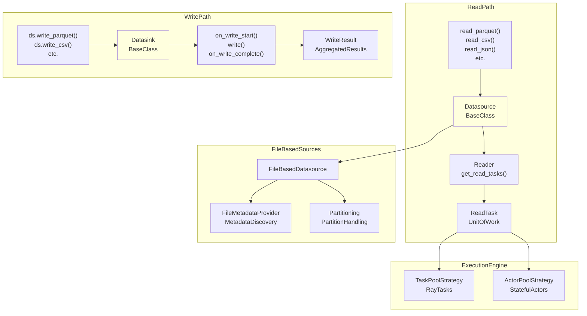
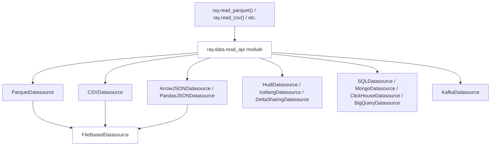
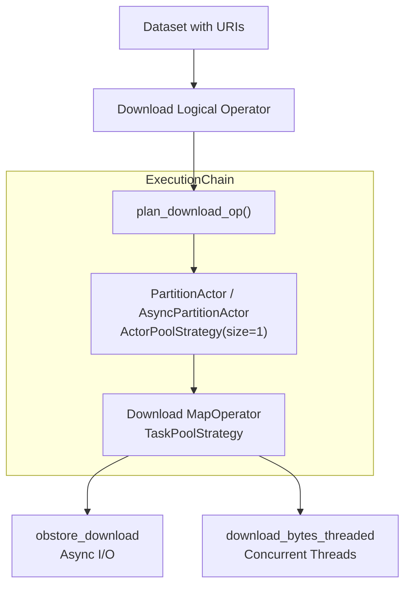
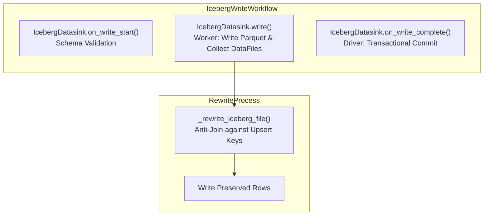

<!-- source: DeepWiki mcp.deepwiki.com · repo ray-project/ray · page 3.2 Data Sources and Sinks · fetched 2026-10-21 -->

# Data Sources and Sinks

Relevant source files

The following files were used as context for generating this wiki page:

- [.vale/styles/config/vocabularies/Data/accept.txt](.vale/styles/config/vocabularies/Data/accept.txt)
- [ci/lint/check-documentation-style.sh](ci/lint/check-documentation-style.sh)
- [doc/source/data/aggregating-data.rst](doc/source/data/aggregating-data.rst)
- [doc/source/data/api/from_other_data_libs.rst](doc/source/data/api/from_other_data_libs.rst)
- [doc/source/data/api/loading_data.rst](doc/source/data/api/loading_data.rst)
- [doc/source/data/api/saving_data.rst](doc/source/data/api/saving_data.rst)
- [doc/source/data/batch_inference.rst](doc/source/data/batch_inference.rst)
- [doc/source/data/comparisons.rst](doc/source/data/comparisons.rst)
- [doc/source/data/data-internals.rst](doc/source/data/data-internals.rst)
- [doc/source/data/how-to-avoid-ooms.md](doc/source/data/how-to-avoid-ooms.md)
- [doc/source/data/joining-data.rst](doc/source/data/joining-data.rst)
- [doc/source/data/key-concepts.rst](doc/source/data/key-concepts.rst)
- [doc/source/data/loading-data.rst](doc/source/data/loading-data.rst)
- [doc/source/data/performance-tips.rst](doc/source/data/performance-tips.rst)
- [doc/source/data/quickstart.rst](doc/source/data/quickstart.rst)
- [doc/source/data/saving-data.rst](doc/source/data/saving-data.rst)
- [doc/source/data/shuffling-data.rst](doc/source/data/shuffling-data.rst)
- [doc/source/data/transforming-data.rst](doc/source/data/transforming-data.rst)
- [doc/source/data/user-guide.rst](doc/source/data/user-guide.rst)
- [doc/source/data/working-with-images.rst](doc/source/data/working-with-images.rst)
- [doc/source/data/working-with-pytorch.rst](doc/source/data/working-with-pytorch.rst)
- [doc/source/data/working-with-tensors.rst](doc/source/data/working-with-tensors.rst)
- [doc/source/data/working-with-text.rst](doc/source/data/working-with-text.rst)
- [doc/source/serve/doc_code/tutorial_sklearn.py](doc/source/serve/doc_code/tutorial_sklearn.py)
- [pyrefly.toml](pyrefly.toml)
- [python/ray/data/__init__.py](python/ray/data/__init__.py)
- [python/ray/data/_internal/datasource/bigquery_datasink.py](python/ray/data/_internal/datasource/bigquery_datasink.py)
- [python/ray/data/_internal/datasource/bigquery_datasource.py](python/ray/data/_internal/datasource/bigquery_datasource.py)
- [python/ray/data/_internal/datasource/clickhouse_datasink.py](python/ray/data/_internal/datasource/clickhouse_datasink.py)
- [python/ray/data/_internal/datasource/clickhouse_datasource.py](python/ray/data/_internal/datasource/clickhouse_datasource.py)
- [python/ray/data/_internal/datasource/hudi_datasource.py](python/ray/data/_internal/datasource/hudi_datasource.py)
- [python/ray/data/_internal/datasource/iceberg_datasink.py](python/ray/data/_internal/datasource/iceberg_datasink.py)
- [python/ray/data/_internal/datasource/iceberg_datasource.py](python/ray/data/_internal/datasource/iceberg_datasource.py)
- [python/ray/data/_internal/datasource/lance_datasink.py](python/ray/data/_internal/datasource/lance_datasink.py)
- [python/ray/data/_internal/datasource/lance_datasource.py](python/ray/data/_internal/datasource/lance_datasource.py)
- [python/ray/data/_internal/datasource/mongo_datasink.py](python/ray/data/_internal/datasource/mongo_datasink.py)
- [python/ray/data/_internal/datasource/mongo_datasource.py](python/ray/data/_internal/datasource/mongo_datasource.py)
- [python/ray/data/_internal/datasource/orc_datasource.py](python/ray/data/_internal/datasource/orc_datasource.py)
- [python/ray/data/_internal/datasource/parquet_datasink.py](python/ray/data/_internal/datasource/parquet_datasink.py)
- [python/ray/data/_internal/datasource/parquet_datasource.py](python/ray/data/_internal/datasource/parquet_datasource.py)
- [python/ray/data/_internal/datasource/sql_datasink.py](python/ray/data/_internal/datasource/sql_datasink.py)
- [python/ray/data/_internal/datasource/sql_datasource.py](python/ray/data/_internal/datasource/sql_datasource.py)
- [python/ray/data/_internal/datasource/torch_datasource.py](python/ray/data/_internal/datasource/torch_datasource.py)
- [python/ray/data/_internal/datasource_v2/chunkers/file_chunker.py](python/ray/data/_internal/datasource_v2/chunkers/file_chunker.py)
- [python/ray/data/_internal/datasource_v2/chunkers/parquet_file_chunking_utils.py](python/ray/data/_internal/datasource_v2/chunkers/parquet_file_chunking_utils.py)
- [python/ray/data/_internal/datasource_v2/datasource_v2.py](python/ray/data/_internal/datasource_v2/datasource_v2.py)
- [python/ray/data/_internal/datasource_v2/listing/file_indexer.py](python/ray/data/_internal/datasource_v2/listing/file_indexer.py)
- [python/ray/data/_internal/datasource_v2/listing/file_manifest.py](python/ray/data/_internal/datasource_v2/listing/file_manifest.py)
- [python/ray/data/_internal/datasource_v2/listing/listing_utils.py](python/ray/data/_internal/datasource_v2/listing/listing_utils.py)
- [python/ray/data/_internal/datasource_v2/logical_optimizers.py](python/ray/data/_internal/datasource_v2/logical_optimizers.py)
- [python/ray/data/_internal/datasource_v2/parquet_datasource_v2.py](python/ray/data/_internal/datasource_v2/parquet_datasource_v2.py)
- [python/ray/data/_internal/datasource_v2/readers/file_reader.py](python/ray/data/_internal/datasource_v2/readers/file_reader.py)
- [python/ray/data/_internal/datasource_v2/readers/in_memory_size_estimator.py](python/ray/data/_internal/datasource_v2/readers/in_memory_size_estimator.py)
- [python/ray/data/_internal/datasource_v2/readers/parquet_file_reader.py](python/ray/data/_internal/datasource_v2/readers/parquet_file_reader.py)
- [python/ray/data/_internal/datasource_v2/scanners/arrow_file_scanner.py](python/ray/data/_internal/datasource_v2/scanners/arrow_file_scanner.py)
- [python/ray/data/_internal/datasource_v2/scanners/file_scanner.py](python/ray/data/_internal/datasource_v2/scanners/file_scanner.py)
- [python/ray/data/_internal/datasource_v2/scanners/parquet_scanner.py](python/ray/data/_internal/datasource_v2/scanners/parquet_scanner.py)
- [python/ray/data/_internal/datasource_v2/scanners/scanner.py](python/ray/data/_internal/datasource_v2/scanners/scanner.py)
- [python/ray/data/_internal/datasource_v2/tests/test_footer_chunking.py](python/ray/data/_internal/datasource_v2/tests/test_footer_chunking.py)
- [python/ray/data/_internal/datasource_v2/tests/test_parquet_datasource_v2.py](python/ray/data/_internal/datasource_v2/tests/test_parquet_datasource_v2.py)
- [python/ray/data/_internal/logical/rules/combine_downloads.py](python/ray/data/_internal/logical/rules/combine_downloads.py)
- [python/ray/data/_internal/logical/rules/derive_list_files_pushdown.py](python/ray/data/_internal/logical/rules/derive_list_files_pushdown.py)
- [python/ray/data/_internal/object_extensions/arrow.py](python/ray/data/_internal/object_extensions/arrow.py)
- [python/ray/data/_internal/planner/_obstore_download.py](python/ray/data/_internal/planner/_obstore_download.py)
- [python/ray/data/_internal/planner/download_partition_actor.py](python/ray/data/_internal/planner/download_partition_actor.py)
- [python/ray/data/_internal/planner/download_partitioner.py](python/ray/data/_internal/planner/download_partitioner.py)
- [python/ray/data/_internal/planner/plan_download_op.py](python/ray/data/_internal/planner/plan_download_op.py)
- [python/ray/data/_internal/planner/plan_list_files_op.py](python/ray/data/_internal/planner/plan_list_files_op.py)
- [python/ray/data/_internal/planner/plan_write_op.py](python/ray/data/_internal/planner/plan_write_op.py)
- [python/ray/data/_internal/savemode.py](python/ray/data/_internal/savemode.py)
- [python/ray/data/datasource/__init__.py](python/ray/data/datasource/__init__.py)
- [python/ray/data/datasource/datasink.py](python/ray/data/datasource/datasink.py)
- [python/ray/data/datasource/file_based_datasource.py](python/ray/data/datasource/file_based_datasource.py)
- [python/ray/data/datasource/file_datasink.py](python/ray/data/datasource/file_datasink.py)
- [python/ray/data/datasource/file_meta_provider.py](python/ray/data/datasource/file_meta_provider.py)
- [python/ray/data/datasource/filename_provider.py](python/ray/data/datasource/filename_provider.py)
- [python/ray/data/datasource/partitioning.py](python/ray/data/datasource/partitioning.py)
- [python/ray/data/datasource/path_util.py](python/ray/data/datasource/path_util.py)
- [python/ray/data/read_api.py](python/ray/data/read_api.py)
- [python/ray/data/tests/datasource/test_clickhouse.py](python/ray/data/tests/datasource/test_clickhouse.py)
- [python/ray/data/tests/datasource/test_hudi.py](python/ray/data/tests/datasource/test_hudi.py)
- [python/ray/data/tests/datasource/test_iceberg.py](python/ray/data/tests/datasource/test_iceberg.py)
- [python/ray/data/tests/datasource/test_lance.py](python/ray/data/tests/datasource/test_lance.py)
- [python/ray/data/tests/datasource/test_orc.py](python/ray/data/tests/datasource/test_orc.py)
- [python/ray/data/tests/datasource/test_parquet.py](python/ray/data/tests/datasource/test_parquet.py)
- [python/ray/data/tests/datasource/test_read_parquet_v2.py](python/ray/data/tests/datasource/test_read_parquet_v2.py)
- [python/ray/data/tests/test_combine_downloads.py](python/ray/data/tests/test_combine_downloads.py)
- [python/ray/data/tests/test_download_expression.py](python/ray/data/tests/test_download_expression.py)
- [python/ray/data/tests/test_metadata_provider.py](python/ray/data/tests/test_metadata_provider.py)
- [python/ray/data/tests/test_partitioning.py](python/ray/data/tests/test_partitioning.py)
- [python/ray/data/tests/test_read_datasource.py](python/ray/data/tests/test_read_datasource.py)
- [python/ray/data/tests/unit/datasource_v2/test_arrow_file_scanner.py](python/ray/data/tests/unit/datasource_v2/test_arrow_file_scanner.py)
- [python/ray/data/tests/unit/datasource_v2/test_file_chunker.py](python/ray/data/tests/unit/datasource_v2/test_file_chunker.py)
- [python/ray/data/tests/unit/datasource_v2/test_file_indexer.py](python/ray/data/tests/unit/datasource_v2/test_file_indexer.py)
- [python/ray/data/tests/unit/test_obstore_download.py](python/ray/data/tests/unit/test_obstore_download.py)
- [python/ray/data/tests/unit/test_parquet_predicate_split.py](python/ray/data/tests/unit/test_parquet_predicate_split.py)
- [python/ray/data/tests/unit/test_path_util.py](python/ray/data/tests/unit/test_path_util.py)
- [rllib/algorithms/cql/README.md](rllib/algorithms/cql/README.md)
- [rllib/algorithms/sac/README.md](rllib/algorithms/sac/README.md)
- [rllib/core/models/tests/test_catalog.py](rllib/core/models/tests/test_catalog.py)
- [rllib/core/testing/testing_learner.py](rllib/core/testing/testing_learner.py)
- [rllib/examples/actions/autoregressive_actions.py](rllib/examples/actions/autoregressive_actions.py)
- [rllib/examples/envs/classes/correlated_actions_env.py](rllib/examples/envs/classes/correlated_actions_env.py)
- [rllib/examples/rl_modules/classes/autoregressive_actions_rlm.py](rllib/examples/rl_modules/classes/autoregressive_actions_rlm.py)
- [rllib/examples/rl_modules/classes/mobilenet_rlm.py](rllib/examples/rl_modules/classes/mobilenet_rlm.py)
- [rllib/models/action_dist.py](rllib/models/action_dist.py)
- [rllib/models/tests/test_distributions.py](rllib/models/tests/test_distributions.py)
- [rllib/models/torch/torch_distributions.py](rllib/models/torch/torch_distributions.py)
- [rllib/models/utils.py](rllib/models/utils.py)

## Purpose and Scope

This page documents Ray Data's I/O system, which provides robust abstractions for reading from and writing to diverse data sources and storage formats. The system supports columnar and row-based file formats (Parquet, CSV, JSON, ORC, Avro, Zarr), modern lakehouse table formats (Iceberg, Delta Lake, Hudi), enterprise data warehouses and databases (BigQuery, Snowflake, ClickHouse, MongoDB, SQL), streaming/message systems (Kafka), and specialized multi-modal data types (Images, Audio, Video, Lance, LeRobot). It also handles conversions from in-memory single-node libraries (Pandas, Dask, Spark) and machine learning frameworks (TensorFlow, PyTorch, Hugging Face).

For details on how datasets are transformed after ingestion, see [Dataset API and Transformations](3.1). For details on execution scheduling and resource management during I/O, see [Streaming Execution and Resource Management](3.3).

---

## Datasource Architecture

The Ray Data I/O system is built around two primary core abstractions: `Datasource` for reading and `Datasink` for writing. These abstractions enable parallel, distributed I/O operations tightly integrated with Ray's task execution engine and metadata listing components.

### Core Abstractions

**Sources:** [python/ray/data/read_api.py:101-118](), [python/ray/data/datasource/datasource.py:35-100](), [python/ray/data/datasource/datasink.py:18-105]()

The `Datasource` class defines the read interface [python/ray/data/datasource/datasource.py:35-60](). When a read invocation occurs (e.g., `read_parquet()`), it instantiates the datasource implementation, calls `get_read_tasks()` to generate parallel `ReadTask` units of work, and returns a `Dataset` containing a `Read` logical operator [python/ray/data/read_api.py:79-81]() [python/ray/data/datasource/datasource.py:45-55]().

The `Datasink` class defines the write interface with three lifecycle callbacks:
- `on_write_start()`: Initial driver-side setup before execution starts [python/ray/data/datasource/datasink.py:75-80]().
- `write()`: Worker-side execution method operating on individual blocks or rows [python/ray/data/datasource/datasink.py:82-95]().
- `on_write_complete()`: Driver-side finalization and commit after all parallel workers finish [python/ray/data/datasource/datasink.py:97-105]().

### File-Based Datasources

Most file format readers inherit from `FileBasedDatasource`, providing unified mechanisms for file path discovery, metadata extraction, partitioning, and error resilience [python/ray/data/datasource/file_based_datasource.py:126-155]().

| Component | Purpose | Key Classes & Functions |
|-----------|---------|-------------------------|
| `FileMetadataProvider` | Discovers files and extracts size/row metadata | `DefaultFileMetadataProvider`, `ImageFileMetadataProvider` [python/ray/data/datasource/file_meta_provider.py:34-56]() |
| `Partitioning` | Parses partition keys from directory structures (Hive-style) | `Partitioning`, `PathPartitionParser`, `PathPartitionFilter` [python/ray/data/datasource/partitioning.py:57-62]() |
| `FileShuffleConfig` | Controls file-level shuffling for non-deterministic or seeded reads | `FileShuffleConfig(seed, reseed_after_execution)` [python/ray/data/datasource/file_based_datasource.py:65-108]() |
| `PathUtil` | Resolves URIs and file systems across S3, GCS, HDFS, and local storage | `_resolve_paths_and_filesystem`, `_validate_and_wrap_filesystem` [python/ray/data/datasource/path_util.py:40-104]() |

**Sources:** [python/ray/data/datasource/file_based_datasource.py:126-186](), [python/ray/data/datasource/path_util.py:40-104]()

---

## Read APIs and Format Support

Ray Data provides a rich set of read functions exposed in `ray.data` and defined in `python/ray/data/read_api.py`.

**Sources:** [python/ray/data/read_api.py:25-70]()

### Specialized Format Implementations

1. **Parquet (`read_parquet`)**: Managed by `ParquetDatasource` [python/ray/data/_internal/datasource/parquet_datasource.py:246-250]() and accelerated via V2 components. Supports column pruning (projection pushdown), row group filtering, and dynamic batch-size estimation using metadata [python/ray/data/_internal/datasource_v2/readers/parquet_file_reader.py:61-143]().
2. **CSV and JSON (`read_csv`, `read_json`)**: Row-based readers using Arrow and Pandas backends (`CSVDatasource`, `ArrowJSONDatasource`, `PandasJSONDatasource`) [python/ray/data/read_api.py:31-47]().
3. **Table Formats (Iceberg, Delta Lake, Hudi)**:
   - `read_iceberg()` integrates with `pyiceberg` to translate Ray expression trees into PyIceberg boolean expressions via `_IcebergExpressionVisitor` [python/ray/data/_internal/datasource/iceberg_datasource.py:182-198]().
   - `read_delta()` and `read_hudi()` handle transactional table layouts and partition pruning [python/ray/data/read_api.py:66-70]().
4. **Databases and Vector Stores**:
   - `read_clickhouse()` uses `ClickHouseDatasource` with table settings configured via `ClickHouseTableSettings` [python/ray/data/_internal/datasource/clickhouse_datasource.py:30]() [python/ray/data/__init__.py:21]().
   - `read_mongo()`, `read_bigquery()`, `read_sql()`, and `read_lance()` support large-scale parallel reads from database partitions and vector formats [python/ray/data/_internal/datasource/mongo_datasource.py:56]() [python/ray/data/_internal/datasource/lance_datasource.py:53]().
5. **Streaming Sources (`read_kafka`)**: `KafkaDatasource` ingests streaming records using `KafkaAuthConfig` and per-partition offsets (`PerPartitionOffsets`) [python/ray/data/_internal/datasource/kafka_datasource.py:48-52]().

**Sources:** [python/ray/data/read_api.py:25-88](), [python/ray/data/_internal/datasource/iceberg_datasource.py:182-198]()

---

## The Datasource V2 Stack

Ray Data features an advanced V2 modular I/O stack (enabled via `use_datasource_v2` flags) consisting of **File Indexers**, **File Chunkers**, **File Readers**, and **Arrow File Scanners** [python/ray/data/tests/datasource/test_parquet.py:50-53]() [python/ray/data/_internal/datasource_v2/readers/parquet_file_reader.py:172-174]().

**Sources:** [python/ray/data/_internal/datasource_v2/readers/parquet_file_reader.py:172-174]()

### Key Components of the V2 Stack
- **File Indexer**: Lists target URIs, reads footers concurrently, and extracts partition and column statistics [python/ray/data/_internal/datasource_v2/readers/parquet_file_reader.py:145-170]().
- **File Chunker**: Groups file fragments or row groups into balanced read chunks based on target block sizes and memory constraints.
- **File Readers (`ParquetFileReader`)**: Implements adaptive batch sizing using uncompressed column sizes from metadata without fully materializing data [python/ray/data/_internal/datasource_v2/readers/parquet_file_reader.py:61-89](). It configures high-concurrency IO thread pools (`_READER_IO_THREAD_COUNT`) and buffer sizes (`_PARQUET_FRAGMENT_BUFFER_SIZE`) to optimize cloud storage read latency [python/ray/data/_internal/datasource_v2/readers/parquet_file_reader.py:47-58]().
- **Arrow File Scanner**: Executes projection pushdowns, filters, and batch conversion into Arrow blocks [python/ray/data/_internal/datasource_v2/scanners/arrow_file_scanner.py]().

**Sources:** [python/ray/data/_internal/datasource_v2/readers/parquet_file_reader.py:61-174]()

---

## Catalogs and Metadata Providers

Ray Data includes catalog integrations (e.g., Databricks Unity Catalog via `DatabricksUnityCatalog`, `Catalog`, and `ResolvedSource`) to simplify governance and table discovery across lakehouses [python/ray/data/catalog.py] [python/ray/data/__init__.py:89-95]().

- **Catalog Access Modes**: Governs how datasets interact with external catalogs (`CatalogAccessMode`) [python/ray/data/__init__.py:90]().
- **Metadata Providers**: Subclasses of `BaseFileMetadataProvider` or `FileMetadataProvider` control how files are listed and queried for file size, modification time, and schema properties [python/ray/data/datasource/file_meta_provider.py:34-56]().

**Sources:** [python/ray/data/catalog.py](), [python/ray/data/datasource/file_meta_provider.py:34-56]()

---

## Download Expression System

Ray Data provides a specialized download subsystem for fetching external binary objects (such as image URLs or model weights) referenced inside dataset columns via the `Download` logical operator and `plan_download_op` physical planner [python/ray/data/_internal/planner/plan_download_op.py:18-74]().

**Sources:** [python/ray/data/_internal/planner/plan_download_op.py:52-132](), [python/ray/data/_internal/planner/download_partition_actor.py:26-30]()

### Implementation Details
- **URI Sharding and Splitting**: Large URI columns are split into bounded blocks using `split_download_uri_blocks()` (`URI_SPLIT_MAX_ROWS`) [python/ray/data/_internal/planner/plan_download_op.py:52-67]().
- **Partition Actors**: Uses `PartitionActor` or `AsyncPartitionActor` under an `ActorPoolStrategy` to coordinate metadata fetching and batching [python/ray/data/_internal/planner/plan_download_op.py:129-136]().
- **Backend Selection**: Automatically routes downloads via high-performance `obstore` asynchronous clients when available (`_plan_obstore_routing`), falling back to threaded PyArrow streams if custom sessions are active [python/ray/data/_internal/planner/plan_download_op.py:99-106]().

**Sources:** [python/ray/data/_internal/planner/plan_download_op.py:52-182]()

---

## Write API and Datasinks

Writing data is driven by `Datasink` subclasses. File-based writing is managed through `_FileDatasink` and `BlockBasedFileDatasink` / `RowBasedFileDatasink` [python/ray/data/__init__.py:29-34]().

**Sources:** [python/ray/data/_internal/datasource/iceberg_datasink.py:39-210]()

### Parquet Datasink (`ParquetDatasink`)
- Configures row group limits (`min_rows_per_group`, `max_rows_per_group`, `max_rows_per_file`) via `choose_row_group_limits()` [python/ray/data/_internal/datasource/parquet_datasink.py:39-105]().
- **Offset Overflow Protection**: Automatically detects `string` or `binary` columns whose combined block sizes exceed `INT32_MAX` and promotes them to 64-bit offset variants (`large_string`, `large_binary`) via `_widen_offset_overflowing_columns()` [python/ray/data/_internal/datasource/parquet_datasink.py:107-170]().
- **Column Reordering**: Aligns columns across disparate block schemas prior to writing [python/ray/data/tests/datasource/test_parquet.py:124-145]().

**Sources:** [python/ray/data/_internal/datasource/parquet_datasink.py:39-170]()

---

## Dependency Management

Ray Data modularizes format dependencies as optional packages:
- **Core Arrow Stack**: `pyarrow`, `pandas`, `numpy` [python/ray/data/__init__.py:3-6]()
- **Lakehouse & Table Formats**: `pyiceberg`, `deltalake`, `hudi`
- **Database Connectors**: `clickhouse-connect`, `confluent-kafka`, `google-cloud-bigquery`, `snowflake-connector-python`, `pymongo`
- **Media Libraries**: `decord`, `soundfile`, `Pillow`

**Sources:** [python/ray/data/__init__.py:103-135]()

---

