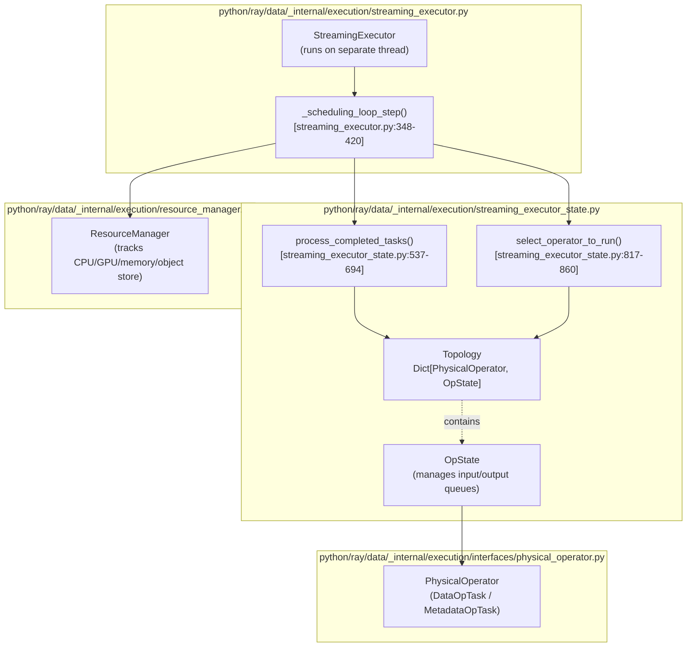
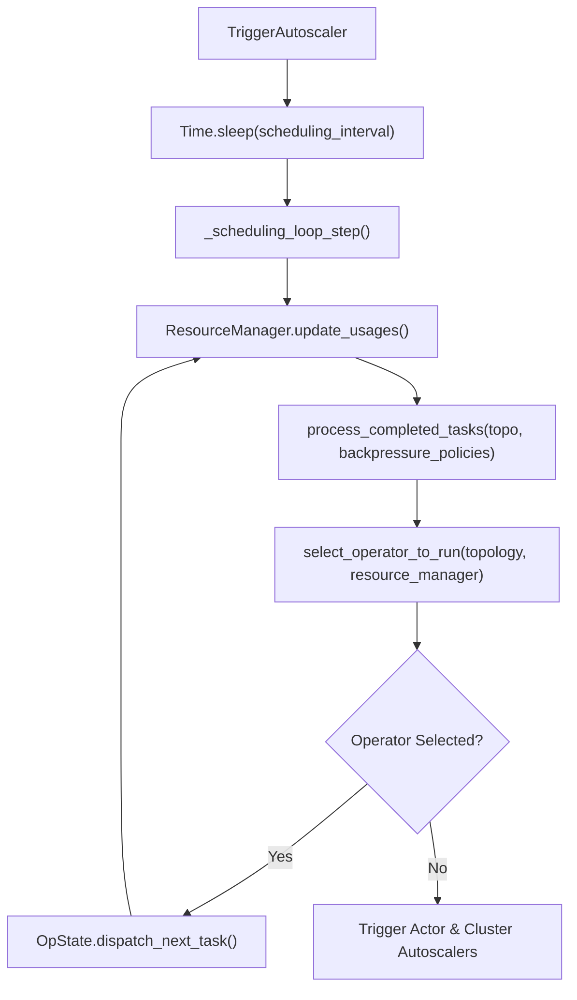
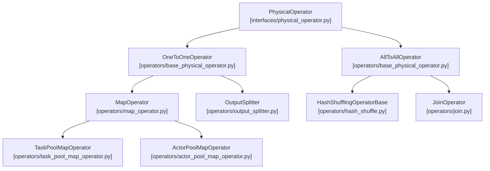
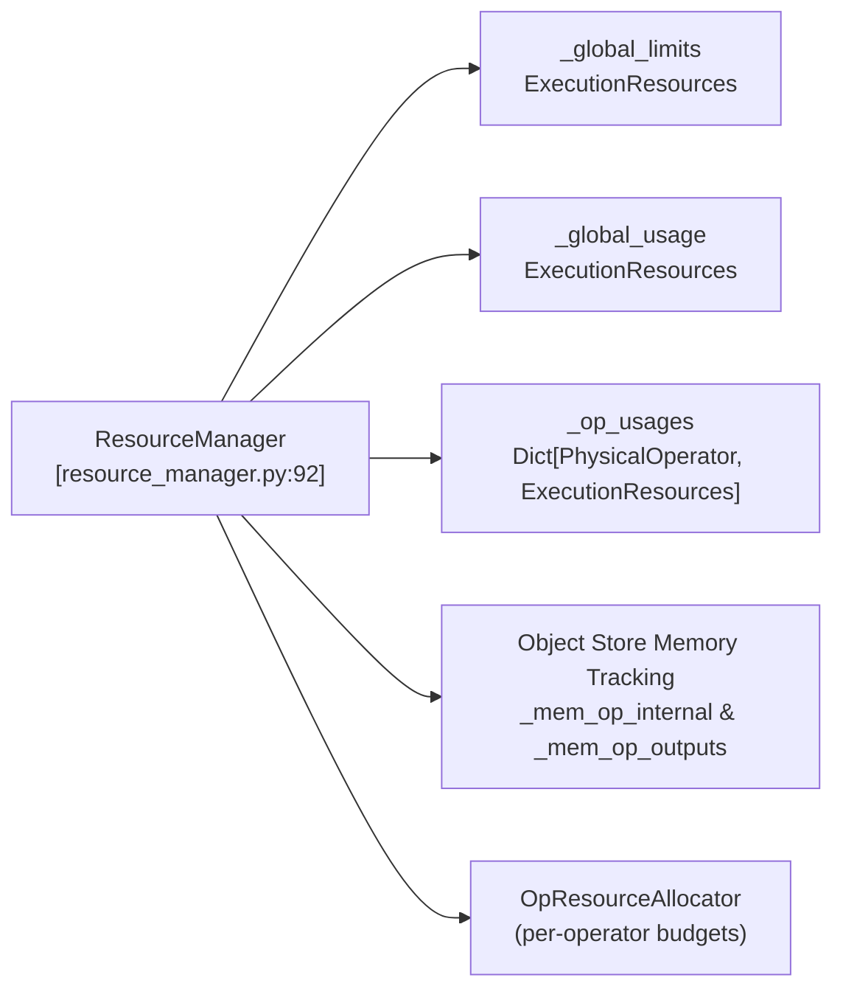
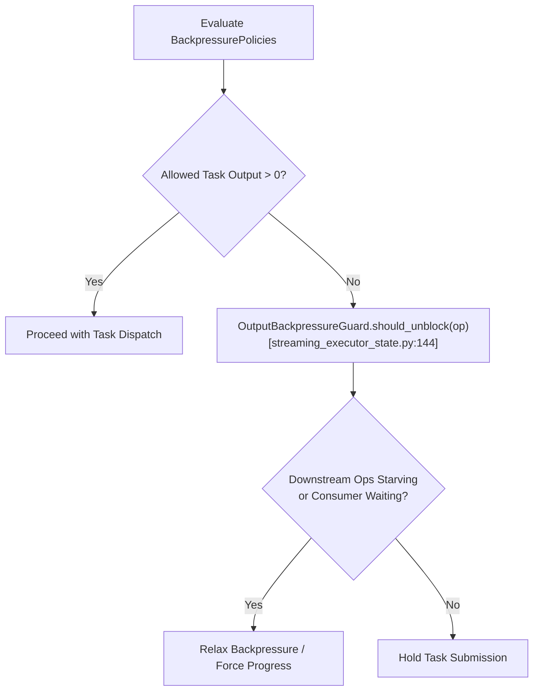
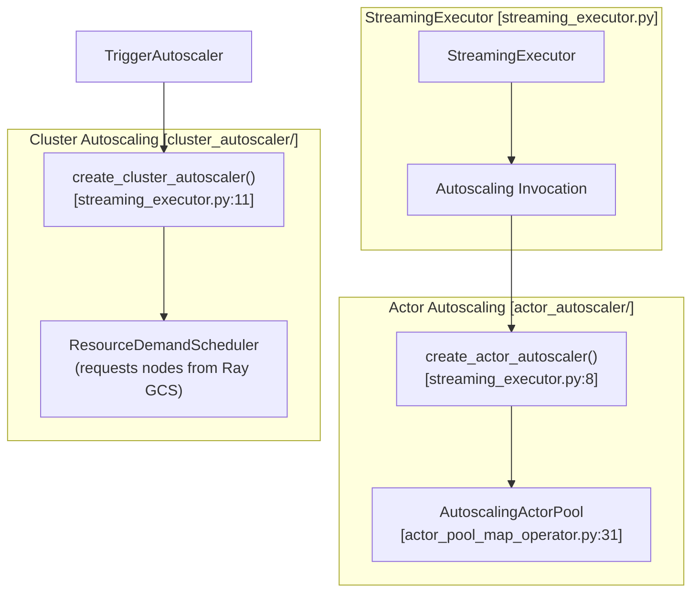
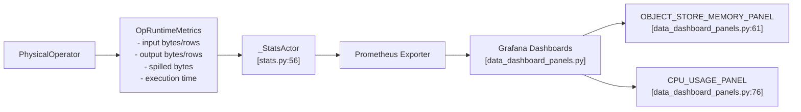
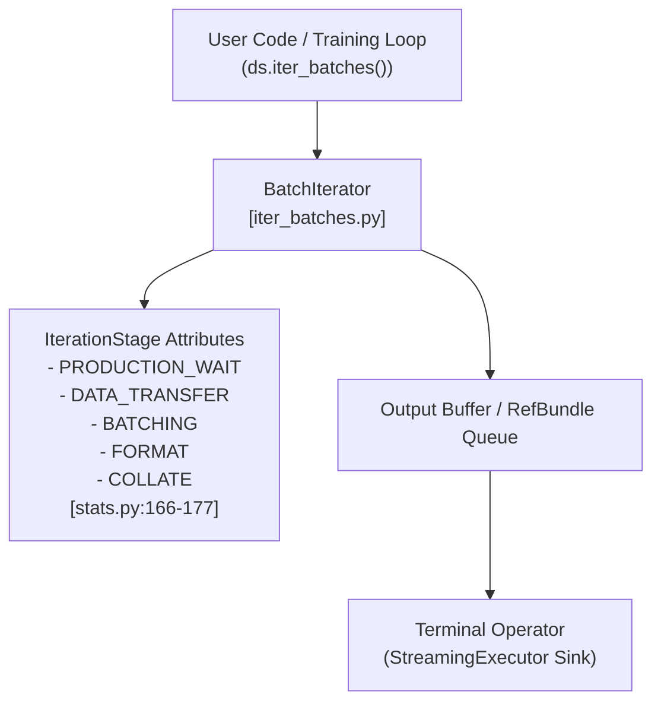

<!-- source: DeepWiki mcp.deepwiki.com · repo ray-project/ray · page 3.3 Streaming Execution and Resource Management · fetched 2026-10-21 -->

# Streaming Execution and Resource Management

Relevant source files

The following files were used as context for generating this wiki page:

- [ci/lint/pyrefly-excluded-files.txt](ci/lint/pyrefly-excluded-files.txt)
- [python/ray/air/_internal/torch_utils.py](python/ray/air/_internal/torch_utils.py)
- [python/ray/autoscaler/sdk/sdk.py](python/ray/autoscaler/sdk/sdk.py)
- [python/ray/dashboard/modules/metrics/dashboards/data_dashboard_panels.py](python/ray/dashboard/modules/metrics/dashboards/data_dashboard_panels.py)
- [python/ray/data/BUILD.bazel](python/ray/data/BUILD.bazel)
- [python/ray/data/_internal/average_calculator.py](python/ray/data/_internal/average_calculator.py)
- [python/ray/data/_internal/block_batching/block_batching.py](python/ray/data/_internal/block_batching/block_batching.py)
- [python/ray/data/_internal/block_batching/interfaces.py](python/ray/data/_internal/block_batching/interfaces.py)
- [python/ray/data/_internal/block_batching/iter_batches.py](python/ray/data/_internal/block_batching/iter_batches.py)
- [python/ray/data/_internal/block_batching/util.py](python/ray/data/_internal/block_batching/util.py)
- [python/ray/data/_internal/cluster_autoscaler/__init__.py](python/ray/data/_internal/cluster_autoscaler/__init__.py)
- [python/ray/data/_internal/cluster_autoscaler/base_autoscaling_coordinator.py](python/ray/data/_internal/cluster_autoscaler/base_autoscaling_coordinator.py)
- [python/ray/data/_internal/cluster_autoscaler/default_autoscaling_coordinator.py](python/ray/data/_internal/cluster_autoscaler/default_autoscaling_coordinator.py)
- [python/ray/data/_internal/cluster_autoscaler/default_cluster_autoscaler_v2.py](python/ray/data/_internal/cluster_autoscaler/default_cluster_autoscaler_v2.py)
- [python/ray/data/_internal/cluster_autoscaler/fake_autoscaling_coordinator.py](python/ray/data/_internal/cluster_autoscaler/fake_autoscaling_coordinator.py)
- [python/ray/data/_internal/cluster_autoscaler/placement_group_cluster_autoscaler.py](python/ray/data/_internal/cluster_autoscaler/placement_group_cluster_autoscaler.py)
- [python/ray/data/_internal/cluster_autoscaler/resource_utilization_gauge.py](python/ray/data/_internal/cluster_autoscaler/resource_utilization_gauge.py)
- [python/ray/data/_internal/cluster_autoscaler/util.py](python/ray/data/_internal/cluster_autoscaler/util.py)
- [python/ray/data/_internal/execution/__init__.py](python/ray/data/_internal/execution/__init__.py)
- [python/ray/data/_internal/execution/interfaces/__init__.py](python/ray/data/_internal/execution/interfaces/__init__.py)
- [python/ray/data/_internal/execution/interfaces/execution_options.py](python/ray/data/_internal/execution/interfaces/execution_options.py)
- [python/ray/data/_internal/execution/interfaces/op_runtime_metrics.py](python/ray/data/_internal/execution/interfaces/op_runtime_metrics.py)
- [python/ray/data/_internal/execution/interfaces/physical_operator.py](python/ray/data/_internal/execution/interfaces/physical_operator.py)
- [python/ray/data/_internal/execution/interfaces/ref_bundle.py](python/ray/data/_internal/execution/interfaces/ref_bundle.py)
- [python/ray/data/_internal/execution/operators/actor_pool_map_operator.py](python/ray/data/_internal/execution/operators/actor_pool_map_operator.py)
- [python/ray/data/_internal/execution/operators/aggregate_num_rows.py](python/ray/data/_internal/execution/operators/aggregate_num_rows.py)
- [python/ray/data/_internal/execution/operators/base_physical_operator.py](python/ray/data/_internal/execution/operators/base_physical_operator.py)
- [python/ray/data/_internal/execution/operators/hash_aggregate.py](python/ray/data/_internal/execution/operators/hash_aggregate.py)
- [python/ray/data/_internal/execution/operators/hash_shuffle.py](python/ray/data/_internal/execution/operators/hash_shuffle.py)
- [python/ray/data/_internal/execution/operators/hash_shuffle_v2.py](python/ray/data/_internal/execution/operators/hash_shuffle_v2.py)
- [python/ray/data/_internal/execution/operators/input_data_buffer.py](python/ray/data/_internal/execution/operators/input_data_buffer.py)
- [python/ray/data/_internal/execution/operators/join.py](python/ray/data/_internal/execution/operators/join.py)
- [python/ray/data/_internal/execution/operators/limit_operator.py](python/ray/data/_internal/execution/operators/limit_operator.py)
- [python/ray/data/_internal/execution/operators/map_operator.py](python/ray/data/_internal/execution/operators/map_operator.py)
- [python/ray/data/_internal/execution/operators/mix_operator.py](python/ray/data/_internal/execution/operators/mix_operator.py)
- [python/ray/data/_internal/execution/operators/output_splitter.py](python/ray/data/_internal/execution/operators/output_splitter.py)
- [python/ray/data/_internal/execution/operators/shuffle_operators/__init__.py](python/ray/data/_internal/execution/operators/shuffle_operators/__init__.py)
- [python/ray/data/_internal/execution/operators/shuffle_operators/shuffle_map_operator.py](python/ray/data/_internal/execution/operators/shuffle_operators/shuffle_map_operator.py)
- [python/ray/data/_internal/execution/operators/shuffle_operators/shuffle_reduce_operator.py](python/ray/data/_internal/execution/operators/shuffle_operators/shuffle_reduce_operator.py)
- [python/ray/data/_internal/execution/operators/shuffle_operators/shuffle_tasks.py](python/ray/data/_internal/execution/operators/shuffle_operators/shuffle_tasks.py)
- [python/ray/data/_internal/execution/operators/task_pool_map_operator.py](python/ray/data/_internal/execution/operators/task_pool_map_operator.py)
- [python/ray/data/_internal/execution/operators/union_operator.py](python/ray/data/_internal/execution/operators/union_operator.py)
- [python/ray/data/_internal/execution/operators/zip_operator.py](python/ray/data/_internal/execution/operators/zip_operator.py)
- [python/ray/data/_internal/execution/ranker.py](python/ray/data/_internal/execution/ranker.py)
- [python/ray/data/_internal/execution/resource_manager.py](python/ray/data/_internal/execution/resource_manager.py)
- [python/ray/data/_internal/execution/streaming_executor.py](python/ray/data/_internal/execution/streaming_executor.py)
- [python/ray/data/_internal/execution/streaming_executor_state.py](python/ray/data/_internal/execution/streaming_executor_state.py)
- [python/ray/data/_internal/gpu_shuffle/__init__.py](python/ray/data/_internal/gpu_shuffle/__init__.py)
- [python/ray/data/_internal/gpu_shuffle/hash_shuffle.py](python/ray/data/_internal/gpu_shuffle/hash_shuffle.py)
- [python/ray/data/_internal/gpu_shuffle/rapidsmpf_backend.py](python/ray/data/_internal/gpu_shuffle/rapidsmpf_backend.py)
- [python/ray/data/_internal/iterator/iterator_impl.py](python/ray/data/_internal/iterator/iterator_impl.py)
- [python/ray/data/_internal/iterator/stream_split_iterator.py](python/ray/data/_internal/iterator/stream_split_iterator.py)
- [python/ray/data/_internal/logical/interfaces/operator.py](python/ray/data/_internal/logical/interfaces/operator.py)
- [python/ray/data/_internal/logical/rules/operator_fusion.py](python/ray/data/_internal/logical/rules/operator_fusion.py)
- [python/ray/data/_internal/planner/plan_all_to_all_op.py](python/ray/data/_internal/planner/plan_all_to_all_op.py)
- [python/ray/data/_internal/split.py](python/ray/data/_internal/split.py)
- [python/ray/data/_internal/stats.py](python/ray/data/_internal/stats.py)
- [python/ray/data/_internal/utils/torch_inference.py](python/ray/data/_internal/utils/torch_inference.py)
- [python/ray/data/_internal/utils/torch_utils.py](python/ray/data/_internal/utils/torch_utils.py)
- [python/ray/data/collate_fn.py](python/ray/data/collate_fn.py)
- [python/ray/data/context.py](python/ray/data/context.py)
- [python/ray/data/grouped_data.py](python/ray/data/grouped_data.py)
- [python/ray/data/iterator.py](python/ray/data/iterator.py)
- [python/ray/data/tests/block_batching/test_block_batching.py](python/ray/data/tests/block_batching/test_block_batching.py)
- [python/ray/data/tests/block_batching/test_interfaces.py](python/ray/data/tests/block_batching/test_interfaces.py)
- [python/ray/data/tests/block_batching/test_iter_batches.py](python/ray/data/tests/block_batching/test_iter_batches.py)
- [python/ray/data/tests/block_batching/test_util.py](python/ray/data/tests/block_batching/test_util.py)
- [python/ray/data/tests/conftest.py](python/ray/data/tests/conftest.py)
- [python/ray/data/tests/test_actor_pool_map_operator.py](python/ray/data/tests/test_actor_pool_map_operator.py)
- [python/ray/data/tests/test_autoscaling_coordinator.py](python/ray/data/tests/test_autoscaling_coordinator.py)
- [python/ray/data/tests/test_backpressure_e2e.py](python/ray/data/tests/test_backpressure_e2e.py)
- [python/ray/data/tests/test_consumption.py](python/ray/data/tests/test_consumption.py)
- [python/ray/data/tests/test_default_cluster_autoscaler_v2.py](python/ray/data/tests/test_default_cluster_autoscaler_v2.py)
- [python/ray/data/tests/test_dynamic_block_split.py](python/ray/data/tests/test_dynamic_block_split.py)
- [python/ray/data/tests/test_executor_resource_management.py](python/ray/data/tests/test_executor_resource_management.py)
- [python/ray/data/tests/test_gpu_shuffle.py](python/ray/data/tests/test_gpu_shuffle.py)
- [python/ray/data/tests/test_groupby_e2e.py](python/ray/data/tests/test_groupby_e2e.py)
- [python/ray/data/tests/test_hash_shuffle.py](python/ray/data/tests/test_hash_shuffle.py)
- [python/ray/data/tests/test_hash_shuffle_v2.py](python/ray/data/tests/test_hash_shuffle_v2.py)
- [python/ray/data/tests/test_iter_torch_batches_gpu.py](python/ray/data/tests/test_iter_torch_batches_gpu.py)
- [python/ray/data/tests/test_iterator.py](python/ray/data/tests/test_iterator.py)
- [python/ray/data/tests/test_join.py](python/ray/data/tests/test_join.py)
- [python/ray/data/tests/test_mix.py](python/ray/data/tests/test_mix.py)
- [python/ray/data/tests/test_op_runtime_metrics.py](python/ray/data/tests/test_op_runtime_metrics.py)
- [python/ray/data/tests/test_operator_fusion.py](python/ray/data/tests/test_operator_fusion.py)
- [python/ray/data/tests/test_operators.py](python/ray/data/tests/test_operators.py)
- [python/ray/data/tests/test_placement_group_cluster_autoscaler.py](python/ray/data/tests/test_placement_group_cluster_autoscaler.py)
- [python/ray/data/tests/test_ref_bundle.py](python/ray/data/tests/test_ref_bundle.py)
- [python/ray/data/tests/test_reservation_based_resource_allocator.py](python/ray/data/tests/test_reservation_based_resource_allocator.py)
- [python/ray/data/tests/test_resource_manager.py](python/ray/data/tests/test_resource_manager.py)
- [python/ray/data/tests/test_shuffle_diagnostics.py](python/ray/data/tests/test_shuffle_diagnostics.py)
- [python/ray/data/tests/test_split.py](python/ray/data/tests/test_split.py)
- [python/ray/data/tests/test_stats.py](python/ray/data/tests/test_stats.py)
- [python/ray/data/tests/test_streaming_executor.py](python/ray/data/tests/test_streaming_executor.py)
- [python/ray/data/tests/test_torch_inference.py](python/ray/data/tests/test_torch_inference.py)
- [python/ray/data/tests/test_torch_tensor_utils.py](python/ray/data/tests/test_torch_tensor_utils.py)
- [python/ray/data/tests/test_zip.py](python/ray/data/tests/test_zip.py)
- [python/ray/data/tests/unit/test_average_calculator.py](python/ray/data/tests/unit/test_average_calculator.py)
- [python/ray/data/tests/unit/test_bundler.py](python/ray/data/tests/unit/test_bundler.py)
- [python/ray/data/tests/unit/test_ranker.py](python/ray/data/tests/unit/test_ranker.py)
- [python/ray/data/tests/unit/test_resource_manager.py](python/ray/data/tests/unit/test_resource_manager.py)
- [python/ray/data/util/torch_inference.py](python/ray/data/util/torch_inference.py)
- [python/ray/data/util/torch_utils.py](python/ray/data/util/torch_utils.py)
- [python/ray/train/BUILD.bazel](python/ray/train/BUILD.bazel)
- [python/ray/train/_internal/autoscaling_coordinator_client.py](python/ray/train/_internal/autoscaling_coordinator_client.py)
- [python/ray/train/tests/test_torch_utils.py](python/ray/train/tests/test_torch_utils.py)
- [python/ray/train/v2/_internal/execution/scaling_policy/__init__.py](python/ray/train/v2/_internal/execution/scaling_policy/__init__.py)
- [python/ray/train/v2/_internal/execution/scaling_policy/autoscaling_coordinator_client.py](python/ray/train/v2/_internal/execution/scaling_policy/autoscaling_coordinator_client.py)
- [python/ray/train/v2/_internal/execution/scaling_policy/elastic.py](python/ray/train/v2/_internal/execution/scaling_policy/elastic.py)
- [python/ray/train/v2/_internal/execution/scaling_policy/fixed.py](python/ray/train/v2/_internal/execution/scaling_policy/fixed.py)
- [python/ray/train/v2/_internal/execution/scaling_policy/scaling_policy.py](python/ray/train/v2/_internal/execution/scaling_policy/scaling_policy.py)
- [python/ray/train/v2/tests/test_elastic_scaling_policy.py](python/ray/train/v2/tests/test_elastic_scaling_policy.py)
- [python/ray/util/debug.py](python/ray/util/debug.py)

This document details Ray Data's streaming execution engine, resource management system, physical operator implementations, autoscaling, metrics collection, and batch iteration pipelines. The streaming executor executes Dataset DAGs by continuously scheduling tasks to physical operators while managing cluster resources, balancing backpressure, and feeding consumer iterators.

---

## 1. Streaming Executor Architecture and Scheduling Loop

The streaming execution engine is orchestrated by `StreamingExecutor` (defined in `python/ray/data/_internal/execution/streaming_executor.py`), which runs Dataset DAGs in a fully streamed fashion across a separate background thread [python/ray/data/_internal/execution/streaming_executor.py:107-138](). The execution state is tracked via `Topology`, mapping each `PhysicalOperator` to its `OpState` [python/ray/data/_internal/execution/streaming_executor_state.py:51-57]().

### Core Components and Data Flow

**Diagram: Streaming Executor Control Plane Integration**
Sources: `python/ray/data/_internal/execution/streaming_executor.py:107-177]`, `python/ray/data/_internal/execution/streaming_executor_state.py:51-187]`, `python/ray/data/_internal/execution/resource_manager.py:92-157]`

### Scheduling Loop Execution Step

The scheduling loop executes continuously, performing resource checks, pulling completed task outputs via `process_completed_tasks()`, and dispatching runnable operator tasks [python/ray/data/_internal/execution/streaming_executor.py:348-430]().

**Diagram: Scheduling Loop Iteration Flow**
Sources: `python/ray/data/_internal/execution/streaming_executor.py:348-450]`, `python/ray/data/_internal/execution/streaming_executor_state.py:537-860]`

Sources: `python/ray/data/_internal/execution/streaming_executor.py:100-450]`, `python/ray/data/_internal/execution/streaming_executor_state.py:51-187]`

---

## 2. Physical Operator Implementations

Physical operators implement the concrete execution steps corresponding to logical dataset transformations. They inherit from `PhysicalOperator` [python/ray/data/_internal/execution/interfaces/physical_operator.py:1-10]().

### Operator Hierarchy and Implementations

**Diagram: Physical Operator Class Hierarchy**
Sources: `python/ray/data/_internal/execution/interfaces/physical_operator.py:1-10]`, `python/ray/data/_internal/execution/operators/map_operator.py:203-215]`, `python/ray/data/_internal/execution/operators/actor_pool_map_operator.py:88-102]`

### Key Operator Types

1. **`ActorPoolMapOperator`**: Manages a pool of stateful actors via `AutoscalingActorPool` [python/ray/data/_internal/execution/operators/actor_pool_map_operator.py:31-100](). It handles batch rebundling through `RebundleQueue` and tracks locality using `ActorLocationTracker` [python/ray/data/_internal/execution/operators/actor_pool_map_operator.py:39-57]().
2. **`TaskPoolMapOperator`**: Executes stateless map tasks concurrently using Ray tasks (`ray.remote`) without long-lived worker actors.
3. **`OutputSplitter`**: Splits data streams across multiple consumers, frequently utilized in streaming split iterators for distributed training dataloading (`ray.data.iterator.StreamSplitIterator`).
4. **Shuffle and Join Operators**: Materializing operators such as `HashShufflingOperatorBase` and `JoinOperator` that partition and redistribute data across the cluster [python/ray/data/_internal/execution/resource_manager.py:56-66]().

Sources: `python/ray/data/_internal/execution/operators/actor_pool_map_operator.py:88-172]`, `python/ray/data/_internal/execution/operators/map_operator.py:203-215]`, `python/ray/data/_internal/execution/resource_manager.py:56-66]`

---

## 3. Resource Management and Backpressure

Resource management and backpressure control are handled by `ResourceManager` [python/ray/data/_internal/execution/resource_manager.py:92-157]() and pluggable `BackpressurePolicy` implementations [python/ray/data/_internal/execution/backpressure_policy/backpressure_policy.py:25-30]().

### Resource Tracking and Limits

`ResourceManager` periodically evaluates global resource usage (CPU, GPU, object store memory) against cluster capacity limits (`ExecutionResources`) [python/ray/data/_internal/execution/resource_manager.py:113-130]().

**Diagram: ResourceManager State Structure**
Sources: `python/ray/data/_internal/execution/resource_manager.py:113-157]`

### Backpressure and Output Backpressure Guard

When downstream operators or external consumers (like iterators) cannot keep pace, backpressure policies restrict task dispatching. If deadlocks arise due to tight resource budgets, `OutputBackpressureGuard` acts as an escape hatch [python/ray/data/_internal/execution/streaming_executor_state.py:126-168]().

**Diagram: Backpressure and Escape Hatch Evaluation**
Sources: `python/ray/data/_internal/execution/streaming_executor_state.py:126-168]`, `python/ray/data/_internal/execution/backpressure_policy/backpressure_policy.py:25-30]`

Sources: `python/ray/data/_internal/execution/resource_manager.py:92-280]`, `python/ray/data/_internal/execution/streaming_executor_state.py:126-168]`

---

## 4. Actor and Cluster Autoscaling for Data

Ray Data integrates cluster and actor autoscaling directly into the streaming execution lifecycle to dynamically provision resources under heavy workloads.

### Autoscaling Subsystems

**Diagram: Data Autoscaling Architecture**
Sources: `python/ray/data/_internal/execution/streaming_executor.py:8-11]`, `python/ray/data/_internal/actor_autoscaler/autoscaling_actor_pool.py:1-40]`, `python/ray/data/_internal/cluster_autoscaler/default_cluster_autoscaler_v2.py:1-30]`

Sources: `python/ray/data/_internal/execution/streaming_executor.py:8-12]`, `python/ray/data/_internal/actor_autoscaler/autoscaling_actor_pool.py:1-50]`, `python/ray/data/_internal/cluster_autoscaler/default_cluster_autoscaler_v2.py:1-40]`

---

## 5. Metrics Collection and Observability

Ray Data collects runtime metrics via `OpRuntimeMetrics` [python/ray/data/_internal/execution/interfaces/op_runtime_metrics.py:1-40](), reporting to the stats actor (`_StatsActor`) [python/ray/data/_internal/stats.py:56-57]() and exporting metrics to Prometheus and Grafana dashboards [python/ray/dashboard/modules/metrics/dashboards/data_dashboard_panels.py:31-89]().

### Metrics Collection and Dashboard Pipeline

**Diagram: Observability and Metrics Flow**
Sources: `python/ray/data/_internal/execution/interfaces/op_runtime_metrics.py:1-40]`, `python/ray/data/_internal/stats.py:56-62]`, `python/ray/dashboard/modules/metrics/dashboards/data_dashboard_panels.py:31-89]`

Sources: `python/ray/data/_internal/execution/interfaces/op_runtime_metrics.py:1-50]`, `python/ray/data/_internal/stats.py:56-65]`, `python/ray/dashboard/modules/metrics/dashboards/data_dashboard_panels.py:31-100]`

---

## 6. Batch Iteration and Data Consumption

Data consumption by user code or training loops is mediated by batch iterators such as `BatchIterator` [python/ray/data/_internal/block_batching/iter_batches.py:1-30]() and `StreamSplitIterator` [python/ray/data/_internal/iterator/stream_split_iterator.py:1-30](), which bridge streaming execution output queues with Python consumers.

### Iteration Pipeline and Block Batching

**Diagram: Data Consumption and Batch Iteration Pipeline**
Sources: `python/ray/data/_internal/block_batching/iter_batches.py:1-35]`, `python/ray/data/_internal/stats.py:166-178]`, `python/ray/data/_internal/execution/resource_manager.py:144-148]`

Sources: `python/ray/data/_internal/block_batching/iter_batches.py:1-40]`, `python/ray/data/_internal/stats.py:166-178]`, `python/ray/data/_internal/iterator/stream_split_iterator.py:1-35]`

---

