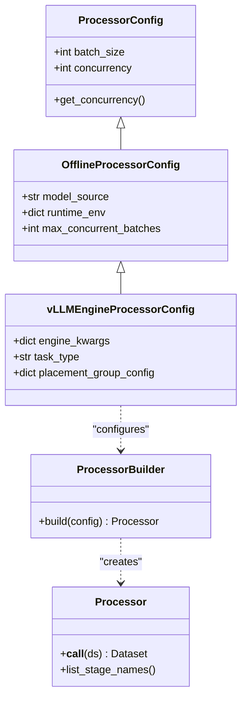
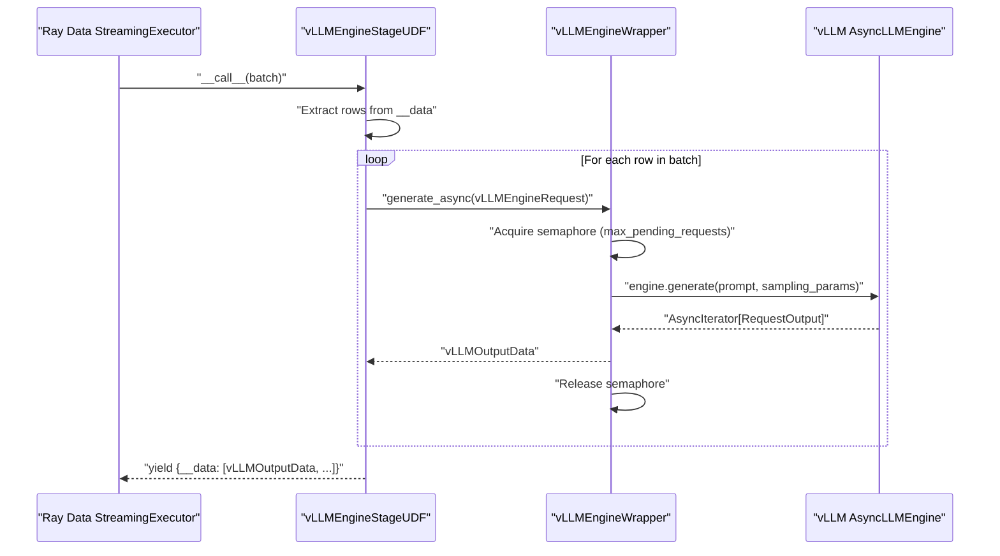

<!-- source: DeepWiki mcp.deepwiki.com · repo ray-project/ray · page 3.4 Ray Data for LLMs · fetched 2026-10-21 -->

# Ray Data for LLMs

Relevant source files

The following files were used as context for generating this wiki page:

- [ci/docker/llm.build.Dockerfile](ci/docker/llm.build.Dockerfile)
- [ci/docker/llm.build.wanda.yaml](ci/docker/llm.build.wanda.yaml)
- [doc/source/data/api/llm.rst](doc/source/data/api/llm.rst)
- [doc/source/data/doc_code/working-with-llms/basic_llm_example.py](doc/source/data/doc_code/working-with-llms/basic_llm_example.py)
- [doc/source/data/doc_code/working-with-llms/classification_example.py](doc/source/data/doc_code/working-with-llms/classification_example.py)
- [doc/source/data/doc_code/working-with-llms/embedding_example.py](doc/source/data/doc_code/working-with-llms/embedding_example.py)
- [doc/source/data/doc_code/working-with-llms/minimal_quickstart.py](doc/source/data/doc_code/working-with-llms/minimal_quickstart.py)
- [doc/source/data/doc_code/working-with-llms/omni_audio_example.py](doc/source/data/doc_code/working-with-llms/omni_audio_example.py)
- [doc/source/data/doc_code/working-with-llms/openai_api_example.py](doc/source/data/doc_code/working-with-llms/openai_api_example.py)
- [doc/source/data/doc_code/working-with-llms/vlm_image_example.py](doc/source/data/doc_code/working-with-llms/vlm_image_example.py)
- [doc/source/data/doc_code/working-with-llms/vlm_video_example.py](doc/source/data/doc_code/working-with-llms/vlm_video_example.py)
- [doc/source/data/working-with-llms.rst](doc/source/data/working-with-llms.rst)
- [doc/source/serve/llm/troubleshooting.md](doc/source/serve/llm/troubleshooting.md)
- [docker/ray-llm/Dockerfile](docker/ray-llm/Dockerfile)
- [docker/ray-llm/cuda.wanda.yaml](docker/ray-llm/cuda.wanda.yaml)
- [pytest.ini](pytest.ini)
- [python/deplocks/llm/rayllm_py312_cpu.lock](python/deplocks/llm/rayllm_py312_cpu.lock)
- [python/deplocks/llm/rayllm_py312_cu130.lock](python/deplocks/llm/rayllm_py312_cu130.lock)
- [python/deplocks/llm/rayllm_test_py312_cpu.lock](python/deplocks/llm/rayllm_test_py312_cpu.lock)
- [python/deplocks/llm/rayllm_test_py312_cu130.lock](python/deplocks/llm/rayllm_test_py312_cu130.lock)
- [python/ray/data/llm.py](python/ray/data/llm.py)
- [python/ray/llm/_internal/batch/processor/base.py](python/ray/llm/_internal/batch/processor/base.py)
- [python/ray/llm/_internal/batch/processor/http_request_proc.py](python/ray/llm/_internal/batch/processor/http_request_proc.py)
- [python/ray/llm/_internal/batch/processor/serve_deployment_proc.py](python/ray/llm/_internal/batch/processor/serve_deployment_proc.py)
- [python/ray/llm/_internal/batch/processor/sglang_engine_proc.py](python/ray/llm/_internal/batch/processor/sglang_engine_proc.py)
- [python/ray/llm/_internal/batch/processor/vllm_engine_proc.py](python/ray/llm/_internal/batch/processor/vllm_engine_proc.py)
- [python/ray/llm/_internal/batch/stages/base.py](python/ray/llm/_internal/batch/stages/base.py)
- [python/ray/llm/_internal/batch/stages/chat_template_stage.py](python/ray/llm/_internal/batch/stages/chat_template_stage.py)
- [python/ray/llm/_internal/batch/stages/common.py](python/ray/llm/_internal/batch/stages/common.py)
- [python/ray/llm/_internal/batch/stages/http_request_stage.py](python/ray/llm/_internal/batch/stages/http_request_stage.py)
- [python/ray/llm/_internal/batch/stages/serve_deployment_stage.py](python/ray/llm/_internal/batch/stages/serve_deployment_stage.py)
- [python/ray/llm/_internal/batch/stages/sglang_engine_stage.py](python/ray/llm/_internal/batch/stages/sglang_engine_stage.py)
- [python/ray/llm/_internal/batch/stages/tokenize_stage.py](python/ray/llm/_internal/batch/stages/tokenize_stage.py)
- [python/ray/llm/_internal/batch/stages/vllm_engine_stage.py](python/ray/llm/_internal/batch/stages/vllm_engine_stage.py)
- [python/ray/llm/_internal/batch/utils.py](python/ray/llm/_internal/batch/utils.py)
- [python/ray/llm/_internal/common/observability/logging/__init__.py](python/ray/llm/_internal/common/observability/logging/__init__.py)
- [python/ray/llm/_internal/common/observability/logging/setup.py](python/ray/llm/_internal/common/observability/logging/setup.py)
- [python/ray/llm/_internal/common/utils/cloud_utils.py](python/ray/llm/_internal/common/utils/cloud_utils.py)
- [python/ray/llm/_internal/common/utils/download_utils.py](python/ray/llm/_internal/common/utils/download_utils.py)
- [python/ray/llm/tests/batch/cpu/processor/test_http_request_proc.py](python/ray/llm/tests/batch/cpu/processor/test_http_request_proc.py)
- [python/ray/llm/tests/batch/cpu/processor/test_processor_base.py](python/ray/llm/tests/batch/cpu/processor/test_processor_base.py)
- [python/ray/llm/tests/batch/cpu/stages/test_chat_template_stage.py](python/ray/llm/tests/batch/cpu/stages/test_chat_template_stage.py)
- [python/ray/llm/tests/batch/cpu/stages/test_http_request_stage.py](python/ray/llm/tests/batch/cpu/stages/test_http_request_stage.py)
- [python/ray/llm/tests/batch/cpu/stages/test_stage_base.py](python/ray/llm/tests/batch/cpu/stages/test_stage_base.py)
- [python/ray/llm/tests/batch/cpu/stages/test_tokenize_stage.py](python/ray/llm/tests/batch/cpu/stages/test_tokenize_stage.py)
- [python/ray/llm/tests/batch/gpu/processor/test_serve_deployment_proc.py](python/ray/llm/tests/batch/gpu/processor/test_serve_deployment_proc.py)
- [python/ray/llm/tests/batch/gpu/processor/test_sglang_engine_proc.py](python/ray/llm/tests/batch/gpu/processor/test_sglang_engine_proc.py)
- [python/ray/llm/tests/batch/gpu/processor/test_vllm_engine_proc.py](python/ray/llm/tests/batch/gpu/processor/test_vllm_engine_proc.py)
- [python/ray/llm/tests/batch/gpu/stages/test_serve_deployment_stage.py](python/ray/llm/tests/batch/gpu/stages/test_serve_deployment_stage.py)
- [python/ray/llm/tests/batch/gpu/stages/test_sglang_engine_stage.py](python/ray/llm/tests/batch/gpu/stages/test_sglang_engine_stage.py)
- [python/ray/llm/tests/batch/gpu/stages/test_vllm_engine_stage.py](python/ray/llm/tests/batch/gpu/stages/test_vllm_engine_stage.py)
- [python/requirements.txt](python/requirements.txt)
- [python/requirements/llm/llm-requirements.txt](python/requirements/llm/llm-requirements.txt)
- [python/requirements/ml/data-test-requirements.txt](python/requirements/ml/data-test-requirements.txt)
- [python/requirements/test-requirements.txt](python/requirements/test-requirements.txt)
- [python/requirements_compiled.txt](python/requirements_compiled.txt)
- [python/requirements_compiled_py3.13.txt](python/requirements_compiled_py3.13.txt)
- [python/setup.py](python/setup.py)
- [release/llm_tests/batch/test_batch_vllm.py](release/llm_tests/batch/test_batch_vllm.py)

Ray Data for LLMs, primarily implemented in the `ray.data.llm` module, provides a high-performance, multi-stage pipeline for large-scale batch inference. It abstracts the complexities of distributed GPU management, model loading, and request orchestration, allowing users to run inference engines like vLLM and SGLang at scale [doc/source/data/working-with-llms.rst:6-11]().

## Processor Architecture

The core abstraction in Ray Data for LLMs is the **Processor**. A Processor defines a logical pipeline of stages that transform an input dataset into an output dataset containing LLM-generated content [doc/source/data/working-with-llms.rst:64-69]().

### Data Flow and Pipeline Stages
The pipeline follows a structured flow where data is passed through specialized stages. Each stage typically runs as a separate Ray actor pool, enabling independent scaling and backpressure management [doc/source/data/working-with-llms.rst:87-97]().

| Stage | Purpose | Code Entity |
| :--- | :--- | :--- |
| **Preprocess** | User-defined logic to format rows (e.g., creating OpenAI `messages`). | `wrap_preprocess` [python/ray/llm/_internal/batch/stages/base.py:12-12]() |
| **PrepareMultimodal** | Extracts and prepares multimodal inputs for VLM/Omni models. | `PrepareMultimodalStage` [python/ray/llm/_internal/batch/processor/vllm_engine_proc.py:30-30]() |
| **ChatTemplate** | Applies model-specific Jinja templates to convert messages into prompt strings. | `ChatTemplateStage` [python/ray/llm/_internal/batch/stages/chat_template_stage.py:128-133]() |
| **Tokenize** | Converts text prompts into integer token IDs. | `TokenizeStage` [python/ray/llm/_internal/batch/processor/vllm_engine_proc.py:31-31]() |
| **LLM Engine** | Executes distributed inference using vLLM or SGLang. | `vLLMEngineStage` [python/ray/llm/_internal/batch/stages/vllm_engine_stage.py:270-275]() |
| **Detokenize** | Converts output token IDs back into human-readable text. | `DetokenizeStage` [python/ray/llm/_internal/batch/processor/vllm_engine_proc.py:29-29]() |
| **Postprocess** | User-defined logic to extract specific fields from the LLM output. | `wrap_postprocess` [python/ray/llm/_internal/batch/stages/base.py:11-11]() |

Sources: [python/ray/llm/_internal/batch/stages/base.py:11-12](), [python/ray/llm/_internal/batch/processor/vllm_engine_proc.py:29-31](), [python/ray/llm/_internal/batch/stages/chat_template_stage.py:128-133]()

### Processor Class Diagram
The following diagram illustrates the relationship between configuration classes and the execution engine.

**LLM Processor Entity Map**

Sources: [python/ray/llm/_internal/batch/processor/base.py:20-136](), [python/ray/llm/_internal/batch/processor/vllm_engine_proc.py:55-128](), [python/ray/data/llm.py:26-48]()

---

## Batch Inference Engines

Ray Data supports multiple backends for executing inference. The most common is the `vLLMEngineStage`, which manages vLLM engine instances across the cluster [python/ray/llm/_internal/batch/stages/vllm_engine_stage.py:270-275]().

### vLLM Integration
The `vLLMEngineStage` manages the lifecycle of vLLM replicas. It handles:
1.  **Model Downloading**: Automatically fetches models from HuggingFace or S3 using `download_model_files` [python/ray/llm/_internal/batch/stages/vllm_engine_stage.py:39-44]().
2.  **Resource Scheduling**: Uses `PlacementGroupSchedulingStrategy` to ensure that for Tensor Parallelism (TP) or Pipeline Parallelism (PP), workers are co-located correctly [python/ray/llm/_internal/batch/stages/vllm_engine_stage.py:46-46]().
3.  **Request Orchestration**: Uses a `vLLMEngineWrapper` to submit requests to the engine and manage `max_pending_requests` to prevent memory exhaustion [python/ray/llm/_internal/batch/stages/vllm_engine_stage.py:82-117]().

**Inference Execution Flow**

Sources: [python/ray/llm/_internal/batch/stages/vllm_engine_stage.py:3-47](), [python/ray/llm/_internal/batch/stages/vllm_engine_stage.py:82-117]()

---

## Multimodal and Advanced Features

### Multimodal Pipeline
For Vision-Language Models (VLM) or Omni models, the processor includes a `PrepareMultimodalStage`. This stage utilizes vLLM's parsing utilities to process images, videos, or audio URLs into the format required by the engine. It is enabled by setting `prepare_multimodal_stage=True` in the `vLLMEngineProcessorConfig` [python/ray/llm/_internal/batch/processor/vllm_engine_proc.py:29-30]().

### HTTP and Serve Integration
Beyond local engines, Ray Data can query remote endpoints:
*   **HttpRequestProcessor**: Sends batches of data to external OpenAI-compatible APIs using `HttpRequestStage` [python/ray/data/llm.py:49-57]().
*   **ServeDeploymentProcessor**: Queries a model already deployed via Ray Serve, allowing for shared engine resources between online serving and offline batch jobs [python/ray/data/llm.py:9-9]().

### Error Handling and Fault Tolerance
The `OfflineProcessorConfig` includes a `should_continue_on_error` flag [python/ray/llm/_internal/batch/processor/base.py:158-162](). When enabled:
*   Failed inference rows do not crash the entire dataset job.
*   Errors are captured in a special `__inference_error__` column.
*   Faulty rows bypass the user's `postprocess` function to prevent secondary failures [python/ray/llm/_internal/batch/processor/base.py:158-162]().

Sources: [python/ray/llm/_internal/batch/processor/base.py:158-162](), [python/ray/llm/_internal/batch/processor/vllm_engine_proc.py:29-30](), [python/ray/data/llm.py:9-57]()

---

## Scaling and Resource Management

Ray Data LLM supports both fixed and autoscaling worker pools for inference replicas [python/ray/llm/_internal/batch/processor/base.py:36-45]().

*   **Concurrency**: Defined as an integer `n` (autoscales 1 to `n`) or a tuple `(m, n)` (autoscales `m` to `n`) [python/ray/llm/_internal/batch/processor/base.py:36-45]().
*   **Placement Groups**: For distributed inference (e.g., tensor/pipeline parallelism), the processor automatically configures a `PlacementGroup` with strategies like `PACK` or `SPREAD` to ensure high-bandwidth communication between GPU shards [python/ray/llm/_internal/batch/processor/vllm_engine_proc.py:74-82](), [python/ray/llm/_internal/batch/stages/vllm_engine_stage.py:46-46]().
*   **Metrics**: vLLM engine metrics (e.g., KV cache utilization, TTFT, TPOT) are exported via Ray's Prometheus endpoint when `log_engine_metrics` is enabled [python/ray/llm/_internal/batch/processor/vllm_engine_proc.py:57-64]().

**Key Implementation Classes:**
*   `vLLMEngineStageUDF`: The actual Ray Data worker class that wraps the inference engine [python/ray/llm/_internal/batch/stages/vllm_engine_stage.py:30-33]().
*   `ProcessorBuilder`: Orchestrates the assembly of individual stages into a functional pipeline [python/ray/llm/_internal/batch/processor/base.py:19-21]().

Sources: [python/ray/llm/_internal/batch/processor/base.py:19-45](), [python/ray/llm/_internal/batch/processor/vllm_engine_proc.py:57-82](), [python/ray/llm/_internal/batch/stages/vllm_engine_stage.py:30-46]()

---

