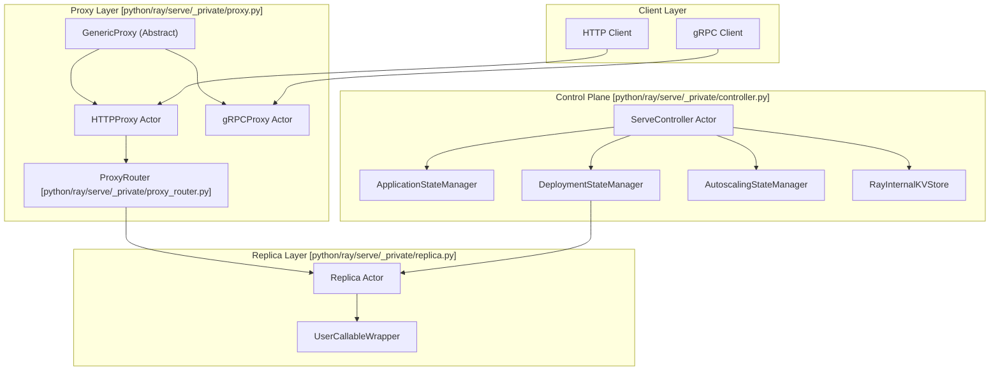
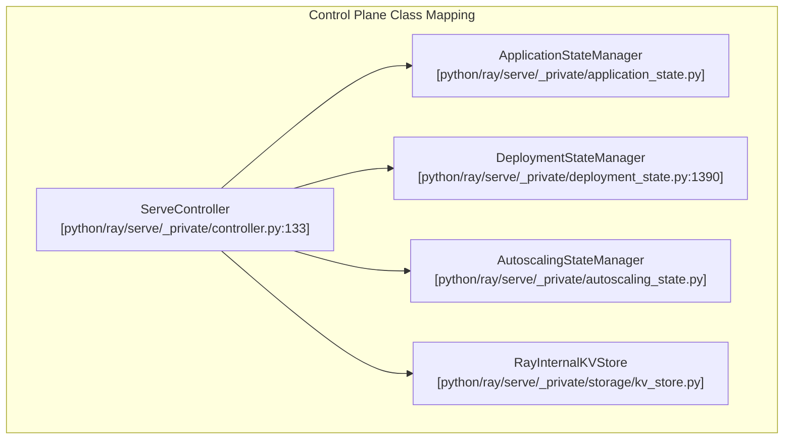

<!-- source: DeepWiki mcp.deepwiki.com · repo ray-project/ray · page 4 Ray Serve · fetched 2026-10-21 -->

# Ray Serve

Relevant source files

The following files were used as context for generating this wiki page:

- [doc/source/serve/api/index.md](doc/source/serve/api/index.md)
- [doc/source/serve/monitoring.md](doc/source/serve/monitoring.md)
- [python/ray/dashboard/modules/serve/serve_head.py](python/ray/dashboard/modules/serve/serve_head.py)
- [python/ray/dashboard/modules/serve/tests/test_serve_dashboard.py](python/ray/dashboard/modules/serve/tests/test_serve_dashboard.py)
- [python/ray/llm/tests/serve/cpu/deployments/routers/test_make_fastapi_ingress.py](python/ray/llm/tests/serve/cpu/deployments/routers/test_make_fastapi_ingress.py)
- [python/ray/serve/_private/api.py](python/ray/serve/_private/api.py)
- [python/ray/serve/_private/application_state.py](python/ray/serve/_private/application_state.py)
- [python/ray/serve/_private/build_app.py](python/ray/serve/_private/build_app.py)
- [python/ray/serve/_private/client.py](python/ray/serve/_private/client.py)
- [python/ray/serve/_private/config.py](python/ray/serve/_private/config.py)
- [python/ray/serve/_private/constants.py](python/ray/serve/_private/constants.py)
- [python/ray/serve/_private/controller.py](python/ray/serve/_private/controller.py)
- [python/ray/serve/_private/deploy_utils.py](python/ray/serve/_private/deploy_utils.py)
- [python/ray/serve/_private/deployment_state.py](python/ray/serve/_private/deployment_state.py)
- [python/ray/serve/_private/direct_ingress_grpc_util.py](python/ray/serve/_private/direct_ingress_grpc_util.py)
- [python/ray/serve/_private/haproxy.py](python/ray/serve/_private/haproxy.py)
- [python/ray/serve/_private/haproxy_metrics.py](python/ray/serve/_private/haproxy_metrics.py)
- [python/ray/serve/_private/haproxy_templates.py](python/ray/serve/_private/haproxy_templates.py)
- [python/ray/serve/_private/http_util.py](python/ray/serve/_private/http_util.py)
- [python/ray/serve/_private/ingress_request_router.lua.tmpl](python/ray/serve/_private/ingress_request_router.lua.tmpl)
- [python/ray/serve/_private/local_testing_mode.py](python/ray/serve/_private/local_testing_mode.py)
- [python/ray/serve/_private/proxy.py](python/ray/serve/_private/proxy.py)
- [python/ray/serve/_private/replica.py](python/ray/serve/_private/replica.py)
- [python/ray/serve/api.py](python/ray/serve/api.py)
- [python/ray/serve/config.py](python/ray/serve/config.py)
- [python/ray/serve/deployment.py](python/ray/serve/deployment.py)
- [python/ray/serve/experimental/round_robin_router.py](python/ray/serve/experimental/round_robin_router.py)
- [python/ray/serve/schema.py](python/ray/serve/schema.py)
- [python/ray/serve/tests/BUILD.bazel](python/ray/serve/tests/BUILD.bazel)
- [python/ray/serve/tests/test_api.py](python/ray/serve/tests/test_api.py)
- [python/ray/serve/tests/test_callback.py](python/ray/serve/tests/test_callback.py)
- [python/ray/serve/tests/test_cli_4.py](python/ray/serve/tests/test_cli_4.py)
- [python/ray/serve/tests/test_config_files/multi_fastapi.py](python/ray/serve/tests/test_config_files/multi_fastapi.py)
- [python/ray/serve/tests/test_controller.py](python/ray/serve/tests/test_controller.py)
- [python/ray/serve/tests/test_controller_recovery.py](python/ray/serve/tests/test_controller_recovery.py)
- [python/ray/serve/tests/test_deploy.py](python/ray/serve/tests/test_deploy.py)
- [python/ray/serve/tests/test_direct_ingress.py](python/ray/serve/tests/test_direct_ingress.py)
- [python/ray/serve/tests/test_failure.py](python/ray/serve/tests/test_failure.py)
- [python/ray/serve/tests/test_fastapi.py](python/ray/serve/tests/test_fastapi.py)
- [python/ray/serve/tests/test_gcs_failure.py](python/ray/serve/tests/test_gcs_failure.py)
- [python/ray/serve/tests/test_grpc.py](python/ray/serve/tests/test_grpc.py)
- [python/ray/serve/tests/test_haproxy.py](python/ray/serve/tests/test_haproxy.py)
- [python/ray/serve/tests/test_haproxy_api.py](python/ray/serve/tests/test_haproxy_api.py)
- [python/ray/serve/tests/test_haproxy_metrics.py](python/ray/serve/tests/test_haproxy_metrics.py)
- [python/ray/serve/tests/test_metrics.py](python/ray/serve/tests/test_metrics.py)
- [python/ray/serve/tests/test_metrics_2.py](python/ray/serve/tests/test_metrics_2.py)
- [python/ray/serve/tests/test_metrics_3.py](python/ray/serve/tests/test_metrics_3.py)
- [python/ray/serve/tests/test_metrics_haproxy.py](python/ray/serve/tests/test_metrics_haproxy.py)
- [python/ray/serve/tests/test_multiplex.py](python/ray/serve/tests/test_multiplex.py)
- [python/ray/serve/tests/test_proxy.py](python/ray/serve/tests/test_proxy.py)
- [python/ray/serve/tests/test_runtime_env_2.py](python/ray/serve/tests/test_runtime_env_2.py)
- [python/ray/serve/tests/test_standalone.py](python/ray/serve/tests/test_standalone.py)
- [python/ray/serve/tests/unit/BUILD.bazel](python/ray/serve/tests/unit/BUILD.bazel)
- [python/ray/serve/tests/unit/test_application_state.py](python/ray/serve/tests/unit/test_application_state.py)
- [python/ray/serve/tests/unit/test_build_app.py](python/ray/serve/tests/unit/test_build_app.py)
- [python/ray/serve/tests/unit/test_config.py](python/ray/serve/tests/unit/test_config.py)
- [python/ray/serve/tests/unit/test_deployment_state.py](python/ray/serve/tests/unit/test_deployment_state.py)
- [python/ray/serve/tests/unit/test_haproxy_process_manager.py](python/ray/serve/tests/unit/test_haproxy_process_manager.py)
- [python/ray/serve/tests/unit/test_http_util.py](python/ray/serve/tests/unit/test_http_util.py)
- [python/ray/serve/tests/unit/test_local_testing_mode.py](python/ray/serve/tests/unit/test_local_testing_mode.py)
- [python/ray/serve/tests/unit/test_round_robin_router.py](python/ray/serve/tests/unit/test_round_robin_router.py)
- [python/ray/serve/tests/unit/test_schema.py](python/ray/serve/tests/unit/test_schema.py)
- [python/ray/serve/tests/unit/test_user_callable_wrapper.py](python/ray/serve/tests/unit/test_user_callable_wrapper.py)
- [src/ray/protobuf/serve.proto](src/ray/protobuf/serve.proto)

## Purpose and Scope

Ray Serve is a scalable model serving platform for deploying and managing machine learning applications on Ray clusters. It provides HTTP and gRPC ingress capabilities, dynamic request routing, metrics-based autoscaling, and fault-tolerant deployment management. This document focuses on the core orchestration and data plane components:

1.  **Deployment Management**: How deployments are created, updated, and monitored through the control plane.
2.  **Request Routing**: How HTTP and gRPC requests are routed from proxies to replica actors.
3.  **Autoscaling**: How metrics are collected and used to make scaling decisions.
4.  **Fault Tolerance**: How state is persisted and recovered after failures.

Ray Serve builds on Ray Core's actor and task execution model (see [Ray Core Infrastructure](#2) [python/ray/serve/_private/replica.py:47-53]()). All deployments run as Ray actors, and inter-deployment communication uses Ray's distributed object references.

For details on control-plane scheduling, proxies, request flows, and pub/sub mechanisms, see [Architecture and Request Processing](#4.1). For large language model serving architectures, see [Ray Serve LLM](#4.2).

---

## Architecture Overview

Ray Serve implements a multi-tier architecture consisting of an ingress proxy layer for handling external requests, a control plane for orchestration, and a replica execution layer for running user code.

### Diagram: Three-Tier Serving Architecture and Code Entities

Sources: [python/ray/serve/_private/proxy.py:147-184](), [python/ray/serve/_private/controller.py:133-181](), [python/ray/serve/_private/replica.py:503-530]()

---

## Core Components

### ServeController: Central Orchestration

The `ServeController` is a Ray actor defined in [python/ray/serve/_private/controller.py:133]() that serves as the central orchestrator for the entire Serve cluster. It persists all hard state through checkpoints in the `RayInternalKVStore`, enabling fault tolerance.

### Diagram: Control Plane Component Mapping to Code Entities

**Key Responsibilities:**
*   **Application Lifecycle:** Manages deploying, updating, and deleting applications through `ApplicationStateManager` [python/ray/serve/_private/application_state.py:16-20]().
*   **Deployment Management:** Coordinates deployment replica counts and versions through `DeploymentStateManager` [python/ray/serve/_private/controller.py:218-221]().
*   **Autoscaling Decisions:** Processes metrics from replicas and handles to make scaling decisions through `AutoscalingStateManager` [python/ray/serve/_private/controller.py:229-231]().
*   **Endpoint Registration:** Maintains route tables via `EndpointState` and broadcasts updates via `LongPollHost` [python/ray/serve/_private/controller.py:172-174]().
*   **Fault Tolerance:** Persists checkpoints to `RayInternalKVStore` [python/ray/serve/_private/controller.py:169-171]().

Sources: [python/ray/serve/_private/controller.py:133-186](), [python/ray/serve/_private/deployment_state.py:1390-1420]()

---

### Proxy Layer: HTTP and gRPC Request Handling

The proxy layer consists of `GenericProxy` subclasses implemented in [python/ray/serve/_private/proxy.py:147]() for HTTP and gRPC protocols. Proxies run as Ray actors on cluster nodes and route incoming requests to deployment replicas.

*   **Draining Support:** Proxies support graceful draining to finish ongoing requests before shutdown [python/ray/serve/_private/proxy.py:192-209]().
*   **ProxyRouter:** Matches paths or gRPC services to `DeploymentHandle` objects [python/ray/serve/_private/proxy.py:164-166]().
*   **HAProxy Integration:** Optional integration with `HAProxyManager` for advanced load balancing [python/ray/serve/_private/haproxy.py:23-28]().

For details, see [Architecture and Request Processing](#4.1).

Sources: [python/ray/serve/_private/proxy.py:135-213](), [python/ray/serve/_private/haproxy.py:119-134]()

---

### Deployment State Management

The `DeploymentStateManager` [python/ray/serve/_private/deployment_state.py:1390]() manages the lifecycle of all deployments in the cluster, including replica creation, version updates, health checks, and autoscaling.

| Class Name | File Path | Purpose |
| :--- | :--- | :--- |
| `DeploymentStateManager` | `python/ray/serve/_private/deployment_state.py:1390` | Orchestrates all deployments in the cluster. |
| `DeploymentState` | `python/ray/serve/_private/deployment_state.py:1940` | Maintains target and actual state for a deployment. |
| `DeploymentReplica` | `python/ray/serve/_private/deployment_state.py:2150` | Logic for managing an individual replica actor. |
| `ActorReplicaWrapper` | `python/ray/serve/_private/deployment_state.py:219` | Low-level Ray actor operations (remote calls, health checks). |

Sources: [python/ray/serve/_private/deployment_state.py:1390-2150](), [python/ray/serve/tests/unit/test_deployment_state.py:40-54]()

---

### Replica Execution: Running User Code

The replica runs user-defined code inside a Ray actor. Requests are processed through user callables managed by `UserCallableWrapper` [python/ray/serve/_private/replica.py:503-610]().

*   **Concurrency Control:** Uses a `Semaphore` to limit concurrent requests based on `max_ongoing_requests` [python/ray/serve/_private/replica.py:542-543]().
*   **Health Monitoring:** Periodic health checks via `check_health` [python/ray/serve/_private/replica.py:1077-1108]().

Sources: [python/ray/serve/_private/replica.py:503-610](), [python/ray/serve/_private/replica.py:833-861]()

---

## Autoscaling and Metrics

Ray Serve supports dynamic scaling based on request traffic metrics collected via `AutoscalingStateManager` [python/ray/serve/_private/autoscaling_state.py:10-27]().

**Key Metrics:**
*   `serve_deployment_queued_queries`: Requests waiting in handle queues [python/ray/serve/tests/test_metrics.py:142]().
*   `serve_replica_processing_queries`: Requests currently executing on replicas [python/ray/serve/tests/test_metrics.py:151]().
*   `serve_deployment_processing_latency_ms`: Distribution of request processing latencies [python/ray/serve/tests/test_metrics.py:146]().

The autoscaling loop runs within the `ServeController` at intervals defined by `CONTROL_LOOP_INTERVAL_S` [python/ray/serve/_private/constants.py:77-79](). For details on autoscaling policies and scheduling, see [Architecture and Request Processing](#4.1).

Sources: [python/ray/serve/_private/autoscaling_state.py:10-27](), [python/ray/serve/tests/test_metrics.py:137-156]()

---

## LLM Serving

Ray Serve provides specialized support for Large Language Models (LLMs) through the `LLMServer` abstraction and integrations with vLLM and SGLang.

*   **OpenAI-Compatible API**: Standardized REST endpoints for LLM inference.
*   **KV Cache Transfer**: Optimizes multi-step reasoning via transfer protocols (LMCache, NIXL).
*   **LoRA Multiplexing**: Multiplexes adapters over shared base model instances.

For complete details on LLM serving patterns, see [Ray Serve LLM](#4.2).

Sources: [python/ray/serve/_private/replica.py:19-30](), [python/ray/serve/schema.py:41-50]()

---

