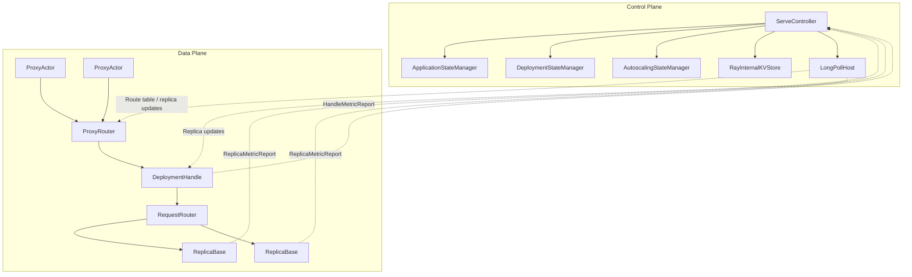
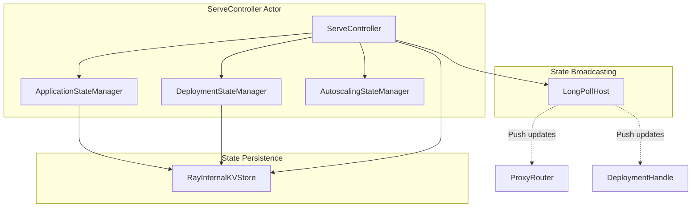

<!-- source: DeepWiki mcp.deepwiki.com · repo ray-project/ray · page 4.1 Architecture and Request Processing · fetched 2026-10-21 -->

# Architecture and Request Processing

<details>
<summary>Relevant source files</summary>

The following files were used as context for generating this wiki page:

- [doc/source/ray-core/api/core.rst](doc/source/ray-core/api/core.rst)
- [doc/source/serve/advanced-guides/grpc-guide.md](doc/source/serve/advanced-guides/grpc-guide.md)
- [doc/source/serve/doc_code/grpc_proxy/grpc_guide.py](doc/source/serve/doc_code/grpc_proxy/grpc_guide.py)
- [doc/source/serve/monitoring.md](doc/source/serve/monitoring.md)
- [python/ray/_private/log.py](python/ray/_private/log.py)
- [python/ray/_private/ray_logging/default_impl.py](python/ray/_private/ray_logging/default_impl.py)
- [python/ray/_private/ray_logging/logging_config.py](python/ray/_private/ray_logging/logging_config.py)
- [python/ray/llm/tests/serve/cpu/deployments/routers/test_make_fastapi_ingress.py](python/ray/llm/tests/serve/cpu/deployments/routers/test_make_fastapi_ingress.py)
- [python/ray/serve/_private/application_state.py](python/ray/serve/_private/application_state.py)
- [python/ray/serve/_private/build_app.py](python/ray/serve/_private/build_app.py)
- [python/ray/serve/_private/client.py](python/ray/serve/_private/client.py)
- [python/ray/serve/_private/common.py](python/ray/serve/_private/common.py)
- [python/ray/serve/_private/constants.py](python/ray/serve/_private/constants.py)
- [python/ray/serve/_private/controller.py](python/ray/serve/_private/controller.py)
- [python/ray/serve/_private/default_impl.py](python/ray/serve/_private/default_impl.py)
- [python/ray/serve/_private/deploy_utils.py](python/ray/serve/_private/deploy_utils.py)
- [python/ray/serve/_private/deployment_scheduler.py](python/ray/serve/_private/deployment_scheduler.py)
- [python/ray/serve/_private/deployment_state.py](python/ray/serve/_private/deployment_state.py)
- [python/ray/serve/_private/direct_ingress_grpc_util.py](python/ray/serve/_private/direct_ingress_grpc_util.py)
- [python/ray/serve/_private/grpc_util.py](python/ray/serve/_private/grpc_util.py)
- [python/ray/serve/_private/handle_options.py](python/ray/serve/_private/handle_options.py)
- [python/ray/serve/_private/haproxy.py](python/ray/serve/_private/haproxy.py)
- [python/ray/serve/_private/haproxy_metrics.py](python/ray/serve/_private/haproxy_metrics.py)
- [python/ray/serve/_private/haproxy_templates.py](python/ray/serve/_private/haproxy_templates.py)
- [python/ray/serve/_private/http_util.py](python/ray/serve/_private/http_util.py)
- [python/ray/serve/_private/ingress_request_router.lua.tmpl](python/ray/serve/_private/ingress_request_router.lua.tmpl)
- [python/ray/serve/_private/local_testing_mode.py](python/ray/serve/_private/local_testing_mode.py)
- [python/ray/serve/_private/logging_utils.py](python/ray/serve/_private/logging_utils.py)
- [python/ray/serve/_private/proxy.py](python/ray/serve/_private/proxy.py)
- [python/ray/serve/_private/replica.py](python/ray/serve/_private/replica.py)
- [python/ray/serve/_private/replica_result.py](python/ray/serve/_private/replica_result.py)
- [python/ray/serve/_private/request_router/__init__.py](python/ray/serve/_private/request_router/__init__.py)
- [python/ray/serve/_private/request_router/common.py](python/ray/serve/_private/request_router/common.py)
- [python/ray/serve/_private/request_router/pow_2_router.py](python/ray/serve/_private/request_router/pow_2_router.py)
- [python/ray/serve/_private/request_router/replica_wrapper.py](python/ray/serve/_private/request_router/replica_wrapper.py)
- [python/ray/serve/_private/request_router/request_router.py](python/ray/serve/_private/request_router/request_router.py)
- [python/ray/serve/_private/router.py](python/ray/serve/_private/router.py)
- [python/ray/serve/_private/utils.py](python/ray/serve/_private/utils.py)
- [python/ray/serve/experimental/round_robin_router.py](python/ray/serve/experimental/round_robin_router.py)
- [python/ray/serve/gang.py](python/ray/serve/gang.py)
- [python/ray/serve/handle.py](python/ray/serve/handle.py)
- [python/ray/serve/tests/BUILD.bazel](python/ray/serve/tests/BUILD.bazel)
- [python/ray/serve/tests/test_actor_replica_wrapper.py](python/ray/serve/tests/test_actor_replica_wrapper.py)
- [python/ray/serve/tests/test_backpressure.py](python/ray/serve/tests/test_backpressure.py)
- [python/ray/serve/tests/test_callback.py](python/ray/serve/tests/test_callback.py)
- [python/ray/serve/tests/test_cli_4.py](python/ray/serve/tests/test_cli_4.py)
- [python/ray/serve/tests/test_config_files/multi_fastapi.py](python/ray/serve/tests/test_config_files/multi_fastapi.py)
- [python/ray/serve/tests/test_controller_recovery.py](python/ray/serve/tests/test_controller_recovery.py)
- [python/ray/serve/tests/test_deployment_scheduler.py](python/ray/serve/tests/test_deployment_scheduler.py)
- [python/ray/serve/tests/test_direct_ingress.py](python/ray/serve/tests/test_direct_ingress.py)
- [python/ray/serve/tests/test_failure.py](python/ray/serve/tests/test_failure.py)
- [python/ray/serve/tests/test_fastapi.py](python/ray/serve/tests/test_fastapi.py)
- [python/ray/serve/tests/test_gcs_failure.py](python/ray/serve/tests/test_gcs_failure.py)
- [python/ray/serve/tests/test_grpc.py](python/ray/serve/tests/test_grpc.py)
- [python/ray/serve/tests/test_handle_1.py](python/ray/serve/tests/test_handle_1.py)
- [python/ray/serve/tests/test_handle_2.py](python/ray/serve/tests/test_handle_2.py)
- [python/ray/serve/tests/test_handle_cancellation.py](python/ray/serve/tests/test_handle_cancellation.py)
- [python/ray/serve/tests/test_haproxy.py](python/ray/serve/tests/test_haproxy.py)
- [python/ray/serve/tests/test_haproxy_api.py](python/ray/serve/tests/test_haproxy_api.py)
- [python/ray/serve/tests/test_haproxy_metrics.py](python/ray/serve/tests/test_haproxy_metrics.py)
- [python/ray/serve/tests/test_healthcheck.py](python/ray/serve/tests/test_healthcheck.py)
- [python/ray/serve/tests/test_http_cancellation.py](python/ray/serve/tests/test_http_cancellation.py)
- [python/ray/serve/tests/test_logging.py](python/ray/serve/tests/test_logging.py)
- [python/ray/serve/tests/test_metrics.py](python/ray/serve/tests/test_metrics.py)
- [python/ray/serve/tests/test_metrics_2.py](python/ray/serve/tests/test_metrics_2.py)
- [python/ray/serve/tests/test_metrics_3.py](python/ray/serve/tests/test_metrics_3.py)
- [python/ray/serve/tests/test_metrics_haproxy.py](python/ray/serve/tests/test_metrics_haproxy.py)
- [python/ray/serve/tests/test_multiplex.py](python/ray/serve/tests/test_multiplex.py)
- [python/ray/serve/tests/test_proxy.py](python/ray/serve/tests/test_proxy.py)
- [python/ray/serve/tests/test_replica_grpc_auth.py](python/ray/serve/tests/test_replica_grpc_auth.py)
- [python/ray/serve/tests/test_replica_placement_group.py](python/ray/serve/tests/test_replica_placement_group.py)
- [python/ray/serve/tests/test_request_timeout.py](python/ray/serve/tests/test_request_timeout.py)
- [python/ray/serve/tests/test_runtime_env_2.py](python/ray/serve/tests/test_runtime_env_2.py)
- [python/ray/serve/tests/unit/BUILD.bazel](python/ray/serve/tests/unit/BUILD.bazel)
- [python/ray/serve/tests/unit/test_application_state.py](python/ray/serve/tests/unit/test_application_state.py)
- [python/ray/serve/tests/unit/test_build_app.py](python/ray/serve/tests/unit/test_build_app.py)
- [python/ray/serve/tests/unit/test_deployment_scheduler.py](python/ray/serve/tests/unit/test_deployment_scheduler.py)
- [python/ray/serve/tests/unit/test_deployment_state.py](python/ray/serve/tests/unit/test_deployment_state.py)
- [python/ray/serve/tests/unit/test_grpc_util.py](python/ray/serve/tests/unit/test_grpc_util.py)
- [python/ray/serve/tests/unit/test_handle_options.py](python/ray/serve/tests/unit/test_handle_options.py)
- [python/ray/serve/tests/unit/test_haproxy_process_manager.py](python/ray/serve/tests/unit/test_haproxy_process_manager.py)
- [python/ray/serve/tests/unit/test_http_util.py](python/ray/serve/tests/unit/test_http_util.py)
- [python/ray/serve/tests/unit/test_local_testing_mode.py](python/ray/serve/tests/unit/test_local_testing_mode.py)
- [python/ray/serve/tests/unit/test_pow_2_request_router.py](python/ray/serve/tests/unit/test_pow_2_request_router.py)
- [python/ray/serve/tests/unit/test_round_robin_router.py](python/ray/serve/tests/unit/test_round_robin_router.py)
- [python/ray/serve/tests/unit/test_router.py](python/ray/serve/tests/unit/test_router.py)
- [python/ray/serve/tests/unit/test_user_callable_wrapper.py](python/ray/serve/tests/unit/test_user_callable_wrapper.py)
- [python/ray/tests/test_logging_2.py](python/ray/tests/test_logging_2.py)
- [python/ray/tests/test_util_helpers.py](python/ray/tests/test_util_helpers.py)
- [python/ray/util/__init__.py](python/ray/util/__init__.py)
- [python/ray/util/helpers.py](python/ray/util/helpers.py)

</details>


## Purpose and Scope

This document explains Ray Serve's architecture, separating the control plane (orchestration and state management) from the data plane (request routing and execution). It covers how the `ServeController`, `ApplicationStateManager`, and `DeploymentStateManager` orchestrate deployments, how HTTP/gRPC proxies route requests to replica actors via deployment handles, how metrics drive autoscaling decisions, and how state is persisted for fault tolerance.

For detailed documentation on the Serve public API schemas (`DeploymentConfig`, `ServeDeploySchema`), CLI tools, task processor/consumer utilities, and specific metrics-based autoscaling policies including gang scheduling, see [Serve Configuration, CLI, and Autoscaling](#4.1.1). For protocol-specific proxy implementations, see page 4.2. For the overall Ray distributed systems architecture, see page 1.1.

---

## Ray Serve Architecture Overview

Ray Serve implements a **control plane / data plane** separation where the control plane manages deployment lifecycle and makes scaling decisions, while the data plane handles request routing and execution.

**Control Plane vs Data Plane Architecture**



Sources: [python/ray/serve/_private/controller.py:133-190](), [python/ray/serve/_private/application_state.py:24-81](), [python/ray/serve/_private/deployment_state.py:54-97](), [python/ray/serve/_private/proxy.py:147-194]()

### Architectural Components

| Layer | Component | Primary Responsibilities | Code Entity / Actor |
|-------|-----------|-------------------------|---------------|
| **Control Plane** | `ServeController` | Overall orchestration, state persistence, long poll coordination | `ServeController` actor on head node [python/ray/serve/_private/controller.py:133-190]() |
| | `ApplicationStateManager` | Multi-application lifecycle management | `ApplicationStateManager` [python/ray/serve/_private/application_state.py:24-81]() |
| | `DeploymentStateManager` | Replica creation, health checks, scaling execution | `DeploymentStateManager` [python/ray/serve/_private/deployment_state.py:54-97]() |
| | `AutoscalingStateManager` | Metrics aggregation, scaling decisions | `AutoscalingStateManager` [python/ray/serve/_private/autoscaling_state.py:10-27]() |
| **Data Plane** | `GenericProxy` / `ProxyActor` | Protocol handling, request validation, route matching | `GenericProxy` / `ProxyActor` [python/ray/serve/_private/proxy.py:147-194]() |
| | `ProxyRouter` | Route pattern matching, handle lookup | `ProxyRouter` [python/ray/serve/_private/proxy_router.py]() |
| | `DeploymentHandle` | Request routing interface, metrics collection | `DeploymentHandle` [python/ray/serve/handle.py]() |
| | `RequestRouter` | Load balancing, replica selection | `RequestRouter` / `PowerOfTwoChoicesRequestRouter` [python/ray/serve/_private/router.py:67]() |
| | Replica Actors | User code execution, concurrency control | `ReplicaBase` [python/ray/serve/_private/replica.py]() |

Sources: [python/ray/serve/_private/controller.py:133-190](), [python/ray/serve/_private/application_state.py:24-81](), [python/ray/serve/_private/autoscaling_state.py:10-27](), [python/ray/serve/_private/proxy.py:147-194]()

---

## Control Plane Architecture

The control plane manages all deployment state, makes scaling decisions, and persists configuration for fault tolerance.

**Control Plane Component Relationships**



Sources: [python/ray/serve/_private/controller.py:133-190](), [python/ray/serve/_private/application_state.py:24-81](), [python/ray/serve/_private/storage/kv_store.py:116]()

### ServeController

The `ServeController` is a named, detached Ray actor running on the head node that orchestrates all Serve operations [python/ray/serve/_private/controller.py:133-190](). It runs a periodic control loop (`CONTROL_LOOP_INTERVAL_S`) that updates deployment states, checks replica health, executes autoscaling decisions, and broadcasts changes through `LongPollHost` [python/ray/serve/_private/constants.py:76-78]().

Sources: [python/ray/serve/_private/controller.py:133-190](), [python/ray/serve/_private/constants.py:76-78]()

### ApplicationStateManager

The `ApplicationStateManager` coordinates multi-application lifecycle management, building applications from schemas and tracking application status (`DEPLOYING`, `RUNNING`, `DEPLOY_FAILED`) [python/ray/serve/_private/application_state.py:24-81]().

Sources: [python/ray/serve/_private/application_state.py:24-81]()

### DeploymentStateManager

The `DeploymentStateManager` oversees individual deployment lifecycles, maintaining collections of `DeploymentState` objects and interacting with the `DeploymentScheduler` to scale, place, and recover replicas [python/ray/serve/_private/deployment_state.py:54-97]().

Sources: [python/ray/serve/_private/deployment_state.py:54-97]()

---

## Data Plane Architecture

The data plane handles request routing from proxies to replica actors, performing load balancing and execution.

### HTTP/gRPC Proxies

Proxies (`GenericProxy` and its implementations like `ProxyActor`) run as per-node actors parsing HTTP/gRPC traffic, matching request paths against routes via `ProxyRouter`, and forwarding requests to `DeploymentHandle` instances [python/ray/serve/_private/proxy.py:147-194]().

Sources: [python/ray/serve/_private/proxy.py:147-194]()

### DeploymentHandle and Request Routing

`DeploymentHandle` provides the programmatic client-side routing interface. It delegates request assignment to a `Router` wrapper (`AsyncioRouter`), which uses underlying load-balancing implementations such as `PowerOfTwoChoicesRequestRouter` to select optimal replicas based on queue lengths [python/ray/serve/_private/router.py:67]().

Sources: [python/ray/serve/handle.py](), [python/ray/serve/_private/router.py:67]()

### Replica Actors

Replicas (`ReplicaBase`) manage concurrency limits via internal semaphores and execute user code wrapped by `UserCallableWrapper`, reporting processing metrics back to the control plane [python/ray/serve/_private/replica.py:505-1660]().

Sources: [python/ray/serve/_private/replica.py:505-1660]()

---

## End-to-End Request Processing

**End-to-End Request Flow and Code Mapping**

```mermaid
sequenceDiagram
    participant Client
    participant Proxy["ProxyActor<br/>proxy_request()"]
    participant ProxyRouter["ProxyRouter<br/>match_route()"]
    participant Handle["DeploymentHandle<br/>remote()"]
    participant Router["AsyncioRouter<br/>assign_request()"]
    participant POW2["PowerOfTwoChoicesRequestRouter<br/>choose_replica()"]
    participant Replica["ReplicaBase<br/>handle_request()"]
    
    Client->>Proxy: Request (HTTP/gRPC)
    Proxy->>ProxyRouter: match_route()
    ProxyRouter-->>Proxy: EndpointInfo & Handle
    Proxy->>Handle: remote(*args, **kwargs)
    Handle->>Router: assign_request()
    Router->>POW2: choose_replica()
    POW2->>Replica: handle_request.remote()
    Replica-->>POW2: Response
    POW2-->>Router: Response
    Router-->>Handle: Response
    Handle-->>Proxy: Response
    Proxy-->>Client: HTTP/gRPC Response
```

Sources: [python/ray/serve/_private/proxy.py:420-501](), [python/ray/serve/_private/proxy_router.py](), [python/ray/serve/handle.py](), [python/ray/serve/_private/router.py:67](), [python/ray/serve/_private/replica.py:847-925]()

### Request Processing Stages

1. **Ingress**: `ProxyActor` receives incoming connections [python/ray/serve/_private/proxy.py:147-194]()
2. **Route Matching**: `ProxyRouter` identifies matching endpoint patterns [python/ray/serve/_private/proxy_router.py]()
3. **Handle Dispatch**: `DeploymentHandle` packages arguments into a invocation request [python/ray/serve/handle.py]()
4. **Router Selection**: `AsyncioRouter` and `PowerOfTwoChoicesRequestRouter` select the least-loaded replica [python/ray/serve/_private/router.py:67]()
5. **Execution**: `ReplicaBase` acquires concurrency permits and invokes user code via `UserCallableWrapper` [python/ray/serve/_private/replica.py:505-1660]()

Sources: [python/ray/serve/_private/proxy.py:147-194](), [python/ray/serve/_private/proxy_router.py](), [python/ray/serve/handle.py](), [python/ray/serve/_private/router.py:67](), [python/ray/serve/_private/replica.py:505-1660]()

---

## Metrics-Based Autoscaling

Ray Serve collects metrics from replicas (`ReplicaMetricsManager`) and handles (`RouterMetricsManager`) to drive autoscaling decisions through `AutoscalingStateManager` [python/ray/serve/_private/autoscaling_state.py:10-27]().

For detailed configuration schemas (`AutoscalingConfig`), custom autoscaling policies, and gang scheduling strategies, see [Serve Configuration, CLI, and Autoscaling](#4.1.1).

Sources: [python/ray/serve/_private/autoscaling_state.py:10-27](), [python/ray/serve/_private/replica.py:288-499](), [python/ray/serve/_private/router.py:105-196]()

---

## State Persistence and Recovery

The control plane persists configuration and state updates using `RayInternalKVStore` backed by Ray's GCS storage, enabling fault-tolerant recovery after controller crashes [python/ray/serve/_private/storage/kv_store.py:116]().

Checkpoints like `CONFIG_CHECKPOINT_KEY` and deployment state checkpoints ensure that upon restart, the `ServeController` can reconstruct application configurations and reconcile running replica actors [python/ray/serve/_private/controller.py:128-130]().

Sources: [python/ray/serve/_private/storage/kv_store.py:116](), [python/ray/serve/_private/controller.py:128-130]()

---

## Additional Implementation Details

### Long Poll State Broadcasting

State updates are broadcast efficiently across the cluster using `LongPollHost` and `LongPollClient` across channels such as `ROUTE_TABLE` and `RUNNING_REPLICAS`, avoiding polling overhead [python/ray/serve/_private/long_poll.py]().

Sources: [python/ray/serve/_private/long_poll.py]()

### HAProxy Integration

When enabled via configuration flags, `HAProxyManager` coordinates with HAProxy to supply advanced load-balancing topologies, health check verification, and dynamic proxy routing updates [python/ray/serve/_private/haproxy.py:1-200]().

Sources: [python/ray/serve/_private/haproxy.py:1-200]()

---

