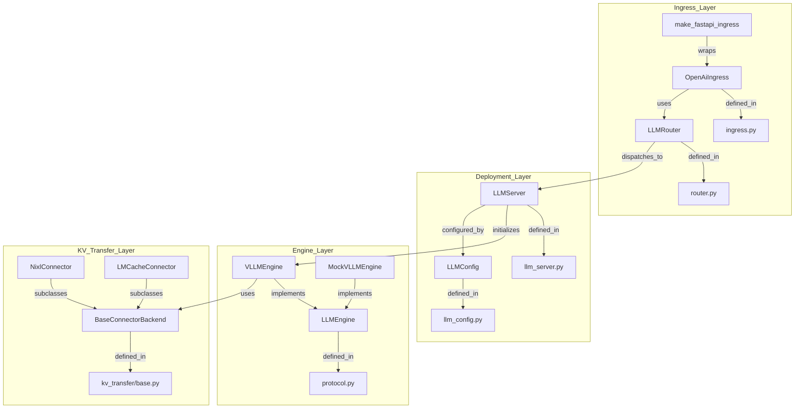
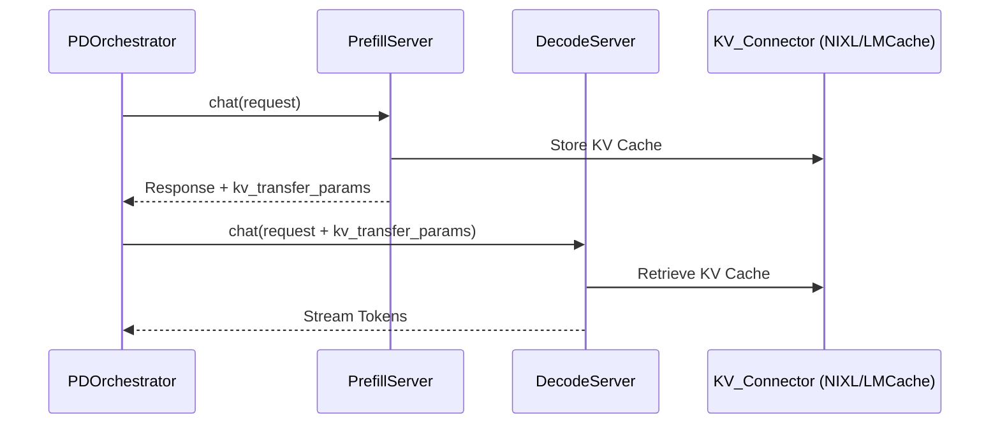

<!-- source: DeepWiki mcp.deepwiki.com · repo ray-project/ray · page 4.2 Ray Serve LLM · fetched 2026-10-21 -->

# Ray Serve LLM

Relevant source files

The following files were used as context for generating this wiki page:

- [doc/source/llm/doc_code/serve/multi_gpu/dp_basic_example.py](doc/source/llm/doc_code/serve/multi_gpu/dp_basic_example.py)
- [doc/source/llm/doc_code/serve/multi_gpu/dp_pd_example.py](doc/source/llm/doc_code/serve/multi_gpu/dp_pd_example.py)
- [doc/source/ray-core/doc_code/placement_group_example.py](doc/source/ray-core/doc_code/placement_group_example.py)
- [doc/source/ray-core/scheduling/placement-group.rst](doc/source/ray-core/scheduling/placement-group.rst)
- [doc/source/serve/llm/user-guides/data-parallel-attention.md](doc/source/serve/llm/user-guides/data-parallel-attention.md)
- [doc/source/serve/llm/user-guides/fractional-gpu.md](doc/source/serve/llm/user-guides/fractional-gpu.md)
- [python/ray/llm/_internal/common/dict_utils.py](python/ray/llm/_internal/common/dict_utils.py)
- [python/ray/llm/_internal/common/utils/import_utils.py](python/ray/llm/_internal/common/utils/import_utils.py)
- [python/ray/llm/_internal/serve/core/configs/accelerators.py](python/ray/llm/_internal/serve/core/configs/accelerators.py)
- [python/ray/llm/_internal/serve/core/configs/llm_config.py](python/ray/llm/_internal/serve/core/configs/llm_config.py)
- [python/ray/llm/_internal/serve/core/configs/openai_api_models.py](python/ray/llm/_internal/serve/core/configs/openai_api_models.py)
- [python/ray/llm/_internal/serve/core/engine/protocol.py](python/ray/llm/_internal/serve/core/engine/protocol.py)
- [python/ray/llm/_internal/serve/core/ingress/builder.py](python/ray/llm/_internal/serve/core/ingress/builder.py)
- [python/ray/llm/_internal/serve/core/ingress/dev_ingress.py](python/ray/llm/_internal/serve/core/ingress/dev_ingress.py)
- [python/ray/llm/_internal/serve/core/ingress/ingress.py](python/ray/llm/_internal/serve/core/ingress/ingress.py)
- [python/ray/llm/_internal/serve/core/ingress/mixins/__init__.py](python/ray/llm/_internal/serve/core/ingress/mixins/__init__.py)
- [python/ray/llm/_internal/serve/core/ingress/mixins/collective_rpc.py](python/ray/llm/_internal/serve/core/ingress/mixins/collective_rpc.py)
- [python/ray/llm/_internal/serve/core/protocol.py](python/ray/llm/_internal/serve/core/protocol.py)
- [python/ray/llm/_internal/serve/core/server/builder.py](python/ray/llm/_internal/serve/core/server/builder.py)
- [python/ray/llm/_internal/serve/core/server/llm_server.py](python/ray/llm/_internal/serve/core/server/llm_server.py)
- [python/ray/llm/_internal/serve/engines/vllm/kv_transfer/base.py](python/ray/llm/_internal/serve/engines/vllm/kv_transfer/base.py)
- [python/ray/llm/_internal/serve/engines/vllm/kv_transfer/factory.py](python/ray/llm/_internal/serve/engines/vllm/kv_transfer/factory.py)
- [python/ray/llm/_internal/serve/engines/vllm/kv_transfer/lmcache.py](python/ray/llm/_internal/serve/engines/vllm/kv_transfer/lmcache.py)
- [python/ray/llm/_internal/serve/engines/vllm/kv_transfer/moriio.py](python/ray/llm/_internal/serve/engines/vllm/kv_transfer/moriio.py)
- [python/ray/llm/_internal/serve/engines/vllm/kv_transfer/multi_connector.py](python/ray/llm/_internal/serve/engines/vllm/kv_transfer/multi_connector.py)
- [python/ray/llm/_internal/serve/engines/vllm/kv_transfer/nixl.py](python/ray/llm/_internal/serve/engines/vllm/kv_transfer/nixl.py)
- [python/ray/llm/_internal/serve/engines/vllm/vllm_engine.py](python/ray/llm/_internal/serve/engines/vllm/vllm_engine.py)
- [python/ray/llm/_internal/serve/engines/vllm/vllm_models.py](python/ray/llm/_internal/serve/engines/vllm/vllm_models.py)
- [python/ray/llm/_internal/serve/routing_policies/kv_aware/__init__.py](python/ray/llm/_internal/serve/routing_policies/kv_aware/__init__.py)
- [python/ray/llm/_internal/serve/serving_patterns/data_parallel/builder.py](python/ray/llm/_internal/serve/serving_patterns/data_parallel/builder.py)
- [python/ray/llm/_internal/serve/serving_patterns/data_parallel/dp_server.py](python/ray/llm/_internal/serve/serving_patterns/data_parallel/dp_server.py)
- [python/ray/llm/_internal/serve/serving_patterns/prefill_decode/builder.py](python/ray/llm/_internal/serve/serving_patterns/prefill_decode/builder.py)
- [python/ray/llm/_internal/serve/serving_patterns/prefill_decode/pd_server.py](python/ray/llm/_internal/serve/serving_patterns/prefill_decode/pd_server.py)
- [python/ray/llm/_internal/serve/utils/broadcast.py](python/ray/llm/_internal/serve/utils/broadcast.py)
- [python/ray/llm/_internal/serve/utils/pg_utils.py](python/ray/llm/_internal/serve/utils/pg_utils.py)
- [python/ray/llm/_internal/serve/utils/registry.py](python/ray/llm/_internal/serve/utils/registry.py)
- [python/ray/llm/tests/serve/conftest.py](python/ray/llm/tests/serve/conftest.py)
- [python/ray/llm/tests/serve/cpu/configs/test_models.py](python/ray/llm/tests/serve/cpu/configs/test_models.py)
- [python/ray/llm/tests/serve/cpu/configs/test_multi_node_placement_groups.py](python/ray/llm/tests/serve/cpu/configs/test_multi_node_placement_groups.py)
- [python/ray/llm/tests/serve/cpu/configs/test_openai_api_models_backends.py](python/ray/llm/tests/serve/cpu/configs/test_openai_api_models_backends.py)
- [python/ray/llm/tests/serve/cpu/deployments/conftest.py](python/ray/llm/tests/serve/cpu/deployments/conftest.py)
- [python/ray/llm/tests/serve/cpu/deployments/data_parallel/test_dp_server.py](python/ray/llm/tests/serve/cpu/deployments/data_parallel/test_dp_server.py)
- [python/ray/llm/tests/serve/cpu/deployments/llm/test_builder_llm_server.py](python/ray/llm/tests/serve/cpu/deployments/llm/test_builder_llm_server.py)
- [python/ray/llm/tests/serve/cpu/deployments/llm/test_llm_engine.py](python/ray/llm/tests/serve/cpu/deployments/llm/test_llm_engine.py)
- [python/ray/llm/tests/serve/cpu/deployments/llm/test_llm_engine_tpu.py](python/ray/llm/tests/serve/cpu/deployments/llm/test_llm_engine_tpu.py)
- [python/ray/llm/tests/serve/cpu/deployments/llm/test_llm_server.py](python/ray/llm/tests/serve/cpu/deployments/llm/test_llm_server.py)
- [python/ray/llm/tests/serve/cpu/deployments/llm/vllm/kv_transfer_backends/test_factory.py](python/ray/llm/tests/serve/cpu/deployments/llm/vllm/kv_transfer_backends/test_factory.py)
- [python/ray/llm/tests/serve/cpu/deployments/llm/vllm/kv_transfer_backends/test_lmcache_connector_v1.py](python/ray/llm/tests/serve/cpu/deployments/llm/vllm/kv_transfer_backends/test_lmcache_connector_v1.py)
- [python/ray/llm/tests/serve/cpu/deployments/llm/vllm/kv_transfer_backends/test_moriio_connector.py](python/ray/llm/tests/serve/cpu/deployments/llm/vllm/kv_transfer_backends/test_moriio_connector.py)
- [python/ray/llm/tests/serve/cpu/deployments/llm/vllm/kv_transfer_backends/test_multi_connector.py](python/ray/llm/tests/serve/cpu/deployments/llm/vllm/kv_transfer_backends/test_multi_connector.py)
- [python/ray/llm/tests/serve/cpu/deployments/llm/vllm/kv_transfer_backends/test_nixl_connector.py](python/ray/llm/tests/serve/cpu/deployments/llm/vllm/kv_transfer_backends/test_nixl_connector.py)
- [python/ray/llm/tests/serve/cpu/deployments/llm/vllm/kv_transfer_backends/test_pd_protocol.py](python/ray/llm/tests/serve/cpu/deployments/llm/vllm/kv_transfer_backends/test_pd_protocol.py)
- [python/ray/llm/tests/serve/cpu/deployments/llm/vllm/kv_transfer_backends/test_registry.py](python/ray/llm/tests/serve/cpu/deployments/llm/vllm/kv_transfer_backends/test_registry.py)
- [python/ray/llm/tests/serve/cpu/deployments/prefill_decode_disagg/test_prefill_decode_disagg.py](python/ray/llm/tests/serve/cpu/deployments/prefill_decode_disagg/test_prefill_decode_disagg.py)
- [python/ray/llm/tests/serve/cpu/deployments/routers/test_builder_ingress.py](python/ray/llm/tests/serve/cpu/deployments/routers/test_builder_ingress.py)
- [python/ray/llm/tests/serve/cpu/deployments/routers/test_dev_ingress.py](python/ray/llm/tests/serve/cpu/deployments/routers/test_dev_ingress.py)
- [python/ray/llm/tests/serve/cpu/deployments/routers/test_router.py](python/ray/llm/tests/serve/cpu/deployments/routers/test_router.py)
- [python/ray/llm/tests/serve/cpu/deployments/utils/test_batcher.py](python/ray/llm/tests/serve/cpu/deployments/utils/test_batcher.py)
- [python/ray/llm/tests/serve/gpu/deployments/llm/prefill_decode_disagg/test_prefill_decode_disagg_gpu.py](python/ray/llm/tests/serve/gpu/deployments/llm/prefill_decode_disagg/test_prefill_decode_disagg_gpu.py)
- [python/ray/llm/tests/serve/gpu/deployments/llm/vllm/test_vllm_engine_gpu.py](python/ray/llm/tests/serve/gpu/deployments/llm/vllm/test_vllm_engine_gpu.py)
- [python/ray/llm/tests/serve/mock_vllm_model.yaml](python/ray/llm/tests/serve/mock_vllm_model.yaml)
- [python/ray/llm/tests/serve/mock_vllm_model_no_accelerator.yaml](python/ray/llm/tests/serve/mock_vllm_model_no_accelerator.yaml)
- [python/ray/llm/tests/serve/mocks/mock_vllm_engine.py](python/ray/llm/tests/serve/mocks/mock_vllm_engine.py)
- [python/ray/llm/tests/serve/utils/conftest.py](python/ray/llm/tests/serve/utils/conftest.py)
- [python/ray/llm/tests/serve/utils/test_pg_utils.py](python/ray/llm/tests/serve/utils/test_pg_utils.py)
- [python/ray/llm/tests/serve/utils/testing_utils.py](python/ray/llm/tests/serve/utils/testing_utils.py)
- [python/ray/serve/llm/__init__.py](python/ray/serve/llm/__init__.py)
- [python/ray/serve/llm/deployment.py](python/ray/serve/llm/deployment.py)
- [python/ray/serve/llm/ingress.py](python/ray/serve/llm/ingress.py)
- [python/ray/serve/llm/openai_api_models.py](python/ray/serve/llm/openai_api_models.py)
- [python/ray/serve/llm/request_router.py](python/ray/serve/llm/request_router.py)
- [python/ray/serve/tests/unit/test_llm_imports.py](python/ray/serve/tests/unit/test_llm_imports.py)
- [python/ray/util/placement_group.py](python/ray/util/placement_group.py)
- [release/llm_tests/serve/configs/serve_llama_3dot1_8b_quantized_tp1_1p1d.yaml](release/llm_tests/serve/configs/serve_llama_3dot1_8b_quantized_tp1_1p1d.yaml)
- [release/llm_tests/serve/configs/serve_llama_3dot1_8b_quantized_tp1_2p6d.yaml](release/llm_tests/serve/configs/serve_llama_3dot1_8b_quantized_tp1_2p6d.yaml)
- [release/llm_tests/serve/rlhf_utils.py](release/llm_tests/serve/rlhf_utils.py)
- [release/llm_tests/serve/test_llm_serve_integration.py](release/llm_tests/serve/test_llm_serve_integration.py)
- [release/llm_tests/serve/test_llm_serve_multi_node_integration.py](release/llm_tests/serve/test_llm_serve_multi_node_integration.py)
- [release/llm_tests/serve/test_llm_serve_rlhf.py](release/llm_tests/serve/test_llm_serve_rlhf.py)
- [release/llm_tests/serve/test_llm_serve_sleep_wakeup.py](release/llm_tests/serve/test_llm_serve_sleep_wakeup.py)
- [release/llm_tests/serve/utils.py](release/llm_tests/serve/utils.py)

## Purpose and Scope
Ray Serve LLM provides a high-performance, extensible framework for serving Large Language Models (LLMs) on Ray. It abstracts complex distributed serving patterns—such as continuous batching, dynamic LoRA multiplexing, prefix-aware routing, KV cache transfer, and prefill/decode disaggregation—into a unified system that integrates natively with engines like vLLM. This page details the implementation, data flows, core classes, configuration systems, and deployment patterns.

Sources: [python/ray/llm/_internal/serve/core/server/llm_server.py:127-151](), [python/ray/llm/_internal/serve/core/configs/llm_config.py:152-178]()

---

## Core Architecture and Data Flow

The architecture is built around the `LLMServer` deployment class, which wraps model engines, and the `OpenAiIngress` router/ingress system, which provides standardized API endpoints.

### System Component Association (Code Entity Mapping)
The following diagram bridges natural language architecture concepts to their concrete code entities and files.

**Diagram: Ray Serve LLM Entity Mapping**

Sources: [python/ray/llm/_internal/serve/core/ingress/ingress.py:20-55](), [python/ray/llm/_internal/serve/core/server/llm_server.py:127-151](), [python/ray/llm/_internal/serve/core/configs/llm_config.py:152-170](), [python/ray/llm/_internal/serve/engines/vllm/vllm_engine.py:49-53](), [python/ray/llm/_internal/serve/engines/vllm/kv_transfer/base.py:34-45]()

### Request Lifecycle
1.  **Ingress Processing**: The `OpenAiIngress` receives incoming HTTP requests (e.g., `/v1/chat/completions`) and validates payloads against OpenAI-compatible Pydantic models [python/ray/llm/_internal/serve/core/ingress/ingress.py:119-133]().
2.  **Routing**: The `LLMRouter` parses the request body into a `routing_payload` and selects an appropriate replica via deployment handles [python/ray/llm/_internal/serve/core/ingress/router.py:134-160]().
3.  **Engine Execution**: The `LLMServer` replica receives the request and delegates inference tasks to its internal `LLMEngine` instance [python/ray/llm/_internal/serve/core/server/llm_server.py:175-186]().
4.  **Token Streaming**: Responses are yielded via an `AsyncGenerator`, allowing token-by-token streaming back through the ingress proxy [python/ray/llm/_internal/serve/core/server/llm_server.py:214-225]().

Sources: [python/ray/llm/_internal/serve/core/ingress/ingress.py:119-133](), [python/ray/llm/_internal/serve/core/ingress/router.py:134-160](), [python/ray/llm/_internal/serve/core/server/llm_server.py:175-225]()

---

## Configuration System (`LLMConfig`)

The `LLMConfig` class serves as the single source of truth for model deployments, combining model weights sources, hardware configurations, scaling policies, and engine arguments.

| Field | Type | Description |
| :--- | :--- | :--- |
| `model_loading_config` | `ModelLoadingConfig` | Defines `model_id` and `model_source` (HuggingFace, S3, GCS) [python/ray/llm/_internal/serve/core/configs/llm_config.py:125-148](). |
| `engine_kwargs` | `dict` | Keyword arguments passed directly to the engine (e.g., vLLM `max_model_len`, `tensor_parallel_size`) [python/ray/llm/_internal/serve/core/configs/llm_config.py:171-178](). |
| `accelerator_type` | `str` | Target hardware accelerator type (e.g., `"A100-40G"`, `"L4"`) [python/ray/llm/_internal/serve/core/configs/llm_config.py:180-183](). |
| `lora_config` | `LoraConfig` | Settings for dynamic LoRA adapter loading and multiplexing [python/ray/llm/_internal/serve/core/configs/llm_config.py:91-110](). |
| `placement_group_config`| `dict` | Ray resource bundles for scheduling distributed multi-node workers [python/ray/llm/_internal/serve/core/configs/llm_config.py:193-204](). |

Sources: [python/ray/llm/_internal/serve/core/configs/llm_config.py:91-204](), [python/ray/llm/tests/serve/cpu/configs/test_models.py:30-46]()

---

## Engine Integrations & Protocol

Ray Serve abstracts concrete inference engines behind the `LLMEngine` protocol, ensuring engine-agnostic server behavior.

### vLLM Integration
The `VLLMEngine` class wraps vLLM's `AsyncLLMEngine` (or `AsyncLLM` in newer vLLM versions) to execute batched, continuous generation.
*   **Initialization**: Resolves model paths from cloud mirrors and constructs `AsyncEngineArgs` [python/ray/llm/_internal/serve/engines/vllm/vllm_engine.py:22-28]()
*   **Distributed Execution**: Configures distributed workers using Ray placement groups and backend settings [python/ray/llm/_internal/serve/engines/vllm/vllm_models.py:148-185]().
*   **Metrics Collection**: Integrates Prometheus stat loggers via `RayPrometheusStatLogger` [release/llm_tests/serve/test_llm_serve_integration.py:10-11]().

Sources: [python/ray/llm/_internal/serve/engines/vllm/vllm_engine.py:22-28](), [python/ray/llm/_internal/serve/engines/vllm/vllm_models.py:148-185](), [release/llm_tests/serve/test_llm_serve_integration.py:10-48]()

---

## OpenAI-Compatible API Capabilities

The `LLMServer` class exposes a broad suite of endpoints compliant with OpenAI standards:
*   **Chat & Completions**: Standard text generation via `/v1/chat/completions` and `/v1/completions` [python/ray/llm/_internal/serve/core/ingress/ingress.py:124-125]().
*   **Embeddings**: Vector representations via `/v1/embeddings` [python/ray/llm/_internal/serve/core/ingress/ingress.py:126]().
*   **Transcription**: Speech-to-text processing via `/v1/audio/transcriptions` [python/ray/llm/_internal/serve/core/ingress/ingress.py:127-129]().
*   **Scoring & Tokenization**: Text scoring, tokenization (`/tokenize`), and detokenization (`/detokenize`) endpoints [python/ray/llm/_internal/serve/core/ingress/ingress.py:130-132]().

Sources: [python/ray/llm/_internal/serve/core/ingress/ingress.py:119-134](), [python/ray/llm/tests/serve/cpu/deployments/llm/test_llm_server.py:143-250]()

---

## LoRA Multiplexing

Ray Serve LLM supports multi-tenant serving of LoRA adapters on top of a shared base model deployment without duplicating base model weights in GPU memory.

1.  **Request Identification**: Client requests specify a target adapter via model naming or multiplexing request headers.
2.  **Dynamic Loading**: The `LLMServer` coordinates with `LoraModelLoader` to fetch adapter weights from cloud storage (`dynamic_lora_loading_path`) [python/ray/llm/_internal/serve/core/configs/llm_config.py:91-95](), [python/ray/llm/_internal/serve/core/server/llm_server.py:160-175]().
3.  **Engine Resolution**: The underlying engine invokes `resolve_lora()` to load the adapter into GPU memory prior to execution [python/ray/llm/tests/serve/mocks/mock_vllm_engine.py:73-76]().

Sources: [python/ray/llm/_internal/serve/core/configs/llm_config.py:91-110](), [python/ray/llm/_internal/serve/core/server/llm_server.py:160-175](), [python/ray/llm/tests/serve/mocks/mock_vllm_engine.py:73-76]()

---

## KV Cache Transfer and Prefill-Decode Disaggregation

Ray Serve supports advanced disaggregation patterns separating prefill (compute-bound) and decode (memory-bandwidth-bound) phases across distinct replica pools.

**Diagram: Prefill-Decode Disaggregation Flow**

Sources: [python/ray/llm/_internal/serve/serving_patterns/prefill_decode/pd_server.py](), [python/ray/llm/_internal/serve/engines/vllm/kv_transfer/base.py:34-45]()

*   **Connector Backends**: Data transfer across nodes is managed by connector implementations such as `NixlConnector` and `LMCacheConnector`, instantiated through the `KVConnectorBackendFactory` [python/ray/llm/_internal/serve/engines/vllm/kv_transfer/factory.py]().
*   **Configuration**: Enabled by specifying `kv_transfer_config` inside `engine_kwargs` [python/ray/llm/tests/serve/cpu/deployments/prefill_decode_disagg/test_prefill_decode_disagg.py]() and coordinating via `PDOrchestratorMixin`.

Sources: [python/ray/llm/_internal/serve/engines/vllm/kv_transfer/base.py:34-45](), [python/ray/llm/_internal/serve/engines/vllm/kv_transfer/factory.py](), [python/ray/llm/_internal/serve/serving_patterns/prefill_decode/pd_server.py]()

---

## Prefix-Aware Routing and Deployment Patterns

Ray Serve LLM features specialized routers and deployment patterns to optimize locality and throughput.

*   **Prefix-Aware Routing**: The `LLMRouter` inspects request prompt tokens and routes requests to replicas holding matching prefix KV caches in memory, maximizing cache hits.
*   **Data Parallelism**: The data parallel serving pattern (`build_dp_deployment`) coordinates multiple worker replicas across multi-node Ray clusters using placement groups and gang scheduling [release/llm_tests/serve/test_llm_serve_multi_node_integration.py:59-147]().
*   **Placement Groups**: Multi-node tensor/pipeline parallel configurations rely on Ray placement groups (`placement_group_config`) with `PACK` or `STRICT_PACK` strategies to ensure worker collocation [release/llm_tests/serve/test_llm_serve_multi_node_integration.py:66-70](), [doc/source/ray-core/scheduling/placement-group.rst:9-11]().

Sources: [python/ray/llm/_internal/serve/core/ingress/router.py](), [release/llm_tests/serve/test_llm_serve_multi_node_integration.py:59-147](), [doc/source/ray-core/scheduling/placement-group.rst:9-16]()

---

