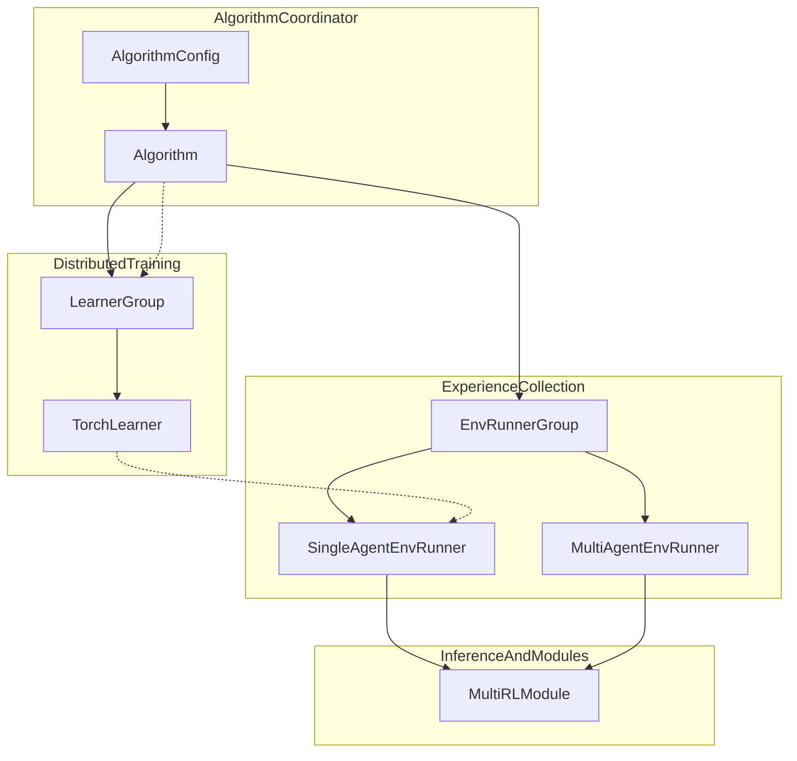
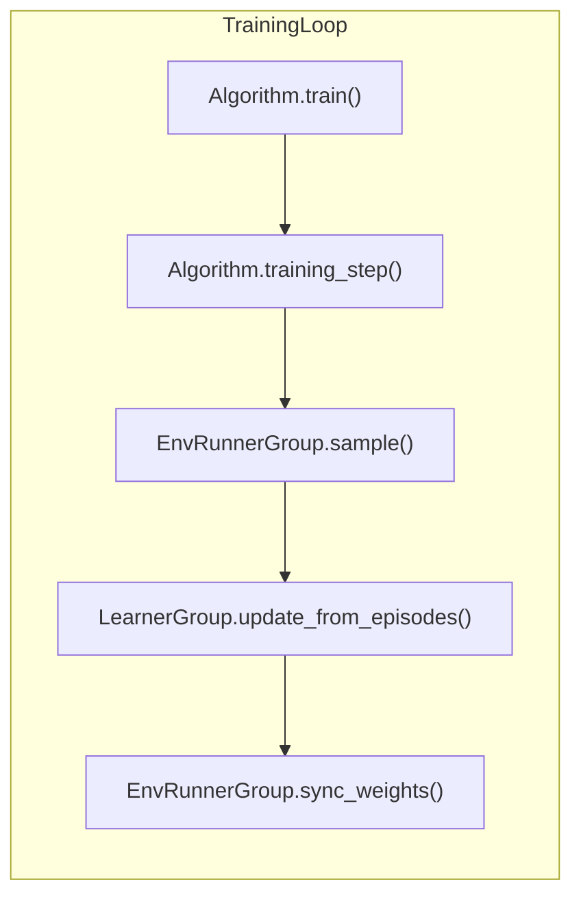

<!-- source: DeepWiki mcp.deepwiki.com · repo ray-project/ray · page 5 Ray RLlib · fetched 2026-10-21 -->

# Ray RLlib

Relevant source files

The following files were used as context for generating this wiki page:

- [.vale/styles/config/vocabularies/RLlib/accept.txt](.vale/styles/config/vocabularies/RLlib/accept.txt)
- [doc/source/_includes/rllib/new_api_stack.rst](doc/source/_includes/rllib/new_api_stack.rst)
- [doc/source/rllib/algorithm-config.rst](doc/source/rllib/algorithm-config.rst)
- [doc/source/rllib/checkpoints.rst](doc/source/rllib/checkpoints.rst)
- [doc/source/rllib/external-envs.rst](doc/source/rllib/external-envs.rst)
- [doc/source/rllib/getting-started.rst](doc/source/rllib/getting-started.rst)
- [doc/source/rllib/images/acrobot-v1.png](doc/source/rllib/images/acrobot-v1.png)
- [doc/source/rllib/images/algos/cql-architecture.svg](doc/source/rllib/images/algos/cql-architecture.svg)
- [doc/source/rllib/images/rllib-new-api-stack-simple.svg](doc/source/rllib/images/rllib-new-api-stack-simple.svg)
- [doc/source/rllib/images/scaling_axes_overview.svg](doc/source/rllib/images/scaling_axes_overview.svg)
- [doc/source/rllib/index.rst](doc/source/rllib/index.rst)
- [doc/source/rllib/key-concepts.rst](doc/source/rllib/key-concepts.rst)
- [doc/source/rllib/metrics-logger.rst](doc/source/rllib/metrics-logger.rst)
- [doc/source/rllib/new-api-stack-migration-guide.rst](doc/source/rllib/new-api-stack-migration-guide.rst)
- [doc/source/rllib/package_ref/callback.rst](doc/source/rllib/package_ref/callback.rst)
- [doc/source/rllib/package_ref/index.rst](doc/source/rllib/package_ref/index.rst)
- [doc/source/rllib/rl-modules.rst](doc/source/rllib/rl-modules.rst)
- [doc/source/rllib/rllib-advanced-api.rst](doc/source/rllib/rllib-advanced-api.rst)
- [doc/source/rllib/rllib-algorithms.rst](doc/source/rllib/rllib-algorithms.rst)
- [doc/source/rllib/rllib-callback.rst](doc/source/rllib/rllib-callback.rst)
- [doc/source/rllib/rllib-dev.rst](doc/source/rllib/rllib-dev.rst)
- [doc/source/rllib/rllib-env.rst](doc/source/rllib/rllib-env.rst)
- [doc/source/rllib/rllib-examples.rst](doc/source/rllib/rllib-examples.rst)
- [doc/source/rllib/rllib-fault-tolerance.rst](doc/source/rllib/rllib-fault-tolerance.rst)
- [doc/source/rllib/user-guides.rst](doc/source/rllib/user-guides.rst)
- [rllib/algorithms/algorithm.py](rllib/algorithms/algorithm.py)
- [rllib/algorithms/algorithm_config.py](rllib/algorithms/algorithm_config.py)
- [rllib/algorithms/appo/appo.py](rllib/algorithms/appo/appo.py)
- [rllib/algorithms/appo/appo_learner.py](rllib/algorithms/appo/appo_learner.py)
- [rllib/algorithms/appo/appo_rl_module.py](rllib/algorithms/appo/appo_rl_module.py)
- [rllib/algorithms/appo/tests/test_appo_learner.py](rllib/algorithms/appo/tests/test_appo_learner.py)
- [rllib/algorithms/appo/torch/appo_torch_learner.py](rllib/algorithms/appo/torch/appo_torch_learner.py)
- [rllib/algorithms/appo/utils.py](rllib/algorithms/appo/utils.py)
- [rllib/algorithms/impala/impala.py](rllib/algorithms/impala/impala.py)
- [rllib/algorithms/impala/impala_learner.py](rllib/algorithms/impala/impala_learner.py)
- [rllib/algorithms/tests/test_algorithm.py](rllib/algorithms/tests/test_algorithm.py)
- [rllib/algorithms/utils.py](rllib/algorithms/utils.py)
- [rllib/core/learner/learner.py](rllib/core/learner/learner.py)
- [rllib/core/learner/learner_group.py](rllib/core/learner/learner_group.py)
- [rllib/core/learner/tests/test_learner_group.py](rllib/core/learner/tests/test_learner_group.py)
- [rllib/core/learner/torch/torch_learner.py](rllib/core/learner/torch/torch_learner.py)
- [rllib/core/rl_module/multi_rl_module.py](rllib/core/rl_module/multi_rl_module.py)
- [rllib/core/rl_module/rl_module.py](rllib/core/rl_module/rl_module.py)
- [rllib/core/rl_module/torch/torch_rl_module.py](rllib/core/rl_module/torch/torch_rl_module.py)
- [rllib/env/env_runner.py](rllib/env/env_runner.py)
- [rllib/env/env_runner_group.py](rllib/env/env_runner_group.py)
- [rllib/env/multi_agent_env_runner.py](rllib/env/multi_agent_env_runner.py)
- [rllib/env/single_agent_env_runner.py](rllib/env/single_agent_env_runner.py)
- [rllib/evaluation/rollout_worker.py](rllib/evaluation/rollout_worker.py)
- [rllib/execution/rollout_ops.py](rllib/execution/rollout_ops.py)
- [rllib/utils/actor_manager.py](rllib/utils/actor_manager.py)
- [rllib/utils/metrics/__init__.py](rllib/utils/metrics/__init__.py)
- [rllib/utils/test_utils.py](rllib/utils/test_utils.py)

## Purpose and Scope

Ray RLlib is a scalable reinforcement learning library built on Ray. It provides a unified framework for training RL agents across multiple algorithms (PPO, IMPALA, DQN, etc.) with support for distributed training, multi-agent scenarios, and optimization techniques. This page provides a high-level overview of RLlib's core architecture, including training orchestration via `Algorithm` and `AlgorithmConfig`, experience collection through `EnvRunnerGroup`, and distributed model updates via `LearnerGroup`.

For deeper technical details, refer to the child pages:
- For training architectures, `AlgorithmConfig`, `RLModule`, fault tolerance, and algorithm specifications, see [Training Architecture and Configuration](#5.1).
- For environment abstractions, episode data structures (`SingleAgentEpisode`, `MultiAgentEpisode`), and `ConnectorV2` pipelines, see [Environments, Episodes, and Connectors](#5.2).

Sources: [rllib/algorithms/algorithm.py:210-216](), [rllib/algorithms/algorithm_config.py:109-138]()

---

## Core Architecture

RLlib follows a distributed actor-based architecture where independent components coordinate to collect experience data and train neural network policies.

### System Overview

Title: RLlib Distributed System Overview

Sources: [rllib/algorithms/algorithm.py:208-253](), [rllib/algorithms/algorithm_config.py:109-138](), [rllib/env/env_runner_group.py:70-85]()

### Key Components

| Component | Code Entity / Class | Purpose |
|-----------|---------------------|---------|
| Algorithm Coordinator | `ray.rllib.algorithms.algorithm.Algorithm` | Coordinates training iterations, workers, and learners |
| Configuration | `ray.rllib.algorithms.algorithm_config.AlgorithmConfig` | Fluent builder config for all parameters |
| Environment Runner | `ray.rllib.env.env_runner.EnvRunner` | Base class for environment interaction and sampling |
| Runner Group | `ray.rllib.env.env_runner_group.EnvRunnerGroup` | Manages distributed `EnvRunner` actors |
| Learner | `ray.rllib.core.learner.learner.Learner` | Computes losses and updates neural network weights |
| Learner Group | `ray.rllib.core.learner.learner_group.LearnerGroup` | Coordinates distributed `Learner` workers |
| RL Module | `ray.rllib.core.rl_module.rl_module.RLModule` | Neural network policy and value function abstraction |

Sources: [rllib/algorithms/algorithm.py:208-216](), [rllib/algorithms/algorithm_config.py:109-138](), [rllib/env/env_runner.py:36-45](), [rllib/env/env_runner_group.py:70-75](), [rllib/core/learner/learner.py:112-118]()

---

## Training Orchestration and Algorithm Execution

The `Algorithm` class ([rllib/algorithms/algorithm.py:210]()) serves as the central control plane coordinator. It inherits from `Trainable` and `Checkpointable`, driving training iterations by sampling experience batches from the `EnvRunnerGroup` and dispatching them to the `LearnerGroup` for weight updates.

Title: Algorithm Training Orchestration Flow

Sources: [rllib/algorithms/algorithm.py:208-216](), [rllib/env/env_runner_group.py:70-85]()

For complete details on configuration options, algorithm subclasses (PPO, IMPALA, DQN, SAC), and fault tolerance via `FaultTolerantActorManager`, see [Training Architecture and Configuration](#5.1).

---

## Environments, Episodes, and Data Pipelines

RLlib abstracts environment interactions using vectorized wrappers and typed episode containers (`SingleAgentEpisode` and `MultiAgentEpisode`). Data flowing between environments, neural network modules, and learners is transformed via `ConnectorV2` pipelines (`EnvToModule` and `LearnerConnector`).

For comprehensive documentation on environment wrappers, infinite-lookback buffers, and custom `ConnectorV2` components, see [Environments, Episodes, and Connectors](#5.2).

Sources: [rllib/env/single_agent_env_runner.py:68-127](), [rllib/env/multi_agent_env_runner.py:73-140]()

---

## Child Pages

- [Training Architecture and Configuration](#5.1)
- [Environments, Episodes, and Connectors](#5.2)

---

