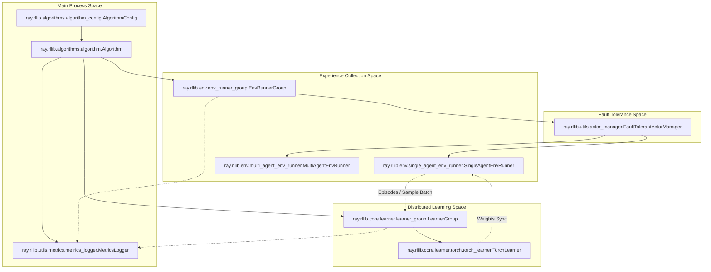
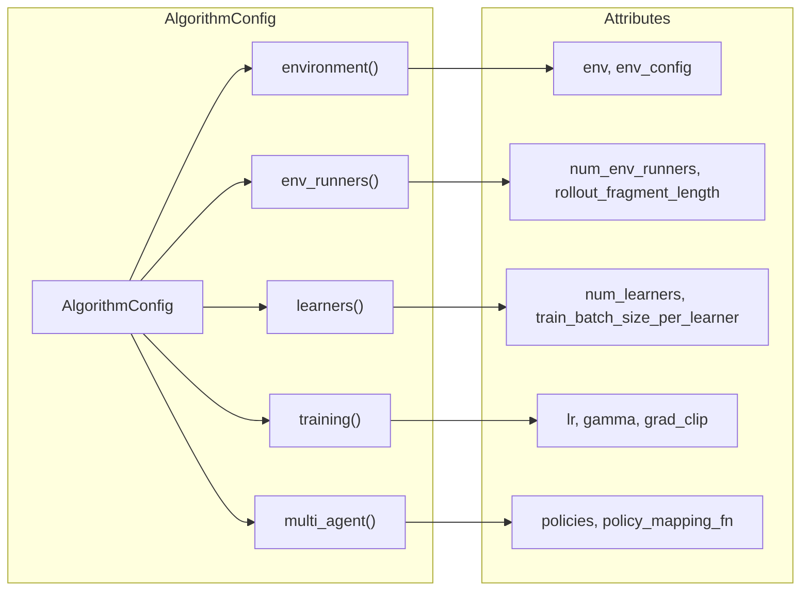
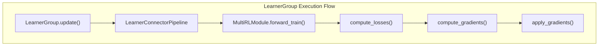

<!-- source: DeepWiki mcp.deepwiki.com · repo ray-project/ray · page 5.1 Training Architecture and Configuration · fetched 2026-10-21 -->

# Training Architecture and Configuration

Relevant source files

The following files were used as context for generating this wiki page:

- [rllib/BUILD.bazel](rllib/BUILD.bazel)
- [rllib/algorithms/algorithm.py](rllib/algorithms/algorithm.py)
- [rllib/algorithms/algorithm_config.py](rllib/algorithms/algorithm_config.py)
- [rllib/algorithms/appo/appo.py](rllib/algorithms/appo/appo.py)
- [rllib/algorithms/appo/appo_learner.py](rllib/algorithms/appo/appo_learner.py)
- [rllib/algorithms/appo/appo_rl_module.py](rllib/algorithms/appo/appo_rl_module.py)
- [rllib/algorithms/appo/tests/test_appo_learner.py](rllib/algorithms/appo/tests/test_appo_learner.py)
- [rllib/algorithms/appo/torch/appo_torch_learner.py](rllib/algorithms/appo/torch/appo_torch_learner.py)
- [rllib/algorithms/appo/utils.py](rllib/algorithms/appo/utils.py)
- [rllib/algorithms/bc/bc.py](rllib/algorithms/bc/bc.py)
- [rllib/algorithms/cql/cql.py](rllib/algorithms/cql/cql.py)
- [rllib/algorithms/cql/torch/cql_torch_learner.py](rllib/algorithms/cql/torch/cql_torch_learner.py)
- [rllib/algorithms/cql/torch/default_cql_torch_rl_module.py](rllib/algorithms/cql/torch/default_cql_torch_rl_module.py)
- [rllib/algorithms/dqn/dqn.py](rllib/algorithms/dqn/dqn.py)
- [rllib/algorithms/dreamerv3/dreamerv3.py](rllib/algorithms/dreamerv3/dreamerv3.py)
- [rllib/algorithms/impala/impala.py](rllib/algorithms/impala/impala.py)
- [rllib/algorithms/impala/impala_learner.py](rllib/algorithms/impala/impala_learner.py)
- [rllib/algorithms/marwil/marwil.py](rllib/algorithms/marwil/marwil.py)
- [rllib/algorithms/marwil/tests/test_marwil.py](rllib/algorithms/marwil/tests/test_marwil.py)
- [rllib/algorithms/ppo/ppo.py](rllib/algorithms/ppo/ppo.py)
- [rllib/algorithms/sac/sac.py](rllib/algorithms/sac/sac.py)
- [rllib/algorithms/sac/sac_learner.py](rllib/algorithms/sac/sac_learner.py)
- [rllib/algorithms/sac/torch/default_sac_torch_rl_module.py](rllib/algorithms/sac/torch/default_sac_torch_rl_module.py)
- [rllib/algorithms/sac/torch/sac_torch_learner.py](rllib/algorithms/sac/torch/sac_torch_learner.py)
- [rllib/algorithms/tests/test_algorithm.py](rllib/algorithms/tests/test_algorithm.py)
- [rllib/algorithms/tqc/tests/test_default_tqc_rl_module.py](rllib/algorithms/tqc/tests/test_default_tqc_rl_module.py)
- [rllib/algorithms/tqc/torch/default_tqc_torch_rl_module.py](rllib/algorithms/tqc/torch/default_tqc_torch_rl_module.py)
- [rllib/algorithms/utils.py](rllib/algorithms/utils.py)
- [rllib/core/distribution/distribution.py](rllib/core/distribution/distribution.py)
- [rllib/core/distribution/torch/tests/__init__.py](rllib/core/distribution/torch/tests/__init__.py)
- [rllib/core/distribution/torch/tests/test_torch_squashed_gaussian.py](rllib/core/distribution/torch/tests/test_torch_squashed_gaussian.py)
- [rllib/core/distribution/torch/torch_distribution.py](rllib/core/distribution/torch/torch_distribution.py)
- [rllib/core/learner/learner.py](rllib/core/learner/learner.py)
- [rllib/core/learner/learner_group.py](rllib/core/learner/learner_group.py)
- [rllib/core/learner/tests/test_learner_group.py](rllib/core/learner/tests/test_learner_group.py)
- [rllib/core/learner/torch/torch_learner.py](rllib/core/learner/torch/torch_learner.py)
- [rllib/core/models/base.py](rllib/core/models/base.py)
- [rllib/env/env_runner.py](rllib/env/env_runner.py)
- [rllib/env/env_runner_group.py](rllib/env/env_runner_group.py)
- [rllib/env/multi_agent_env_runner.py](rllib/env/multi_agent_env_runner.py)
- [rllib/env/single_agent_env_runner.py](rllib/env/single_agent_env_runner.py)
- [rllib/evaluation/rollout_worker.py](rllib/evaluation/rollout_worker.py)
- [rllib/examples/envs/env_rendering_and_recording.py](rllib/examples/envs/env_rendering_and_recording.py)
- [rllib/examples/metrics/custom_metrics_in_env_runners.py](rllib/examples/metrics/custom_metrics_in_env_runners.py)
- [rllib/examples/ray_tune/appo_hyperparameter_tune.py](rllib/examples/ray_tune/appo_hyperparameter_tune.py)
- [rllib/execution/rollout_ops.py](rllib/execution/rollout_ops.py)
- [rllib/offline/offline_data.py](rllib/offline/offline_data.py)
- [rllib/offline/offline_env_runner.py](rllib/offline/offline_env_runner.py)
- [rllib/offline/offline_prelearner.py](rllib/offline/offline_prelearner.py)
- [rllib/offline/tests/test_offline_data.py](rllib/offline/tests/test_offline_data.py)
- [rllib/offline/tests/test_offline_env_runner.py](rllib/offline/tests/test_offline_env_runner.py)
- [rllib/offline/tests/test_offline_prelearner.py](rllib/offline/tests/test_offline_prelearner.py)
- [rllib/utils/actor_manager.py](rllib/utils/actor_manager.py)
- [rllib/utils/metrics/__init__.py](rllib/utils/metrics/__init__.py)
- [rllib/utils/metrics/metrics_logger.py](rllib/utils/metrics/metrics_logger.py)
- [rllib/utils/metrics/stats/ema.py](rllib/utils/metrics/stats/ema.py)
- [rllib/utils/metrics/tests/test_metrics_logger.py](rllib/utils/metrics/tests/test_metrics_logger.py)
- [rllib/utils/metrics/tests/test_stats.py](rllib/utils/metrics/tests/test_stats.py)
- [rllib/utils/test_utils.py](rllib/utils/test_utils.py)

This page documents RLlib's training architecture, focusing on how the `Algorithm` class orchestrates distributed reinforcement learning training. It covers the configuration system (`AlgorithmConfig`), experience collection via `EnvRunnerGroup` and `EnvRunner` actors, distributed learning via `LearnerGroup` and `Learner` actors, the `RLModule` abstraction, connector pipelines for data transformation, multi-agent support, fault tolerance mechanisms via `FaultTolerantActorManager`, and `MetricsLogger` / offline RL pipelines.

For information about specific RLModule implementations and model architectures, see the RLModule documentation. For details on the underlying Ray Core infrastructure that enables distributed execution, see [2.1]().

Sources:
- [rllib/algorithms/algorithm.py:208-293]()
- [rllib/env/env_runner_group.py:70-226]()
- [rllib/core/learner/learner_group.py:112-220]()

## Training Loop Overview

RLlib's training architecture follows a distributed actor-based pattern where the `Algorithm` orchestrates parallel experience collection and model updates. The system separates environment interaction (handled by `EnvRunner` actors) from learning (handled by `Learner` actors), enabling efficient scaling across clusters.

*Diagram 1: Code Entity Mapping for RLlib Training Architecture.*

Sources:
- [rllib/algorithms/algorithm.py:210-250]()
- [rllib/algorithms/algorithm_config.py:109-138]()
- [rllib/env/env_runner_group.py:70-142]()
- [rllib/core/learner/learner_group.py:112-150]()
- [rllib/utils/actor_manager.py:42-100]()
- [rllib/utils/metrics/metrics_logger.py:116-152]()

## Configuration System

The `AlgorithmConfig` class [rllib/algorithms/algorithm_config.py:109-138]() provides a fluent API for configuring all aspects of RLlib training. It uses method chaining to organize settings into logical categories: environment, env_runners, learners, training, multi_agent, evaluation, and logging.

*Diagram 2: AlgorithmConfig Fluent Builder API.*

### Core Configuration Attributes

| Category | Key Attributes | Description |
|----------|---------------|-------------|
| Environment | `env`, `env_config`, `observation_space`, `action_space` | Environment specification and spaces [rllib/algorithms/algorithm_config.py:734-754]() |
| EnvRunners | `num_env_runners`, `num_envs_per_env_runner`, `rollout_fragment_length`, `batch_mode` | Experience collection parallelism and sampling settings [rllib/algorithms/algorithm_config.py:901-925]() |
| Learners | `num_learners`, `num_gpus_per_learner`, `train_batch_size_per_learner` | Learning parallelism and batch size [rllib/algorithms/algorithm_config.py:1264-1280]() |
| Training | `lr`, `gamma`, `grad_clip`, `num_epochs`, `minibatch_size` | Optimization hyperparameters [rllib/algorithms/algorithm_config.py:1515-1550]() |
| Multi-Agent | `policies`, `policy_mapping_fn`, `count_steps_by` | Multi-agent policy configuration [rllib/algorithms/algorithm_config.py:1930-1960]() |
| Callbacks | `callbacks_class` | User hooks for customization [rllib/algorithms/algorithm_config.py:2308-2315]() |

Sources:
- [rllib/algorithms/algorithm_config.py:109-180]()
- [rllib/algorithms/algorithm_config.py:734-754]()
- [rllib/algorithms/algorithm_config.py:901-925]()
- [rllib/algorithms/algorithm_config.py:1264-1280]()

## Algorithm Class

The `Algorithm` class [rllib/algorithms/algorithm.py:210-250]() is the central orchestrator for RLlib training. It inherits from `Trainable` and `Checkpointable`, managing the training loop, coordinating between `EnvRunnerGroup` and `LearnerGroup`, handling checkpoints, and aggregating metrics via `MetricsLogger`.

Sources:
- [rllib/algorithms/algorithm.py:208-293]()

## Experience Collection via EnvRunnerGroup

RLlib's experience collection system uses `EnvRunnerGroup` [rllib/env/env_runner_group.py:70-142]() to manage parallel `EnvRunner` actors. Each `EnvRunner` (`SingleAgentEnvRunner` [rllib/env/single_agent_env_runner.py:68-127]() or `MultiAgentEnvRunner` [rllib/env/multi_agent_env_runner.py:73-136]()) contains its own vectorized environment instance and `RLModule` for action inference.

Sources:
- [rllib/env/env_runner_group.py:70-179]()
- [rllib/env/single_agent_env_runner.py:67-127]()
- [rllib/env/multi_agent_env_runner.py:71-136]()

## Distributed Learning via LearnerGroup

The learning architecture mirrors experience collection: `LearnerGroup` [rllib/core/learner/learner_group.py:112-150]() manages parallel `Learner` actors (such as `TorchLearner` [rllib/core/learner/torch/torch_learner.py:67-136]()), where each learner owns model weights, optimizers, and runs gradient updates.

*Diagram 3: Learner Update Pipeline.*

Sources:
- [rllib/core/learner/learner_group.py:112-150]()
- [rllib/core/learner/learner.py:112-134]()
- [rllib/core/learner/torch/torch_learner.py:67-136]()

## RLModule Abstraction

The `RLModule` abstraction provides a clean separation of neural network logic from algorithms and environment execution, supporting single and multi-agent setups via `MultiRLModule`.

Sources:
- [rllib/core/rl_module/rl_module.py:1-50]()
- [rllib/core/rl_module/multi_rl_module.py:1-50]()

## Fault Tolerance via actor_manager

RLlib provides robust fault tolerance for remote actors using `FaultTolerantActorManager` [rllib/utils/actor_manager.py:42-100](). If an `EnvRunner` or `Learner` worker fails, the manager detects the failure, restarts the actor, and restores checkpoints.

Sources:
- [rllib/utils/actor_manager.py:42-100]()
- [rllib/algorithms/algorithm_config.py:587-603]()

## MetricsLogger and Offline RL Pipelines

Metrics are aggregated hierarchically across workers using `MetricsLogger` [rllib/utils/metrics/metrics_logger.py:116-152](). For offline RL, `OfflineData` and `OfflinePreLearner` [rllib/offline/offline_prelearner.py:104-143]() utilize Ray Data datasets to transform stored trajectories into training batches.

Sources:
- [rllib/utils/metrics/metrics_logger.py:116-152]()
- [rllib/offline/offline_prelearner.py:104-143]()
- [rllib/offline/offline_data.py:1-50]()

---

