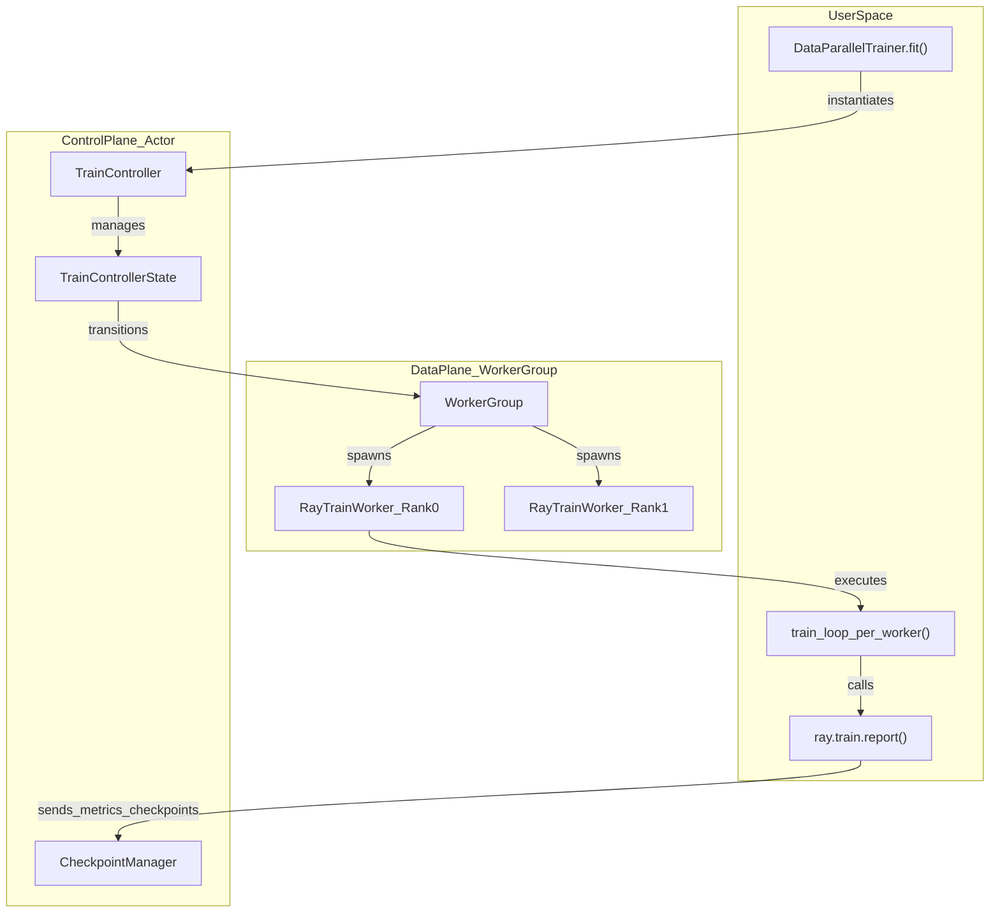
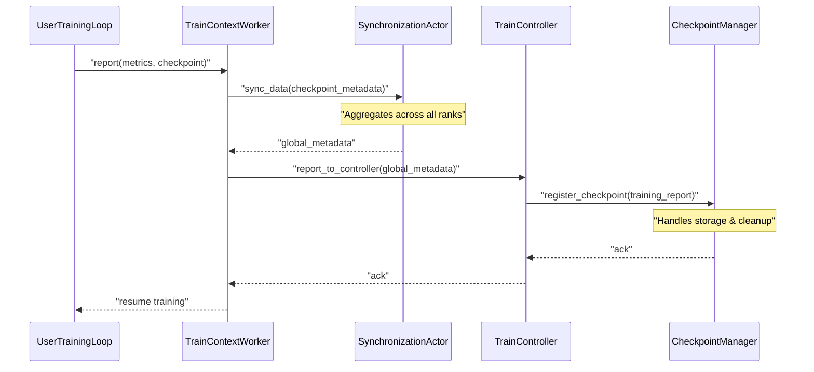

<!-- source: DeepWiki mcp.deepwiki.com · repo ray-project/ray · page 6 Ray Train · fetched 2026-10-21 -->

# Ray Train

Relevant source files

The following files were used as context for generating this wiki page:

- [python/ray/air/BUILD.bazel](python/ray/air/BUILD.bazel)
- [python/ray/air/__init__.py](python/ray/air/__init__.py)
- [python/ray/air/config.py](python/ray/air/config.py)
- [python/ray/air/result.py](python/ray/air/result.py)
- [python/ray/air/tests/conftest.py](python/ray/air/tests/conftest.py)
- [python/ray/data/test.bzl](python/ray/data/test.bzl)
- [python/ray/data/tests/doctest_pytest_plugin.py](python/ray/data/tests/doctest_pytest_plugin.py)
- [python/ray/train/__init__.py](python/ray/train/__init__.py)
- [python/ray/train/collective/__init__.py](python/ray/train/collective/__init__.py)
- [python/ray/train/collective/collectives.py](python/ray/train/collective/collectives.py)
- [python/ray/train/v2/BUILD.bazel](python/ray/train/v2/BUILD.bazel)
- [python/ray/train/v2/_internal/callbacks/datasets.py](python/ray/train/v2/_internal/callbacks/datasets.py)
- [python/ray/train/v2/_internal/callbacks/user_callback.py](python/ray/train/v2/_internal/callbacks/user_callback.py)
- [python/ray/train/v2/_internal/constants.py](python/ray/train/v2/_internal/constants.py)
- [python/ray/train/v2/_internal/data_integration/dataset_manager.py](python/ray/train/v2/_internal/data_integration/dataset_manager.py)
- [python/ray/train/v2/_internal/data_integration/interfaces.py](python/ray/train/v2/_internal/data_integration/interfaces.py)
- [python/ray/train/v2/_internal/execution/callback.py](python/ray/train/v2/_internal/execution/callback.py)
- [python/ray/train/v2/_internal/execution/checkpoint/checkpoint_manager.py](python/ray/train/v2/_internal/execution/checkpoint/checkpoint_manager.py)
- [python/ray/train/v2/_internal/execution/checkpoint/report_handler.py](python/ray/train/v2/_internal/execution/checkpoint/report_handler.py)
- [python/ray/train/v2/_internal/execution/checkpoint/validation_manager.py](python/ray/train/v2/_internal/execution/checkpoint/validation_manager.py)
- [python/ray/train/v2/_internal/execution/collective_impl.py](python/ray/train/v2/_internal/execution/collective_impl.py)
- [python/ray/train/v2/_internal/execution/context.py](python/ray/train/v2/_internal/execution/context.py)
- [python/ray/train/v2/_internal/execution/controller/controller.py](python/ray/train/v2/_internal/execution/controller/controller.py)
- [python/ray/train/v2/_internal/execution/storage.py](python/ray/train/v2/_internal/execution/storage.py)
- [python/ray/train/v2/_internal/execution/train_fn_utils.py](python/ray/train/v2/_internal/execution/train_fn_utils.py)
- [python/ray/train/v2/_internal/execution/worker_group/thread_runner.py](python/ray/train/v2/_internal/execution/worker_group/thread_runner.py)
- [python/ray/train/v2/_internal/execution/worker_group/worker.py](python/ray/train/v2/_internal/execution/worker_group/worker.py)
- [python/ray/train/v2/_internal/execution/worker_group/worker_group.py](python/ray/train/v2/_internal/execution/worker_group/worker_group.py)
- [python/ray/train/v2/_internal/util.py](python/ray/train/v2/_internal/util.py)
- [python/ray/train/v2/api/config.py](python/ray/train/v2/api/config.py)
- [python/ray/train/v2/api/data_parallel_trainer.py](python/ray/train/v2/api/data_parallel_trainer.py)
- [python/ray/train/v2/api/reported_checkpoint.py](python/ray/train/v2/api/reported_checkpoint.py)
- [python/ray/train/v2/api/result.py](python/ray/train/v2/api/result.py)
- [python/ray/train/v2/api/train_fn_utils.py](python/ray/train/v2/api/train_fn_utils.py)
- [python/ray/train/v2/api/validation_config.py](python/ray/train/v2/api/validation_config.py)
- [python/ray/train/v2/tests/conftest.py](python/ray/train/v2/tests/conftest.py)
- [python/ray/train/v2/tests/test_accelerator_utils.py](python/ray/train/v2/tests/test_accelerator_utils.py)
- [python/ray/train/v2/tests/test_async_checkpointing_validation.py](python/ray/train/v2/tests/test_async_checkpointing_validation.py)
- [python/ray/train/v2/tests/test_checkpoint_manager.py](python/ray/train/v2/tests/test_checkpoint_manager.py)
- [python/ray/train/v2/tests/test_collective.py](python/ray/train/v2/tests/test_collective.py)
- [python/ray/train/v2/tests/test_config.py](python/ray/train/v2/tests/test_config.py)
- [python/ray/train/v2/tests/test_controller.py](python/ray/train/v2/tests/test_controller.py)
- [python/ray/train/v2/tests/test_data_integration.py](python/ray/train/v2/tests/test_data_integration.py)
- [python/ray/train/v2/tests/test_data_parallel_trainer.py](python/ray/train/v2/tests/test_data_parallel_trainer.py)
- [python/ray/train/v2/tests/test_data_resource_cleanup.py](python/ray/train/v2/tests/test_data_resource_cleanup.py)
- [python/ray/train/v2/tests/test_persistence.py](python/ray/train/v2/tests/test_persistence.py)
- [python/ray/train/v2/tests/test_preemption_fault_tolerance.py](python/ray/train/v2/tests/test_preemption_fault_tolerance.py)
- [python/ray/train/v2/tests/test_report_handler.py](python/ray/train/v2/tests/test_report_handler.py)
- [python/ray/train/v2/tests/test_result.py](python/ray/train/v2/tests/test_result.py)
- [python/ray/train/v2/tests/test_serialization.py](python/ray/train/v2/tests/test_serialization.py)
- [python/ray/train/v2/tests/test_thread_runner.py](python/ray/train/v2/tests/test_thread_runner.py)
- [python/ray/train/v2/tests/test_validation_manager.py](python/ray/train/v2/tests/test_validation_manager.py)
- [python/ray/train/v2/tests/test_worker_group.py](python/ray/train/v2/tests/test_worker_group.py)
- [python/ray/train/v2/tests/util.py](python/ray/train/v2/tests/util.py)
- [python/ray/tune/tests/test_api_migrations.py](python/ray/tune/tests/test_api_migrations.py)

Ray Train is a distributed training framework built on top of Ray Core, designed to scale model training from a single machine to large clusters. It provides a unified API for data-parallel training across multiple deep learning and machine learning frameworks. The "v2" architecture introduces a robust state-machine-based controller and improved lifecycle management for distributed worker groups.

## Architecture Overview

The Ray Train architecture follows a hierarchical control pattern where a central controller manages a group of distributed workers.

### System Components

*   **`DataParallelTrainer`**: The primary entry point for users. It configures the training run, including scaling, backends, and datasets, and launches the `TrainController` [python/ray/train/v2/api/data_parallel_trainer.py:66-107]().
*   **`TrainController`**: An actor that manages the training lifecycle. It implements a state machine to handle scheduling, running, resizing (elasticity), and failure recovery [python/ray/train/v2/_internal/execution/controller/controller.py:114-123]().
*   **`WorkerGroup`**: A collection of Ray actors (`RayTrainWorker`) that execute the user-provided training function in parallel [python/ray/train/v2/_internal/execution/worker_group/worker_group.py:98-128]().
*   **`TrainContext`**: A singleton available within the training function that provides access to world rank, local rank, and storage for reporting metrics and checkpoints [python/ray/train/v2/_internal/execution/context.py:123-132]().

### Code Entity Relationship

The following diagram illustrates how high-level API calls translate into the underlying code entities.

**Diagram: API to Execution Mapping**

Sources: [python/ray/train/v2/api/data_parallel_trainer.py:160-175](), [python/ray/train/v2/_internal/execution/controller/controller.py:114-123](), [python/ray/train/v2/_internal/execution/worker_group/worker_group.py:98-128](), [python/ray/train/v2/api/train_fn_utils.py:23-32]()

## Distributed Training Lifecycle

Ray Train manages the complex transitions of a distributed job through a series of states. The `TrainController` coordinates scheduling, execution, and scaling [python/ray/train/v2/_internal/execution/controller/controller.py:114-123](). Each worker runs in its own process, managed by `RayTrainWorker`, where the user's training function is executed inside a `ThreadRunner` to keep the actor responsive to heartbeats and polls [python/ray/train/v2/_internal/execution/context.py:100-118](), [python/ray/train/v2/_internal/execution/worker_group/worker.py:132-177]().

For deep architectural details, see [Train v2 Controller and Worker Group](#6.1).

Sources: [python/ray/train/v2/_internal/execution/controller/controller.py:114-123](), [python/ray/train/v2/_internal/execution/context.py:100-118](), [python/ray/train/v2/_internal/execution/worker_group/worker.py:132-177]()

## Checkpointing and Metrics

Ray Train provides a standardized way to save model state and track progress via `ray.train.report` [python/ray/train/v2/api/train_fn_utils.py:23-32]().

| Feature | Implementation | Description |
| :--- | :--- | :--- |
| **`CheckpointManager`** | [python/ray/train/v2/_internal/execution/checkpoint/checkpoint_manager.py:98-142]() | Manages checkpoint persistence, deletion of old checkpoints, and restoration. |
| **`SynchronizationActor`** | [python/ray/train/v2/_internal/execution/checkpoint/sync_actor.py]() | Facilitates broadcasting data (like model weights) across ranks for synchronized checkpointing. |
| **Async Reporting** | [python/ray/train/v2/api/report_config.py]() | Supports asynchronous uploads to avoid blocking the training loop during I/O. |

Sources: [python/ray/train/v2/api/train_fn_utils.py:23-32](), [python/ray/train/v2/_internal/execution/checkpoint/checkpoint_manager.py:98-142]()

## Framework Integrations and Data

Ray Train abstracts the setup of distributed backends and integrates with Ray Data for high-performance ingestion.

*   **Backend Setup**: Classes like `AcceleratorSetupCallback` and `BackendSetupCallback` handle environment-specific initialization (e.g., setting up distributed environment variables) [python/ray/train/v2/api/data_parallel_trainer.py:27-32]().
*   **Data Ingestion**: The `DataConfig` system allows `Ray Data` iterators to be automatically sharded across workers [python/ray/train/v2/api/data_parallel_trainer.py:82-83]().

For details on PyTorch, TensorFlow, HuggingFace, and other framework specifics, see [Framework Integrations and Data Loading](#6.2).

Sources: [python/ray/train/v2/api/data_parallel_trainer.py:27-83]()

## System Flow: Checkpoint Reporting

The following diagram bridges the `ray.train.report` call to the internal persistence logic.

**Diagram: Checkpoint Persistence Flow**

Sources: [python/ray/train/v2/api/train_fn_utils.py:23-132](), [python/ray/train/v2/_internal/execution/context.py:123-191](), [python/ray/train/v2/_internal/execution/checkpoint/checkpoint_manager.py:143-175]()

## Next Steps
- [Train v2 Controller and Worker Group](#6.1) — Deep dive into the `TrainController` state machine and `WorkerGroup` management.
- [Framework Integrations and Data Loading](#6.2) — Details on PyTorch/TF/XGBoost integrations and the `DataConfig` pipeline.

---

