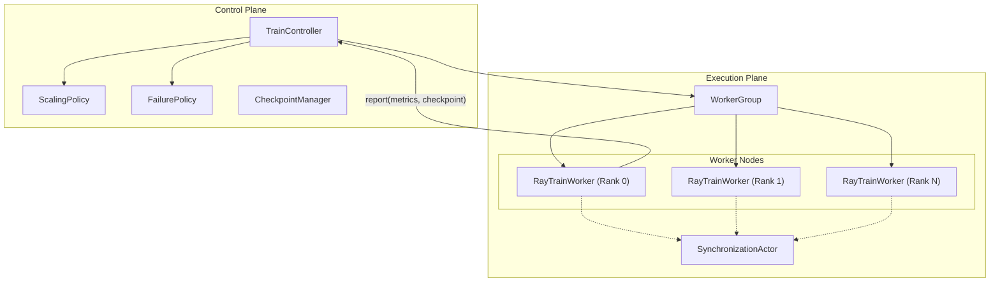
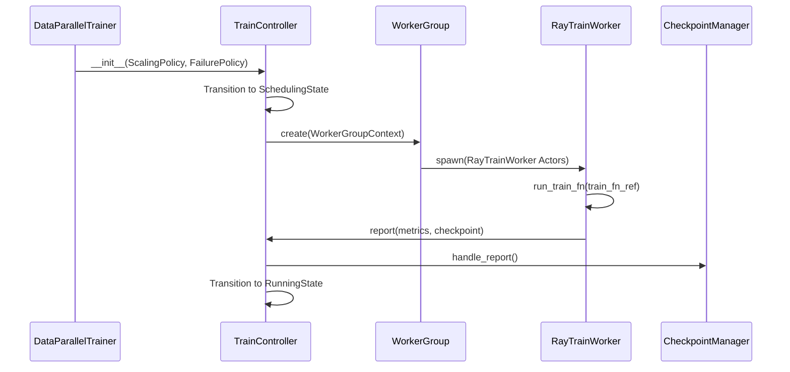

<!-- source: DeepWiki mcp.deepwiki.com · repo ray-project/ray · page 6.1 Train v2 Controller and Worker Group · fetched 2026-10-21 -->

# Train v2 Controller and Worker Group

Relevant source files

The following files were used as context for generating this wiki page:

- [python/ray/air/BUILD.bazel](python/ray/air/BUILD.bazel)
- [python/ray/air/__init__.py](python/ray/air/__init__.py)
- [python/ray/air/config.py](python/ray/air/config.py)
- [python/ray/air/result.py](python/ray/air/result.py)
- [python/ray/air/tests/conftest.py](python/ray/air/tests/conftest.py)
- [python/ray/data/test.bzl](python/ray/data/test.bzl)
- [python/ray/data/tests/doctest_pytest_plugin.py](python/ray/data/tests/doctest_pytest_plugin.py)
- [python/ray/train/__init__.py](python/ray/train/__init__.py)
- [python/ray/train/collective/__init__.py](python/ray/train/collective/__init__.py)
- [python/ray/train/collective/collectives.py](python/ray/train/collective/collectives.py)
- [python/ray/train/v2/BUILD.bazel](python/ray/train/v2/BUILD.bazel)
- [python/ray/train/v2/_internal/callbacks/datasets.py](python/ray/train/v2/_internal/callbacks/datasets.py)
- [python/ray/train/v2/_internal/callbacks/user_callback.py](python/ray/train/v2/_internal/callbacks/user_callback.py)
- [python/ray/train/v2/_internal/constants.py](python/ray/train/v2/_internal/constants.py)
- [python/ray/train/v2/_internal/data_integration/dataset_manager.py](python/ray/train/v2/_internal/data_integration/dataset_manager.py)
- [python/ray/train/v2/_internal/data_integration/interfaces.py](python/ray/train/v2/_internal/data_integration/interfaces.py)
- [python/ray/train/v2/_internal/execution/callback.py](python/ray/train/v2/_internal/execution/callback.py)
- [python/ray/train/v2/_internal/execution/checkpoint/checkpoint_manager.py](python/ray/train/v2/_internal/execution/checkpoint/checkpoint_manager.py)
- [python/ray/train/v2/_internal/execution/checkpoint/report_handler.py](python/ray/train/v2/_internal/execution/checkpoint/report_handler.py)
- [python/ray/train/v2/_internal/execution/checkpoint/validation_manager.py](python/ray/train/v2/_internal/execution/checkpoint/validation_manager.py)
- [python/ray/train/v2/_internal/execution/collective_impl.py](python/ray/train/v2/_internal/execution/collective_impl.py)
- [python/ray/train/v2/_internal/execution/context.py](python/ray/train/v2/_internal/execution/context.py)
- [python/ray/train/v2/_internal/execution/controller/controller.py](python/ray/train/v2/_internal/execution/controller/controller.py)
- [python/ray/train/v2/_internal/execution/storage.py](python/ray/train/v2/_internal/execution/storage.py)
- [python/ray/train/v2/_internal/execution/train_fn_utils.py](python/ray/train/v2/_internal/execution/train_fn_utils.py)
- [python/ray/train/v2/_internal/execution/worker_group/thread_runner.py](python/ray/train/v2/_internal/execution/worker_group/thread_runner.py)
- [python/ray/train/v2/_internal/execution/worker_group/worker.py](python/ray/train/v2/_internal/execution/worker_group/worker.py)
- [python/ray/train/v2/_internal/execution/worker_group/worker_group.py](python/ray/train/v2/_internal/execution/worker_group/worker_group.py)
- [python/ray/train/v2/_internal/util.py](python/ray/train/v2/_internal/util.py)
- [python/ray/train/v2/api/config.py](python/ray/train/v2/api/config.py)
- [python/ray/train/v2/api/data_parallel_trainer.py](python/ray/train/v2/api/data_parallel_trainer.py)
- [python/ray/train/v2/api/reported_checkpoint.py](python/ray/train/v2/api/reported_checkpoint.py)
- [python/ray/train/v2/api/result.py](python/ray/train/v2/api/result.py)
- [python/ray/train/v2/api/train_fn_utils.py](python/ray/train/v2/api/train_fn_utils.py)
- [python/ray/train/v2/api/validation_config.py](python/ray/train/v2/api/validation_config.py)
- [python/ray/train/v2/tests/conftest.py](python/ray/train/v2/tests/conftest.py)
- [python/ray/train/v2/tests/test_accelerator_utils.py](python/ray/train/v2/tests/test_accelerator_utils.py)
- [python/ray/train/v2/tests/test_async_checkpointing_validation.py](python/ray/train/v2/tests/test_async_checkpointing_validation.py)
- [python/ray/train/v2/tests/test_checkpoint_manager.py](python/ray/train/v2/tests/test_checkpoint_manager.py)
- [python/ray/train/v2/tests/test_collective.py](python/ray/train/v2/tests/test_collective.py)
- [python/ray/train/v2/tests/test_config.py](python/ray/train/v2/tests/test_config.py)
- [python/ray/train/v2/tests/test_controller.py](python/ray/train/v2/tests/test_controller.py)
- [python/ray/train/v2/tests/test_data_integration.py](python/ray/train/v2/tests/test_data_integration.py)
- [python/ray/train/v2/tests/test_data_parallel_trainer.py](python/ray/train/v2/tests/test_data_parallel_trainer.py)
- [python/ray/train/v2/tests/test_data_resource_cleanup.py](python/ray/train/v2/tests/test_data_resource_cleanup.py)
- [python/ray/train/v2/tests/test_persistence.py](python/ray/train/v2/tests/test_persistence.py)
- [python/ray/train/v2/tests/test_preemption_fault_tolerance.py](python/ray/train/v2/tests/test_preemption_fault_tolerance.py)
- [python/ray/train/v2/tests/test_report_handler.py](python/ray/train/v2/tests/test_report_handler.py)
- [python/ray/train/v2/tests/test_result.py](python/ray/train/v2/tests/test_result.py)
- [python/ray/train/v2/tests/test_serialization.py](python/ray/train/v2/tests/test_serialization.py)
- [python/ray/train/v2/tests/test_thread_runner.py](python/ray/train/v2/tests/test_thread_runner.py)
- [python/ray/train/v2/tests/test_validation_manager.py](python/ray/train/v2/tests/test_validation_manager.py)
- [python/ray/train/v2/tests/test_worker_group.py](python/ray/train/v2/tests/test_worker_group.py)
- [python/ray/train/v2/tests/util.py](python/ray/train/v2/tests/util.py)
- [python/ray/tune/tests/test_api_migrations.py](python/ray/tune/tests/test_api_migrations.py)

Ray Train v2 introduces a revamped architecture designed for robustness, elasticity, and improved observability. The core of this architecture is the decoupling of training orchestration (the `TrainController`) from the execution environment (the `WorkerGroup`).

## TrainController and State Machine

The `TrainController` is the central orchestrator for a distributed training job [python/ray/train/v2/_internal/execution/controller/controller.py:105-114](). It manages the lifecycle of training by transitioning through a set of formal states defined in `ray.train.v2._internal.execution.controller.state` [python/ray/train/v2/_internal/execution/controller/controller.py:39-51]().

### Lifecycle State Machine

The controller operates as an asynchronous state machine. Each iteration of the control loop evaluates the current state and triggers transitions based on worker health, scaling decisions, or user code completion [python/ray/train/v2/_internal/execution/controller/controller.py:221-236]().

| State | Responsibility |
| :--- | :--- |
| `InitializingState` | Initial setup of the controller and policies [python/ray/train/v2/_internal/execution/controller/state.py:43](). |
| `SchedulingState` | Requesting resources and instantiating the `WorkerGroup` [python/ray/train/v2/_internal/execution/controller/state.py:48](). |
| `RunningState` | Monitoring an active `WorkerGroup` and processing reported metrics/checkpoints [python/ray/train/v2/_internal/execution/controller/state.py:47](). |
| `ResizingState` | Transition state when the `ScalingPolicy` requests a change in worker count [python/ray/train/v2/_internal/execution/controller/state.py:45](). |
| `RestartingState` | Triggered by the `FailurePolicy` to recover from worker failures [python/ray/train/v2/_internal/execution/controller/state.py:46](). |
| `ShuttingDownState` | Graceful termination of workers and cleanup of resources [python/ray/train/v2/_internal/execution/controller/state.py:49](). |

### Control Loop Logic
The control loop iterates via `TrainController` methods to poll status, execute the current state behavior, and consult scaling and failure policies [python/ray/train/v2/_internal/execution/controller/controller.py:114-144]().

Sources: [python/ray/train/v2/_internal/execution/controller/controller.py:105-236](), [python/ray/train/v2/_internal/execution/controller/state.py:39-51]()

## WorkerGroup Lifecycle Management

The `WorkerGroup` represents the collection of Ray Actors (`RayTrainWorker`) executing the training function [python/ray/train/v2/_internal/execution/worker_group/worker_group.py:88-99]().

### Initialization and Startup
A `WorkerGroup` is created via the `WorkerGroup.create` factory method [python/ray/train/v2/_internal/execution/worker_group/worker_group.py:100-128]().
- **Resource Allocation**: It manages placement group handles (such as `DefaultPlacementGroupHandle` or `SlicePlacementGroupHandle` for TPUs) to guarantee gang-scheduling of workers [python/ray/train/v2/_internal/execution/worker_group/worker_group.py:48-52]().
- **Actor Creation**: It instantiates `RayTrainWorker` actors with appropriate runtime environments and resource requirements [python/ray/train/v2/_internal/execution/worker_group/worker.py:132-176]().
- **Synchronization**: It instantiates a `SynchronizationActor` for cross-worker barrier synchronization [python/ray/train/v2/_internal/execution/worker_group/worker_group.py:39]().

### Data Flow: Controller to Worker
The following diagram illustrates the relationship between the Controller, the WorkerGroup, and the individual Workers.

**Train v2 Entity Mapping**

Sources: [python/ray/train/v2/_internal/execution/worker_group/worker_group.py:88-160](), [python/ray/train/v2/_internal/execution/controller/controller.py:105-150](), [python/ray/train/v2/_internal/execution/context.py:123-130]()

## Checkpoint and Validation Management

Train v2 separates checkpoint persistence and validation from the training loop thread to minimize GPU idle time.

### Async Checkpoint Validation
When `ray.train.report` is called with a checkpoint and validation enabled [python/ray/train/v2/api/train_fn_utils.py:23-32](), the checkpoint manager and validation manager handle asynchronous workflows:
1. **Reporting**: Workers report checkpoints and metrics via `ray.train.report` [python/ray/train/v2/api/train_fn_utils.py:125-133]().
2. **Async Validation**: The `ValidationManager` schedules validation tasks without blocking the main training execution thread [python/ray/train/v2/_internal/execution/controller/controller.py:36-38]().
3. **Consistency**: The `CheckpointConsistencyMode` ensures checkpoints satisfy consistency criteria before being exposed via `get_all_reported_checkpoints` [python/ray/train/v2/_internal/execution/checkpoint/checkpoint_manager.py:181-190]().

### Synchronization Actor and Storage Context
The `SynchronizationActor` coordinates barriers and state across worker ranks [python/ray/train/v2/_internal/execution/checkpoint/sync_actor.py:20-30](). Additionally, the `StorageContext` coordinates persistent storage paths and filesystem interactions for checkpoint uploads [python/ray/train/v2/_internal/execution/storage.py]() and `CheckpointManager` snapshots [python/ray/train/v2/_internal/execution/checkpoint/checkpoint_manager.py:138-142]().

Sources: [python/ray/train/v2/api/train_fn_utils.py:23-132](), [python/ray/train/v2/_internal/execution/controller/controller.py:149-166](), [python/ray/train/v2/_internal/execution/checkpoint/checkpoint_manager.py:98-142]()

## Scaling Policies (Elastic and Fixed)

Ray Train v2 supports both fixed and elastic worker scaling configurations via `ScalingConfig` [python/ray/train/v2/api/config.py:31-91]().

- **Fixed Scaling**: Specified using an integer `num_workers`, maintaining a static worker group size throughout the run [python/ray/train/v2/api/config.py:108]().
- **Elastic Scaling**: Specified using a `(min_workers, max_workers)` tuple, allowing dynamic resizing based on cluster resource fluctuations and scaling decisions [python/ray/train/v2/api/config.py:109-113](). When a resize decision occurs, the controller transitions through `ResizingState` to adapt the `WorkerGroup` [python/ray/train/v2/_internal/execution/controller/controller.py:47,61]().

Sources: [python/ray/train/v2/api/config.py:31-132](), [python/ray/train/v2/_internal/execution/controller/controller.py:39-63]()

## Failure Handling

The `FailurePolicy` monitors exceptions, worker crashes, and preemption signals to determine recovery strategies [python/ray/train/v2/_internal/execution/controller/controller.py:54-57]().

- **Worker Failures**: If a `RayTrainWorker` encounters an unhandled exception or actor death (`RayActorError`), the failure policy evaluates whether to restart the worker group from the latest checkpoint or fail the job [python/ray/train/v2/_internal/execution/controller/controller.py:121]().
- **Preemption**: The preemption watcher detects cluster drain events or spot instance reclamations, signalling workers to perform just-in-time checkpointing before controller-managed rescheduling [python/ray/train/v2/_internal/constants.py:61-73](), [python/ray/train/v2/api/train_fn_utils.py:148-160]().

Sources: [python/ray/train/v2/_internal/execution/controller/controller.py:54-57](), [python/ray/train/v2/_internal/constants.py:61-73]()

## Storage Integration

Storage management is handled by `StorageContext`, which abstracts filesystem operations for experiment directories and checkpoint artifacts [python/ray/train/v2/_internal/execution/storage.py](). Checkpoints reported by workers are persisted to durable storage via sync or async upload modes configured in `RunConfig` [python/ray/train/v2/api/train_fn_utils.py:28-30]().

Sources: [python/ray/train/v2/_internal/execution/storage.py](), [python/ray/train/v2/api/train_fn_utils.py:23-46]()

## Callback System

Ray Train v2 uses a tiered callback system to inject hooks at different levels of the control and execution hierarchy [python/ray/train/v2/_internal/execution/controller/controller.py:22-28]().

| Callback Type | Hook Execution Location | Purpose |
| :--- | :--- | :--- |
| `ControllerCallback` | `TrainController` loop | Monitoring training progress and scaling decisions [python/ray/train/v2/_internal/execution/controller/controller.py:23](). |
| `WorkerGroupCallback` | `WorkerGroup` lifecycle | Setup/teardown of placement groups or external resources [python/ray/train/v2/_internal/execution/callback.py]() |
| `WorkerCallback` | `RayTrainWorker` actor | Environment and accelerator setup [python/ray/train/v2/_internal/execution/callback.py]() |
| `TrainContextCallback`| Inside training thread | Injecting utilities into the `TrainContext` [python/ray/train/v2/_internal/execution/callback.py]() |

**Code Entity Interaction Diagram**

Sources: [python/ray/train/v2/api/data_parallel_trainer.py:159-175](), [python/ray/train/v2/_internal/execution/controller/controller.py:114-191](), [python/ray/train/v2/_internal/execution/worker_group/worker_group.py:100-128]()

---

