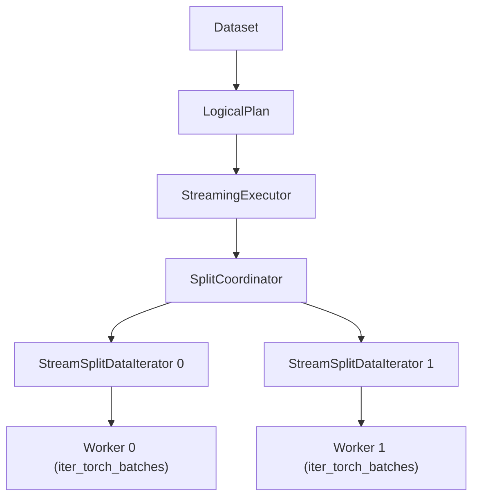
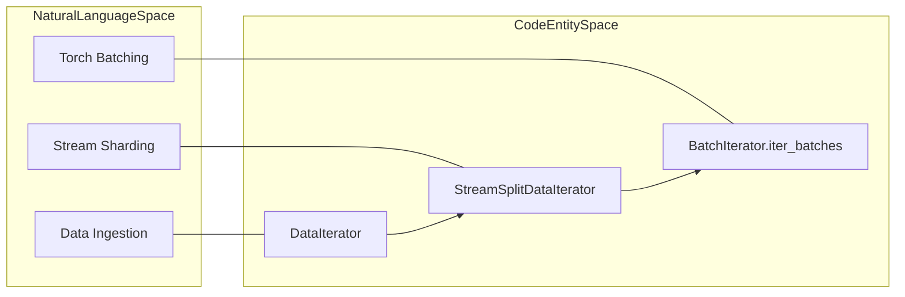
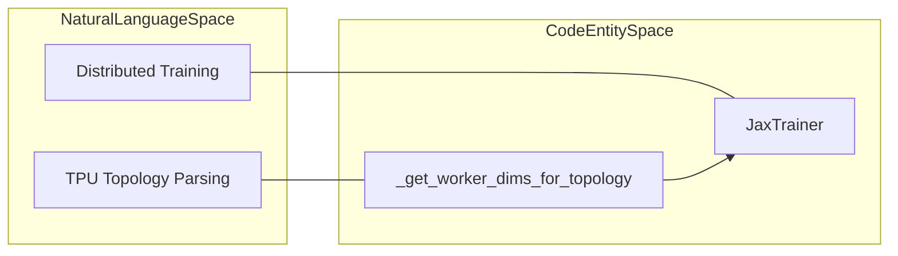

<!-- source: DeepWiki mcp.deepwiki.com · repo ray-project/ray · page 6.2 Framework Integrations and Data Loading · fetched 2026-10-21 -->

# Framework Integrations and Data Loading

Relevant source files

The following files were used as context for generating this wiki page:

- [.claude/rules/security.md](.claude/rules/security.md)
- [.vale.ini](.vale.ini)
- [.vale/styles/KubeRay/Terms.yml](.vale/styles/KubeRay/Terms.yml)
- [.vale/styles/config/vocabularies/KubeRay/accept.txt](.vale/styles/config/vocabularies/KubeRay/accept.txt)
- [doc/source/cluster/configure-manage-dashboard.md](doc/source/cluster/configure-manage-dashboard.md)
- [doc/source/data/concurrent-dataset-execution.md](doc/source/data/concurrent-dataset-execution.md)
- [doc/source/ray-contribute/dependency-management.md](doc/source/ray-contribute/dependency-management.md)
- [doc/source/ray-contribute/writing-style.md](doc/source/ray-contribute/writing-style.md)
- [doc/source/ray-core/api/scheduling.rst](doc/source/ray-core/api/scheduling.rst)
- [doc/source/ray-core/api/utility.rst](doc/source/ray-core/api/utility.rst)
- [doc/source/ray-core/internals/rpc-fault-tolerance.rst](doc/source/ray-core/internals/rpc-fault-tolerance.rst)
- [doc/source/ray-core/runtime_env_auth.md](doc/source/ray-core/runtime_env_auth.md)
- [doc/source/serve/advanced-guides/multi-app-container.md](doc/source/serve/advanced-guides/multi-app-container.md)
- [doc/source/train/doc_code/asynchronous_validation.py](doc/source/train/doc_code/asynchronous_validation.py)
- [doc/source/train/getting-started-jax.rst](doc/source/train/getting-started-jax.rst)
- [doc/source/train/overview.rst](doc/source/train/overview.rst)
- [doc/source/train/user-guides/asynchronous-validation.rst](doc/source/train/user-guides/asynchronous-validation.rst)
- [doc/source/train/user-guides/data-loading-preprocessing.rst](doc/source/train/user-guides/data-loading-preprocessing.rst)
- [doc/source/train/user-guides/elastic-training.rst](doc/source/train/user-guides/elastic-training.rst)
- [python/ray/_private/accelerators/tpu.py](python/ray/_private/accelerators/tpu.py)
- [python/ray/air/_internal/torch_utils.py](python/ray/air/_internal/torch_utils.py)
- [python/ray/autoscaler/_private/gcp/config.py](python/ray/autoscaler/_private/gcp/config.py)
- [python/ray/autoscaler/_private/gcp/node.py](python/ray/autoscaler/_private/gcp/node.py)
- [python/ray/dashboard/client/src/common/CodeDialogButton/CodeDialogButton.component.test.tsx](python/ray/dashboard/client/src/common/CodeDialogButton/CodeDialogButton.component.test.tsx)
- [python/ray/dashboard/client/src/common/CodeDialogButton/CodeDialogButton.tsx](python/ray/dashboard/client/src/common/CodeDialogButton/CodeDialogButton.tsx)
- [python/ray/dashboard/client/src/common/RuntimeEnvRedaction.ts](python/ray/dashboard/client/src/common/RuntimeEnvRedaction.ts)
- [python/ray/dashboard/modules/job/pydantic_models.py](python/ray/dashboard/modules/job/pydantic_models.py)
- [python/ray/dashboard/modules/reporter/jax_profile_manager.py](python/ray/dashboard/modules/reporter/jax_profile_manager.py)
- [python/ray/dashboard/modules/reporter/tests/test_jax_profiler_manager.py](python/ray/dashboard/modules/reporter/tests/test_jax_profiler_manager.py)
- [python/ray/data/_internal/block_batching/block_batching.py](python/ray/data/_internal/block_batching/block_batching.py)
- [python/ray/data/_internal/block_batching/interfaces.py](python/ray/data/_internal/block_batching/interfaces.py)
- [python/ray/data/_internal/block_batching/iter_batches.py](python/ray/data/_internal/block_batching/iter_batches.py)
- [python/ray/data/_internal/block_batching/util.py](python/ray/data/_internal/block_batching/util.py)
- [python/ray/data/_internal/execution/interfaces/__init__.py](python/ray/data/_internal/execution/interfaces/__init__.py)
- [python/ray/data/_internal/execution/interfaces/ref_bundle.py](python/ray/data/_internal/execution/interfaces/ref_bundle.py)
- [python/ray/data/_internal/iterator/iterator_impl.py](python/ray/data/_internal/iterator/iterator_impl.py)
- [python/ray/data/_internal/iterator/stream_split_iterator.py](python/ray/data/_internal/iterator/stream_split_iterator.py)
- [python/ray/data/_internal/split.py](python/ray/data/_internal/split.py)
- [python/ray/data/_internal/utils/torch_inference.py](python/ray/data/_internal/utils/torch_inference.py)
- [python/ray/data/_internal/utils/torch_utils.py](python/ray/data/_internal/utils/torch_utils.py)
- [python/ray/data/collate_fn.py](python/ray/data/collate_fn.py)
- [python/ray/data/iterator.py](python/ray/data/iterator.py)
- [python/ray/data/tests/block_batching/test_block_batching.py](python/ray/data/tests/block_batching/test_block_batching.py)
- [python/ray/data/tests/block_batching/test_interfaces.py](python/ray/data/tests/block_batching/test_interfaces.py)
- [python/ray/data/tests/block_batching/test_iter_batches.py](python/ray/data/tests/block_batching/test_iter_batches.py)
- [python/ray/data/tests/block_batching/test_util.py](python/ray/data/tests/block_batching/test_util.py)
- [python/ray/data/tests/test_consumption.py](python/ray/data/tests/test_consumption.py)
- [python/ray/data/tests/test_dynamic_block_split.py](python/ray/data/tests/test_dynamic_block_split.py)
- [python/ray/data/tests/test_iterator.py](python/ray/data/tests/test_iterator.py)
- [python/ray/data/tests/test_ref_bundle.py](python/ray/data/tests/test_ref_bundle.py)
- [python/ray/data/tests/test_split.py](python/ray/data/tests/test_split.py)
- [python/ray/data/tests/test_torch_inference.py](python/ray/data/tests/test_torch_inference.py)
- [python/ray/data/tests/test_torch_tensor_utils.py](python/ray/data/tests/test_torch_tensor_utils.py)
- [python/ray/data/tests/test_zip.py](python/ray/data/tests/test_zip.py)
- [python/ray/data/tests/unit/test_bundler.py](python/ray/data/tests/unit/test_bundler.py)
- [python/ray/data/util/torch_inference.py](python/ray/data/util/torch_inference.py)
- [python/ray/data/util/torch_utils.py](python/ray/data/util/torch_utils.py)
- [python/ray/tests/accelerators/test_tpu.py](python/ray/tests/accelerators/test_tpu.py)
- [python/ray/tests/gcp/test_gcp_node_provider.py](python/ray/tests/gcp/test_gcp_node_provider.py)
- [python/ray/tests/test_autoscaler_fake_multinode.py](python/ray/tests/test_autoscaler_fake_multinode.py)
- [python/ray/tests/test_tpu.py](python/ray/tests/test_tpu.py)
- [python/ray/tests/unit/test_node_affinity_validation.py](python/ray/tests/unit/test_node_affinity_validation.py)
- [python/ray/train/tests/test_torch_utils.py](python/ray/train/tests/test_torch_utils.py)
- [python/ray/train/v2/_internal/callbacks/__init__.py](python/ray/train/v2/_internal/callbacks/__init__.py)
- [python/ray/train/v2/jax/config.py](python/ray/train/v2/jax/config.py)
- [python/ray/train/v2/jax/jax_trainer.py](python/ray/train/v2/jax/jax_trainer.py)
- [python/ray/train/v2/tests/test_jax_trainer.py](python/ray/train/v2/tests/test_jax_trainer.py)
- [python/ray/util/debug.py](python/ray/util/debug.py)
- [python/ray/util/scheduling_strategies.py](python/ray/util/scheduling_strategies.py)
- [python/ray/util/tpu.py](python/ray/util/tpu.py)
- [src/ray/protobuf/reporter.proto](src/ray/protobuf/reporter.proto)

Ray Train provides a unified interface for distributed training across multiple deep learning and gradient boosting frameworks. It leverages **Ray Data** for high-throughput, distributed data ingestion, ensuring that training workers remain saturated even with large-scale datasets [doc/source/train/user-guides/data-loading-preprocessing.rst:9-16]().

## Data Ingestion with DataConfig

The `DataConfig` class is the primary mechanism for configuring how Ray Data interacts with Ray Train workers. It handles dataset sharding, resource reservation, and locality-aware data placement.

### Implementation and Data Flow
When `trainer.fit()` is called, the data configuration and sharding subsystems orchestrate the transition from a global `Dataset` to worker-local `DataIterator` instances [python/ray/data/iterator.py:73-83]().

1.  **Resource Reservation**: `DataConfig` calculates the resources (CPUs/GPUs) used by training workers and coordinates resource allocation to prevent resource contention.
2.  **Streaming Split**: The system uses `streaming_split` (implemented via `StreamSplitDataIterator`) to divide the dataset into `world_size` shards [python/ray/data/_internal/iterator/stream_split_iterator.py:27-52](). This enables "just-in-time" data loading, which is critical for datasets that do not fit in memory.
3.  **Locality Awareness**: Sharding logic can use worker node information as locality hints to ensure data blocks are processed on the same nodes where they are stored [python/ray/data/_internal/iterator/stream_split_iterator.py:33-49]().

### Key Classes and Interfaces
| Class | Role |
| :--- | :--- |
| `DataIterator` | Abstract base class for reading records from a Dataset. Each trainer actor receives its own shard via this interface [python/ray/data/iterator.py:73-83](). |
| `StreamSplitDataIterator` | Implements a collection of iterators over a shared data stream backed by a `SplitCoordinator` actor [python/ray/data/_internal/iterator/stream_split_iterator.py:27-52](). |
| `BatchIterator` | Converts a stream of block object references into formatted batches ready for consumption [python/ray/data/_internal/block_batching/iter_batches.py:60-68](). |

Sources: [python/ray/data/iterator.py:73-102](), [python/ray/data/_internal/iterator/stream_split_iterator.py:27-52](), [python/ray/data/_internal/block_batching/iter_batches.py:60-68]()

---

## Framework Integrations

Ray Train integrates with major ML frameworks by wrapping their distributed backends and providing specialized iterator methods and trainer configurations.

### PyTorch Integration
Ray Train's PyTorch integration focuses on the `iter_torch_batches` API, which converts Ray Data blocks into Torch tensors efficiently [doc/source/train/user-guides/data-loading-preprocessing.rst:82-88]().

*   **`iter_torch_batches`**: Provides a seamless bridge between Ray Data and PyTorch. It supports `prefetch_batches` for pipelining, local shuffling, and tensor dtype conversions [python/ray/data/iterator.py:137-188]().
*   **Collate Functions**: Users can provide a `CollateFn` or utilize built-in collators (`DefaultCollateFn`, `ArrowBatchCollateFn`, etc.) to customize how individual rows are aggregated into batches [python/ray/data/iterator.py:27-34]().
*   **Executor Lifecycle**: Early exit (such as breaking out of an iteration loop) automatically triggers the shutdown of the underlying `StreamingExecutor` to release object store memory [python/ray/data/tests/test_iterator.py:79-96]().

### TensorFlow and JAX Integration
*   **TensorFlow**: The `to_tf` API converts a Ray `DataIterator` into a `tf.data.Dataset`, allowing native Keras compatibility where the resulting dataset is passed directly to training routines [python/ray/data/tests/test_iterator.py:200-209]().
*   **JAX**: Integration via `JaxTrainer` manages multi-host TPU topologies and coordinates with `ray.train.get_dataset_shard` to feed JAX-compatible data to each worker [python/ray/train/v2/tests/test_jax_trainer.py:210-217](), leveraging accelerator helpers like `_get_worker_dims_for_topology` [python/ray/_private/accelerators/tpu.py:173-191]().

### Gradient Boosting (XGBoost/LightGBM)
These integrations utilize Ray Data to load distributed DataFrames. The corresponding trainers handle the conversion of Ray Datasets into the internal distributed structures required by gradient boosting engines.

Sources: [python/ray/data/iterator.py:27-34](), [python/ray/data/iterator.py:137-188](), [python/ray/data/tests/test_iterator.py:79-96](), [python/ray/train/v2/tests/test_jax_trainer.py:210-217](), [python/ray/_private/accelerators/tpu.py:173-191]()

---

## Data Loading Patterns

### The streaming_split Pattern
The `streaming_split` pattern is the standard for distributed training in Ray Train. Unlike traditional static sharding, it creates a set of output streams that consume from a shared execution graph via a `SplitCoordinator` actor [python/ray/data/_internal/iterator/stream_split_iterator.py:27-52]().

Data Split Flow:

Sources: [python/ray/data/_internal/iterator/stream_split_iterator.py:27-52](), [python/ray/data/iterator.py:137-146]()

### Resource and Performance Management
For high-performance training, Ray Train allows fine-tuning of the data consumption pipeline:
*   **Prefetching**: `prefetch_batches` uses a separate threadpool to fetch objects to the local node and format them before the training loop requests them [python/ray/data/_internal/block_batching/iter_batches.py:60-95]().
*   **Memory Safety**: The `StreamingExecutor` can be shut down eagerly if an iteration loop is broken early, preventing object store bloat and worker starvation [python/ray/data/iterator.py:120-135](), [python/ray/data/tests/test_iterator.py:79-96]().

Sources: [python/ray/data/_internal/block_batching/iter_batches.py:60-95](), [python/ray/data/iterator.py:120-135](), [python/ray/data/tests/test_iterator.py:79-96]()

---

## System Components Association

The following diagrams bridge high-level training and ingestion concepts to their concrete implementations in the codebase.

Data Ingestion and Sharding Code Entities:

Sources: [python/ray/data/iterator.py:73-102](), [python/ray/data/_internal/iterator/stream_split_iterator.py:27-52](), [python/ray/data/_internal/block_batching/iter_batches.py:60-68]()

Hardware Acceleration and Trainer Mapping:

Sources: [python/ray/_private/accelerators/tpu.py:173-191](), [python/ray/train/v2/jax/jax_trainer.py](), [python/ray/train/v2/tests/test_jax_trainer.py:210-217]()

### Summary of Key APIs for Data Loading
| API | File Path | Purpose |
| :--- | :--- | :--- |
| `DataIterator.iter_batches` | [python/ray/data/iterator.py:137-146]() | Base method for batched iteration with prefetching. |
| `StreamSplitDataIterator.create` | [python/ray/data/_internal/iterator/stream_split_iterator.py:32-51]() | Initializes distributed stream splitting via `SplitCoordinator`. |
| `BatchIterator` | [python/ray/data/_internal/block_batching/iter_batches.py:60-68]() | Pipeline executor converting block references into formatted batches. |
| `JaxTrainer` | [python/ray/train/v2/jax/jax_trainer.py]() | Trainer implementation for distributed JAX/TPU workloads. |

Sources: [python/ray/data/iterator.py:137-146](), [python/ray/data/_internal/iterator/stream_split_iterator.py:32-51](), [python/ray/data/_internal/block_batching/iter_batches.py:60-68](), [python/ray/train/v2/jax/jax_trainer.py]()

---

