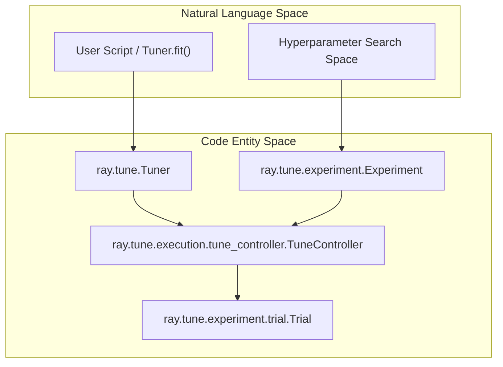
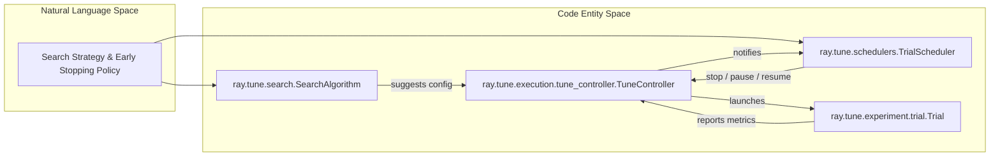

<!-- source: DeepWiki mcp.deepwiki.com · repo ray-project/ray · page 7 Ray Tune · fetched 2026-10-21 -->

# Ray Tune

Relevant source files

The following files were used as context for generating this wiki page:

- [doc/requirements-doc.txt](doc/requirements-doc.txt)
- [doc/source/_ext/llms_txt.py](doc/source/_ext/llms_txt.py)
- [doc/source/_ext/test_llms_txt.py](doc/source/_ext/test_llms_txt.py)
- [doc/source/_intersphinx/README.md](doc/source/_intersphinx/README.md)
- [doc/source/_intersphinx/refresh.py](doc/source/_intersphinx/refresh.py)
- [doc/source/_intersphinx/torch.inv](doc/source/_intersphinx/torch.inv)
- [doc/source/_static/css/custom.css](doc/source/_static/css/custom.css)
- [doc/source/_static/img/ray_logo.svg](doc/source/_static/img/ray_logo.svg)
- [doc/source/cluster/images/ray-job-diagram.png](doc/source/cluster/images/ray-job-diagram.png)
- [doc/source/cluster/kubernetes/troubleshooting/troubleshooting.md](doc/source/cluster/kubernetes/troubleshooting/troubleshooting.md)
- [doc/source/cluster/running-applications/job-submission/api.md](doc/source/cluster/running-applications/job-submission/api.md)
- [doc/source/cluster/running-applications/job-submission/index.md](doc/source/cluster/running-applications/job-submission/index.md)
- [doc/source/cluster/running-applications/job-submission/openapi.yml](doc/source/cluster/running-applications/job-submission/openapi.yml)
- [doc/source/cluster/running-applications/job-submission/rest.rst](doc/source/cluster/running-applications/job-submission/rest.rst)
- [doc/source/conf.py](doc/source/conf.py)
- [doc/source/custom_directives.py](doc/source/custom_directives.py)
- [doc/source/data/examples.yml](doc/source/data/examples.yml)
- [doc/source/images/ray_header_logo.png](doc/source/images/ray_header_logo.png)
- [doc/source/images/ray_logo.png](doc/source/images/ray_logo.png)
- [doc/source/llms_txt_summary.txt](doc/source/llms_txt_summary.txt)
- [doc/source/ray-overview/images/ray_svg_logo.svg](doc/source/ray-overview/images/ray_svg_logo.svg)
- [doc/source/serve/examples.yml](doc/source/serve/examples.yml)
- [doc/source/serve/tutorials/serve-deepseek.md](doc/source/serve/tutorials/serve-deepseek.md)
- [doc/source/train/deepspeed.rst](doc/source/train/deepspeed.rst)
- [doc/source/train/examples.yml](doc/source/train/examples.yml)
- [doc/source/train/examples/aws-trainium/llama3.rst](doc/source/train/examples/aws-trainium/llama3.rst)
- [doc/source/train/examples/jax/intro_to_jax_trainer/README.ipynb](doc/source/train/examples/jax/intro_to_jax_trainer/README.ipynb)
- [doc/source/train/examples/jax/intro_to_jax_trainer/README.md](doc/source/train/examples/jax/intro_to_jax_trainer/README.md)
- [doc/source/tune/examples/index.rst](doc/source/tune/examples/index.rst)
- [doc/source/tune/examples/tune-pytorch-cifar.ipynb](doc/source/tune/examples/tune-pytorch-cifar.ipynb)
- [python/deplocks/docs/docbuild_depset_py3.11.lock](python/deplocks/docs/docbuild_depset_py3.11.lock)
- [python/ray/air/BUILD.bazel](python/ray/air/BUILD.bazel)
- [python/ray/air/__init__.py](python/ray/air/__init__.py)
- [python/ray/air/config.py](python/ray/air/config.py)
- [python/ray/air/result.py](python/ray/air/result.py)
- [python/ray/air/tests/conftest.py](python/ray/air/tests/conftest.py)
- [python/ray/data/test.bzl](python/ray/data/test.bzl)
- [python/ray/data/tests/doctest_pytest_plugin.py](python/ray/data/tests/doctest_pytest_plugin.py)
- [python/ray/train/v2/BUILD.bazel](python/ray/train/v2/BUILD.bazel)
- [python/ray/train/v2/_internal/execution/storage.py](python/ray/train/v2/_internal/execution/storage.py)
- [python/ray/train/v2/_internal/execution/worker_group/thread_runner.py](python/ray/train/v2/_internal/execution/worker_group/thread_runner.py)
- [python/ray/train/v2/api/result.py](python/ray/train/v2/api/result.py)
- [python/ray/train/v2/tests/conftest.py](python/ray/train/v2/tests/conftest.py)
- [python/ray/train/v2/tests/test_result.py](python/ray/train/v2/tests/test_result.py)
- [python/ray/train/v2/tests/test_thread_runner.py](python/ray/train/v2/tests/test_thread_runner.py)

Ray Tune is a distributed hyperparameter optimization (HPO) framework built on Ray. It provides a unified interface for scaling hyperparameter search, supporting various search algorithms (e.g., Bayesian Optimization, HyperOpt) and scheduling strategies (e.g., ASHA, PBT) to efficiently manage cluster resources and trial lifecycles.

## Tuner API and Experiment Definition

The primary entry point for Ray Tune is the `Tuner` class (`ray.tune.Tuner`), which orchestrates the tuning process by taking a `Trainable` (the function or class to optimize) and a `param_space` (the search space) [doc/source/conf.py:113](). The `Tuner` internally manages the conversion of user inputs into an experiment specification that encapsulates the HPO run.

### Core Configuration Entities
*   **`RunConfig`**: Defines runtime configurations for individual trials, including storage paths, checkpointing policies, and failure handling.
*   **`TuneConfig`**: Specifies HPO-specific settings such as the optimization metric, mode (`min`/`max`), search algorithm, scheduler, and the number of samples to draw.
*   **`Trial`**: Represents a single execution of a `Trainable` with a specific hyperparameter configuration. It tracks its own state (`PENDING`, `RUNNING`, `TERMINATED`, `ERROR`) and resource requirements.

**Tuner Architecture Mapping**

Sources: [doc/source/conf.py:113](), [python/ray/air/config.py:100-110]()

## Execution Engine and Trial Management

The execution of a Tune experiment is driven by the `TuneController`. It manages the main event loop, interacting with the Ray cluster to request resources and launch trials as Ray Actors.

The `TuneController` handles:
1.  **Trial Lifecycle**: Transitioning trials through states and managing actor placement.
2.  **Experiment Persistence**: Periodically saving the experiment state to allow for restoration after driver failures.
3.  **Result Reporting**: Aggregating metrics reported by trials via `tune.report()` and passing them to schedulers.

For a detailed deep dive into the execution loop, trial lifecycle management, result reporting, and integration with Ray Train trainables, see **[Tune Execution and Trial Management](#7.1)**.

Sources: [doc/source/conf.py:113](), [python/ray/air/config.py:27-35]()

## Search Algorithms and Schedulers

Ray Tune decouples the generation of hyperparameter configurations from the scheduling of trial execution. Search algorithms implement the logic to suggest new configurations, while schedulers decide when to stop, pause, or exploit trials based on intermediate performance.

**Search and Schedule Interaction**

Sources: [doc/source/conf.py:113](), [python/ray/air/config.py:32-33]()

For details on Tune's search algorithm integrations (Optuna, HyperOpt, BayesOpt, Ax, BOHB), trial schedulers (ASHA, PBT, HyperBand, MedianStopping), the search space definition API, and the `ConcurrencyLimiter` pattern, see **[Search Algorithms and Schedulers](#7.2)**.

Sources: [doc/source/conf.py:113](), [python/ray/air/config.py:32-33]()

## Experiment Management and Restoration

Tune provides robust support for experiment management, including logging, checkpointing, and fault tolerance.

| Component | Description | Reference |
| :--- | :--- | :--- |
| **ExperimentAnalysis** | Utilities to analyze results, find the best trial, and load metrics dataframes. | [doc/source/conf.py:113]() |
| **JobManager** | Manages the lifecycle of the Tune driver job and supervisor actors. | [python/ray/dashboard/modules/job/job_manager.py:57]() |
| **JobSupervisor** | Ray actor responsible for setting up environment and executing the entrypoint. | [python/ray/dashboard/modules/job/job_supervisor.py:57]() |
| **GcsClient** | Used for persisting experiment state and internal KV storage. | [python/ray/tests/test_gcs_utils.py:46]() |

Sources: [python/ray/dashboard/modules/job/job_manager.py:57-88](), [python/ray/dashboard/modules/job/job_supervisor.py:57-79](), [python/ray/tests/test_gcs_utils.py:43-68]()

---

