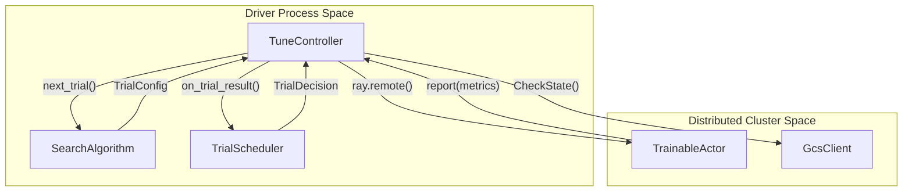
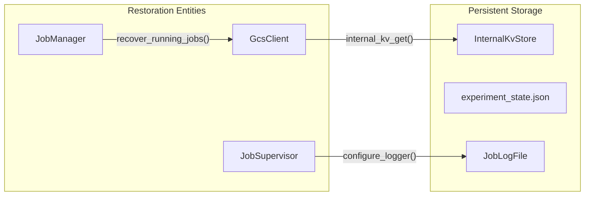

<!-- source: DeepWiki mcp.deepwiki.com · repo ray-project/ray · page 7.1 Tune Execution and Trial Management · fetched 2026-10-21 -->

# Tune Execution and Trial Management

Relevant source files

The following files were used as context for generating this wiki page:

- [doc/requirements-doc.txt](doc/requirements-doc.txt)
- [doc/source/_ext/llms_txt.py](doc/source/_ext/llms_txt.py)
- [doc/source/_ext/test_llms_txt.py](doc/source/_ext/test_llms_txt.py)
- [doc/source/_intersphinx/README.md](doc/source/_intersphinx/README.md)
- [doc/source/_intersphinx/refresh.py](doc/source/_intersphinx/refresh.py)
- [doc/source/_intersphinx/torch.inv](doc/source/_intersphinx/torch.inv)
- [doc/source/_static/css/custom.css](doc/source/_static/css/custom.css)
- [doc/source/_static/img/ray_logo.svg](doc/source/_static/img/ray_logo.svg)
- [doc/source/cluster/images/ray-job-diagram.png](doc/source/cluster/images/ray-job-diagram.png)
- [doc/source/cluster/kubernetes/troubleshooting/troubleshooting.md](doc/source/cluster/kubernetes/troubleshooting/troubleshooting.md)
- [doc/source/cluster/running-applications/job-submission/api.md](doc/source/cluster/running-applications/job-submission/api.md)
- [doc/source/cluster/running-applications/job-submission/index.md](doc/source/cluster/running-applications/job-submission/index.md)
- [doc/source/cluster/running-applications/job-submission/openapi.yml](doc/source/cluster/running-applications/job-submission/openapi.yml)
- [doc/source/cluster/running-applications/job-submission/rest.rst](doc/source/cluster/running-applications/job-submission/rest.rst)
- [doc/source/conf.py](doc/source/conf.py)
- [doc/source/custom_directives.py](doc/source/custom_directives.py)
- [doc/source/data/examples.yml](doc/source/data/examples.yml)
- [doc/source/images/ray_header_logo.png](doc/source/images/ray_header_logo.png)
- [doc/source/images/ray_logo.png](doc/source/images/ray_logo.png)
- [doc/source/llms_txt_summary.txt](doc/source/llms_txt_summary.txt)
- [doc/source/ray-overview/images/ray_svg_logo.svg](doc/source/ray-overview/images/ray_svg_logo.svg)
- [doc/source/serve/examples.yml](doc/source/serve/examples.yml)
- [doc/source/serve/tutorials/serve-deepseek.md](doc/source/serve/tutorials/serve-deepseek.md)
- [doc/source/train/deepspeed.rst](doc/source/train/deepspeed.rst)
- [doc/source/train/examples.yml](doc/source/train/examples.yml)
- [doc/source/train/examples/aws-trainium/llama3.rst](doc/source/train/examples/aws-trainium/llama3.rst)
- [doc/source/train/examples/jax/intro_to_jax_trainer/README.ipynb](doc/source/train/examples/jax/intro_to_jax_trainer/README.ipynb)
- [doc/source/train/examples/jax/intro_to_jax_trainer/README.md](doc/source/train/examples/jax/intro_to_jax_trainer/README.md)
- [doc/source/tune/examples/index.rst](doc/source/tune/examples/index.rst)
- [doc/source/tune/examples/tune-pytorch-cifar.ipynb](doc/source/tune/examples/tune-pytorch-cifar.ipynb)
- [python/deplocks/docs/docbuild_depset_py3.11.lock](python/deplocks/docs/docbuild_depset_py3.11.lock)
- [python/ray/air/BUILD.bazel](python/ray/air/BUILD.bazel)
- [python/ray/air/__init__.py](python/ray/air/__init__.py)
- [python/ray/air/config.py](python/ray/air/config.py)
- [python/ray/air/result.py](python/ray/air/result.py)
- [python/ray/air/tests/conftest.py](python/ray/air/tests/conftest.py)
- [python/ray/data/test.bzl](python/ray/data/test.bzl)
- [python/ray/data/tests/doctest_pytest_plugin.py](python/ray/data/tests/doctest_pytest_plugin.py)
- [python/ray/train/v2/BUILD.bazel](python/ray/train/v2/BUILD.bazel)
- [python/ray/train/v2/_internal/execution/storage.py](python/ray/train/v2/_internal/execution/storage.py)
- [python/ray/train/v2/_internal/execution/worker_group/thread_runner.py](python/ray/train/v2/_internal/execution/worker_group/thread_runner.py)
- [python/ray/train/v2/api/result.py](python/ray/train/v2/api/result.py)
- [python/ray/train/v2/tests/conftest.py](python/ray/train/v2/tests/conftest.py)
- [python/ray/train/v2/tests/test_result.py](python/ray/train/v2/tests/test_result.py)
- [python/ray/train/v2/tests/test_thread_runner.py](python/ray/train/v2/tests/test_thread_runner.py)

This page documents the core execution engine of Ray Tune, focusing on the `TuneController` event loop, the lifecycle of `Trial` objects, and how experiment state is persisted and restored. It also covers the integration between high-level configurations (`RunConfig`, `TuneConfig`) and the underlying Ray Train trainables.

## TuneController Execution Loop

The `TuneController` (formerly `TrialRunner`) is the central orchestration component of a `Ray Tune` experiment. It manages the interaction between the `SearchAlgorithm`, the `TrialScheduler`, and the Ray cluster.

### Core Event Loop
The execution loop is driven by the `TuneController`, which monitors the state of all active trials. It performs the following high-level steps:
1. **Trial Generation**: Requests new hyperparameter configurations from the `SearchAlgorithm`.
2. **Resource Allocation**: Uses `PlacementGroupFactory` to request resources for pending trials [python/ray/tests/test_placement_group_5.py:1-20]().
3. **Task Dispatch**: Launches `Trainable` actors via Ray Core when resources become available.
4. **Result Processing**: Collects results reported by `Trainable.report()`, updates trial metadata, and passes results to the `TrialScheduler` to decide on pausing, stopping, or continuing.

### Diagram: Tune Execution Flow
This diagram maps the natural language execution flow to specific code entities involved in the loop, bridging natural language space to codebase entity identifiers.

Sources: [python/ray/dashboard/modules/job/job_manager.py:73-81](), [python/ray/dashboard/modules/job/job_supervisor.py:57-65](), [python/ray/tests/test_gcs_utils.py:43-65]()

---

## Trial Lifecycle Management

A `Trial` object represents a single instance of a hyperparameter evaluation. It tracks the state, configuration, and results of the run.

### Trial States
Trials transition through a strict state machine managed by the `TuneController`:
* **PENDING**: The trial is created but waiting for resources or searcher concurrency limits.
* **RUNNING**: A Ray actor has been started and is executing the `Trainable`.
* **PAUSED**: The trial is stopped, but its state is preserved (e.g., for PBT or ASHA schedulers).
* **TERMINATED**: The trial completed successfully.
* **ERROR**: The trial failed due to an exception or node failure.

### Result Reporting
When a `Trainable` calls `report()`, the result is sent back to the `TuneController`. The `Trial` object updates its `last_result` attributes and increments its training iteration. Status tracking is mirrored in dashboard state utilities [python/ray/dashboard/modules/job/common.py:1-50]().

### Resource Management
Resources are defined via `PlacementGroupFactory`, allowing Tune to reserve specific bundles of CPUs and GPUs across the cluster prior to launching actor processes [src/ray/raylet/placement_group_resource_manager.cc:1-50]().

Sources: [python/ray/dashboard/modules/job/job_manager.py:176-185](), [python/ray/dashboard/modules/job/job_supervisor.py:182-195](), [python/ray/tests/test_placement_group_5.py:1-20]()

---

## Experiment State and Persistence

Tune ensures fault tolerance by persisting experiment state, allowing experiments to be resumed after driver failures or cluster preemption.

### State Persistence
Experiment state is periodically serialized into snapshot files (such as `experiment_state.json`). Within Ray's job submission and supervisor subsystems, persistence integrates with internal key-value storage managed via `GcsClient` [python/ray/dashboard/modules/job/job_manager.py:73-78]().

### Restoration Logic
When restoring an experiment, the following sequence executes:
1. **Load State**: The `TuneController` or `JobManager` reads persisted metadata [python/ray/dashboard/modules/job/job_manager.py:107-118]().
2. **Rehydrate Trials**: `Trial` instances are reconstructed from stored states [python/ray/tests/test_gcs_utils.py:139-160]().
3. **Resume Policy**: Tune determines whether to skip completed trials, retry failed ones, or reload checkpoints.

### Diagram: Experiment Restoration Pipeline

Sources: [python/ray/dashboard/modules/job/job_manager.py:107-118](), [python/ray/dashboard/modules/job/job_supervisor.py:101-122](), [python/ray/tests/test_gcs_utils.py:43-65]()

---

## Configuration: RunConfig and TuneConfig

Ray Tune uses distinct configuration classes to separate execution environment options from hyperparameter tuning algorithms.

### RunConfig
Defines execution behavior shared across Ray Train and Tune (configured via classes like `ScalingConfig` in [python/ray/air/config.py:101-110]()):
* **Storage**: Output paths and remote cloud URIs for checkpoints.
* **Failure Handling**: Max retries and failure propagation rules.

### TuneConfig
Defines the hyperparameter optimization strategy:
* **Metric/Mode**: Objective metric name and optimization direction (`min` or `max`).
* **Search Algorithm**: Underlying `Searcher` instance wrapper.
* **Concurrency**: Maximum number of concurrent running trials.

Sources: [python/ray/air/config.py:101-172](), [python/ray/dashboard/modules/job/job_manager.py:158-162]()

---

## Integration with Ray Train

Ray Tune frequently wraps Ray Train trainers. In this setup, each trial managed by Tune coordinates a `WorkerGroup` via Ray Train.

### Execution Flow with Train
1. The `TuneController` initiates a trainer actor (such as `JobSupervisor`) [python/ray/dashboard/modules/job/job_supervisor.py:57-65]().
2. The trainer provisions a `WorkerGroup` for distributed data-parallel training.
3. Workers process data splits concurrently.

| Component | Code Entity | File Path |
| :--- | :--- | :--- |
| Job Management | `JobManager` | [python/ray/dashboard/modules/job/job_manager.py:57]() |
| Job Supervision | `JobSupervisor` | [python/ray/dashboard/modules/job/job_supervisor.py:57]() |
| GCS Client | `GcsClient` | [python/ray/tests/test_gcs_utils.py:21]() |
| Training Config | `ScalingConfig` | [python/ray/air/config.py:101]() |

Sources: [python/ray/dashboard/modules/job/job_manager.py:57-89](), [python/ray/dashboard/modules/job/job_supervisor.py:57-122](), [python/ray/air/config.py:101-172]()

---

