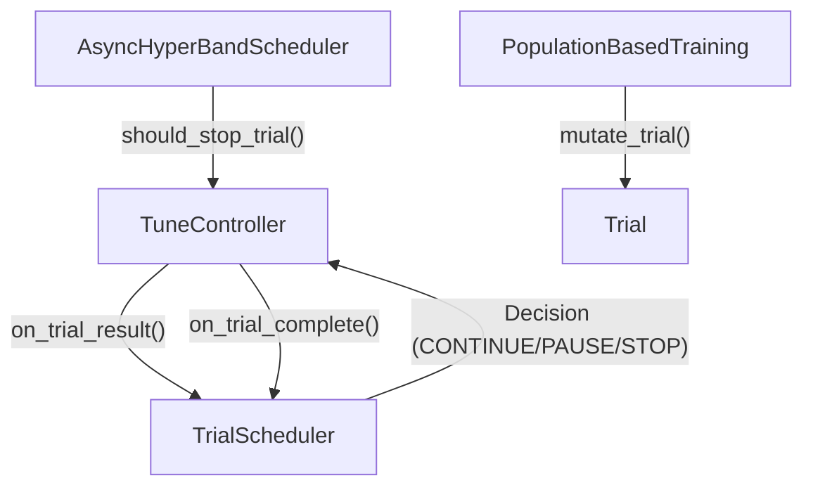
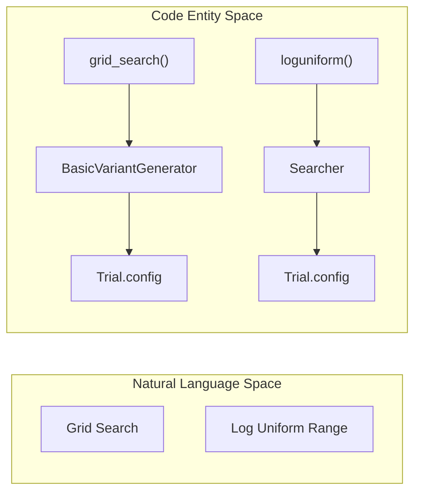
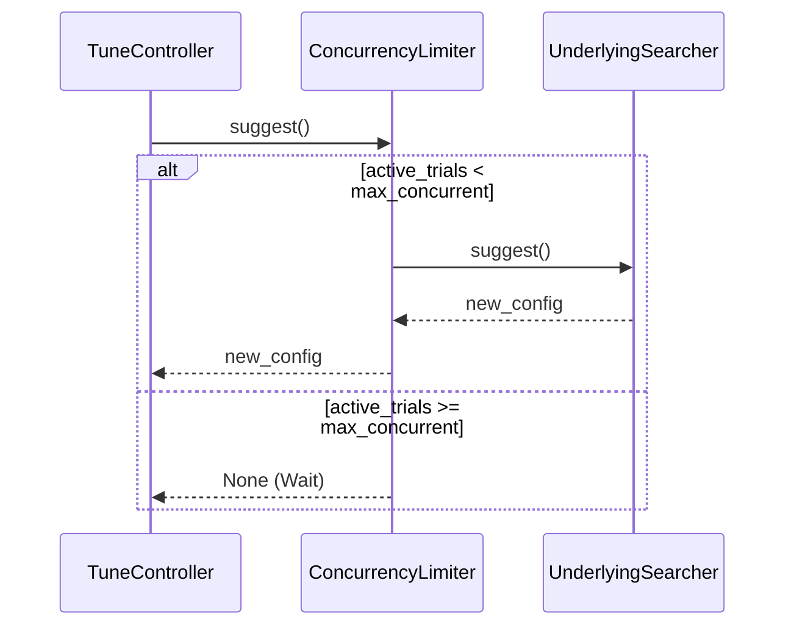

<!-- source: DeepWiki mcp.deepwiki.com · repo ray-project/ray · page 7.2 Search Algorithms and Schedulers · fetched 2026-10-21 -->

# Search Algorithms and Schedulers

Relevant source files

The following files were used as context for generating this wiki page:

- [doc/requirements-doc.txt](doc/requirements-doc.txt)
- [doc/source/_ext/llms_txt.py](doc/source/_ext/llms_txt.py)
- [doc/source/_ext/test_llms_txt.py](doc/source/_ext/test_llms_txt.py)
- [doc/source/_intersphinx/README.md](doc/source/_intersphinx/README.md)
- [doc/source/_intersphinx/refresh.py](doc/source/_intersphinx/refresh.py)
- [doc/source/_intersphinx/torch.inv](doc/source/_intersphinx/torch.inv)
- [doc/source/_static/css/custom.css](doc/source/_static/css/custom.css)
- [doc/source/_static/img/ray_logo.svg](doc/source/_static/img/ray_logo.svg)
- [doc/source/cluster/images/ray-job-diagram.png](doc/source/cluster/images/ray-job-diagram.png)
- [doc/source/cluster/kubernetes/troubleshooting/troubleshooting.md](doc/source/cluster/kubernetes/troubleshooting/troubleshooting.md)
- [doc/source/cluster/running-applications/job-submission/api.md](doc/source/cluster/running-applications/job-submission/api.md)
- [doc/source/cluster/running-applications/job-submission/index.md](doc/source/cluster/running-applications/job-submission/index.md)
- [doc/source/cluster/running-applications/job-submission/openapi.yml](doc/source/cluster/running-applications/job-submission/openapi.yml)
- [doc/source/cluster/running-applications/job-submission/rest.rst](doc/source/cluster/running-applications/job-submission/rest.rst)
- [doc/source/conf.py](doc/source/conf.py)
- [doc/source/custom_directives.py](doc/source/custom_directives.py)
- [doc/source/data/examples.yml](doc/source/data/examples.yml)
- [doc/source/images/ray_header_logo.png](doc/source/images/ray_header_logo.png)
- [doc/source/images/ray_logo.png](doc/source/images/ray_logo.png)
- [doc/source/llms_txt_summary.txt](doc/source/llms_txt_summary.txt)
- [doc/source/ray-overview/images/ray_svg_logo.svg](doc/source/ray-overview/images/ray_svg_logo.svg)
- [doc/source/serve/examples.yml](doc/source/serve/examples.yml)
- [doc/source/serve/tutorials/serve-deepseek.md](doc/source/serve/tutorials/serve-deepseek.md)
- [doc/source/train/deepspeed.rst](doc/source/train/deepspeed.rst)
- [doc/source/train/examples.yml](doc/source/train/examples.yml)
- [doc/source/train/examples/aws-trainium/llama3.rst](doc/source/train/examples/aws-trainium/llama3.rst)
- [doc/source/train/examples/jax/intro_to_jax_trainer/README.ipynb](doc/source/train/examples/jax/intro_to_jax_trainer/README.ipynb)
- [doc/source/train/examples/jax/intro_to_jax_trainer/README.md](doc/source/train/examples/jax/intro_to_jax_trainer/README.md)
- [doc/source/tune/examples/index.rst](doc/source/tune/examples/index.rst)
- [doc/source/tune/examples/tune-pytorch-cifar.ipynb](doc/source/tune/examples/tune-pytorch-cifar.ipynb)
- [python/deplocks/docs/docbuild_depset_py3.11.lock](python/deplocks/docs/docbuild_depset_py3.11.lock)
- [rllib/BUILD.bazel](rllib/BUILD.bazel)
- [rllib/algorithms/cql/torch/cql_torch_learner.py](rllib/algorithms/cql/torch/cql_torch_learner.py)
- [rllib/algorithms/cql/torch/default_cql_torch_rl_module.py](rllib/algorithms/cql/torch/default_cql_torch_rl_module.py)
- [rllib/algorithms/sac/sac.py](rllib/algorithms/sac/sac.py)
- [rllib/algorithms/sac/sac_learner.py](rllib/algorithms/sac/sac_learner.py)
- [rllib/algorithms/sac/torch/default_sac_torch_rl_module.py](rllib/algorithms/sac/torch/default_sac_torch_rl_module.py)
- [rllib/algorithms/sac/torch/sac_torch_learner.py](rllib/algorithms/sac/torch/sac_torch_learner.py)
- [rllib/algorithms/tqc/tests/test_default_tqc_rl_module.py](rllib/algorithms/tqc/tests/test_default_tqc_rl_module.py)
- [rllib/algorithms/tqc/torch/default_tqc_torch_rl_module.py](rllib/algorithms/tqc/torch/default_tqc_torch_rl_module.py)
- [rllib/core/distribution/distribution.py](rllib/core/distribution/distribution.py)
- [rllib/core/distribution/torch/tests/__init__.py](rllib/core/distribution/torch/tests/__init__.py)
- [rllib/core/distribution/torch/tests/test_torch_squashed_gaussian.py](rllib/core/distribution/torch/tests/test_torch_squashed_gaussian.py)
- [rllib/core/distribution/torch/torch_distribution.py](rllib/core/distribution/torch/torch_distribution.py)
- [rllib/core/models/base.py](rllib/core/models/base.py)
- [rllib/examples/ray_tune/appo_hyperparameter_tune.py](rllib/examples/ray_tune/appo_hyperparameter_tune.py)

Ray Tune separates the **generation** of hyperparameters from the **scheduling** of trials. This separation allows users to combine any search algorithm (such as Bayesian Optimization or Tree-structured Parzen Estimators) with any scheduling strategy (such as early stopping or Population Based Training).

---

## Search Algorithms

Search algorithms in Tune are responsible for suggesting hyperparameter configurations. They implement the `Searcher` or `SearchAlgorithm` interface to provide logic for exploring the parameter space.

### Implementation and Data Flow
The `Searcher` interface provides the core logic for suggesting new trials and processing results to update underlying models (such as Gaussian Processes in Bayesian Optimization).

1. **Suggestion**: The `TuneController` requests a new configuration via `Searcher.suggest()`. [python/ray/tune/search/searcher.py:20-50]()
2. **Feedback**: When a trial reports results or completes, the execution loop calls `Searcher.on_trial_result()` and `Searcher.on_trial_complete()` to provide feedback to the algorithm. [python/ray/tune/tune.py:197-201]()
3. **Concurrency Limiting**: The `ConcurrencyLimiter` wrapper is used to restrict the number of trials initiated by a searcher. This is critical for sequential algorithms like those found in Optuna or BayesOpt that require feedback before making the next optimal suggestion. [python/ray/tune/search/concurrency_limiter.py:15-40]()

### Integrated Searchers
Tune integrates with a wide variety of third-party optimization libraries:

| Searcher Class | Backend Library | Description |
| :--- | :--- | :--- |
| `OptunaSearch` | Optuna | Supports Tree-structured Parzen Estimator (TPE) and CMA-ES. |
| `HyperOptSearch` | HyperOpt | TPE-based search for distributed optimization. [python/ray/tune/tests/test_api.py:58]() |
| `BayesOptSearch` | BayesOpt | Bayesian Optimization using Gaussian Processes. |
| `AxSearch` | Ax/BoTorch | Adaptive Experimentation platform for multi-objective optimization. [python/ray/tune/tests/test_api.py:57]() |
| `BasicVariantGenerator` | Internal | Default generator for grid search and random search. [python/ray/tune/search/variant_generator.py:10-30]() |

Sources: [python/ray/tune/tune.py:57-64](), [python/ray/tune/search/variant_generator.py:10-68](), [python/ray/tune/tests/test_api.py:53-60]()

---

## Trial Schedulers

Schedulers manage the lifecycle of running trials. Unlike Searchers, which pick *what* to run, Schedulers decide *when* to stop, pause, or mutate trials based on intermediate performance metrics.

### Key Schedulers
* **ASHA (Asynchronous Successive Halving)**: An aggressive early-stopping scheduler implemented as `AsyncHyperBandScheduler` that promotes well-performing trials to higher "rungs" of resource allocation while terminating underperformers. [python/ray/tune/schedulers/async_hyperband.py:10-50]()
* **PBT (Population Based Training)**: Periodically replaces underperforming trials with clones of top performers and "mutates" their hyperparameters in-flight, creating a dynamic schedule. [python/ray/tune/schedulers/pbt.py:20-100]()
* **HyperBand**: A multi-fidelity bandit-based approach implemented as `HyperBandScheduler` that allocates more resources to promising configurations. [python/ray/tune/schedulers/hyperband.py:5-40]()
* **MedianStoppingRule**: Stops trials whose performance is below the median of previous trials at similar time points.

### Scheduler Logic Flow
The `TrialScheduler` interacts directly with the `TuneController` loop to influence trial state transitions.

Title: Trial Scheduler Interaction Loop

Sources: [python/ray/tune/schedulers/trial_scheduler.py:15-60](), [python/ray/tune/tune.py:48-56](), [python/ray/tune/execution/tune_controller.py:33-50]()

---

## Search Space API

The search space defines the domain and distribution of hyperparameters. Tune provides a domain-specific language (DSL) to define these distributions, which are resolved during experiment execution.

### Common Distributions
* `tune.grid_search([values])`: Iterates through every value in the provided list. [python/ray/tune/search/variant_generator.py:68-70]()
* `tune.uniform(low, high)`: Samples uniformly between low and high.
* `tune.loguniform(low, high)`: Samples from a logarithmic uniform distribution, ideal for parameters like learning rates. [python/ray/tune/tests/test_tuner.py:130-132]()
* `tune.randint(low, high)`: Samples random integers. [python/ray/tune/tests/test_tuner.py:132-133]()

### Resolution Flow
Title: Search Space Resolution to Code Entities

Sources: [python/ray/tune/search/variant_generator.py:10-68](), [python/ray/tune/experiment/trial.py:183-200](), [python/ray/tune/tests/test_tuner.py:117-135]()

---

## Concurrency Management

In distributed environments, it is vital to control the number of simultaneous trials to prevent resource contention or to satisfy the requirements of sequential search algorithms.

### ConcurrencyLimiter Pattern
The `ConcurrencyLimiter` is a wrapper class that intercepts `suggest()` calls. If the number of active trials meets the `max_concurrent` threshold, it returns `None`, signaling the controller to wait.

Title: Concurrency Control Flow

Sources: [python/ray/tune/search/concurrency_limiter.py:15-60](), [python/ray/tune/impl/tuner_internal.py:194-200]()

---

## Resource Schedulers and Data Integration

Tune trials often integrate with Ray Train and Ray Data. The `DataConfig` class ensures that resources (CPUs/GPUs) are correctly partitioned between the training logic and the data preprocessing/ingestion logic.

* **Resource Exclusion**: When using `DataParallelTrainer` within Tune, `DataConfig` can exclude training-reserved resources from the `StreamingExecutor` to ensure the data pipeline does not starve the model training. [python/ray/train/_internal/data_config.py:127-141]()
* **Execution Resources**: The `ExecutionResources` class in Ray Data tracks limits for CPU, GPU, and Object Store memory used by operators within a Tune trial. [python/ray/data/_internal/execution/interfaces/execution_options.py:11-39]()

Sources: [python/ray/train/_internal/data_config.py:14-43](), [python/ray/data/_internal/execution/interfaces/execution_options.py:11-82]()

---

