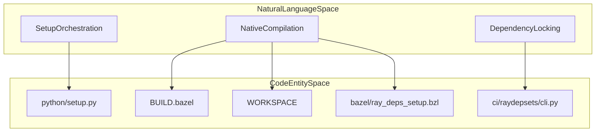
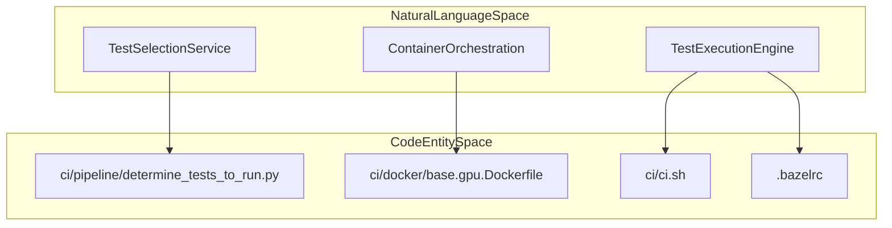

<!-- source: DeepWiki mcp.deepwiki.com · repo ray-project/ray · page 8 Build and Development Infrastructure · fetched 2026-10-21 -->

# Build and Development Infrastructure

Relevant source files

The following files were used as context for generating this wiki page:

- [.bazelrc](.bazelrc)
- [.bazelversion](.bazelversion)
- [.buildkite/release-automation/forge_arm64.wanda.yaml](.buildkite/release-automation/forge_arm64.wanda.yaml)
- [.buildkite/release-automation/forge_x86_64.wanda.yaml](.buildkite/release-automation/forge_x86_64.wanda.yaml)
- [BUILD.bazel](BUILD.bazel)
- [WORKSPACE](WORKSPACE)
- [bazel/BUILD.bazel](bazel/BUILD.bazel)
- [bazel/gen_extract.py](bazel/gen_extract.py)
- [bazel/jemalloc.BUILD](bazel/jemalloc.BUILD)
- [bazel/ray_deps_build_all.bzl](bazel/ray_deps_build_all.bzl)
- [bazel/ray_deps_setup.bzl](bazel/ray_deps_setup.bzl)
- [bazel/rocksdb.BUILD](bazel/rocksdb.BUILD)
- [ci/build/build-manylinux-forge.sh](ci/build/build-manylinux-forge.sh)
- [ci/build/build-manylinux-ray.sh](ci/build/build-manylinux-ray.sh)
- [ci/build/test-linux-placeholder-wheel.sh](ci/build/test-linux-placeholder-wheel.sh)
- [ci/ci.sh](ci/ci.sh)
- [ci/docker/base.build.Dockerfile](ci/docker/base.build.Dockerfile)
- [ci/docker/base.build.aarch64.wanda.yaml](ci/docker/base.build.aarch64.wanda.yaml)
- [ci/docker/base.build.wanda.yaml](ci/docker/base.build.wanda.yaml)
- [ci/docker/base.cu128.wanda.yaml](ci/docker/base.cu128.wanda.yaml)
- [ci/docker/base.gpu.Dockerfile](ci/docker/base.gpu.Dockerfile)
- [ci/docker/base.gpu.wanda.yaml](ci/docker/base.gpu.wanda.yaml)
- [ci/docker/base.ml.wanda.yaml](ci/docker/base.ml.wanda.yaml)
- [ci/docker/base.test.Dockerfile](ci/docker/base.test.Dockerfile)
- [ci/docker/base.test.aarch64.wanda.yaml](ci/docker/base.test.aarch64.wanda.yaml)
- [ci/docker/base.test.wanda.yaml](ci/docker/base.test.wanda.yaml)
- [ci/docker/llm.build.aarch64.wanda.yaml](ci/docker/llm.build.aarch64.wanda.yaml)
- [ci/env/install-dependencies.sh](ci/env/install-dependencies.sh)
- [ci/lint/BUILD.bazel](ci/lint/BUILD.bazel)
- [ci/pipeline/BUILD.bazel](ci/pipeline/BUILD.bazel)
- [ci/pipeline/determine_tests_to_run.py](ci/pipeline/determine_tests_to_run.py)
- [ci/ray_ci/BUILD.bazel](ci/ray_ci/BUILD.bazel)
- [ci/ray_ci/bazel_sharding.py](ci/ray_ci/bazel_sharding.py)
- [ci/ray_ci/bisect/BUILD.bazel](ci/ray_ci/bisect/BUILD.bazel)
- [ci/ray_ci/builder_container.py](ci/ray_ci/builder_container.py)
- [ci/ray_ci/pipeline/BUILD.bazel](ci/ray_ci/pipeline/BUILD.bazel)
- [ci/ray_ci/test_bazel_sharding.py](ci/ray_ci/test_bazel_sharding.py)
- [ci/raydepsets/BUILD.bazel](ci/raydepsets/BUILD.bazel)
- [ci/raydepsets/cli.py](ci/raydepsets/cli.py)
- [ci/raydepsets/pre_hooks/remove-compiled-headers.sh](ci/raydepsets/pre_hooks/remove-compiled-headers.sh)
- [ci/raydepsets/tests/test_cli.py](ci/raydepsets/tests/test_cli.py)
- [ci/raydepsets/tests/test_data/pre-hook-error-test.sh](ci/raydepsets/tests/test_data/pre-hook-error-test.sh)
- [ci/raydepsets/tests/test_data/pre-hook-test.sh](ci/raydepsets/tests/test_data/pre-hook-test.sh)
- [ci/raydepsets/tests/test_data/test.depsets.yaml](ci/raydepsets/tests/test_data/test.depsets.yaml)
- [ci/raydepsets/tests/test_workspace.py](ci/raydepsets/tests/test_workspace.py)
- [ci/raydepsets/tests/utils.py](ci/raydepsets/tests/utils.py)
- [ci/raydepsets/workspace.py](ci/raydepsets/workspace.py)
- [cpp/BUILD.bazel](cpp/BUILD.bazel)
- [cpp/test_python_call_cpp.py](cpp/test_python_call_cpp.py)
- [doc/external/test_hashes.py](doc/external/test_hashes.py)
- [gen_py_proto.py](gen_py_proto.py)
- [java/BUILD.bazel](java/BUILD.bazel)
- [java/build-jar-multiplatform.sh](java/build-jar-multiplatform.sh)
- [java/gen_maven_deps.py](java/gen_maven_deps.py)
- [java/gen_pom_files.py](java/gen_pom_files.py)
- [java/gen_proto_files.py](java/gen_proto_files.py)
- [java/generate_jni_header_files.sh](java/generate_jni_header_files.sh)
- [java/test.sh](java/test.sh)
- [python/build-wheel-manylinux2014.sh](python/build-wheel-manylinux2014.sh)
- [python/ray/tests/test_protobuf_compatibility.py](python/ray/tests/test_protobuf_compatibility.py)
- [python/requirements/ml/rllib-test-requirements.txt](python/requirements/ml/rllib-test-requirements.txt)
- [release/BUILD.bazel](release/BUILD.bazel)
- [thirdparty/patches/boost-headers.patch](thirdparty/patches/boost-headers.patch)
- [thirdparty/patches/build-bazel-apple-support-xcode.patch](thirdparty/patches/build-bazel-apple-support-xcode.patch)
- [thirdparty/patches/org_lzma_lzma.BUILD.bazel](thirdparty/patches/org_lzma_lzma.BUILD.bazel)
- [thirdparty/patches/protobuf-bazel7.patch](thirdparty/patches/protobuf-bazel7.patch)
- [thirdparty/patches/rocksdb-tsan-no-pie.patch](thirdparty/patches/rocksdb-tsan-no-pie.patch)
- [thirdparty/patches/spdlog-rotation-file-format.patch](thirdparty/patches/spdlog-rotation-file-format.patch)

This page provides an overview of Ray's build system, continuous integration and continuous deployment (CI/CD) pipelines, testing infrastructure, and release processes that support Ray development. Ray relies on a robust combination of **Bazel**, **Buildkite**, containerized execution environments via **wanda**, and automated dependency management to ensure cross-platform reproducibility and high velocity.

Since this is a parent page, high-level summaries are provided below. For deeper technical specifics, consult the designated child pages:
- For Python packaging, setup orchestration, and dependency locking, see [Package Management and Dependencies](#8.1).
- For CI/CD execution, test selection logic, and container builds, see [CI/CD Pipeline and Test Orchestration](#8.2).
- For benchmark suites, release workflows, and performance tracking, see [Release Testing and Benchmarks](#8.3).
- For shared fixtures, test harnesses, and Bazel conventions, see [Testing Utilities and Fixtures](#8.4).

---

## 1. Build System and Package Management

Ray's build architecture integrates **Bazel** for native C/C++ compilation (`_raylet`, GCS, Plasma store) with Python setuptools packaging (`python/setup.py`) [BUILD.bazel:163-206](), [python/setup.py:1-154](). Dependency management is centralized through lock files and the `raydepsets` tool, which leverages `uv` for fast resolution across platforms and installation extras [ci/raydepsets/cli.py:30-90]().

The diagram below bridges the high-level packaging subsystems to their underlying codebase entities:

Sources: [python/setup.py:1-154](), [BUILD.bazel:1-206](), [WORKSPACE:1-48](), [ci/raydepsets/cli.py:30-90](), [bazel/ray_deps_setup.bzl:86-128]()

For comprehensive details on wheel builds, third-party vendoring, and GPU provisioning, see [Package Management and Dependencies](#8.1).

---

## 2. CI/CD Pipelines and Test Orchestration

Ray uses **Buildkite** to orchestrate all continuous integration pipelines, utilizing intelligent test selection (`determine_tests_to_run.py`) to map git diffs to specific component tags (`core`, `serve`, `data`, `ml`, `rllib`) [ci/pipeline/determine_tests_to_run.py:60-91](). Containerized build environments are managed via `wanda` configuration files and Dockerfiles (e.g., `base.gpu.Dockerfile`), while test execution across worker pools is coordinated via `tester.py` [ci/docker/base.gpu.Dockerfile:1-40]().

The following diagram maps the CI orchestration workflow to its concrete implementation files:

Sources: [ci/pipeline/determine_tests_to_run.py:12-215](), [ci/docker/base.gpu.Dockerfile:1-88](), [ci/ci.sh:1-122](), [.bazelrc:1-35]()

For detailed documentation on pipeline definitions, container images, lint jobs, and flaky test management, see [CI/CD Pipeline and Test Orchestration](#8.2).

---

## 3. Release Testing and Benchmarks

Ray's release framework provides robust validation for production readiness across multiple cloud providers and hardware architectures. Benchmark definitions (`release_tests.yaml`, `release_data_tests.yaml`) and execution glue scripts (`release/ray_release/`) coordinate Bring-Your-Own-Device (BYOD) image builds, retry logic, and performance metrics collection [release/BUILD.bazel:66-262]().

| Component / Subsystem | Configuration & Source Entities | Primary Target Tags |
|-----------------------|---------------------------------|---------------------|
| Serve Smoke & Load Tests | `release/BUILD.bazel` | `team:serve` |
| ML & Train Benchmarks | `release/BUILD.bazel` | `team:ml` |
| Data Processing Workloads | `release/BUILD.bazel` | `team:data` |
| CI Release Automation | `ci/ray_ci/automation/` | `team:ci` |

Sources: [release/BUILD.bazel:66-262]()

For complete information on benchmark suites, glue logic (`AnyscaleJobRunner`), and performance tracking, see [Release Testing and Benchmarks](#8.3).

---

## 4. Testing Utilities and Fixtures

To reduce boilerplate and standardize testing patterns, Ray maintains a shared testing infrastructure. This includes helper utilities (`python/ray/_private/test_utils.py`), pytest fixtures for multi-node cluster fault tolerance, GCS/Redis test harnesses, and standard `BUILD.bazel` test target conventions [BUILD.bazel:47-58]().

For details on shared helpers, conftest fixtures, and cluster harnesses, see [Testing Utilities and Fixtures](#8.4).

---

