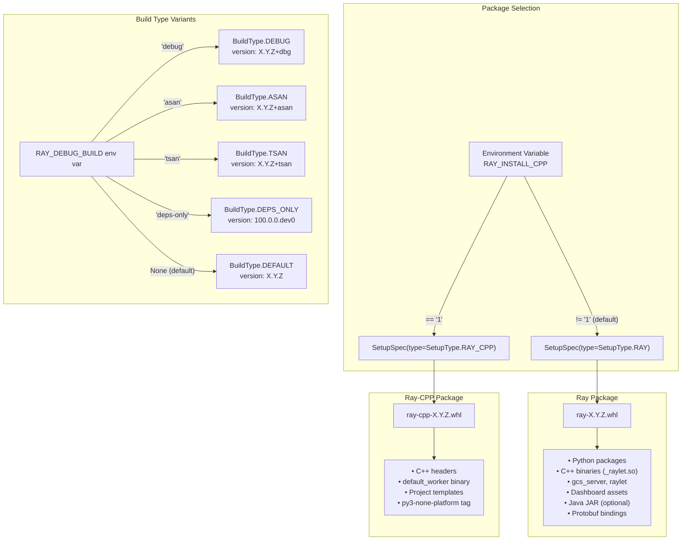
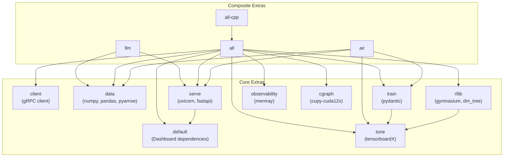
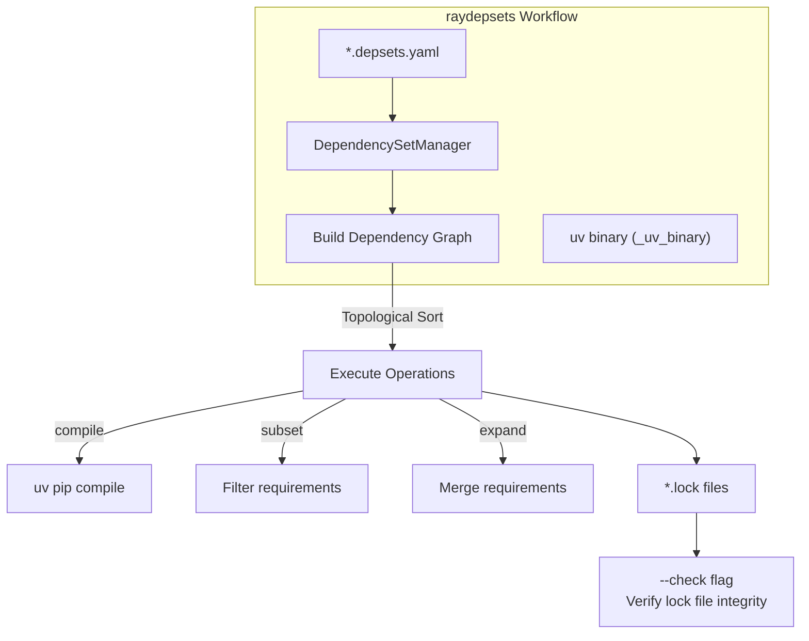
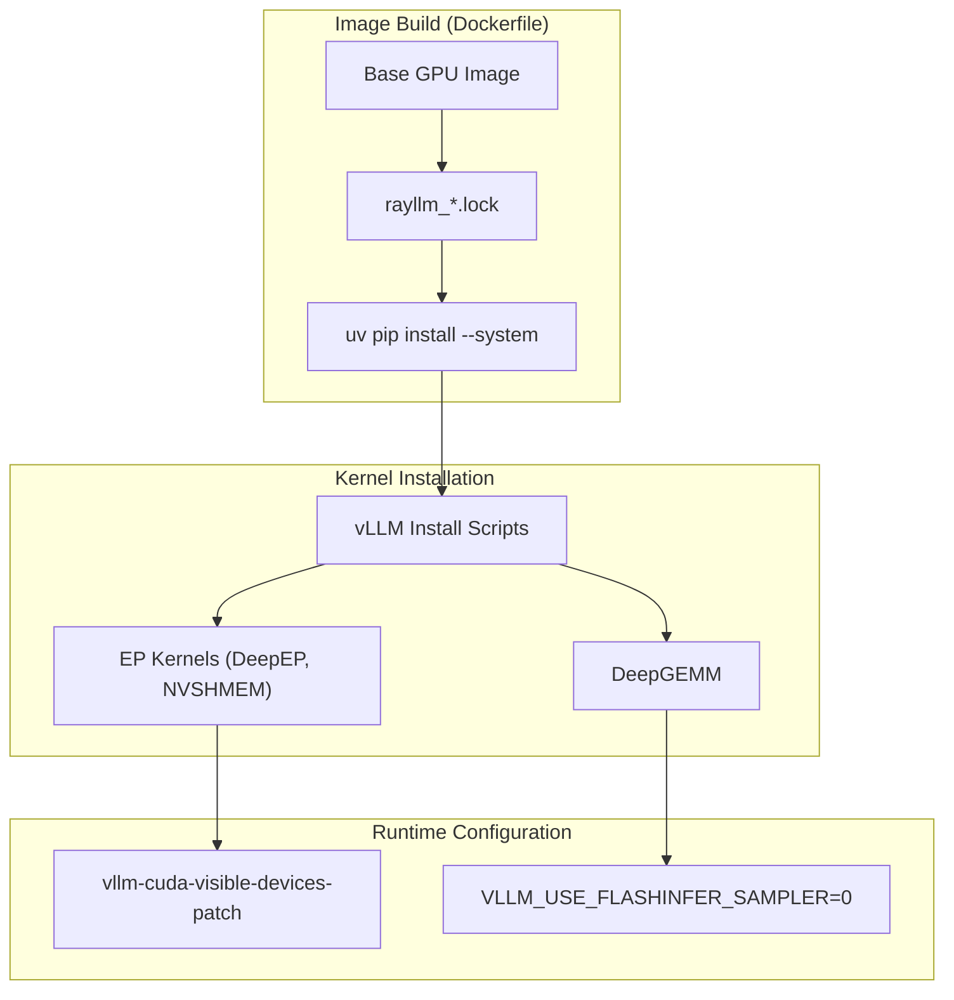

<!-- source: DeepWiki mcp.deepwiki.com · repo ray-project/ray · page 8.1 Package Management and Dependencies · fetched 2026-10-21 -->

# Package Management and Dependencies

Relevant source files

The following files were used as context for generating this wiki page:

- [.bazelrc](.bazelrc)
- [.bazelversion](.bazelversion)
- [.buildkite/_wheel-build.rayci.yml](.buildkite/_wheel-build.rayci.yml)
- [.buildkite/release-automation/forge_arm64.wanda.yaml](.buildkite/release-automation/forge_arm64.wanda.yaml)
- [.buildkite/release-automation/forge_x86_64.wanda.yaml](.buildkite/release-automation/forge_x86_64.wanda.yaml)
- [BUILD.bazel](BUILD.bazel)
- [WORKSPACE](WORKSPACE)
- [bazel/BUILD.bazel](bazel/BUILD.bazel)
- [bazel/ray_deps_setup.bzl](bazel/ray_deps_setup.bzl)
- [bazel/rocksdb.BUILD](bazel/rocksdb.BUILD)
- [build-wheel.sh](build-wheel.sh)
- [ci/build/BUILD.bazel](ci/build/BUILD.bazel)
- [ci/build/build-manylinux-wheel.sh](ci/build/build-manylinux-wheel.sh)
- [ci/build/build_common.py](ci/build/build_common.py)
- [ci/build/build_common_test.py](ci/build/build_common_test.py)
- [ci/build/build_image.py](ci/build/build_image.py)
- [ci/build/build_image_test.py](ci/build/build_image_test.py)
- [ci/build/build_wheel.py](ci/build/build_wheel.py)
- [ci/build/build_wheel_test.py](ci/build/build_wheel_test.py)
- [ci/build/test-macos-wheels.sh](ci/build/test-macos-wheels.sh)
- [ci/docker/base.build.Dockerfile](ci/docker/base.build.Dockerfile)
- [ci/docker/base.build.aarch64.wanda.yaml](ci/docker/base.build.aarch64.wanda.yaml)
- [ci/docker/base.build.wanda.yaml](ci/docker/base.build.wanda.yaml)
- [ci/docker/base.cu128.wanda.yaml](ci/docker/base.cu128.wanda.yaml)
- [ci/docker/base.gpu.Dockerfile](ci/docker/base.gpu.Dockerfile)
- [ci/docker/base.gpu.wanda.yaml](ci/docker/base.gpu.wanda.yaml)
- [ci/docker/base.ml.wanda.yaml](ci/docker/base.ml.wanda.yaml)
- [ci/docker/base.test.Dockerfile](ci/docker/base.test.Dockerfile)
- [ci/docker/base.test.aarch64.wanda.yaml](ci/docker/base.test.aarch64.wanda.yaml)
- [ci/docker/base.test.wanda.yaml](ci/docker/base.test.wanda.yaml)
- [ci/docker/core.build.Dockerfile](ci/docker/core.build.Dockerfile)
- [ci/docker/core.build.wanda.yaml](ci/docker/core.build.wanda.yaml)
- [ci/docker/doc.build.Dockerfile](ci/docker/doc.build.Dockerfile)
- [ci/docker/doc.build.wanda.yaml](ci/docker/doc.build.wanda.yaml)
- [ci/docker/docgpu.build.Dockerfile](ci/docker/docgpu.build.Dockerfile)
- [ci/docker/docgpu.build.wanda.yaml](ci/docker/docgpu.build.wanda.yaml)
- [ci/docker/doctest.build.Dockerfile](ci/docker/doctest.build.Dockerfile)
- [ci/docker/doctest.build.wanda.yaml](ci/docker/doctest.build.wanda.yaml)
- [ci/docker/llm.build.Dockerfile](ci/docker/llm.build.Dockerfile)
- [ci/docker/llm.build.aarch64.wanda.yaml](ci/docker/llm.build.aarch64.wanda.yaml)
- [ci/docker/llm.build.wanda.yaml](ci/docker/llm.build.wanda.yaml)
- [ci/docker/min.build.Dockerfile](ci/docker/min.build.Dockerfile)
- [ci/docker/ml.build.Dockerfile](ci/docker/ml.build.Dockerfile)
- [ci/docker/ml.build.wanda.yaml](ci/docker/ml.build.wanda.yaml)
- [ci/docker/ray-cpp-wheel.Dockerfile](ci/docker/ray-cpp-wheel.Dockerfile)
- [ci/docker/ray-cpp-wheel.wanda.yaml](ci/docker/ray-cpp-wheel.wanda.yaml)
- [ci/docker/ray-image.Dockerfile](ci/docker/ray-image.Dockerfile)
- [ci/docker/ray-wheel.Dockerfile](ci/docker/ray-wheel.Dockerfile)
- [ci/docker/ray-wheel.wanda.yaml](ci/docker/ray-wheel.wanda.yaml)
- [ci/docker/rllib.build.Dockerfile](ci/docker/rllib.build.Dockerfile)
- [ci/docker/rllib.build.wanda.yaml](ci/docker/rllib.build.wanda.yaml)
- [ci/docker/serve.build.Dockerfile](ci/docker/serve.build.Dockerfile)
- [ci/env/install-dependencies.sh](ci/env/install-dependencies.sh)
- [ci/lint/BUILD.bazel](ci/lint/BUILD.bazel)
- [ci/lint/git-clang-format](ci/lint/git-clang-format)
- [ci/pipeline/BUILD.bazel](ci/pipeline/BUILD.bazel)
- [ci/pipeline/determine_tests_to_run.py](ci/pipeline/determine_tests_to_run.py)
- [ci/ray_ci/BUILD.bazel](ci/ray_ci/BUILD.bazel)
- [ci/ray_ci/bazel_sharding.py](ci/ray_ci/bazel_sharding.py)
- [ci/ray_ci/bisect/BUILD.bazel](ci/ray_ci/bisect/BUILD.bazel)
- [ci/ray_ci/pipeline/BUILD.bazel](ci/ray_ci/pipeline/BUILD.bazel)
- [ci/ray_ci/supported_images.py](ci/ray_ci/supported_images.py)
- [ci/ray_ci/test_bazel_sharding.py](ci/ray_ci/test_bazel_sharding.py)
- [ci/ray_ci/test_supported_images.py](ci/ray_ci/test_supported_images.py)
- [ci/raydepsets/BUILD.bazel](ci/raydepsets/BUILD.bazel)
- [ci/raydepsets/cli.py](ci/raydepsets/cli.py)
- [ci/raydepsets/configs/ci_rllib.depsets.yaml](ci/raydepsets/configs/ci_rllib.depsets.yaml)
- [ci/raydepsets/pre_hooks/remove-compiled-headers.sh](ci/raydepsets/pre_hooks/remove-compiled-headers.sh)
- [ci/raydepsets/tests/test_cli.py](ci/raydepsets/tests/test_cli.py)
- [ci/raydepsets/tests/test_data/pre-hook-error-test.sh](ci/raydepsets/tests/test_data/pre-hook-error-test.sh)
- [ci/raydepsets/tests/test_data/pre-hook-test.sh](ci/raydepsets/tests/test_data/pre-hook-test.sh)
- [ci/raydepsets/tests/test_data/test.depsets.yaml](ci/raydepsets/tests/test_data/test.depsets.yaml)
- [ci/raydepsets/tests/test_workspace.py](ci/raydepsets/tests/test_workspace.py)
- [ci/raydepsets/tests/utils.py](ci/raydepsets/tests/utils.py)
- [ci/raydepsets/workspace.py](ci/raydepsets/workspace.py)
- [doc/source/cluster/doc_code/slurm-basic.sh](doc/source/cluster/doc_code/slurm-basic.sh)
- [doc/source/cluster/vms/user-guides/community/slurm.rst](doc/source/cluster/vms/user-guides/community/slurm.rst)
- [doc/source/data/api/llm.rst](doc/source/data/api/llm.rst)
- [doc/source/data/doc_code/working-with-llms/basic_llm_example.py](doc/source/data/doc_code/working-with-llms/basic_llm_example.py)
- [doc/source/data/doc_code/working-with-llms/classification_example.py](doc/source/data/doc_code/working-with-llms/classification_example.py)
- [doc/source/data/doc_code/working-with-llms/embedding_example.py](doc/source/data/doc_code/working-with-llms/embedding_example.py)
- [doc/source/data/doc_code/working-with-llms/minimal_quickstart.py](doc/source/data/doc_code/working-with-llms/minimal_quickstart.py)
- [doc/source/data/doc_code/working-with-llms/omni_audio_example.py](doc/source/data/doc_code/working-with-llms/omni_audio_example.py)
- [doc/source/data/doc_code/working-with-llms/openai_api_example.py](doc/source/data/doc_code/working-with-llms/openai_api_example.py)
- [doc/source/data/doc_code/working-with-llms/vlm_image_example.py](doc/source/data/doc_code/working-with-llms/vlm_image_example.py)
- [doc/source/data/doc_code/working-with-llms/vlm_video_example.py](doc/source/data/doc_code/working-with-llms/vlm_video_example.py)
- [doc/source/data/working-with-llms.rst](doc/source/data/working-with-llms.rst)
- [doc/source/rllib/images/envs/external_env_setup_client_inference.svg](doc/source/rllib/images/envs/external_env_setup_client_inference.svg)
- [doc/source/rllib/images/envs/external_env_setup_server_inference.svg](doc/source/rllib/images/envs/external_env_setup_server_inference.svg)
- [doc/source/rllib/images/envs/multi_agent_episode_complex_order.svg](doc/source/rllib/images/envs/multi_agent_episode_complex_order.svg)
- [doc/source/serve/advanced-guides/performance.md](doc/source/serve/advanced-guides/performance.md)
- [doc/source/serve/llm/troubleshooting.md](doc/source/serve/llm/troubleshooting.md)
- [docker/base-deps/Dockerfile](docker/base-deps/Dockerfile)
- [docker/base-extra-testdeps/cpu.wanda.yaml](docker/base-extra-testdeps/cpu.wanda.yaml)
- [docker/base-extra-testdeps/cuda.wanda.yaml](docker/base-extra-testdeps/cuda.wanda.yaml)
- [docker/base-extra/Dockerfile](docker/base-extra/Dockerfile)
- [docker/base-slim/Dockerfile](docker/base-slim/Dockerfile)
- [docker/base-slim/cpu.wanda.yaml](docker/base-slim/cpu.wanda.yaml)
- [docker/base-slim/cuda.wanda.yaml](docker/base-slim/cuda.wanda.yaml)
- [docker/ray-llm/Dockerfile](docker/ray-llm/Dockerfile)
- [docker/ray-llm/cuda.wanda.yaml](docker/ray-llm/cuda.wanda.yaml)
- [pyproject.toml](pyproject.toml)
- [python/build-wheel-macos.sh](python/build-wheel-macos.sh)
- [python/build-wheel-windows.sh](python/build-wheel-windows.sh)
- [python/deplocks/llm/rayllm_py312_cpu.lock](python/deplocks/llm/rayllm_py312_cpu.lock)
- [python/deplocks/llm/rayllm_py312_cu130.lock](python/deplocks/llm/rayllm_py312_cu130.lock)
- [python/deplocks/llm/rayllm_test_py312_cpu.lock](python/deplocks/llm/rayllm_test_py312_cpu.lock)
- [python/deplocks/llm/rayllm_test_py312_cu130.lock](python/deplocks/llm/rayllm_test_py312_cu130.lock)
- [python/ray/_raylet.pxd](python/ray/_raylet.pxd)
- [python/ray/_raylet.pyi](python/ray/_raylet.pyi)
- [python/ray/includes/object_ref.pxi](python/ray/includes/object_ref.pxi)
- [python/ray/includes/object_ref.pyi](python/ray/includes/object_ref.pyi)
- [python/ray/includes/unique_ids.pyi](python/ray/includes/unique_ids.pyi)
- [python/ray/scripts/symmetric_run.py](python/ray/scripts/symmetric_run.py)
- [python/ray/setup-dev.py](python/ray/setup-dev.py)
- [python/ray/tests/autoscaler_test_utils.py](python/ray/tests/autoscaler_test_utils.py)
- [python/ray/tests/aws/utils/stubs.py](python/ray/tests/aws/utils/stubs.py)
- [python/ray/tests/kuberay/rune2e.sh](python/ray/tests/kuberay/rune2e.sh)
- [python/ray/tests/test_protobuf_compatibility.py](python/ray/tests/test_protobuf_compatibility.py)
- [python/ray/tests/test_symmetric_run.py](python/ray/tests/test_symmetric_run.py)
- [python/requirements.txt](python/requirements.txt)
- [python/requirements/doc/doc-test-requirements.txt](python/requirements/doc/doc-test-requirements.txt)
- [python/requirements/llm/llm-requirements.txt](python/requirements/llm/llm-requirements.txt)
- [python/requirements/ml/data-test-requirements.txt](python/requirements/ml/data-test-requirements.txt)
- [python/requirements/ml/rllib-test-requirements.txt](python/requirements/ml/rllib-test-requirements.txt)
- [python/requirements/test-requirements.txt](python/requirements/test-requirements.txt)
- [python/requirements_compiled.txt](python/requirements_compiled.txt)
- [python/requirements_compiled_py3.13.txt](python/requirements_compiled_py3.13.txt)
- [python/setup.py](python/setup.py)
- [ray-images.json](ray-images.json)
- [release/BUILD.bazel](release/BUILD.bazel)
- [release/ray_release/byod/byod.Dockerfile](release/ray_release/byod/byod.Dockerfile)
- [release/release_logs/compare_perf_metrics](release/release_logs/compare_perf_metrics)
- [rllib/utils/tests/test_utils.py](rllib/utils/tests/test_utils.py)
- [thirdparty/patches/build-bazel-apple-support-xcode.patch](thirdparty/patches/build-bazel-apple-support-xcode.patch)
- [thirdparty/patches/org_lzma_lzma.BUILD.bazel](thirdparty/patches/org_lzma_lzma.BUILD.bazel)
- [thirdparty/patches/protobuf-bazel7.patch](thirdparty/patches/protobuf-bazel7.patch)
- [thirdparty/patches/rocksdb-tsan-no-pie.patch](thirdparty/patches/rocksdb-tsan-no-pie.patch)
- [thirdparty/patches/spdlog-rotation-file-format.patch](thirdparty/patches/spdlog-rotation-file-format.patch)

This document describes Ray's package management architecture, including how the project defines, resolves, and distributes dependencies across multiple optional components. It covers the core dependency set, the extras system for optional features, dependency lock files for reproducible builds, the `raydepsets` locking system, third-party vendoring and patches, wheel builds across platforms, and the GPU/CUDA environment provisioning for LLM workloads.

---

## Package Distribution Model

Ray produces distinct wheel packages from the same repository, controlled by environment variables during the build process [python/setup.py:30-138]().

### Primary Package Types

Sources: [python/setup.py:30-138]()

The `SetupSpec` class [python/setup.py:82-111]() determines package characteristics based on build configuration. Supported Python versions span from 3.10 to 3.14 [python/setup.py:25](). The `ray-cpp` wheel uses custom distribution handlers to produce Python-agnostic wheels with `py3-none-platform` tags, allowing the same wheel to work across Python versions while maintaining platform-specific binary compatibility [python/setup.py:125-132]().

Sources: [python/setup.py:25-138]()

---

## Core Dependencies

Ray's minimal dependency set is defined in `setup.py` [python/setup.py:395-404]() and mirrored in requirements files for developer installation. This set is intentionally minimal to reduce installation friction.

### Install Requirements

| Dependency | Version Constraint | Purpose |
|------------|-------------------|---------|
| `click` | `>= 7.0` | CLI interface |
| `filelock` | (unbounded) | Cross-process synchronization |
| `jsonschema` | (unbounded) | Configuration validation |
| `msgpack` | `>= 1.0.0, < 2.0.0` | Serialization format |
| `packaging` | `>= 24.2` | Version parsing |
| `protobuf` | `>= 3.20.3` | RPC message format |
| `pyyaml` | (unbounded) | Configuration files |
| `requests` | (unbounded) | HTTP client |

Sources: [python/setup.py:395-404](), [python/requirements.txt:10-19]()

---

## Optional Extras System

Ray uses setuptools' `extras_require` mechanism to provide optional feature sets.

### Extras Dependency Graph

Sources: [python/setup.py:227-385]()

### Key Extras Definitions

- **`llm` Extra** [python/setup.py:365-385](): Large language model support, intentionally excluded from `all` due to large and potentially conflicting dependency sets. It depends on `data` and `serve` extras.
- **`all` Extra** [python/setup.py:347-351](): Union of all extras except `cpp` and `llm`.

Sources: [python/setup.py:227-385]()

---

## Dependency Resolution and Locking (`raydepsets`)

Ray uses a specialized dependency management system called `raydepsets` to generate reproducible lock files via `uv`.

### The raydepsets System

`raydepsets` is a CLI tool [ci/raydepsets/cli.py:30-34]() that manages dependency sets defined in YAML configuration files (`*.depsets.yaml`). It supports operations like `compile` (resolving transitive dependencies), `subset` (filtering a larger set), and `expand` (adding new requirements to an existing set) [ci/raydepsets/cli.py:175-199]().

**Key Components:**
- **`DependencySetManager`** [ci/raydepsets/cli.py:91-119](): Orchestrates the build process, loading configs and building a `DiGraph` of dependencies.
- **`uv` Integration** [ci/raydepsets/cli.py:114-115](): Uses the high-performance `uv` binary for dependency resolution.
- **Topological Sorting** [ci/raydepsets/cli.py:124-127](): Ensures that base dependency sets are compiled before the sets that depend on them.
- **Default Flags** [ci/raydepsets/cli.py:19-27](): Uses `--generate-hashes` and `--index-strategy unsafe-best-match` to ensure secure and flexible package resolution.

Sources: [ci/raydepsets/cli.py:19-27](), [ci/raydepsets/cli.py:91-127](), [ci/raydepsets/cli.py:171-200]()

### Lock File Matrix

Ray maintains separate lock files under `python/deplocks/` to handle combinatorial hardware and software configurations across Python versions (3.10 to 3.14) and hardware backends (CPU, CUDA).

Sources: [python/setup.py:25](), [docker/base-deps/Dockerfile:27-29]()

---

## Vendoring and Patching Strategy

Ray vendors specific third-party packages directly into the wheel to ensure availability and avoid runtime installation issues.

### Vendored Locations

- **`ray/thirdparty_files/`** [python/setup.py:38](): Contains core utilities like `psutil` and `colorama`.
- **`ray/_private/runtime_env/agent/thirdparty_files/`** [python/setup.py:39-41](): Contains `aiohttp` and `idna` for the Runtime Environment agent [python/setup.py:42-45]().

The build process uses `pip install --target` [python/setup.py:554-582]() to populate these directories before wheel assembly. Furthermore, C++ third-party dependencies loaded via Bazel (such as `com_google_protobuf` and `com_github_antirez_redis`) apply patch files located in `thirdparty/patches/` during the repository setup phase [bazel/ray_deps_setup.bzl:103-139]().

Sources: [python/setup.py:38-45](), [python/setup.py:554-582](), [bazel/ray_deps_setup.bzl:103-139]()

---

## GPU/CUDA Environment Provisioning

The `ray-llm` and base GPU Docker images provide specialized environments for high-performance distributed workloads and LLM serving, integrating custom engines and hardware-accelerated kernels.

### LLM Docker Provisioning Flow

**Key Implementation Details:**
- **Lock Selection** [docker/base-deps/Dockerfile:27-29](): Selects constraints and depset lock files dynamically based on the target `PYTHON_VERSION`.
- **Environment Bootstrapping** [docker/base-deps/Dockerfile:112-121](): Installs `uv` and provisions pip dependencies using `--index-strategy unsafe-best-match`.

Sources: [docker/base-deps/Dockerfile:1-136](), [python/requirements/test-requirements.txt:1-182]()

---

## Build System Integration (Bazel & setup.py)

The `setup.py` script orchestrates Bazel to build native components and package them into wheels.

### Native Build Targets

| Target | Purpose |
|--------|---------|
| `//:_raylet` | Cython/C++ extension for worker communication [BUILD.bazel:163-167]() |
| `//:exported_internal` | Header wrapper to reduce exported symbols [BUILD.bazel:100-116]() |
| `//:platform_shims` | Windows platform shims [BUILD.bazel:118-138]() |

**Bazel Configuration:**
Ray uses `bazel/ray_deps_setup.bzl` to manage external C++ dependencies like `protobuf`, `redis`, and `hiredis` [bazel/ray_deps_setup.bzl:118-151](). The `auto_http_archive` function [bazel/ray_deps_setup.bzl:23-84]() intelligently selects mirrors and manages `strip_prefix` for GitHub archives.

Sources: [BUILD.bazel:100-197](), [bazel/ray_deps_setup.bzl:23-151]()

---

