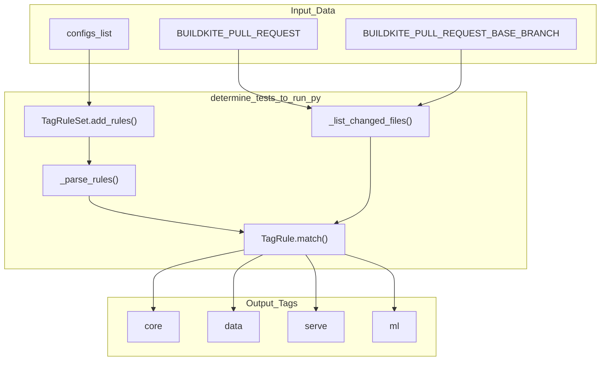
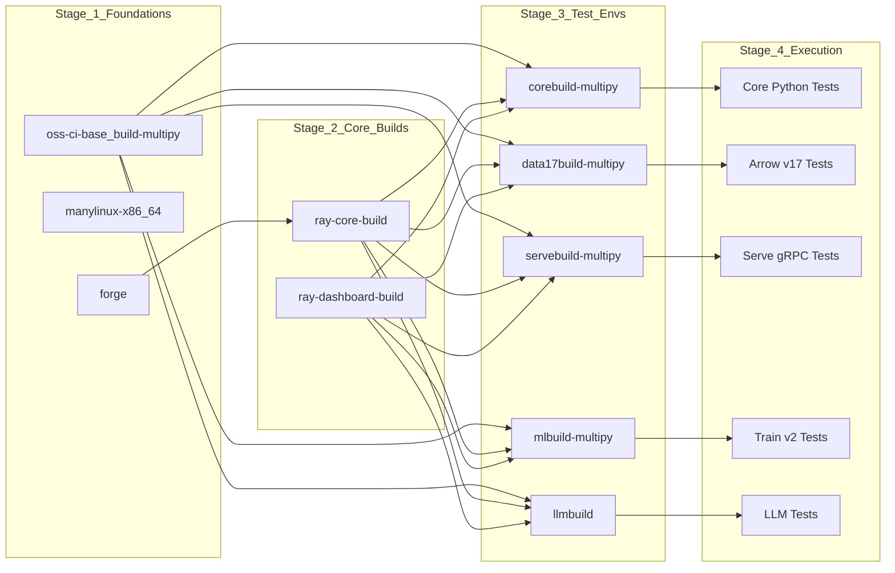

<!-- source: DeepWiki mcp.deepwiki.com · repo ray-project/ray · page 8.2 CI/CD Pipeline and Test Orchestration · fetched 2026-10-21 -->

# CI/CD Pipeline and Test Orchestration

Relevant source files

The following files were used as context for generating this wiki page:

- [.buildkite/_forge.rayci.yml](.buildkite/_forge.rayci.yml)
- [.buildkite/_images.rayci.yml](.buildkite/_images.rayci.yml)
- [.buildkite/always.rules.test.txt](.buildkite/always.rules.test.txt)
- [.buildkite/always.rules.txt](.buildkite/always.rules.txt)
- [.buildkite/base.rayci.yml](.buildkite/base.rayci.yml)
- [.buildkite/build.rayci.yml](.buildkite/build.rayci.yml)
- [.buildkite/cicd-cron/_forge.rayci.yml](.buildkite/cicd-cron/_forge.rayci.yml)
- [.buildkite/cicd-cron/cicd-cron.rayci.yml](.buildkite/cicd-cron/cicd-cron.rayci.yml)
- [.buildkite/cicd-cron/config.yaml](.buildkite/cicd-cron/config.yaml)
- [.buildkite/cicd.rayci.yml](.buildkite/cicd.rayci.yml)
- [.buildkite/core.rayci.yml](.buildkite/core.rayci.yml)
- [.buildkite/data.rayci.yml](.buildkite/data.rayci.yml)
- [.buildkite/dependencies.rayci.yml](.buildkite/dependencies.rayci.yml)
- [.buildkite/doc.rayci.yml](.buildkite/doc.rayci.yml)
- [.buildkite/hooks/pre-command](.buildkite/hooks/pre-command)
- [.buildkite/kuberay.rayci.yml](.buildkite/kuberay.rayci.yml)
- [.buildkite/lint.rayci.yml](.buildkite/lint.rayci.yml)
- [.buildkite/linux_aarch64.rayci.yml](.buildkite/linux_aarch64.rayci.yml)
- [.buildkite/llm.rayci.yml](.buildkite/llm.rayci.yml)
- [.buildkite/macos/always.rules.test.txt](.buildkite/macos/always.rules.test.txt)
- [.buildkite/macos/always.rules.txt](.buildkite/macos/always.rules.txt)
- [.buildkite/macos/config.yml](.buildkite/macos/config.yml)
- [.buildkite/macos/macos.rayci.yml](.buildkite/macos/macos.rayci.yml)
- [.buildkite/macos/test.rules.test.txt](.buildkite/macos/test.rules.test.txt)
- [.buildkite/macos/test.rules.txt](.buildkite/macos/test.rules.txt)
- [.buildkite/ml.rayci.yml](.buildkite/ml.rayci.yml)
- [.buildkite/others.rayci.yml](.buildkite/others.rayci.yml)
- [.buildkite/release-automation/forge.rayci.yml](.buildkite/release-automation/forge.rayci.yml)
- [.buildkite/release-automation/forge_arm64.Dockerfile](.buildkite/release-automation/forge_arm64.Dockerfile)
- [.buildkite/release-automation/forge_x86_64.Dockerfile](.buildkite/release-automation/forge_x86_64.Dockerfile)
- [.buildkite/release-automation/set-ray-version.sh](.buildkite/release-automation/set-ray-version.sh)
- [.buildkite/release-automation/verify-linux-wheels.sh](.buildkite/release-automation/verify-linux-wheels.sh)
- [.buildkite/release-automation/verify-macos-wheels.sh](.buildkite/release-automation/verify-macos-wheels.sh)
- [.buildkite/release-automation/wheels.rayci.yml](.buildkite/release-automation/wheels.rayci.yml)
- [.buildkite/release/_images.rayci.yml](.buildkite/release/_images.rayci.yml)
- [.buildkite/release/build.rayci.yml](.buildkite/release/build.rayci.yml)
- [.buildkite/release/config.yml](.buildkite/release/config.yml)
- [.buildkite/rllib.rayci.yml](.buildkite/rllib.rayci.yml)
- [.buildkite/serve.rayci.yml](.buildkite/serve.rayci.yml)
- [.buildkite/test.rules.test.txt](.buildkite/test.rules.test.txt)
- [.buildkite/test.rules.txt](.buildkite/test.rules.txt)
- [.buildkite/windows.rayci.yml](.buildkite/windows.rayci.yml)
- [.pre-commit-config.yaml](.pre-commit-config.yaml)
- [.rayciversion](.rayciversion)
- [ci/bazel_mirror_downloader.sh](ci/bazel_mirror_downloader.sh)
- [ci/build/build-ray-cpp-wheel.sh](ci/build/build-ray-cpp-wheel.sh)
- [ci/build/upload_build_info.sh](ci/build/upload_build_info.sh)
- [ci/compile_llm_requirements.sh](ci/compile_llm_requirements.sh)
- [ci/docker/forge.Dockerfile](ci/docker/forge.Dockerfile)
- [ci/docker/forge.aarch64.wanda.yaml](ci/docker/forge.aarch64.wanda.yaml)
- [ci/docker/forge.wanda.yaml](ci/docker/forge.wanda.yaml)
- [ci/docker/manylinux-cibase.wanda.yaml](ci/docker/manylinux-cibase.wanda.yaml)
- [ci/docker/manylinux-retag.Dockerfile](ci/docker/manylinux-retag.Dockerfile)
- [ci/docker/manylinux.Dockerfile](ci/docker/manylinux.Dockerfile)
- [ci/docker/manylinux.wanda.yaml](ci/docker/manylinux.wanda.yaml)
- [ci/docker/ray-core.Dockerfile](ci/docker/ray-core.Dockerfile)
- [ci/docker/ray-core.wanda.yaml](ci/docker/ray-core.wanda.yaml)
- [ci/docker/ray-cpp-core.Dockerfile](ci/docker/ray-cpp-core.Dockerfile)
- [ci/docker/ray-cpp-core.wanda.yaml](ci/docker/ray-cpp-core.wanda.yaml)
- [ci/docker/ray-dashboard.Dockerfile](ci/docker/ray-dashboard.Dockerfile)
- [ci/docker/ray-dashboard.wanda.yaml](ci/docker/ray-dashboard.wanda.yaml)
- [ci/docker/ray-java.Dockerfile](ci/docker/ray-java.Dockerfile)
- [ci/docker/ray-java.wanda.yaml](ci/docker/ray-java.wanda.yaml)
- [ci/docker/windows.build.Dockerfile](ci/docker/windows.build.Dockerfile)
- [ci/env/install-bazel.sh](ci/env/install-bazel.sh)
- [ci/lint/lint.sh](ci/lint/lint.sh)
- [ci/lint/validate_docs_go_scope.sh](ci/lint/validate_docs_go_scope.sh)
- [ci/pypi_proxy_agent.sh](ci/pypi_proxy_agent.sh)
- [ci/pypi_proxy_profile.sh](ci/pypi_proxy_profile.sh)
- [ci/ray_ci/anyscale_docker_container.py](ci/ray_ci/anyscale_docker_container.py)
- [ci/ray_ci/automation/BUILD.bazel](ci/ray_ci/automation/BUILD.bazel)
- [ci/ray_ci/automation/copy_wanda_image.py](ci/ray_ci/automation/copy_wanda_image.py)
- [ci/ray_ci/automation/crane_lib.py](ci/ray_ci/automation/crane_lib.py)
- [ci/ray_ci/automation/docker_tags_lib.py](ci/ray_ci/automation/docker_tags_lib.py)
- [ci/ray_ci/automation/generate_index.py](ci/ray_ci/automation/generate_index.py)
- [ci/ray_ci/automation/get_contributors.py](ci/ray_ci/automation/get_contributors.py)
- [ci/ray_ci/automation/image_tags_lib.py](ci/ray_ci/automation/image_tags_lib.py)
- [ci/ray_ci/automation/list_docker_tags.py](ci/ray_ci/automation/list_docker_tags.py)
- [ci/ray_ci/automation/push_ray_image.py](ci/ray_ci/automation/push_ray_image.py)
- [ci/ray_ci/automation/pypi_lib.py](ci/ray_ci/automation/pypi_lib.py)
- [ci/ray_ci/automation/ray_wheels_lib.py](ci/ray_ci/automation/ray_wheels_lib.py)
- [ci/ray_ci/automation/test_crane_lib.py](ci/ray_ci/automation/test_crane_lib.py)
- [ci/ray_ci/automation/test_docker_tags_lib.py](ci/ray_ci/automation/test_docker_tags_lib.py)
- [ci/ray_ci/automation/test_get_contributors.py](ci/ray_ci/automation/test_get_contributors.py)
- [ci/ray_ci/automation/test_image_tags_lib.py](ci/ray_ci/automation/test_image_tags_lib.py)
- [ci/ray_ci/automation/test_push_ray_image.py](ci/ray_ci/automation/test_push_ray_image.py)
- [ci/ray_ci/automation/test_pypi_lib.py](ci/ray_ci/automation/test_pypi_lib.py)
- [ci/ray_ci/automation/test_ray_wheels_lib.py](ci/ray_ci/automation/test_ray_wheels_lib.py)
- [ci/ray_ci/automation/test_update_version_lib.py](ci/ray_ci/automation/test_update_version_lib.py)
- [ci/ray_ci/automation/test_utils.py](ci/ray_ci/automation/test_utils.py)
- [ci/ray_ci/automation/update_version_lib.py](ci/ray_ci/automation/update_version_lib.py)
- [ci/ray_ci/automation/upload_wheels_pypi.py](ci/ray_ci/automation/upload_wheels_pypi.py)
- [ci/ray_ci/builder.py](ci/ray_ci/builder.py)
- [ci/ray_ci/configs.py](ci/ray_ci/configs.py)
- [ci/ray_ci/container.py](ci/ray_ci/container.py)
- [ci/ray_ci/doc/BUILD.bazel](ci/ray_ci/doc/BUILD.bazel)
- [ci/ray_ci/doc/README.md](ci/ray_ci/doc/README.md)
- [ci/ray_ci/doc/api.py](ci/ray_ci/doc/api.py)
- [ci/ray_ci/doc/api_param_coverage.py](ci/ray_ci/doc/api_param_coverage.py)
- [ci/ray_ci/doc/autodoc.py](ci/ray_ci/doc/autodoc.py)
- [ci/ray_ci/doc/cmd_check_api_discrepancy.py](ci/ray_ci/doc/cmd_check_api_discrepancy.py)
- [ci/ray_ci/doc/cmd_check_api_param_coverage.py](ci/ray_ci/doc/cmd_check_api_param_coverage.py)
- [ci/ray_ci/doc/mock/__init__.py](ci/ray_ci/doc/mock/__init__.py)
- [ci/ray_ci/doc/mock/_internal/__init__.py](ci/ray_ci/doc/mock/_internal/__init__.py)
- [ci/ray_ci/doc/mock/mock_module.py](ci/ray_ci/doc/mock/mock_module.py)
- [ci/ray_ci/doc/module.py](ci/ray_ci/doc/module.py)
- [ci/ray_ci/doc/test_api.py](ci/ray_ci/doc/test_api.py)
- [ci/ray_ci/doc/test_api_param_coverage.py](ci/ray_ci/doc/test_api_param_coverage.py)
- [ci/ray_ci/doc/test_autodoc.py](ci/ray_ci/doc/test_autodoc.py)
- [ci/ray_ci/doc/test_cmd_check_api_discrepancy.py](ci/ray_ci/doc/test_cmd_check_api_discrepancy.py)
- [ci/ray_ci/doc/test_module.py](ci/ray_ci/doc/test_module.py)
- [ci/ray_ci/docker_container.py](ci/ray_ci/docker_container.py)
- [ci/ray_ci/linux_container.py](ci/ray_ci/linux_container.py)
- [ci/ray_ci/linux_tester_container.py](ci/ray_ci/linux_tester_container.py)
- [ci/ray_ci/macos/macos_ci.sh](ci/ray_ci/macos/macos_ci.sh)
- [ci/ray_ci/macos/macos_ci_build.sh](ci/ray_ci/macos/macos_ci_build.sh)
- [ci/ray_ci/macos/pypi_proxy.sh](ci/ray_ci/macos/pypi_proxy.sh)
- [ci/ray_ci/ray_docker_container.py](ci/ray_ci/ray_docker_container.py)
- [ci/ray_ci/ray_image.py](ci/ray_ci/ray_image.py)
- [ci/ray_ci/test_anyscale_docker_container.py](ci/ray_ci/test_anyscale_docker_container.py)
- [ci/ray_ci/test_base.py](ci/ray_ci/test_base.py)
- [ci/ray_ci/test_container.py](ci/ray_ci/test_container.py)
- [ci/ray_ci/test_linux_container.py](ci/ray_ci/test_linux_container.py)
- [ci/ray_ci/test_linux_tester_container.py](ci/ray_ci/test_linux_tester_container.py)
- [ci/ray_ci/test_privileged.py](ci/ray_ci/test_privileged.py)
- [ci/ray_ci/test_ray_docker_container.py](ci/ray_ci/test_ray_docker_container.py)
- [ci/ray_ci/test_ray_image.py](ci/ray_ci/test_ray_image.py)
- [ci/ray_ci/test_tester.py](ci/ray_ci/test_tester.py)
- [ci/ray_ci/test_windows_container.py](ci/ray_ci/test_windows_container.py)
- [ci/ray_ci/test_windows_tester_container.py](ci/ray_ci/test_windows_tester_container.py)
- [ci/ray_ci/tester.py](ci/ray_ci/tester.py)
- [ci/ray_ci/tester_container.py](ci/ray_ci/tester_container.py)
- [ci/ray_ci/tests.env.Dockerfile](ci/ray_ci/tests.env.Dockerfile)
- [ci/ray_ci/windows/tests.env.Dockerfile](ci/ray_ci/windows/tests.env.Dockerfile)
- [ci/ray_ci/windows_container.py](ci/ray_ci/windows_container.py)
- [ci/raydepsets/configs/llm_release_tests.depsets.yaml](ci/raydepsets/configs/llm_release_tests.depsets.yaml)
- [ci/raydepsets/configs/rayllm.depsets.yaml](ci/raydepsets/configs/rayllm.depsets.yaml)
- [ci/test_compile_llm_requirements.sh](ci/test_compile_llm_requirements.sh)
- [doc/source/cluster/kubernetes/user-guides/label-based-scheduling.md](doc/source/cluster/kubernetes/user-guides/label-based-scheduling.md)
- [doc/source/cluster/kubernetes/user-guides/tpu.md](doc/source/cluster/kubernetes/user-guides/tpu.md)
- [docker/base-deps/cpu.wanda.yaml](docker/base-deps/cpu.wanda.yaml)
- [docker/base-deps/cuda.wanda.yaml](docker/base-deps/cuda.wanda.yaml)
- [docker/retag-lambda/cuda_versions.txt](docker/retag-lambda/cuda_versions.txt)
- [python/README-building-wheels.md](python/README-building-wheels.md)
- [python/ray/_private/runtime_env/conda.py](python/ray/_private/runtime_env/conda.py)
- [python/ray/_private/runtime_env/conda_utils.py](python/ray/_private/runtime_env/conda_utils.py)
- [python/ray/_private/runtime_env/dependency_utils.py](python/ray/_private/runtime_env/dependency_utils.py)
- [python/ray/_private/runtime_env/pip.py](python/ray/_private/runtime_env/pip.py)
- [python/ray/_private/runtime_env/virtualenv_utils.py](python/ray/_private/runtime_env/virtualenv_utils.py)
- [python/ray/serve/_private/tracing_utils.py](python/ray/serve/_private/tracing_utils.py)
- [python/ray/serve/pyrefly-serve.toml](python/ray/serve/pyrefly-serve.toml)
- [python/ray/serve/tests/test_tracing_utils.py](python/ray/serve/tests/test_tracing_utils.py)
- [python/ray/tests/authentication/BUILD.bazel](python/ray/tests/authentication/BUILD.bazel)
- [python/ray/tests/test_runtime_env_conda_and_pip.py](python/ray/tests/test_runtime_env_conda_and_pip.py)
- [python/ray/tests/test_runtime_env_conda_and_pip_4.py](python/ray/tests/test_runtime_env_conda_and_pip_4.py)
- [python/ray/tests/test_runtime_env_conda_and_pip_5.py](python/ray/tests/test_runtime_env_conda_and_pip_5.py)
- [python/ray/tests/test_runtime_env_get_wheel_names.py](python/ray/tests/test_runtime_env_get_wheel_names.py)
- [rayci.env](rayci.env)
- [release/util/sanity_check_cpp.sh](release/util/sanity_check_cpp.sh)

This document covers Ray's continuous integration and continuous deployment (CI/CD) infrastructure, focusing on intelligent test selection, pipeline orchestration, test execution in containerized environments, and flaky test management. For information about the package management and dependency system, see [Package Management and Dependencies](#8.1). For details about release testing and benchmarks, see [Release Testing and Benchmarks](#8.3).

## Overview

Ray's CI/CD system is built on Buildkite and implements several sophisticated features:

- **Intelligent Test Selection**: Analyzes git diffs to determine which tests need to run based on code changes [[ci/pipeline/determine_tests_to_run.py:12-47]]().
- **Multi-Platform Support**: Executes tests across Linux (x86_64, aarch64), Windows, and macOS [[.buildkite/linux_aarch64.rayci.yml:1-12]](), [[.buildkite/windows.rayci.yml:1-3]]().
- **Containerized Test Execution**: Runs tests in isolated Docker containers with controlled dependencies via `tester.py` [[ci/ray_ci/tester.py:12-15]]().
- **Parallel Execution**: Shards tests across multiple workers for faster feedback using `parallelism` and `workers` flags [[ci/ray_ci/tester.py:44-55]]().
- **Flaky Test Tracking**: Maintains a database of flaky tests and automatically excludes them from standard runs [[ci/ray_ci/tester.py:261-270]]().
- **Build Artifact Management**: Produces wheels, Docker images, and Java artifacts for different platforms and Python versions [[.buildkite/build.rayci.yml:3-24]]().

The system coordinates hundreds of test targets across different teams (core, data, serve, rllib, ml) and ensures that only relevant tests run for each code change.

Sources: [.buildkite/core.rayci.yml:1-6](), [ci/ray_ci/tester.py:41-197](), [ci/pipeline/determine_tests_to_run.py:1-110]()

## Test Selection and Tagging System

### Rule-Based Test Selection

The `determine_tests_to_run.py` script implements a rule-based system that maps file patterns to test tags. When a pull request is opened, the script analyzes the git diff using `_list_changed_files` and emits tags that determine which pipeline steps should run [[ci/pipeline/determine_tests_to_run.py:12-47]]().

Title: Test Selection Flow

**Rule Configuration Format**

Rules are defined in text files with a custom syntax parsed by `_parse_rules` [[ci/pipeline/determine_tests_to_run.py:93-164]]():

- `!` prefix: Declares valid tags at the start of the file [[ci/pipeline/determine_tests_to_run.py:135-139]]().
- `@` prefix: Assigns tags to the preceding file patterns [[ci/pipeline/determine_tests_to_run.py:144-146]]().
- `;` separator: Ends a rule block [[ci/pipeline/determine_tests_to_run.py:147-151]]().
- `*` patterns: Uses `fnmatch` for pattern matching [[ci/pipeline/determine_tests_to_run.py:153-154]]().

Sources: [ci/pipeline/determine_tests_to_run.py:60-164](), [ci/pipeline/determine_tests_to_run.py:211-215]()

### Tag-to-Pipeline Mapping

Each Buildkite pipeline YAML file uses group headers and dependencies to organize execution. The output of the selection script is used to trigger specific labels:

| Tag | Component | Pipeline File |
|---|---|---|
| `core` | Ray Core | `.buildkite/core.rayci.yml` [[.buildkite/core.rayci.yml:1]]() |
| `data` | Ray Data | `.buildkite/data.rayci.yml` [[.buildkite/data.rayci.yml:1]]() |
| `serve` | Ray Serve | `.buildkite/serve.rayci.yml` [[.buildkite/serve.rayci.yml:1]]() |
| `ml` | Ray Train/Tune | `.buildkite/ml.rayci.yml` [[.buildkite/ml.rayci.yml:1]]() |
| `linux_wheels` | Wheel Build | `.buildkite/build.rayci.yml` [[.buildkite/build.rayci.yml:24]]() |
| `llm` | Ray LLM | `.buildkite/llm.rayci.yml` [[.buildkite/llm.rayci.yml:1]]() |
| `rllib` | Ray RLlib | `.buildkite/rllib.rayci.yml` [[.buildkite/rllib.rayci.yml:1]]() |
| `dashboard` | Ray Dashboard | `.buildkite/core.rayci.yml` [[.buildkite/core.rayci.yml:73]]() |
| `python_dependencies` | Python Dependencies | `.buildkite/dependencies.rayci.yml` [[.buildkite/dependencies.rayci.yml:1]]() |
| `min_build` | Minimal Builds | `.buildkite/base.rayci.yml` [[.buildkite/base.rayci.yml:1]]() |
| `kuberay` | KubeRay | `.buildkite/kuberay.rayci.yml` [[.buildkite/kuberay.rayci.yml:1]]() |
| `lint` | Linting | `.buildkite/lint.rayci.yml` [[.buildkite/lint.rayci.yml:1]]() |
| `release_tests` | Release Tests | `.buildkite/release/build.rayci.yml` [[.buildkite/release/build.rayci.yml:1]]() |

Sources: [.buildkite/core.rayci.yml:1-6](), [.buildkite/data.rayci.yml:1-7](), [.buildkite/serve.rayci.yml:1-7](), [.buildkite/ml.rayci.yml:1-6](), [.buildkite/llm.rayci.yml:1-6](), [.buildkite/rllib.rayci.yml:1-6](), [.buildkite/build.rayci.yml:24](), [.buildkite/dependencies.rayci.yml:1-6](), [.buildkite/base.rayci.yml:1-6](), [.buildkite/kuberay.rayci.yml:1-6](), [.buildkite/lint.rayci.yml:1-6](), [.buildkite/release/build.rayci.yml:1-2]()

## Pipeline Architecture

### Build Dependency Chain

Ray uses a multi-stage pipeline where "Wanda" (Ray's internal Docker build tool) manages container builds.

Title: Ray CI Build Dependency Graph

**Wanda Build Definitions**
Wanda builds are defined using YAML files and triggered in Buildkite steps:
- **Core Build**: Uses `ci/docker/core.build.wanda.yaml` [[.buildkite/core.rayci.yml:10]]().
- **Data Build**: Uses `ci/docker/data17.build.wanda.yaml` [[.buildkite/data.rayci.yml:11]]().
- **Serve Build**: Uses `ci/docker/serve.build.wanda.yaml` [[.buildkite/serve.rayci.yml:11]]().
- **ML Build**: Uses `ci/docker/ml.build.wanda.yaml` [[.buildkite/ml.rayci.yml:22]]().
- **LLM Build**: Uses `ci/docker/llm.build.wanda.yaml` [[.buildkite/llm.rayci.yml:10]]().

Sources: [.buildkite/core.rayci.yml:8-19](), [.buildkite/data.rayci.yml:9-17](), [.buildkite/serve.rayci.yml:9-17](), [.buildkite/ml.rayci.yml:20-33](), [.buildkite/llm.rayci.yml:8-19]()

### Build Step Anatomy

Each pipeline step typically invokes `bazel run //ci/ray_ci:test_in_docker` to ensure tests run in a controlled environment [[.buildkite/core.rayci.yml:78]]().

**Key Parameters:**
- `--install-mask`: Speeds up installation by masking out unused libraries (e.g., `all-ray-libraries`) [[.buildkite/core.rayci.yml:79]]().
- `--parallelism-per-worker`: Controls how many tests run concurrently inside a single container [[.buildkite/core.rayci.yml:80]]().
- `--build-name`: References the specific Wanda build image to use for the environment [[.buildkite/core.rayci.yml:81]]().

Sources: [.buildkite/core.rayci.yml:71-84](), [ci/ray_ci/tester.py:171-174]()

## Test Execution Infrastructure

### Tester Container Architecture

The `tester.py` script is the main entry point for running tests. It selects a container implementation based on the operating system [[ci/ray_ci/tester.py:233-249]]().

- `LinuxTesterContainer`: Handles Docker-based execution on Linux [[ci/ray_ci/tester.py:12]]().
- `WindowsTesterContainer`: Handles execution on Windows nodes [[ci/ray_ci/tester.py:15]]().

### Intelligent Test Selection in Execution
The `_get_test_targets` function in `tester.py` queries Bazel for targets and applies filters [[ci/ray_ci/tester.py:262]]():
1. **Flaky Tests**: Excludes targets marked as flaky unless `--run-flaky-tests` is passed [[ci/ray_ci/tester.py:82-87]]().
2. **High Impact**: If `--run-high-impact-tests` is set, it selects tests that have historically caught regressions [[ci/ray_ci/tester.py:89-97]]().

Sources: [ci/ray_ci/tester.py:1-223](), [ci/ray_ci/tester_container.py:1-13]()

### Docker Containerization and Image Tagging

Ray uses a sophisticated tagging strategy for Docker images produced by the CI system.

**Image Tagging Strategy**
The `push_ray_image` automation tool handles multi-platform tagging [[.buildkite/build.rayci.yml:183-198]]().
- **Architecture**: Supports `x86_64` and `aarch64` [[.buildkite/build.rayci.yml:198]]().
- **Platform Variants**: Includes `cpu`, `tpu`, and specific CUDA versions (e.g., `cu12.1.1-cudnn8`) [[.buildkite/build.rayci.yml:185-189]]().
- **Python Versions**: Matrix builds for Python 3.10 through 3.14 [[.buildkite/build.rayci.yml:14-18]]().

**Specialized Images:**
- `ray-image-cuda-build`: GPU-optimized image with specific CUDA versions [[.buildkite/build.rayci.yml:145-164]]().
- `ray-extra-image-cpu-build`: Image containing additional library integrations [[.buildkite/build.rayci.yml:215-227]]().
- `ray-java-build`: Images used for Java artifact generation [[.buildkite/build.rayci.yml:54]]().

Sources: [.buildkite/build.rayci.yml:145-198](), [.buildkite/linux_aarch64.rayci.yml:31-119]()

## Multi-Architecture and Platform Support

### aarch64 (ARM64) Support
Ray provides first-class support for ARM64 architectures. The `linux_aarch64.rayci.yml` pipeline defines specific builds for ARM [[.buildkite/linux_aarch64.rayci.yml:1-3]]().
- **Instance Type**: Uses `builder-arm64` Buildkite agents [[.buildkite/linux_aarch64.rayci.yml:10]]().
- **Suffixing**: Images and wheels are tagged with `-aarch64` [[.buildkite/linux_aarch64.rayci.yml:27]]().
- **Wheel Build**: `ray-wheel-build-aarch64` depends on core, java, and dashboard ARM builds [[.buildkite/linux_aarch64.rayci.yml:201-227]]().

### Windows Support
Windows tests are orchestrated through `.buildkite/windows.rayci.yml` [[.buildkite/windows.rayci.yml:1]]().
- **Environment**: Uses `windows` instance types and `WINDOWS` job env [[.buildkite/windows.rayci.yml:13-14]]().
- **Tooling**: Invokes `ci/ray_ci/windows/install_tools.sh` before execution [[.buildkite/windows.rayci.yml:16]]().
- **Selection**: Uses `--operating-system windows` and excludes `no_windows` tags [[.buildkite/windows.rayci.yml:19-20]]().

Sources: [.buildkite/linux_aarch64.rayci.yml:8-227](), [.buildkite/windows.rayci.yml:1-113]()

## Lint Jobs

Linting jobs are defined in `.buildkite/lint.rayci.yml` and are categorized into prose-related and code-related checks.

- **Prose Linting**: Checks like `documentation_style` and `doc_no_new_rst` run on every pull request, even for documentation-only changes [[.buildkite/lint.rayci.yml:27-28]]().
- **Code Linting**: Checks such as `clang_format`, `pre_commit`, `dashboard_format`, `copyright_format`, `bazel_team`, `bazel_buildifier`, `pytest_format`, and `test_coverage` are triggered by code changes [[.buildkite/lint.rayci.yml:66-73]]().
- **`pre-commit` Hooks**: The `pre_commit` job runs a suite of pre-commit hooks defined in `.pre-commit-config.yaml` [[.buildkite/lint.rayci.yml:67]](). These include `ruff`, `black`, `mypy`, `cpplint`, and `buildifier` [[.pre-commit-config.yaml:51-100]]().
- **API Policy Checks**:
    - `api_annotations`: Checks for correct `@PublicAPI` annotations [[ci/lint/lint.sh:107-113]]().
    - `api_policy_check`: Verifies consistency between API definitions and documentation stubs [[ci/lint/lint.sh:115-132]](). This check uses `cmd_check_api_discrepancy.py` [[ci/ray_ci/doc/cmd_check_api_discrepancy.py:10]]() to compare the actual public API surface with the documented one, leveraging `TEAM_API_CONFIGS` to define module heads and exemptions [[ci/ray_ci/doc/cmd_check_api_discrepancy.py:31-96]]().
    - `api_param_coverage`: Ensures new parameters in public APIs have corresponding docstring entries [[ci/lint/lint.sh:134-144]](). This is a diff-scoped check that runs with `soft_fail: true` by default [[.buildkite/lint.rayci.yml:99]]().

Sources: [.buildkite/lint.rayci.yml:1-117](), [ci/lint/lint.sh:1-154](), [.pre-commit-config.yaml:1-169](), [ci/ray_ci/doc/cmd_check_api_discrepancy.py:1-123]()

## Flaky Test Management

Ray manages flakiness through several mechanisms:
1. **Manual Tagging**: Tests can be tagged with `flaky` in `BUILD.bazel` files or specific component `BUILD` files [[rllib/BUILD.bazel:39]]().
2. **Automated Tracking**: The `tester.py` script can interface with a test database to identify and skip high-frequency flaky tests [[ci/ray_ci/tester.py:261-262]]().
3. **Flaky Runs**: Specific CI steps are dedicated to running flaky tests to monitor stability without blocking PRs [[.buildkite/windows.rayci.yml:153-176]]().
4. **Bisection Mode**: The CI supports a bisection mode via `RAYCI_BISECT_TEST_TARGET` to track down the introduction of flakiness [[ci/ray_ci/tester.py:230-232]]().

Sources: [ci/ray_ci/tester.py:82-87](), [ci/ray_ci/tester.py:230-232](), [.buildkite/windows.rayci.yml:153-176]()

---

