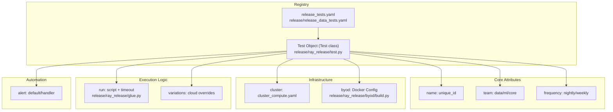
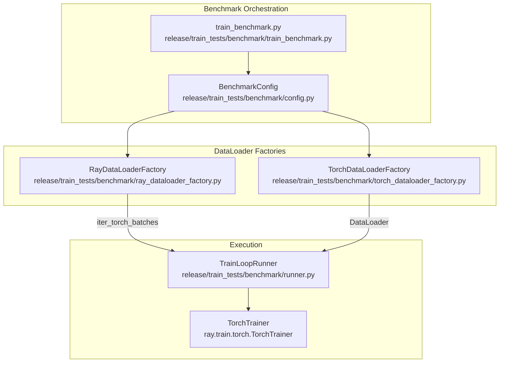

<!-- source: DeepWiki mcp.deepwiki.com · repo ray-project/ray · page 8.3 Release Testing and Benchmarks · fetched 2026-10-21 -->

# Release Testing and Benchmarks

Relevant source files

The following files were used as context for generating this wiki page:

- [ci/build/build-anyscale-docker.sh](ci/build/build-anyscale-docker.sh)
- [ci/ray_ci/oss_config.yaml](ci/ray_ci/oss_config.yaml)
- [doc/source/templates/README.md](doc/source/templates/README.md)
- [python/ray/data/_internal/cloud_auth.py](python/ray/data/_internal/cloud_auth.py)
- [python/ray/data/_internal/datasource/delta_datasink.py](python/ray/data/_internal/datasource/delta_datasink.py)
- [python/ray/data/catalog.py](python/ray/data/catalog.py)
- [python/ray/data/tests/catalog_test_utils.py](python/ray/data/tests/catalog_test_utils.py)
- [python/ray/data/tests/datasource/test_write_delta.py](python/ray/data/tests/datasource/test_write_delta.py)
- [python/ray/data/tests/datasource/test_write_delta_catalog_e2e.py](python/ray/data/tests/datasource/test_write_delta_catalog_e2e.py)
- [python/ray/data/tests/test_catalog.py](python/ray/data/tests/test_catalog.py)
- [release/llm_tests/batch/llm_4xl4.yaml](release/llm_tests/batch/llm_4xl4.yaml)
- [release/llm_tests/batch/llm_single_node_benchmark_l4.yaml](release/llm_tests/batch/llm_single_node_benchmark_l4.yaml)
- [release/llm_tests/batch/test_batch_single_node_vllm.py](release/llm_tests/batch/test_batch_single_node_vllm.py)
- [release/llm_tests/serve/configs/serve_llama_3dot2_1b_no_accelerator.yaml](release/llm_tests/serve/configs/serve_llama_3dot2_1b_no_accelerator.yaml)
- [release/llm_tests/serve/configs/serve_llama_3dot2_1b_s3.yaml](release/llm_tests/serve/configs/serve_llama_3dot2_1b_s3.yaml)
- [release/llm_tests/serve/llm_four_L4_gpu_head_node.yaml](release/llm_tests/serve/llm_four_L4_gpu_head_node.yaml)
- [release/llm_tests/serve/llm_g5-4xlarge.yaml](release/llm_tests/serve/llm_g5-4xlarge.yaml)
- [release/llm_tests/serve/run_llm_serve_test_and_bms.py](release/llm_tests/serve/run_llm_serve_test_and_bms.py)
- [release/llm_tests/serve/test_llm_serve_correctness.py](release/llm_tests/serve/test_llm_serve_correctness.py)
- [release/llm_tests/serve/test_llm_serve_dp_engine_fault.py](release/llm_tests/serve/test_llm_serve_dp_engine_fault.py)
- [release/llm_tests/serve/test_utils.py](release/llm_tests/serve/test_utils.py)
- [release/nightly_tests/dataset/autoscaling_100_cpu_compute.yaml](release/nightly_tests/dataset/autoscaling_100_cpu_compute.yaml)
- [release/nightly_tests/dataset/backpressure_benchmark.py](release/nightly_tests/dataset/backpressure_benchmark.py)
- [release/nightly_tests/dataset/benchmark.py](release/nightly_tests/dataset/benchmark.py)
- [release/nightly_tests/dataset/fixed_size_100_cpu_compute.yaml](release/nightly_tests/dataset/fixed_size_100_cpu_compute.yaml)
- [release/nightly_tests/dataset/fixed_size_1_cpu_compute.yaml](release/nightly_tests/dataset/fixed_size_1_cpu_compute.yaml)
- [release/nightly_tests/dataset/fixed_size_8_cpu_compute.yaml](release/nightly_tests/dataset/fixed_size_8_cpu_compute.yaml)
- [release/nightly_tests/dataset/gpu_batch_inference.py](release/nightly_tests/dataset/gpu_batch_inference.py)
- [release/nightly_tests/dataset/heterogeneous_memory_batch_inference.py](release/nightly_tests/dataset/heterogeneous_memory_batch_inference.py)
- [release/nightly_tests/dataset/heterogeneous_memory_batch_inference_multitenancy.py](release/nightly_tests/dataset/heterogeneous_memory_batch_inference_multitenancy.py)
- [release/nightly_tests/dataset/heterogeneous_memory_compute.yaml](release/nightly_tests/dataset/heterogeneous_memory_compute.yaml)
- [release/nightly_tests/dataset/heterogeneous_memory_compute_multitenancy.yaml](release/nightly_tests/dataset/heterogeneous_memory_compute_multitenancy.yaml)
- [release/nightly_tests/dataset/image_classification_from_parquet/main.py](release/nightly_tests/dataset/image_classification_from_parquet/main.py)
- [release/nightly_tests/dataset/image_embedding_from_jsonl/fake_gpu_fixed_size_cluster_compute.yaml](release/nightly_tests/dataset/image_embedding_from_jsonl/fake_gpu_fixed_size_cluster_compute.yaml)
- [release/nightly_tests/dataset/image_embedding_from_jsonl/main.py](release/nightly_tests/dataset/image_embedding_from_jsonl/main.py)
- [release/nightly_tests/dataset/image_embedding_from_uris/main.py](release/nightly_tests/dataset/image_embedding_from_uris/main.py)
- [release/nightly_tests/dataset/map_benchmark.py](release/nightly_tests/dataset/map_benchmark.py)
- [release/nightly_tests/dataset/model_inference_pipeline_benchmark.py](release/nightly_tests/dataset/model_inference_pipeline_benchmark.py)
- [release/nightly_tests/dataset/read_and_consume_benchmark.py](release/nightly_tests/dataset/read_and_consume_benchmark.py)
- [release/nightly_tests/dataset/sort_benchmark.py](release/nightly_tests/dataset/sort_benchmark.py)
- [release/nightly_tests/dataset/streaming_split_benchmark.py](release/nightly_tests/dataset/streaming_split_benchmark.py)
- [release/nightly_tests/dataset/text_embedding/main.py](release/nightly_tests/dataset/text_embedding/main.py)
- [release/nightly_tests/dataset/worker_scaling_benchmark.py](release/nightly_tests/dataset/worker_scaling_benchmark.py)
- [release/perf_metrics/benchmarks/many_actors.json](release/perf_metrics/benchmarks/many_actors.json)
- [release/perf_metrics/benchmarks/many_nodes.json](release/perf_metrics/benchmarks/many_nodes.json)
- [release/perf_metrics/benchmarks/many_pgs.json](release/perf_metrics/benchmarks/many_pgs.json)
- [release/perf_metrics/benchmarks/many_tasks.json](release/perf_metrics/benchmarks/many_tasks.json)
- [release/perf_metrics/metadata.json](release/perf_metrics/metadata.json)
- [release/perf_metrics/microbenchmark.json](release/perf_metrics/microbenchmark.json)
- [release/perf_metrics/scalability/object_store.json](release/perf_metrics/scalability/object_store.json)
- [release/perf_metrics/scalability/single_node.json](release/perf_metrics/scalability/single_node.json)
- [release/perf_metrics/stress_tests/stress_test_dead_actors.json](release/perf_metrics/stress_tests/stress_test_dead_actors.json)
- [release/perf_metrics/stress_tests/stress_test_many_tasks.json](release/perf_metrics/stress_tests/stress_test_many_tasks.json)
- [release/perf_metrics/stress_tests/stress_test_placement_group.json](release/perf_metrics/stress_tests/stress_test_placement_group.json)
- [release/ray_release/anyscale_util.py](release/ray_release/anyscale_util.py)
- [release/ray_release/buildkite/concurrency.py](release/ray_release/buildkite/concurrency.py)
- [release/ray_release/buildkite/filter.py](release/ray_release/buildkite/filter.py)
- [release/ray_release/buildkite/settings.py](release/ray_release/buildkite/settings.py)
- [release/ray_release/buildkite/step.py](release/ray_release/buildkite/step.py)
- [release/ray_release/byod/build.py](release/ray_release/byod/build.py)
- [release/ray_release/byod/build_context.py](release/ray_release/byod/build_context.py)
- [release/ray_release/cloud_util.py](release/ray_release/cloud_util.py)
- [release/ray_release/cluster_manager/cluster_manager.py](release/ray_release/cluster_manager/cluster_manager.py)
- [release/ray_release/cluster_manager/minimal.py](release/ray_release/cluster_manager/minimal.py)
- [release/ray_release/command_runner/anyscale_job_runner.py](release/ray_release/command_runner/anyscale_job_runner.py)
- [release/ray_release/command_runner/command_runner.py](release/ray_release/command_runner/command_runner.py)
- [release/ray_release/config.py](release/ray_release/config.py)
- [release/ray_release/configs/global_config.py](release/ray_release/configs/global_config.py)
- [release/ray_release/custom_byod_build_init_helper.py](release/ray_release/custom_byod_build_init_helper.py)
- [release/ray_release/environments/kuberay.env](release/ray_release/environments/kuberay.env)
- [release/ray_release/exception.py](release/ray_release/exception.py)
- [release/ray_release/file_manager/job_file_manager.py](release/ray_release/file_manager/job_file_manager.py)
- [release/ray_release/glue.py](release/ray_release/glue.py)
- [release/ray_release/job_manager/__init__.py](release/ray_release/job_manager/__init__.py)
- [release/ray_release/job_manager/anyscale_job_manager.py](release/ray_release/job_manager/anyscale_job_manager.py)
- [release/ray_release/job_manager/kuberay_job_manager.py](release/ray_release/job_manager/kuberay_job_manager.py)
- [release/ray_release/reporter/db.py](release/ray_release/reporter/db.py)
- [release/ray_release/reporter/log.py](release/ray_release/reporter/log.py)
- [release/ray_release/result.py](release/ray_release/result.py)
- [release/ray_release/schema.json](release/ray_release/schema.json)
- [release/ray_release/scripts/custom_byod_build.py](release/ray_release/scripts/custom_byod_build.py)
- [release/ray_release/scripts/ray_bisect.py](release/ray_release/scripts/ray_bisect.py)
- [release/ray_release/scripts/run_release_test.py](release/ray_release/scripts/run_release_test.py)
- [release/ray_release/template.py](release/ray_release/template.py)
- [release/ray_release/test.py](release/ray_release/test.py)
- [release/ray_release/tests/test_anyscale_job_manager.py](release/ray_release/tests/test_anyscale_job_manager.py)
- [release/ray_release/tests/test_anyscale_job_runner.py](release/ray_release/tests/test_anyscale_job_runner.py)
- [release/ray_release/tests/test_buildkite.py](release/ray_release/tests/test_buildkite.py)
- [release/ray_release/tests/test_byod_build.py](release/ray_release/tests/test_byod_build.py)
- [release/ray_release/tests/test_byod_build_context.py](release/ray_release/tests/test_byod_build_context.py)
- [release/ray_release/tests/test_cloud_util.py](release/ray_release/tests/test_cloud_util.py)
- [release/ray_release/tests/test_cluster_manager.py](release/ray_release/tests/test_cluster_manager.py)
- [release/ray_release/tests/test_config.py](release/ray_release/tests/test_config.py)
- [release/ray_release/tests/test_custom_byod_build.py](release/ray_release/tests/test_custom_byod_build.py)
- [release/ray_release/tests/test_custom_byod_build_init_helper.py](release/ray_release/tests/test_custom_byod_build_init_helper.py)
- [release/ray_release/tests/test_global_config.py](release/ray_release/tests/test_global_config.py)
- [release/ray_release/tests/test_glue.py](release/ray_release/tests/test_glue.py)
- [release/ray_release/tests/test_result.py](release/ray_release/tests/test_result.py)
- [release/ray_release/tests/test_run_script.py](release/ray_release/tests/test_run_script.py)
- [release/ray_release/tests/test_step.py](release/ray_release/tests/test_step.py)
- [release/ray_release/tests/test_template.py](release/ray_release/tests/test_template.py)
- [release/ray_release/tests/test_test.py](release/ray_release/tests/test_test.py)
- [release/ray_release/util.py](release/ray_release/util.py)
- [release/ray_release/wheels.py](release/ray_release/wheels.py)
- [release/release_data_tests.yaml](release/release_data_tests.yaml)
- [release/release_tests.yaml](release/release_tests.yaml)
- [release/run_release_test.sh](release/run_release_test.sh)
- [release/train_tests/benchmark/config.py](release/train_tests/benchmark/config.py)
- [release/train_tests/benchmark/dataloader_factory.py](release/train_tests/benchmark/dataloader_factory.py)
- [release/train_tests/benchmark/image_classification/factory.py](release/train_tests/benchmark/image_classification/factory.py)
- [release/train_tests/benchmark/image_classification/imagenet.py](release/train_tests/benchmark/image_classification/imagenet.py)
- [release/train_tests/benchmark/image_classification/parquet/imagenet.py](release/train_tests/benchmark/image_classification/parquet/imagenet.py)
- [release/train_tests/benchmark/ray_dataloader_factory.py](release/train_tests/benchmark/ray_dataloader_factory.py)
- [release/train_tests/benchmark/recsys/criteo.py](release/train_tests/benchmark/recsys/criteo.py)
- [release/train_tests/benchmark/recsys/recsys_factory.py](release/train_tests/benchmark/recsys/recsys_factory.py)
- [release/train_tests/benchmark/runner.py](release/train_tests/benchmark/runner.py)
- [release/train_tests/benchmark/torch_dataloader_factory.py](release/train_tests/benchmark/torch_dataloader_factory.py)
- [release/train_tests/benchmark/train_benchmark.py](release/train_tests/benchmark/train_benchmark.py)
- [release/tune_tests/scalability_tests/kuberay.yaml](release/tune_tests/scalability_tests/kuberay.yaml)

This page documents the Ray release testing framework and benchmark suite. This infrastructure is responsible for validating Ray's functionality, performance, and scalability on real cloud environments before official releases. The system supports multi-cloud execution, specialized ML workload benchmarks, and automated lifecycle management for flaky tests.

---

## Purpose and Scope

The release testing framework provides:
1.  **Functional Validation**: Integration tests across AWS, GCP, and Azure to ensure component reliability.
2.  **Performance Benchmarking**: Tracking of throughput and latency metrics for Ray Data, Train, and Serve.
3.  **Stability Testing**: Long-running workloads (24h+) to detect memory leaks and actor lifecycle issues.
4.  **Automation**: A state machine that monitors test results and automatically creates GitHub issues or "jails" flaky tests.

Sources: [release/release_tests.yaml:1-76](), [release/ray_release/test.py:69-80]()

---

## Release Test Configuration System

Release tests are defined declaratively in YAML files. The primary registry is `release_tests.yaml`, supplemented by `release_data_tests.yaml` for data-intensive benchmarks.

### Test Definition Schema

Each test entry defines how to provision infrastructure and execute the workload.

**Diagram: Release Test Configuration Schema**

| Field | Purpose | Implementation Detail |
| :--- | :--- | :--- |
| `name` | Unique identifier | Used as a key in S3 result tracking [release/ray_release/test.py:176-183]() |
| `cluster_compute` | Hardware spec | Relative path to a YAML defining instance types [release/release_tests.yaml:26-34]() |
| `byod` | Custom Images | "Bring Your Own Docker" configuration for specialized envs [release/release_tests.yaml:121-124]() |
| `variations` | Multi-Cloud | List of overrides for `aws`, `gce`, or `azure` [release/release_tests.yaml:96-108]() |
| `frequency` | Schedule | `nightly`, `nightly-3x`, `weekly`, or `manual` [release/release_tests.yaml:12-17]() |

Sources: [release/release_tests.yaml:1-76](), [release/ray_release/test.py:160-173]()

---

## Test Execution Engine and Retry Logic (`ray_release`)

The execution of release tests is managed by the `ray_release` package, primarily through `glue.py`, `AnyscaleJobRunner`, and dynamic Buildkite step generation.

### Execution Lifecycle

The `glue.py` module acts as the entry point, coordinating the cluster manager and the job runner.

```mermaid
graph LR
    Start["glue.py:_load_test_configuration"] --> CM["ClusterManager<br/>release/ray_release/cluster_manager/minimal.py"]
    CM --> JR["JobRunner<br/>release/ray_release/command_runner/anyscale_job_runner.py"]
    JR --> BYOD_Build["byod/build.py<br/>release/ray_release/byod/build.py"]
    BYOD_Build --> Provision["Provision Cluster"]
    Provision --> Prepare["Run Prepare Script"]
    Prepare --> Execute["Run Test Script"]
    Execute --> ResultProc["handle_result()<br/>release/ray_release/alerts/handle.py"]
```

**Diagram: Test Execution Flow**

1.  **Configuration Loading**: `_load_test_configuration` parses the YAML and initializes managers [release/ray_release/glue.py:77-141]().
2.  **Cluster Setup**: `_setup_cluster_environment` handles timeouts for building images, waiting for nodes, and execution [release/ray_release/glue.py:144-205]().
3.  **Retry Logic**: Tests support `num_retries` (e.g., in `hello_world` configurations) to handle transient cloud provider failures [release/release_tests.yaml:93]().
4.  **Result Handling**: `handle_result` processes output and triggers alerts if regressions are found [release/ray_release/glue.py:10-14]().

Sources: [release/ray_release/glue.py:1-60](), [release/ray_release/command_runner/anyscale_job_runner.py:1-20]()

### BYOD (Bring Your Own Docker) Support

The BYOD system allows tests to run in custom containers, supporting on-the-fly building and dependency locking.

-   **Base Images**: Tests specify a `type` (e.g., `gpu`, `torch-cu128`) which maps to standard Ray images [release/ray_release/tests/test_test.py:110-160]().
-   **Custom Builds**: If a `post_build_script` or `python_depset` is defined, `build_anyscale_custom_byod_image` creates an image using `docker build`, tags it with the Ray commit, and pushes it to ECR [release/ray_release/byod/build.py:22-60]().
-   **Commit Validation**: `_check_ray_commit_in_image` runs the container to verify that `import ray; print(ray.__commit__)` matches the expected commit [release/ray_release/byod/build.py:112-136]().

Sources: [release/ray_release/byod/build.py:22-60](), [release/ray_release/tests/test_test.py:95-160]()

---

## Benchmark Suite for ML Workloads and Dataloader Factories

Ray includes a specialized benchmark harness for training and data ingestion located in `release/train_tests/benchmark/`.

### Architecture and Data Flow

The benchmark suite uses a factory pattern to swap between different data loading strategies (Ray Data vs. Vanilla PyTorch).

**Diagram: ML Benchmark Architecture**

-   **`BenchmarkConfig`**: Uses Pydantic to validate parameters like `num_workers`, `batch_size`, and `dataloader_type` [release/train_tests/benchmark/config.py:68-115]().
-   **`RayDataLoaderFactory`**: Implements data loading using Ray Data, leveraging functions like `iter_torch_batches` for zero-copy training integration.
-   **Metrics Collection**: The benchmark runner tracks performance metrics like throughput and latency, exporting them to JSON for tracking [release/perf_metrics/benchmarks/many_nodes.json:7-33]().

Sources: [release/train_tests/benchmark/config.py:1-115](), [release/train_tests/benchmark/ray_dataloader_factory.py:1-50]()

---

## CI Automation and Test State Machine

To manage hundreds of tests, Ray uses an automated state machine (`CITestStateMachine`) to track test health.

### Test States and Transitions

The state machine reads historical results from S3 and transitions tests between states.

| State | Definition | Transition Logic |
| :--- | :--- | :--- |
| `PASSING` | Test is stable | Default state [release/ray_release/test.py:78]() |
| `FAILING` | Recent failure detected | Single failure detected in latest run [release/ray_release/test.py:75]() |
| `CONSISTENTLY_FAILING` | Fails multiple times in a row | 3+ continuous failures [release/ray_release/test.py:76]() |
| `FLAKY` | Intermittent failures | Transitions if failure rate is inconsistent [release/ray_release/test.py:77]() |
| `JAILED` | Manually disabled via GitHub | Triggered when a test is quarantined due to excessive instability [release/ray_release/test.py:74]() |

### Automated Actions
-   **GitHub Integration**: The system can check for open GitHub issues associated with a test to determine if it should remain in a `JAILED` state [release/ray_release/test.py:189-219]().
-   **Bisect Support**: The framework includes logic to limit daily bisections per platform to manage CI resources [release/ray_release/test.py:49-52]().

Sources: [release/ray_release/test.py:69-160]()

---

## Metrics and Performance Tracking

Ray tracks performance over time for various core and library workloads, storing JSON metric definitions under `release/perf_metrics/`.

-   **Scalability Metrics**: Tracks throughput and latency for many actors, tasks, and placement groups (e.g., `actors_per_second`, `tasks_per_second`) [release/perf_metrics/benchmarks/many_actors.json:8-29](), [release/perf_metrics/benchmarks/many_pgs.json:7-28]().
-   **Data Metrics**: Measures Parquet read throughput and shuffle performance under different scaling scenarios [release/release_data_tests.yaml:28-44]().
-   **Dashboard Latency**: Benchmarks track dashboard P50, P95, and P99 latencies to ensure observability tools remain responsive under load [release/perf_metrics/benchmarks/many_nodes.json:19-32]().
-   **Metadata Tracking**: Global release metadata is tracked in files such as `release/perf_metrics/metadata.json` [release/perf_metrics/metadata.json:1]().

Sources: [release/release_data_tests.yaml:1-21](), [release/perf_metrics/benchmarks/many_nodes.json:1-37](), [release/perf_metrics/metadata.json:1]()

---

