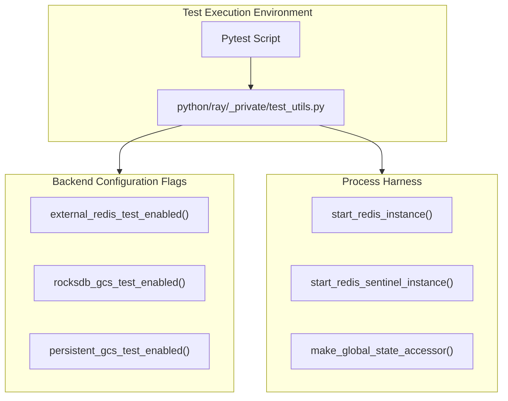
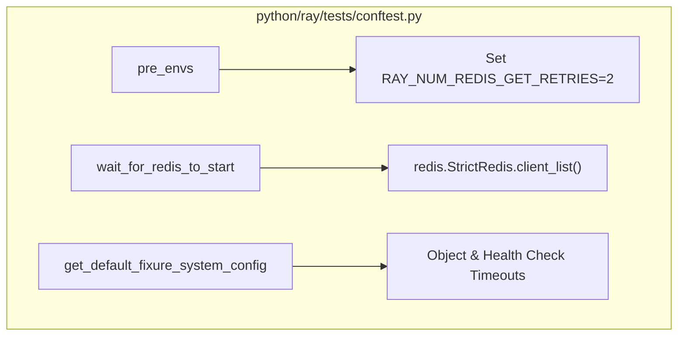
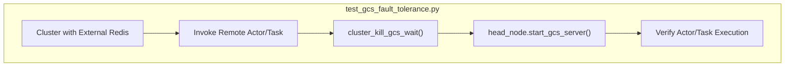
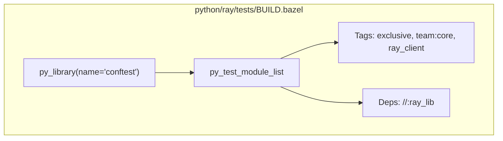

<!-- source: DeepWiki mcp.deepwiki.com · repo ray-project/ray · page 8.4 Testing Utilities and Fixtures · fetched 2026-10-21 -->

# Testing Utilities and Fixtures

Relevant source files

The following files were used as context for generating this wiki page:

- [bazel/gen_extract.py](bazel/gen_extract.py)
- [bazel/jemalloc.BUILD](bazel/jemalloc.BUILD)
- [bazel/ray_deps_build_all.bzl](bazel/ray_deps_build_all.bzl)
- [ci/build/build-manylinux-forge.sh](ci/build/build-manylinux-forge.sh)
- [ci/build/build-manylinux-ray.sh](ci/build/build-manylinux-ray.sh)
- [ci/build/test-linux-placeholder-wheel.sh](ci/build/test-linux-placeholder-wheel.sh)
- [ci/ci.sh](ci/ci.sh)
- [ci/ray_ci/builder_container.py](ci/ray_ci/builder_container.py)
- [cpp/BUILD.bazel](cpp/BUILD.bazel)
- [cpp/test_python_call_cpp.py](cpp/test_python_call_cpp.py)
- [doc/external/test_hashes.py](doc/external/test_hashes.py)
- [doc/source/cluster/kubernetes/user-guides/configuring-autoscaling.md](doc/source/cluster/kubernetes/user-guides/configuring-autoscaling.md)
- [doc/source/cluster/kubernetes/user-guides/kuberay-gcs-ft.md](doc/source/cluster/kubernetes/user-guides/kuberay-gcs-ft.md)
- [doc/source/cluster/vms/references/ray-cluster-configuration.rst](doc/source/cluster/vms/references/ray-cluster-configuration.rst)
- [doc/source/data/data.md](doc/source/data/data.md)
- [doc/source/ray-contribute/fake-autoscaler.md](doc/source/ray-contribute/fake-autoscaler.md)
- [doc/source/ray-core/scheduling/accelerators.rst](doc/source/ray-core/scheduling/accelerators.rst)
- [doc/source/ray-observability/user-guides/debug-apps/optimize-performance.rst](doc/source/ray-observability/user-guides/debug-apps/optimize-performance.rst)
- [doc/source/ray-overview/installation.md](doc/source/ray-overview/installation.md)
- [doc/source/rllib/multi-agent-envs.rst](doc/source/rllib/multi-agent-envs.rst)
- [doc/source/serve/tutorials/aws-neuron-core-inference-stable-diffusion.md](doc/source/serve/tutorials/aws-neuron-core-inference-stable-diffusion.md)
- [gen_py_proto.py](gen_py_proto.py)
- [java/BUILD.bazel](java/BUILD.bazel)
- [java/build-jar-multiplatform.sh](java/build-jar-multiplatform.sh)
- [java/gen_maven_deps.py](java/gen_maven_deps.py)
- [java/gen_pom_files.py](java/gen_pom_files.py)
- [java/gen_proto_files.py](java/gen_proto_files.py)
- [java/generate_jni_header_files.sh](java/generate_jni_header_files.sh)
- [java/test.sh](java/test.sh)
- [python/build-wheel-manylinux2014.sh](python/build-wheel-manylinux2014.sh)
- [python/ray/_common/test_utils.py](python/ray/_common/test_utils.py)
- [python/ray/_private/accelerators/__init__.py](python/ray/_private/accelerators/__init__.py)
- [python/ray/_private/accelerators/mblt.py](python/ray/_private/accelerators/mblt.py)
- [python/ray/_private/gcs_utils.py](python/ray/_private/gcs_utils.py)
- [python/ray/_private/test_utils.py](python/ray/_private/test_utils.py)
- [python/ray/tests/BUILD.bazel](python/ray/tests/BUILD.bazel)
- [python/ray/tests/accelerators/test_accelerators.py](python/ray/tests/accelerators/test_accelerators.py)
- [python/ray/tests/accelerators/test_mblt.py](python/ray/tests/accelerators/test_mblt.py)
- [python/ray/tests/conftest.py](python/ray/tests/conftest.py)
- [python/ray/tests/test_gcs_fault_tolerance.py](python/ray/tests/test_gcs_fault_tolerance.py)
- [python/ray/tests/test_gcs_utils.py](python/ray/tests/test_gcs_utils.py)
- [python/ray/tests/test_placement_group_5.py](python/ray/tests/test_placement_group_5.py)
- [python/ray/tests/test_runtime_env_conda_and_pip_3.py](python/ray/tests/test_runtime_env_conda_and_pip_3.py)
- [python/ray/tests/test_runtime_env_working_dir_3.py](python/ray/tests/test_runtime_env_working_dir_3.py)
- [python/ray/util/accelerators/__init__.py](python/ray/util/accelerators/__init__.py)
- [python/ray/util/accelerators/accelerators.py](python/ray/util/accelerators/accelerators.py)
- [src/mock/ray/gcs/store_client/redis_store_client.h](src/mock/ray/gcs/store_client/redis_store_client.h)
- [src/mock/ray/gcs/store_client/store_client.h](src/mock/ray/gcs/store_client/store_client.h)
- [src/ray/common/test_utils.cc](src/ray/common/test_utils.cc)
- [src/ray/common/test_utils.h](src/ray/common/test_utils.h)
- [src/ray/gcs/store_client/BUILD.bazel](src/ray/gcs/store_client/BUILD.bazel)
- [src/ray/gcs/store_client/in_memory_store_client.cc](src/ray/gcs/store_client/in_memory_store_client.cc)
- [src/ray/gcs/store_client/in_memory_store_client.h](src/ray/gcs/store_client/in_memory_store_client.h)
- [src/ray/gcs/store_client/observable_store_client.cc](src/ray/gcs/store_client/observable_store_client.cc)
- [src/ray/gcs/store_client/observable_store_client.h](src/ray/gcs/store_client/observable_store_client.h)
- [src/ray/gcs/store_client/redis_store_client.cc](src/ray/gcs/store_client/redis_store_client.cc)
- [src/ray/gcs/store_client/redis_store_client.h](src/ray/gcs/store_client/redis_store_client.h)
- [src/ray/gcs/store_client/store_client.h](src/ray/gcs/store_client/store_client.h)
- [src/ray/gcs/store_client/tests/in_memory_store_client_test.cc](src/ray/gcs/store_client/tests/in_memory_store_client_test.cc)
- [src/ray/gcs/store_client/tests/observable_store_client_test.cc](src/ray/gcs/store_client/tests/observable_store_client_test.cc)
- [src/ray/gcs/store_client/tests/redis_async_context_test.cc](src/ray/gcs/store_client/tests/redis_async_context_test.cc)
- [src/ray/gcs/store_client/tests/redis_store_client_test.cc](src/ray/gcs/store_client/tests/redis_store_client_test.cc)
- [src/ray/gcs/store_client/tests/store_client_test_base.h](src/ray/gcs/store_client/tests/store_client_test_base.h)
- [src/ray/raylet/placement_group_resource_manager.cc](src/ray/raylet/placement_group_resource_manager.cc)
- [thirdparty/patches/boost-headers.patch](thirdparty/patches/boost-headers.patch)

## Purpose and Scope
This document details Ray's shared test infrastructure located in `python/ray/_private/test_utils.py`, `python/ray/tests/conftest.py`, cluster-level fault-tolerance test suites, and Bazel build target conventions (`python/ray/tests/BUILD.bazel`). These utilities provide the foundation for unit, integration, and fault-tolerance testing across Ray Core, GCS, Redis, and distributed subsystems.

---

## 1. Test Helpers and Backend Switchers (`python/ray/_private/test_utils.py`)
Ray's test suite supports multiple backend configurations (such as in-memory, external Redis, or RocksDB for GCS metadata). Helper functions in `python/ray/_private/test_utils.py` detect active environments and manage local test processes.

### Key Functions and Classes
- **Backend Detection**: 
  - `external_redis_test_enabled()`: Checks if tests should run against an external Redis instance via the `TEST_EXTERNAL_REDIS` environment variable [python/ray/_private/test_utils.py:83-84]().
  - `rocksdb_gcs_test_enabled()`: Determines if the RocksDB GCS backend is enabled via `TEST_GCS_ROCKSDB` [python/ray/_private/test_utils.py:87-91]().
  - `persistent_gcs_test_enabled()`: Returns `True` if GCS state persists across restarts (either external Redis or RocksDB) [python/ray/_private/test_utils.py:101-107]().
- **Process & Instance Management**:
  - `start_redis_instance()`: Spawns a local Redis server instance for testing with configurable max clients, ports, and retry counts [python/ray/_private/test_utils.py:198-207]().
  - `start_redis_sentinel_instance()`: Configures and starts a Redis Sentinel instance to test high-availability and failover logic [python/ray/_private/test_utils.py:141-195]().
- **Global State**:
  - `make_global_state_accessor()`: Connects a `GlobalStateAccessor` to a running Ray context's GCS address for inspecting internal cluster metadata [python/ray/_private/test_utils.py:71-80]().

*Sources: [python/ray/_private/test_utils.py:71-107](), [python/ray/_private/test_utils.py:141-207]()*

---

## 2. Pytest Fixtures and Environment Configuration (`python/ray/tests/conftest.py`)
`python/ray/tests/conftest.py` defines shared pytest fixtures that govern environment variables, timeout retries, default cluster configs, and connectivity helpers.

### Key Fixtures and Utility Routines
- **Environment Patching**:
  - `pre_envs()`: An autouse fixture that throttles retry limits (`RAY_NUM_REDIS_GET_RETRIES = 2`) to speed up test execution [python/ray/tests/conftest.py:65-71]().
- **Server Health Checks**:
  - `wait_for_redis_to_start()`: Polls a target Redis server using `client_list()` until a connection is established or retries are exhausted [python/ray/tests/conftest.py:73-151]().
- **Default System Configurations**:
  - `get_default_fixure_system_config()`: Provides default system configs like low object timeout and health check parameters for isolated tests [python/ray/tests/conftest.py:153-161]().
  - `get_default_fixture_ray_kwargs()`: Returns default arguments for `ray.init()` in tests (CPU count, memory limits, namespace) [python/ray/tests/conftest.py:164-173]().

*Sources: [python/ray/tests/conftest.py:65-173]()*

---

## 3. Cluster Fixtures and Fault-Tolerance Testing (`python/ray/tests/test_gcs_fault_tolerance.py`)
Tests in `test_gcs_fault_tolerance.py` validate GCS durability, server restarts, node failure detectors, and actor resubscription under cluster failures.

### Key Patterns
- **GCS Interruption**:
  - `cluster_kill_gcs_wait()`: Extracts the GCS server process ID from a cluster head node, kills the server, and waits for process termination to prevent zombie states [python/ray/tests/test_gcs_fault_tolerance.py:51-60]().
- **Fault-Tolerance Verification**:
  - `test_gcs_server_restart()`: Validates that actors and tasks continue functioning or successfully recover after killing and restarting the GCS server [python/ray/tests/test_gcs_fault_tolerance.py:62-82]().

*Sources: [python/ray/tests/test_gcs_fault_tolerance.py:51-82]()*

---

## 4. BUILD.bazel Test Target Conventions (`python/ray/tests/BUILD.bazel`)
Ray relies on Bazel to organize and execute its Python test suites. Test targets are organized using macro wrappers like `py_test_module_list`.

### Target Structures and Conventions
- **Conftest Library**:
  - A shared `py_library` target named `conftest` bundles all `conftest.py` files across test packages with visibility rules restricted to core and subsystem packages [python/ray/tests/BUILD.bazel:4-16]().
- **Module Lists**:
  - Tests are grouped into size categories (`medium`, `large`) using `py_test_module_list` [python/ray/tests/BUILD.bazel:18-32]().
  - **Tags**: Common tags include `exclusive` (preventing concurrent tests from colliding on ports or local state), `team:core`, and `ray_client` [python/ray/tests/BUILD.bazel:23-27]().

*Sources: [python/ray/tests/BUILD.bazel:4-32]()*

---

