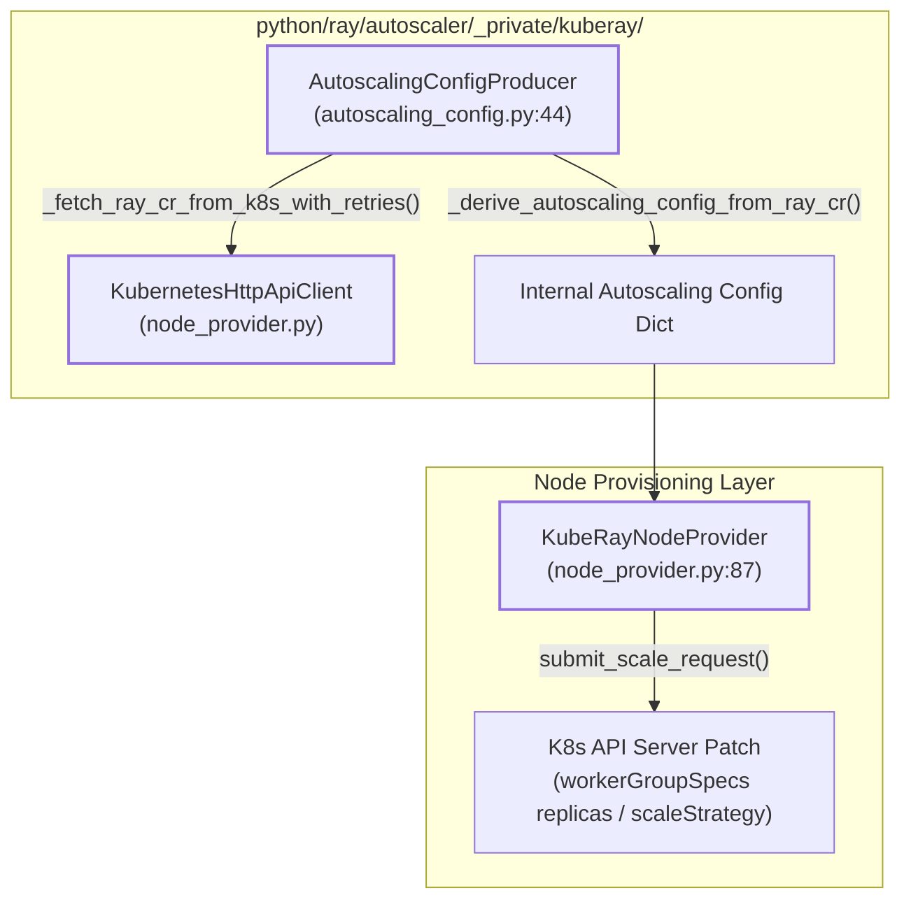
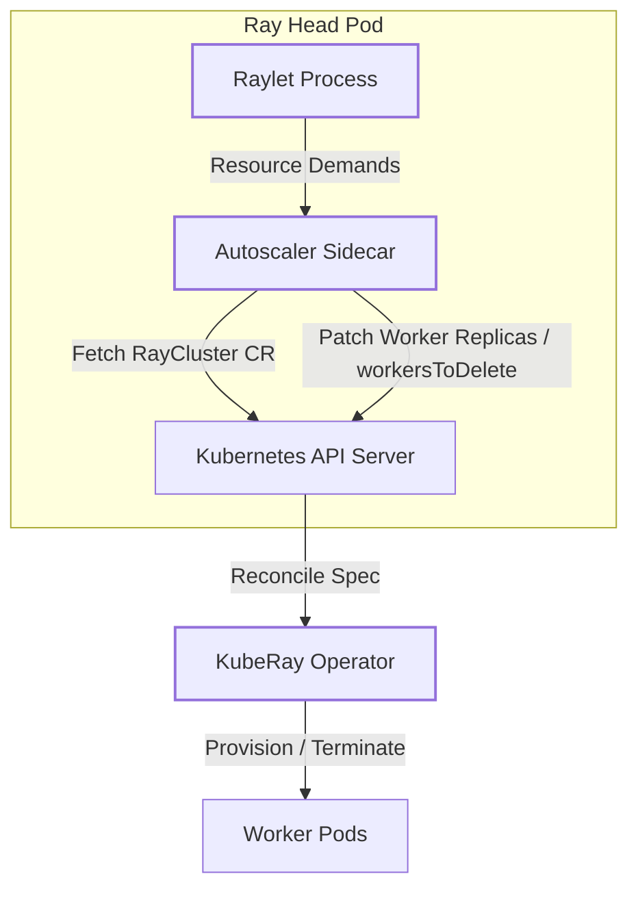
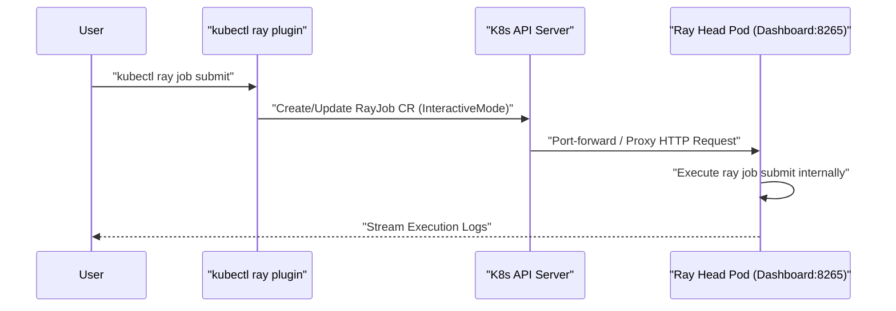

<!-- source: DeepWiki mcp.deepwiki.com · repo ray-project/ray · page 9.1 KubeRay and Kubernetes Integration · fetched 2026-10-21 -->

# KubeRay and Kubernetes Integration

Relevant source files

The following files were used as context for generating this wiki page:

- [.vale/styles/Google/WordList.yml](.vale/styles/Google/WordList.yml)
- [.vale/styles/config/vocabularies/Core/accept.txt](.vale/styles/config/vocabularies/Core/accept.txt)
- [.vale/styles/config/vocabularies/General/accept.txt](.vale/styles/config/vocabularies/General/accept.txt)
- [.vale/styles/config/vocabularies/Train/accept.txt](.vale/styles/config/vocabularies/Train/accept.txt)
- [cpp/include/ray/api/ray_config.h](cpp/include/ray/api/ray_config.h)
- [doc/source/cluster/kubernetes/examples/mobilenet-rayservice.md](doc/source/cluster/kubernetes/examples/mobilenet-rayservice.md)
- [doc/source/cluster/kubernetes/examples/rayjob-batch-inference-example.md](doc/source/cluster/kubernetes/examples/rayjob-batch-inference-example.md)
- [doc/source/cluster/kubernetes/examples/stable-diffusion-rayservice.md](doc/source/cluster/kubernetes/examples/stable-diffusion-rayservice.md)
- [doc/source/cluster/kubernetes/examples/text-summarizer-rayservice.md](doc/source/cluster/kubernetes/examples/text-summarizer-rayservice.md)
- [doc/source/cluster/kubernetes/getting-started/kuberay-operator-installation.md](doc/source/cluster/kubernetes/getting-started/kuberay-operator-installation.md)
- [doc/source/cluster/kubernetes/getting-started/raycluster-quick-start.md](doc/source/cluster/kubernetes/getting-started/raycluster-quick-start.md)
- [doc/source/cluster/kubernetes/getting-started/rayjob-quick-start.md](doc/source/cluster/kubernetes/getting-started/rayjob-quick-start.md)
- [doc/source/cluster/kubernetes/getting-started/rayservice-quick-start.md](doc/source/cluster/kubernetes/getting-started/rayservice-quick-start.md)
- [doc/source/cluster/kubernetes/images/diffusion_results.png](doc/source/cluster/kubernetes/images/diffusion_results.png)
- [doc/source/cluster/kubernetes/images/platform-events-ui.png](doc/source/cluster/kubernetes/images/platform-events-ui.png)
- [doc/source/cluster/kubernetes/images/rayservice-no-ray-serve-replica-dashboard.png](doc/source/cluster/kubernetes/images/rayservice-no-ray-serve-replica-dashboard.png)
- [doc/source/cluster/kubernetes/images/serve_dashboard.png](doc/source/cluster/kubernetes/images/serve_dashboard.png)
- [doc/source/cluster/kubernetes/k8s-ecosystem/ingress.md](doc/source/cluster/kubernetes/k8s-ecosystem/ingress.md)
- [doc/source/cluster/kubernetes/k8s-ecosystem/istio.md](doc/source/cluster/kubernetes/k8s-ecosystem/istio.md)
- [doc/source/cluster/kubernetes/k8s-ecosystem/prometheus-grafana.md](doc/source/cluster/kubernetes/k8s-ecosystem/prometheus-grafana.md)
- [doc/source/cluster/kubernetes/k8s-ecosystem/volcano.md](doc/source/cluster/kubernetes/k8s-ecosystem/volcano.md)
- [doc/source/cluster/kubernetes/k8s-ecosystem/yunikorn.md](doc/source/cluster/kubernetes/k8s-ecosystem/yunikorn.md)
- [doc/source/cluster/kubernetes/references.md](doc/source/cluster/kubernetes/references.md)
- [doc/source/cluster/kubernetes/references/api.md](doc/source/cluster/kubernetes/references/api.md)
- [doc/source/cluster/kubernetes/troubleshooting/rayservice-troubleshooting.md](doc/source/cluster/kubernetes/troubleshooting/rayservice-troubleshooting.md)
- [doc/source/cluster/kubernetes/user-guides.md](doc/source/cluster/kubernetes/user-guides.md)
- [doc/source/cluster/kubernetes/user-guides/ack-gpu-cluster.md](doc/source/cluster/kubernetes/user-guides/ack-gpu-cluster.md)
- [doc/source/cluster/kubernetes/user-guides/azure-aks-gpu-cluster.md](doc/source/cluster/kubernetes/user-guides/azure-aks-gpu-cluster.md)
- [doc/source/cluster/kubernetes/user-guides/config.md](doc/source/cluster/kubernetes/user-guides/config.md)
- [doc/source/cluster/kubernetes/user-guides/gcp-gke-tpu-cluster.md](doc/source/cluster/kubernetes/user-guides/gcp-gke-tpu-cluster.md)
- [doc/source/cluster/kubernetes/user-guides/gke-gcs-bucket.md](doc/source/cluster/kubernetes/user-guides/gke-gcs-bucket.md)
- [doc/source/cluster/kubernetes/user-guides/helm-chart-rbac.md](doc/source/cluster/kubernetes/user-guides/helm-chart-rbac.md)
- [doc/source/cluster/kubernetes/user-guides/images/kuberay-dashboard-rayjobs.png](doc/source/cluster/kubernetes/user-guides/images/kuberay-dashboard-rayjobs.png)
- [doc/source/cluster/kubernetes/user-guides/k8s-autoscaler.md](doc/source/cluster/kubernetes/user-guides/k8s-autoscaler.md)
- [doc/source/cluster/kubernetes/user-guides/k8s-cluster-setup.md](doc/source/cluster/kubernetes/user-guides/k8s-cluster-setup.md)
- [doc/source/cluster/kubernetes/user-guides/k8s-events.md](doc/source/cluster/kubernetes/user-guides/k8s-events.md)
- [doc/source/cluster/kubernetes/user-guides/kubectl-plugin.md](doc/source/cluster/kubernetes/user-guides/kubectl-plugin.md)
- [doc/source/cluster/kubernetes/user-guides/kuberay-dashboard.md](doc/source/cluster/kubernetes/user-guides/kuberay-dashboard.md)
- [doc/source/cluster/kubernetes/user-guides/kuberay-gcs-rocksdb-ft.md](doc/source/cluster/kubernetes/user-guides/kuberay-gcs-rocksdb-ft.md)
- [doc/source/cluster/kubernetes/user-guides/network-policy.md](doc/source/cluster/kubernetes/user-guides/network-policy.md)
- [doc/source/cluster/kubernetes/user-guides/observability.md](doc/source/cluster/kubernetes/user-guides/observability.md)
- [doc/source/cluster/kubernetes/user-guides/rayjob-sidecar-submitter-restart.md](doc/source/cluster/kubernetes/user-guides/rayjob-sidecar-submitter-restart.md)
- [doc/source/cluster/kubernetes/user-guides/rayservice-incremental-upgrade.md](doc/source/cluster/kubernetes/user-guides/rayservice-incremental-upgrade.md)
- [doc/source/cluster/kubernetes/user-guides/rayservice-no-ray-serve-replica.md](doc/source/cluster/kubernetes/user-guides/rayservice-no-ray-serve-replica.md)
- [doc/source/cluster/kubernetes/user-guides/rayservice.md](doc/source/cluster/kubernetes/user-guides/rayservice.md)
- [doc/source/cluster/kubernetes/user-guides/scheduling.md](doc/source/cluster/kubernetes/user-guides/scheduling.md)
- [doc/source/cluster/kubernetes/user-guides/tls.md](doc/source/cluster/kubernetes/user-guides/tls.md)
- [doc/source/cluster/kubernetes/user-guides/upgrade-guide.md](doc/source/cluster/kubernetes/user-guides/upgrade-guide.md)
- [doc/source/ray-core/fault_tolerance/gcs.rst](doc/source/ray-core/fault_tolerance/gcs.rst)
- [doc/source/rllib/doc_code/rllib_on_ray_readme.py](doc/source/rllib/doc_code/rllib_on_ray_readme.py)
- [doc/source/serve/doc_code/fake_email_creator.yaml](doc/source/serve/doc_code/fake_email_creator.yaml)
- [doc/source/serve/doc_code/fault_tolerance/k8s_config.yaml](doc/source/serve/doc_code/fault_tolerance/k8s_config.yaml)
- [doc/source/serve/production-guide/fault-tolerance.md](doc/source/serve/production-guide/fault-tolerance.md)
- [doc/source/serve/production-guide/kubernetes.md](doc/source/serve/production-guide/kubernetes.md)
- [doc/source/train/examples/transformers/transformer_reinforcement_learning/README.ipynb](doc/source/train/examples/transformers/transformer_reinforcement_learning/README.ipynb)
- [doc/source/train/examples/transformers/transformer_reinforcement_learning/README.md](doc/source/train/examples/transformers/transformer_reinforcement_learning/README.md)
- [doc/source/train/examples/transformers/transformer_reinforcement_learning/ci/aws.yaml](doc/source/train/examples/transformers/transformer_reinforcement_learning/ci/aws.yaml)
- [doc/source/train/examples/transformers/transformer_reinforcement_learning/ci/gce.yaml](doc/source/train/examples/transformers/transformer_reinforcement_learning/ci/gce.yaml)
- [doc/source/train/examples/transformers/transformer_reinforcement_learning/ci/nb2py.py](doc/source/train/examples/transformers/transformer_reinforcement_learning/ci/nb2py.py)
- [doc/source/train/examples/transformers/transformer_reinforcement_learning/ci/tests.sh](doc/source/train/examples/transformers/transformer_reinforcement_learning/ci/tests.sh)
- [doc/source/train/examples/transformers/transformer_reinforcement_learning/configs/aws.yaml](doc/source/train/examples/transformers/transformer_reinforcement_learning/configs/aws.yaml)
- [doc/source/train/examples/transformers/transformer_reinforcement_learning/configs/gce.yaml](doc/source/train/examples/transformers/transformer_reinforcement_learning/configs/gce.yaml)
- [python/ray/autoscaler/_private/kuberay/autoscaling_config.py](python/ray/autoscaler/_private/kuberay/autoscaling_config.py)
- [python/ray/autoscaler/_private/kuberay/node_provider.py](python/ray/autoscaler/_private/kuberay/node_provider.py)
- [python/ray/autoscaler/_private/kuberay/utils.py](python/ray/autoscaler/_private/kuberay/utils.py)
- [python/ray/autoscaler/batching_node_provider.py](python/ray/autoscaler/batching_node_provider.py)
- [python/ray/autoscaler/kuberay/init-config.sh](python/ray/autoscaler/kuberay/init-config.sh)
- [python/ray/autoscaler/kuberay/ray-cluster.complete.yaml](python/ray/autoscaler/kuberay/ray-cluster.complete.yaml)
- [python/ray/autoscaler/tags.py](python/ray/autoscaler/tags.py)
- [python/ray/tests/kuberay/test_autoscaling_config.py](python/ray/tests/kuberay/test_autoscaling_config.py)
- [python/ray/tests/kuberay/test_files/podlist1.yaml](python/ray/tests/kuberay/test_files/podlist1.yaml)
- [python/ray/tests/kuberay/test_files/podlist2.yaml](python/ray/tests/kuberay/test_files/podlist2.yaml)
- [python/ray/tests/kuberay/test_kuberay_node_provider.py](python/ray/tests/kuberay/test_kuberay_node_provider.py)
- [python/ray/tests/test_batch_node_provider_unit.py](python/ray/tests/test_batch_node_provider_unit.py)
- [release/k8s_tests/ray_rayservice_template.yaml](release/k8s_tests/ray_rayservice_template.yaml)
- [release/k8s_tests/run_gcs_ft_on_k8s.py](release/k8s_tests/run_gcs_ft_on_k8s.py)
- [rllib/core/distribution/__init__.py](rllib/core/distribution/__init__.py)
- [rllib/core/distribution/torch/__init__.py](rllib/core/distribution/torch/__init__.py)

The KubeRay operator serves as the standard control plane for deploying and managing distributed Ray clusters, jobs, and serving applications on Kubernetes. This page details the internal architecture, custom resources, node provisioning, autoscaling mechanisms, fault tolerance, monitoring integrations, ecosystem extensions, hardware accelerator configurations (such as TPUs), and command-line tooling associated with KubeRay.

---

## 1. KubeRay Custom Resources

KubeRay defines three primary Custom Resource Definitions (CRDs) managed by the custom controller (the KubeRay operator) [doc/source/cluster/kubernetes/user-guides/config.md:15-18]():

| Custom Resource | Purpose | Core Components |
| :--- | :--- | :--- |
| `RayCluster` | Manages the lifecycle of a single Ray cluster topology. | Head Pod, Worker PodGroups, Autoscaler sidecar [doc/source/cluster/kubernetes/user-guides/config.md:95-100](). |
| `RayJob` | Manages batch execution by provisioning a `RayCluster` and submitting a Ray application [doc/source/cluster/kubernetes/getting-started/rayjob-quick-start.md:19-23](). | `RayCluster` spec, sub-job submitter (K8s Job, HTTP, or Sidecar mode) [doc/source/cluster/kubernetes/getting-started/rayjob-quick-start.md:33-62](). |
| `RayService` | Manages high-availability Ray Serve applications with zero-downtime upgrades. | Multi-cluster rolling deployments, health checking, Serve proxy routes [doc/source/serve/production-guide/fault-tolerance.md:103-103](). |

### RayJob Lifecycle and Submission Modes
A `RayJob` orchestrates application execution via its `submissionMode` field, which supports `K8sJobMode`, `HTTPMode`, `InteractiveMode`, and `SidecarMode` [doc/source/cluster/kubernetes/getting-started/rayjob-quick-start.md:57-62](). 
- Under `K8sJobMode`, KubeRay spins up a dedicated Kubernetes Job running `ray job submit` [doc/source/cluster/kubernetes/getting-started/rayjob-quick-start.md:31-59]().
- Cleanup behaviors can be automated via fields like `shutdownAfterJobFinishes` and `ttlSecondsAfterFinished` [doc/source/cluster/kubernetes/getting-started/rayjob-quick-start.md:73-74]().

Sources: [doc/source/cluster/kubernetes/user-guides/config.md:13-18](), [doc/source/cluster/kubernetes/getting-started/rayjob-quick-start.md:19-62]()

---

## 2. Autoscaling Configuration and the KubeRay Node Provider

Autoscaling in KubeRay operates either via an in-tree autoscaling sidecar container running inside the Ray head Pod or via external control loops [doc/source/cluster/kubernetes/user-guides/configuring-autoscaling.md:24-26](). The autoscaler monitors pending resource demands from the `Raylet` and issues scaling requests by patching the `RayCluster` CR spec [python/ray/autoscaler/_private/kuberay/autoscaling_config.py:43-68]().

### Code Entity Space: Autoscaling Pipeline
The diagram below bridges natural language descriptions of autoscaling components to their precise codebase implementations in `autoscaling_config.py` and `node_provider.py`.

Title: "KubeRay Autoscaling Code Entity Mapping"

Sources: [python/ray/autoscaler/_private/kuberay/autoscaling_config.py:44-68](), [python/ray/autoscaler/_private/kuberay/node_provider.py:87-92]()

### Data Flow: Autoscaling Execution
When task or actor resource demands exceed available cluster capacity, the Raylet triggers scale-up requests handled by the KubeRay node provider.

Title: "KubeRay Autoscaling Data Flow"

Sources: [python/ray/autoscaler/_private/kuberay/autoscaling_config.py:43-68](), [python/ray/autoscaler/_private/kuberay/node_provider.py:81-92]()

---

## 3. GCS Fault Tolerance on Kubernetes

By default, the Ray Global Control Service (GCS) runs on the head node and serves as a single point of failure [doc/source/serve/production-guide/fault-tolerance.md:103-103](). To prevent cluster-wide outages upon head node termination:
1. **External Persistence**: KubeRay supports GCS fault tolerance (GCS FT) by configuring external datastores (such as Redis or cloud object stores like GKE GCS buckets) to persist cluster metadata [doc/source/cluster/kubernetes/user-guides.md:28-31]().
2. **Pod Resiliency**: When a head Pod crashes on Kubernetes, the KubeRay operator recreates the head Pod [doc/source/serve/production-guide/fault-tolerance.md:103-103](). Upon reboot, the GCS server re-establishes its state from the persistent store without losing active actor registries or task queues.

Sources: [doc/source/cluster/kubernetes/user-guides.md:28-31](), [doc/source/serve/production-guide/fault-tolerance.md:101-104]()

---

## 4. Prometheus, Grafana, and Ingress Integration

### Prometheus and Grafana Monitoring
KubeRay clusters expose Prometheus metrics on port `8080` via a built-in metrics exporter [doc/source/cluster/kubernetes/k8s-ecosystem/prometheus-grafana.md:111-111]().
- **ServiceMonitor**: Configured to scrape metrics from the KubeRay operator [doc/source/cluster/kubernetes/k8s-ecosystem/prometheus-grafana.md:56-62]().
- **PodMonitor**: Used for Ray cluster head and worker pods to track telemetry such as object spilling and task execution latency [doc/source/cluster/kubernetes/k8s-ecosystem/prometheus-grafana.md:41-43]().
- **Grafana Dashboards**: Dashboards can be auto-loaded via Helm configurations or embedded directly into the Ray Dashboard interface [doc/source/cluster/kubernetes/k8s-ecosystem/prometheus-grafana.md:29-45]().

### Ingress Management
KubeRay supports automated ingress generation via the `ingressOptions` parameter under `headGroupSpec` [doc/source/cluster/kubernetes/k8s-ecosystem/ingress.md:27-30](). Setting `enableIngress: true` directs the operator to instantiate a Kubernetes `Ingress` object routing external traffic to the Ray dashboard [doc/source/cluster/kubernetes/k8s-ecosystem/ingress.md:39-61](). Cloud-specific controllers (such as AWS ALB Ingress or GKE Ingress) integrate seamlessly with these options [doc/source/cluster/kubernetes/k8s-ecosystem/ingress.md:13-16]().

Sources: [doc/source/cluster/kubernetes/k8s-ecosystem/prometheus-grafana.md:29-111](), [doc/source/cluster/kubernetes/k8s-ecosystem/ingress.md:27-61]()

---

## 5. Ecosystem Integrations

KubeRay integrates with various Kubernetes ecosystem components to enhance scheduling, networking, and batch queuing:
* **Istio**: Facilitates mutual TLS and service mesh routing for secure pod-to-pod RPC communication [doc/source/cluster/kubernetes/user-guides.md:38-38]().
* **Volcano / Yunikorn**: Provides advanced batch scheduling policies, gang scheduling, and quota management for large-scale distributed workloads [doc/source/cluster/kubernetes/user-guides.md:24-27]().
* **Kueue**: Coordinates with `RayJob` resources via the `suspend` field to queue and schedule jobs based on cluster-wide cluster queue resource availability [doc/source/cluster/kubernetes/getting-started/rayjob-quick-start.md:71-77]().

Sources: [doc/source/cluster/kubernetes/user-guides.md:24-38](), [doc/source/cluster/kubernetes/getting-started/rayjob-quick-start.md:71-77]()

---

## 6. TPU Clusters and Hardware Accelerators

Running workloads on Google Cloud TPUs requires specialized node group configuration and webhook support [doc/source/cluster/kubernetes/user-guides/gcp-gke-tpu-cluster.md:9-11]().
- **Node Selectors and Topologies**: TPU worker groups utilize node selectors such as `cloud.google.com/gke-tpu-accelerator` and `cloud.google.com/gke-tpu-topology` (e.g., `2x2x2`) to provision atomic multi-host TPU slices [python/ray/tests/kuberay/test_autoscaling_config.py:46-56]().
- **TPU Webhook**: GKE provides validating and mutating webhooks that handle TPU pod scheduling and initialize required environment variables (such as for JAX) [doc/source/cluster/kubernetes/user-guides/gcp-gke-tpu-cluster.md:96-96]().

Sources: [python/ray/tests/kuberay/test_autoscaling_config.py:46-60](), [doc/source/cluster/kubernetes/user-guides/gcp-gke-tpu-cluster.md:9-72]()

---

## 7. KubeRay `kubectl` Plugin Usage

The `kubectl ray` CLI plugin simplifies common cluster administration and job submission tasks [doc/source/cluster/kubernetes/user-guides/kubectl-plugin.md:9-11]().

### Code Entity Space: kubectl-ray Submission Flow
The sequence below illustrates how the `kubectl ray` plugin interacts with the Kubernetes API server and Ray dashboard via `InteractiveMode` [doc/source/cluster/kubernetes/getting-started/rayjob-quick-start.md:57-61]().

Title: "kubectl-ray Submission Flow"

Sources: [doc/source/cluster/kubernetes/user-guides/kubectl-plugin.md:9-15](), [doc/source/cluster/kubernetes/getting-started/rayjob-quick-start.md:57-61]()

---

