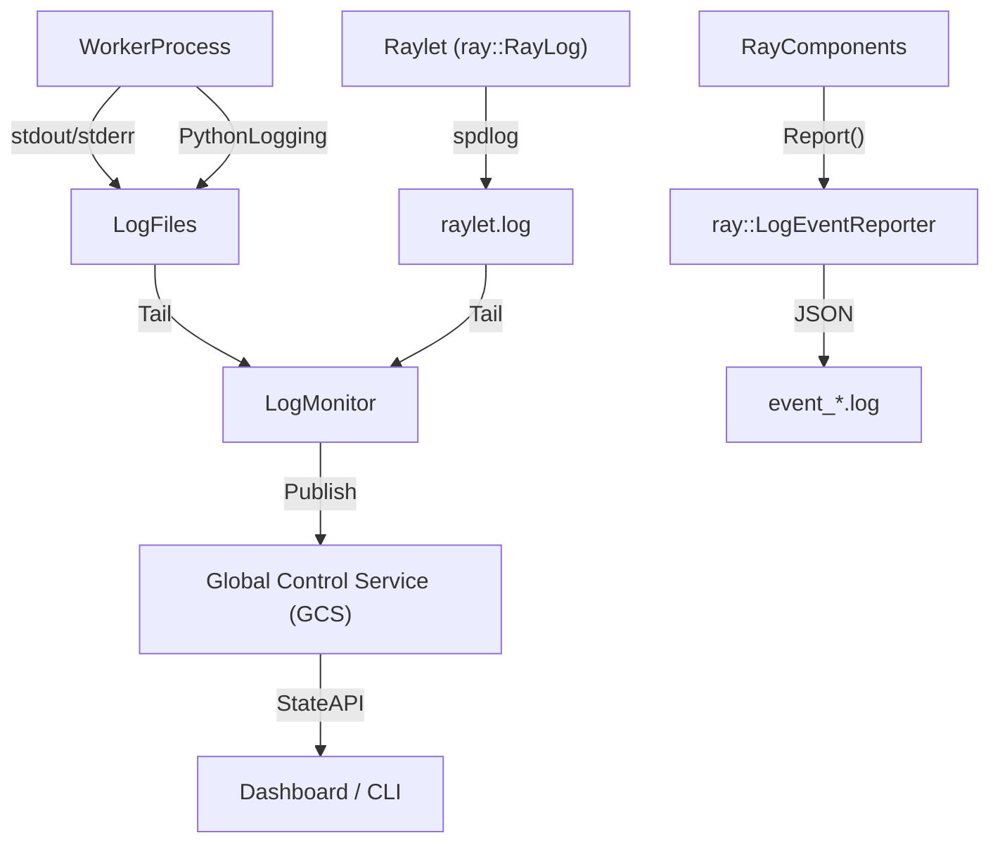
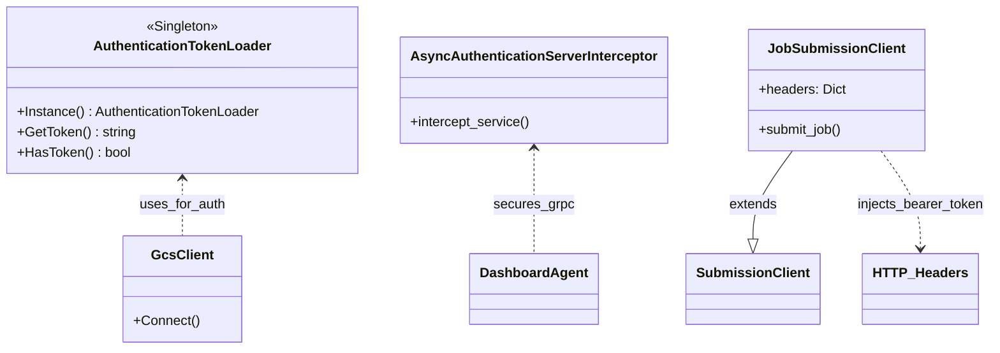

<!-- source: DeepWiki mcp.deepwiki.com · repo ray-project/ray · page 9.2 Logging, Tracing, and Security · fetched 2026-10-21 -->

# Logging, Tracing, and Security

Relevant source files

The following files were used as context for generating this wiki page:

- [bazel/ray.bzl](bazel/ray.bzl)
- [cpp/include/ray/api/logging.h](cpp/include/ray/api/logging.h)
- [doc/source/ray-core/api/core.rst](doc/source/ray-core/api/core.rst)
- [doc/source/ray-core/api/exceptions.rst](doc/source/ray-core/api/exceptions.rst)
- [doc/source/ray-security/token-auth.md](doc/source/ray-security/token-auth.md)
- [python/ray/_private/authentication/authentication_constants.py](python/ray/_private/authentication/authentication_constants.py)
- [python/ray/_private/authentication/authentication_token_setup.py](python/ray/_private/authentication/authentication_token_setup.py)
- [python/ray/_private/authentication/authentication_utils.py](python/ray/_private/authentication/authentication_utils.py)
- [python/ray/_private/authentication/http_token_authentication.py](python/ray/_private/authentication/http_token_authentication.py)
- [python/ray/_private/authentication_test_utils.py](python/ray/_private/authentication_test_utils.py)
- [python/ray/_private/log.py](python/ray/_private/log.py)
- [python/ray/_private/object_ref_generator.py](python/ray/_private/object_ref_generator.py)
- [python/ray/_private/ray_logging/default_impl.py](python/ray/_private/ray_logging/default_impl.py)
- [python/ray/_private/ray_logging/logging_config.py](python/ray/_private/ray_logging/logging_config.py)
- [python/ray/dashboard/client/src/authentication/TokenAuthenticationDialog.component.test.tsx](python/ray/dashboard/client/src/authentication/TokenAuthenticationDialog.component.test.tsx)
- [python/ray/dashboard/client/src/authentication/TokenAuthenticationDialog.tsx](python/ray/dashboard/client/src/authentication/TokenAuthenticationDialog.tsx)
- [python/ray/dashboard/tests/test_dashboard_auth.py](python/ray/dashboard/tests/test_dashboard_auth.py)
- [python/ray/exceptions.py](python/ray/exceptions.py)
- [python/ray/includes/rpc_token_authentication.pxd](python/ray/includes/rpc_token_authentication.pxd)
- [python/ray/includes/rpc_token_authentication.pxi](python/ray/includes/rpc_token_authentication.pxi)
- [python/ray/serve/_private/logging_utils.py](python/ray/serve/_private/logging_utils.py)
- [python/ray/serve/tests/test_logging.py](python/ray/serve/tests/test_logging.py)
- [python/ray/tests/test_exceptions.py](python/ray/tests/test_exceptions.py)
- [python/ray/tests/test_failure.py](python/ray/tests/test_failure.py)
- [python/ray/tests/test_logging_2.py](python/ray/tests/test_logging_2.py)
- [python/ray/tests/test_streaming_generator.py](python/ray/tests/test_streaming_generator.py)
- [python/ray/tests/test_token_auth_integration.py](python/ray/tests/test_token_auth_integration.py)
- [python/ray/tests/test_traceback.py](python/ray/tests/test_traceback.py)
- [python/ray/tests/test_util_helpers.py](python/ray/tests/test_util_helpers.py)
- [python/ray/tests/test_wait.py](python/ray/tests/test_wait.py)
- [python/ray/util/__init__.py](python/ray/util/__init__.py)
- [python/ray/util/helpers.py](python/ray/util/helpers.py)
- [src/ray/common/id.cc](src/ray/common/id.cc)
- [src/ray/common/id.h](src/ray/common/id.h)
- [src/ray/common/metrics.h](src/ray/common/metrics.h)
- [src/ray/rpc/authentication/BUILD.bazel](src/ray/rpc/authentication/BUILD.bazel)
- [src/ray/rpc/authentication/authentication_mode.cc](src/ray/rpc/authentication/authentication_mode.cc)
- [src/ray/rpc/authentication/authentication_mode.h](src/ray/rpc/authentication/authentication_mode.h)
- [src/ray/rpc/authentication/authentication_token.h](src/ray/rpc/authentication/authentication_token.h)
- [src/ray/rpc/authentication/authentication_token_loader.cc](src/ray/rpc/authentication/authentication_token_loader.cc)
- [src/ray/rpc/authentication/authentication_token_loader.h](src/ray/rpc/authentication/authentication_token_loader.h)
- [src/ray/rpc/authentication/authentication_token_validator.cc](src/ray/rpc/authentication/authentication_token_validator.cc)
- [src/ray/rpc/authentication/authentication_token_validator.h](src/ray/rpc/authentication/authentication_token_validator.h)
- [src/ray/rpc/authentication/k8s_constants.h](src/ray/rpc/authentication/k8s_constants.h)
- [src/ray/rpc/authentication/k8s_util.cc](src/ray/rpc/authentication/k8s_util.cc)
- [src/ray/rpc/authentication/k8s_util.h](src/ray/rpc/authentication/k8s_util.h)
- [src/ray/rpc/authentication/tests/BUILD.bazel](src/ray/rpc/authentication/tests/BUILD.bazel)
- [src/ray/rpc/authentication/tests/authentication_token_loader_test.cc](src/ray/rpc/authentication/tests/authentication_token_loader_test.cc)
- [src/ray/rpc/authentication/tests/authentication_token_test.cc](src/ray/rpc/authentication/tests/authentication_token_test.cc)
- [src/ray/rpc/authentication/tests/grpc_auth_token_tests.cc](src/ray/rpc/authentication/tests/grpc_auth_token_tests.cc)
- [src/ray/rpc/grpc_client.cc](src/ray/rpc/grpc_client.cc)
- [src/ray/rpc/tests/BUILD.bazel](src/ray/rpc/tests/BUILD.bazel)
- [src/ray/stats/tests/metric_exporter_grpc_test.cc](src/ray/stats/tests/metric_exporter_grpc_test.cc)
- [src/ray/util/event.cc](src/ray/util/event.cc)
- [src/ray/util/event.h](src/ray/util/event.h)
- [src/ray/util/logging.cc](src/ray/util/logging.cc)
- [src/ray/util/logging.h](src/ray/util/logging.h)
- [src/ray/util/process_utils.cc](src/ray/util/process_utils.cc)
- [src/ray/util/tests/event_test.cc](src/ray/util/tests/event_test.cc)
- [src/ray/util/tests/logging_test.cc](src/ray/util/tests/logging_test.cc)
- [src/ray/util/thread_utils.h](src/ray/util/thread_utils.h)

This page documents Ray's observability and security infrastructure, covering the unified distributed logging system, log rotation and stream redirection, structured logging, event reporting utilities, distributed tracing, token-based authentication for RPC and HTTP, Kubernetes RBAC integration, and the Ray security model.

## Logging Infrastructure

Ray provides a distributed logging infrastructure that captures output from system components (GCS, Raylet) as well as user-defined tasks and actors.

### Log Redirection and Rotation
Ray processes capture and redirect standard output (`stdout`) and standard error (`stderr`) streams to session log directories. To prevent uncontrolled disk usage, Ray implements log rotation governed by environment variables:
*   `RAY_ROTATION_MAX_BYTES`: Maximum size in bytes before a log file is rotated (defaults to 512MB) [python/ray/serve/_private/logging_utils.py:11]().
*   `RAY_ROTATION_BACKUP_COUNT`: Number of rotated historical backup files to preserve [python/ray/serve/_private/logging_utils.py:11]().

The `LogMonitor` background process monitors these log files, tracking inode changes and file truncation events during rotation to ensure seamless stream ingestion [python/ray/tests/test_logging.py:61-154]().

### Structured Logging and Formatting
Ray supports structured logging natively in both C++ and Python. The C++ core utilizes `spdlog` as its logging backend [src/ray/util/logging.cc:53]().

*   **Log Formats**: Supports `TEXT` and `JSON` encodings. The JSON format structures standard attributes such as `asctime`, `levelname`, and `message` [src/ray/util/logging.cc:60-61]().
*   **Python Configuration**: The `LoggingConfig` dataclass enables users to configure encoding parameters and inject additional standard Python log attributes (e.g., `task_id`, `job_id`) into every generated log record [python/ray/_private/ray_logging/logging_config.py:68-73]().
*   **Contextual Metadata**: Log records are enriched with unique Ray identifiers via keys defined in constants like `kLogKeyJobID`, `kLogKeyWorkerID`, and `kLogKeyActorID` [src/ray/util/logging.h:93-107]().

### Ray Serve Logging
Ray Serve extends core logging by introducing specialized filters and formatters to trace requests across deployment replicas:
*   `ServeComponentFilter`: Appends `component_name`, `component_id`, and `component_type` (such as `REPLICA` or `PROXY`) to log records [python/ray/serve/_private/logging_utils.py:49-63]().
*   `ServeContextFilter`: Injects active request metadata (`route`, `request_id`, `app_name`) from the Serve context [python/ray/serve/_private/logging_utils.py:84-104]().
*   `ServeFormatter`: An optimized formatter class that pre-computes format strings and specialized formatters for high-throughput request handling [python/ray/serve/_private/logging_utils.py:124-166]().

### Event Logging Utilities
Ray includes a structured event reporting subsystem for publishing high-level execution events (e.g., state transitions).
*   `LogEventReporter`: Utilizes `spdlog::rotating_logger_mt` to serialize and write events to designated target files such as `event_GCS.log` or `event_RAYLET.log` [src/ray/util/event.cc:36-85]().
*   **Serialization**: Events are serialized to JSON, embedding core fields alongside `custom_fields` dictionaries [src/ray/util/event.cc:106-129]().

### Component-to-Code Mapping: Logging

| System Name | Code Entity | Role |
| :--- | :--- | :--- |
| **C++ Logger** | `ray::RayLog` | Primary C++ interface for severity-checked logging [src/ray/util/logging.h:128-134](). |
| **Python JSON Formatter** | `ray._common.formatters.JSONFormatter` | Formats Python log records into structured JSON [python/ray/serve/tests/test_logging.py:24](). |
| **Log Monitor** | `ray._private.log_monitor.LogMonitor` | Internal file-tailing aggregator that feeds logs to the dashboard [python/ray/tests/test_logging.py:28](). |
| **Serve Access Logger** | `ray.serve._private.logging_utils.ServeContextFilter` | Injects HTTP request context into Serve replica logs [python/ray/serve/_private/logging_utils.py:84](). |
| **Event Reporter** | `ray::LogEventReporter` | Manages rotation and persistence for structured system events [src/ray/util/event.cc:36](). |

Sources: [python/ray/serve/_private/logging_utils.py:1-126](), [src/ray/util/logging.cc:55-128](), [src/ray/util/event.cc:36-85](), [python/ray/tests/test_logging.py:24-45]().

---

## Distributed Tracing

Ray integrates with OpenTelemetry to provide distributed tracing across task graphs and actor method invocations. When enabled, tracing contexts propagate across gRPC boundaries, enabling visualization of asynchronous execution paths.

*   **Context Propagation**: Ray's C++ RPC layer automatically injects and extracts trace contexts across network calls.
*   **Task Spans**: Spans are instantiated automatically for task submissions, core worker executions, and actor method calls.
*   **Exporting**: Trace data can be routed to standard observability backends (e.g., Jaeger, OpenTelemetry Collector).

Sources: [python/exceptions.py:109-114]()

---

## Security Model

Ray's security model establishes boundaries around cluster access, process isolation, and authenticated communication channels.

### Token-Based Authentication
Ray implements token-based authentication for internal RPC channels (GCS, Raylet, workers) and HTTP entrypoints to prevent unauthorized clients from joining or interacting with the cluster.

*   **Token Generation**: When `auth_mode="token"` is configured, initialization routines generate a secure 64-character hexadecimal token [python/ray/tests/test_token_auth_integration.py:113-137]().
*   **Storage**: Tokens are stored locally, typically at `~/.ray/auth_token` [python/ray/tests/test_token_auth_integration.py:116]().
*   **Token Validation**: The C++ core component `AuthenticationTokenLoader` and related validators inspect and verify incoming connection handshakes [python/ray/tests/test_token_auth_integration.py:18-24]().
*   **API and Dashboard Security**: State APIs and dashboard services validate requests using `Authorization: Bearer <token>` headers [python/ray/tests/test_token_auth_integration.py:174-191]().

### Kubernetes RBAC Integration
When deployed via KubeRay, Ray relies on Kubernetes native security primitives:
*   **Service Accounts**: Worker and head pods execute under dedicated `ServiceAccount` definitions.
*   **RBAC Roles**: Role-based access control restricts the permissions of the KubeRay operator within target namespaces.

### Component-to-Code Mapping: Security

| Component | Code Path | Description |
| :--- | :--- | :--- |
| **Token Loader** | `ray::_raylet.AuthenticationTokenLoader` | Singleton utility loading RPC authentication tokens [python/ray/tests/test_token_auth_integration.py:19](). |
| **gRPC Auth Interceptor** | `ray.dashboard.agent` (AsyncAuthenticationServerInterceptor) | Intercepts dashboard agent gRPC requests for authentication checks [python/ray/dashboard/agent.py:120](). |
| **Job Submission Client** | `ray.dashboard.modules.job.sdk.JobSubmissionClient` | Manages authentication headers during remote job deployments [python/ray/dashboard/modules/job/sdk.py:37](). |

Sources: [python/ray/tests/test_token_auth_integration.py:1-221](), [python/ray/dashboard/agent.py:113-174](), [python/ray/dashboard/modules/job/sdk.py:37-112]().

---

## Exception Handling and Observability

Ray differentiates application-level faults from system failures through specialized exception hierarchies and signal handlers.

*   **RayTaskError**: Raised when a remote task encounters an unhandled exception during execution, wrapping the remote traceback and original cause [python/exceptions.py:149-157]().
*   **C++ Terminate Handler**: `TerminateHandler` intercepts unhandled C++ exceptions and abnormal terminations, logging stack traces via `ray::StackTrace` before invoking `std::abort()` [src/ray/util/logging.cc:112-128]().
*   **Stack Traces**: The `StackTrace` class provides platform-independent stack dumping for Linux and Windows platforms [src/ray/util/logging.cc:73-110]().

Sources: [python/exceptions.py:149-184](), [src/ray/util/logging.cc:73-128](), [src/ray/util/logging.h:107-117]().

---

