# Page: Ray Overview

# Ray Overview

<details>
<summary>Relevant source files</summary>

The following files were used as context for generating this wiki page:

- [ci/lint/pydoclint-baseline.txt](ci/lint/pydoclint-baseline.txt)
- [doc/source/_static/img/run-on-anyscale.svg](doc/source/_static/img/run-on-anyscale.svg)
- [doc/source/data/examples/batch_inference_object_detection.ipynb](doc/source/data/examples/batch_inference_object_detection.ipynb)
- [doc/source/data/examples/huggingface_vit_batch_prediction.ipynb](doc/source/data/examples/huggingface_vit_batch_prediction.ipynb)
- [doc/source/data/examples/pytorch_resnet_batch_prediction.ipynb](doc/source/data/examples/pytorch_resnet_batch_prediction.ipynb)
- [doc/source/ray-overview/getting-started.md](doc/source/ray-overview/getting-started.md)
- [doc/source/serve/doc_code/stable_diffusion.py](doc/source/serve/doc_code/stable_diffusion.py)
- [doc/source/serve/tutorials/stable-diffusion.md](doc/source/serve/tutorials/stable-diffusion.md)
- [doc/source/templates/04_finetuning_llms_with_deepspeed/utils.py](doc/source/templates/04_finetuning_llms_with_deepspeed/utils.py)
- [doc/source/train/examples/deepspeed/gptj_deepspeed_fine_tuning.ipynb](doc/source/train/examples/deepspeed/gptj_deepspeed_fine_tuning.ipynb)
- [doc/source/train/examples/lightning/lightning_cola_advanced.ipynb](doc/source/train/examples/lightning/lightning_cola_advanced.ipynb)
- [doc/source/train/examples/lightning/vicuna_13b_lightning_deepspeed_finetune.ipynb](doc/source/train/examples/lightning/vicuna_13b_lightning_deepspeed_finetune.ipynb)
- [doc/source/train/examples/pytorch/torch_detection.ipynb](doc/source/train/examples/pytorch/torch_detection.ipynb)
- [doc/source/train/examples/transformers/huggingface_text_classification.ipynb](doc/source/train/examples/transformers/huggingface_text_classification.ipynb)
- [java/test/src/main/java/io/ray/test/NodeLabelSchedulingTest.java](java/test/src/main/java/io/ray/test/NodeLabelSchedulingTest.java)
- [python/ray/_common/ray_option_utils.py](python/ray/_common/ray_option_utils.py)
- [python/ray/_private/accelerators/accelerator.py](python/ray/_private/accelerators/accelerator.py)
- [python/ray/_private/accelerators/apple_gpu.py](python/ray/_private/accelerators/apple_gpu.py)
- [python/ray/_private/label_utils.py](python/ray/_private/label_utils.py)
- [python/ray/_private/node.py](python/ray/_private/node.py)
- [python/ray/_private/parameter.py](python/ray/_private/parameter.py)
- [python/ray/_private/services.py](python/ray/_private/services.py)
- [python/ray/_private/utils.py](python/ray/_private/utils.py)
- [python/ray/_private/worker.py](python/ray/_private/worker.py)
- [python/ray/actor.py](python/ray/actor.py)
- [python/ray/remote_function.py](python/ray/remote_function.py)
- [python/ray/scripts/scripts.py](python/ray/scripts/scripts.py)
- [python/ray/tests/accelerators/test_apple_gpu.py](python/ray/tests/accelerators/test_apple_gpu.py)
- [python/ray/tests/test_actor.py](python/ray/tests/test_actor.py)
- [python/ray/tests/test_basic.py](python/ray/tests/test_basic.py)
- [python/ray/tests/test_client_terminate.py](python/ray/tests/test_client_terminate.py)
- [python/ray/tests/test_label_utils.py](python/ray/tests/test_label_utils.py)
- [python/ray/tests/test_node_label_scheduling_strategy.py](python/ray/tests/test_node_label_scheduling_strategy.py)
- [python/ray/tests/test_node_labels.py](python/ray/tests/test_node_labels.py)
- [python/ray/tests/test_utils.py](python/ray/tests/test_utils.py)
- [python/ray/tests/unit/test_decorator_validation.py](python/ray/tests/unit/test_decorator_validation.py)
- [release/ray_release/byod/byod_dolly_test.sh](release/ray_release/byod/byod_dolly_test.sh)
- [release/ray_release/byod/byod_gptj_test.sh](release/ray_release/byod/byod_gptj_test.sh)
- [release/ray_release/byod/byod_vicuna_test.sh](release/ray_release/byod/byod_vicuna_test.sh)

</details>


Ray is a unified distributed computing platform designed to scale Python applications and AI workloads from a single machine to a large cluster [doc/source/ray-overview/getting-started.md:11-18](). It provides a general-purpose core distributed runtime along with an ecosystem of specialized domain-specific libraries for AI and machine learning.

**Core Value Proposition:**
- **Unified API**: Use consistent primitives (`@ray.remote`, `ray.put`, `ray.get`) across tasks, actors, and distributed objects [python/ray/_private/worker.py:151-185](), [python/ray/actor.py:91-110]().
- **Composable Libraries**: Ray Data, Serve, Train, Tune, RLlib, and LLM libraries share the same underlying execution runtime.
- **Production-Ready Infrastructure**: Built-in cluster management, autoscaling, fault tolerance, and observability [doc/source/ray-overview/getting-started.md:18]().

For detailed architecture and core concepts, see [Architecture and Core Concepts](#1.1). For contribution workflows, see [Contributing and Documentation Workflow](#1.2).

**Sources:** [doc/source/ray-overview/getting-started.md:11-18](), [python/ray/_private/worker.py:151-185](), [python/ray/actor.py:91-110]()

---

## High-Level Architecture

Ray abstracts a physical cluster of nodes into a uniform pool of compute and memory resources. The architecture divides cleanly into a core execution layer and an upper library ecosystem.

### System Topology

The following diagram maps high-level system subsystems to their primary implementation entities in the codebase.

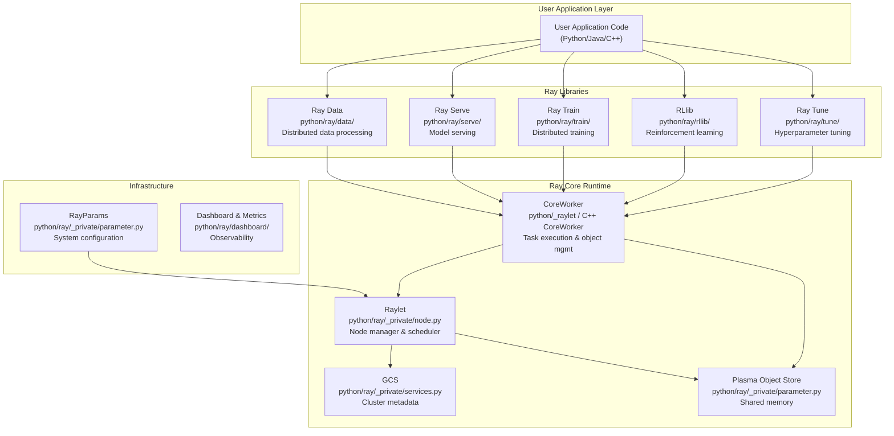

**Sources:** [python/ray/_private/parameter.py:14-124](), [python/ray/_private/services.py:59-66]()

---

## Major Subsystems

Ray is structured around a foundational core infrastructure and several specialized domain libraries:

| Subsystem | Primary Role | Code Base Entry Point / Module |
|-----------|--------------|--------------------------------|
| **Ray Core** | Tasks, actors, objects, scheduling, and process management | `python/ray/_private/worker.py` [python/ray/_private/worker.py:1-60]() |
| **Ray Data** | Scalable batch data processing and LLM data ingestion | `python/ray/data/` |
| **Ray Serve** | Scalable and programmable model serving | `python/ray/serve/` |
| **Ray Train** | Distributed deep learning training across frameworks | `python/ray/train/` |
| **Ray Tune** | Scalable hyperparameter tuning | `python/ray/tune/` |
| **RLlib** | Scalable reinforcement learning | `python/ray/rllib/` |

---

## Code Entity Mapping

The following diagram bridges natural language runtime concepts ("Remote Functions", "Actors", "Workers") to their concrete code entities and binding classes in Python and C++.

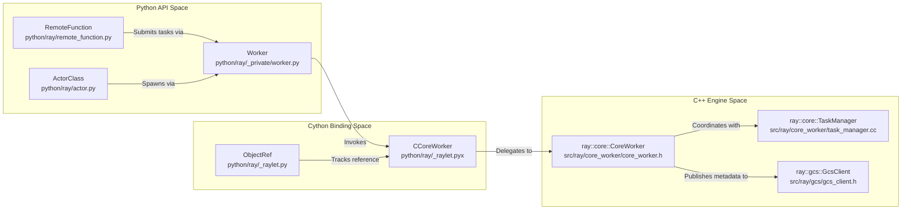

**Sources:** [python/ray/_private/worker.py:55-60](), [python/ray/actor.py:26-30](), [python/ray/remote_function.py:40-45]()

---

## Getting Started and Node Lifecycle

Nodes and local clusters are initialized via the Python API (`ray.init()`) or the command-line interface (`ray start`) [python/ray/_private/node.py:80-110](), [python/ray/scripts/scripts.py:1-25](). 

To start a head node from the CLI:
```bash
ray start --head
```
This command invokes the CLI entrypoint in `python/ray/scripts/scripts.py` [python/ray/scripts/scripts.py:180-195](), instantiating the `Node` manager in `python/ray/_private/node.py` [python/ray/_private/node.py:68-115]() which sets up process configurations via `RayParams` [python/ray/_private/parameter.py:14-45]().

For deeper architectural details, see [Architecture and Core Concepts](#1.1). For developer workflow and documentation guidelines, see [Contributing and Documentation Workflow](#1.2).

**Sources:** [python/ray/_private/node.py:68-115](), [python/ray/_private/parameter.py:14-45](), [python/ray/scripts/scripts.py:180-195]()

---

# Page: Architecture and Core Concepts

# Architecture and Context

<details>
<summary>Relevant source files</summary>

The following files were used as context for generating this wiki page:

- [ci/lint/pydoclint-baseline.txt](ci/lint/pydoclint-baseline.txt)
- [cpp/src/ray/runtime/task/local_mode_task_submitter.cc](cpp/src/ray/runtime/task/local_mode_task_submitter.cc)
- [java/test/src/main/java/io/ray/test/NodeLabelSchedulingTest.java](java/test/src/main/java/io/ray/test/NodeLabelSchedulingTest.java)
- [python/ray/_common/ray_option_utils.py](python/ray/_common/ray_option_utils.py)
- [python/ray/_private/accelerators/accelerator.py](python/ray/_private/accelerators/accelerator.py)
- [python/ray/_private/accelerators/apple_gpu.py](python/ray/_private/accelerators/apple_gpu.py)
- [python/ray/_private/custom_types.py](python/ray/_private/custom_types.py)
- [python/ray/_private/label_utils.py](python/ray/_private/label_utils.py)
- [python/ray/_private/node.py](python/ray/_private/node.py)
- [python/ray/_private/parameter.py](python/ray/_private/parameter.py)
- [python/ray/_private/services.py](python/ray/_private/services.py)
- [python/ray/_private/utils.py](python/ray/_private/utils.py)
- [python/ray/_private/worker.py](python/ray/_private/worker.py)
- [python/ray/actor.py](python/ray/actor.py)
- [python/ray/remote_function.py](python/ray/remote_function.py)
- [python/ray/scripts/scripts.py](python/ray/scripts/scripts.py)
- [python/ray/tests/accelerators/test_apple_gpu.py](python/ray/tests/accelerators/test_apple_gpu.py)
- [python/ray/tests/test_actor.py](python/ray/tests/test_actor.py)
- [python/ray/tests/test_basic.py](python/ray/tests/test_basic.py)
- [python/ray/tests/test_client_terminate.py](python/ray/tests/test_client_terminate.py)
- [python/ray/tests/test_label_utils.py](python/ray/tests/test_label_utils.py)
- [python/ray/tests/test_node_label_scheduling_strategy.py](python/ray/tests/test_node_label_scheduling_strategy.py)
- [python/ray/tests/test_node_labels.py](python/ray/tests/test_node_labels.py)
- [python/ray/tests/test_utils.py](python/ray/tests/test_utils.py)
- [python/ray/tests/unit/test_decorator_validation.py](python/ray/tests/unit/test_decorator_validation.py)
- [src/ray/common/scheduling/cluster_resource_data.cc](src/ray/common/scheduling/cluster_resource_data.cc)
- [src/ray/common/scheduling/cluster_resource_data.h](src/ray/common/scheduling/cluster_resource_data.h)
- [src/ray/common/task/task_spec.cc](src/ray/common/task/task_spec.cc)
- [src/ray/common/task/task_spec.h](src/ray/common/task/task_spec.h)
- [src/ray/common/task/task_util.h](src/ray/common/task/task_util.h)
- [src/ray/core_worker/common.h](src/ray/core_worker/common.h)
- [src/ray/gcs/gcs_resource_manager.cc](src/ray/gcs/gcs_resource_manager.cc)
- [src/ray/gcs/gcs_resource_manager.h](src/ray/gcs/gcs_resource_manager.h)
- [src/ray/gcs/tests/gcs_placement_group_scheduler_test.cc](src/ray/gcs/tests/gcs_placement_group_scheduler_test.cc)
- [src/ray/gcs/tests/gcs_resource_manager_test.cc](src/ray/gcs/tests/gcs_resource_manager_test.cc)
- [src/ray/protobuf/common.proto](src/ray/protobuf/common.proto)
- [src/ray/raylet/scheduling/BUILD.bazel](src/ray/raylet/scheduling/BUILD.bazel)
- [src/ray/raylet/scheduling/cluster_resource_manager.cc](src/ray/raylet/scheduling/cluster_resource_manager.cc)
- [src/ray/raylet/scheduling/cluster_resource_manager.h](src/ray/raylet/scheduling/cluster_resource_manager.h)
- [src/ray/raylet/scheduling/cluster_resource_scheduler.cc](src/ray/raylet/scheduling/cluster_resource_scheduler.cc)
- [src/ray/raylet/scheduling/cluster_resource_scheduler.h](src/ray/raylet/scheduling/cluster_resource_scheduler.h)
- [src/ray/raylet/scheduling/local_resource_manager.cc](src/ray/raylet/scheduling/local_resource_manager.cc)
- [src/ray/raylet/scheduling/local_resource_manager.h](src/ray/raylet/scheduling/local_resource_manager.h)
- [src/ray/raylet/scheduling/policy/scorer.cc](src/ray/raylet/scheduling/policy/scorer.cc)
- [src/ray/raylet/scheduling/policy/tests/hybrid_scheduling_policy_test.cc](src/ray/raylet/scheduling/policy/tests/hybrid_scheduling_policy_test.cc)
- [src/ray/raylet/scheduling/policy/tests/scheduling_policy_test.cc](src/ray/raylet/scheduling/policy/tests/scheduling_policy_test.cc)
- [src/ray/raylet/scheduling/tests/BUILD.bazel](src/ray/raylet/scheduling/tests/BUILD.bazel)
- [src/ray/raylet/scheduling/tests/cluster_lease_manager_test.cc](src/ray/raylet/scheduling/tests/cluster_lease_manager_test.cc)
- [src/ray/raylet/scheduling/tests/cluster_resource_manager_test.cc](src/ray/raylet/scheduling/tests/cluster_resource_manager_test.cc)
- [src/ray/raylet/scheduling/tests/cluster_resource_scheduler_2_test.cc](src/ray/raylet/scheduling/tests/cluster_resource_scheduler_2_test.cc)
- [src/ray/raylet/scheduling/tests/cluster_resource_scheduler_test.cc](src/ray/raylet/scheduling/tests/cluster_resource_scheduler_test.cc)
- [src/ray/raylet/scheduling/tests/local_resource_manager_test.cc](src/ray/raylet/scheduling/tests/local_resource_manager_test.cc)

</details>


This page explains the fundamental architecture of Ray and its core concepts including tasks, actors, objects, and the key components (`CoreWorker`, `Raylet`, `GCS`) that enable distributed execution. For details on higher-level libraries built on Ray Core (Data, Serve, RLlib), see their respective sections ([Ray Data](#3), [Ray Serve](#4), [Ray RLlib](#5)).

## Overview

Ray is a distributed computing framework with a three-tier architecture:

1.  **Application Layer**: User code written in Python, Java, or C++.
2.  **Core Runtime Layer**: Distributed task execution, object management, and scheduling.
3.  **Infrastructure Layer**: Cluster management and resource coordination.

The core runtime provides abstractions for distributed computing (`tasks` and `actors`) while managing object storage, reference counting, and fault tolerance transparently.

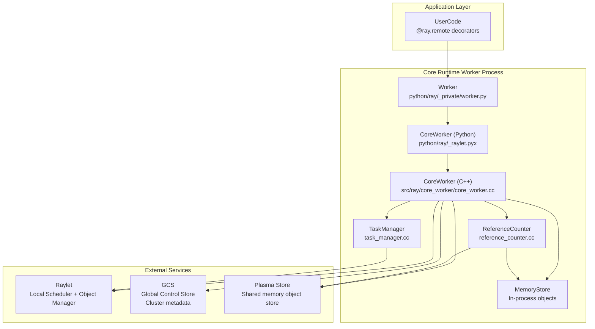
Sources: `src/ray/core_worker/core_worker.cc:167-280]`, `[python/ray/_raylet.pyx:157-200]`, `[python/ray/_private/worker.py:58-100]`

## Core Concepts

### Tasks

Tasks are the fundamental unit of computation in Ray. A task is a stateless function decorated with `@ray.remote` that executes asynchronously and returns an `ObjectRef`.

**Task Types** (defined via `TaskType` in `src/ray/protobuf/common.proto`):
*   **Normal tasks**: Stateless functions executed by worker processes (`NORMAL_TASK = 0`).
*   **Actor creation tasks**: Special tasks that instantiate an actor process (`ACTOR_CREATION_TASK = 1`).
*   **Actor tasks**: Methods executed on stateful actor instances (`ACTOR_TASK = 2`).
*   **Driver tasks**: The main script that orchestrates execution (`DRIVER_TASK = 3`).

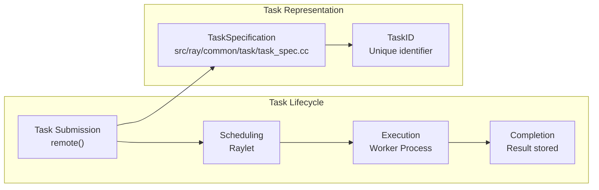
Sources: `[src/ray/protobuf/common.proto:42-51]`, `[src/ray/common/task/task_spec.h:82-122]`, `[python/ray/_private/worker.py:156-250]`

**Implementation Details**:
*   Python tasks are defined using the `@ray.remote` decorator in `[python/ray/_private/worker.py:156-250]()`.
*   Task specifications are wrapped by `TaskSpecification` in `[src/ray/common/task/task_spec.h:82-122]()`.
*   Task execution and tracking are managed by the `TaskManager` within the CoreWorker.

Sources: `[python/ray/_private/worker.py:156-250]`, `[src/ray/common/task/task_spec.h:82-122]`, `[src/ray/common/task/task_spec.cc:59-114]`

### Actors

Actors are stateful workers that execute methods sequentially. Each actor is a long-running Ray worker process that maintains state across method invocations.

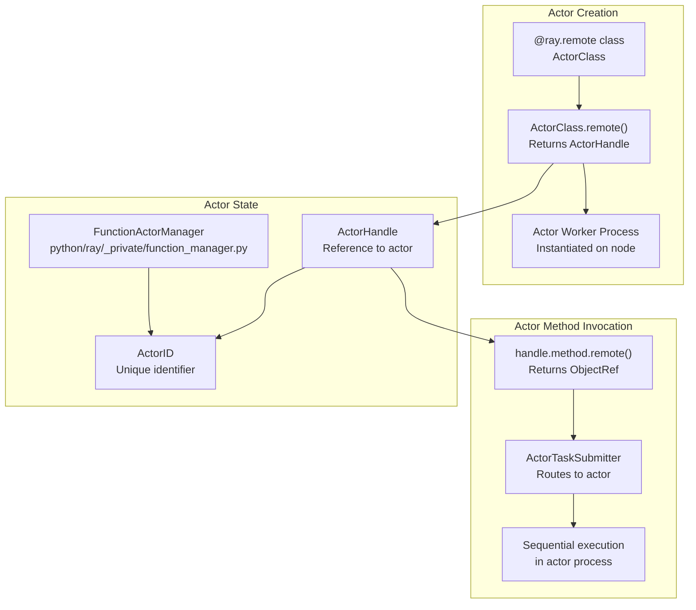
Sources: `[python/ray/actor.py:91-250]`, `[python/ray/_private/worker.py:68]`

**Key Properties**:
*   **Statefulness**: Instance variables persist across method calls.
*   **Sequential execution**: Methods execute one at a time by default.
*   **Concurrency control**: Configurable with `max_concurrency` parameter (`DEFAULT_MAX_CONCURRENCY_ASYNC` in `[python/ray/actor.py:29-32]()`).
*   **Async actors**: Support for `async def` methods with higher concurrency.

Sources: `[python/ray/actor.py:29-50]`, `[python/ray/actor.py:91-241]`

### Objects and ObjectRefs

Ray objects are immutable data stored in the distributed object store. An `ObjectRef` is a reference to an object that may not yet exist (future).

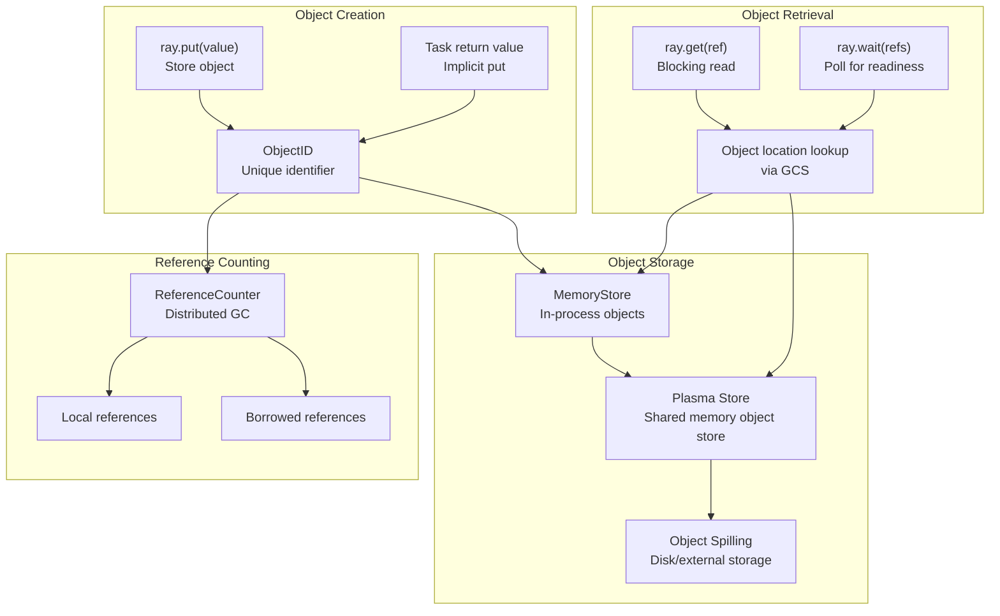
Sources: `[src/ray/core_worker/core_worker.cc:93-126]`, `[src/ray/core_worker/core_worker.h:44-48]`

**Object Lifecycle**:
1.  **Creation**: Objects created via `ray.put()` or task returns.
2.  **Storage**: Small objects stored in-process `MemoryStore`, large objects in `Plasma`.
3.  **Reference tracking**: `ReferenceCounter` tracks local and borrowed references (`[src/ray/core_worker/core_worker.h:44-48]()`).
4.  **Retrieval**: `ray.get()` fetches object data, potentially from remote nodes.
5.  **Garbage collection**: Objects deleted when all references go out of scope.

Sources: `[src/ray/core_worker/core_worker.cc:93-126]`, `[src/ray/core_worker/core_worker.h:44-48]`, `[python/ray/_private/ray_constants.py:37-91]`

## Key Components

### CoreWorker

The `CoreWorker` is the central coordinator of Ray functionality within each worker process. It manages task execution, object storage, and communication with external services.

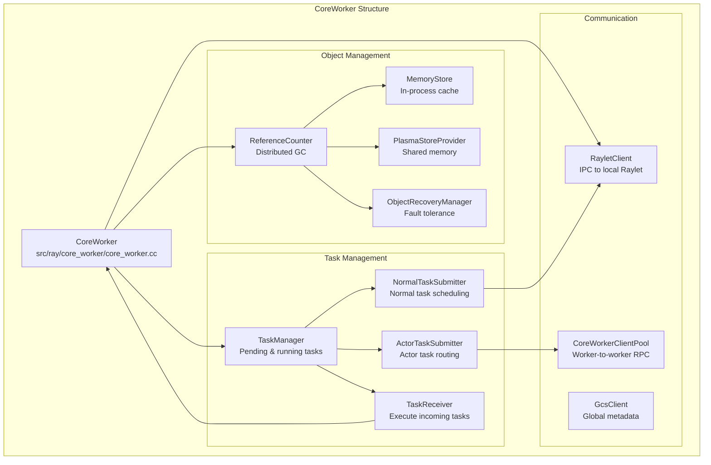
Sources: `[src/ray/core_worker/core_worker.cc:166-280]`, `[src/ray/core_worker/core_worker.h:15-180]`

**CoreWorker Responsibilities**:

| Component | Responsibility | Key Files |
| :--- | :--- | :--- |
| `TaskManager` | Tracks stats for inbound tasks (pending, running, finished) | `[src/ray/core_worker/core_worker.h:64-140]()` |
| `ReferenceCounter` | Maintains reference counts for distributed GC | `[src/ray/core_worker/core_worker.h:44-45]()` |
| `NormalTaskSubmitter` | Submits normal tasks to Raylet for scheduling | `[src/ray/core_worker/core_worker.h:51]()` |
| `ActorTaskSubmitter` | Submits actor tasks internally | `[src/ray/core_worker/core_worker.h:51]()` |
| `TaskReceiver` | Executes tasks assigned to this worker | `[src/ray/core_worker/core_worker.h:50]()` |
| `MemoryStore` | Stores small objects in worker heap | `[src/ray/core_worker/core_worker.h:47]()` |
| `PlasmaStoreProvider` | Interfaces with the external plasma store | `[src/ray/core_worker/core_worker.h:48]()` |
| `ObjectRecoveryManager` | Reconstructs lost objects via lineage | `[src/ray/core_worker/core_worker.h:42]()` |

Sources: `[src/ray/core_worker/core_worker.h:15-180]`, `[src/ray/core_worker/core_worker.cc:166-280]`

### Raylet

The Raylet is a per-node daemon that handles local scheduling, resource management, and object transfer. Each node runs exactly one Raylet process (`RAYLET_EXECUTABLE` in `[python/ray/_private/services.py:61-63]()`).

**Raylet Components**:
*   **NodeManager**: Manages workers, resource scheduling, and node-level lifecycle (`[src/ray/raylet/node_manager.h:138-142]()`).
*   **WorkerPool**: Manages a pool of worker processes for task execution (`[src/ray/raylet/node_manager.h:55]()`).
*   **ClusterResourceScheduler**: Makes local scheduling decisions based on cluster resources (`[src/ray/raylet/node_manager.h:50]()`).
*   **ObjectManager**: Manages object transfers and shared memory (Plasma) (`[src/ray/raylet/node_manager.h:40]()`).

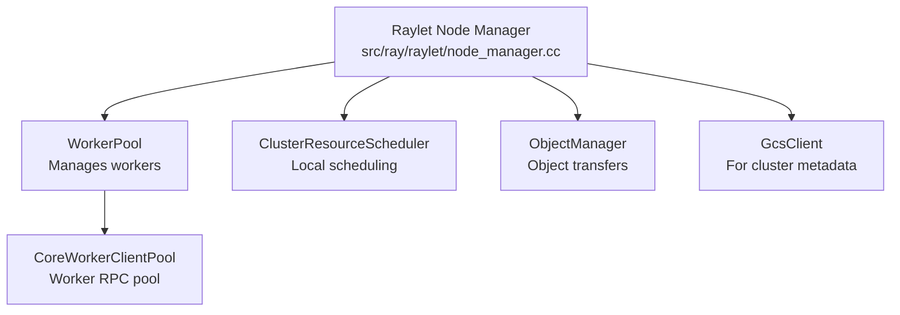
Sources: `[src/ray/raylet/node_manager.h:138-188]`, `[src/ray/raylet/node_manager.cc:164-200]`

Sources: `[src/ray/raylet/node_manager.h:138-188]`, `[src/ray/raylet/node_manager.cc:164-200]`, `[python/ray/_private/services.py:61-63]`

### Global Control Service (GCS)

The GCS is Ray's centralized metadata service that maintains cluster-wide state using `GcsClient` (`[src/ray/raylet/node_manager.h]` and `[python/ray/_private/services.py:196-202]()`).

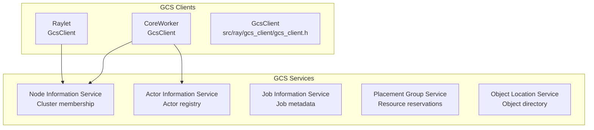
Sources: `[python/ray/_private/services.py:32-36]`, `[src/ray/raylet/node_manager.h]`

**GCS Functionality**:
*   **Node Management**: Tracks node health and resources via `GcsNodeInfo` (`[python/ray/_private/services.py:32-36]()`).
*   **Actor Management**: Tracks actor locations and states.
*   **Job Management**: Stores job configurations (`[python/ray/_raylet.pyx]`).
*   **Authentication**: Supports token-based authentication for RPC calls if auth is enabled.

Sources: `[python/ray/_private/services.py:32-36]`, `[python/ray/_raylet.pyx]`

## Node Lifecycle and Process Management

### ray start CLI
The `ray start` command (implemented via `RayCLI` in `[python/ray/scripts/scripts.py:146-189]()`) initializes a Ray node process.

1.  **Head Node**: Starts GCS, Raylet, Plasma Store, and Dashboard processes (`[python/ray/_private/node.py:80-133]()`).
2.  **Worker Node**: Starts Raylet and Plasma Store, connecting to the head node's GCS.

### Process Management
Ray manages several types of processes encapsulated by the `Node` class (`[python/ray/_private/node.py:68-183]()`):
*   **Raylet**: Starts the local node manager daemon (`RAYLET_EXECUTABLE`, `[python/ray/_private/services.py:61-63]()`).
*   **GCS Server**: A standalone metadata service process (`GCS_SERVER_EXECUTABLE`, `[python/ray/_private/services.py:64-66]()`).
*   **Workers**: Task execution processes started by the Raylet’s `WorkerPool`. Python workers use the Python interpreter (`sys.executable`) with specific environment variables (`[python/ray/_private/services.py:144-193]()`).

Sources: `[python/ray/scripts/scripts.py:146-189]`, `[python/ray/_private/node.py:68-183]`, `[python/ray/_private/services.py:61-66]`

---

This page provides foundational knowledge to understand Ray’s distributed execution model built on tasks, actors, and objects managed by core components `CoreWorker`, `Raylet`, and `GCS`.

---

# Page: Contributing and Documentation Workflow

# Contributing and Documentation Workflow

<details>
<summary>Relevant source files</summary>

The following files were used as context for generating this wiki page:

- [.buildkite/lint.rayci.yml](.buildkite/lint.rayci.yml)
- [.claude/agents/README.md](.claude/agents/README.md)
- [.claude/settings.json](.claude/settings.json)
- [.claude/skills/backport-docs/SKILL.md](.claude/skills/backport-docs/SKILL.md)
- [.claude/skills/fetch-buildkite-logs/SKILL.md](.claude/skills/fetch-buildkite-logs/SKILL.md)
- [.gitignore](.gitignore)
- [.pre-commit-config.yaml](.pre-commit-config.yaml)
- [.readthedocs.yaml](.readthedocs.yaml)
- [bazel/python.bzl](bazel/python.bzl)
- [ci/lint/lint.sh](ci/lint/lint.sh)
- [ci/ray_ci/doc/BUILD.bazel](ci/ray_ci/doc/BUILD.bazel)
- [ci/ray_ci/doc/api.py](ci/ray_ci/doc/api.py)
- [ci/ray_ci/doc/autodoc.py](ci/ray_ci/doc/autodoc.py)
- [ci/ray_ci/doc/build_cache.py](ci/ray_ci/doc/build_cache.py)
- [ci/ray_ci/doc/cmd_build.py](ci/ray_ci/doc/cmd_build.py)
- [ci/ray_ci/doc/cmd_check_api_discrepancy.py](ci/ray_ci/doc/cmd_check_api_discrepancy.py)
- [ci/ray_ci/doc/massage_cache.py](ci/ray_ci/doc/massage_cache.py)
- [ci/ray_ci/doc/mock/__init__.py](ci/ray_ci/doc/mock/__init__.py)
- [ci/ray_ci/doc/mock/_internal/__init__.py](ci/ray_ci/doc/mock/_internal/__init__.py)
- [ci/ray_ci/doc/mock/mock_module.py](ci/ray_ci/doc/mock/mock_module.py)
- [ci/ray_ci/doc/module.py](ci/ray_ci/doc/module.py)
- [ci/ray_ci/doc/test_api.py](ci/ray_ci/doc/test_api.py)
- [ci/ray_ci/doc/test_autodoc.py](ci/ray_ci/doc/test_autodoc.py)
- [ci/ray_ci/doc/test_build_cache.py](ci/ray_ci/doc/test_build_cache.py)
- [ci/ray_ci/doc/test_cmd_check_api_discrepancy.py](ci/ray_ci/doc/test_cmd_check_api_discrepancy.py)
- [ci/ray_ci/doc/test_module.py](ci/ray_ci/doc/test_module.py)
- [ci/raydepsets/configs/docs.depsets.yaml](ci/raydepsets/configs/docs.depsets.yaml)
- [doc/.claude/CLAUDE.md](doc/.claude/CLAUDE.md)
- [doc/.gitignore](doc/.gitignore)
- [doc/BUILD.bazel](doc/BUILD.bazel)
- [doc/Makefile](doc/Makefile)
- [doc/README.md](doc/README.md)
- [doc/requirements-doc.lock.txt](doc/requirements-doc.lock.txt)
- [doc/requirements-doc.txt](doc/requirements-doc.txt)
- [doc/rtd_doctor.py](doc/rtd_doctor.py)
- [doc/source/_ext/llms_txt.py](doc/source/_ext/llms_txt.py)
- [doc/source/_ext/test_llms_txt.py](doc/source/_ext/test_llms_txt.py)
- [doc/source/_intersphinx/README.md](doc/source/_intersphinx/README.md)
- [doc/source/_intersphinx/refresh.py](doc/source/_intersphinx/refresh.py)
- [doc/source/_intersphinx/torch.inv](doc/source/_intersphinx/torch.inv)
- [doc/source/_static/css/custom.css](doc/source/_static/css/custom.css)
- [doc/source/_static/img/ray_logo.svg](doc/source/_static/img/ray_logo.svg)
- [doc/source/cluster/images/ray-job-diagram.png](doc/source/cluster/images/ray-job-diagram.png)
- [doc/source/cluster/kubernetes/troubleshooting/troubleshooting.md](doc/source/cluster/kubernetes/troubleshooting/troubleshooting.md)
- [doc/source/cluster/running-applications/job-submission/api.md](doc/source/cluster/running-applications/job-submission/api.md)
- [doc/source/cluster/running-applications/job-submission/index.md](doc/source/cluster/running-applications/job-submission/index.md)
- [doc/source/cluster/running-applications/job-submission/jobs-package-ref.rst](doc/source/cluster/running-applications/job-submission/jobs-package-ref.rst)
- [doc/source/cluster/running-applications/job-submission/openapi.yml](doc/source/cluster/running-applications/job-submission/openapi.yml)
- [doc/source/cluster/running-applications/job-submission/rest.rst](doc/source/cluster/running-applications/job-submission/rest.rst)
- [doc/source/conf.py](doc/source/conf.py)
- [doc/source/custom_directives.py](doc/source/custom_directives.py)
- [doc/source/data/examples.yml](doc/source/data/examples.yml)
- [doc/source/data/examples/BUILD.bazel](doc/source/data/examples/BUILD.bazel)
- [doc/source/images/ray_header_logo.png](doc/source/images/ray_header_logo.png)
- [doc/source/images/ray_logo.png](doc/source/images/ray_logo.png)
- [doc/source/llm/doc_code/serve/tpu/serve_tpu_multihost.py](doc/source/llm/doc_code/serve/tpu/serve_tpu_multihost.py)
- [doc/source/llms_txt_summary.txt](doc/source/llms_txt_summary.txt)
- [doc/source/ray-contribute/agent-development.md](doc/source/ray-contribute/agent-development.md)
- [doc/source/ray-contribute/api-policy.md](doc/source/ray-contribute/api-policy.md)
- [doc/source/ray-contribute/ci.md](doc/source/ray-contribute/ci.md)
- [doc/source/ray-contribute/debugging.md](doc/source/ray-contribute/debugging.md)
- [doc/source/ray-contribute/development.md](doc/source/ray-contribute/development.md)
- [doc/source/ray-contribute/docs.md](doc/source/ray-contribute/docs.md)
- [doc/source/ray-contribute/getting-involved.md](doc/source/ray-contribute/getting-involved.md)
- [doc/source/ray-contribute/involvement.md](doc/source/ray-contribute/involvement.md)
- [doc/source/ray-contribute/profiling.md](doc/source/ray-contribute/profiling.md)
- [doc/source/ray-contribute/publishing-examples-legacy.md](doc/source/ray-contribute/publishing-examples-legacy.md)
- [doc/source/ray-contribute/publishing-examples.md](doc/source/ray-contribute/publishing-examples.md)
- [doc/source/ray-contribute/stability.md](doc/source/ray-contribute/stability.md)
- [doc/source/ray-contribute/testing-tips.md](doc/source/ray-contribute/testing-tips.md)
- [doc/source/ray-contribute/whitepaper.md](doc/source/ray-contribute/whitepaper.md)
- [doc/source/ray-contribute/writing-code-snippets.md](doc/source/ray-contribute/writing-code-snippets.md)
- [doc/source/ray-core/examples/BUILD.bazel](doc/source/ray-core/examples/BUILD.bazel)
- [doc/source/ray-overview/images/ray_svg_logo.svg](doc/source/ray-overview/images/ray_svg_logo.svg)
- [doc/source/serve/examples.yml](doc/source/serve/examples.yml)
- [doc/source/serve/llm/architecture/routing-policies.md](doc/source/serve/llm/architecture/routing-policies.md)
- [doc/source/serve/llm/images/kv_aware_routing_flow.png](doc/source/serve/llm/images/kv_aware_routing_flow.png)
- [doc/source/serve/llm/images/kv_offload_dashboard.png](doc/source/serve/llm/images/kv_offload_dashboard.png)
- [doc/source/serve/llm/images/ray_serve_llm_tpu.png](doc/source/serve/llm/images/ray_serve_llm_tpu.png)
- [doc/source/serve/llm/user-guides/index.md](doc/source/serve/llm/user-guides/index.md)
- [doc/source/serve/llm/user-guides/kv-aware-routing.md](doc/source/serve/llm/user-guides/kv-aware-routing.md)
- [doc/source/serve/llm/user-guides/kv-cache-offloading.md](doc/source/serve/llm/user-guides/kv-cache-offloading.md)
- [doc/source/serve/llm/user-guides/tpu.md](doc/source/serve/llm/user-guides/tpu.md)
- [doc/source/serve/tutorials/batch.md](doc/source/serve/tutorials/batch.md)
- [doc/source/serve/tutorials/serve-deepseek.md](doc/source/serve/tutorials/serve-deepseek.md)
- [doc/source/train/deepspeed.rst](doc/source/train/deepspeed.rst)
- [doc/source/train/examples.yml](doc/source/train/examples.yml)
- [doc/source/train/examples/BUILD.bazel](doc/source/train/examples/BUILD.bazel)
- [doc/source/train/examples/aws-trainium/llama3.rst](doc/source/train/examples/aws-trainium/llama3.rst)
- [doc/source/train/examples/jax/intro_to_jax_trainer/README.ipynb](doc/source/train/examples/jax/intro_to_jax_trainer/README.ipynb)
- [doc/source/train/examples/jax/intro_to_jax_trainer/README.md](doc/source/train/examples/jax/intro_to_jax_trainer/README.md)
- [doc/source/train/examples/lightning/BUILD.bazel](doc/source/train/examples/lightning/BUILD.bazel)
- [doc/source/train/examples/pytorch/BUILD.bazel](doc/source/train/examples/pytorch/BUILD.bazel)
- [doc/source/train/examples/transformers/BUILD.bazel](doc/source/train/examples/transformers/BUILD.bazel)
- [doc/source/tune/examples/BUILD.bazel](doc/source/tune/examples/BUILD.bazel)
- [doc/source/tune/examples/index.rst](doc/source/tune/examples/index.rst)
- [doc/source/tune/examples/tune-pytorch-cifar.ipynb](doc/source/tune/examples/tune-pytorch-cifar.ipynb)
- [python/deplocks/docs/docbuild_depset_py3.11.lock](python/deplocks/docs/docbuild_depset_py3.11.lock)
- [python/ray/serve/_private/tracing_utils.py](python/ray/serve/_private/tracing_utils.py)
- [python/ray/serve/pyrefly-serve.toml](python/ray/serve/pyrefly-serve.toml)
- [python/ray/serve/tests/test_tracing_utils.py](python/ray/serve/tests/test_tracing_utils.py)
- [release/requirements-doc.txt](release/requirements-doc.txt)

</details>


## Purpose and Scope
This wiki page serves as the comprehensive technical guide for contributors working on the Ray codebase. It covers the repository layout, the Sphinx-based documentation build pipeline (`doc/source/conf.py`), editorial style and style checks (Vale), linting infrastructure (`.pre-commit-config.yaml` and `ci/lint/lint.sh`), API policy consistency verifications (`ci/ray_ci/doc/cmd_check_api_discrepancy.py`), and the integration of development agent skills used for automated maintenance.

Sources: [`doc/source/conf.py:1-45`](), [`doc/source/ray-contribute/docs.md:1-25`](), [.pre-commit-config.yaml:1-23]()

---

## Repository Layout and Directory Organization
The Ray repository is structured to separate core distributed systems implementations, framework libraries, build scripts, and documentation sources. Understanding this layout is essential for locating module sources, test targets, and configuration files.

| Directory Path | Primary Components and Responsibilities |
| :--- | :--- |
| `python/ray/` | Python library implementations including Ray Core, Serve, Data, Train, Tune, and RLlib. |
| `src/ray/` | C++ core runtime engines, including `raylet`, `core_worker`, `gcs`, and the Plasma object store. |
| `doc/` | Documentation source files (`doc/source/`), Sphinx configuration, extensions (`doc/source/_ext/`), and build scripts. |
| `ci/` | Continuous integration scripts, lint runners (`ci/lint/`), and validation utilities (`ci/ray_ci/`). |
| `bazel/` | Bazel build definitions, platform toolchains, and Python dependency rules. |

Sources: [`doc/source/conf.py:37-44`](), [.pre-commit-config.yaml:1-22]()

---

## Documentation Build System and Sphinx Pipeline
The Ray documentation is built using Sphinx (`sphinx==8.2.3`), MyST Parser for Markdown, and a custom pydata-sphinx-theme [doc/requirements-doc.txt:1-51](). The core configuration resides in `doc/source/conf.py`, which initializes extensions such as `sphinx.ext.autodoc`, `myst_nb`, and custom in-repo agent extensions like `llms_txt` [doc/source/conf.py:58-82]().

### Local Build Commands and Caching
Contributors can run local builds via the `doc/Makefile` using incremental or full build targets:
- **Incremental Build (`make local`)**: Uses global caches from upstream commits stored on S3 to rebuild only changed files with live reloading.
- **Full Build (`make develop`)**: Performs a complete clean build from scratch inside the `_build/` directory [doc/source/ray-contribute/docs.md:59-98]().
- **RTD-Faithful Build (`make rtd-build`)**: Simulates the Read the Docs production pipeline with strict warning enforcement via `make rtd-doctor` [doc/source/ray-contribute/docs.md:102-118]().

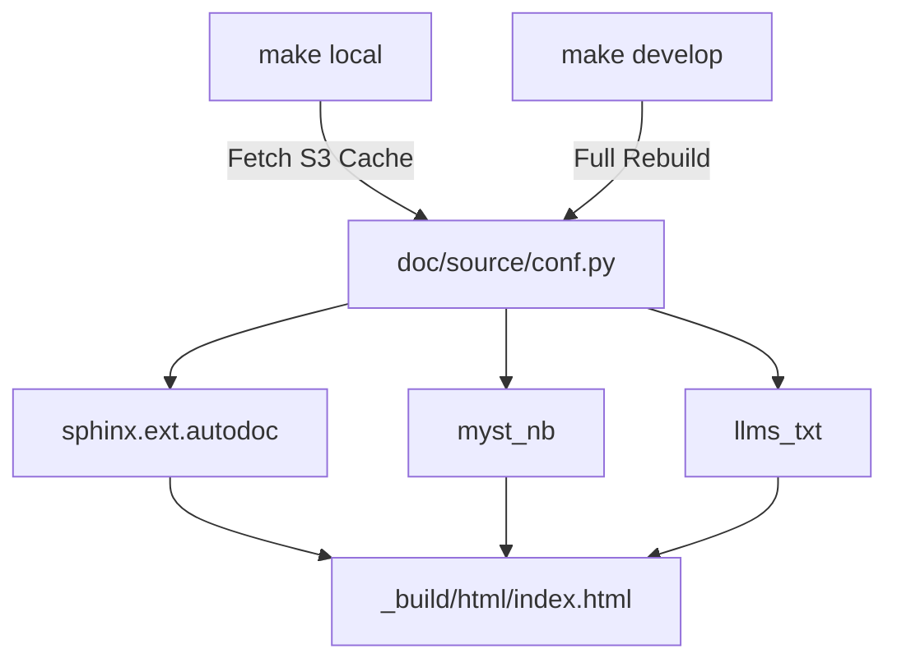
Sources: [`doc/source/conf.py:1-83`](), [`doc/requirements-doc.txt:1-35`](), [`doc/source/ray-contribute/docs.md:60-118`](), [`doc/BUILD.bazel:1-22`]()

---

## Linting, Pre-Commit Hooks, and CI Infrastructure
Ray enforces strict code formatting, linting, and style policies via `.pre-commit-config.yaml` and pipeline scripts in `ci/lint/lint.sh`. Pre-commit hooks run checkers such as `ruff`, `pydoclint`, `cpplint`, `buildifier`, `black`, and `mypy` [.pre-commit-config.yaml:23-169]().

### Pre-Commit and Lint Script Execution
The lint runner script `ci/lint/lint.sh` aggregates checks into isolated functions, executed across Buildkite pipeline matrices defined in `.buildkite/lint.rayci.yml` [ci/lint/lint.sh:1-154](), [.buildkite/lint.rayci.yml:1-117]().

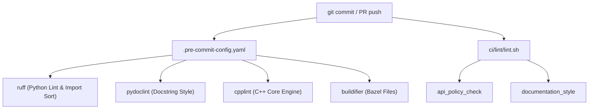
Sources: [.pre-commit-config.yaml:1-169](), [ci/lint/lint.sh:1-154](), [.buildkite/lint.rayci.yml:1-117]()

---

## API Policy Checks and Consistency Verification
Ray maintains strict consistency between public APIs, docstring parameter annotations, and Sphinx documentation stubs. The verification suite is coordinated by `ci/ray_ci/doc/cmd_check_api_discrepancy.py` [ci/ray_ci/doc/cmd_check_api_discrepancy.py:1-646]().

### API Discrepancy Checks
The script `ci/ray_ci/doc/cmd_check_api_discrepancy.py` walks designated module roots (e.g., `ray.data`, `ray.serve`) defined in `TEAM_API_CONFIGS` and validates that every `@PublicAPI` annotated symbol is accounted for in documentation autosummary files or explicit exemption lists (`white_list_apis` and `tracked_doc_debt`) [ci/ray_ci/doc/cmd_check_api_discrepancy.py:31-108]().

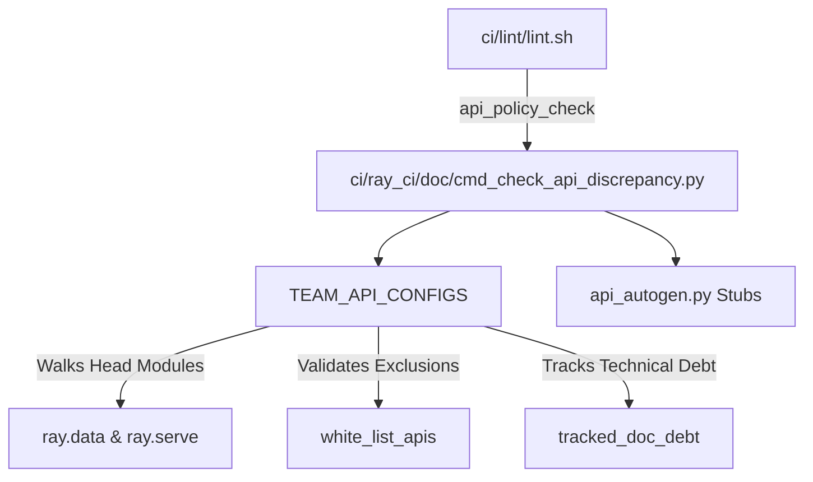
Sources: [ci/lint/lint.sh:115-132](), [ci/ray_ci/doc/cmd_check_api_discrepancy.py:1-123](), [doc/source/conf.py:29-35]()

---

## Agent Skills and Developer Workflow Automation
Ray incorporates automated agent capabilities (housed under `.claude/`) to streamline code navigation, error resolution, and doc synchronization. These agent definitions interact with core testing utilities and Bazel targets specified in `doc/BUILD.bazel` to validate code snippets embedded in rST/Markdown files [doc/BUILD.bazel:29-241]().

Sources: [doc/BUILD.bazel:1-241]()

---

# Page: Ray Core Infrastructure

# Ray Core Infrastructure

<details>
<summary>Relevant source files</summary>

The following files were used as context for generating this wiki page:

- [cpp/src/ray/runtime/task/task_executor.cc](cpp/src/ray/runtime/task/task_executor.cc)
- [cpp/src/ray/runtime/task/task_executor.h](cpp/src/ray/runtime/task/task_executor.h)
- [doc/source/data/images/dataset_mixing/per_block_mix.png](doc/source/data/images/dataset_mixing/per_block_mix.png)
- [doc/source/data/images/dataset_mixing/random_mix.png](doc/source/data/images/dataset_mixing/random_mix.png)
- [doc/source/data/mixing-data.rst](doc/source/data/mixing-data.rst)
- [doc/source/data/scaling-collation-functions.rst](doc/source/data/scaling-collation-functions.rst)
- [doc/source/ray-observability/reference/system-metrics.rst](doc/source/ray-observability/reference/system-metrics.rst)
- [doc/source/train/user-guides.rst](doc/source/train/user-guides.rst)
- [doc/source/train/user-guides/local_mode.rst](doc/source/train/user-guides/local_mode.rst)
- [doc/source/train/user-guides/monitor-your-application.rst](doc/source/train/user-guides/monitor-your-application.rst)
- [python/ray/_private/ray_constants.py](python/ray/_private/ray_constants.py)
- [python/ray/_raylet.pyx](python/ray/_raylet.pyx)
- [python/ray/dashboard/client/src/type/node.d.ts](python/ray/dashboard/client/src/type/node.d.ts)
- [python/ray/dashboard/consts.py](python/ray/dashboard/consts.py)
- [python/ray/dashboard/dashboard_metrics.py](python/ray/dashboard/dashboard_metrics.py)
- [python/ray/dashboard/modules/metrics/dashboards/default_dashboard_panels.py](python/ray/dashboard/modules/metrics/dashboards/default_dashboard_panels.py)
- [python/ray/dashboard/modules/reporter/reporter_agent.py](python/ray/dashboard/modules/reporter/reporter_agent.py)
- [python/ray/dashboard/modules/reporter/reporter_models.py](python/ray/dashboard/modules/reporter/reporter_models.py)
- [python/ray/dashboard/modules/reporter/tests/test_reporter.py](python/ray/dashboard/modules/reporter/tests/test_reporter.py)
- [python/ray/includes/libcoreworker.pxd](python/ray/includes/libcoreworker.pxd)
- [python/ray/tests/unit/test_get_system_metric.py](python/ray/tests/unit/test_get_system_metric.py)
- [src/ray/common/ray_config_def.h](src/ray/common/ray_config_def.h)
- [src/ray/core_worker/core_worker.cc](src/ray/core_worker/core_worker.cc)
- [src/ray/core_worker/core_worker.h](src/ray/core_worker/core_worker.h)
- [src/ray/core_worker/core_worker_options.h](src/ray/core_worker/core_worker_options.h)
- [src/ray/core_worker/core_worker_process.cc](src/ray/core_worker/core_worker_process.cc)
- [src/ray/core_worker/core_worker_process.h](src/ray/core_worker/core_worker_process.h)
- [src/ray/core_worker/lib/java/io_ray_runtime_RayNativeRuntime.cc](src/ray/core_worker/lib/java/io_ray_runtime_RayNativeRuntime.cc)
- [src/ray/core_worker/metrics.h](src/ray/core_worker/metrics.h)
- [src/ray/core_worker/task_manager.cc](src/ray/core_worker/task_manager.cc)
- [src/ray/core_worker/task_manager.h](src/ray/core_worker/task_manager.h)
- [src/ray/core_worker/tests/core_worker_test.cc](src/ray/core_worker/tests/core_worker_test.cc)
- [src/ray/core_worker/tests/task_manager_test.cc](src/ray/core_worker/tests/task_manager_test.cc)

</details>


## Purpose and Scope

Ray Core Infrastructure provides the foundational distributed computing layer that underlies all Ray libraries. It handles task execution, object lifecycle management, distributed memory, reference counting, and fault tolerance. This infrastructure is implemented primarily in C++ for performance, with language-specific frontends (Python, Java, C++) that communicate through protocol buffers and shared memory.

This document covers the core execution and storage mechanisms at a high level. For details on specific subsystems, see the respective child pages:
- Core worker internals, task submission pipelines (`NormalTaskSubmitter`, `ActorTaskSubmitter`), reference counting, and actor management: see [Core Worker and Task Execution](#2.1)
- Accelerated task graph execution, shared memory optimization, and GPU tensor transport: see [Compiled DAG and Accelerated Execution](#2.2)
- Raylet node manager, Global Control Service (GCS), Plasma object store, and pub/sub infrastructure: see [Raylet, GCS, and Object Store](#2.3)
- Autoscaling architectures (`InstanceManager`, `Reconciler`), KubeRay integration, and cloud provider adapters: see [Autoscaler and Cluster Management](#2.4)
- Runtime environment packaging, URI protocols, isolation mechanisms, and dependency propagation: see [Runtime Environment and Dependency Management](#2.5)
- Dashboard head/agent modules, State API, metrics collection, and Job Submission API: see [Observability: Dashboard, Metrics, and State API](#2.6)

## Core Infrastructure Components

The Ray Core infrastructure consists of several key C++ components defined in `src/ray/core_worker/` that work together to enable distributed execution.

**Core Infrastructure Overview**
```mermaid
graph TB
    subgraph "Python Layer"
        Worker["Worker<br/>(Python Process)"]
        Raylet_pyx["_raylet.pyx<br/>(Cython Bridge)"]
    end
    
    subgraph "C++ Core Components"
        CoreWorker["CoreWorker<br/>(src/ray/core_worker/core_worker.h)"]
        TaskManager["TaskManager<br/>(src/ray/core_worker/task_manager.h)"]
        RefCounter["ReferenceCounter<br/>(src/ray/core_worker/reference_counter.h)"]
        MemoryStore["CoreWorkerMemoryStore<br/>(src/ray/core_worker/store_provider/memory_store/)"]
        PlasmaProvider["PlasmaStoreProvider<br/>(src/ray/core_worker/store_provider/)"]
        FutureResolver["FutureResolver<br/>(src/ray/core_worker/future_resolver.h)"]
        ObjectRecovery["ObjectRecoveryManager<br/>(src/ray/core_worker/object_recovery_manager.h)"]
    end
    
    subgraph "Task Submission"
        NormalSubmitter["NormalTaskSubmitter<br/>(src/ray/core_worker/task_submission/normal_task_submitter.h)"]
        ActorSubmitter["ActorTaskSubmitter<br/>(src/ray/core_worker/task_submission/actor_task_submitter.h)"]
    end
    
    subgraph "Task Execution"
        TaskReceiver["TaskReceiver<br/>(src/ray/core_worker/task_execution/task_receiver.h)"]
        TaskEventBuffer["TaskEventBuffer<br/>(src/ray/core_worker/task_event_buffer.h)"]
    end
    
    subgraph "External Services"
        Raylet["Raylet<br/>(src/ray/raylet/)"]
        GCS["GCS Server<br/>(src/ray/gcs/)"]
    end
    
    Worker --> Raylet_pyx
    Raylet_pyx --> CoreWorker
    
    CoreWorker --> TaskManager
    CoreWorker --> RefCounter
    CoreWorker --> MemoryStore
    CoreWorker --> PlasmaProvider
    CoreWorker --> FutureResolver
    CoreWorker --> ObjectRecovery
    
    CoreWorker --> NormalSubmitter
    CoreWorker --> ActorSubmitter
    
    CoreWorker --> TaskReceiver
    CoreWorker --> TaskEventBuffer
    
    NormalSubmitter --> Raylet
    ActorSubmitter --> Raylet
    TaskReceiver --> CoreWorker
    
    CoreWorker --> GCS
    RefCounter --> GCS
    ObjectRecovery --> GCS
```
Sources: [src/ray/core_worker/core_worker.h:33-56](), [src/ray/core_worker/core_worker.cc:287-372](), [python/ray/_raylet.pyx:157-170]()

### CoreWorker
The `CoreWorker` class (`src/ray/core_worker/core_worker.h`) is the central coordinator for all Ray functionality in a worker process. It is instantiated once per worker or driver process via `CoreWorkerProcess` and manages task submission, task execution, and object storage. It coordinates with the `Raylet` for resource scheduling and the `GCS` for global metadata. For details, see [Core Worker and Task Execution](#2.1).

Sources: [src/ray/core_worker/core_worker.h:136-183](), [src/ray/core_worker/core_worker_process.cc:91-125]()

### TaskManager
The `TaskManager` (`src/ray/core_worker/task_manager.h`) tracks the lifecycle of all tasks submitted by a worker. It maintains task state, handles retries for failed tasks (using policies defined in `src/ray/core_worker/task_manager.h`), and manages `ObjectRefStream` for streaming generator results. For details, see [Core Worker and Task Execution](#2.1).

| Component | Purpose |
|-----------|---------|
| `pending_tasks_` | Tasks awaiting execution or whose results are being consumed |
| `submissible_tasks_` | Tasks that can be retried if needed upon failure |
| `ObjectRefStream` | Manages streaming generator task results and unconsumed item tracking |

Sources: [src/ray/core_worker/task_manager.h:102-178](), [src/ray/core_worker/task_manager.cc:84-122]()

### ReferenceCounter
The `ReferenceCounter` (`src/ray/core_worker/reference_counter.h`) implements distributed garbage collection by tracking object references across the cluster. It manages local references held by the language runtime, references passed to tasks, and borrower information for objects shared across nodes. For details, see [Core Worker and Task Execution](#2.1).

Sources: [src/ray/core_worker/reference_counter.h](), [src/ray/core_worker/core_worker.cc:115-128]()

## Task Execution Flow

**Natural Language to Code: Task Submission and Execution**
```mermaid
graph LR
    subgraph "User Code (Python Space)"
        UserCode["@ray.remote<br/>func.remote()"]
    end

    subgraph "Python Frontend (python/ray/)"
        RemoteFunc["RemoteFunction._remote()"]
        CythonBridge["_raylet.pyx<br/>CCoreWorker.SubmitTask"]
    end
    
    subgraph "C++ Core (src/ray/core_worker/)"
        CoreSubmit["CoreWorker::SubmitTask<br/>(core_worker.cc)"]
        TaskMgrAdd["TaskManager::AddPendingTask<br/>(task_manager.cc)"]
        NormalSubmit["NormalTaskSubmitter::SubmitTask<br/>(normal_task_submitter.h)"]
    end
    
    subgraph "Local Node Manager (src/ray/raylet/)"
        RayletSched["NodeManager::HandleSubmitTask<br/>(node_manager.cc)"]
        WorkerPool["WorkerPool::PopWorker<br/>(worker_pool.cc)"]
    end

    subgraph "Execution Worker (src/ray/core_worker/)"
        TaskRecv["TaskReceiver::HandleTask<br/>(task_receiver.h)"]
        ExecLoop["CoreWorker::ExecuteTask<br/>(core_worker.cc)"]
        UserExec["Python Callback Execution"]
    end
    
    UserCode --> RemoteFunc
    RemoteFunc --> CythonBridge
    CythonBridge --> CoreSubmit
    CoreSubmit --> TaskMgrAdd
    TaskMgrAdd --> NormalSubmit
    NormalSubmit --> RayletSched
    RayletSched --> WorkerPool
    WorkerPool --> TaskRecv
    TaskRecv --> ExecLoop
    ExecLoop --> UserExec
```
Sources: [python/ray/_raylet.pyx:140-150](), [src/ray/core_worker/core_worker.cc:373-396](), [src/ray/core_worker/task_manager.cc:238-267]()

### Task Submission (Python to C++)
When a user invokes a remote function via `func.remote()`, the Python layer dispatches through `RemoteFunction._remote()`. Arguments are prepared and serialized via Cython bindings in `python/ray/_raylet.pyx`. The `CoreWorker::SubmitTask` C++ method is then invoked, registering the task in the `TaskManager` before dispatching it through the task submission pipeline (`NormalTaskSubmitter` or `ActorTaskSubmitter`) to the local `Raylet`. For details, see [Core Worker and Task Execution](#2.1).

Sources: [python/ray/_raylet.pyx:140-150](), [src/ray/core_worker/core_worker.h:140-150](), [src/ray/core_worker/task_manager.cc:238-267]()

### Task Execution
When a worker receives a task from the Raylet, `TaskReceiver::HandleTask` is triggered. The `CoreWorker` resolves task dependencies, ensures all input object references are available locally, and executes the language-specific task callback. Results are stored in the local `CoreWorkerMemoryStore` or the Plasma object store. For details, see [Core Worker and Task Execution](#2.1).

Sources: [src/ray/core_worker/core_worker.h:51](), [src/ray/core_worker/tests/core_worker_test.cc:78-104]()

## Object Management and Storage

Ray uses a tiered storage system to handle objects efficiently based on size and access patterns. For details, see [Raylet, GCS, and Object Store](#2.3).

**Natural Language to Code: Object Storage and Management Hierarchy**
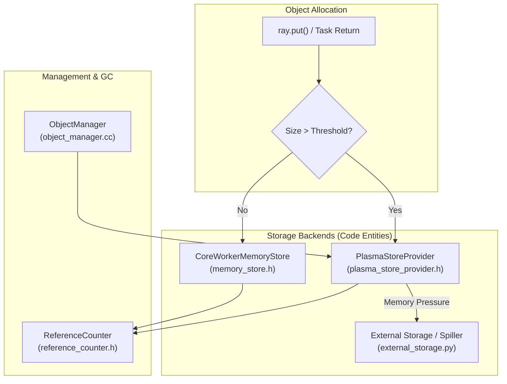
Sources: [src/ray/core_worker/store_provider/memory_store/memory_store.h](), [src/ray/core_worker/store_provider/plasma_store_provider.h](), [src/ray/core_worker/reference_counter.h]()

### Memory Store vs. Plasma
- **CoreWorkerMemoryStore**: Stores small objects directly in the worker's heap using `absl::flat_hash_map`. This provides lowest-latency access for small payloads.
- **Plasma Object Store**: Large objects are stored in a shared memory region (`/dev/shm`), enabling zero-copy sharing across multiple local workers via memory mapping.

Sources: [src/ray/core_worker/store_provider/memory_store/memory_store.h](), [src/ray/core_worker/store_provider/plasma_store_provider.h]()

### Distributed Reference Counting
The `ReferenceCounter` tracks ownership semantics across the cluster. The creating worker is designated as the object owner, while workers holding references are borrowers. The owner maintains ref-counts and coordinates distributed cleanup. For details, see [Core Worker and Task Execution](#2.1).

Sources: [src/ray/core_worker/reference_counter.h](), [src/ray/core_worker/core_worker.cc:115-128]()

## Streaming and Generators
Ray supports streaming task results via `ObjectRefStream`, allowing generator tasks to yield multiple intermediate return objects asynchronously back to the task manager while maintaining backpressure and reference safety. For details, see [Core Worker and Task Execution](#2.1).

Sources: [src/ray/core_worker/task_manager.h:102-178](), [src/ray/core_worker/task_manager.cc:84-152]()

## Fault Tolerance
Object reconstruction and fault recovery are managed by `ObjectRecoveryManager`. If node failures occur and Plasma objects are evicted or lost, Ray reconstructs object lineage through the `TaskManager` and resubmits producing tasks. For details, see [Core Worker and Task Execution](#2.1).

Sources: [src/ray/core_worker/object_recovery_manager.h](), [src/ray/core_worker/core_worker.h:43]()

## Observability and Metrics
Core infrastructure components record task metrics via `TaskCounter` and task execution events via `TaskEventBuffer`, exporting signals to the GCS and Dashboard agent for cluster-wide visibility. For details, see [Observability: Dashboard, Metrics, and State API](#2.6).

Sources: [src/ray/core_worker/core_worker.h:67-157](), [src/ray/core_worker/task_event_buffer.h](), [python/ray/dashboard/modules/reporter/reporter_agent.py:134-222]()

---

# Page: Core Worker and Task Execution

# Core Worker and Task Execution

<details>
<summary>Relevant source files</summary>

The following files were used as context for generating this wiki page:

- [cpp/src/ray/runtime/task/task_executor.cc](cpp/src/ray/runtime/task/task_executor.cc)
- [cpp/src/ray/runtime/task/task_executor.h](cpp/src/ray/runtime/task/task_executor.h)
- [doc/source/ray-core/api/direct-transport.rst](doc/source/ray-core/api/direct-transport.rst)
- [doc/source/ray-core/api/exceptions.rst](doc/source/ray-core/api/exceptions.rst)
- [doc/source/ray-core/direct-transport/custom-tensor-transport.rst](doc/source/ray-core/direct-transport/custom-tensor-transport.rst)
- [doc/source/ray-core/direct-transport/direct-transport.rst](doc/source/ray-core/direct-transport/direct-transport.rst)
- [doc/source/ray-core/doc_code/direct_transport_custom.py](doc/source/ray-core/doc_code/direct_transport_custom.py)
- [doc/source/ray-core/doc_code/direct_transport_gloo.py](doc/source/ray-core/doc_code/direct_transport_gloo.py)
- [doc/source/ray-security/token-auth.md](doc/source/ray-security/token-auth.md)
- [python/ray/_private/authentication/authentication_constants.py](python/ray/_private/authentication/authentication_constants.py)
- [python/ray/_private/authentication/http_token_authentication.py](python/ray/_private/authentication/http_token_authentication.py)
- [python/ray/_private/object_ref_generator.py](python/ray/_private/object_ref_generator.py)
- [python/ray/_private/serialization.py](python/ray/_private/serialization.py)
- [python/ray/_raylet.pyx](python/ray/_raylet.pyx)
- [python/ray/dashboard/client/src/authentication/TokenAuthenticationDialog.component.test.tsx](python/ray/dashboard/client/src/authentication/TokenAuthenticationDialog.component.test.tsx)
- [python/ray/dashboard/client/src/authentication/TokenAuthenticationDialog.tsx](python/ray/dashboard/client/src/authentication/TokenAuthenticationDialog.tsx)
- [python/ray/dashboard/tests/test_dashboard_auth.py](python/ray/dashboard/tests/test_dashboard_auth.py)
- [python/ray/exceptions.py](python/ray/exceptions.py)
- [python/ray/experimental/__init__.py](python/ray/experimental/__init__.py)
- [python/ray/experimental/rdt/__init__.py](python/ray/experimental/rdt/__init__.py)
- [python/ray/experimental/rdt/nixl_memory_pool.py](python/ray/experimental/rdt/nixl_memory_pool.py)
- [python/ray/experimental/rdt/nixl_tensor_transport.py](python/ray/experimental/rdt/nixl_tensor_transport.py)
- [python/ray/experimental/rdt/rdt_manager.py](python/ray/experimental/rdt/rdt_manager.py)
- [python/ray/experimental/rdt/rdt_store.py](python/ray/experimental/rdt/rdt_store.py)
- [python/ray/experimental/rdt/tensor_transport_manager.py](python/ray/experimental/rdt/tensor_transport_manager.py)
- [python/ray/experimental/rdt/util.py](python/ray/experimental/rdt/util.py)
- [python/ray/includes/libcoreworker.pxd](python/ray/includes/libcoreworker.pxd)
- [python/ray/tests/rdt/test_nixl_backend_selection.py](python/ray/tests/rdt/test_nixl_backend_selection.py)
- [python/ray/tests/rdt/test_nixl_memory_pool.py](python/ray/tests/rdt/test_nixl_memory_pool.py)
- [python/ray/tests/rdt/test_rdt_gloo.py](python/ray/tests/rdt/test_rdt_gloo.py)
- [python/ray/tests/rdt/test_rdt_manager.py](python/ray/tests/rdt/test_rdt_manager.py)
- [python/ray/tests/rdt/test_rdt_nixl.py](python/ray/tests/rdt/test_rdt_nixl.py)
- [python/ray/tests/test_exceptions.py](python/ray/tests/test_exceptions.py)
- [python/ray/tests/test_failure.py](python/ray/tests/test_failure.py)
- [python/ray/tests/test_streaming_generator.py](python/ray/tests/test_streaming_generator.py)
- [python/ray/tests/test_traceback.py](python/ray/tests/test_traceback.py)
- [python/ray/tests/test_wait.py](python/ray/tests/test_wait.py)
- [src/ray/common/protobuf_utils.cc](src/ray/common/protobuf_utils.cc)
- [src/ray/core_worker/BUILD.bazel](src/ray/core_worker/BUILD.bazel)
- [src/ray/core_worker/core_worker.cc](src/ray/core_worker/core_worker.cc)
- [src/ray/core_worker/core_worker.h](src/ray/core_worker/core_worker.h)
- [src/ray/core_worker/core_worker_options.h](src/ray/core_worker/core_worker_options.h)
- [src/ray/core_worker/core_worker_process.cc](src/ray/core_worker/core_worker_process.cc)
- [src/ray/core_worker/core_worker_process.h](src/ray/core_worker/core_worker_process.h)
- [src/ray/core_worker/future_resolver.cc](src/ray/core_worker/future_resolver.cc)
- [src/ray/core_worker/lib/java/io_ray_runtime_RayNativeRuntime.cc](src/ray/core_worker/lib/java/io_ray_runtime_RayNativeRuntime.cc)
- [src/ray/core_worker/metrics.h](src/ray/core_worker/metrics.h)
- [src/ray/core_worker/profile_event.cc](src/ray/core_worker/profile_event.cc)
- [src/ray/core_worker/profile_event.h](src/ray/core_worker/profile_event.h)
- [src/ray/core_worker/task_event_buffer.cc](src/ray/core_worker/task_event_buffer.cc)
- [src/ray/core_worker/task_event_buffer.h](src/ray/core_worker/task_event_buffer.h)
- [src/ray/core_worker/task_execution/tests/task_receiver_test.cc](src/ray/core_worker/task_execution/tests/task_receiver_test.cc)
- [src/ray/core_worker/task_manager.cc](src/ray/core_worker/task_manager.cc)
- [src/ray/core_worker/task_manager.h](src/ray/core_worker/task_manager.h)
- [src/ray/core_worker/task_submission/BUILD.bazel](src/ray/core_worker/task_submission/BUILD.bazel)
- [src/ray/core_worker/task_submission/actor_task_submitter.cc](src/ray/core_worker/task_submission/actor_task_submitter.cc)
- [src/ray/core_worker/task_submission/actor_task_submitter.h](src/ray/core_worker/task_submission/actor_task_submitter.h)
- [src/ray/core_worker/task_submission/dependency_resolver.cc](src/ray/core_worker/task_submission/dependency_resolver.cc)
- [src/ray/core_worker/task_submission/normal_task_submitter.cc](src/ray/core_worker/task_submission/normal_task_submitter.cc)
- [src/ray/core_worker/task_submission/normal_task_submitter.h](src/ray/core_worker/task_submission/normal_task_submitter.h)
- [src/ray/core_worker/task_submission/tests/BUILD.bazel](src/ray/core_worker/task_submission/tests/BUILD.bazel)
- [src/ray/core_worker/task_submission/tests/actor_task_submitter_test.cc](src/ray/core_worker/task_submission/tests/actor_task_submitter_test.cc)
- [src/ray/core_worker/task_submission/tests/dependency_resolver_test.cc](src/ray/core_worker/task_submission/tests/dependency_resolver_test.cc)
- [src/ray/core_worker/task_submission/tests/direct_actor_transport_test.cc](src/ray/core_worker/task_submission/tests/direct_actor_transport_test.cc)
- [src/ray/core_worker/task_submission/tests/normal_task_submitter_test.cc](src/ray/core_worker/task_submission/tests/normal_task_submitter_test.cc)
- [src/ray/core_worker/tests/BUILD.bazel](src/ray/core_worker/tests/BUILD.bazel)
- [src/ray/core_worker/tests/core_worker_test.cc](src/ray/core_worker/tests/core_worker_test.cc)
- [src/ray/core_worker/tests/future_resolver_test.cc](src/ray/core_worker/tests/future_resolver_test.cc)
- [src/ray/core_worker/tests/memory_store_test.cc](src/ray/core_worker/tests/memory_store_test.cc)
- [src/ray/core_worker/tests/task_event_buffer_test.cc](src/ray/core_worker/tests/task_event_buffer_test.cc)
- [src/ray/core_worker/tests/task_manager_test.cc](src/ray/core_worker/tests/task_manager_test.cc)
- [src/ray/gcs/gcs_job_manager.cc](src/ray/gcs/gcs_job_manager.cc)
- [src/ray/gcs/gcs_job_manager.h](src/ray/gcs/gcs_job_manager.h)
- [src/ray/gcs/gcs_ray_event_converter.cc](src/ray/gcs/gcs_ray_event_converter.cc)
- [src/ray/gcs/gcs_ray_event_converter.h](src/ray/gcs/gcs_ray_event_converter.h)
- [src/ray/gcs/gcs_task_manager.cc](src/ray/gcs/gcs_task_manager.cc)
- [src/ray/gcs/gcs_task_manager.h](src/ray/gcs/gcs_task_manager.h)
- [src/ray/gcs/tests/export_api/gcs_job_manager_export_event_test.cc](src/ray/gcs/tests/export_api/gcs_job_manager_export_event_test.cc)
- [src/ray/gcs/tests/gcs_job_manager_test.cc](src/ray/gcs/tests/gcs_job_manager_test.cc)
- [src/ray/gcs/tests/gcs_ray_event_converter_test.cc](src/ray/gcs/tests/gcs_ray_event_converter_test.cc)
- [src/ray/observability/ray_driver_job_definition_event.cc](src/ray/observability/ray_driver_job_definition_event.cc)
- [src/ray/protobuf/public/events_actor_task_definition_event.proto](src/ray/protobuf/public/events_actor_task_definition_event.proto)
- [src/ray/protobuf/public/events_task_definition_event.proto](src/ray/protobuf/public/events_task_definition_event.proto)
- [src/ray/protobuf/public/events_task_lifecycle_event.proto](src/ray/protobuf/public/events_task_lifecycle_event.proto)
- [src/ray/pubsub/BUILD.bazel](src/ray/pubsub/BUILD.bazel)

</details>


## Purpose and Scope

The `CoreWorker` is the fundamental runtime component that powers distributed task execution in Ray. Every worker process (including drivers) contains a `CoreWorker` instance that handles:

- **Task submission**: Submitting tasks and actor methods to the distributed system via `CoreWorker::SubmitTask` and `CoreWorker::SubmitActorTask` [python/ray/includes/libcoreworker.pxd:140-178]().
- **Task execution**: Receiving and executing tasks on worker processes through `TaskReceiver` [src/ray/core_worker/core_worker.h:51]().
- **Object management**: Storing, retrieving, and tracking distributed objects through reference counting via `ReferenceCounter` [src/ray/core_worker/core_worker.h:45]().
- **Actor lifecycle**: Managing actor creation, method invocation, and state via `ActorManager` [src/ray/core_worker/core_worker.h:34]().

This document details the `CoreWorker` implementation, its internal pipeline (including `NormalTaskSubmitter` and `ActorTaskSubmitter`), and its role in the task/actor execution lifecycle.

Sources: [src/ray/core_worker/core_worker.h:33-60](), [python/ray/includes/libcoreworker.pxd:136-183]()

---

## CoreWorker Architecture

The `CoreWorker` is implemented in C++ with Python bindings via Cython, providing a unified interface for both driver and worker processes.

### Component Map: Natural Language to Code Entities

The following diagram maps high-level system responsibilities to the specific C++ classes and Python modules that implement them, bridging natural language concepts to concrete code entities.

**Architecture and Code Entity Mapping**
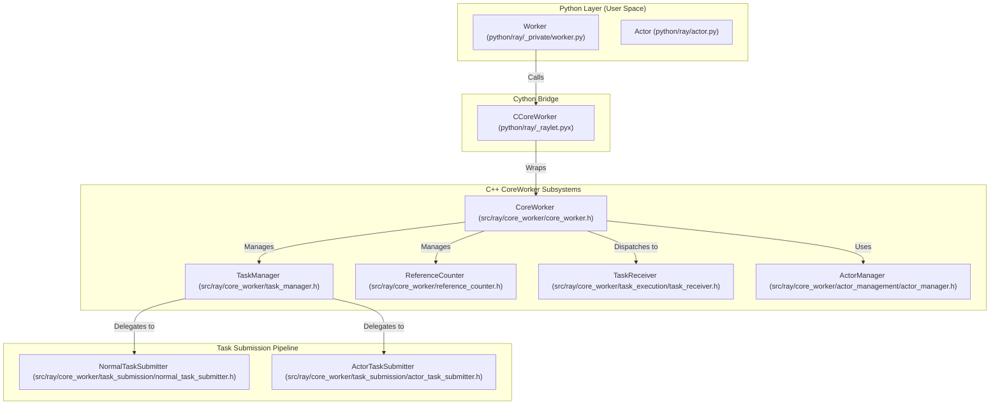
Sources: [python/ray/includes/libcoreworker.pxd:136-183](), [src/ray/core_worker/core_worker.h:33-60](), [python/ray/_raylet.pyx:1-253]()

### Key Classes and Responsibilities

| Class | File | Responsibility |
| :--- | :--- | :--- |
| `CoreWorker` | [python/ray/includes/libcoreworker.pxd:136-183]() | Central orchestrator for task submission, execution, and object management. |
| `WorkerContext` | [python/ray/includes/libcoreworker.pxd:92-100]() | Tracks thread-local state like `current_task_id`, `current_actor_id`, and `job_id`. |
| `TaskManager` | [src/ray/core_worker/task_manager.h:34-45]() | Tracks pending tasks, manages return values, and handles generator streams (`ObjectRefStream`). |
| `TaskReceiver` | [src/ray/core_worker/task_execution/task_receiver.h:51-51]() | Receives tasks from the Raylet and dispatches them to the language-specific execution callback. |
| `ReferenceCounter` | [src/ray/core_worker/reference_counter.h:45-46]() | Tracks object lifetimes (local, submitted, and contained) for distributed GC. |
| `NormalTaskSubmitter` | [src/ray/core_worker/task_submission/normal_task_submitter.h:51-51]() | Handles lease requests from Raylets and pushes non-actor tasks. |
| `ActorTaskSubmitter` | [src/ray/core_worker/task_submission/actor_task_submitter.h:23-23]() | Manages actor task ordering, pending call limits, and actor state resolution. |

Sources: [python/ray/includes/libcoreworker.pxd:136-183](), [src/ray/core_worker/core_worker.h:33-60]()

---

## Task Submission Pipeline

Task submission is split into two primary paths: **Normal Tasks** (stateless) managed by `NormalTaskSubmitter` and **Actor Tasks** (stateful) managed by `ActorTaskSubmitter`. Both paths utilize the `TaskManager` to register pending tasks and their expected return objects [src/ray/core_worker/task_manager.h:34-45]().

### 1. Normal Task Submission
Normal tasks use `NormalTaskSubmitter`. The process involves requesting a worker lease from the local Raylet before pushing the task directly to the leased worker.

**Normal Task Submission Code Entity Flow**
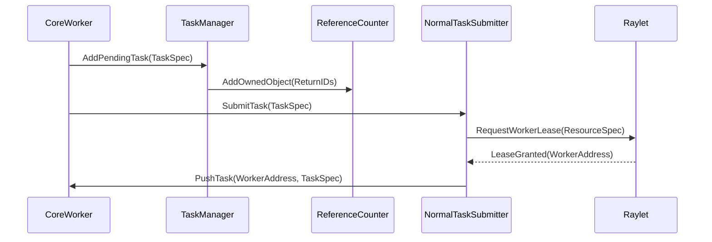
Sources: [src/ray/core_worker/task_submission/normal_task_submitter.h:51-51](), [src/ray/core_worker/task_manager.h:34-45]()

### 2. Actor Task Submission
Actor tasks use `ActorTaskSubmitter`. Unlike normal tasks, actor tasks are routed based on the `ActorID`. The submitter ensures that tasks are sent in order and respects the `max_pending_calls` limit defined in the `ActorHandle` [python/ray/includes/libcoreworker.pxd:123-135]().

- **Ordering**: `ActorTaskSubmitter` maintains a per-actor queue to ensure sequential execution for non-concurrent actors.
- **Resolution**: If the actor's location is unknown, `ActorManager` resolves the actor's address via the GCS before submission.

Sources: [src/ray/core_worker/task_submission/actor_task_submitter.h:23-23](), [python/ray/includes/libcoreworker.pxd:123-135]()

---

## Task Execution and Lifecycle

When a worker receives a task, it enters the execution loop managed by `TaskReceiver` [src/ray/core_worker/core_worker.h:51]().

### Execution Flow
1. **Dependency Resolution**: `TaskReceiver` ensures all `ObjectRef` arguments are available locally (fetching from Plasma if necessary).
2. **Execution Callback**: `CoreWorker` invokes the task execution callback (provided during initialization and bound in Cython) [src/ray/core_worker/tests/core_worker_test.cc:78-104]().
3. **Metric Tracking**: `TaskCounter` updates the task status using methods like `MovePendingToRunning` and `MoveRunningToFinished` [src/ray/core_worker/core_worker.h:95-108]().
4. **Return Object Allocation**: The worker reserves space in the Object Store (Plasma) or Memory Store for results [src/ray/core_worker/task_manager.cc:44-63]().

### Task Status Transitions in CoreWorker
| Status | Method | Description |
| :--- | :--- | :--- |
| `kPending` | `IncPending` | Task is submitted but not yet running [src/ray/core_worker/core_worker.h:90-93](). |
| `kRunning` | `MovePendingToRunning` | Worker has started executing the task logic [src/ray/core_worker/core_worker.h:95-100](). |
| `kFinished` | `MoveRunningToFinished` | Task logic completed; results are being sealed [src/ray/core_worker/core_worker.h:102-108](). |

Sources: [src/ray/core_worker/core_worker.h:65-117](), [src/ray/core_worker/task_manager.cc:44-63]()

---

## Object Lifecycle and Reference Counting

Ray uses a distributed reference counting mechanism implemented in `ReferenceCounter` [src/ray/core_worker/core_worker.h:45]().

### Reference Types
`ReferenceCounter` tracks three types of references to an `ObjectID`:
1. **Local References**: Held by the language runtime (e.g., a Python `ObjectRef` object) [python/ray/_private/serialization.py:79-81]().
2. **Submitted Task References**: Objects passed as arguments to pending tasks.
3. **Contained References**: Objects nested inside other objects.

### Reference Counting Logic
- **Ownership**: The worker that creates an object (via `ray.put` or as a task return) is the **owner**.
- **Borrowing**: Workers that receive an `ObjectRef` are **borrowers**. Borrowers report their local reference counts back to the owner.
- **Fate Sharing**: If an owner dies, all objects it owned become unreachable, throwing an `OwnerDiedError` [python/ray/_private/serialization.py:42]().

Sources: [src/ray/core_worker/core_worker.h:45-46](), [python/ray/_private/serialization.py:28-54]()

---

## Actor Management and Fault Tolerance

### Actor Lifecycle
Actors are created via `ACTOR_CREATION_TASK` [python/ray/includes/libcoreworker.pxd:121](). `ActorManager` tracks the state of all actor handles visible to the worker [src/ray/core_worker/core_worker.h:34]().

- **Creation**: Handled by GCS; `CoreWorker` submits the creation task and waits for instantiation [python/ray/includes/libcoreworker.pxd:151-157]().
- **Death Detection**: `CoreWorker` subscribes to actor state changes from GCS. If an actor dies, `ActorManager` marks the handle as dead, and subsequent tasks fail with `RayActorError` [python/ray/_private/serialization.py:211]().

### Fault Tolerance Mechanisms
1. **Task Retries**: Controlled by `max_retries` in `TaskSpecification`. If a worker or actor dies, `TaskManager` triggers a retry using exponential backoff via `GetTaskRetryDelayMs` [src/ray/core_worker/task_manager.h:61-73]().
2. **Lineage Reconstruction**: If an object is lost and was created by a task, Ray can re-execute the task lineage to recover the object [src/ray/core_worker/core_worker.h:43]().
3. **Object Recovery**: Managed by `ObjectRecoveryManager`, which coordinates with `ReferenceCounter` and GCS to find or recreate lost objects [src/ray/core_worker/core_worker.h:43]().

Sources: [src/ray/core_worker/task_manager.h:61-73](), [src/ray/core_worker/core_worker.h:34-43]()

---

## Generator Tasks and Streaming Returns

For tasks returning multiple values (Generators), Ray uses `ObjectRefStream` to manage dynamic returns [src/ray/core_worker/task_manager.h:102-122]().

- **`ObjectRefStream`**: Manages a sequence of `ObjectIDs` associated with a single generator task [src/ray/core_worker/task_manager.h:102-122]().
- **Backpressure**: `TaskGeneratorBackpressureWaiter` prevents a generator from producing objects faster than the consumer can process them [python/ray/includes/libcoreworker.pxd:101-110]().
- **EndOfStream**: The stream is closed when the task finishes or explicitly signals EOF [src/ray/core_worker/task_manager.cc:100-113]().

Sources: [src/ray/core_worker/task_manager.h:102-122](), [python/ray/includes/libcoreworker.pxd:101-110]()

---

## Worker Initialization and Shutdown

### Initialization
`CoreWorkerProcess` initializes the singleton `CoreWorker` instance [src/ray/core_worker/core_worker_process.cc:91-95]().
1. **IO Service**: Starts a background `io_service_` thread for RPC and GCS communication [src/ray/core_worker/core_worker_process.cc:147-152]().
2. **GCS Registration**: Registers the worker with GCS to receive a `WorkerID`.
3. **Signal Handling**: Sets up signal handlers to trigger graceful shutdown.

### Shutdown
Shutdown is coordinated by `ShutdownCoordinator` and `CoreWorkerShutdownExecutor` [src/ray/core_worker/core_worker.h:27-28]().
- **Graceful Shutdown**: The worker stops accepting new tasks, flushes pending task events via `TaskEventBuffer`, and notifies the Raylet [src/ray/core_worker/core_worker.h:50]().
- **Exit Types**: Workers exit with specific types like `INTENDED_USER_EXIT`, `SYSTEM_ERROR`, or `NODE_OUT_OF_MEMORY`, which map to `ShutdownReason` [src/ray/core_worker/core_worker.cc:134-150]().

Sources: [src/ray/core_worker/core_worker_process.cc:91-125](), [src/ray/core_worker/core_worker.cc:27-28]()

---

# Page: Compiled DAG and Accelerated Execution

# Compiled DAG and Accelerated Execution

<details>
<summary>Relevant source files</summary>

The following files were used as context for generating this wiki page:

- [python/ray/_private/ray_experimental_perf.py](python/ray/_private/ray_experimental_perf.py)
- [python/ray/dag/__init__.py](python/ray/dag/__init__.py)
- [python/ray/dag/collective_node.py](python/ray/dag/collective_node.py)
- [python/ray/dag/compiled_dag_node.py](python/ray/dag/compiled_dag_node.py)
- [python/ray/dag/constants.py](python/ray/dag/constants.py)
- [python/ray/dag/context.py](python/ray/dag/context.py)
- [python/ray/dag/dag_node.py](python/ray/dag/dag_node.py)
- [python/ray/dag/dag_node_operation.py](python/ray/dag/dag_node_operation.py)
- [python/ray/dag/tests/experimental/test_collective_dag.py](python/ray/dag/tests/experimental/test_collective_dag.py)
- [python/ray/dag/tests/experimental/test_cpu_communicator_dag.py](python/ray/dag/tests/experimental/test_cpu_communicator_dag.py)
- [python/ray/dag/tests/experimental/test_execution_schedule.py](python/ray/dag/tests/experimental/test_execution_schedule.py)
- [python/ray/dag/tests/experimental/test_execution_schedule_gpu.py](python/ray/dag/tests/experimental/test_execution_schedule_gpu.py)
- [python/ray/dag/tests/experimental/test_mocked_nccl_dag.py](python/ray/dag/tests/experimental/test_mocked_nccl_dag.py)
- [python/ray/dag/tests/experimental/test_multi_args_gpu.py](python/ray/dag/tests/experimental/test_multi_args_gpu.py)
- [python/ray/dag/tests/experimental/test_multi_node_dag.py](python/ray/dag/tests/experimental/test_multi_node_dag.py)
- [python/ray/dag/tests/experimental/test_torch_tensor_dag.py](python/ray/dag/tests/experimental/test_torch_tensor_dag.py)
- [python/ray/dag/tests/experimental/test_torch_tensor_transport.py](python/ray/dag/tests/experimental/test_torch_tensor_transport.py)
- [python/ray/experimental/channel/auto_transport_type.py](python/ray/experimental/channel/auto_transport_type.py)
- [python/ray/experimental/channel/common.py](python/ray/experimental/channel/common.py)
- [python/ray/experimental/channel/communicator.py](python/ray/experimental/channel/communicator.py)
- [python/ray/experimental/channel/conftest.py](python/ray/experimental/channel/conftest.py)
- [python/ray/experimental/channel/cpu_communicator.py](python/ray/experimental/channel/cpu_communicator.py)
- [python/ray/experimental/channel/intra_process_channel.py](python/ray/experimental/channel/intra_process_channel.py)
- [python/ray/experimental/channel/nccl_group.py](python/ray/experimental/channel/nccl_group.py)
- [python/ray/experimental/channel/serialization_context.py](python/ray/experimental/channel/serialization_context.py)
- [python/ray/experimental/channel/shared_memory_channel.py](python/ray/experimental/channel/shared_memory_channel.py)
- [python/ray/experimental/channel/torch_tensor_type.py](python/ray/experimental/channel/torch_tensor_type.py)
- [python/ray/experimental/channel/utils.py](python/ray/experimental/channel/utils.py)
- [python/ray/experimental/collective/conftest.py](python/ray/experimental/collective/conftest.py)
- [python/ray/experimental/collective/operations.py](python/ray/experimental/collective/operations.py)
- [python/ray/experimental/compiled_dag_ref.py](python/ray/experimental/compiled_dag_ref.py)
- [python/ray/tests/test_channel.py](python/ray/tests/test_channel.py)
- [python/ray/tests/test_nccl_channel.py](python/ray/tests/test_nccl_channel.py)
- [src/ray/core_worker/experimental_mutable_object_manager.cc](src/ray/core_worker/experimental_mutable_object_manager.cc)
- [src/ray/core_worker/experimental_mutable_object_manager.h](src/ray/core_worker/experimental_mutable_object_manager.h)
- [src/ray/core_worker/experimental_mutable_object_provider.cc](src/ray/core_worker/experimental_mutable_object_provider.cc)
- [src/ray/core_worker/experimental_mutable_object_provider.h](src/ray/core_worker/experimental_mutable_object_provider.h)
- [src/ray/object_manager/common.cc](src/ray/object_manager/common.cc)
- [src/ray/object_manager/common.h](src/ray/object_manager/common.h)

</details>


## Purpose and Scope

This document describes the experimental Compiled DAG system in Ray, which provides accelerated task graph execution through pre-allocated communication channels, static scheduling, shared memory optimization, and GPU-direct tensor transport via NCCL. Compiled DAGs eliminate traditional Ray task submission overhead by bypassing the distributed scheduler for iterative execution.

For general Ray task execution and worker architecture, see [Core Worker and Task Execution (2.1)](). For lower-level node management and the Plasma object store, see [Raylet, GCS, and Object Store (2.3)]().

Sources: [python/ray/dag/dag_node.py:1-40](), [python/ray/dag/compiled_dag_node.py:1-80]()

## Overview and Motivation

Traditional Ray task graphs submit tasks dynamically, generating new `ObjectRef`s and incurring scheduling and serialization overhead on each iteration. The Compiled DAG (also known as Ray Compiled Graphs) framework addresses this by introducing:
- **Pre-allocated communication channels** between persistent actors and drivers [python/ray/experimental/channel/common.py:177-182]().
- **Zero-copy memory transport** via host shared memory (`SharedMemoryType`) and intra-process buffers (`IntraProcessChannel`) [python/ray/experimental/channel/shared_memory_channel.py:94-112](), [python/ray/experimental/channel/intra_process_channel.py:1-15]().
- **Direct GPU-to-GPU transport** using NCCL (`_NcclGroup`) for `torch.Tensor` workloads [python/ray/experimental/channel/torch_tensor_type.py:17-49](), [python/ray/experimental/channel/nccl_group.py:21-38]().
- **Static execution schedules** where actors execute deterministic sequences of `READ`, `COMPUTE`, and `WRITE` operations [python/ray/dag/dag_node_operation.py:14-24]().

Sources: [python/ray/dag/dag_node.py:1-40](), [python/ray/experimental/channel/common.py:177-182](), [python/ray/experimental/channel/torch_tensor_type.py:17-49](), [python/ray/dag/dag_node_operation.py:14-24]()

## Core Architecture and Component Mapping

The Compiled DAG subsystem transforms a logical `DAGNode` tree into a compiled execution plan managed by `CompiledDAG` [python/ray/dag/compiled_dag_node.py:805-830](). 

### System-to-Code Entity Mapping

The diagram below maps the high-level system concepts of Compiled DAGs to their concrete code entities in the Ray codebase.

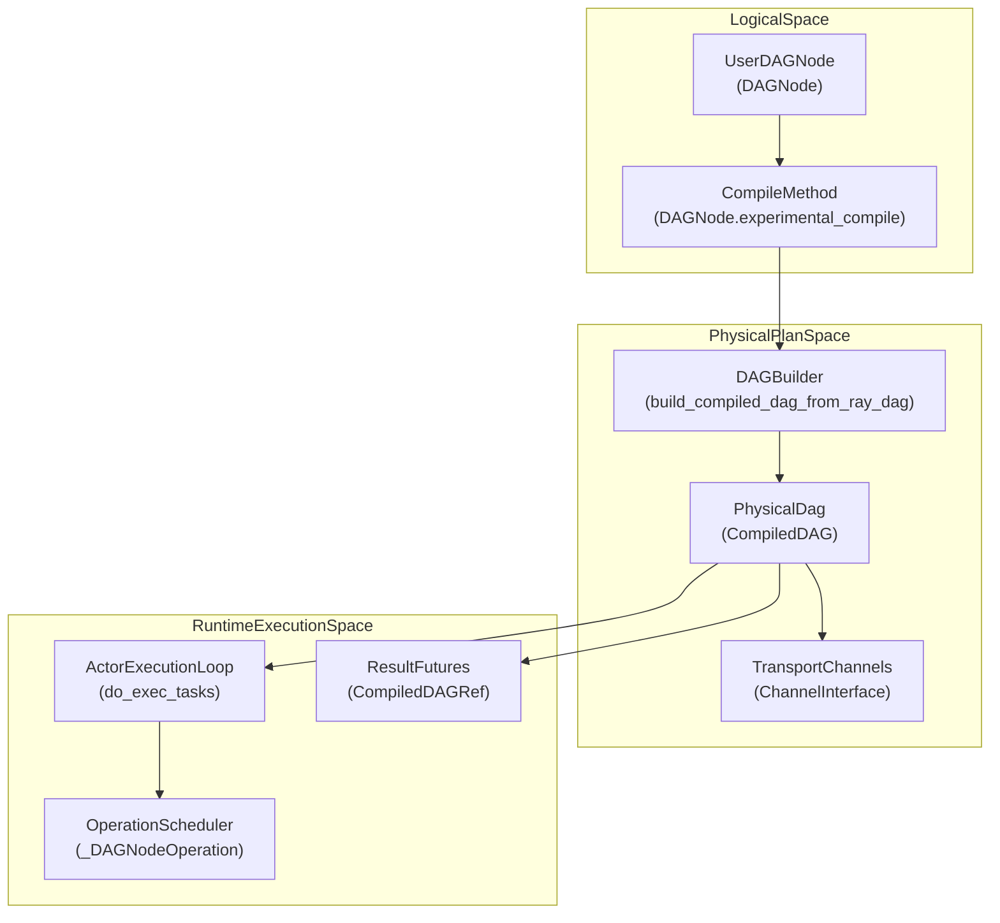
Sources: [python/ray/dag/dag_node.py:1-40](), [python/ray/dag/compiled_dag_node.py:150-200](), [python/ray/experimental/channel/common.py:177-182](), [python/ray/experimental/compiled_dag_ref.py:36-75]()

### Key Components Table

| Component Name | Role / Responsibility | Code Entity (Class / Function) |
|---|---|---|
| **Compiled DAG Coordinator** | Manages compilation, resource allocation, actor startup, and result tracking. | `CompiledDAG` [python/ray/dag/compiled_dag_node.py:805]() |
| **Executable Task Wrapper** | Encapsulates actor methods and their binding in compiled tasks. | `ExecutableTask` [python/ray/dag/compiled_dag_node.py:478]() |
| **Channel Interface** | Abstract transport contract between writer and reader actors. | `ChannelInterface` [python/ray/experimental/channel/common.py:177]() |
| **Operation Graph Node** | Represents an individual execution step (`READ`, `COMPUTE`, `WRITE`). | `_DAGOperationGraphNode` [python/ray/dag/dag_node_operation.py:87]() |
| **Operation Sentinel** | Defines sequencing instructions for the actor execution loop. | `_DAGNodeOperation` [python/ray/dag/dag_node_operation.py:41]() |

Sources: [python/ray/dag/compiled_dag_node.py:478-805](), [python/ray/dag/dag_node_operation.py:41-87](), [python/ray/experimental/channel/common.py:177-182]()

## Channel-Based Communication

Data movement between actors in a Compiled DAG is mediated by channels that implement `ChannelInterface` [python/ray/experimental/channel/common.py:177-182]().

### Channel Hierarchy Diagram

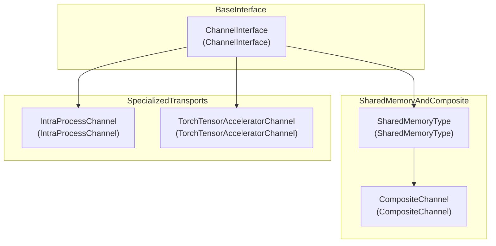
Sources: [python/ray/experimental/channel/common.py:177-182](), [python/ray/experimental/channel/shared_memory_channel.py:94-152](), [python/ray/experimental/channel/torch_tensor_type.py:17-156]()

### Transport Mechanisms
- **`IntraProcessChannel`**: Used when sender and receiver are co-located in the same worker process, bypassing serialization entirely via `_SerializationContext` [python/ray/experimental/channel/serialization_context.py:28-69]().
- **`SharedMemoryType` & `CompositeChannel`**: Allocates memory buffers using Ray's object store (Plasma) and coordinates multi-reader or remote access using semaphores [python/ray/experimental/channel/shared_memory_channel.py:94-152]().
- **`TorchTensorAcceleratorChannel`**: Optimized for PyTorch tensors, routing them through NCCL communicator groups or fallback shared memory channels depending on configuration [python/ray/experimental/channel/torch_tensor_type.py:17-156]().

Sources: [python/ray/experimental/channel/common.py:177-182](), [python/ray/experimental/channel/shared_memory_channel.py:94-152](), [python/ray/experimental/channel/serialization_context.py:28-69](), [python/ray/experimental/channel/torch_tensor_type.py:17-156]()

## ExecutableTask and Operations

Compiled DAG actor methods are invoked through a dedicated worker execution loop rather than standard Ray task scheduling.

### Operation Types and Scheduling
Each task execution is broken down into ordered operations (`_DAGNodeOperationType`) [python/ray/dag/dag_node_operation.py:14-24]():
1. `READ`: Fetch input arguments from input channels.
2. `COMPUTE`: Execute the bound actor method.
3. `WRITE`: Serialize and push return values to output channels.

The `do_exec_tasks` function runs an infinite loop on participant actors, executing operations according to the pre-computed schedule [python/ray/dag/compiled_dag_node.py:186-210]().

Sources: [python/ray/dag/dag_node_operation.py:14-24](), [python/ray/dag/compiled_dag_node.py:186-210]()

## Mutable Objects and Zero-Precision Memory Management

To avoid allocating new objects in the Plasma store on every graph execution, Compiled DAGs leverage mutable objects managed by C++ code.

### MutableObjectManager Architecture
The `MutableObjectManager` class handles channel registration and cross-process synchronization using POSIX semaphores and plasma object headers [src/ray/core_worker/experimental_mutable_object_manager.cc:59-108]().

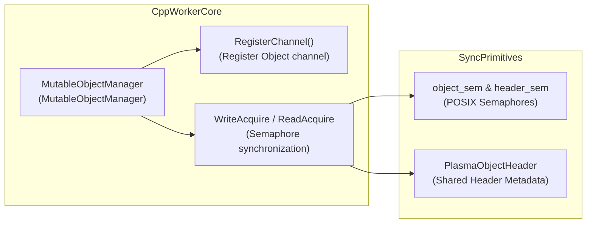
Sources: [src/ray/core_worker/experimental_mutable_object_manager.cc:59-182](), [src/ray/core_worker/experimental_mutable_object_manager.h:1-50]()

- **`RegisterChannel`**: Associates an `ObjectID` with a `plasma::MutableObject` and initializes synchronization semaphores (`object_sem`, `header_sem`) [src/ray/core_worker/experimental_mutable_object_manager.cc:59-83]().
- **Write/Read Synchronization**: Writers acquire the object semaphore before writing and release the header semaphore upon completion. Readers wait on the header semaphore and release the object semaphore when done reading [src/ray/core_worker/experimental_mutable_object_manager.cc:212-403]().

Sources: [src/ray/core_worker/experimental_mutable_object_manager.cc:59-403](), [src/ray/core_worker/experimental_mutable_object_manager.h:1-50]()

## GPU Tensor Transport via NCCL

For GPU actor workloads, Compiled DAGs utilize NCCL via `_NcclGroup` to achieve high-throughput, low-latency tensor transport [python/ray/experimental/channel/nccl_group.py:21-38]().

### Communicator Setup and Overlap
- **`_NcclGroup`**: Implements `Communicator` and wraps NCCL primitives (`ncclComm_t`) for peer-to-peer send/recv and collectives (`allreduce`) [python/ray/experimental/channel/nccl_group.py:21-115]().
- **Stream Overlap**: Supports dedicated send and receive CUDA streams (`_send_stream`, `_recv_stream`) to overlap communication with GPU computation kernels [python/ray/experimental/channel/nccl_group.py:102-113]().

Sources: [python/ray/experimental/channel/communicator.py:1-50](), [python/ray/experimental/channel/nccl_group.py:21-115]()

## Compilation and Execution Flow

The end-to-end execution lifecycle of a Compiled DAG proceeds through three distinct phases:

1. **Logical Definition**: The user builds a task graph using `DAGNode` and `.bind()` syntax [python/ray/dag/dag_node.py:33-65]().
2. **Compilation**: Calling `.experimental_compile()` triggers `build_compiled_dag_from_ray_dag()`, which validates the graph, allocates input/output channels via `do_allocate_channel`, and dispatches execution loop tasks to actors [python/ray/dag/compiled_dag_node.py:150-182]().
3. **Execution**: Invoking `compiled_dag.execute()` writes inputs to root channels, drives the actor execution loops, and returns a `CompiledDAGRef` whose `.get()` retrieves the final outputs [python/ray/experimental/compiled_dag_ref.py:36-118]().

Sources: [python/ray/dag/dag_node.py:33-65](), [python/ray/dag/compiled_dag_node.py:150-182](), [python/ray/experimental/compiled_dag_ref.py:36-118]()

---

# Page: Raylet, GCS, and Object Store

# Raylet, GCS, and Object Store

<details>
<summary>Relevant source files</summary>

The following files were used as context for generating this wiki page:

- [cpp/src/ray/runtime/object/local_mode_object_store.cc](cpp/src/ray/runtime/object/local_mode_object_store.cc)
- [doc/source/ray-core/configure.rst](doc/source/ray-core/configure.rst)
- [doc/source/ray-core/internals/port-service-discovery.rst](doc/source/ray-core/internals/port-service-discovery.rst)
- [doc/source/ray-observability/user-guides/debug-apps/debug-worker-thread-count.md](doc/source/ray-observability/user-guides/debug-apps/debug-worker-thread-count.md)
- [doc/source/ray-observability/user-guides/debug-apps/index.md](doc/source/ray-observability/user-guides/debug-apps/index.md)
- [python/ray/_private/state.py](python/ray/_private/state.py)
- [python/ray/includes/common.pxd](python/ray/includes/common.pxd)
- [python/ray/includes/common.pxi](python/ray/includes/common.pxi)
- [python/ray/includes/gcs_client.pxi](python/ray/includes/gcs_client.pxi)
- [python/ray/includes/global_state_accessor.pxd](python/ray/includes/global_state_accessor.pxd)
- [python/ray/includes/global_state_accessor.pxi](python/ray/includes/global_state_accessor.pxi)
- [python/ray/tests/test_actor_advanced.py](python/ray/tests/test_actor_advanced.py)
- [python/ray/tests/test_actor_lineage_reconstruction.py](python/ray/tests/test_actor_lineage_reconstruction.py)
- [python/ray/tests/test_core_worker_fault_tolerance.py](python/ray/tests/test_core_worker_fault_tolerance.py)
- [python/ray/tests/test_global_state.py](python/ray/tests/test_global_state.py)
- [python/ray/tests/test_object_manager_fault_tolerance.py](python/ray/tests/test_object_manager_fault_tolerance.py)
- [python/ray/tests/test_raylet_fault_tolerance.py](python/ray/tests/test_raylet_fault_tolerance.py)
- [python/ray/tests/test_state_api_2.py](python/ray/tests/test_state_api_2.py)
- [python/ray/tests/test_streaming_generator_4.py](python/ray/tests/test_streaming_generator_4.py)
- [python/ray/tests/test_task_events_3.py](python/ray/tests/test_task_events_3.py)
- [src/mock/ray/gcs/gcs_actor_manager.h](src/mock/ray/gcs/gcs_actor_manager.h)
- [src/mock/ray/gcs_client/accessor.h](src/mock/ray/gcs_client/accessor.h)
- [src/mock/ray/object_manager/object_directory.h](src/mock/ray/object_manager/object_directory.h)
- [src/mock/ray/object_manager/object_manager.h](src/mock/ray/object_manager/object_manager.h)
- [src/mock/ray/raylet/worker.h](src/mock/ray/raylet/worker.h)
- [src/mock/ray/raylet_client/raylet_client.h](src/mock/ray/raylet_client/raylet_client.h)
- [src/ray/common/BUILD.bazel](src/ray/common/BUILD.bazel)
- [src/ray/common/constants.h](src/ray/common/constants.h)
- [src/ray/common/event_stats.cc](src/ray/common/event_stats.cc)
- [src/ray/common/event_stats.h](src/ray/common/event_stats.h)
- [src/ray/common/tests/BUILD.bazel](src/ray/common/tests/BUILD.bazel)
- [src/ray/core_worker/store_provider/memory_store/memory_store.cc](src/ray/core_worker/store_provider/memory_store/memory_store.cc)
- [src/ray/core_worker/store_provider/memory_store/memory_store.h](src/ray/core_worker/store_provider/memory_store/memory_store.h)
- [src/ray/core_worker/store_provider/plasma_store_provider.cc](src/ray/core_worker/store_provider/plasma_store_provider.cc)
- [src/ray/core_worker/store_provider/plasma_store_provider.h](src/ray/core_worker/store_provider/plasma_store_provider.h)
- [src/ray/flatbuffers/node_manager.fbs](src/ray/flatbuffers/node_manager.fbs)
- [src/ray/gcs/BUILD.bazel](src/ray/gcs/BUILD.bazel)
- [src/ray/gcs/gcs_node_manager.cc](src/ray/gcs/gcs_node_manager.cc)
- [src/ray/gcs/gcs_node_manager.h](src/ray/gcs/gcs_node_manager.h)
- [src/ray/gcs/gcs_resource_load_puller.cc](src/ray/gcs/gcs_resource_load_puller.cc)
- [src/ray/gcs/gcs_resource_load_puller.h](src/ray/gcs/gcs_resource_load_puller.h)
- [src/ray/gcs/gcs_server.cc](src/ray/gcs/gcs_server.cc)
- [src/ray/gcs/gcs_server.h](src/ray/gcs/gcs_server.h)
- [src/ray/gcs/gcs_server_io_context_policy.h](src/ray/gcs/gcs_server_io_context_policy.h)
- [src/ray/gcs/gcs_server_main.cc](src/ray/gcs/gcs_server_main.cc)
- [src/ray/gcs/grpc_service_interfaces.h](src/ray/gcs/grpc_service_interfaces.h)
- [src/ray/gcs/grpc_services.cc](src/ray/gcs/grpc_services.cc)
- [src/ray/gcs/grpc_services.h](src/ray/gcs/grpc_services.h)
- [src/ray/gcs/metrics.h](src/ray/gcs/metrics.h)
- [src/ray/gcs/pubsub_handler.cc](src/ray/gcs/pubsub_handler.cc)
- [src/ray/gcs/pubsub_handler.h](src/ray/gcs/pubsub_handler.h)
- [src/ray/gcs/tests/BUILD.bazel](src/ray/gcs/tests/BUILD.bazel)
- [src/ray/gcs/tests/export_api/gcs_actor_manager_export_event_test.cc](src/ray/gcs/tests/export_api/gcs_actor_manager_export_event_test.cc)
- [src/ray/gcs/tests/export_api/gcs_node_manager_export_event_test.cc](src/ray/gcs/tests/export_api/gcs_node_manager_export_event_test.cc)
- [src/ray/gcs/tests/gcs_node_manager_test.cc](src/ray/gcs/tests/gcs_node_manager_test.cc)
- [src/ray/gcs/tests/gcs_resource_load_puller_test.cc](src/ray/gcs/tests/gcs_resource_load_puller_test.cc)
- [src/ray/gcs/tests/gcs_server_rpc_test.cc](src/ray/gcs/tests/gcs_server_rpc_test.cc)
- [src/ray/gcs/tests/gcs_server_test_util.h](src/ray/gcs/tests/gcs_server_test_util.h)
- [src/ray/gcs/tests/pubsub_handler_test.cc](src/ray/gcs/tests/pubsub_handler_test.cc)
- [src/ray/gcs_rpc_client/accessor.cc](src/ray/gcs_rpc_client/accessor.cc)
- [src/ray/gcs_rpc_client/accessor.h](src/ray/gcs_rpc_client/accessor.h)
- [src/ray/gcs_rpc_client/rpc_client.h](src/ray/gcs_rpc_client/rpc_client.h)
- [src/ray/gcs_rpc_client/tests/gcs_client_reconnection_test.cc](src/ray/gcs_rpc_client/tests/gcs_client_reconnection_test.cc)
- [src/ray/gcs_rpc_client/tests/gcs_client_test.cc](src/ray/gcs_rpc_client/tests/gcs_client_test.cc)
- [src/ray/gcs_rpc_client/tests/global_state_accessor_test.cc](src/ray/gcs_rpc_client/tests/global_state_accessor_test.cc)
- [src/ray/object_manager/chunk_object_reader.h](src/ray/object_manager/chunk_object_reader.h)
- [src/ray/object_manager/object_directory.h](src/ray/object_manager/object_directory.h)
- [src/ray/object_manager/object_manager.cc](src/ray/object_manager/object_manager.cc)
- [src/ray/object_manager/object_manager.h](src/ray/object_manager/object_manager.h)
- [src/ray/object_manager/ownership_object_directory.cc](src/ray/object_manager/ownership_object_directory.cc)
- [src/ray/object_manager/ownership_object_directory.h](src/ray/object_manager/ownership_object_directory.h)
- [src/ray/object_manager/plasma/fake_plasma_client.h](src/ray/object_manager/plasma/fake_plasma_client.h)
- [src/ray/object_manager/push_manager.cc](src/ray/object_manager/push_manager.cc)
- [src/ray/object_manager/push_manager.h](src/ray/object_manager/push_manager.h)
- [src/ray/object_manager/tests/BUILD.bazel](src/ray/object_manager/tests/BUILD.bazel)
- [src/ray/object_manager/tests/object_manager_test.cc](src/ray/object_manager/tests/object_manager_test.cc)
- [src/ray/object_manager/tests/ownership_object_directory_test.cc](src/ray/object_manager/tests/ownership_object_directory_test.cc)
- [src/ray/object_manager/tests/push_manager_test.cc](src/ray/object_manager/tests/push_manager_test.cc)
- [src/ray/protobuf/gcs_service.proto](src/ray/protobuf/gcs_service.proto)
- [src/ray/protobuf/node_manager.proto](src/ray/protobuf/node_manager.proto)
- [src/ray/pubsub/gcs_subscriber.cc](src/ray/pubsub/gcs_subscriber.cc)
- [src/ray/pubsub/gcs_subscriber.h](src/ray/pubsub/gcs_subscriber.h)
- [src/ray/raylet/BUILD.bazel](src/ray/raylet/BUILD.bazel)
- [src/ray/raylet/fake_worker.h](src/ray/raylet/fake_worker.h)
- [src/ray/raylet/lease_dependency_manager.cc](src/ray/raylet/lease_dependency_manager.cc)
- [src/ray/raylet/lease_dependency_manager.h](src/ray/raylet/lease_dependency_manager.h)
- [src/ray/raylet/main.cc](src/ray/raylet/main.cc)
- [src/ray/raylet/node_manager.cc](src/ray/raylet/node_manager.cc)
- [src/ray/raylet/node_manager.h](src/ray/raylet/node_manager.h)
- [src/ray/raylet/noop_worker_killing_policy.h](src/ray/raylet/noop_worker_killing_policy.h)
- [src/ray/raylet/tests/BUILD.bazel](src/ray/raylet/tests/BUILD.bazel)
- [src/ray/raylet/tests/lease_dependency_manager_test.cc](src/ray/raylet/tests/lease_dependency_manager_test.cc)
- [src/ray/raylet/tests/node_manager_test.cc](src/ray/raylet/tests/node_manager_test.cc)
- [src/ray/raylet/tests/util.h](src/ray/raylet/tests/util.h)
- [src/ray/raylet/tests/worker_killing_policy_group_by_owner_test.cc](src/ray/raylet/tests/worker_killing_policy_group_by_owner_test.cc)
- [src/ray/raylet/tests/worker_pool_test.cc](src/ray/raylet/tests/worker_pool_test.cc)
- [src/ray/raylet/worker.cc](src/ray/raylet/worker.cc)
- [src/ray/raylet/worker.h](src/ray/raylet/worker.h)
- [src/ray/raylet/worker_interface.h](src/ray/raylet/worker_interface.h)
- [src/ray/raylet/worker_killing_policy_group_by_owner.cc](src/ray/raylet/worker_killing_policy_group_by_owner.cc)
- [src/ray/raylet/worker_killing_policy_group_by_owner.h](src/ray/raylet/worker_killing_policy_group_by_owner.h)
- [src/ray/raylet/worker_killing_policy_interface.h](src/ray/raylet/worker_killing_policy_interface.h)
- [src/ray/raylet/worker_pool.cc](src/ray/raylet/worker_pool.cc)
- [src/ray/raylet/worker_pool.h](src/ray/raylet/worker_pool.h)
- [src/ray/raylet_ipc_client/fake_raylet_ipc_client.h](src/ray/raylet_ipc_client/fake_raylet_ipc_client.h)
- [src/ray/raylet_ipc_client/raylet_ipc_client.cc](src/ray/raylet_ipc_client/raylet_ipc_client.cc)
- [src/ray/raylet_ipc_client/raylet_ipc_client.h](src/ray/raylet_ipc_client/raylet_ipc_client.h)
- [src/ray/raylet_ipc_client/raylet_ipc_client_interface.h](src/ray/raylet_ipc_client/raylet_ipc_client_interface.h)
- [src/ray/raylet_rpc_client/fake_raylet_client.h](src/ray/raylet_rpc_client/fake_raylet_client.h)
- [src/ray/raylet_rpc_client/raylet_client.cc](src/ray/raylet_rpc_client/raylet_client.cc)
- [src/ray/raylet_rpc_client/raylet_client.h](src/ray/raylet_rpc_client/raylet_client.h)
- [src/ray/raylet_rpc_client/raylet_client_interface.h](src/ray/raylet_rpc_client/raylet_client_interface.h)
- [src/ray/rpc/BUILD.bazel](src/ray/rpc/BUILD.bazel)
- [src/ray/rpc/client_call.h](src/ray/rpc/client_call.h)
- [src/ray/rpc/grpc_client.h](src/ray/rpc/grpc_client.h)
- [src/ray/rpc/grpc_server.cc](src/ray/rpc/grpc_server.cc)
- [src/ray/rpc/grpc_server.h](src/ray/rpc/grpc_server.h)
- [src/ray/rpc/node_manager/node_manager_server.h](src/ray/rpc/node_manager/node_manager_server.h)
- [src/ray/rpc/rpc_chaos.cc](src/ray/rpc/rpc_chaos.cc)
- [src/ray/rpc/rpc_chaos.h](src/ray/rpc/rpc_chaos.h)
- [src/ray/rpc/server_call.h](src/ray/rpc/server_call.h)
- [src/ray/rpc/tests/rpc_chaos_test.cc](src/ray/rpc/tests/rpc_chaos_test.cc)
- [src/ray/util/BUILD.bazel](src/ray/util/BUILD.bazel)
- [src/ray/util/tests/BUILD.bazel](src/ray/util/tests/BUILD.bazel)
- [src/ray/util/time.h](src/ray/util/time.h)

</details>


This page documents the primary system components of a Ray node: the **Raylet** (node manager and scheduler), the **Global Control Service (GCS)** (cluster metadata and control plane), and the **Plasma Object Store** (shared memory and object management). It covers process management, resource scheduling, storage backends, object spilling, and the RPC/pub-sub infrastructure.

---

## 1. Raylet: Node Management and Scheduling

The Raylet is the per-node daemon responsible for worker process management, local resource scheduling, and object management. Its core control logic is implemented in `ray::raylet::NodeManager` [src/ray/raylet/node_manager.h:146]().

### 1.1 NodeManager and Worker Lifecycle
The `NodeManager` interacts closely with `WorkerPool` to manage worker processes (`WorkerInterface`) across languages like Python, Java, and C++ [src/ray/raylet/worker_pool.h:55]().

*   **Worker Pool**: `WorkerPool` tracks idle and busy worker instances, coordinating startup concurrency limits via `maximum_startup_concurrency_` [src/ray/raylet/worker_pool.cc:149-154]() and prestarted python workers [src/ray/raylet/worker_pool.cc:162]().
*   **Worker Process Startup**: When a task or actor requires a worker that cannot be satisfied from the idle pool, `WorkerPool::StartWorkerProcess` spawns a new worker process using commands defined in `WorkerCommandMap` [src/ray/raylet/worker_pool.h:55]().
*   **Resource Isolation**: On Linux systems supporting cgroups v2, `NodeManager` can enforce CPU and memory boundaries between system processes and worker processes using `AddProcessToCgroupHook` [src/ray/raylet/node_manager.h:73-137]().

### 1.2 Resource Scheduling
The Raylet performs local scheduling decisions via `ClusterResourceScheduler` and `LocalLeaseManager`.

*   **Lease Requests**: Core workers request execution leases via the `RequestWorkerLease` RPC handler [src/ray/raylet/node_manager.h:146]().
*   **Spillback**: If local resources are insufficient to satisfy a task's resource requirements, the Raylet can spill back the lease request to other nodes in the cluster using `ClusterLeaseManager` [src/ray/raylet/node_manager.h:168]().

### 1.3 System Entity Mapping (Raylet Architecture)

```mermaid
graph TD
    subgraph "Raylet Process (raylet/main.cc)"
        NM["ray::raylet::NodeManager<br/>(node_manager.h)"]
        WP["ray::raylet::WorkerPool<br/>(worker_pool.h)"]
        OM["ray::ObjectManager<br/>(object_manager.h)"]
        LOM["ray::raylet::LocalObjectManager<br/>(local_object_manager.h)"]
        CRS["ClusterResourceScheduler<br/>(cluster_resource_scheduler.h)"]
    end

    NM --> WP
    NM --> CRS
    NM --> OM
    OM --> LOM
    WP --> WI["ray::raylet::WorkerInterface<br/>(worker_interface.h)"]
```
*Sources: [src/ray/raylet/main.cc](), [src/ray/raylet/node_manager.h](), [src/ray/raylet/worker_pool.h](), [src/ray/object_manager/object_manager.cc](), [src/ray/raylet/local_object_manager.h]()*.

---

## 2. Global Control Service (GCS)

The Global Control Service (GCS) serves as the cluster's centralized metadata store and control plane, coordinating actors, placement groups, node registrations, and job lifecycles.

### 2.1 Metadata Managers
The GCS server (`GcsServer`) instantiates several specialized managers to handle domain-specific cluster state [src/ray/gcs/gcs_server.cc:68]():
*   **Actor Manager (`GcsActorManager`)**: Manages actor creation, state transitions, placement, and reconstruction [src/ray/gcs/gcs_server.cc:28]().
*   **Node Manager (`GcsNodeManager`)**: Tracks node liveliness, registration, and failure detection [src/ray/gcs/gcs_server.cc:89]().
*   **Placement Group Manager (`GcsPlacementGroupManager`)**: Coordinates multi-node resource bundle allocation and scheduling [src/ray/gcs/gcs_server.cc:31]().

### 2.2 Storage Backends
GCS metadata persistence is abstracted through `StoreClient` implementations, configured via `StorageType` [src/ray/gcs/gcs_server.cc:53]():
1.  **In-Memory Store (`InMemoryStoreClient`)**: Non-persistent backend primarily utilized for unit testing and transient clusters [src/ray/gcs/gcs_server.cc:35]().
2.  **Redis Store (`RedisStoreClient`)**: Standard high-availability persistent storage backend for production clusters [src/ray/gcs/gcs_server.cc:37]().
3.  **RocksDB Store (`RocksDBStoreClient`)**: Local embedded key-value storage option for single-node or durable configurations [src/ray/gcs/gcs_server.cc:39]().

### 2.3 Pub/Sub Infrastructure
The GCS uses `pubsub::Publisher` to broadcast cluster-wide state changes (such as node heartbeats and actor updates) to subscribed raylets and core workers [src/ray/gcs/gcs_server.cc:44]().

#### GCS Server Control Plane
```mermaid
graph TD
    subgraph "GcsServer (gcs/gcs_server.cc)"
        GS["ray::gcs::GcsServer"]
        GAM["ray::gcs::GcsActorManager"]
        GNM["ray::gcs::GcsNodeManager"]
        GPGM["ray::gcs::GcsPlacementGroupManager"]
        GP["pubsub::Publisher"]
    end

    GS --> GAM
    GS --> GNM
    GS --> GPGM
    GS --> GP
    GNM --> Store["ray::gcs::StoreClient<br/>(InMemory / Redis / RocksDB)"]
    GP --> Subscribers["Raylet / CoreWorker Subscribers"]
```
*Sources: [src/ray/gcs/gcs_server.cc](), [src/ray/gcs/BUILD.bazel]()*.

---

## 3. Object Store (Plasma)

Ray utilizes the Plasma object store for zero-copy shared memory access among local worker processes, complemented by an object manager for inter-node transfers and spilling.

### 3.1 Object Management and Shared Memory
*   **Plasma Store Runner (`PlasmaStoreRunner`)**: Manages the lifecycle of the shared memory store process (`plasma_store_runner`), allocating shared memory segments via `/dev/shm` or temporary directories [src/ray/object_manager/object_manager.cc:37-47]().
*   **Object Manager (`ObjectManager`)**: Coordinates pull and push operations across nodes [src/ray/object_manager/object_manager.cc:66](). It relies on `PullManager` to fetch remote objects and `PushManager` to transmit chunks over TCP [src/ray/object_manager/object_manager.cc:104-131]().

### 3.2 Object Spilling
When the object store hits capacity limits, `LocalObjectManager` initiates object spilling to offload objects to external storage targets (such as cloud object stores or local disk) [src/ray/raylet/local_object_manager.h:45-50]().
*   `SpillObjects`: Asynchronously serializes and writes objects to configured URLs [python/ray/includes/common.pxd:79-80]().
*   `AsyncRestoreSpilledObject`: Reloads spilled objects back into local plasma memory on demand [python/ray/includes/common.pxd:82-86]().

### 3.3 Data Flow: Remote Object Retrieval
```mermaid
sequenceDiagram
    participant CW as CoreWorker
    participant OM as ObjectManager
    participant PM as PullManager
    participant OD as IObjectDirectory
    participant RN as RemoteNode
    participant PS as PlasmaStoreRunner

    CW->>OM: Pull(ObjectID)
    OM->>PM: AddPullRequest(ObjectID)
    PM->>OD: GetLocations(ObjectID)
    OD-->>PM: Object Locations (NodeIDs)
    PM->>RN: SendPullRequest(ObjectID, NodeID)
    RN-->>OM: Object Chunks / Data
    OM->>PS: Create & Seal Object
    PS-->>CW: Shared Memory Mapping
```
*Sources: [src/ray/object_manager/object_manager.cc](), [src/ray/raylet/local_object_manager.cc](), [python/ray/includes/common.pxd]()*.

---

## 4. RPC and Pub/Sub Layer

Communication across Ray components relies heavily on gRPC services and lightweight asynchronous client pools.

*   **Node Manager Server (`NodeManagerServiceHandler`)**: Handles remote procedure calls from workers and other raylets, including task leasing, worker registration, and cancellation requests [src/ray/raylet/node_manager.h:146]().
*   **GCS Client (`InnerGcsClient`)**: Provides bindings for interacting with GCS services and internal key-value stores from Python and C++ [python/ray/includes/gcs_client.pxi:48]().
*   **Client Pools**: `ray::rpc::RayletClientPool` and `ray::rpc::CoreWorkerClientPool` manage persistent gRPC client connections across nodes with automatic timeout handling and failure callbacks [src/ray/gcs/gcs_server.cc:85-98]().

#### Inter-Component RPC Flow
```mermaid
graph TD
    CW["CoreWorker<br/>(core_worker)"] -- "RequestWorkerLease RPC" --> NM["ray::raylet::NodeManager<br/>(node_manager.h)"]
    NM -- "ReportResourceUsage RPC" --> GS["ray::gcs::GcsServer<br/>(gcs_server.cc)"]
    GS -- "Publish GcsEvent" --> NM
    OM["ray::ObjectManager<br/>(object_manager.cc)"] -- "ObjectTransfer RPC" --> RemoteOM["Remote ObjectManager"]
```
*Sources: [src/ray/raylet/node_manager.h](), [src/ray/gcs/gcs_server.cc](), [src/ray/object_manager/object_manager.cc](), [python/ray/includes/gcs_client.pxi]()*.

---

# Page: Autoscaler and Cluster Management

# Autoscaler and Cluster Management

<details>
<summary>Relevant source files</summary>

The following files were used as context for generating this wiki page:

- [doc/source/cluster/kubernetes/user-guides/configuring-autoscaling.md](doc/source/cluster/kubernetes/user-guides/configuring-autoscaling.md)
- [doc/source/cluster/vms/references/ray-cluster-configuration.rst](doc/source/cluster/vms/references/ray-cluster-configuration.rst)
- [doc/source/data/data.md](doc/source/data/data.md)
- [doc/source/ray-contribute/fake-autoscaler.md](doc/source/ray-contribute/fake-autoscaler.md)
- [doc/source/ray-core/api/scheduling.rst](doc/source/ray-core/api/scheduling.rst)
- [doc/source/ray-core/api/utility.rst](doc/source/ray-core/api/utility.rst)
- [doc/source/ray-core/scheduling/accelerators.rst](doc/source/ray-core/scheduling/accelerators.rst)
- [doc/source/ray-observability/user-guides/debug-apps/optimize-performance.rst](doc/source/ray-observability/user-guides/debug-apps/optimize-performance.rst)
- [doc/source/ray-overview/installation.md](doc/source/ray-overview/installation.md)
- [doc/source/rllib/multi-agent-envs.rst](doc/source/rllib/multi-agent-envs.rst)
- [doc/source/serve/tutorials/aws-neuron-core-inference-stable-diffusion.md](doc/source/serve/tutorials/aws-neuron-core-inference-stable-diffusion.md)
- [doc/source/train/getting-started-jax.rst](doc/source/train/getting-started-jax.rst)
- [doc/source/train/overview.rst](doc/source/train/overview.rst)
- [python/ray/_private/accelerators/__init__.py](python/ray/_private/accelerators/__init__.py)
- [python/ray/_private/accelerators/mblt.py](python/ray/_private/accelerators/mblt.py)
- [python/ray/_private/accelerators/tpu.py](python/ray/_private/accelerators/tpu.py)
- [python/ray/_private/logging_utils.py](python/ray/_private/logging_utils.py)
- [python/ray/_private/runtime_env/uri_cache.py](python/ray/_private/runtime_env/uri_cache.py)
- [python/ray/air/tests/test_utils.py](python/ray/air/tests/test_utils.py)
- [python/ray/autoscaler/_private/autoscaler.py](python/ray/autoscaler/_private/autoscaler.py)
- [python/ray/autoscaler/_private/gcp/config.py](python/ray/autoscaler/_private/gcp/config.py)
- [python/ray/autoscaler/_private/gcp/node.py](python/ray/autoscaler/_private/gcp/node.py)
- [python/ray/autoscaler/_private/kuberay/run_autoscaler.py](python/ray/autoscaler/_private/kuberay/run_autoscaler.py)
- [python/ray/autoscaler/_private/load_metrics.py](python/ray/autoscaler/_private/load_metrics.py)
- [python/ray/autoscaler/_private/local/config.py](python/ray/autoscaler/_private/local/config.py)
- [python/ray/autoscaler/_private/monitor.py](python/ray/autoscaler/_private/monitor.py)
- [python/ray/autoscaler/_private/readonly/defaults.yaml](python/ray/autoscaler/_private/readonly/defaults.yaml)
- [python/ray/autoscaler/_private/resource_demand_scheduler.py](python/ray/autoscaler/_private/resource_demand_scheduler.py)
- [python/ray/autoscaler/_private/util.py](python/ray/autoscaler/_private/util.py)
- [python/ray/autoscaler/v2/autoscaler.py](python/ray/autoscaler/v2/autoscaler.py)
- [python/ray/autoscaler/v2/event_logger.py](python/ray/autoscaler/v2/event_logger.py)
- [python/ray/autoscaler/v2/instance_manager/cloud_providers/kuberay/cloud_provider.py](python/ray/autoscaler/v2/instance_manager/cloud_providers/kuberay/cloud_provider.py)
- [python/ray/autoscaler/v2/instance_manager/common.py](python/ray/autoscaler/v2/instance_manager/common.py)
- [python/ray/autoscaler/v2/instance_manager/config.py](python/ray/autoscaler/v2/instance_manager/config.py)
- [python/ray/autoscaler/v2/instance_manager/instance_manager.py](python/ray/autoscaler/v2/instance_manager/instance_manager.py)
- [python/ray/autoscaler/v2/instance_manager/node_provider.py](python/ray/autoscaler/v2/instance_manager/node_provider.py)
- [python/ray/autoscaler/v2/instance_manager/ray_installer.py](python/ray/autoscaler/v2/instance_manager/ray_installer.py)
- [python/ray/autoscaler/v2/instance_manager/reconciler.py](python/ray/autoscaler/v2/instance_manager/reconciler.py)
- [python/ray/autoscaler/v2/instance_manager/subscribers/threaded_ray_installer.py](python/ray/autoscaler/v2/instance_manager/subscribers/threaded_ray_installer.py)
- [python/ray/autoscaler/v2/monitor.py](python/ray/autoscaler/v2/monitor.py)
- [python/ray/autoscaler/v2/scheduler.py](python/ray/autoscaler/v2/scheduler.py)
- [python/ray/autoscaler/v2/schema.py](python/ray/autoscaler/v2/schema.py)
- [python/ray/autoscaler/v2/tests/test_config.py](python/ray/autoscaler/v2/tests/test_config.py)
- [python/ray/autoscaler/v2/tests/test_e2e.py](python/ray/autoscaler/v2/tests/test_e2e.py)
- [python/ray/autoscaler/v2/tests/test_event_logger.py](python/ray/autoscaler/v2/tests/test_event_logger.py)
- [python/ray/autoscaler/v2/tests/test_instance_util.py](python/ray/autoscaler/v2/tests/test_instance_util.py)
- [python/ray/autoscaler/v2/tests/test_node_provider.py](python/ray/autoscaler/v2/tests/test_node_provider.py)
- [python/ray/autoscaler/v2/tests/test_ray_installer.py](python/ray/autoscaler/v2/tests/test_ray_installer.py)
- [python/ray/autoscaler/v2/tests/test_reconciler.py](python/ray/autoscaler/v2/tests/test_reconciler.py)
- [python/ray/autoscaler/v2/tests/test_scheduler.py](python/ray/autoscaler/v2/tests/test_scheduler.py)
- [python/ray/autoscaler/v2/tests/test_schema.py](python/ray/autoscaler/v2/tests/test_schema.py)
- [python/ray/autoscaler/v2/tests/test_sdk.py](python/ray/autoscaler/v2/tests/test_sdk.py)
- [python/ray/autoscaler/v2/tests/test_threaded_ray_installer.py](python/ray/autoscaler/v2/tests/test_threaded_ray_installer.py)
- [python/ray/autoscaler/v2/tests/test_utils.py](python/ray/autoscaler/v2/tests/test_utils.py)
- [python/ray/autoscaler/v2/utils.py](python/ray/autoscaler/v2/utils.py)
- [python/ray/dashboard/modules/reporter/jax_profile_manager.py](python/ray/dashboard/modules/reporter/jax_profile_manager.py)
- [python/ray/dashboard/modules/reporter/tests/test_jax_profiler_manager.py](python/ray/dashboard/modules/reporter/tests/test_jax_profiler_manager.py)
- [python/ray/tests/BUILD.bazel](python/ray/tests/BUILD.bazel)
- [python/ray/tests/accelerators/test_accelerators.py](python/ray/tests/accelerators/test_accelerators.py)
- [python/ray/tests/accelerators/test_mblt.py](python/ray/tests/accelerators/test_mblt.py)
- [python/ray/tests/accelerators/test_tpu.py](python/ray/tests/accelerators/test_tpu.py)
- [python/ray/tests/gcp/test_gcp_node_provider.py](python/ray/tests/gcp/test_gcp_node_provider.py)
- [python/ray/tests/kuberay/test_run_autoscaler_logging.py](python/ray/tests/kuberay/test_run_autoscaler_logging.py)
- [python/ray/tests/test_autoscaler.py](python/ray/tests/test_autoscaler.py)
- [python/ray/tests/test_autoscaler_e2e.py](python/ray/tests/test_autoscaler_e2e.py)
- [python/ray/tests/test_autoscaler_fake_multinode.py](python/ray/tests/test_autoscaler_fake_multinode.py)
- [python/ray/tests/test_autoscaling_policy.py](python/ray/tests/test_autoscaling_policy.py)
- [python/ray/tests/test_cli_patterns/test_ray_status.txt](python/ray/tests/test_cli_patterns/test_ray_status.txt)
- [python/ray/tests/test_cli_patterns/test_ray_status_multinode.txt](python/ray/tests/test_cli_patterns/test_ray_status_multinode.txt)
- [python/ray/tests/test_cli_patterns/test_ray_status_multinode_v1.txt](python/ray/tests/test_cli_patterns/test_ray_status_multinode_v1.txt)
- [python/ray/tests/test_cli_patterns/test_ray_status_v1.txt](python/ray/tests/test_cli_patterns/test_ray_status_v1.txt)
- [python/ray/tests/test_monitor.py](python/ray/tests/test_monitor.py)
- [python/ray/tests/test_placement_group.py](python/ray/tests/test_placement_group.py)
- [python/ray/tests/test_placement_group_2.py](python/ray/tests/test_placement_group_2.py)
- [python/ray/tests/test_placement_group_3.py](python/ray/tests/test_placement_group_3.py)
- [python/ray/tests/test_resource_demand_scheduler.py](python/ray/tests/test_resource_demand_scheduler.py)
- [python/ray/tests/test_scheduling.py](python/ray/tests/test_scheduling.py)
- [python/ray/tests/test_scheduling_2.py](python/ray/tests/test_scheduling_2.py)
- [python/ray/tests/test_tpu.py](python/ray/tests/test_tpu.py)
- [python/ray/tests/unit/test_node_affinity_validation.py](python/ray/tests/unit/test_node_affinity_validation.py)
- [python/ray/train/v2/_internal/callbacks/__init__.py](python/ray/train/v2/_internal/callbacks/__init__.py)
- [python/ray/train/v2/jax/config.py](python/ray/train/v2/jax/config.py)
- [python/ray/train/v2/jax/jax_trainer.py](python/ray/train/v2/jax/jax_trainer.py)
- [python/ray/train/v2/tests/test_jax_trainer.py](python/ray/train/v2/tests/test_jax_trainer.py)
- [python/ray/util/accelerators/__init__.py](python/ray/util/accelerators/__init__.py)
- [python/ray/util/accelerators/accelerators.py](python/ray/util/accelerators/accelerators.py)
- [python/ray/util/scheduling_strategies.py](python/ray/util/scheduling_strategies.py)
- [python/ray/util/tpu.py](python/ray/util/tpu.py)
- [src/ray/common/placement_group.h](src/ray/common/placement_group.h)
- [src/ray/protobuf/autoscaler.proto](src/ray/protobuf/autoscaler.proto)
- [src/ray/protobuf/instance_manager.proto](src/ray/protobuf/instance_manager.proto)
- [src/ray/protobuf/reporter.proto](src/ray/protobuf/reporter.proto)

</details>


Ray's autoscaling system is responsible for dynamically adjusting the cluster size to meet resource demands while minimizing costs. The system has evolved into the **Autoscaler v2** architecture, which provides a more robust, state-machine-driven approach to node lifecycle management, integration with Kubernetes via KubeRay, and support for various cloud providers.

## Purpose and Scope

This document details Ray's autoscaling subsystem, focusing on the Autoscaler v2 architecture, its core components (`InstanceManager`, `Reconciler`, `ResourceDemandScheduler`), Kubernetes integration through KubeRay, cloud provider adapters, and the complete node lifecycle from initial provisioning to termination.

Sources: `[python/ray/autoscaler/v2/autoscaler.py:1-50]()`, `[python/ray/autoscaler/v2/instance_manager/reconciler.py:59-80]()`

## Autoscaler v2 Architecture

The v2 autoscaler is built around a reconciliation loop that synchronizes the desired cluster state (based on resource demands) with the actual state of the cloud provider and the Ray cluster.

### Key Components

| Component | Role | Code Entity |
| :--- | :--- | :--- |
| **InstanceManager** | Tracks the state of all instances (nodes) in the cluster and persists them to storage. | `InstanceManager` [python/ray/autoscaler/v2/instance_manager/instance_manager.py:15]() |
| **Reconciler** | The central logic engine that computes state transitions and triggers actions. | `Reconciler` [python/ray/autoscaler/v2/instance_manager/reconciler.py:56]() |
| **ResourceDemandScheduler** | Calculates the target cluster shape based on pending tasks, actors, and placement groups. | `ResourceDemandScheduler` [python/ray/autoscaler/v2/scheduler.py:216]() |
| **NodeProvider** | Interface for interacting with cloud/infrastructure backends (AWS, GCP, KubeRay). | `ICloudInstanceProvider` [python/ray/autoscaler/v2/instance_manager/node_provider.py:20]() |

### System Data Flow and Entity Mapping

The following diagram illustrates how the v2 autoscaler components interact during a single reconciliation tick, bridging natural language concepts to concrete code entities.

**Autoscaler v2 Reconciliation Loop**
```mermaid
graph TD
    subgraph "Control Plane (Autoscaler Process)"
        A["Autoscaler.run()"] --> B["Reconciler.reconcile()"]
        B --> C["_sync_from()"]
        B --> D["_step_next()"]
        
        subgraph "Logic Engine"
            C --> C1["Update InstanceManager state from Cloud/Ray"]
            D --> D1["ResourceDemandScheduler.schedule()"]
            D1 --> D2["Compute to_launch / to_terminate"]
        end
        
        subgraph "State Management"
            E["InstanceManager"] -- "upsert_instance" --> F[("InstanceStorage")]
        end
    end

    subgraph "External Providers"
        G["Cloud Provider (AWS/GCP/K8s)"]
        H["Ray Cluster (GCS/Raylets)"]
    end

    C1 -- "query" --> G
    C1 -- "query" --> H
    D2 -- "LaunchNode/TerminateNode" --> G
```
Sources: `[python/ray/autoscaler/v2/instance_manager/reconciler.py:64-144]()`, `[python/ray/autoscaler/v2/scheduler.py:91-106]()`

## Resource Scheduling and Demand Calculation

The `ResourceDemandScheduler` is responsible for mapping resource requests (e.g., CPU, GPU, TPU bundles) to specific node types defined in the `AutoscalingConfig`.

### Scheduling Logic
1.  **Request Grouping**: Resource requests are grouped by count to optimize scheduling calculations `[python/ray/autoscaler/v2/utils.py:22]()`.
2.  **Bin Packing**: The scheduler attempts to fit pending `ResourceRequest` bundles into existing `SCHEDULABLE` nodes `[python/ray/autoscaler/v2/scheduler.py:188]()`.
3.  **Upscaling**: If existing nodes cannot satisfy demand, the scheduler selects the cheapest/best-fit `NodeType` to launch `[python/ray/autoscaler/v2/scheduler.py:216]()` `[python/ray/autoscaler/v2/scheduler.py:300]()`.
4.  **Constraints**: It respects `ClusterResourceConstraint` (minimum cluster size) and `GangResourceRequest` (atomic allocation of multiple bundles) `[python/ray/autoscaler/v2/scheduler.py:59-65]()`.

Sources: `[python/ray/autoscaler/v2/scheduler.py:48-89]()`, `[python/ray/autoscaler/v2/scheduler.py:216-300]()`

## Node Lifecycle Management

The `Reconciler` manages nodes through a series of states defined in `instance_manager_pb2`.

### State Transitions
The `Reconciler._sync_from` method performs "passive" transitions based on external observations, while `_step_next` performs "active" transitions.

| Initial Status | Condition | Target Status | Action |
| :--- | :--- | :--- | :--- |
| `QUEUED` | Instance assigned by scheduler | `REQUESTED` | Call `CloudProvider.launch_node` |
| `REQUESTED` | Cloud instance ID becomes available | `ALLOCATED` | Node is provisioning in cloud |
| `ALLOCATED` | Ray process starts and registers | `RAY_RUNNING` | Node is ready for tasks |
| `RAY_RUNNING` | Idle timeout or scale-down | `TERMINATING` | Call `CloudProvider.terminate_node` |

Sources: `[python/ray/autoscaler/v2/instance_manager/reconciler.py:147-167]()`, `[python/ray/autoscaler/v2/instance_manager/reconciler.py:291-320]()`

## Cloud Provider Integration

Ray uses adapters to support various environments. Each provider implements the `NodeProvider` interface.

### KubeRay (Kubernetes)
KubeRay integrates Ray with Kubernetes using Custom Resource Definitions (CRDs) like `RayCluster`.
*   **Config Production**: The `AutoscalingConfigProducer` fetches the `RayCluster` CR and derives the autoscaling configuration `[python/ray/autoscaler/_private/kuberay/autoscaling_config.py:42]()`.
*   **Node Management**: The `KubeRayNodeProvider` communicates with the Kubernetes API server to adjust the `replicas` field of `workerGroupSpecs` or to delete specific pods via `scaleStrategy` `[python/ray/autoscaler/_private/kuberay/node_provider.py:69-80]()`.
*   **TPU Support**: KubeRay supports Google Cloud TPUs, including multi-host TPU slices. The `AutoscalingConfigProducer` extracts TPU-specific labels (`cloud.google.com/gke-tpu-topology`, `cloud.google.com/gke-tpu-accelerator`) from the `RayCluster` CR to correctly configure TPU resources for autoscaling `[python/ray/autoscaler/_private/kuberay/autoscaling_config.py:35-36]()`. It also infers the number of TPUs from the `rayStartParams` or container resource limits `[python/ray/autoscaler/_private/kuberay/autoscaling_config.py:20-21]()`.

### Ray on Spark
Ray can run inside a Spark cluster, utilizing Spark executors as Ray nodes.
*   **Cluster Initialization**: `RayClusterOnSpark` manages the lifecycle of Ray processes on Spark `[python/ray/util/spark/cluster_init.py:72]()`.
*   **Resource Mapping**: It maps Spark executor cores and memory to Ray resources `[python/ray/util/spark/cluster_init.py:24-33]()`.

### Cloud Adapters (AWS, GCP, Azure)
These providers use SDKs (boto3, google-cloud-sdk) to manage VM instances.
*   **Launch Config**: Configs include `node_config` (e.g., InstanceType, ImageId) and `auth` (ssh_user) `[python/ray/autoscaler/v2/instance_manager/config.py:196-210]()`.
*   **Termination**: Nodes are terminated when the `ResourceDemandScheduler` identifies them as idle and redundant `[python/ray/autoscaler/v2/scheduler.py:78]()`.

Sources: `[python/ray/autoscaler/_private/kuberay/autoscaling_config.py:90-142]()`, `[python/ray/autoscaler/_private/kuberay/node_provider.py:152-165]()`, `[python/ray/util/spark/cluster_init.py:120-170]()`, `[python/ray/autoscaler/_private/kuberay/autoscaling_config.py:35-36]()`, `[python/ray/autoscaler/_private/kuberay/autoscaling_config.py:20-21]()`

## Implementation Detail: The Instance Manager

The `InstanceManager` is the source of truth for node states within the autoscaler process. It uses an underlying `InstanceStorage` (often `InMemoryStorage` or backed by a persistent store) to track `AutoscalerInstance` objects.

**Instance Entity Mapping**
```mermaid
classDiagram
    class InstanceManager {
        +upsert_instance(instance)
        +get_instances()
        +get_instance_by_id(id)
    }
    class AutoscalerInstance {
        +instance_id: str
        +instance_type: str
        +status: InstanceStatus
        +cloud_instance_id: str
        +node_id: bytes
    }
    class Reconciler {
        +reconcile(instance_manager)
    }
    
    InstanceManager "1" *-- "many" AutoscalerInstance : tracks
    Reconciler ..> InstanceManager : updates state
```
Sources: `[python/ray/autoscaler/v2/instance_manager/instance_manager.py:15]()`, `[python/ray/autoscaler/v2/instance_manager/reconciler.py:56]()`

## Failure Handling and Timeouts

The autoscaler includes robust error handling for common cloud issues:
*   **Launch Failures**: If `CloudInstanceProviderError` occurs, the reconciler marks the request as failed and allows the scheduler to retry `[python/ray/autoscaler/v2/instance_manager/reconciler.py:151]()`.
*   **Timeouts**: `InstanceReconcileConfig` defines timeouts for each state (e.g., `allocate_status_timeout_s`). If an instance hangs in `ALLOCATED` but never reaches `RAY_RUNNING`, it is terminated `[python/ray/autoscaler/v2/instance_manager/config.py:83-113]()`.
*   **Resource Availability**: The `CloudResourceMonitor` tracks if specific node types are currently unavailable in the cloud (e.g., Spot instance preemption or stock-out) to avoid repeated failed launch attempts `[python/ray/autoscaler/v2/instance_manager/reconciler.py:24-26]()`.

Sources: `[python/ray/autoscaler/v2/instance_manager/reconciler.py:217-250]()`, `[python/ray/autoscaler/v2/instance_manager/config.py:83-113]()`

---

# Page: Runtime Environment and Dependency Management

# Runtime Environment and Dependency Management

<details>
<summary>Relevant source files</summary>

The following files were used as context for generating this wiki page:

- [ci/docker/windows.build.Dockerfile](ci/docker/windows.build.Dockerfile)
- [ci/ray_ci/automation/pypi_lib.py](ci/ray_ci/automation/pypi_lib.py)
- [ci/ray_ci/automation/test_pypi_lib.py](ci/ray_ci/automation/test_pypi_lib.py)
- [ci/ray_ci/container.py](ci/ray_ci/container.py)
- [ci/ray_ci/linux_container.py](ci/ray_ci/linux_container.py)
- [ci/ray_ci/linux_tester_container.py](ci/ray_ci/linux_tester_container.py)
- [ci/ray_ci/test_container.py](ci/ray_ci/test_container.py)
- [ci/ray_ci/test_linux_container.py](ci/ray_ci/test_linux_container.py)
- [ci/ray_ci/test_linux_tester_container.py](ci/ray_ci/test_linux_tester_container.py)
- [ci/ray_ci/test_privileged.py](ci/ray_ci/test_privileged.py)
- [ci/ray_ci/test_tester.py](ci/ray_ci/test_tester.py)
- [ci/ray_ci/test_windows_container.py](ci/ray_ci/test_windows_container.py)
- [ci/ray_ci/test_windows_tester_container.py](ci/ray_ci/test_windows_tester_container.py)
- [ci/ray_ci/tester.py](ci/ray_ci/tester.py)
- [ci/ray_ci/tester_container.py](ci/ray_ci/tester_container.py)
- [ci/ray_ci/tests.env.Dockerfile](ci/ray_ci/tests.env.Dockerfile)
- [ci/ray_ci/windows/tests.env.Dockerfile](ci/ray_ci/windows/tests.env.Dockerfile)
- [ci/ray_ci/windows_container.py](ci/ray_ci/windows_container.py)
- [doc/source/cluster/kubernetes/examples/ray-sandboxing.md](doc/source/cluster/kubernetes/examples/ray-sandboxing.md)
- [doc/source/cluster/running-applications/job-submission/ray-client.rst](doc/source/cluster/running-applications/job-submission/ray-client.rst)
- [doc/source/ray-core/handling-dependencies.rst](doc/source/ray-core/handling-dependencies.rst)
- [doc/source/ray-core/sandboxes.md](doc/source/ray-core/sandboxes.md)
- [python/ray/__init__.py](python/ray/__init__.py)
- [python/ray/_common/runtime_env_package.py](python/ray/_common/runtime_env_package.py)
- [python/ray/_common/runtime_env_uri.py](python/ray/_common/runtime_env_uri.py)
- [python/ray/_common/tests/test_runtime_env_uri.py](python/ray/_common/tests/test_runtime_env_uri.py)
- [python/ray/_private/client_mode_hook.py](python/ray/_private/client_mode_hook.py)
- [python/ray/_private/runtime_env/agent/runtime_env_agent.py](python/ray/_private/runtime_env/agent/runtime_env_agent.py)
- [python/ray/_private/runtime_env/conda.py](python/ray/_private/runtime_env/conda.py)
- [python/ray/_private/runtime_env/conda_utils.py](python/ray/_private/runtime_env/conda_utils.py)
- [python/ray/_private/runtime_env/default_impl.py](python/ray/_private/runtime_env/default_impl.py)
- [python/ray/_private/runtime_env/dependency_utils.py](python/ray/_private/runtime_env/dependency_utils.py)
- [python/ray/_private/runtime_env/packaging.py](python/ray/_private/runtime_env/packaging.py)
- [python/ray/_private/runtime_env/pip.py](python/ray/_private/runtime_env/pip.py)
- [python/ray/_private/runtime_env/protocol.py](python/ray/_private/runtime_env/protocol.py)
- [python/ray/_private/runtime_env/py_modules.py](python/ray/_private/runtime_env/py_modules.py)
- [python/ray/_private/runtime_env/uv.py](python/ray/_private/runtime_env/uv.py)
- [python/ray/_private/runtime_env/uv_runtime_env_hook.py](python/ray/_private/runtime_env/uv_runtime_env_hook.py)
- [python/ray/_private/runtime_env/validation.py](python/ray/_private/runtime_env/validation.py)
- [python/ray/_private/runtime_env/virtualenv_utils.py](python/ray/_private/runtime_env/virtualenv_utils.py)
- [python/ray/_private/runtime_env/working_dir.py](python/ray/_private/runtime_env/working_dir.py)
- [python/ray/client_builder.py](python/ray/client_builder.py)
- [python/ray/dashboard/modules/job/common.py](python/ray/dashboard/modules/job/common.py)
- [python/ray/dashboard/modules/job/tests/test_common.py](python/ray/dashboard/modules/job/tests/test_common.py)
- [python/ray/dashboard/modules/job/tests/test_http_job_server.py](python/ray/dashboard/modules/job/tests/test_http_job_server.py)
- [python/ray/dashboard/modules/job/tests/test_sdk.py](python/ray/dashboard/modules/job/tests/test_sdk.py)
- [python/ray/experimental/sandbox/__init__.py](python/ray/experimental/sandbox/__init__.py)
- [python/ray/experimental/sandbox/_internal/image_utils.py](python/ray/experimental/sandbox/_internal/image_utils.py)
- [python/ray/experimental/sandbox/backend/base.py](python/ray/experimental/sandbox/backend/base.py)
- [python/ray/experimental/sandbox/backend/gvisor.py](python/ray/experimental/sandbox/backend/gvisor.py)
- [python/ray/experimental/sandbox/config.py](python/ray/experimental/sandbox/config.py)
- [python/ray/experimental/sandbox/image_manager.py](python/ray/experimental/sandbox/image_manager.py)
- [python/ray/experimental/sandbox/runtime.py](python/ray/experimental/sandbox/runtime.py)
- [python/ray/experimental/sandbox/sandbox.py](python/ray/experimental/sandbox/sandbox.py)
- [python/ray/experimental/sandbox/tests/conftest.py](python/ray/experimental/sandbox/tests/conftest.py)
- [python/ray/experimental/sandbox/tests/test_gvisor_backend.py](python/ray/experimental/sandbox/tests/test_gvisor_backend.py)
- [python/ray/experimental/sandbox/tests/test_image_manager.py](python/ray/experimental/sandbox/tests/test_image_manager.py)
- [python/ray/experimental/sandbox/tests/test_image_utils.py](python/ray/experimental/sandbox/tests/test_image_utils.py)
- [python/ray/experimental/sandbox/tests/test_sandbox.py](python/ray/experimental/sandbox/tests/test_sandbox.py)
- [python/ray/experimental/sandbox/tests/test_sandbox_config.py](python/ray/experimental/sandbox/tests/test_sandbox_config.py)
- [python/ray/job_config.py](python/ray/job_config.py)
- [python/ray/runtime_env/runtime_env.py](python/ray/runtime_env/runtime_env.py)
- [python/ray/tests/test_client.py](python/ray/tests/test_client.py)
- [python/ray/tests/test_client_builder.py](python/ray/tests/test_client_builder.py)
- [python/ray/tests/test_client_init.py](python/ray/tests/test_client_init.py)
- [python/ray/tests/test_client_metadata.py](python/ray/tests/test_client_metadata.py)
- [python/ray/tests/test_client_proxy.py](python/ray/tests/test_client_proxy.py)
- [python/ray/tests/test_client_working_dir.py](python/ray/tests/test_client_working_dir.py)
- [python/ray/tests/test_draining.py](python/ray/tests/test_draining.py)
- [python/ray/tests/test_exit_observability.py](python/ray/tests/test_exit_observability.py)
- [python/ray/tests/test_metrics.py](python/ray/tests/test_metrics.py)
- [python/ray/tests/test_multi_tenancy.py](python/ray/tests/test_multi_tenancy.py)
- [python/ray/tests/test_node_death.py](python/ray/tests/test_node_death.py)
- [python/ray/tests/test_node_manager.py](python/ray/tests/test_node_manager.py)
- [python/ray/tests/test_runtime_env.py](python/ray/tests/test_runtime_env.py)
- [python/ray/tests/test_runtime_env_agent.py](python/ray/tests/test_runtime_env_agent.py)
- [python/ray/tests/test_runtime_env_conda_and_pip.py](python/ray/tests/test_runtime_env_conda_and_pip.py)
- [python/ray/tests/test_runtime_env_conda_and_pip_4.py](python/ray/tests/test_runtime_env_conda_and_pip_4.py)
- [python/ray/tests/test_runtime_env_conda_and_pip_5.py](python/ray/tests/test_runtime_env_conda_and_pip_5.py)
- [python/ray/tests/test_runtime_env_get_wheel_names.py](python/ray/tests/test_runtime_env_get_wheel_names.py)
- [python/ray/tests/test_runtime_env_packaging.py](python/ray/tests/test_runtime_env_packaging.py)
- [python/ray/tests/test_runtime_env_standalone.py](python/ray/tests/test_runtime_env_standalone.py)
- [python/ray/tests/test_runtime_env_uv.py](python/ray/tests/test_runtime_env_uv.py)
- [python/ray/tests/test_runtime_env_uv_run.py](python/ray/tests/test_runtime_env_uv_run.py)
- [python/ray/tests/test_runtime_env_working_dir.py](python/ray/tests/test_runtime_env_working_dir.py)
- [python/ray/tests/test_serialization.py](python/ray/tests/test_serialization.py)
- [python/ray/tests/unit/test_job_config_client_validation.py](python/ray/tests/unit/test_job_config_client_validation.py)
- [python/ray/tests/unit/test_runtime_env_uv.py](python/ray/tests/unit/test_runtime_env_uv.py)
- [python/ray/tests/unit/test_runtime_env_validation.py](python/ray/tests/unit/test_runtime_env_validation.py)
- [python/ray/util/check_serialize.py](python/ray/util/check_serialize.py)
- [python/ray/util/client/__init__.py](python/ray/util/client/__init__.py)
- [python/ray/util/client/ray_client_helpers.py](python/ray/util/client/ray_client_helpers.py)
- [python/ray/util/client/runtime_context.py](python/ray/util/client/runtime_context.py)
- [python/ray/util/client/server/proxier.py](python/ray/util/client/server/proxier.py)
- [python/ray/util/client/server/server.py](python/ray/util/client/server/server.py)
- [python/ray/util/client_connect.py](python/ray/util/client_connect.py)
- [python/ray/util/serialization_addons.py](python/ray/util/serialization_addons.py)
- [src/ray/protobuf/ray_client.proto](src/ray/protobuf/ray_client.proto)
- [src/ray/protobuf/runtime_env_agent.proto](src/ray/protobuf/runtime_env_agent.proto)
- [src/ray/protobuf/runtime_env_common.proto](src/ray/protobuf/runtime_env_common.proto)
- [src/ray/raylet/runtime_env_agent_client.cc](src/ray/raylet/runtime_env_agent_client.cc)
- [src/ray/raylet/runtime_env_agent_client.h](src/ray/raylet/runtime_env_agent_client.h)

</details>


The Ray Runtime Environment system allows users to dynamically specify dependencies (packages, files, environment variables, and container images) for a job, task, or actor [doc/source/ray-core/handling-dependencies.rst:58-68](). Unlike static cluster-wide environments managed by the Ray Cluster Launcher, runtime environments are installed on-the-fly, cached, and isolated to specific Ray processes [doc/source/ray-core/handling-dependencies.rst:64-67]().

## System Architecture

The runtime environment system is orchestrated by the `RuntimeEnvAgent`, a sidecar process running on every node [python/ray/_private/runtime_env/agent/runtime_env_agent.py:165-180]().

### Component Interaction

1. **Submission**: A user submits a `RuntimeEnv` dict via `ray.init()`, `@ray.remote()`, or the Jobs API [python/ray/runtime_env/runtime_env.py:157-183]().
2. **Request**: The `Raylet` on a node receives a task requiring a specific environment. If the environment is not cached, it sends a `GetOrCreateRuntimeEnv` RPC to the local `RuntimeEnvAgent` [src/ray/raylet/runtime_env_agent_client.cc:48-62]().
3. **Creation**: The `RuntimeEnvAgent` invokes specific plugins (`PipPlugin`, `CondaPlugin`, `WorkingDirPlugin`, `UvPlugin`, `ContainerPlugin`) to install the environment [python/ray/_private/runtime_env/agent/runtime_env_agent.py:19-35]().
4. **Execution**: Once setup is complete, the agent returns a `RuntimeEnvContext` containing environment variables and command prefixes [python/ray/_private/runtime_env/context.py:18-33](). The worker process is then started using these parameters [python/ray/_private/runtime_env/context.py:42-108]().

### Code Entity Map: Environment Setup
This diagram maps high-level setup steps to the internal classes and RPC calls.

```mermaid
graph TD
    subgraph "Client Space"
        A["ray.init(runtime_env=...)"] --> B["RuntimeEnv Class"]
    end

    subgraph "Raylet Node Manager"
        C["Raylet"] -- "GetOrCreateRuntimeEnv" --> D["RuntimeEnvAgentClient"]
    end

    subgraph "RuntimeEnvAgent Process"
        E["RuntimeEnvAgent"] -- "Instantiates" --> F["RuntimeEnvPluginManager"]
        F -- "Calls" --> G["PipPlugin"]
        F -- "Calls" --> H["WorkingDirPlugin"]
        F -- "Calls" --> I["ContainerPlugin"]
        F -- "Calls" --> L["UvPlugin"]
        G -- "Returns" --> J["RuntimeEnvContext"]
    end

    B -- "Serialized JSON" --> C
    D -- "HTTP POST" --> E
    J -- "Context Response" --> C
    C -- "exec_worker()" --> K["Worker Process"]

    style E stroke-width:4px
    style J stroke-dasharray: 5 5
```
Sources: [python/ray/runtime_env/runtime_env.py:157-183](), [python/ray/_private/runtime_env/agent/runtime_env_agent.py:19-35](), [src/ray/raylet/runtime_env_agent_client.cc:48-62](), [python/ray/_private/runtime_env/context.py:18-33]()

## Packaging and URI Protocols

Ray uses URIs to identify and track dependencies. The `packaging.py` module handles the hashing, zipping, and uploading of local resources to cluster storage [python/ray/_private/runtime_env/packaging.py:1-43]().

### Supported Protocols
Ray supports several protocols for fetching resources, managed by `ProtocolsProvider` [python/ray/_private/runtime_env/protocol.py:11-43]():
* `gcs://`: Packages managed by Ray's Global Control Service [python/ray/_private/runtime_env/protocol.py:21-22]().
* `conda://`, `pip://`, `uv://`: Local environment definitions [python/ray/_private/runtime_env/protocol.py:23-28]().
* `s3://`, `gs://`, `azure://`, `abfss://`: Remote cloud object storage [python/ray/_private/runtime_env/protocol.py:33-40]().
* `http://`, `https://`: Publicly accessible archive files [python/ray/_private/runtime_env/protocol.py:29-32]().
* `file://`: Local filesystem paths [python/ray/_private/runtime_env/protocol.py:41-42]().

### Hashing and Determinism
To enable caching, Ray generates a deterministic hash for directories by traversing files and hashing their relative paths and contents [python/ray/_private/runtime_env/packaging.py:181-208](). This hash forms part of the URI (e.g., `gcs://_ray_pkg_<hash>.zip`) [python/ray/_private/runtime_env/packaging.py:51-62](). For `uv` or `pip` environments, the hash is derived from the serialized package list or requirements [python/ray/_private/runtime_env/uv.py:23-45]().

Sources: [python/ray/_private/runtime_env/packaging.py:181-230](), [python/ray/_private/runtime_env/protocol.py:11-43](), [python/ray/_private/runtime_env/uv.py:23-45]()

## Plugin System

The `RuntimeEnvAgent` uses a plugin architecture to handle different dependency types. Every plugin implements the `RuntimeEnvPlugin` interface [python/ray/_private/runtime_env/plugin.py:24-28]().

| Plugin | Key | Description |
| :--- | :--- | :--- |
| `WorkingDirPlugin` | `working_dir` | Downloads and unpacks a zip/directory into the worker's execution path [python/ray/_private/runtime_env/working_dir.py]() |
| `PipPlugin` | `pip` | Creates a virtualenv and installs packages via `pip install` [python/ray/_private/runtime_env/pip.py]() |
| `UvPlugin` | `uv` | Uses `uv` for high-performance package installation and environment management [python/ray/_private/runtime_env/uv.py]() |
| `CondaPlugin` | `conda` | Creates a Conda environment from a YAML or existing name [python/ray/_private/runtime_env/conda.py]() |
| `ContainerPlugin` | `container` | Runs the worker inside a specified container image [python/ray/_private/runtime_env/image_uri.py:184-187]() |
| `EnvVarsPlugin` | `env_vars` | Sets environment variables in the worker process [python/ray/_private/runtime_env/context.py:24]() |
| `PyExecutablePlugin` | `py_executable` | Overrides the Python command, allowing usage of `uv run` or custom wrappers [python/ray/_private/runtime_env/py_executable.py]() |

### Container Isolation
The `ContainerPlugin` and image URI plugins allow Ray workers to run inside isolated container environments. They pull the target image, resolve the internal worker entrypoint, and modify the execution command to prefix execution with container runtime tools [python/ray/_private/runtime_env/image_uri.py:76-137]().

Sources: [python/ray/_private/runtime_env/agent/runtime_env_agent.py:19-35](), [python/ray/_private/runtime_env/image_uri.py:13-137](), [python/ray/_private/runtime_env/uv.py:30-45]()

## Lifecycle and Reference Counting

To prevent disk bloat, the `RuntimeEnvAgent` maintains reference tracking for active URIs and environments across the node [python/ray/_private/runtime_env/agent/runtime_env_agent.py:63-153]().

### Garbage Collection Flow
1. **Increase Reference**: When a Raylet requests an environment, the agent increments the reference count for that environment and its associated URIs [python/ray/_private/runtime_env/agent/runtime_env_agent.py:136-143]().
2. **Decrease Reference**: When the task or actor completes, the Raylet notifies the agent to decrement the reference count [python/ray/_private/runtime_env/agent/runtime_env_agent.py:145-153]().
3. **Deletion**: When a URI's reference count drops to zero, cleanup callbacks trigger URI deletion and cache purging [python/ray/_private/runtime_env/agent/runtime_env_agent.py:98-112]().

### Code Entity Map: GC and Lifecycle
This diagram shows how references are managed between the Raylet and the Agent.

```mermaid
sequenceDiagram
    participant R as Raylet
    participant A as RuntimeEnvAgent
    participant T as ReferenceTable
    participant P as Plugin (e.g. PipPlugin)

    R->>A: GetOrCreateRuntimeEnv(env_proto)
    A->>T: increase_reference(env)
    A->>P: create(uri)
    P-->>A: creation_time_ms
    A-->>R: RuntimeEnvContext

    Note over R,A: Task/Actor Execution

    R->>A: DeleteRuntimeEnvIfPossible(env_proto)
    A->>T: decrease_reference(env)
    T->>T: _decrease_reference_for_uris(uris)
    alt Ref Count == 0
        T->>A: unused_uris_callback(uris)
        A->>P: delete_uri(uri)
    end
```
Sources: [python/ray/_private/runtime_env/agent/runtime_env_agent.py:93-153](), [src/ray/raylet/runtime_env_agent_client.cc:48-62]()

## Working Directory Management

The `working_dir` option handles distributing local code files and directories to all cluster nodes:
1. **Hashing**: The client computes a deterministic hash of the directory using `get_uri_for_directory()` [python/ray/_private/runtime_env/packaging.py:211-230]().
2. **Uploading**: If the package does not exist in GCS storage, the client archives the directory and uploads it via `upload_package_to_gcs()` [python/ray/_private/runtime_env/packaging.py:438-449]().
3. **Unpacking**: On the worker node, `WorkingDirPlugin` downloads the archive, extracts it into a session-scoped directory, and appends the path to `PYTHONPATH` in `RuntimeEnvContext` [python/ray/_private/runtime_env/working_dir.py]().

Sources: [python/ray/_private/runtime_env/packaging.py:211-230](), [python/ray/_private/runtime_env/working_dir.py]()

## Experimental Sandboxes (gVisor)

Ray provides experimental lightweight sandboxes (`ray.experimental.sandbox`) that use **gVisor** (`runsc`) to execute untrusted code (such as LLM-generated agent tool calls or RL rollout scripts) securely inside kernel-isolated execution environments [doc/source/ray-core/sandboxes.md:10-31]().

### Sandbox Architecture and Execution
* **User-Space Kernel**: gVisor intercepts system calls in user space, acting as an isolation layer between untrusted guest processes and the host Linux kernel [doc/source/ray-core/sandboxes.md:23-25]().
* **Ray Actor Integration**: Each sandbox runs as a managed Ray actor instantiated via `sandbox.create()` or `Sandbox.options(...).remote()` [doc/source/ray-core/sandboxes.md:46-153]().
* **File Management**: Sandboxes support fine-grained file operations such as `write_file`, `read_file`, `upload_file`, and `download_file` against a configurable writable scratch space (`workdir`) [doc/source/ray-core/sandboxes.md:78-121]().

Sources: [doc/source/ray-core/sandboxes.md:10-153](), [python/ray/experimental/sandbox/backend/gvisor.py]()

---

# Page: Observability: Dashboard, Metrics, and State API

# Observability: Dashboard, Metrics, and State API

<details>
<summary>Relevant source files</summary>

The following files were used as context for generating this wiki page:

- [.github/CODEOWNERS](.github/CODEOWNERS)
- [doc/source/cluster/metrics.md](doc/source/cluster/metrics.md)
- [doc/source/data/images/dataset_mixing/per_block_mix.png](doc/source/data/images/dataset_mixing/per_block_mix.png)
- [doc/source/data/images/dataset_mixing/random_mix.png](doc/source/data/images/dataset_mixing/random_mix.png)
- [doc/source/data/mixing-data.rst](doc/source/data/mixing-data.rst)
- [doc/source/data/scaling-collation-functions.rst](doc/source/data/scaling-collation-functions.rst)
- [doc/source/ray-observability/reference/system-metrics.rst](doc/source/ray-observability/reference/system-metrics.rst)
- [doc/source/serve/llm/images/serve_llm_dashboard.png](doc/source/serve/llm/images/serve_llm_dashboard.png)
- [doc/source/train/user-guides.rst](doc/source/train/user-guides.rst)
- [doc/source/train/user-guides/local_mode.rst](doc/source/train/user-guides/local_mode.rst)
- [doc/source/train/user-guides/monitor-your-application.rst](doc/source/train/user-guides/monitor-your-application.rst)
- [python/ray/_private/log_monitor.py](python/ray/_private/log_monitor.py)
- [python/ray/_private/metrics_agent.py](python/ray/_private/metrics_agent.py)
- [python/ray/_private/ray_constants.py](python/ray/_private/ray_constants.py)
- [python/ray/_private/resource_isolation_config.py](python/ray/_private/resource_isolation_config.py)
- [python/ray/_private/runtime_env/agent/main.py](python/ray/_private/runtime_env/agent/main.py)
- [python/ray/_private/telemetry/metric_cardinality.py](python/ray/_private/telemetry/metric_cardinality.py)
- [python/ray/_private/telemetry/metric_types.py](python/ray/_private/telemetry/metric_types.py)
- [python/ray/_private/telemetry/open_telemetry_metric_recorder.py](python/ray/_private/telemetry/open_telemetry_metric_recorder.py)
- [python/ray/dashboard/agent.py](python/ray/dashboard/agent.py)
- [python/ray/dashboard/client/src/type/node.d.ts](python/ray/dashboard/client/src/type/node.d.ts)
- [python/ray/dashboard/consts.py](python/ray/dashboard/consts.py)
- [python/ray/dashboard/dashboard.py](python/ray/dashboard/dashboard.py)
- [python/ray/dashboard/dashboard_metrics.py](python/ray/dashboard/dashboard_metrics.py)
- [python/ray/dashboard/head.py](python/ray/dashboard/head.py)
- [python/ray/dashboard/http_server_agent.py](python/ray/dashboard/http_server_agent.py)
- [python/ray/dashboard/http_server_head.py](python/ray/dashboard/http_server_head.py)
- [python/ray/dashboard/modules/aggregator/aggregator_agent.py](python/ray/dashboard/modules/aggregator/aggregator_agent.py)
- [python/ray/dashboard/modules/aggregator/constants.py](python/ray/dashboard/modules/aggregator/constants.py)
- [python/ray/dashboard/modules/aggregator/multi_consumer_event_buffer.py](python/ray/dashboard/modules/aggregator/multi_consumer_event_buffer.py)
- [python/ray/dashboard/modules/aggregator/publisher/__init__.py](python/ray/dashboard/modules/aggregator/publisher/__init__.py)
- [python/ray/dashboard/modules/aggregator/publisher/async_publisher_client.py](python/ray/dashboard/modules/aggregator/publisher/async_publisher_client.py)
- [python/ray/dashboard/modules/aggregator/publisher/configs.py](python/ray/dashboard/modules/aggregator/publisher/configs.py)
- [python/ray/dashboard/modules/aggregator/publisher/metrics.py](python/ray/dashboard/modules/aggregator/publisher/metrics.py)
- [python/ray/dashboard/modules/aggregator/publisher/ray_event_publisher.py](python/ray/dashboard/modules/aggregator/publisher/ray_event_publisher.py)
- [python/ray/dashboard/modules/aggregator/tests/test_aggregator_agent.py](python/ray/dashboard/modules/aggregator/tests/test_aggregator_agent.py)
- [python/ray/dashboard/modules/aggregator/tests/test_multi_consumer_event_buffer.py](python/ray/dashboard/modules/aggregator/tests/test_multi_consumer_event_buffer.py)
- [python/ray/dashboard/modules/aggregator/tests/test_ray_event_publisher.py](python/ray/dashboard/modules/aggregator/tests/test_ray_event_publisher.py)
- [python/ray/dashboard/modules/dashboard_sdk.py](python/ray/dashboard/modules/dashboard_sdk.py)
- [python/ray/dashboard/modules/data/data_head.py](python/ray/dashboard/modules/data/data_head.py)
- [python/ray/dashboard/modules/event/event_agent.py](python/ray/dashboard/modules/event/event_agent.py)
- [python/ray/dashboard/modules/event/event_consts.py](python/ray/dashboard/modules/event/event_consts.py)
- [python/ray/dashboard/modules/event/event_head.py](python/ray/dashboard/modules/event/event_head.py)
- [python/ray/dashboard/modules/job/cli.py](python/ray/dashboard/modules/job/cli.py)
- [python/ray/dashboard/modules/job/job_agent.py](python/ray/dashboard/modules/job/job_agent.py)
- [python/ray/dashboard/modules/job/job_head.py](python/ray/dashboard/modules/job/job_head.py)
- [python/ray/dashboard/modules/job/job_log_storage_client.py](python/ray/dashboard/modules/job/job_log_storage_client.py)
- [python/ray/dashboard/modules/job/job_manager.py](python/ray/dashboard/modules/job/job_manager.py)
- [python/ray/dashboard/modules/job/job_supervisor.py](python/ray/dashboard/modules/job/job_supervisor.py)
- [python/ray/dashboard/modules/job/sdk.py](python/ray/dashboard/modules/job/sdk.py)
- [python/ray/dashboard/modules/job/tests/test_cli.py](python/ray/dashboard/modules/job/tests/test_cli.py)
- [python/ray/dashboard/modules/job/tests/test_cli_integration.py](python/ray/dashboard/modules/job/tests/test_cli_integration.py)
- [python/ray/dashboard/modules/job/tests/test_job_agent.py](python/ray/dashboard/modules/job/tests/test_job_agent.py)
- [python/ray/dashboard/modules/job/tests/test_job_manager.py](python/ray/dashboard/modules/job/tests/test_job_manager.py)
- [python/ray/dashboard/modules/job/tests/test_utils.py](python/ray/dashboard/modules/job/tests/test_utils.py)
- [python/ray/dashboard/modules/job/utils.py](python/ray/dashboard/modules/job/utils.py)
- [python/ray/dashboard/modules/log/log_manager.py](python/ray/dashboard/modules/log/log_manager.py)
- [python/ray/dashboard/modules/metrics/dashboards/common.py](python/ray/dashboard/modules/metrics/dashboards/common.py)
- [python/ray/dashboard/modules/metrics/dashboards/data_llm_dashboard_panels.py](python/ray/dashboard/modules/metrics/dashboards/data_llm_dashboard_panels.py)
- [python/ray/dashboard/modules/metrics/dashboards/data_llm_grafana_dashboard_base.json](python/ray/dashboard/modules/metrics/dashboards/data_llm_grafana_dashboard_base.json)
- [python/ray/dashboard/modules/metrics/dashboards/default_dashboard_panels.py](python/ray/dashboard/modules/metrics/dashboards/default_dashboard_panels.py)
- [python/ray/dashboard/modules/metrics/dashboards/serve_dashboard_panels.py](python/ray/dashboard/modules/metrics/dashboards/serve_dashboard_panels.py)
- [python/ray/dashboard/modules/metrics/dashboards/serve_deployment_dashboard_panels.py](python/ray/dashboard/modules/metrics/dashboards/serve_deployment_dashboard_panels.py)
- [python/ray/dashboard/modules/metrics/dashboards/serve_llm_dashboard_panels.py](python/ray/dashboard/modules/metrics/dashboards/serve_llm_dashboard_panels.py)
- [python/ray/dashboard/modules/metrics/dashboards/serve_llm_grafana_dashboard_base.json](python/ray/dashboard/modules/metrics/dashboards/serve_llm_grafana_dashboard_base.json)
- [python/ray/dashboard/modules/metrics/default_impl.py](python/ray/dashboard/modules/metrics/default_impl.py)
- [python/ray/dashboard/modules/metrics/grafana_dashboard_factory.py](python/ray/dashboard/modules/metrics/grafana_dashboard_factory.py)
- [python/ray/dashboard/modules/metrics/install_and_start_prometheus.py](python/ray/dashboard/modules/metrics/install_and_start_prometheus.py)
- [python/ray/dashboard/modules/metrics/metrics_head.py](python/ray/dashboard/modules/metrics/metrics_head.py)
- [python/ray/dashboard/modules/metrics/templates.py](python/ray/dashboard/modules/metrics/templates.py)
- [python/ray/dashboard/modules/node/datacenter.py](python/ray/dashboard/modules/node/datacenter.py)
- [python/ray/dashboard/modules/node/node_consts.py](python/ray/dashboard/modules/node/node_consts.py)
- [python/ray/dashboard/modules/node/node_head.py](python/ray/dashboard/modules/node/node_head.py)
- [python/ray/dashboard/modules/node/tests/test_node.py](python/ray/dashboard/modules/node/tests/test_node.py)
- [python/ray/dashboard/modules/reporter/reporter_agent.py](python/ray/dashboard/modules/reporter/reporter_agent.py)
- [python/ray/dashboard/modules/reporter/reporter_head.py](python/ray/dashboard/modules/reporter/reporter_head.py)
- [python/ray/dashboard/modules/reporter/reporter_models.py](python/ray/dashboard/modules/reporter/reporter_models.py)
- [python/ray/dashboard/modules/reporter/tests/test_reporter.py](python/ray/dashboard/modules/reporter/tests/test_reporter.py)
- [python/ray/dashboard/modules/state/state_head.py](python/ray/dashboard/modules/state/state_head.py)
- [python/ray/dashboard/modules/tests/test_head.py](python/ray/dashboard/modules/tests/test_head.py)
- [python/ray/dashboard/modules/tests/test_metrics_integration.py](python/ray/dashboard/modules/tests/test_metrics_integration.py)
- [python/ray/dashboard/modules/usage_stats/usage_stats_head.py](python/ray/dashboard/modules/usage_stats/usage_stats_head.py)
- [python/ray/dashboard/optional_utils.py](python/ray/dashboard/optional_utils.py)
- [python/ray/dashboard/state_aggregator.py](python/ray/dashboard/state_aggregator.py)
- [python/ray/dashboard/state_api_utils.py](python/ray/dashboard/state_api_utils.py)
- [python/ray/dashboard/subprocesses/handle.py](python/ray/dashboard/subprocesses/handle.py)
- [python/ray/dashboard/subprocesses/module.py](python/ray/dashboard/subprocesses/module.py)
- [python/ray/dashboard/subprocesses/tests/test_e2e.py](python/ray/dashboard/subprocesses/tests/test_e2e.py)
- [python/ray/dashboard/subprocesses/tests/utils.py](python/ray/dashboard/subprocesses/tests/utils.py)
- [python/ray/dashboard/subprocesses/utils.py](python/ray/dashboard/subprocesses/utils.py)
- [python/ray/dashboard/tests/test_dashboard.py](python/ray/dashboard/tests/test_dashboard.py)
- [python/ray/dashboard/utils.py](python/ray/dashboard/utils.py)
- [python/ray/data/_internal/execution/dataset_state.py](python/ray/data/_internal/execution/dataset_state.py)
- [python/ray/data/_internal/metadata_exporter.py](python/ray/data/_internal/metadata_exporter.py)
- [python/ray/data/tests/test_state_export.py](python/ray/data/tests/test_state_export.py)
- [python/ray/includes/stream_redirection.pxd](python/ray/includes/stream_redirection.pxd)
- [python/ray/tests/resource_isolation/test_resource_isolation_config.py](python/ray/tests/resource_isolation/test_resource_isolation_config.py)
- [python/ray/tests/resource_isolation/test_resource_isolation_integration.py](python/ray/tests/resource_isolation/test_resource_isolation_integration.py)
- [python/ray/tests/test_dashboard.py](python/ray/tests/test_dashboard.py)
- [python/ray/tests/test_get_or_create_actor.py](python/ray/tests/test_get_or_create_actor.py)
- [python/ray/tests/test_logging.py](python/ray/tests/test_logging.py)
- [python/ray/tests/test_metric_cardinality.py](python/ray/tests/test_metric_cardinality.py)
- [python/ray/tests/test_metrics_agent.py](python/ray/tests/test_metrics_agent.py)
- [python/ray/tests/test_metrics_agent_2.py](python/ray/tests/test_metrics_agent_2.py)
- [python/ray/tests/test_metrics_head.py](python/ray/tests/test_metrics_head.py)
- [python/ray/tests/test_network_failure_e2e.py](python/ray/tests/test_network_failure_e2e.py)
- [python/ray/tests/test_open_telemetry_metric_recorder.py](python/ray/tests/test_open_telemetry_metric_recorder.py)
- [python/ray/tests/test_state_api.py](python/ray/tests/test_state_api.py)
- [python/ray/tests/test_state_api_log.py](python/ray/tests/test_state_api_log.py)
- [python/ray/tests/test_state_api_summary.py](python/ray/tests/test_state_api_summary.py)
- [python/ray/tests/test_submission_client_auth.py](python/ray/tests/test_submission_client_auth.py)
- [python/ray/tests/unit/test_get_system_metric.py](python/ray/tests/unit/test_get_system_metric.py)
- [python/ray/tests/unit/test_log_monitor.py](python/ray/tests/unit/test_log_monitor.py)
- [python/ray/util/metrics.py](python/ray/util/metrics.py)
- [python/ray/util/state/common.py](python/ray/util/state/common.py)
- [python/ray/util/state/state_manager.py](python/ray/util/state/state_manager.py)
- [src/ray/common/ray_config_def.h](src/ray/common/ray_config_def.h)
- [src/ray/gcs/actor/gcs_actor_manager.cc](src/ray/gcs/actor/gcs_actor_manager.cc)
- [src/ray/gcs/actor/gcs_actor_manager.h](src/ray/gcs/actor/gcs_actor_manager.h)
- [src/ray/gcs/actor/tests/gcs_actor_manager_test.cc](src/ray/gcs/actor/tests/gcs_actor_manager_test.cc)
- [src/ray/observability/metric_interface.h](src/ray/observability/metric_interface.h)
- [src/ray/observability/open_telemetry_metric_recorder.cc](src/ray/observability/open_telemetry_metric_recorder.cc)
- [src/ray/observability/open_telemetry_metric_recorder.h](src/ray/observability/open_telemetry_metric_recorder.h)
- [src/ray/observability/tests/open_telemetry_metric_recorder_test.cc](src/ray/observability/tests/open_telemetry_metric_recorder_test.cc)
- [src/ray/protobuf/dependency.proto](src/ray/protobuf/dependency.proto)
- [src/ray/protobuf/event.proto](src/ray/protobuf/event.proto)
- [src/ray/protobuf/export_dataset_metadata.proto](src/ray/protobuf/export_dataset_metadata.proto)
- [src/ray/protobuf/gcs.proto](src/ray/protobuf/gcs.proto)
- [src/ray/rpc/metrics_agent_client.cc](src/ray/rpc/metrics_agent_client.cc)
- [src/ray/rpc/metrics_agent_client.h](src/ray/rpc/metrics_agent_client.h)
- [src/ray/rpc/tests/metrics_agent_client_test.cc](src/ray/rpc/tests/metrics_agent_client_test.cc)
- [src/ray/stats/BUILD.bazel](src/ray/stats/BUILD.bazel)
- [src/ray/stats/metric.cc](src/ray/stats/metric.cc)
- [src/ray/stats/metric.h](src/ray/stats/metric.h)
- [src/ray/stats/stats.h](src/ray/stats/stats.h)
- [src/ray/stats/tag_defs.cc](src/ray/stats/tag_defs.cc)
- [src/ray/stats/tag_defs.h](src/ray/stats/tag_defs.h)
- [src/ray/stats/tests/BUILD.bazel](src/ray/stats/tests/BUILD.bazel)
- [src/ray/stats/tests/metric_with_open_telemetry_test.cc](src/ray/stats/tests/metric_with_open_telemetry_test.cc)
- [src/ray/util/internal/BUILD.bazel](src/ray/util/internal/BUILD.bazel)
- [src/ray/util/internal/tests/BUILD.bazel](src/ray/util/internal/tests/BUILD.bazel)
- [src/ray/util/stream_redirection_options.h](src/ray/util/stream_redirection_options.h)

</details>


Ray provides a comprehensive observability stack designed to monitor distributed applications, query cluster-wide state, collect performance metrics, and manage jobs asynchronously. The architecture is split into a centralized control plane (`DashboardHead`) and distributed agents (`DashboardAgent`, `AggregatorAgent`, `ReporterAgent`) running across cluster nodes.

## 1. Dashboard Architecture

The Ray Dashboard is a multi-process system providing a web UI and REST APIs for cluster monitoring. It consists of a central `DashboardHead` process (typically on the head node) and a `DashboardAgent` on every node [python/ray/dashboard/head.py:49-70](), [python/ray/dashboard/agent.py:35-56]().

### 1.1 Dashboard Head
The `DashboardHead` coordinates module loading, aggregates cluster state, and exposes REST endpoints [python/ray/dashboard/head.py:49-70](). 
* **Process Management**: It uses `SubprocessModule` handles and a `ThreadPoolExecutor` constrained by `RAY_DASHBOARD_DASHBOARD_HEAD_TPE_MAX_WORKERS` to execute heavy background tasks without GIL contention [python/ray/dashboard/head.py:41-46]().
* **Data Aggregation**: Subcomponents like `NodeHead` subscribe to GCS node updates, actor states, and resource usage using `GcsAioNodeInfoSubscriber` and `GcsAioActorSubscriber` [python/ray/dashboard/modules/node/node_head.py:189-201]().
* **HTTP Server**: `HttpServerDashboardHead` manages the `aiohttp`-based REST API routing and static frontend file serving [python/ray/dashboard/head.py:146-164](), [python/ray/dashboard/http_server_head.py]().

### 1.2 Dashboard Agent
The `DashboardAgent` runs locally on every node [python/ray/dashboard/agent.py:35-56]().
* **Reporter Module**: `ReporterAgent` leverages `psutil` to sample node-level CPU, memory, disk, and network stats [python/ray/dashboard/modules/reporter/reporter_agent.py:80-82]().
* **Hardware Profiling**: Specialized profiling managers (`GpuProfilingManager`, `JaxProfilingManager`, `CpuProfilingManager`, `MemoryProfilingManager`) capture runtime profiles [python/ray/dashboard/modules/reporter/reporter_agent.py:65-75]().
* **Metrics Export**: Exposes metrics endpoints for Prometheus and OpenTelemetry, persisting endpoint ports via `persist_port` [python/ray/dashboard/modules/reporter/reporter_agent.py:45-51]().

Title: "Dashboard Data Flow and Process Architecture"
```mermaid
graph TD
    subgraph HeadNode ["Head Node"]
        DH["DashboardHead (python/ray/dashboard/head.py)"]
        SH["StateHead (python/ray/dashboard/modules/state/state_head.py)"]
        JH["JobHead (python/ray/dashboard/modules/job/job_head.py)"]
        NH["NodeHead (python/ray/dashboard/modules/node/node_head.py)"]
        GCS["GCS Server (C++)"]
    end

    subgraph WorkerNode ["Worker Node"]
        DA["DashboardAgent (python/ray/dashboard/agent.py)"]
        RA["ReporterAgent (python/ray/dashboard/modules/reporter/reporter_agent.py)"]
        AA["AggregatorAgent (python/ray/dashboard/modules/aggregator/aggregator_agent.py)"]
    end

    RA -- "Push Stats (gRPC)" --> NH
    AA -- "Push Events (gRPC)" --> GCS
    NH -- "Subscribe (GcsAioNodeInfoSubscriber)" --> GCS
    SH -- "Query StateDataSourceClient" --> GCS
    DH -- "Manage" --> SH
    DH -- "Manage" --> JH
    DH -- "Manage" --> NH
    User["User / CLI"] -- "REST / HTTP" --> DH
```
Sources: [python/ray/dashboard/head.py:49-70](), [python/ray/dashboard/agent.py](), [python/ray/dashboard/modules/node/node_head.py:146-201](), [python/ray/dashboard/modules/reporter/reporter_agent.py:35-82]()

## 2. State API

The State API provides a programmatic interface (`ray.util.state`) and CLI commands to query cluster resources (Tasks, Actors, Objects, Nodes, Placement Groups) [python/ray/tests/test_state_api.py:62-77]().

### 2.1 State Aggregation Architecture
The `StateAPIManager` coordinates data retrieval across distributed sources using `StateDataSourceClient` [python/ray/dashboard/state_aggregator.py:57-60]().
1. **GCS Metadata**: Queries cluster-wide persistent records such as `GcsNodeInfo`, `ActorTableData`, and placement groups [python/ray/tests/test_state_api.py:119-124]().
2. **Raylet Query**: Pulls real-time scheduler state and resource loads via `node_manager_pb2`.
3. **Core Worker Query**: Inspects object references (`ObjectRefInfo`) and worker task states [python/ray/tests/test_state_api.py:256-261]().

### 2.2 Query Execution and Filtering
Queries are issued via `StateApiClient` or `ray_list` / `ray_get` CLI wrappers [python/ray/util/state/state_cli.py:90-95]().
* **Filtering**: `convert_filters_type` translates user-supplied predicates (`=`, `!=`) into server-side filter filters [python/ray/dashboard/state_api_utils.py:58-60]().
* **Summarization**: Functions like `summarize_tasks`, `summarize_actors`, and `summarize_objects` aggregate counts and states across the cluster [python/ray/tests/test_state_api.py:74-76]().

Sources: [python/ray/dashboard/state_aggregator.py:57-110](), [python/ray/util/state/state_manager.py:97-100](), [python/ray/tests/test_state_api.py:61-77]()

## 3. Metrics Collection and Monitoring

Ray's metrics subsystem exports telemetry via OpenTelemetry (OTLP) and Prometheus.

### 3.1 Metric Definitions and Gauges
Metrics are registered via `METRICS_GAUGES` and counters across components [python/ray/dashboard/modules/reporter/reporter_agent.py:132-140]().
* **Node Metrics**: `ray_node_cpu_utilization`, `ray_node_mem_used`, `ray_node_disk_usage` [python/ray/tests/test_metrics_agent.py:67-72]().
* **Raylet / GCS**: `ray_scheduler_tasks`, `ray_gcs_actors_count` [python/ray/tests/test_metrics_agent.py:104-114]().
* **Core Worker**: `ray_object_store_memory`, gRPC server latency distributions [python/ray/tests/test_metrics_agent.py:78-90]().

### 3.2 Export Mechanisms
1. **Prometheus Service Discovery**: `PrometheusServiceDiscoveryWriter` generates a JSON discovery file (`prom_discovery.json`) to allow Prometheus scrapers to discover node endpoints dynamically [python/_private/metrics_agent.py:28-34]().
2. **OpenTelemetry Exporter**: Controlled by `RAY_ENABLE_OPEN_TELEMETRY`, metrics are recorded and flushed via `OpenTelemetryMetricRecorder` [python/ray/dashboard/modules/reporter/reporter_agent.py:39-41](), [python/ray/_private/telemetry/open_telemetry_metric_recorder.py]().

### 3.3 Grafana Dashboards
Ray provides embedded dashboard definitions and panel factories:
* **Default Dashboard Panels**: Configured in `default_dashboard_panels.py` to track cluster CPU, memory, node count, and OOM events [python/ray/dashboard/modules/metrics/dashboards/default_dashboard_panels.py:42-114]().
* **Serve and LLM Panels**: Specialized dashboards in `serve_llm_dashboard_panels.py` tracking request throughput, queue latency, and vLLM KV-cache utilization [python/ray/dashboard/modules/metrics/dashboards/serve_llm_dashboard_panels.py:78-81]().

Sources: [python/ray/dashboard/modules/reporter/reporter_agent.py:132-232](), [python/ray/dashboard/modules/metrics/dashboards/default_dashboard_panels.py:42-133](), [python/_private/metrics_agent.py:26-34]()

## 4. Event Aggregator

The event aggregation subsystem collects structured `RayEvent` messages across tasks, jobs, and actors.
* **AggregatorAgent**: Runs on nodes to receive local events via gRPC (`EventAggregatorServiceStub`) and batch-export them via HTTP or GCS publishers [python/ray/dashboard/modules/aggregator/aggregator_agent.py:49-52](), [python/ray/dashboard/modules/aggregator/tests/test_aggregator_agent.py:38-40]().
* **Metrics**: Tracks ingestion and drop rates via metrics such as `ray_aggregator_agent_events_received_total` and `ray_aggregator_agent_queue_dropped_events_total` [python/ray/tests/test_metrics_agent.py:156-165]().

Sources: [python/ray/dashboard/modules/aggregator/aggregator_agent.py](), [python/ray/tests/test_metrics_agent.py:155-165]()

## 5. Job Submission API

The Job Submission API allows users to submit, monitor, and manage Ray jobs asynchronously over HTTP REST endpoints [python/ray/dashboard/modules/job/job_head.py]().

* **`JobHead`**: Exposes `/v1/jobs/` REST routes inside the dashboard head [python/ray/dashboard/modules/job/job_head.py]().
* **`JobManager`**: Coordinates lifecycle actions including packaging runtime environments and spawning supervisors [python/ray/dashboard/modules/job/job_manager.py]().
* **`JobSupervisor`**: An isolated actor managing the execution of the user's entrypoint process [python/ray/dashboard/modules/job/job_supervisor.py]().
* **`JobSubmissionClient`**: Python SDK client communicating with `JobHead` [python/ray/dashboard/modules/job/sdk.py]().

Title: "Job Submission Pipeline"
```mermaid
sequenceDiagram
    participant Client as JobSubmissionClient (python/ray/dashboard/modules/job/sdk.py)
    participant JH as JobHead (python/ray/dashboard/modules/job/job_head.py)
    participant JM as JobManager (python/ray/dashboard/modules/job/job_manager.py)
    participant JS as JobSupervisor (python/ray/dashboard/modules/job/job_supervisor.py)
    participant GCS as GCS Server

    Client->>JH: "POST /v1/jobs/ (runtime_env, entrypoint)"
    JH->>JM: "submit_job()"
    JM->>GCS: "Create JobSupervisor Actor"
    GCS->>JS: "Start Actor Process"
    JS->>JS: "Setup Runtime Environment & Run Entrypoint"
    JS-->>JH: "Update Job Status (RUNNING/SUCCEEDED/FAILED)"
    Client->>JH: "GET /v1/jobs/{job_id}"
    JH-->>Client: "Job Status & Metadata Response"
```
Sources: [python/ray/dashboard/modules/job/job_head.py](), [python/ray/dashboard/modules/job/job_manager.py](), [python/ray/dashboard/modules/job/sdk.py](), [python/ray/dashboard/modules/job/job_supervisor.py]()

## 6. Key Observability Configurations

| Configuration Key | Default | Description |
| :--- | :--- | :--- |
| `RAY_DASHBOARD_REPORTER_AGENT_TPE_MAX_WORKERS` | `1` | Max worker threads for the reporter agent executor [python/ray/dashboard/modules/reporter/reporter_agent.py:104-106]() |
| `RAY_DASHBOARD_NODE_HEAD_TPE_MAX_WORKERS` | `1` | Max worker threads for the node head executor [python/ray/dashboard/modules/node/node_head.py:54-56]() |
| `RAY_DASHBOARD_DASHBOARD_HEAD_TPE_MAX_WORKERS` | `1` | Max worker threads for the dashboard head executor [python/ray/dashboard/head.py:44-46]() |
| `GCS_RPC_TIMEOUT_SECONDS` | `3.0` | Timeout threshold for dashboard GCS RPC requests [python/ray/dashboard/consts.py:60]() |
| `event_stats` | `true` | Enables Ray event statistics collection [src/ray/common/ray_config_def.h:24-25]() |

Sources: [python/ray/dashboard/modules/reporter/reporter_agent.py:104-106](), [python/ray/dashboard/modules/node/node_head.py:54-56](), [python/ray/dashboard/head.py:44-46](), [python/ray/dashboard/consts.py:60](), [src/ray/common/ray_config_def.h:24-25]()

---

# Page: Ray Data

# Ray Data

<details>
<summary>Relevant source files</summary>

The following files were used as context for generating this wiki page:

- [.vale/styles/config/vocabularies/Data/accept.txt](.vale/styles/config/vocabularies/Data/accept.txt)
- [ci/lint/check-documentation-style.sh](ci/lint/check-documentation-style.sh)
- [doc/source/data/aggregating-data.rst](doc/source/data/aggregating-data.rst)
- [doc/source/data/api/expressions.rst](doc/source/data/api/expressions.rst)
- [doc/source/data/api/from_other_data_libs.rst](doc/source/data/api/from_other_data_libs.rst)
- [doc/source/data/batch_inference.rst](doc/source/data/batch_inference.rst)
- [doc/source/data/comparisons.rst](doc/source/data/comparisons.rst)
- [doc/source/data/data-internals.rst](doc/source/data/data-internals.rst)
- [doc/source/data/how-to-avoid-ooms.md](doc/source/data/how-to-avoid-ooms.md)
- [doc/source/data/joining-data.rst](doc/source/data/joining-data.rst)
- [doc/source/data/key-concepts.rst](doc/source/data/key-concepts.rst)
- [doc/source/data/loading-data.rst](doc/source/data/loading-data.rst)
- [doc/source/data/performance-tips.rst](doc/source/data/performance-tips.rst)
- [doc/source/data/quickstart.rst](doc/source/data/quickstart.rst)
- [doc/source/data/saving-data.rst](doc/source/data/saving-data.rst)
- [doc/source/data/shuffling-data.rst](doc/source/data/shuffling-data.rst)
- [doc/source/data/transforming-data.rst](doc/source/data/transforming-data.rst)
- [doc/source/data/user-guide.rst](doc/source/data/user-guide.rst)
- [doc/source/data/working-with-images.rst](doc/source/data/working-with-images.rst)
- [doc/source/data/working-with-pytorch.rst](doc/source/data/working-with-pytorch.rst)
- [doc/source/data/working-with-tensors.rst](doc/source/data/working-with-tensors.rst)
- [doc/source/data/working-with-text.rst](doc/source/data/working-with-text.rst)
- [python/ray/data/_internal/datasource/range_datasource.py](python/ray/data/_internal/datasource/range_datasource.py)
- [python/ray/data/_internal/execution/util.py](python/ray/data/_internal/execution/util.py)
- [python/ray/data/_internal/logical/interfaces/__init__.py](python/ray/data/_internal/logical/interfaces/__init__.py)
- [python/ray/data/_internal/logical/interfaces/logical_operator.py](python/ray/data/_internal/logical/interfaces/logical_operator.py)
- [python/ray/data/_internal/logical/operators/all_to_all_operator.py](python/ray/data/_internal/logical/operators/all_to_all_operator.py)
- [python/ray/data/_internal/logical/operators/count_operator.py](python/ray/data/_internal/logical/operators/count_operator.py)
- [python/ray/data/_internal/logical/operators/from_operators.py](python/ray/data/_internal/logical/operators/from_operators.py)
- [python/ray/data/_internal/logical/operators/input_data_operator.py](python/ray/data/_internal/logical/operators/input_data_operator.py)
- [python/ray/data/_internal/logical/operators/join_operator.py](python/ray/data/_internal/logical/operators/join_operator.py)
- [python/ray/data/_internal/logical/operators/map_operator.py](python/ray/data/_internal/logical/operators/map_operator.py)
- [python/ray/data/_internal/logical/operators/n_ary_operator.py](python/ray/data/_internal/logical/operators/n_ary_operator.py)
- [python/ray/data/_internal/logical/operators/one_to_one_operator.py](python/ray/data/_internal/logical/operators/one_to_one_operator.py)
- [python/ray/data/_internal/logical/operators/read_operator.py](python/ray/data/_internal/logical/operators/read_operator.py)
- [python/ray/data/_internal/logical/operators/streaming_split_operator.py](python/ray/data/_internal/logical/operators/streaming_split_operator.py)
- [python/ray/data/_internal/logical/operators/write_operator.py](python/ray/data/_internal/logical/operators/write_operator.py)
- [python/ray/data/_internal/logical/rules/limit_pushdown.py](python/ray/data/_internal/logical/rules/limit_pushdown.py)
- [python/ray/data/_internal/logical/rules/predicate_pushdown.py](python/ray/data/_internal/logical/rules/predicate_pushdown.py)
- [python/ray/data/_internal/logical/rules/projection_pushdown.py](python/ray/data/_internal/logical/rules/projection_pushdown.py)
- [python/ray/data/_internal/planner/exchange/split_repartition_task_scheduler.py](python/ray/data/_internal/planner/exchange/split_repartition_task_scheduler.py)
- [python/ray/data/_internal/planner/plan_expression/expression_evaluator.py](python/ray/data/_internal/planner/plan_expression/expression_evaluator.py)
- [python/ray/data/_internal/planner/plan_expression/expression_visitors.py](python/ray/data/_internal/planner/plan_expression/expression_visitors.py)
- [python/ray/data/_internal/planner/plan_udf_map_op.py](python/ray/data/_internal/planner/plan_udf_map_op.py)
- [python/ray/data/dataset.py](python/ray/data/dataset.py)
- [python/ray/data/datasource/datasource.py](python/ray/data/datasource/datasource.py)
- [python/ray/data/expressions.py](python/ray/data/expressions.py)
- [python/ray/data/tests/test_execution_optimizer_limit_pushdown.py](python/ray/data/tests/test_execution_optimizer_limit_pushdown.py)
- [python/ray/data/tests/test_map.py](python/ray/data/tests/test_map.py)
- [python/ray/data/tests/test_predicate_pushdown.py](python/ray/data/tests/test_predicate_pushdown.py)
- [python/ray/data/tests/test_projection_fusion.py](python/ray/data/tests/test_projection_fusion.py)
- [python/ray/data/tests/test_read_datasource.py](python/ray/data/tests/test_read_datasource.py)
- [python/ray/data/tests/test_repartition_e2e.py](python/ray/data/tests/test_repartition_e2e.py)
- [python/ray/data/tests/unit/test_logical_plan.py](python/ray/data/tests/unit/test_logical_plan.py)

</details>


## Purpose and Scope

Ray Data is Ray's distributed data processing library that provides scalable data loading, transformation, and output capabilities. The core abstraction is the `Dataset` class [python/ray/data/dataset.py:201-203](), which represents a distributed data collection produced by a pipeline of blocks. Ray Data enables memory-efficient processing through streaming execution and backpressure control, allowing datasets larger than cluster memory to be processed seamlessly across distributed nodes.

This page covers a high-level overview of Ray Data's core architecture, including the Dataset API, execution planning, data sources/sinks, streaming execution, and LLM-specific capabilities. For deep technical details, refer to the child pages:
- [Dataset API and Transformations](#3.1)
- [Data Sources and Sinks](#3.2)
- [Streaming Execution and Resource Management](#3.3)
- [Ray Data for LLMs](#3.4)

Sources: [python/ray/data/dataset.py:201-203](), [python/ray/data/_internal/logical/interfaces/logical_operator.py:16-21]()

## Architecture Overview

Ray Data uses a multi-stage compilation pipeline that translates high-level user API calls into a `LogicalPlan` [python/ray/data/_internal/logical/interfaces/logical_operator.py:16-21](), applies optimizer rules (such as predicate and limit pushdown), and lowers the plan into physical operators executed by the `StreamingExecutor`.

Diagram: Natural Language to Code Entity Space for Ray Data Compilation
```mermaid
graph TB
    subgraph "Natural Language Space"
        UserCode["User Dataset Definitions & Reads"]
        LogicalPlanning["Logical Plan Optimization"]
        PhysicalExecution["Streaming Execution Engine"]
    end

    subgraph "Code Entity Space"
        DatasetClass["Dataset<br/>python/ray/data/dataset.py:201-203"]
        LogicalOp["LogicalOperator<br/>python/ray/data/_internal/logical/interfaces/logical_operator.py:16-21"]
        ReadOp["Read<br/>python/ray/data/_internal/logical/operators/read_operator.py:43-49"]
        MapOp["AbstractMap<br/>python/ray/data/_internal/logical/operators/map_operator.py:56-60"]
        LimitRule["LimitPushdownRule<br/>python/ray/data/_internal/logical/rules/limit_pushdown.py:26-44"]
        PredicateRule["PredicatePushdown<br/>python/ray/data/_internal/logical/rules/predicate_pushdown.py:49-64"]
    end

    UserCode --> DatasetClass
    DatasetClass --> LogicalOp
    LogicalPlanning --> LimitRule
    LogicalPlanning --> PredicateRule
    LogicalOp --> ReadOp
    LogicalOp --> MapOp
```
Sources: [python/ray/data/dataset.py:201-203](), [python/ray/data/_internal/logical/interfaces/logical_operator.py:16-21](), [python/ray/data/_internal/logical/operators/read_operator.py:43-49](), [python/ray/data/_internal/logical/operators/map_operator.py:56-60](), [python/ray/data/_internal/logical/rules/limit_pushdown.py:26-44](), [python/ray/data/_internal/logical/rules/predicate_pushdown.py:49-64]()

## Dataset API and Transformations

The `Dataset` API provides core transformation primitives like `map`, `map_batches`, `filter`, `project`, and `repartition`. Transformations are lazily evaluated: operations build up a logical plan that is optimized and compiled only when an execution trigger (such as `take()`, `iter_batches()`, or a write operation) is invoked.

For details on creation methods, advanced transformations, logical/physical planning, optimizer rules, operator fusion, checkpointing, and block/Arrow integration, see [Dataset API and Transformations](#3.1).

Sources: [python/ray/data/dataset.py:201-203](), [python/ray/data/_internal/logical/operators/map_operator.py:56-60]()

## Data Sources and Sinks

Ray Data includes an extensible I/O system supporting reading from and writing to various file formats, object stores, and catalogs (Parquet, CSV, JSON, Iceberg, Delta, Lance, Kafka, ClickHouse). The I/O subsystem handles file indexing, partitioning, metadata management, and pushdown optimizations directly at the datasource boundary.

Diagram: Natural Language to Code Entity Space for Data Ingestion
```mermaid
graph TB
    subgraph "Natural Language Space"
        LoadData["Loading Data from Storage"]
        SaveData["Saving Data to Sinks"]
    end

    subgraph "Code Entity Space"
        ReadOp["Read<br/>python/ray/data/_internal/logical/operators/read_operator.py:43-49"]
        ReadFiles["ReadFiles<br/>python/ray/data/_internal/logical/operators/read_operator.py:38"]
        ExprVisitor["_ExprVisitor<br/>python/ray/data/expressions.py:98-126"]
    end

    LoadData --> ReadOp
    LoadData --> ReadFiles
    SaveData --> ExprVisitor
```

For details on datasource abstractions, read/write APIs, catalog integration, and metadata providers, see [Data Sources and Sinks](#3.2).

Sources: [doc/source/data/loading-data.rst:1-241](), [doc/source/data/saving-data.rst:1-186](), [python/ray/data/_internal/logical/operators/read_operator.py:43-49]()

## Streaming Execution and Resource Management

The physical execution engine relies on the `StreamingExecutor`, which schedules tasks across task pools or actor pools (`TaskPoolMapOperator`, `ActorPoolMapOperator`). It manages object reference passing, memory accounting via `ResourceManager`, and dynamic backpressure propagation to prevent out-of-memory errors on large datasets.

For details on the scheduling loop, physical operators, metrics collection, and batch iteration, see [Streaming Execution and Resource Management](#3.3).

Sources: [python/ray/data/_internal/logical/operators/map_operator.py:56-60](), [python/ray/data/_internal/logical/rules/limit_pushdown.py:26-44]()

## Ray Data for LLMs

Ray Data provides specialized integration for large language model (LLM) workloads via the `ray.data.llm` module. This includes native support for high-throughput batch inference engines like vLLM and SGLang, pre-processing processor pipelines with chat templates, and scalable HTTP request orchestration.

For details on LLM capabilities and integration patterns, see [Ray Data for LLMs](#3.4).

Sources: [python/ray/data/dataset.py:201-203]()

---

# Page: Dataset API and Transformations

# Dataset API and Transformations

<details>
<summary>Relevant source files</summary>

The following files were used as context for generating this wiki page:

- [ci/lint/pyrefly-excluded-files.txt](ci/lint/pyrefly-excluded-files.txt)
- [doc/source/data/api/checkpoint.rst](doc/source/data/api/checkpoint.rst)
- [doc/source/data/api/expressions.rst](doc/source/data/api/expressions.rst)
- [python/ray/data/BUILD.bazel](python/ray/data/BUILD.bazel)
- [python/ray/data/_internal/datasource/range_datasource.py](python/ray/data/_internal/datasource/range_datasource.py)
- [python/ray/data/_internal/execution/operators/hash_aggregate.py](python/ray/data/_internal/execution/operators/hash_aggregate.py)
- [python/ray/data/_internal/execution/operators/hash_shuffle.py](python/ray/data/_internal/execution/operators/hash_shuffle.py)
- [python/ray/data/_internal/execution/operators/hash_shuffle_v2.py](python/ray/data/_internal/execution/operators/hash_shuffle_v2.py)
- [python/ray/data/_internal/execution/operators/join.py](python/ray/data/_internal/execution/operators/join.py)
- [python/ray/data/_internal/execution/operators/shuffle_operators/__init__.py](python/ray/data/_internal/execution/operators/shuffle_operators/__init__.py)
- [python/ray/data/_internal/execution/operators/shuffle_operators/shuffle_map_operator.py](python/ray/data/_internal/execution/operators/shuffle_operators/shuffle_map_operator.py)
- [python/ray/data/_internal/execution/operators/shuffle_operators/shuffle_reduce_operator.py](python/ray/data/_internal/execution/operators/shuffle_operators/shuffle_reduce_operator.py)
- [python/ray/data/_internal/execution/operators/shuffle_operators/shuffle_tasks.py](python/ray/data/_internal/execution/operators/shuffle_operators/shuffle_tasks.py)
- [python/ray/data/_internal/execution/util.py](python/ray/data/_internal/execution/util.py)
- [python/ray/data/_internal/gpu_shuffle/__init__.py](python/ray/data/_internal/gpu_shuffle/__init__.py)
- [python/ray/data/_internal/gpu_shuffle/hash_shuffle.py](python/ray/data/_internal/gpu_shuffle/hash_shuffle.py)
- [python/ray/data/_internal/gpu_shuffle/rapidsmpf_backend.py](python/ray/data/_internal/gpu_shuffle/rapidsmpf_backend.py)
- [python/ray/data/_internal/logical/interfaces/__init__.py](python/ray/data/_internal/logical/interfaces/__init__.py)
- [python/ray/data/_internal/logical/interfaces/logical_operator.py](python/ray/data/_internal/logical/interfaces/logical_operator.py)
- [python/ray/data/_internal/logical/operators/__init__.py](python/ray/data/_internal/logical/operators/__init__.py)
- [python/ray/data/_internal/logical/operators/all_to_all_operator.py](python/ray/data/_internal/logical/operators/all_to_all_operator.py)
- [python/ray/data/_internal/logical/operators/count_operator.py](python/ray/data/_internal/logical/operators/count_operator.py)
- [python/ray/data/_internal/logical/operators/from_operators.py](python/ray/data/_internal/logical/operators/from_operators.py)
- [python/ray/data/_internal/logical/operators/input_data_operator.py](python/ray/data/_internal/logical/operators/input_data_operator.py)
- [python/ray/data/_internal/logical/operators/join_operator.py](python/ray/data/_internal/logical/operators/join_operator.py)
- [python/ray/data/_internal/logical/operators/map_operator.py](python/ray/data/_internal/logical/operators/map_operator.py)
- [python/ray/data/_internal/logical/operators/n_ary_operator.py](python/ray/data/_internal/logical/operators/n_ary_operator.py)
- [python/ray/data/_internal/logical/operators/one_to_one_operator.py](python/ray/data/_internal/logical/operators/one_to_one_operator.py)
- [python/ray/data/_internal/logical/operators/read_operator.py](python/ray/data/_internal/logical/operators/read_operator.py)
- [python/ray/data/_internal/logical/operators/streaming_split_operator.py](python/ray/data/_internal/logical/operators/streaming_split_operator.py)
- [python/ray/data/_internal/logical/operators/write_operator.py](python/ray/data/_internal/logical/operators/write_operator.py)
- [python/ray/data/_internal/logical/optimizers.py](python/ray/data/_internal/logical/optimizers.py)
- [python/ray/data/_internal/logical/rules/__init__.py](python/ray/data/_internal/logical/rules/__init__.py)
- [python/ray/data/_internal/logical/rules/limit_pushdown.py](python/ray/data/_internal/logical/rules/limit_pushdown.py)
- [python/ray/data/_internal/logical/rules/operator_fusion.py](python/ray/data/_internal/logical/rules/operator_fusion.py)
- [python/ray/data/_internal/logical/rules/predicate_pushdown.py](python/ray/data/_internal/logical/rules/predicate_pushdown.py)
- [python/ray/data/_internal/logical/rules/projection_pushdown.py](python/ray/data/_internal/logical/rules/projection_pushdown.py)
- [python/ray/data/_internal/logical/rules/set_read_parallelism.py](python/ray/data/_internal/logical/rules/set_read_parallelism.py)
- [python/ray/data/_internal/planner/checkpoint/__init__.py](python/ray/data/_internal/planner/checkpoint/__init__.py)
- [python/ray/data/_internal/planner/checkpoint/plan_read_files_op.py](python/ray/data/_internal/planner/checkpoint/plan_read_files_op.py)
- [python/ray/data/_internal/planner/checkpoint/plan_read_op.py](python/ray/data/_internal/planner/checkpoint/plan_read_op.py)
- [python/ray/data/_internal/planner/checkpoint/plan_write_op.py](python/ray/data/_internal/planner/checkpoint/plan_write_op.py)
- [python/ray/data/_internal/planner/exchange/split_repartition_task_scheduler.py](python/ray/data/_internal/planner/exchange/split_repartition_task_scheduler.py)
- [python/ray/data/_internal/planner/plan_all_to_all_op.py](python/ray/data/_internal/planner/plan_all_to_all_op.py)
- [python/ray/data/_internal/planner/plan_expression/expression_evaluator.py](python/ray/data/_internal/planner/plan_expression/expression_evaluator.py)
- [python/ray/data/_internal/planner/plan_expression/expression_visitors.py](python/ray/data/_internal/planner/plan_expression/expression_visitors.py)
- [python/ray/data/_internal/planner/plan_udf_map_op.py](python/ray/data/_internal/planner/plan_udf_map_op.py)
- [python/ray/data/_internal/planner/planner.py](python/ray/data/_internal/planner/planner.py)
- [python/ray/data/checkpoint/__init__.py](python/ray/data/checkpoint/__init__.py)
- [python/ray/data/checkpoint/checkpoint_filter.py](python/ray/data/checkpoint/checkpoint_filter.py)
- [python/ray/data/checkpoint/checkpoint_writer.py](python/ray/data/checkpoint/checkpoint_writer.py)
- [python/ray/data/checkpoint/interfaces.py](python/ray/data/checkpoint/interfaces.py)
- [python/ray/data/checkpoint/load_checkpoint_callback.py](python/ray/data/checkpoint/load_checkpoint_callback.py)
- [python/ray/data/checkpoint/util.py](python/ray/data/checkpoint/util.py)
- [python/ray/data/context.py](python/ray/data/context.py)
- [python/ray/data/dataset.py](python/ray/data/dataset.py)
- [python/ray/data/datasource/datasource.py](python/ray/data/datasource/datasource.py)
- [python/ray/data/expressions.py](python/ray/data/expressions.py)
- [python/ray/data/grouped_data.py](python/ray/data/grouped_data.py)
- [python/ray/data/tests/conftest.py](python/ray/data/tests/conftest.py)
- [python/ray/data/tests/test_checkpoint.py](python/ray/data/tests/test_checkpoint.py)
- [python/ray/data/tests/test_execution_optimizer_advanced.py](python/ray/data/tests/test_execution_optimizer_advanced.py)
- [python/ray/data/tests/test_execution_optimizer_basic.py](python/ray/data/tests/test_execution_optimizer_basic.py)
- [python/ray/data/tests/test_execution_optimizer_limit_pushdown.py](python/ray/data/tests/test_execution_optimizer_limit_pushdown.py)
- [python/ray/data/tests/test_gpu_shuffle.py](python/ray/data/tests/test_gpu_shuffle.py)
- [python/ray/data/tests/test_groupby_e2e.py](python/ray/data/tests/test_groupby_e2e.py)
- [python/ray/data/tests/test_hash_shuffle.py](python/ray/data/tests/test_hash_shuffle.py)
- [python/ray/data/tests/test_hash_shuffle_v2.py](python/ray/data/tests/test_hash_shuffle_v2.py)
- [python/ray/data/tests/test_iter_torch_batches_gpu.py](python/ray/data/tests/test_iter_torch_batches_gpu.py)
- [python/ray/data/tests/test_join.py](python/ray/data/tests/test_join.py)
- [python/ray/data/tests/test_map.py](python/ray/data/tests/test_map.py)
- [python/ray/data/tests/test_operator_fusion.py](python/ray/data/tests/test_operator_fusion.py)
- [python/ray/data/tests/test_predicate_pushdown.py](python/ray/data/tests/test_predicate_pushdown.py)
- [python/ray/data/tests/test_projection_fusion.py](python/ray/data/tests/test_projection_fusion.py)
- [python/ray/data/tests/test_randomize_block_order.py](python/ray/data/tests/test_randomize_block_order.py)
- [python/ray/data/tests/test_repartition_e2e.py](python/ray/data/tests/test_repartition_e2e.py)
- [python/ray/data/tests/test_shuffle_diagnostics.py](python/ray/data/tests/test_shuffle_diagnostics.py)
- [python/ray/data/tests/unit/test_logical_plan.py](python/ray/data/tests/unit/test_logical_plan.py)
- [python/ray/data/tests/unit/test_ranker.py](python/ray/data/tests/unit/test_ranker.py)
- [python/ray/train/BUILD.bazel](python/ray/train/BUILD.bazel)

</details>


## Purpose and Scope

This page provides a high-level overview of Ray Data's `Dataset` API, transformation operations (`map`, `filter`, `groupby`, `join`, `sort`), expression system, logical and physical planning pipelines, optimizer rules (limit, predicate, and projection pushdown), operator fusion, and dataset checkpointing. 

For deep technical details on the underlying data structures, Arrow integration, tensor extension types, batching, aggregation functions, and the built-in preprocessors library, see [Blocks, Arrow Integration, and Aggregations](#3.1.1). For information about data sources and sinks, see [Data Sources and Sinks](#3.2). For details on execution and resource management, see [Streaming Execution and Resource Management](#3.3).

Sources: [python/ray/data/dataset.py:1-40]()

---

## Overview: Dataset Transformation Pipeline

Ray Data implements a lazy execution model where user-facing transformations build a logical plan. When data consumption is triggered, the plan goes through logical optimization, physical planning, physical optimization (including operator fusion), and execution via the streaming execution engine.

```mermaid
graph TB
    subkey ["User API Layer"]
    UserAPI["Dataset.map_batches() <br/> python/ray/data/dataset.py:202"]
    
    sublogical ["Logical Planning & Optimization"]
    LogicalPlan["LogicalPlan <br/> python/ray/data/_internal/logical/interfaces.py:66"]
    LogicalOpt["Logical Optimizer <br/> python/ray/data/_internal/logical/optimizers.py:57"]
    
    subphysical ["Physical Planning & Optimization"]
    Planner["Planner <br/> python/ray/data/_internal/planner/planner.py"]
    PhysicalOpt["Physical Optimizer & FuseOperators <br/> python/ray/data/_internal/logical/rules/operator_fusion.py:63"]
    
    subexec ["Execution Engine"]
    Executor["StreamingExecutor <br/> python/ray/data/_internal/execution/streaming_executor.py"]

    UserAPI --> LogicalPlan
    LogicalPlan --> LogicalOpt
    LogicalOpt --> Planner
    Planner --> PhysicalOpt
    PhysicalOpt --> Executor

    classDef default fill:none,stroke:#000,stroke-width:2px;
```

**Pipeline Stages**
1. **User API**: Transformations on `Dataset` record operations [python/ray/data/dataset.py:202]().
2. **Logical Planning**: Constructs a DAG of `LogicalOperator` instances [python/ray/data/_internal/logical/interfaces.py:66]().
3. **Logical Optimization**: Applies pushdown rules (predicate, projection, limit) [python/ray/data/_internal/logical/optimizers.py:57-65]().
4. **Physical Planning**: Translates logical operators into physical counterparts (e.g., `MapOperator`, `ShuffleReduceOp`) [python/ray/data/_internal/planner/planner.py:1-100]().
5. **Physical Optimization**: Fuses compatible adjacent operators using rules like `FuseOperators` [python/ray/data/_internal/logical/rules/operator_fusion.py:63-90]().
6. **Execution**: Processes data through the streaming executor loop [python/ray/data/_internal/execution/streaming_executor.py:1-50]().

Sources: [python/ray/data/dataset.py:202](), [python/ray/data/_internal/logical/interfaces.py:66](), [python/ray/data/_internal/logical/optimizers.py:57-70](), [python/ray/data/_internal/logical/rules/operator_fusion.py:63-90]()

---

## Dataset Creation and Lazy Execution

Datasets can be created from various sources, including file paths (`read_parquet`, `read_csv`), memory (`from_items`, `from_pandas`, `from_numpy`), or generators (`range`). 

* **Lazy Evaluation**: Methods like `map()`, `filter()`, and `select_columns()` do not immediately compute results. Instead, they append nodes to the dataset's `LogicalPlan` [python/ray/data/dataset.py:202-215]().
* **Materialization & Consumption**: Execution is triggered by terminal actions such as `take()`, `show()`, `write_*()`, or iterating via `iter_torch_batches()` [python/ray/data/dataset.py:102-110]().

For details on block storage formats (Arrow, Pandas, Table) that back these datasets, see [Blocks, Arrow Integration, and Aggregations](#3.1.1).

Sources: [python/ray/data/dataset.py:202-215]()

---

## Transformation Operations

Ray Data provides a rich set of transformation APIs to manipulate datasets:

| Operation | Method | Description |
|---|---|---|
| **Map Rows** | `ds.map()` | Applies a user-defined function row-by-row [python/ray/data/dataset.py:293-350]() |
| **Map Batches** | `ds.map_batches()` | Applies a vectorized UDF over data batches (NumPy/Pandas/Arrow) [python/ray/data/dataset.py:467-520]() |
| **Filter** | `ds.filter()` | Filters rows based on boolean expressions or UDFs [python/ray/data/dataset.py:600-630]() |
| **Groupby** | `ds.groupby()` | Groups dataset rows by key for aggregations [python/ray/data/grouped_data.py:29-78]() |
| **Join** | `ds.join()` | Joins two datasets on specified key columns [python/ray/data/dataset.py:800-840]() |
| **Sort** | `ds.sort()` | Globally sorts dataset blocks by key columns [python/ray/data/dataset.py:900-930]() |

Sources: [python/ray/data/dataset.py:293-630](), [python/ray/data/grouped_data.py:29-78]()

---

## Expressions and Projections

Ray Data features a built-in expression system (`ray.data.expressions`) modeled after DataFrame expression APIs. Expressions allow users to build composable transformations, arithmetic operations, and column selections without writing imperative Python loops.

```mermaid
graph LR
    ExprBase["Expr (expressions.py:5)"]
    ColumnExpr["ColumnExpr (expressions.py:102)"]
    LiteralExpr["LiteralExpr (expressions.py:104)"]
    BinaryExpr["BinaryExpr (expressions.py:106)"]
    UDFExpr["UDFExpr (expressions.py:112)"]

    ExprBase --> ColumnExpr
    ExprBase --> LiteralExpr
    ExprBase --> BinaryExpr
    ExprBase --> UDFExpr
```

* **`ColumnExpr`**: References a dataset column via `col("name")` [python/ray/data/expressions.py:102-103]().
* **`BinaryExpr`**: Represents arithmetic and comparison operators (`+`, `-`, `==`, `&`, etc.) mapped to PyArrow compute kernels [python/ray/data/expressions.py:106-110]().
* **`Project` Operator**: Executes column projections and expression evaluations efficiently using `plan_project_op()` [python/ray/data/_internal/planner/plan_udf_map_op.py:130-184]().

Sources: [python/ray/data/expressions.py:5-115](), [python/ray/data/_internal/planner/plan_udf_map_op.py:130-184]()

---

## Logical and Physical Planning Pipeline

The optimization pipeline translates logical operations into optimized physical DAGs ready for execution.

```mermaid
graph TB
    LogicalOp["LogicalOperator DAG <br/> python/ray/data/_internal/logical/interfaces/logical_operator.py"]
    LogicalOptimizer["LogicalOptimizer <br/> python/ray/data/_internal/logical/optimizers.py"]
    Planner["Planner <br/> python/ray/data/_internal/planner/planner.py"]
    PhysicalPlan["PhysicalPlan <br/> python/ray/data/_internal/logical/interfaces/physical_plan.py"]

    LogicalOp --> LogicalOptimizer
    LogicalOptimizer --> Planner
    Planner --> PhysicalPlan
```

* **Logical Operators**: Subclasses of `AbstractMap`, such as `MapBatches`, `Filter`, `Project`, and `StreamingRepartition`, represent high-level operations [python/ray/data/_internal/logical/operators/map_operator.py:38-46]().
* **Planner**: Converts logical operators into physical operators like `MapOperator`, `ShuffleReduceOp`, and `LimitOperator` [python/ray/data/_internal/planner/planner.py:1-80]().

Sources: [python/ray/data/_internal/logical/interfaces/logical_operator.py:1-50](), [python/ray/data/_internal/logical/operators/map_operator.py:38-46](), [python/ray/data/_internal/planner/planner.py:1-80]()

---

## Optimizer Rules and Operator Fusion

Ray Data applies rule-based optimization during both the logical and physical planning phases to minimize data movement and overhead.

* **Pushdown Rules**: Rules like predicate pushdown, limit pushdown, and projection pushdown move filters, limits, and column selections closer to the data source, reducing unnecessary I/O and materialization overhead [python/ray/data/_internal/logical/rules/limit_pushdown.py:1-40](), [python/ray/data/_internal/logical/rules/predicate_pushdown.py:1-40](), [python/ray/data/_internal/logical/rules/projection_pushdown.py:1-40]().
* **Operator Fusion (`FuseOperators`)**: The `FuseOperators` rule traverses the physical DAG to fuse adjacent map operators (e.g., `ReadParquet` -> `Map` -> `Filter`) into a single `MapOperator` task, and fuses downstream map tasks directly into shuffle-reduce operators [python/ray/data/_internal/logical/rules/operator_fusion.py:63-125]().

Sources: [python/ray/data/_internal/logical/rules/operator_fusion.py:63-125]()

---

## Dataset Checkpointing

Datasets support checkpointing states to persistent storage during training pipelines or long-running processing workflows. Checkpointing integrates with Ray Train and Ray Data I/O utilities to ensure fault tolerance and resumption capabilities.

Sources: [python/ray/data/context.py:14](), [python/ray/data/dataset.py:1-50]()

---

# Page: Blocks, Arrow Integration, and Aggregations

# Blocks, Arrow Integration, and Aggregations

<details>
<summary>Relevant source files</summary>

The following files were used as context for generating this wiki page:

- [doc/source/data/api/aggregate.rst](doc/source/data/api/aggregate.rst)
- [python/ray/_private/arrow_serialization.py](python/ray/_private/arrow_serialization.py)
- [python/ray/air/util/tensor_extensions/arrow.py](python/ray/air/util/tensor_extensions/arrow.py)
- [python/ray/data/_internal/arrow_block.py](python/ray/data/_internal/arrow_block.py)
- [python/ray/data/_internal/arrow_ops/transform_pyarrow.py](python/ray/data/_internal/arrow_ops/transform_pyarrow.py)
- [python/ray/data/_internal/batcher.py](python/ray/data/_internal/batcher.py)
- [python/ray/data/_internal/datasource/__init__.py](python/ray/data/_internal/datasource/__init__.py)
- [python/ray/data/_internal/datasource/avro_datasource.py](python/ray/data/_internal/datasource/avro_datasource.py)
- [python/ray/data/_internal/datasource/kafka_datasink.py](python/ray/data/_internal/datasource/kafka_datasink.py)
- [python/ray/data/_internal/datasource/kafka_datasource.py](python/ray/data/_internal/datasource/kafka_datasource.py)
- [python/ray/data/_internal/execution/operators/map_transformer.py](python/ray/data/_internal/execution/operators/map_transformer.py)
- [python/ray/data/_internal/execution/operators/shuffle_operators/external_shuffle_tasks.py](python/ray/data/_internal/execution/operators/shuffle_operators/external_shuffle_tasks.py)
- [python/ray/data/_internal/output_buffer.py](python/ray/data/_internal/output_buffer.py)
- [python/ray/data/_internal/pandas_block.py](python/ray/data/_internal/pandas_block.py)
- [python/ray/data/_internal/planner/random_shuffle.py](python/ray/data/_internal/planner/random_shuffle.py)
- [python/ray/data/_internal/planner/repartition.py](python/ray/data/_internal/planner/repartition.py)
- [python/ray/data/_internal/table_block.py](python/ray/data/_internal/table_block.py)
- [python/ray/data/_internal/tensor_extensions/pandas.py](python/ray/data/_internal/tensor_extensions/pandas.py)
- [python/ray/data/_internal/util.py](python/ray/data/_internal/util.py)
- [python/ray/data/aggregate.py](python/ray/data/aggregate.py)
- [python/ray/data/block.py](python/ray/data/block.py)
- [python/ray/data/extensions/__init__.py](python/ray/data/extensions/__init__.py)
- [python/ray/data/extensions/object_extension.py](python/ray/data/extensions/object_extension.py)
- [python/ray/data/extensions/tensor_extension.py](python/ray/data/extensions/tensor_extension.py)
- [python/ray/data/preprocessor.py](python/ray/data/preprocessor.py)
- [python/ray/data/preprocessors/chain.py](python/ray/data/preprocessors/chain.py)
- [python/ray/data/preprocessors/concatenator.py](python/ray/data/preprocessors/concatenator.py)
- [python/ray/data/preprocessors/discretizer.py](python/ray/data/preprocessors/discretizer.py)
- [python/ray/data/preprocessors/encoder.py](python/ray/data/preprocessors/encoder.py)
- [python/ray/data/preprocessors/hasher.py](python/ray/data/preprocessors/hasher.py)
- [python/ray/data/preprocessors/imputer.py](python/ray/data/preprocessors/imputer.py)
- [python/ray/data/preprocessors/normalizer.py](python/ray/data/preprocessors/normalizer.py)
- [python/ray/data/preprocessors/scaler.py](python/ray/data/preprocessors/scaler.py)
- [python/ray/data/preprocessors/tokenizer.py](python/ray/data/preprocessors/tokenizer.py)
- [python/ray/data/preprocessors/torch.py](python/ray/data/preprocessors/torch.py)
- [python/ray/data/preprocessors/transformer.py](python/ray/data/preprocessors/transformer.py)
- [python/ray/data/preprocessors/utils.py](python/ray/data/preprocessors/utils.py)
- [python/ray/data/preprocessors/vectorizer.py](python/ray/data/preprocessors/vectorizer.py)
- [python/ray/data/stats.py](python/ray/data/stats.py)
- [python/ray/data/tests/datasource/test_kafka.py](python/ray/data/tests/datasource/test_kafka.py)
- [python/ray/data/tests/preprocessors/test_concatenator.py](python/ray/data/tests/preprocessors/test_concatenator.py)
- [python/ray/data/tests/preprocessors/test_encoder.py](python/ray/data/tests/preprocessors/test_encoder.py)
- [python/ray/data/tests/preprocessors/test_imputer.py](python/ray/data/tests/preprocessors/test_imputer.py)
- [python/ray/data/tests/preprocessors/test_preprocessors.py](python/ray/data/tests/preprocessors/test_preprocessors.py)
- [python/ray/data/tests/preprocessors/test_preprocessors_arrow_backed.py](python/ray/data/tests/preprocessors/test_preprocessors_arrow_backed.py)
- [python/ray/data/tests/preprocessors/test_scaler.py](python/ray/data/tests/preprocessors/test_scaler.py)
- [python/ray/data/tests/test_arrow_block.py](python/ray/data/tests/test_arrow_block.py)
- [python/ray/data/tests/test_arrow_serialization.py](python/ray/data/tests/test_arrow_serialization.py)
- [python/ray/data/tests/test_auto_batch_size.py](python/ray/data/tests/test_auto_batch_size.py)
- [python/ray/data/tests/test_batcher.py](python/ray/data/tests/test_batcher.py)
- [python/ray/data/tests/test_dataset_stats.py](python/ray/data/tests/test_dataset_stats.py)
- [python/ray/data/tests/test_map_transformer.py](python/ray/data/tests/test_map_transformer.py)
- [python/ray/data/tests/test_pandas_block.py](python/ray/data/tests/test_pandas_block.py)
- [python/ray/data/tests/test_strict_mode.py](python/ray/data/tests/test_strict_mode.py)
- [python/ray/data/tests/test_tensor.py](python/ray/data/tests/test_tensor.py)
- [python/ray/data/tests/test_tensor_extension.py](python/ray/data/tests/test_tensor_extension.py)
- [python/ray/data/tests/test_transform_pyarrow.py](python/ray/data/tests/test_transform_pyarrow.py)
- [python/ray/data/tests/test_util.py](python/ray/data/tests/test_util.py)
- [python/ray/data/tests/unit/test_arrow_serialization.py](python/ray/data/tests/unit/test_arrow_serialization.py)
- [python/ray/data/tests/unit/test_auto_batch_size.py](python/ray/data/tests/unit/test_auto_batch_size.py)
- [python/ray/data/tests/unit/test_transform_pyarrow.py](python/ray/data/tests/unit/test_transform_pyarrow.py)

</details>


## Purpose and Scope

This document details the core data structures and execution primitives underlying Ray Data. It covers the `Block` abstraction (`ArrowBlock`, `PandasBlock`, `TableBlock`) [python/ray/data/block.py:55-55] and its companion accessors and builders [python/ray/data/_internal/arrow_block.py:159-225], Apache Arrow transform utilities (`transform_pyarrow.py`, chunk combining, and hashing) [python/ray/data/_internal/arrow_ops/transform_pyarrow.py:47-146], custom tensor extension types for multi-dimensional arrays [python/ray/air/util/tensor_extensions/arrow.py:5-9], batching and iteration mechanisms [python/ray/data/block.py:84-104], distributed aggregation functions (`AggregateFn` and `AggregateFnV2`) [python/ray/data/aggregate.py:70-186], and the built-in feature engineering preprocessors library (`OrdinalEncoder`, etc.) [python/ray/data/preprocessors/encoder.py:72-78].

---

## 1. The Block Abstraction and Accessors

Ray Data processes datasets as a collection of immutable chunks of data called **Blocks**. A `Block` is physically represented as either a `pyarrow.Table` or a `pandas.DataFrame` [python/ray/data/block.py:55-55]. To provide a unified uniform interface over these differing underlying formats, Ray Data defines the `BlockAccessor` class hierarchy [python/ray/data/block.py:53-54].

### Block Hierarchy and Building

- **`Block`**: A type alias union representing `pyarrow.Table` or `pandas.DataFrame` [python/ray/data/block.py:55-55].
- **`BlockAccessor`**: An abstract base class providing uniform methods to query block length, column names, slice data, and iterate over rows or batches.
- **`TableBlockAccessor`**: Implements shared tabular operations for both Arrow and Pandas blocks [python/ray/data/_internal/table_block.py:168-170].
- **`ArrowBlockAccessor`**: Specialized accessor for `pyarrow.Table` blocks, managing `ArrowRow` creation and tensor column projections [python/ray/data/_internal/arrow_block.py:212-225].
- **`TableBlockBuilder` / `ArrowBlockBuilder`**: Incremental builders that buffer Python dictionaries or rows before compacting them into vectorized Arrow tables or Pandas dataframes [python/ray/data/_internal/table_block.py:51-72, python/ray/data/_internal/arrow_block.py:159-191].

```mermaid
graph TD
    BlockUnion["Block (pyarrow.Table | pandas.DataFrame)"] --> BlockAcc["BlockAccessor"]
    BlockAcc --> TableAcc["TableBlockAccessor"]
    TableAcc --> ArrowAcc["ArrowBlockAccessor"]
    TableAcc --> PandasAcc["PandasBlockAccessor"]
    
    BuilderBase["BlockBuilder"] --> TableBuilder["TableBlockBuilder"]
    TableBuilder --> ArrowBuilder["ArrowBlockBuilder"]
    TableBuilder --> PandasBuilder["PandasBlockBuilder"]

    subcode1["python/ray/data/block.py"] -.-> BlockUnion
    subcode2["python/ray/data/_internal/table_block.py"] -.-> TableAcc
    subcode3["python/ray/data/_internal/arrow_block.py"] -.-> ArrowAcc
    subcode4["python/ray/data/_internal/arrow_block.py"] -.-> ArrowBuilder

    style BlockUnion fill:#fff,stroke:#333,stroke-width:1px
    style BlockAcc fill:#fff,stroke:#333,stroke-width:1px
    style TableAcc fill:#fff,stroke:#333,stroke-width:1px
    style ArrowAcc fill:#fff,stroke:#333,stroke-width:1px
    style TableBuilder fill:#fff,stroke:#333,stroke-width:1px
    style ArrowBuilder fill:#fff,stroke:#333,stroke-width:1px
```
*Diagram 1: Block Abstraction and Accessor Hierarchy bridging architectural concepts to `python/ray/data/block.py` and `python/ray/data/_internal/arrow_block.py`.*

Sources:
- `python/ray/data/block.py:53-81`
- `python/ray/data/_internal/arrow_block.py:159-225`
- `python/ray/data/_internal/table_block.py:51-170`

---

## 2. Arrow Integration and Transform Utilities

Ray Data relies heavily on Apache Arrow for zero-copy deserialization, columnar memory layout, and vectorized computation. When operations like sorting, hashing, or chunk joining are requested, Ray Data routes them through high-performance transform modules.

### Pyarrow Transform Operations

- **Sorting (`transform_pyarrow.py` / `transform_polars.py`)**: Computes sort indices via `pyarrow.compute.sort_indices` and materializes sorted tables using `take_table` [python/ray/data/_internal/arrow_ops/transform_pyarrow.py:58-62].
- **Hash Partitioning (`hash_partition`)**: Partitions an Arrow table into `num_partitions` by hashing specified columns (`hash_cols`) [python/ray/data/_internal/arrow_ops/transform_pyarrow.py:135-146]. It detects unhashable nested or tensor types and switches between vectorized pandas hashing (`pandas.util.hash_pandas_object`) and row-by-row PyArrow scalar hashing [python/ray/data/_internal/arrow_ops/transform_pyarrow.py:105-131].
- **Chunk Combining (`combine_chunked_array`)**: Recombines fragmented chunked arrays exceeding 2 GiB or fragment limits into contiguous memory chunks up to `INT32_MAX` to accelerate slicing operations [python/ray/data/tests/test_arrow_block.py:26-47].

```mermaid
graph TD
    InputTable["pyarrow.Table"] --> SelectCols["Table.select(hash_cols)"]
    SelectCols --> CheckHash["_has_unhashable_pandas_types()"]
    CheckHash -- "Hashable (Primitives)" --> PandasHash["pd.util.hash_pandas_object()"]
    CheckHash -- "Unhashable (Nested/Tensors)" --> RowHash["Row-by-Row Scalar Hashing"]
    PandasHash --> PartIndices["Compute Partition Indices"]
    RowHash --> PartIndices
    PartIndices --> SortIndices["pac.sort_indices()"]
    SortIndices --> ZeroCopySlice["Contiguous Zero-Copy Slices"]

    subcode5["python/ray/data/_internal/arrow_ops/transform_pyarrow.py"] -.-> SelectCols
    subcode6["python/ray/data/_internal/arrow_ops/transform_pyarrow.py"] -.-> PandasHash
    subcode7["python/ray/data/_internal/arrow_ops/transform_pyarrow.py"] -.-> RowHash

    style InputTable fill:#fff,stroke:#333,stroke-width:1px
    style PandasHash fill:#fff,stroke:#333,stroke-width:1px
    style RowHash fill:#fff,stroke:#333,stroke-width:1px
    style ZeroCopySlice fill:#fff,stroke:#333,stroke-width:1px
```
*Diagram 2: Arrow Transform Pipeline for Hash Partitioning implemented in `python/ray/data/_internal/arrow_ops/transform_pyarrow.py`.*

### Tensor Extension Types

To support machine learning workloads involving multi-dimensional arrays (such as images and tensors), Ray Data implements custom Arrow extension types (`ArrowTensorType`, `ArrowTensorTypeV2`, `ArrowVariableShapedTensorType`, and `ArrowTensorArray`) [python/ray/air/util/tensor_extensions/arrow.py:5-9, python/ray/data/tests/test_transform_pyarrow.py:12-23]. These extensions wrap raw numeric buffers and allow zero-copy conversions between Ray datasets, PyArrow tables, and NumPy/PyTorch tensors.

Sources:
- `python/ray/data/_internal/arrow_ops/transform_pyarrow.py:47-168`
- `python/ray/air/util/tensor_extensions/arrow.py:1-10`
- `python/ray/data/tests/test_arrow_block.py:26-95`

---

## 3. Batching and Data Iteration

Ray Data supports batch processing via user-facing formats and internal batchers to feed machine learning training loops and UDF execution pipelines efficiently.

- **Batch Formats (`BatchFormat`, `DataBatch`)**: Users can specify batch formats as Pandas DataFrames (`pandas`), PyArrow Tables (`pyarrow`), NumPy dictionaries (`numpy`), or cuDF DataFrames (`cudf`) [python/ray/data/block.py:84-104].
- **Block Batching (`batch_blocks`)**: Combines and slices internal blocks to form uniform batch sizes defined by row counts or byte limits (e.g., `RAY_DATA_DEFAULT_BATCH_SIZE_BYTES`) [python/ray/data/_internal/execution/operators/map_transformer.py:20-33].

Sources:
- `python/ray/data/block.py:78-104`
- `python/ray/data/_internal/execution/operators/map_transformer.py:20-35`

---

## 4. Distributed Aggregation Functions

Ray Data provides a rich set of aggregations for grouped datasets (`dataset.groupby(...).aggregate(...)`). 

- **`AggregateFn` (Deprecated)**: The legacy class defining custom aggregations through `init`, `accumulate_row` or `accumulate_block`, `merge`, and `finalize` callables [python/ray/data/aggregate.py:70-156].
- **`AggregateFnV2`**: The modern base class designed for high-performance distributed aggregations, requiring subclasses to implement vectorized block accumulation and combination methods [python/ray/data/aggregate.py:180-186].
- **Arrow Aggregation Specs (`ArrowAggSpec`)**: Built-in aggregations (`sum_spec`, `mean_spec`, `count_spec`, `minmax_spec`, `distinct_spec`) push down execution directly into Apache Arrow compute kernels for maximal throughput [python/ray/data/aggregate.py:24-33].

Sources:
- `python/ray/data/aggregate.py:70-1944`
- `python/ray/data/_internal/arrow_aggregation.py`

---

## 5. Preprocessors Library

The `ray.data.preprocessors` library provides stateful feature engineering transformers built directly on top of the Dataset API. Preprocessors implement a `fit`, `transform`, and `fit_transform` lifecycle.

- **`Preprocessor`**: Base abstract class handling metadata collection and state persistence [python/ray/data/preprocessor.py].
- **`OrdinalEncoder`**: Encodes categorical features into ordinal integers ranging from $0$ to $n-1$, handling unseen values as `float("nan")` and supporting list-valued columns [python/ray/data/preprocessors/encoder.py:72-158].
- **Other Preprocessors**: Includes scalers (`StandardScaler`, `MinMaxScaler`), imputers (`SimpleImputer`), vectorizers, and concatenators.

Sources:
- `python/ray/data/preprocessor.py`
- `python/ray/data/preprocessors/encoder.py:72-191`

---

# Page: Data Sources and Sinks

# Data Sources and Sinks

<details>
<summary>Relevant source files</summary>

The following files were used as context for generating this wiki page:

- [.vale/styles/config/vocabularies/Data/accept.txt](.vale/styles/config/vocabularies/Data/accept.txt)
- [ci/lint/check-documentation-style.sh](ci/lint/check-documentation-style.sh)
- [doc/source/data/aggregating-data.rst](doc/source/data/aggregating-data.rst)
- [doc/source/data/api/from_other_data_libs.rst](doc/source/data/api/from_other_data_libs.rst)
- [doc/source/data/api/loading_data.rst](doc/source/data/api/loading_data.rst)
- [doc/source/data/api/saving_data.rst](doc/source/data/api/saving_data.rst)
- [doc/source/data/batch_inference.rst](doc/source/data/batch_inference.rst)
- [doc/source/data/comparisons.rst](doc/source/data/comparisons.rst)
- [doc/source/data/data-internals.rst](doc/source/data/data-internals.rst)
- [doc/source/data/how-to-avoid-ooms.md](doc/source/data/how-to-avoid-ooms.md)
- [doc/source/data/joining-data.rst](doc/source/data/joining-data.rst)
- [doc/source/data/key-concepts.rst](doc/source/data/key-concepts.rst)
- [doc/source/data/loading-data.rst](doc/source/data/loading-data.rst)
- [doc/source/data/performance-tips.rst](doc/source/data/performance-tips.rst)
- [doc/source/data/quickstart.rst](doc/source/data/quickstart.rst)
- [doc/source/data/saving-data.rst](doc/source/data/saving-data.rst)
- [doc/source/data/shuffling-data.rst](doc/source/data/shuffling-data.rst)
- [doc/source/data/transforming-data.rst](doc/source/data/transforming-data.rst)
- [doc/source/data/user-guide.rst](doc/source/data/user-guide.rst)
- [doc/source/data/working-with-images.rst](doc/source/data/working-with-images.rst)
- [doc/source/data/working-with-pytorch.rst](doc/source/data/working-with-pytorch.rst)
- [doc/source/data/working-with-tensors.rst](doc/source/data/working-with-tensors.rst)
- [doc/source/data/working-with-text.rst](doc/source/data/working-with-text.rst)
- [doc/source/serve/doc_code/tutorial_sklearn.py](doc/source/serve/doc_code/tutorial_sklearn.py)
- [pyrefly.toml](pyrefly.toml)
- [python/ray/data/__init__.py](python/ray/data/__init__.py)
- [python/ray/data/_internal/datasource/bigquery_datasink.py](python/ray/data/_internal/datasource/bigquery_datasink.py)
- [python/ray/data/_internal/datasource/bigquery_datasource.py](python/ray/data/_internal/datasource/bigquery_datasource.py)
- [python/ray/data/_internal/datasource/clickhouse_datasink.py](python/ray/data/_internal/datasource/clickhouse_datasink.py)
- [python/ray/data/_internal/datasource/clickhouse_datasource.py](python/ray/data/_internal/datasource/clickhouse_datasource.py)
- [python/ray/data/_internal/datasource/hudi_datasource.py](python/ray/data/_internal/datasource/hudi_datasource.py)
- [python/ray/data/_internal/datasource/iceberg_datasink.py](python/ray/data/_internal/datasource/iceberg_datasink.py)
- [python/ray/data/_internal/datasource/iceberg_datasource.py](python/ray/data/_internal/datasource/iceberg_datasource.py)
- [python/ray/data/_internal/datasource/lance_datasink.py](python/ray/data/_internal/datasource/lance_datasink.py)
- [python/ray/data/_internal/datasource/lance_datasource.py](python/ray/data/_internal/datasource/lance_datasource.py)
- [python/ray/data/_internal/datasource/mongo_datasink.py](python/ray/data/_internal/datasource/mongo_datasink.py)
- [python/ray/data/_internal/datasource/mongo_datasource.py](python/ray/data/_internal/datasource/mongo_datasource.py)
- [python/ray/data/_internal/datasource/orc_datasource.py](python/ray/data/_internal/datasource/orc_datasource.py)
- [python/ray/data/_internal/datasource/parquet_datasink.py](python/ray/data/_internal/datasource/parquet_datasink.py)
- [python/ray/data/_internal/datasource/parquet_datasource.py](python/ray/data/_internal/datasource/parquet_datasource.py)
- [python/ray/data/_internal/datasource/sql_datasink.py](python/ray/data/_internal/datasource/sql_datasink.py)
- [python/ray/data/_internal/datasource/sql_datasource.py](python/ray/data/_internal/datasource/sql_datasource.py)
- [python/ray/data/_internal/datasource/torch_datasource.py](python/ray/data/_internal/datasource/torch_datasource.py)
- [python/ray/data/_internal/datasource_v2/chunkers/file_chunker.py](python/ray/data/_internal/datasource_v2/chunkers/file_chunker.py)
- [python/ray/data/_internal/datasource_v2/chunkers/parquet_file_chunking_utils.py](python/ray/data/_internal/datasource_v2/chunkers/parquet_file_chunking_utils.py)
- [python/ray/data/_internal/datasource_v2/datasource_v2.py](python/ray/data/_internal/datasource_v2/datasource_v2.py)
- [python/ray/data/_internal/datasource_v2/listing/file_indexer.py](python/ray/data/_internal/datasource_v2/listing/file_indexer.py)
- [python/ray/data/_internal/datasource_v2/listing/file_manifest.py](python/ray/data/_internal/datasource_v2/listing/file_manifest.py)
- [python/ray/data/_internal/datasource_v2/listing/listing_utils.py](python/ray/data/_internal/datasource_v2/listing/listing_utils.py)
- [python/ray/data/_internal/datasource_v2/logical_optimizers.py](python/ray/data/_internal/datasource_v2/logical_optimizers.py)
- [python/ray/data/_internal/datasource_v2/parquet_datasource_v2.py](python/ray/data/_internal/datasource_v2/parquet_datasource_v2.py)
- [python/ray/data/_internal/datasource_v2/readers/file_reader.py](python/ray/data/_internal/datasource_v2/readers/file_reader.py)
- [python/ray/data/_internal/datasource_v2/readers/in_memory_size_estimator.py](python/ray/data/_internal/datasource_v2/readers/in_memory_size_estimator.py)
- [python/ray/data/_internal/datasource_v2/readers/parquet_file_reader.py](python/ray/data/_internal/datasource_v2/readers/parquet_file_reader.py)
- [python/ray/data/_internal/datasource_v2/scanners/arrow_file_scanner.py](python/ray/data/_internal/datasource_v2/scanners/arrow_file_scanner.py)
- [python/ray/data/_internal/datasource_v2/scanners/file_scanner.py](python/ray/data/_internal/datasource_v2/scanners/file_scanner.py)
- [python/ray/data/_internal/datasource_v2/scanners/parquet_scanner.py](python/ray/data/_internal/datasource_v2/scanners/parquet_scanner.py)
- [python/ray/data/_internal/datasource_v2/scanners/scanner.py](python/ray/data/_internal/datasource_v2/scanners/scanner.py)
- [python/ray/data/_internal/datasource_v2/tests/test_footer_chunking.py](python/ray/data/_internal/datasource_v2/tests/test_footer_chunking.py)
- [python/ray/data/_internal/datasource_v2/tests/test_parquet_datasource_v2.py](python/ray/data/_internal/datasource_v2/tests/test_parquet_datasource_v2.py)
- [python/ray/data/_internal/logical/rules/combine_downloads.py](python/ray/data/_internal/logical/rules/combine_downloads.py)
- [python/ray/data/_internal/logical/rules/derive_list_files_pushdown.py](python/ray/data/_internal/logical/rules/derive_list_files_pushdown.py)
- [python/ray/data/_internal/object_extensions/arrow.py](python/ray/data/_internal/object_extensions/arrow.py)
- [python/ray/data/_internal/planner/_obstore_download.py](python/ray/data/_internal/planner/_obstore_download.py)
- [python/ray/data/_internal/planner/download_partition_actor.py](python/ray/data/_internal/planner/download_partition_actor.py)
- [python/ray/data/_internal/planner/download_partitioner.py](python/ray/data/_internal/planner/download_partitioner.py)
- [python/ray/data/_internal/planner/plan_download_op.py](python/ray/data/_internal/planner/plan_download_op.py)
- [python/ray/data/_internal/planner/plan_list_files_op.py](python/ray/data/_internal/planner/plan_list_files_op.py)
- [python/ray/data/_internal/planner/plan_write_op.py](python/ray/data/_internal/planner/plan_write_op.py)
- [python/ray/data/_internal/savemode.py](python/ray/data/_internal/savemode.py)
- [python/ray/data/datasource/__init__.py](python/ray/data/datasource/__init__.py)
- [python/ray/data/datasource/datasink.py](python/ray/data/datasource/datasink.py)
- [python/ray/data/datasource/file_based_datasource.py](python/ray/data/datasource/file_based_datasource.py)
- [python/ray/data/datasource/file_datasink.py](python/ray/data/datasource/file_datasink.py)
- [python/ray/data/datasource/file_meta_provider.py](python/ray/data/datasource/file_meta_provider.py)
- [python/ray/data/datasource/filename_provider.py](python/ray/data/datasource/filename_provider.py)
- [python/ray/data/datasource/partitioning.py](python/ray/data/datasource/partitioning.py)
- [python/ray/data/datasource/path_util.py](python/ray/data/datasource/path_util.py)
- [python/ray/data/read_api.py](python/ray/data/read_api.py)
- [python/ray/data/tests/datasource/test_clickhouse.py](python/ray/data/tests/datasource/test_clickhouse.py)
- [python/ray/data/tests/datasource/test_hudi.py](python/ray/data/tests/datasource/test_hudi.py)
- [python/ray/data/tests/datasource/test_iceberg.py](python/ray/data/tests/datasource/test_iceberg.py)
- [python/ray/data/tests/datasource/test_lance.py](python/ray/data/tests/datasource/test_lance.py)
- [python/ray/data/tests/datasource/test_orc.py](python/ray/data/tests/datasource/test_orc.py)
- [python/ray/data/tests/datasource/test_parquet.py](python/ray/data/tests/datasource/test_parquet.py)
- [python/ray/data/tests/datasource/test_read_parquet_v2.py](python/ray/data/tests/datasource/test_read_parquet_v2.py)
- [python/ray/data/tests/test_combine_downloads.py](python/ray/data/tests/test_combine_downloads.py)
- [python/ray/data/tests/test_download_expression.py](python/ray/data/tests/test_download_expression.py)
- [python/ray/data/tests/test_metadata_provider.py](python/ray/data/tests/test_metadata_provider.py)
- [python/ray/data/tests/test_partitioning.py](python/ray/data/tests/test_partitioning.py)
- [python/ray/data/tests/test_read_datasource.py](python/ray/data/tests/test_read_datasource.py)
- [python/ray/data/tests/unit/datasource_v2/test_arrow_file_scanner.py](python/ray/data/tests/unit/datasource_v2/test_arrow_file_scanner.py)
- [python/ray/data/tests/unit/datasource_v2/test_file_chunker.py](python/ray/data/tests/unit/datasource_v2/test_file_chunker.py)
- [python/ray/data/tests/unit/datasource_v2/test_file_indexer.py](python/ray/data/tests/unit/datasource_v2/test_file_indexer.py)
- [python/ray/data/tests/unit/test_obstore_download.py](python/ray/data/tests/unit/test_obstore_download.py)
- [python/ray/data/tests/unit/test_parquet_predicate_split.py](python/ray/data/tests/unit/test_parquet_predicate_split.py)
- [python/ray/data/tests/unit/test_path_util.py](python/ray/data/tests/unit/test_path_util.py)
- [rllib/algorithms/cql/README.md](rllib/algorithms/cql/README.md)
- [rllib/algorithms/sac/README.md](rllib/algorithms/sac/README.md)
- [rllib/core/models/tests/test_catalog.py](rllib/core/models/tests/test_catalog.py)
- [rllib/core/testing/testing_learner.py](rllib/core/testing/testing_learner.py)
- [rllib/examples/actions/autoregressive_actions.py](rllib/examples/actions/autoregressive_actions.py)
- [rllib/examples/envs/classes/correlated_actions_env.py](rllib/examples/envs/classes/correlated_actions_env.py)
- [rllib/examples/rl_modules/classes/autoregressive_actions_rlm.py](rllib/examples/rl_modules/classes/autoregressive_actions_rlm.py)
- [rllib/examples/rl_modules/classes/mobilenet_rlm.py](rllib/examples/rl_modules/classes/mobilenet_rlm.py)
- [rllib/models/action_dist.py](rllib/models/action_dist.py)
- [rllib/models/tests/test_distributions.py](rllib/models/tests/test_distributions.py)
- [rllib/models/torch/torch_distributions.py](rllib/models/torch/torch_distributions.py)
- [rllib/models/utils.py](rllib/models/utils.py)

</details>


## Purpose and Scope

This page documents Ray Data's I/O system, which provides robust abstractions for reading from and writing to diverse data sources and storage formats. The system supports columnar and row-based file formats (Parquet, CSV, JSON, ORC, Avro, Zarr), modern lakehouse table formats (Iceberg, Delta Lake, Hudi), enterprise data warehouses and databases (BigQuery, Snowflake, ClickHouse, MongoDB, SQL), streaming/message systems (Kafka), and specialized multi-modal data types (Images, Audio, Video, Lance, LeRobot). It also handles conversions from in-memory single-node libraries (Pandas, Dask, Spark) and machine learning frameworks (TensorFlow, PyTorch, Hugging Face).

For details on how datasets are transformed after ingestion, see [Dataset API and Transformations](3.1). For details on execution scheduling and resource management during I/O, see [Streaming Execution and Resource Management](3.3).

---

## Datasource Architecture

The Ray Data I/O system is built around two primary core abstractions: `Datasource` for reading and `Datasink` for writing. These abstractions enable parallel, distributed I/O operations tightly integrated with Ray's task execution engine and metadata listing components.

### Core Abstractions

```mermaid
graph TB
    subgraph "ReadPath"
        ReadAPI["read_parquet()<br/>read_csv()<br/>read_json()<br/>etc."]
        Datasource["Datasource<br/>BaseClass"]
        Reader["Reader<br/>get_read_tasks()"]
        ReadTask["ReadTask<br/>UnitOfWork"]
    end
    
    subgraph "WritePath"
        WriteAPI["ds.write_parquet()<br/>ds.write_csv()<br/>etc."]
        Datasink["Datasink<br/>BaseClass"]
        WriteOps["on_write_start()<br/>write()<br/>on_write_complete()"]
        WriteResult["WriteResult<br/>AggregatedResults"]
    end
    
    subgraph "FileBasedSources"
        FileBasedDatasource["FileBasedDatasource"]
        FileMetadataProvider["FileMetadataProvider<br/>MetadataDiscovery"]
        Partitioning["Partitioning<br/>PartitionHandling"]
    end
    
    subgraph "ExecutionEngine"
        TaskPool["TaskPoolStrategy<br/>RayTasks"]
        ActorPool["ActorPoolStrategy<br/>StatefulActors"]
    end
    
    ReadAPI --> Datasource
    Datasource --> Reader
    Reader --> ReadTask
    ReadTask --> TaskPool
    ReadTask --> ActorPool
    
    WriteAPI --> Datasink
    Datasink --> WriteOps
    WriteOps --> WriteResult
    
    Datasource --> FileBasedDatasource
    FileBasedDatasource --> FileMetadataProvider
    FileBasedDatasource --> Partitioning
    
    style Datasource fill:none
    style Datasink fill:none
```

**Sources:** [python/ray/data/read_api.py:101-118](), [python/ray/data/datasource/datasource.py:35-100](), [python/ray/data/datasource/datasink.py:18-105]()

The `Datasource` class defines the read interface [python/ray/data/datasource/datasource.py:35-60](). When a read invocation occurs (e.g., `read_parquet()`), it instantiates the datasource implementation, calls `get_read_tasks()` to generate parallel `ReadTask` units of work, and returns a `Dataset` containing a `Read` logical operator [python/ray/data/read_api.py:79-81]() [python/ray/data/datasource/datasource.py:45-55]().

The `Datasink` class defines the write interface with three lifecycle callbacks:
- `on_write_start()`: Initial driver-side setup before execution starts [python/ray/data/datasource/datasink.py:75-80]().
- `write()`: Worker-side execution method operating on individual blocks or rows [python/ray/data/datasource/datasink.py:82-95]().
- `on_write_complete()`: Driver-side finalization and commit after all parallel workers finish [python/ray/data/datasource/datasink.py:97-105]().

### File-Based Datasources

Most file format readers inherit from `FileBasedDatasource`, providing unified mechanisms for file path discovery, metadata extraction, partitioning, and error resilience [python/ray/data/datasource/file_based_datasource.py:126-155]().

| Component | Purpose | Key Classes & Functions |
|-----------|---------|-------------------------|
| `FileMetadataProvider` | Discovers files and extracts size/row metadata | `DefaultFileMetadataProvider`, `ImageFileMetadataProvider` [python/ray/data/datasource/file_meta_provider.py:34-56]() |
| `Partitioning` | Parses partition keys from directory structures (Hive-style) | `Partitioning`, `PathPartitionParser`, `PathPartitionFilter` [python/ray/data/datasource/partitioning.py:57-62]() |
| `FileShuffleConfig` | Controls file-level shuffling for non-deterministic or seeded reads | `FileShuffleConfig(seed, reseed_after_execution)` [python/ray/data/datasource/file_based_datasource.py:65-108]() |
| `PathUtil` | Resolves URIs and file systems across S3, GCS, HDFS, and local storage | `_resolve_paths_and_filesystem`, `_validate_and_wrap_filesystem` [python/ray/data/datasource/path_util.py:40-104]() |

**Sources:** [python/ray/data/datasource/file_based_datasource.py:126-186](), [python/ray/data/datasource/path_util.py:40-104]()

---

## Read APIs and Format Support

Ray Data provides a rich set of read functions exposed in `ray.data` and defined in `python/ray/data/read_api.py`.

```mermaid
graph TD
    UserAPI["ray.read_parquet() / ray.read_csv() / etc."] --> ReadAPI["ray.data.read_api module"]
    ReadAPI --> ParquetDS["ParquetDatasource"]
    ReadAPI --> CSVDS["CSVDatasource"]
    ReadAPI --> JSONDS["ArrowJSONDatasource / PandasJSONDatasource"]
    ReadAPI --> IcebergDS["HudiDatasource / IcebergDatasource / DeltaSharingDatasource"]
    ReadAPI --> DBDS["SQLDatasource / MongoDatasource / ClickHouseDatasource / BigQueryDatasource"]
    ReadAPI --> StreamDS["KafkaDatasource"]
    
    ParquetDS --> FileBase["FileBasedDatasource"]
    CSVDS --> FileBase
    JSONDS --> FileBase
    
    style ReadAPI fill:none
    style FileBase fill:none
```

**Sources:** [python/ray/data/read_api.py:25-70]()

### Specialized Format Implementations

1. **Parquet (`read_parquet`)**: Managed by `ParquetDatasource` [python/ray/data/_internal/datasource/parquet_datasource.py:246-250]() and accelerated via V2 components. Supports column pruning (projection pushdown), row group filtering, and dynamic batch-size estimation using metadata [python/ray/data/_internal/datasource_v2/readers/parquet_file_reader.py:61-143]().
2. **CSV and JSON (`read_csv`, `read_json`)**: Row-based readers using Arrow and Pandas backends (`CSVDatasource`, `ArrowJSONDatasource`, `PandasJSONDatasource`) [python/ray/data/read_api.py:31-47]().
3. **Table Formats (Iceberg, Delta Lake, Hudi)**:
   - `read_iceberg()` integrates with `pyiceberg` to translate Ray expression trees into PyIceberg boolean expressions via `_IcebergExpressionVisitor` [python/ray/data/_internal/datasource/iceberg_datasource.py:182-198]().
   - `read_delta()` and `read_hudi()` handle transactional table layouts and partition pruning [python/ray/data/read_api.py:66-70]().
4. **Databases and Vector Stores**:
   - `read_clickhouse()` uses `ClickHouseDatasource` with table settings configured via `ClickHouseTableSettings` [python/ray/data/_internal/datasource/clickhouse_datasource.py:30]() [python/ray/data/__init__.py:21]().
   - `read_mongo()`, `read_bigquery()`, `read_sql()`, and `read_lance()` support large-scale parallel reads from database partitions and vector formats [python/ray/data/_internal/datasource/mongo_datasource.py:56]() [python/ray/data/_internal/datasource/lance_datasource.py:53]().
5. **Streaming Sources (`read_kafka`)**: `KafkaDatasource` ingests streaming records using `KafkaAuthConfig` and per-partition offsets (`PerPartitionOffsets`) [python/ray/data/_internal/datasource/kafka_datasource.py:48-52]().

**Sources:** [python/ray/data/read_api.py:25-88](), [python/ray/data/_internal/datasource/iceberg_datasource.py:182-198]()

---

## The Datasource V2 Stack

Ray Data features an advanced V2 modular I/O stack (enabled via `use_datasource_v2` flags) consisting of **File Indexers**, **File Chunkers**, **File Readers**, and **Arrow File Scanners** [python/ray/data/tests/datasource/test_parquet.py:50-53]() [python/ray/data/_internal/datasource_v2/readers/parquet_file_reader.py:172-174]().

```mermaid
graph TD
    subgraph "V2Stack"
        FileIndexer["FileIndexer<br/>Listing & Footer Read"]
        FileChunker["FileChunker<br/>Group into Chunk Manifests"]
        FileReader["FileReader / ParquetFileReader<br/>Adaptive Batch Sizing & IO Pools"]
        ArrowFileScanner["ArrowFileScanner<br/>Execution Scan & Pushdowns"]
    end
    
    FileIndexer --> FileChunker
    FileChunker --> FileReader
    FileReader --> ArrowFileScanner
    
    style FileIndexer fill:none
    style ArrowFileScanner fill:none
```

**Sources:** [python/ray/data/_internal/datasource_v2/readers/parquet_file_reader.py:172-174]()

### Key Components of the V2 Stack
- **File Indexer**: Lists target URIs, reads footers concurrently, and extracts partition and column statistics [python/ray/data/_internal/datasource_v2/readers/parquet_file_reader.py:145-170]().
- **File Chunker**: Groups file fragments or row groups into balanced read chunks based on target block sizes and memory constraints.
- **File Readers (`ParquetFileReader`)**: Implements adaptive batch sizing using uncompressed column sizes from metadata without fully materializing data [python/ray/data/_internal/datasource_v2/readers/parquet_file_reader.py:61-89](). It configures high-concurrency IO thread pools (`_READER_IO_THREAD_COUNT`) and buffer sizes (`_PARQUET_FRAGMENT_BUFFER_SIZE`) to optimize cloud storage read latency [python/ray/data/_internal/datasource_v2/readers/parquet_file_reader.py:47-58]().
- **Arrow File Scanner**: Executes projection pushdowns, filters, and batch conversion into Arrow blocks [python/ray/data/_internal/datasource_v2/scanners/arrow_file_scanner.py]().

**Sources:** [python/ray/data/_internal/datasource_v2/readers/parquet_file_reader.py:61-174]()

---

## Catalogs and Metadata Providers

Ray Data includes catalog integrations (e.g., Databricks Unity Catalog via `DatabricksUnityCatalog`, `Catalog`, and `ResolvedSource`) to simplify governance and table discovery across lakehouses [python/ray/data/catalog.py] [python/ray/data/__init__.py:89-95]().

- **Catalog Access Modes**: Governs how datasets interact with external catalogs (`CatalogAccessMode`) [python/ray/data/__init__.py:90]().
- **Metadata Providers**: Subclasses of `BaseFileMetadataProvider` or `FileMetadataProvider` control how files are listed and queried for file size, modification time, and schema properties [python/ray/data/datasource/file_meta_provider.py:34-56]().

**Sources:** [python/ray/data/catalog.py](), [python/ray/data/datasource/file_meta_provider.py:34-56]()

---

## Download Expression System

Ray Data provides a specialized download subsystem for fetching external binary objects (such as image URLs or model weights) referenced inside dataset columns via the `Download` logical operator and `plan_download_op` physical planner [python/ray/data/_internal/planner/plan_download_op.py:18-74]().

```mermaid
graph TB
    Dataset["Dataset with URIs"] --> DownloadOp["Download Logical Operator"]
    DownloadOp --> PhysicalPlanner["plan_download_op()"]
    
    subgraph "ExecutionChain"
        PhysicalPlanner --> PartitionActor["PartitionActor / AsyncPartitionActor<br/>ActorPoolStrategy(size=1)"]
        PartitionActor --> DownloadMap["Download MapOperator<br/>TaskPoolStrategy"]
    end
    
    DownloadMap --> obstore["obstore_download<br/>Async I/O"]
    DownloadMap --> threaded["download_bytes_threaded<br/>Concurrent Threads"]
```

**Sources:** [python/ray/data/_internal/planner/plan_download_op.py:52-132](), [python/ray/data/_internal/planner/download_partition_actor.py:26-30]()

### Implementation Details
- **URI Sharding and Splitting**: Large URI columns are split into bounded blocks using `split_download_uri_blocks()` (`URI_SPLIT_MAX_ROWS`) [python/ray/data/_internal/planner/plan_download_op.py:52-67]().
- **Partition Actors**: Uses `PartitionActor` or `AsyncPartitionActor` under an `ActorPoolStrategy` to coordinate metadata fetching and batching [python/ray/data/_internal/planner/plan_download_op.py:129-136]().
- **Backend Selection**: Automatically routes downloads via high-performance `obstore` asynchronous clients when available (`_plan_obstore_routing`), falling back to threaded PyArrow streams if custom sessions are active [python/ray/data/_internal/planner/plan_download_op.py:99-106]().

**Sources:** [python/ray/data/_internal/planner/plan_download_op.py:52-182]()

---

## Write API and Datasinks

Writing data is driven by `Datasink` subclasses. File-based writing is managed through `_FileDatasink` and `BlockBasedFileDatasink` / `RowBasedFileDatasink` [python/ray/data/__init__.py:29-34]().

```mermaid
graph TB
    subgraph "IcebergWriteWorkflow"
        on_write_start["IcebergDatasink.on_write_start()<br/>Schema Validation"]
        write_worker["IcebergDatasink.write()<br/>Worker: Write Parquet & Collect DataFiles"]
        on_write_complete["IcebergDatasink.on_write_complete()<br/>Driver: Transactional Commit"]
    end
    
    subgraph "RewriteProcess"
        rewrite_file["_rewrite_iceberg_file()<br/>Anti-Join against Upsert Keys"]
        preserved_rows["Write Preserved Rows"]
    end
    
    write_worker --> rewrite_file
    rewrite_file --> preserved_rows
```

**Sources:** [python/ray/data/_internal/datasource/iceberg_datasink.py:39-210]()

### Parquet Datasink (`ParquetDatasink`)
- Configures row group limits (`min_rows_per_group`, `max_rows_per_group`, `max_rows_per_file`) via `choose_row_group_limits()` [python/ray/data/_internal/datasource/parquet_datasink.py:39-105]().
- **Offset Overflow Protection**: Automatically detects `string` or `binary` columns whose combined block sizes exceed `INT32_MAX` and promotes them to 64-bit offset variants (`large_string`, `large_binary`) via `_widen_offset_overflowing_columns()` [python/ray/data/_internal/datasource/parquet_datasink.py:107-170]().
- **Column Reordering**: Aligns columns across disparate block schemas prior to writing [python/ray/data/tests/datasource/test_parquet.py:124-145]().

**Sources:** [python/ray/data/_internal/datasource/parquet_datasink.py:39-170]()

---

## Dependency Management

Ray Data modularizes format dependencies as optional packages:
- **Core Arrow Stack**: `pyarrow`, `pandas`, `numpy` [python/ray/data/__init__.py:3-6]()
- **Lakehouse & Table Formats**: `pyiceberg`, `deltalake`, `hudi`
- **Database Connectors**: `clickhouse-connect`, `confluent-kafka`, `google-cloud-bigquery`, `snowflake-connector-python`, `pymongo`
- **Media Libraries**: `decord`, `soundfile`, `Pillow`

**Sources:** [python/ray/data/__init__.py:103-135]()

---

# Page: Streaming Execution and Resource Management

# Streaming Execution and Resource Management

<details>
<summary>Relevant source files</summary>

The following files were used as context for generating this wiki page:

- [ci/lint/pyrefly-excluded-files.txt](ci/lint/pyrefly-excluded-files.txt)
- [python/ray/air/_internal/torch_utils.py](python/ray/air/_internal/torch_utils.py)
- [python/ray/autoscaler/sdk/sdk.py](python/ray/autoscaler/sdk/sdk.py)
- [python/ray/dashboard/modules/metrics/dashboards/data_dashboard_panels.py](python/ray/dashboard/modules/metrics/dashboards/data_dashboard_panels.py)
- [python/ray/data/BUILD.bazel](python/ray/data/BUILD.bazel)
- [python/ray/data/_internal/average_calculator.py](python/ray/data/_internal/average_calculator.py)
- [python/ray/data/_internal/block_batching/block_batching.py](python/ray/data/_internal/block_batching/block_batching.py)
- [python/ray/data/_internal/block_batching/interfaces.py](python/ray/data/_internal/block_batching/interfaces.py)
- [python/ray/data/_internal/block_batching/iter_batches.py](python/ray/data/_internal/block_batching/iter_batches.py)
- [python/ray/data/_internal/block_batching/util.py](python/ray/data/_internal/block_batching/util.py)
- [python/ray/data/_internal/cluster_autoscaler/__init__.py](python/ray/data/_internal/cluster_autoscaler/__init__.py)
- [python/ray/data/_internal/cluster_autoscaler/base_autoscaling_coordinator.py](python/ray/data/_internal/cluster_autoscaler/base_autoscaling_coordinator.py)
- [python/ray/data/_internal/cluster_autoscaler/default_autoscaling_coordinator.py](python/ray/data/_internal/cluster_autoscaler/default_autoscaling_coordinator.py)
- [python/ray/data/_internal/cluster_autoscaler/default_cluster_autoscaler_v2.py](python/ray/data/_internal/cluster_autoscaler/default_cluster_autoscaler_v2.py)
- [python/ray/data/_internal/cluster_autoscaler/fake_autoscaling_coordinator.py](python/ray/data/_internal/cluster_autoscaler/fake_autoscaling_coordinator.py)
- [python/ray/data/_internal/cluster_autoscaler/placement_group_cluster_autoscaler.py](python/ray/data/_internal/cluster_autoscaler/placement_group_cluster_autoscaler.py)
- [python/ray/data/_internal/cluster_autoscaler/resource_utilization_gauge.py](python/ray/data/_internal/cluster_autoscaler/resource_utilization_gauge.py)
- [python/ray/data/_internal/cluster_autoscaler/util.py](python/ray/data/_internal/cluster_autoscaler/util.py)
- [python/ray/data/_internal/execution/__init__.py](python/ray/data/_internal/execution/__init__.py)
- [python/ray/data/_internal/execution/interfaces/__init__.py](python/ray/data/_internal/execution/interfaces/__init__.py)
- [python/ray/data/_internal/execution/interfaces/execution_options.py](python/ray/data/_internal/execution/interfaces/execution_options.py)
- [python/ray/data/_internal/execution/interfaces/op_runtime_metrics.py](python/ray/data/_internal/execution/interfaces/op_runtime_metrics.py)
- [python/ray/data/_internal/execution/interfaces/physical_operator.py](python/ray/data/_internal/execution/interfaces/physical_operator.py)
- [python/ray/data/_internal/execution/interfaces/ref_bundle.py](python/ray/data/_internal/execution/interfaces/ref_bundle.py)
- [python/ray/data/_internal/execution/operators/actor_pool_map_operator.py](python/ray/data/_internal/execution/operators/actor_pool_map_operator.py)
- [python/ray/data/_internal/execution/operators/aggregate_num_rows.py](python/ray/data/_internal/execution/operators/aggregate_num_rows.py)
- [python/ray/data/_internal/execution/operators/base_physical_operator.py](python/ray/data/_internal/execution/operators/base_physical_operator.py)
- [python/ray/data/_internal/execution/operators/hash_aggregate.py](python/ray/data/_internal/execution/operators/hash_aggregate.py)
- [python/ray/data/_internal/execution/operators/hash_shuffle.py](python/ray/data/_internal/execution/operators/hash_shuffle.py)
- [python/ray/data/_internal/execution/operators/hash_shuffle_v2.py](python/ray/data/_internal/execution/operators/hash_shuffle_v2.py)
- [python/ray/data/_internal/execution/operators/input_data_buffer.py](python/ray/data/_internal/execution/operators/input_data_buffer.py)
- [python/ray/data/_internal/execution/operators/join.py](python/ray/data/_internal/execution/operators/join.py)
- [python/ray/data/_internal/execution/operators/limit_operator.py](python/ray/data/_internal/execution/operators/limit_operator.py)
- [python/ray/data/_internal/execution/operators/map_operator.py](python/ray/data/_internal/execution/operators/map_operator.py)
- [python/ray/data/_internal/execution/operators/mix_operator.py](python/ray/data/_internal/execution/operators/mix_operator.py)
- [python/ray/data/_internal/execution/operators/output_splitter.py](python/ray/data/_internal/execution/operators/output_splitter.py)
- [python/ray/data/_internal/execution/operators/shuffle_operators/__init__.py](python/ray/data/_internal/execution/operators/shuffle_operators/__init__.py)
- [python/ray/data/_internal/execution/operators/shuffle_operators/shuffle_map_operator.py](python/ray/data/_internal/execution/operators/shuffle_operators/shuffle_map_operator.py)
- [python/ray/data/_internal/execution/operators/shuffle_operators/shuffle_reduce_operator.py](python/ray/data/_internal/execution/operators/shuffle_operators/shuffle_reduce_operator.py)
- [python/ray/data/_internal/execution/operators/shuffle_operators/shuffle_tasks.py](python/ray/data/_internal/execution/operators/shuffle_operators/shuffle_tasks.py)
- [python/ray/data/_internal/execution/operators/task_pool_map_operator.py](python/ray/data/_internal/execution/operators/task_pool_map_operator.py)
- [python/ray/data/_internal/execution/operators/union_operator.py](python/ray/data/_internal/execution/operators/union_operator.py)
- [python/ray/data/_internal/execution/operators/zip_operator.py](python/ray/data/_internal/execution/operators/zip_operator.py)
- [python/ray/data/_internal/execution/ranker.py](python/ray/data/_internal/execution/ranker.py)
- [python/ray/data/_internal/execution/resource_manager.py](python/ray/data/_internal/execution/resource_manager.py)
- [python/ray/data/_internal/execution/streaming_executor.py](python/ray/data/_internal/execution/streaming_executor.py)
- [python/ray/data/_internal/execution/streaming_executor_state.py](python/ray/data/_internal/execution/streaming_executor_state.py)
- [python/ray/data/_internal/gpu_shuffle/__init__.py](python/ray/data/_internal/gpu_shuffle/__init__.py)
- [python/ray/data/_internal/gpu_shuffle/hash_shuffle.py](python/ray/data/_internal/gpu_shuffle/hash_shuffle.py)
- [python/ray/data/_internal/gpu_shuffle/rapidsmpf_backend.py](python/ray/data/_internal/gpu_shuffle/rapidsmpf_backend.py)
- [python/ray/data/_internal/iterator/iterator_impl.py](python/ray/data/_internal/iterator/iterator_impl.py)
- [python/ray/data/_internal/iterator/stream_split_iterator.py](python/ray/data/_internal/iterator/stream_split_iterator.py)
- [python/ray/data/_internal/logical/interfaces/operator.py](python/ray/data/_internal/logical/interfaces/operator.py)
- [python/ray/data/_internal/logical/rules/operator_fusion.py](python/ray/data/_internal/logical/rules/operator_fusion.py)
- [python/ray/data/_internal/planner/plan_all_to_all_op.py](python/ray/data/_internal/planner/plan_all_to_all_op.py)
- [python/ray/data/_internal/split.py](python/ray/data/_internal/split.py)
- [python/ray/data/_internal/stats.py](python/ray/data/_internal/stats.py)
- [python/ray/data/_internal/utils/torch_inference.py](python/ray/data/_internal/utils/torch_inference.py)
- [python/ray/data/_internal/utils/torch_utils.py](python/ray/data/_internal/utils/torch_utils.py)
- [python/ray/data/collate_fn.py](python/ray/data/collate_fn.py)
- [python/ray/data/context.py](python/ray/data/context.py)
- [python/ray/data/grouped_data.py](python/ray/data/grouped_data.py)
- [python/ray/data/iterator.py](python/ray/data/iterator.py)
- [python/ray/data/tests/block_batching/test_block_batching.py](python/ray/data/tests/block_batching/test_block_batching.py)
- [python/ray/data/tests/block_batching/test_interfaces.py](python/ray/data/tests/block_batching/test_interfaces.py)
- [python/ray/data/tests/block_batching/test_iter_batches.py](python/ray/data/tests/block_batching/test_iter_batches.py)
- [python/ray/data/tests/block_batching/test_util.py](python/ray/data/tests/block_batching/test_util.py)
- [python/ray/data/tests/conftest.py](python/ray/data/tests/conftest.py)
- [python/ray/data/tests/test_actor_pool_map_operator.py](python/ray/data/tests/test_actor_pool_map_operator.py)
- [python/ray/data/tests/test_autoscaling_coordinator.py](python/ray/data/tests/test_autoscaling_coordinator.py)
- [python/ray/data/tests/test_backpressure_e2e.py](python/ray/data/tests/test_backpressure_e2e.py)
- [python/ray/data/tests/test_consumption.py](python/ray/data/tests/test_consumption.py)
- [python/ray/data/tests/test_default_cluster_autoscaler_v2.py](python/ray/data/tests/test_default_cluster_autoscaler_v2.py)
- [python/ray/data/tests/test_dynamic_block_split.py](python/ray/data/tests/test_dynamic_block_split.py)
- [python/ray/data/tests/test_executor_resource_management.py](python/ray/data/tests/test_executor_resource_management.py)
- [python/ray/data/tests/test_gpu_shuffle.py](python/ray/data/tests/test_gpu_shuffle.py)
- [python/ray/data/tests/test_groupby_e2e.py](python/ray/data/tests/test_groupby_e2e.py)
- [python/ray/data/tests/test_hash_shuffle.py](python/ray/data/tests/test_hash_shuffle.py)
- [python/ray/data/tests/test_hash_shuffle_v2.py](python/ray/data/tests/test_hash_shuffle_v2.py)
- [python/ray/data/tests/test_iter_torch_batches_gpu.py](python/ray/data/tests/test_iter_torch_batches_gpu.py)
- [python/ray/data/tests/test_iterator.py](python/ray/data/tests/test_iterator.py)
- [python/ray/data/tests/test_join.py](python/ray/data/tests/test_join.py)
- [python/ray/data/tests/test_mix.py](python/ray/data/tests/test_mix.py)
- [python/ray/data/tests/test_op_runtime_metrics.py](python/ray/data/tests/test_op_runtime_metrics.py)
- [python/ray/data/tests/test_operator_fusion.py](python/ray/data/tests/test_operator_fusion.py)
- [python/ray/data/tests/test_operators.py](python/ray/data/tests/test_operators.py)
- [python/ray/data/tests/test_placement_group_cluster_autoscaler.py](python/ray/data/tests/test_placement_group_cluster_autoscaler.py)
- [python/ray/data/tests/test_ref_bundle.py](python/ray/data/tests/test_ref_bundle.py)
- [python/ray/data/tests/test_reservation_based_resource_allocator.py](python/ray/data/tests/test_reservation_based_resource_allocator.py)
- [python/ray/data/tests/test_resource_manager.py](python/ray/data/tests/test_resource_manager.py)
- [python/ray/data/tests/test_shuffle_diagnostics.py](python/ray/data/tests/test_shuffle_diagnostics.py)
- [python/ray/data/tests/test_split.py](python/ray/data/tests/test_split.py)
- [python/ray/data/tests/test_stats.py](python/ray/data/tests/test_stats.py)
- [python/ray/data/tests/test_streaming_executor.py](python/ray/data/tests/test_streaming_executor.py)
- [python/ray/data/tests/test_torch_inference.py](python/ray/data/tests/test_torch_inference.py)
- [python/ray/data/tests/test_torch_tensor_utils.py](python/ray/data/tests/test_torch_tensor_utils.py)
- [python/ray/data/tests/test_zip.py](python/ray/data/tests/test_zip.py)
- [python/ray/data/tests/unit/test_average_calculator.py](python/ray/data/tests/unit/test_average_calculator.py)
- [python/ray/data/tests/unit/test_bundler.py](python/ray/data/tests/unit/test_bundler.py)
- [python/ray/data/tests/unit/test_ranker.py](python/ray/data/tests/unit/test_ranker.py)
- [python/ray/data/tests/unit/test_resource_manager.py](python/ray/data/tests/unit/test_resource_manager.py)
- [python/ray/data/util/torch_inference.py](python/ray/data/util/torch_inference.py)
- [python/ray/data/util/torch_utils.py](python/ray/data/util/torch_utils.py)
- [python/ray/train/BUILD.bazel](python/ray/train/BUILD.bazel)
- [python/ray/train/_internal/autoscaling_coordinator_client.py](python/ray/train/_internal/autoscaling_coordinator_client.py)
- [python/ray/train/tests/test_torch_utils.py](python/ray/train/tests/test_torch_utils.py)
- [python/ray/train/v2/_internal/execution/scaling_policy/__init__.py](python/ray/train/v2/_internal/execution/scaling_policy/__init__.py)
- [python/ray/train/v2/_internal/execution/scaling_policy/autoscaling_coordinator_client.py](python/ray/train/v2/_internal/execution/scaling_policy/autoscaling_coordinator_client.py)
- [python/ray/train/v2/_internal/execution/scaling_policy/elastic.py](python/ray/train/v2/_internal/execution/scaling_policy/elastic.py)
- [python/ray/train/v2/_internal/execution/scaling_policy/fixed.py](python/ray/train/v2/_internal/execution/scaling_policy/fixed.py)
- [python/ray/train/v2/_internal/execution/scaling_policy/scaling_policy.py](python/ray/train/v2/_internal/execution/scaling_policy/scaling_policy.py)
- [python/ray/train/v2/tests/test_elastic_scaling_policy.py](python/ray/train/v2/tests/test_elastic_scaling_policy.py)
- [python/ray/util/debug.py](python/ray/util/debug.py)

</details>


This document details Ray Data's streaming execution engine, resource management system, physical operator implementations, autoscaling, metrics collection, and batch iteration pipelines. The streaming executor executes Dataset DAGs by continuously scheduling tasks to physical operators while managing cluster resources, balancing backpressure, and feeding consumer iterators.

---

## 1. Streaming Executor Architecture and Scheduling Loop

The streaming execution engine is orchestrated by `StreamingExecutor` (defined in `python/ray/data/_internal/execution/streaming_executor.py`), which runs Dataset DAGs in a fully streamed fashion across a separate background thread [python/ray/data/_internal/execution/streaming_executor.py:107-138](). The execution state is tracked via `Topology`, mapping each `PhysicalOperator` to its `OpState` [python/ray/data/_internal/execution/streaming_executor_state.py:51-57]().

### Core Components and Data Flow

```mermaid
graph TB
    subgraph "python/ray/data/_internal/execution/streaming_executor.py"
        StreamingExecutor["StreamingExecutor<br/>(runs on separate thread)"]
        SchedulingLoop["_scheduling_loop_step()<br/>[streaming_executor.py:348-420]"]
    end

    subgraph "python/ray/data/_internal/execution/streaming_executor_state.py"
        Topology["Topology<br/>Dict[PhysicalOperator, OpState]"]
        ProcessTasks["process_completed_tasks()<br/>[streaming_executor_state.py:537-694]"]
        SelectOp["select_operator_to_run()<br/>[streaming_executor_state.py:817-860]"]
        OpState["OpState<br/>(manages input/output queues)"]
    end

    subgraph "python/ray/data/_internal/execution/resource_manager.py"
        ResourceManager["ResourceManager<br/>(tracks CPU/GPU/memory/object store)"]
    end

    subgraph "python/ray/data/_internal/execution/interfaces/physical_operator.py"
        PhysicalOperator["PhysicalOperator<br/>(DataOpTask / MetadataOpTask)"]
    end

    StreamingExecutor --> SchedulingLoop
    SchedulingLoop --> ProcessTasks
    SchedulingLoop --> SelectOp
    SchedulingLoop --> ResourceManager
    ProcessTasks --> Topology
    SelectOp --> Topology
    Topology -.contains.-> OpState
    OpState --> PhysicalOperator
```

**Diagram: Streaming Executor Control Plane Integration**
Sources: `python/ray/data/_internal/execution/streaming_executor.py:107-177]`, `python/ray/data/_internal/execution/streaming_executor_state.py:51-187]`, `python/ray/data/_internal/execution/resource_manager.py:92-157]`

### Scheduling Loop Execution Step

The scheduling loop executes continuously, performing resource checks, pulling completed task outputs via `process_completed_tasks()`, and dispatching runnable operator tasks [python/ray/data/_internal/execution/streaming_executor.py:348-430]().

```mermaid
flowchart TD
    Start["_scheduling_loop_step()"]
    UpdateUsages["ResourceManager.update_usages()"]
    ProcessCompleted["process_completed_tasks(topo, backpressure_policies)"]
    SelectOp["select_operator_to_run(topology, resource_manager)"]
    HasEligible{"Operator Selected?"}
    Dispatch["OpState.dispatch_next_task()"]
    TriggerAutoscale["Trigger Actor & Cluster Autoscalers"]
    Sleep["Time.sleep(scheduling_interval)"]

    Start --> UpdateUsages
    UpdateUsages --> ProcessCompleted
    ProcessCompleted --> SelectOp
    SelectOp --> HasEligible
    HasEligible -->|Yes| Dispatch
    Dispatch --> UpdateUsages
    HasEligible -->|No| TriggerAutoscale
    TriggerAutoscaler --> Sleep
    Sleep --> Start
```

**Diagram: Scheduling Loop Iteration Flow**
Sources: `python/ray/data/_internal/execution/streaming_executor.py:348-450]`, `python/ray/data/_internal/execution/streaming_executor_state.py:537-860]`

Sources: `python/ray/data/_internal/execution/streaming_executor.py:100-450]`, `python/ray/data/_internal/execution/streaming_executor_state.py:51-187]`

---

## 2. Physical Operator Implementations

Physical operators implement the concrete execution steps corresponding to logical dataset transformations. They inherit from `PhysicalOperator` [python/ray/data/_internal/execution/interfaces/physical_operator.py:1-10]().

### Operator Hierarchy and Implementations

```mermaid
graph TB
    BaseOp["PhysicalOperator<br/>[interfaces/physical_operator.py]"]
    OneToOne["OneToOneOperator<br/>[operators/base_physical_operator.py]"]
    AllToAll["AllToAllOperator<br/>[operators/base_physical_operator.py]"]

    MapOp["MapOperator<br/>[operators/map_operator.py]"]
    TaskPoolMap["TaskPoolMapOperator<br/>[operators/task_pool_map_operator.py]"]
    ActorPoolMap["ActorPoolMapOperator<br/>[operators/actor_pool_map_operator.py]"]

    OutputSplitterOp["OutputSplitter<br/>[operators/output_splitter.py]"]
    ShuffleOp["HashShufflingOperatorBase<br/>[operators/hash_shuffle.py]"]
    JoinOp["JoinOperator<br/>[operators/join.py]"]

    BaseOp --> OneToOne
    BaseOp --> AllToAll
    OneToOne --> MapOp
    MapOp --> TaskPoolMap
    MapOp --> ActorPoolMap
    OneToOne --> OutputSplitterOp
    AllToAll --> ShuffleOp
    AllToAll --> JoinOp
```

**Diagram: Physical Operator Class Hierarchy**
Sources: `python/ray/data/_internal/execution/interfaces/physical_operator.py:1-10]`, `python/ray/data/_internal/execution/operators/map_operator.py:203-215]`, `python/ray/data/_internal/execution/operators/actor_pool_map_operator.py:88-102]`

### Key Operator Types

1. **`ActorPoolMapOperator`**: Manages a pool of stateful actors via `AutoscalingActorPool` [python/ray/data/_internal/execution/operators/actor_pool_map_operator.py:31-100](). It handles batch rebundling through `RebundleQueue` and tracks locality using `ActorLocationTracker` [python/ray/data/_internal/execution/operators/actor_pool_map_operator.py:39-57]().
2. **`TaskPoolMapOperator`**: Executes stateless map tasks concurrently using Ray tasks (`ray.remote`) without long-lived worker actors.
3. **`OutputSplitter`**: Splits data streams across multiple consumers, frequently utilized in streaming split iterators for distributed training dataloading (`ray.data.iterator.StreamSplitIterator`).
4. **Shuffle and Join Operators**: Materializing operators such as `HashShufflingOperatorBase` and `JoinOperator` that partition and redistribute data across the cluster [python/ray/data/_internal/execution/resource_manager.py:56-66]().

Sources: `python/ray/data/_internal/execution/operators/actor_pool_map_operator.py:88-172]`, `python/ray/data/_internal/execution/operators/map_operator.py:203-215]`, `python/ray/data/_internal/execution/resource_manager.py:56-66]`

---

## 3. Resource Management and Backpressure

Resource management and backpressure control are handled by `ResourceManager` [python/ray/data/_internal/execution/resource_manager.py:92-157]() and pluggable `BackpressurePolicy` implementations [python/ray/data/_internal/execution/backpressure_policy/backpressure_policy.py:25-30]().

### Resource Tracking and Limits

`ResourceManager` periodically evaluates global resource usage (CPU, GPU, object store memory) against cluster capacity limits (`ExecutionResources`) [python/ray/data/_internal/execution/resource_manager.py:113-130]().

```mermaid
graph LR
    RM["ResourceManager<br/>[resource_manager.py:92]"] --> GlobalLimits["_global_limits<br/>ExecutionResources"]
    RM --> GlobalUsage["_global_usage<br/>ExecutionResources"]
    RM --> OpUsages["_op_usages<br/>Dict[PhysicalOperator, ExecutionResources]"]
    RM --> ObjectStoreMem["Object Store Memory Tracking<br/>_mem_op_internal & _mem_op_outputs"]
    RM --> Allocator["OpResourceAllocator<br/>(per-operator budgets)"]
```

**Diagram: ResourceManager State Structure**
Sources: `python/ray/data/_internal/execution/resource_manager.py:113-157]`

### Backpressure and Output Backpressure Guard

When downstream operators or external consumers (like iterators) cannot keep pace, backpressure policies restrict task dispatching. If deadlocks arise due to tight resource budgets, `OutputBackpressureGuard` acts as an escape hatch [python/ray/data/_internal/execution/streaming_executor_state.py:126-168]().

```mermaid
flowchart TD
    CheckBP["Evaluate BackpressurePolicies"] --> AllowTasks{"Allowed Task Output > 0?"}
    AllowTasks -->|Yes| Proceed["Proceed with Task Dispatch"]
    AllowTasks -->|No| CheckGuard["OutputBackpressureGuard.should_unblock(op)<br/>[streaming_executor_state.py:144]"]
    CheckGuard --> DownstreamStarving{"Downstream Ops Starving<br/>or Consumer Waiting?"}
    DownstreamStarving -->|Yes| Unblock["Relax Backpressure / Force Progress"]
    DownstreamStarving -->|No| Block["Hold Task Submission"]
```

**Diagram: Backpressure and Escape Hatch Evaluation**
Sources: `python/ray/data/_internal/execution/streaming_executor_state.py:126-168]`, `python/ray/data/_internal/execution/backpressure_policy/backpressure_policy.py:25-30]`

Sources: `python/ray/data/_internal/execution/resource_manager.py:92-280]`, `python/ray/data/_internal/execution/streaming_executor_state.py:126-168]`

---

## 4. Actor and Cluster Autoscaling for Data

Ray Data integrates cluster and actor autoscaling directly into the streaming execution lifecycle to dynamically provision resources under heavy workloads.

### Autoscaling Subsystems

```mermaid
graph TB
    subgraph "StreamingExecutor [streaming_executor.py]"
        Exec["StreamingExecutor"] --> TriggerAutoscale["Autoscaling Invocation"]
    end

    subgraph "Actor Autoscaling [actor_autoscaler/]"
        ActorAutoscaler["create_actor_autoscaler()<br/>[streaming_executor.py:8]"]
        AutoscalingActorPool["AutoscalingActorPool<br/>[actor_pool_map_operator.py:31]"]
    end

    subgraph "Cluster Autoscaling [cluster_autoscaler/]"
        ClusterAutoscaler["create_cluster_autoscaler()<br/>[streaming_executor.py:11]"]
        DemandScheduler["ResourceDemandScheduler<br/>(requests nodes from Ray GCS)"]
    end

    TriggerAutoscale --> ActorAutoscaler
    TriggerAutoscaler --> ClusterAutoscaler
    ActorAutoscaler --> AutoscalingActorPool
    ClusterAutoscaler --> DemandScheduler
```

**Diagram: Data Autoscaling Architecture**
Sources: `python/ray/data/_internal/execution/streaming_executor.py:8-11]`, `python/ray/data/_internal/actor_autoscaler/autoscaling_actor_pool.py:1-40]`, `python/ray/data/_internal/cluster_autoscaler/default_cluster_autoscaler_v2.py:1-30]`

Sources: `python/ray/data/_internal/execution/streaming_executor.py:8-12]`, `python/ray/data/_internal/actor_autoscaler/autoscaling_actor_pool.py:1-50]`, `python/ray/data/_internal/cluster_autoscaler/default_cluster_autoscaler_v2.py:1-40]`

---

## 5. Metrics Collection and Observability

Ray Data collects runtime metrics via `OpRuntimeMetrics` [python/ray/data/_internal/execution/interfaces/op_runtime_metrics.py:1-40](), reporting to the stats actor (`_StatsActor`) [python/ray/data/_internal/stats.py:56-57]() and exporting metrics to Prometheus and Grafana dashboards [python/ray/dashboard/modules/metrics/dashboards/data_dashboard_panels.py:31-89]().

### Metrics Collection and Dashboard Pipeline

```mermaid
graph LR
    Op["PhysicalOperator"] --> Metrics["OpRuntimeMetrics<br/>- input bytes/rows<br/>- output bytes/rows<br/>- spilled bytes<br/>- execution time"]
    Metrics --> StatsActor["_StatsActor<br/>[stats.py:56]"]
    StatsActor --> Prometheus["Prometheus Exporter"]
    Prometheus --> Panels["Grafana Dashboards<br/>[data_dashboard_panels.py]"]
    Panels --> Pane1["OBJECT_STORE_MEMORY_PANEL<br/>[data_dashboard_panels.py:61]"]
    Panels --> Pane2["CPU_USAGE_PANEL<br/>[data_dashboard_panels.py:76]"]
```

**Diagram: Observability and Metrics Flow**
Sources: `python/ray/data/_internal/execution/interfaces/op_runtime_metrics.py:1-40]`, `python/ray/data/_internal/stats.py:56-62]`, `python/ray/dashboard/modules/metrics/dashboards/data_dashboard_panels.py:31-89]`

Sources: `python/ray/data/_internal/execution/interfaces/op_runtime_metrics.py:1-50]`, `python/ray/data/_internal/stats.py:56-65]`, `python/ray/dashboard/modules/metrics/dashboards/data_dashboard_panels.py:31-100]`

---

## 6. Batch Iteration and Data Consumption

Data consumption by user code or training loops is mediated by batch iterators such as `BatchIterator` [python/ray/data/_internal/block_batching/iter_batches.py:1-30]() and `StreamSplitIterator` [python/ray/data/_internal/iterator/stream_split_iterator.py:1-30](), which bridge streaming execution output queues with Python consumers.

### Iteration Pipeline and Block Batching

```mermaid
graph TB
    Consumer["User Code / Training Loop<br/>(ds.iter_batches())"] --> Iterator["BatchIterator<br/>[iter_batches.py]"]
    Iterator --> StageAttr["IterationStage Attributes<br/>- PRODUCTION_WAIT<br/>- DATA_TRANSFER<br/>- BATCHING<br/>- FORMAT<br/>- COLLATE<br/>[stats.py:166-177]"]
    Iterator --> OutputBuffer["Output Buffer / RefBundle Queue"]
    OutputBuffer --> TerminalOp["Terminal Operator<br/>(StreamingExecutor Sink)"]
```

**Diagram: Data Consumption and Batch Iteration Pipeline**
Sources: `python/ray/data/_internal/block_batching/iter_batches.py:1-35]`, `python/ray/data/_internal/stats.py:166-178]`, `python/ray/data/_internal/execution/resource_manager.py:144-148]`

Sources: `python/ray/data/_internal/block_batching/iter_batches.py:1-40]`, `python/ray/data/_internal/stats.py:166-178]`, `python/ray/data/_internal/iterator/stream_split_iterator.py:1-35]`

---

# Page: Ray Data for LLMs

# Ray Data for LLMs

<details>
<summary>Relevant source files</summary>

The following files were used as context for generating this wiki page:

- [ci/docker/llm.build.Dockerfile](ci/docker/llm.build.Dockerfile)
- [ci/docker/llm.build.wanda.yaml](ci/docker/llm.build.wanda.yaml)
- [doc/source/data/api/llm.rst](doc/source/data/api/llm.rst)
- [doc/source/data/doc_code/working-with-llms/basic_llm_example.py](doc/source/data/doc_code/working-with-llms/basic_llm_example.py)
- [doc/source/data/doc_code/working-with-llms/classification_example.py](doc/source/data/doc_code/working-with-llms/classification_example.py)
- [doc/source/data/doc_code/working-with-llms/embedding_example.py](doc/source/data/doc_code/working-with-llms/embedding_example.py)
- [doc/source/data/doc_code/working-with-llms/minimal_quickstart.py](doc/source/data/doc_code/working-with-llms/minimal_quickstart.py)
- [doc/source/data/doc_code/working-with-llms/omni_audio_example.py](doc/source/data/doc_code/working-with-llms/omni_audio_example.py)
- [doc/source/data/doc_code/working-with-llms/openai_api_example.py](doc/source/data/doc_code/working-with-llms/openai_api_example.py)
- [doc/source/data/doc_code/working-with-llms/vlm_image_example.py](doc/source/data/doc_code/working-with-llms/vlm_image_example.py)
- [doc/source/data/doc_code/working-with-llms/vlm_video_example.py](doc/source/data/doc_code/working-with-llms/vlm_video_example.py)
- [doc/source/data/working-with-llms.rst](doc/source/data/working-with-llms.rst)
- [doc/source/serve/llm/troubleshooting.md](doc/source/serve/llm/troubleshooting.md)
- [docker/ray-llm/Dockerfile](docker/ray-llm/Dockerfile)
- [docker/ray-llm/cuda.wanda.yaml](docker/ray-llm/cuda.wanda.yaml)
- [pytest.ini](pytest.ini)
- [python/deplocks/llm/rayllm_py312_cpu.lock](python/deplocks/llm/rayllm_py312_cpu.lock)
- [python/deplocks/llm/rayllm_py312_cu130.lock](python/deplocks/llm/rayllm_py312_cu130.lock)
- [python/deplocks/llm/rayllm_test_py312_cpu.lock](python/deplocks/llm/rayllm_test_py312_cpu.lock)
- [python/deplocks/llm/rayllm_test_py312_cu130.lock](python/deplocks/llm/rayllm_test_py312_cu130.lock)
- [python/ray/data/llm.py](python/ray/data/llm.py)
- [python/ray/llm/_internal/batch/processor/base.py](python/ray/llm/_internal/batch/processor/base.py)
- [python/ray/llm/_internal/batch/processor/http_request_proc.py](python/ray/llm/_internal/batch/processor/http_request_proc.py)
- [python/ray/llm/_internal/batch/processor/serve_deployment_proc.py](python/ray/llm/_internal/batch/processor/serve_deployment_proc.py)
- [python/ray/llm/_internal/batch/processor/sglang_engine_proc.py](python/ray/llm/_internal/batch/processor/sglang_engine_proc.py)
- [python/ray/llm/_internal/batch/processor/vllm_engine_proc.py](python/ray/llm/_internal/batch/processor/vllm_engine_proc.py)
- [python/ray/llm/_internal/batch/stages/base.py](python/ray/llm/_internal/batch/stages/base.py)
- [python/ray/llm/_internal/batch/stages/chat_template_stage.py](python/ray/llm/_internal/batch/stages/chat_template_stage.py)
- [python/ray/llm/_internal/batch/stages/common.py](python/ray/llm/_internal/batch/stages/common.py)
- [python/ray/llm/_internal/batch/stages/http_request_stage.py](python/ray/llm/_internal/batch/stages/http_request_stage.py)
- [python/ray/llm/_internal/batch/stages/serve_deployment_stage.py](python/ray/llm/_internal/batch/stages/serve_deployment_stage.py)
- [python/ray/llm/_internal/batch/stages/sglang_engine_stage.py](python/ray/llm/_internal/batch/stages/sglang_engine_stage.py)
- [python/ray/llm/_internal/batch/stages/tokenize_stage.py](python/ray/llm/_internal/batch/stages/tokenize_stage.py)
- [python/ray/llm/_internal/batch/stages/vllm_engine_stage.py](python/ray/llm/_internal/batch/stages/vllm_engine_stage.py)
- [python/ray/llm/_internal/batch/utils.py](python/ray/llm/_internal/batch/utils.py)
- [python/ray/llm/_internal/common/observability/logging/__init__.py](python/ray/llm/_internal/common/observability/logging/__init__.py)
- [python/ray/llm/_internal/common/observability/logging/setup.py](python/ray/llm/_internal/common/observability/logging/setup.py)
- [python/ray/llm/_internal/common/utils/cloud_utils.py](python/ray/llm/_internal/common/utils/cloud_utils.py)
- [python/ray/llm/_internal/common/utils/download_utils.py](python/ray/llm/_internal/common/utils/download_utils.py)
- [python/ray/llm/tests/batch/cpu/processor/test_http_request_proc.py](python/ray/llm/tests/batch/cpu/processor/test_http_request_proc.py)
- [python/ray/llm/tests/batch/cpu/processor/test_processor_base.py](python/ray/llm/tests/batch/cpu/processor/test_processor_base.py)
- [python/ray/llm/tests/batch/cpu/stages/test_chat_template_stage.py](python/ray/llm/tests/batch/cpu/stages/test_chat_template_stage.py)
- [python/ray/llm/tests/batch/cpu/stages/test_http_request_stage.py](python/ray/llm/tests/batch/cpu/stages/test_http_request_stage.py)
- [python/ray/llm/tests/batch/cpu/stages/test_stage_base.py](python/ray/llm/tests/batch/cpu/stages/test_stage_base.py)
- [python/ray/llm/tests/batch/cpu/stages/test_tokenize_stage.py](python/ray/llm/tests/batch/cpu/stages/test_tokenize_stage.py)
- [python/ray/llm/tests/batch/gpu/processor/test_serve_deployment_proc.py](python/ray/llm/tests/batch/gpu/processor/test_serve_deployment_proc.py)
- [python/ray/llm/tests/batch/gpu/processor/test_sglang_engine_proc.py](python/ray/llm/tests/batch/gpu/processor/test_sglang_engine_proc.py)
- [python/ray/llm/tests/batch/gpu/processor/test_vllm_engine_proc.py](python/ray/llm/tests/batch/gpu/processor/test_vllm_engine_proc.py)
- [python/ray/llm/tests/batch/gpu/stages/test_serve_deployment_stage.py](python/ray/llm/tests/batch/gpu/stages/test_serve_deployment_stage.py)
- [python/ray/llm/tests/batch/gpu/stages/test_sglang_engine_stage.py](python/ray/llm/tests/batch/gpu/stages/test_sglang_engine_stage.py)
- [python/ray/llm/tests/batch/gpu/stages/test_vllm_engine_stage.py](python/ray/llm/tests/batch/gpu/stages/test_vllm_engine_stage.py)
- [python/requirements.txt](python/requirements.txt)
- [python/requirements/llm/llm-requirements.txt](python/requirements/llm/llm-requirements.txt)
- [python/requirements/ml/data-test-requirements.txt](python/requirements/ml/data-test-requirements.txt)
- [python/requirements/test-requirements.txt](python/requirements/test-requirements.txt)
- [python/requirements_compiled.txt](python/requirements_compiled.txt)
- [python/requirements_compiled_py3.13.txt](python/requirements_compiled_py3.13.txt)
- [python/setup.py](python/setup.py)
- [release/llm_tests/batch/test_batch_vllm.py](release/llm_tests/batch/test_batch_vllm.py)

</details>


Ray Data for LLMs, primarily implemented in the `ray.data.llm` module, provides a high-performance, multi-stage pipeline for large-scale batch inference. It abstracts the complexities of distributed GPU management, model loading, and request orchestration, allowing users to run inference engines like vLLM and SGLang at scale [doc/source/data/working-with-llms.rst:6-11]().

## Processor Architecture

The core abstraction in Ray Data for LLMs is the **Processor**. A Processor defines a logical pipeline of stages that transform an input dataset into an output dataset containing LLM-generated content [doc/source/data/working-with-llms.rst:64-69]().

### Data Flow and Pipeline Stages
The pipeline follows a structured flow where data is passed through specialized stages. Each stage typically runs as a separate Ray actor pool, enabling independent scaling and backpressure management [doc/source/data/working-with-llms.rst:87-97]().

| Stage | Purpose | Code Entity |
| :--- | :--- | :--- |
| **Preprocess** | User-defined logic to format rows (e.g., creating OpenAI `messages`). | `wrap_preprocess` [python/ray/llm/_internal/batch/stages/base.py:12-12]() |
| **PrepareMultimodal** | Extracts and prepares multimodal inputs for VLM/Omni models. | `PrepareMultimodalStage` [python/ray/llm/_internal/batch/processor/vllm_engine_proc.py:30-30]() |
| **ChatTemplate** | Applies model-specific Jinja templates to convert messages into prompt strings. | `ChatTemplateStage` [python/ray/llm/_internal/batch/stages/chat_template_stage.py:128-133]() |
| **Tokenize** | Converts text prompts into integer token IDs. | `TokenizeStage` [python/ray/llm/_internal/batch/processor/vllm_engine_proc.py:31-31]() |
| **LLM Engine** | Executes distributed inference using vLLM or SGLang. | `vLLMEngineStage` [python/ray/llm/_internal/batch/stages/vllm_engine_stage.py:270-275]() |
| **Detokenize** | Converts output token IDs back into human-readable text. | `DetokenizeStage` [python/ray/llm/_internal/batch/processor/vllm_engine_proc.py:29-29]() |
| **Postprocess** | User-defined logic to extract specific fields from the LLM output. | `wrap_postprocess` [python/ray/llm/_internal/batch/stages/base.py:11-11]() |

Sources: [python/ray/llm/_internal/batch/stages/base.py:11-12](), [python/ray/llm/_internal/batch/processor/vllm_engine_proc.py:29-31](), [python/ray/llm/_internal/batch/stages/chat_template_stage.py:128-133]()

### Processor Class Diagram
The following diagram illustrates the relationship between configuration classes and the execution engine.

**LLM Processor Entity Map**
```mermaid
classDiagram
    class ProcessorConfig {
        +int batch_size
        +int concurrency
        +get_concurrency()
    }
    class OfflineProcessorConfig {
        +str model_source
        +dict runtime_env
        +int max_concurrent_batches
    }
    class vLLMEngineProcessorConfig {
        +dict engine_kwargs
        +str task_type
        +dict placement_group_config
    }
    class ProcessorBuilder {
        +build(config) Processor
    }
    class Processor {
        +__call__(ds) Dataset
        +list_stage_names()
    }

    ProcessorConfig <|-- OfflineProcessorConfig
    OfflineProcessorConfig <|-- vLLMEngineProcessorConfig
    ProcessorBuilder ..> Processor : "creates"
    vLLMEngineProcessorConfig ..> ProcessorBuilder : "configures"
```
Sources: [python/ray/llm/_internal/batch/processor/base.py:20-136](), [python/ray/llm/_internal/batch/processor/vllm_engine_proc.py:55-128](), [python/ray/data/llm.py:26-48]()

---

## Batch Inference Engines

Ray Data supports multiple backends for executing inference. The most common is the `vLLMEngineStage`, which manages vLLM engine instances across the cluster [python/ray/llm/_internal/batch/stages/vllm_engine_stage.py:270-275]().

### vLLM Integration
The `vLLMEngineStage` manages the lifecycle of vLLM replicas. It handles:
1.  **Model Downloading**: Automatically fetches models from HuggingFace or S3 using `download_model_files` [python/ray/llm/_internal/batch/stages/vllm_engine_stage.py:39-44]().
2.  **Resource Scheduling**: Uses `PlacementGroupSchedulingStrategy` to ensure that for Tensor Parallelism (TP) or Pipeline Parallelism (PP), workers are co-located correctly [python/ray/llm/_internal/batch/stages/vllm_engine_stage.py:46-46]().
3.  **Request Orchestration**: Uses a `vLLMEngineWrapper` to submit requests to the engine and manage `max_pending_requests` to prevent memory exhaustion [python/ray/llm/_internal/batch/stages/vllm_engine_stage.py:82-117]().

**Inference Execution Flow**
```mermaid
sequenceDiagram
    participant RD as "Ray Data StreamingExecutor"
    participant Stage as "vLLMEngineStageUDF"
    participant Wrap as "vLLMEngineWrapper"
    participant Engine as "vLLM AsyncLLMEngine"

    RD->>Stage: "__call__(batch)"
    Stage->>Stage: "Extract rows from __data"
    loop For each row in batch
        Stage->>Wrap: "generate_async(vLLMEngineRequest)"
        Wrap->>Wrap: "Acquire semaphore (max_pending_requests)"
        Wrap->>Engine: "engine.generate(prompt, sampling_params)"
        Engine-->>Wrap: "AsyncIterator[RequestOutput]"
        Wrap-->>Stage: "vLLMOutputData"
        Wrap->>Wrap: "Release semaphore"
    end
    Stage-->>RD: "yield {__data: [vLLMOutputData, ...]}"
```
Sources: [python/ray/llm/_internal/batch/stages/vllm_engine_stage.py:3-47](), [python/ray/llm/_internal/batch/stages/vllm_engine_stage.py:82-117]()

---

## Multimodal and Advanced Features

### Multimodal Pipeline
For Vision-Language Models (VLM) or Omni models, the processor includes a `PrepareMultimodalStage`. This stage utilizes vLLM's parsing utilities to process images, videos, or audio URLs into the format required by the engine. It is enabled by setting `prepare_multimodal_stage=True` in the `vLLMEngineProcessorConfig` [python/ray/llm/_internal/batch/processor/vllm_engine_proc.py:29-30]().

### HTTP and Serve Integration
Beyond local engines, Ray Data can query remote endpoints:
*   **HttpRequestProcessor**: Sends batches of data to external OpenAI-compatible APIs using `HttpRequestStage` [python/ray/data/llm.py:49-57]().
*   **ServeDeploymentProcessor**: Queries a model already deployed via Ray Serve, allowing for shared engine resources between online serving and offline batch jobs [python/ray/data/llm.py:9-9]().

### Error Handling and Fault Tolerance
The `OfflineProcessorConfig` includes a `should_continue_on_error` flag [python/ray/llm/_internal/batch/processor/base.py:158-162](). When enabled:
*   Failed inference rows do not crash the entire dataset job.
*   Errors are captured in a special `__inference_error__` column.
*   Faulty rows bypass the user's `postprocess` function to prevent secondary failures [python/ray/llm/_internal/batch/processor/base.py:158-162]().

Sources: [python/ray/llm/_internal/batch/processor/base.py:158-162](), [python/ray/llm/_internal/batch/processor/vllm_engine_proc.py:29-30](), [python/ray/data/llm.py:9-57]()

---

## Scaling and Resource Management

Ray Data LLM supports both fixed and autoscaling worker pools for inference replicas [python/ray/llm/_internal/batch/processor/base.py:36-45]().

*   **Concurrency**: Defined as an integer `n` (autoscales 1 to `n`) or a tuple `(m, n)` (autoscales `m` to `n`) [python/ray/llm/_internal/batch/processor/base.py:36-45]().
*   **Placement Groups**: For distributed inference (e.g., tensor/pipeline parallelism), the processor automatically configures a `PlacementGroup` with strategies like `PACK` or `SPREAD` to ensure high-bandwidth communication between GPU shards [python/ray/llm/_internal/batch/processor/vllm_engine_proc.py:74-82](), [python/ray/llm/_internal/batch/stages/vllm_engine_stage.py:46-46]().
*   **Metrics**: vLLM engine metrics (e.g., KV cache utilization, TTFT, TPOT) are exported via Ray's Prometheus endpoint when `log_engine_metrics` is enabled [python/ray/llm/_internal/batch/processor/vllm_engine_proc.py:57-64]().

**Key Implementation Classes:**
*   `vLLMEngineStageUDF`: The actual Ray Data worker class that wraps the inference engine [python/ray/llm/_internal/batch/stages/vllm_engine_stage.py:30-33]().
*   `ProcessorBuilder`: Orchestrates the assembly of individual stages into a functional pipeline [python/ray/llm/_internal/batch/processor/base.py:19-21]().

Sources: [python/ray/llm/_internal/batch/processor/base.py:19-45](), [python/ray/llm/_internal/batch/processor/vllm_engine_proc.py:57-82](), [python/ray/llm/_internal/batch/stages/vllm_engine_stage.py:30-46]()

---

# Page: Ray Serve

# Ray Serve

<details>
<summary>Relevant source files</summary>

The following files were used as context for generating this wiki page:

- [doc/source/serve/api/index.md](doc/source/serve/api/index.md)
- [doc/source/serve/monitoring.md](doc/source/serve/monitoring.md)
- [python/ray/dashboard/modules/serve/serve_head.py](python/ray/dashboard/modules/serve/serve_head.py)
- [python/ray/dashboard/modules/serve/tests/test_serve_dashboard.py](python/ray/dashboard/modules/serve/tests/test_serve_dashboard.py)
- [python/ray/llm/tests/serve/cpu/deployments/routers/test_make_fastapi_ingress.py](python/ray/llm/tests/serve/cpu/deployments/routers/test_make_fastapi_ingress.py)
- [python/ray/serve/_private/api.py](python/ray/serve/_private/api.py)
- [python/ray/serve/_private/application_state.py](python/ray/serve/_private/application_state.py)
- [python/ray/serve/_private/build_app.py](python/ray/serve/_private/build_app.py)
- [python/ray/serve/_private/client.py](python/ray/serve/_private/client.py)
- [python/ray/serve/_private/config.py](python/ray/serve/_private/config.py)
- [python/ray/serve/_private/constants.py](python/ray/serve/_private/constants.py)
- [python/ray/serve/_private/controller.py](python/ray/serve/_private/controller.py)
- [python/ray/serve/_private/deploy_utils.py](python/ray/serve/_private/deploy_utils.py)
- [python/ray/serve/_private/deployment_state.py](python/ray/serve/_private/deployment_state.py)
- [python/ray/serve/_private/direct_ingress_grpc_util.py](python/ray/serve/_private/direct_ingress_grpc_util.py)
- [python/ray/serve/_private/haproxy.py](python/ray/serve/_private/haproxy.py)
- [python/ray/serve/_private/haproxy_metrics.py](python/ray/serve/_private/haproxy_metrics.py)
- [python/ray/serve/_private/haproxy_templates.py](python/ray/serve/_private/haproxy_templates.py)
- [python/ray/serve/_private/http_util.py](python/ray/serve/_private/http_util.py)
- [python/ray/serve/_private/ingress_request_router.lua.tmpl](python/ray/serve/_private/ingress_request_router.lua.tmpl)
- [python/ray/serve/_private/local_testing_mode.py](python/ray/serve/_private/local_testing_mode.py)
- [python/ray/serve/_private/proxy.py](python/ray/serve/_private/proxy.py)
- [python/ray/serve/_private/replica.py](python/ray/serve/_private/replica.py)
- [python/ray/serve/api.py](python/ray/serve/api.py)
- [python/ray/serve/config.py](python/ray/serve/config.py)
- [python/ray/serve/deployment.py](python/ray/serve/deployment.py)
- [python/ray/serve/experimental/round_robin_router.py](python/ray/serve/experimental/round_robin_router.py)
- [python/ray/serve/schema.py](python/ray/serve/schema.py)
- [python/ray/serve/tests/BUILD.bazel](python/ray/serve/tests/BUILD.bazel)
- [python/ray/serve/tests/test_api.py](python/ray/serve/tests/test_api.py)
- [python/ray/serve/tests/test_callback.py](python/ray/serve/tests/test_callback.py)
- [python/ray/serve/tests/test_cli_4.py](python/ray/serve/tests/test_cli_4.py)
- [python/ray/serve/tests/test_config_files/multi_fastapi.py](python/ray/serve/tests/test_config_files/multi_fastapi.py)
- [python/ray/serve/tests/test_controller.py](python/ray/serve/tests/test_controller.py)
- [python/ray/serve/tests/test_controller_recovery.py](python/ray/serve/tests/test_controller_recovery.py)
- [python/ray/serve/tests/test_deploy.py](python/ray/serve/tests/test_deploy.py)
- [python/ray/serve/tests/test_direct_ingress.py](python/ray/serve/tests/test_direct_ingress.py)
- [python/ray/serve/tests/test_failure.py](python/ray/serve/tests/test_failure.py)
- [python/ray/serve/tests/test_fastapi.py](python/ray/serve/tests/test_fastapi.py)
- [python/ray/serve/tests/test_gcs_failure.py](python/ray/serve/tests/test_gcs_failure.py)
- [python/ray/serve/tests/test_grpc.py](python/ray/serve/tests/test_grpc.py)
- [python/ray/serve/tests/test_haproxy.py](python/ray/serve/tests/test_haproxy.py)
- [python/ray/serve/tests/test_haproxy_api.py](python/ray/serve/tests/test_haproxy_api.py)
- [python/ray/serve/tests/test_haproxy_metrics.py](python/ray/serve/tests/test_haproxy_metrics.py)
- [python/ray/serve/tests/test_metrics.py](python/ray/serve/tests/test_metrics.py)
- [python/ray/serve/tests/test_metrics_2.py](python/ray/serve/tests/test_metrics_2.py)
- [python/ray/serve/tests/test_metrics_3.py](python/ray/serve/tests/test_metrics_3.py)
- [python/ray/serve/tests/test_metrics_haproxy.py](python/ray/serve/tests/test_metrics_haproxy.py)
- [python/ray/serve/tests/test_multiplex.py](python/ray/serve/tests/test_multiplex.py)
- [python/ray/serve/tests/test_proxy.py](python/ray/serve/tests/test_proxy.py)
- [python/ray/serve/tests/test_runtime_env_2.py](python/ray/serve/tests/test_runtime_env_2.py)
- [python/ray/serve/tests/test_standalone.py](python/ray/serve/tests/test_standalone.py)
- [python/ray/serve/tests/unit/BUILD.bazel](python/ray/serve/tests/unit/BUILD.bazel)
- [python/ray/serve/tests/unit/test_application_state.py](python/ray/serve/tests/unit/test_application_state.py)
- [python/ray/serve/tests/unit/test_build_app.py](python/ray/serve/tests/unit/test_build_app.py)
- [python/ray/serve/tests/unit/test_config.py](python/ray/serve/tests/unit/test_config.py)
- [python/ray/serve/tests/unit/test_deployment_state.py](python/ray/serve/tests/unit/test_deployment_state.py)
- [python/ray/serve/tests/unit/test_haproxy_process_manager.py](python/ray/serve/tests/unit/test_haproxy_process_manager.py)
- [python/ray/serve/tests/unit/test_http_util.py](python/ray/serve/tests/unit/test_http_util.py)
- [python/ray/serve/tests/unit/test_local_testing_mode.py](python/ray/serve/tests/unit/test_local_testing_mode.py)
- [python/ray/serve/tests/unit/test_round_robin_router.py](python/ray/serve/tests/unit/test_round_robin_router.py)
- [python/ray/serve/tests/unit/test_schema.py](python/ray/serve/tests/unit/test_schema.py)
- [python/ray/serve/tests/unit/test_user_callable_wrapper.py](python/ray/serve/tests/unit/test_user_callable_wrapper.py)
- [src/ray/protobuf/serve.proto](src/ray/protobuf/serve.proto)

</details>


## Purpose and Scope

Ray Serve is a scalable model serving platform for deploying and managing machine learning applications on Ray clusters. It provides HTTP and gRPC ingress capabilities, dynamic request routing, metrics-based autoscaling, and fault-tolerant deployment management. This document focuses on the core orchestration and data plane components:

1.  **Deployment Management**: How deployments are created, updated, and monitored through the control plane.
2.  **Request Routing**: How HTTP and gRPC requests are routed from proxies to replica actors.
3.  **Autoscaling**: How metrics are collected and used to make scaling decisions.
4.  **Fault Tolerance**: How state is persisted and recovered after failures.

Ray Serve builds on Ray Core's actor and task execution model (see [Ray Core Infrastructure](#2) [python/ray/serve/_private/replica.py:47-53]()). All deployments run as Ray actors, and inter-deployment communication uses Ray's distributed object references.

For details on control-plane scheduling, proxies, request flows, and pub/sub mechanisms, see [Architecture and Request Processing](#4.1). For large language model serving architectures, see [Ray Serve LLM](#4.2).

---

## Architecture Overview

Ray Serve implements a multi-tier architecture consisting of an ingress proxy layer for handling external requests, a control plane for orchestration, and a replica execution layer for running user code.

### Diagram: Three-Tier Serving Architecture and Code Entities

```mermaid
graph TB
    subgraph "Client Layer"
        HTTPClient["HTTP Client"]
        gRPCClient["gRPC Client"]
    end
    
    subgraph "Proxy Layer [python/ray/serve/_private/proxy.py]"
        GenericProxy["GenericProxy (Abstract)"] --> HTTPProxy["HTTPProxy Actor"]
        GenericProxy --> gRPCProxy["gRPCProxy Actor"]
        HTTPProxy --> ProxyRouter["ProxyRouter [python/ray/serve/_private/proxy_router.py]"]
    end
    
    subgraph "Control Plane [python/ray/serve/_private/controller.py]"
        ServeController["ServeController Actor"] --> AppStateManager["ApplicationStateManager"]
        ServeController --> DeploymentStateManager["DeploymentStateManager"]
        ServeController --> AutoscalingStateManager["AutoscalingStateManager"]
        ServeController --> KVStore["RayInternalKVStore"]
    end
    
    subgraph "Replica Layer [python/ray/serve/_private/replica.py]"
        ReplicaBase["Replica Actor"] --> UserWrapper["UserCallableWrapper"]
    end
    
    HTTPClient --> HTTPProxy
    gRPCClient --> gRPCProxy
    ProxyRouter --> ReplicaBase
    DeploymentStateManager --> ReplicaBase
```

Sources: [python/ray/serve/_private/proxy.py:147-184](), [python/ray/serve/_private/controller.py:133-181](), [python/ray/serve/_private/replica.py:503-530]()

---

## Core Components

### ServeController: Central Orchestration

The `ServeController` is a Ray actor defined in [python/ray/serve/_private/controller.py:133]() that serves as the central orchestrator for the entire Serve cluster. It persists all hard state through checkpoints in the `RayInternalKVStore`, enabling fault tolerance.

### Diagram: Control Plane Component Mapping to Code Entities

```mermaid
graph TB
    subgraph "Control Plane Class Mapping"
        Controller["ServeController\n[python/ray/serve/_private/controller.py:133]"]
        AppMgr["ApplicationStateManager\n[python/ray/serve/_private/application_state.py]"]
        DeployMgr["DeploymentStateManager\n[python/ray/serve/_private/deployment_state.py:1390]"]
        AutoMgr["AutoscalingStateManager\n[python/ray/serve/_private/autoscaling_state.py]"]
        KVStore["RayInternalKVStore\n[python/ray/serve/_private/storage/kv_store.py]"]
    end
    
    Controller --> AppMgr
    Controller --> DeployMgr
    Controller --> AutoMgr
    Controller --> KVStore
```

**Key Responsibilities:**
*   **Application Lifecycle:** Manages deploying, updating, and deleting applications through `ApplicationStateManager` [python/ray/serve/_private/application_state.py:16-20]().
*   **Deployment Management:** Coordinates deployment replica counts and versions through `DeploymentStateManager` [python/ray/serve/_private/controller.py:218-221]().
*   **Autoscaling Decisions:** Processes metrics from replicas and handles to make scaling decisions through `AutoscalingStateManager` [python/ray/serve/_private/controller.py:229-231]().
*   **Endpoint Registration:** Maintains route tables via `EndpointState` and broadcasts updates via `LongPollHost` [python/ray/serve/_private/controller.py:172-174]().
*   **Fault Tolerance:** Persists checkpoints to `RayInternalKVStore` [python/ray/serve/_private/controller.py:169-171]().

Sources: [python/ray/serve/_private/controller.py:133-186](), [python/ray/serve/_private/deployment_state.py:1390-1420]()

---

### Proxy Layer: HTTP and gRPC Request Handling

The proxy layer consists of `GenericProxy` subclasses implemented in [python/ray/serve/_private/proxy.py:147]() for HTTP and gRPC protocols. Proxies run as Ray actors on cluster nodes and route incoming requests to deployment replicas.

*   **Draining Support:** Proxies support graceful draining to finish ongoing requests before shutdown [python/ray/serve/_private/proxy.py:192-209]().
*   **ProxyRouter:** Matches paths or gRPC services to `DeploymentHandle` objects [python/ray/serve/_private/proxy.py:164-166]().
*   **HAProxy Integration:** Optional integration with `HAProxyManager` for advanced load balancing [python/ray/serve/_private/haproxy.py:23-28]().

For details, see [Architecture and Request Processing](#4.1).

Sources: [python/ray/serve/_private/proxy.py:135-213](), [python/ray/serve/_private/haproxy.py:119-134]()

---

### Deployment State Management

The `DeploymentStateManager` [python/ray/serve/_private/deployment_state.py:1390]() manages the lifecycle of all deployments in the cluster, including replica creation, version updates, health checks, and autoscaling.

| Class Name | File Path | Purpose |
| :--- | :--- | :--- |
| `DeploymentStateManager` | `python/ray/serve/_private/deployment_state.py:1390` | Orchestrates all deployments in the cluster. |
| `DeploymentState` | `python/ray/serve/_private/deployment_state.py:1940` | Maintains target and actual state for a deployment. |
| `DeploymentReplica` | `python/ray/serve/_private/deployment_state.py:2150` | Logic for managing an individual replica actor. |
| `ActorReplicaWrapper` | `python/ray/serve/_private/deployment_state.py:219` | Low-level Ray actor operations (remote calls, health checks). |

Sources: [python/ray/serve/_private/deployment_state.py:1390-2150](), [python/ray/serve/tests/unit/test_deployment_state.py:40-54]()

---

### Replica Execution: Running User Code

The replica runs user-defined code inside a Ray actor. Requests are processed through user callables managed by `UserCallableWrapper` [python/ray/serve/_private/replica.py:503-610]().

*   **Concurrency Control:** Uses a `Semaphore` to limit concurrent requests based on `max_ongoing_requests` [python/ray/serve/_private/replica.py:542-543]().
*   **Health Monitoring:** Periodic health checks via `check_health` [python/ray/serve/_private/replica.py:1077-1108]().

Sources: [python/ray/serve/_private/replica.py:503-610](), [python/ray/serve/_private/replica.py:833-861]()

---

## Autoscaling and Metrics

Ray Serve supports dynamic scaling based on request traffic metrics collected via `AutoscalingStateManager` [python/ray/serve/_private/autoscaling_state.py:10-27]().

**Key Metrics:**
*   `serve_deployment_queued_queries`: Requests waiting in handle queues [python/ray/serve/tests/test_metrics.py:142]().
*   `serve_replica_processing_queries`: Requests currently executing on replicas [python/ray/serve/tests/test_metrics.py:151]().
*   `serve_deployment_processing_latency_ms`: Distribution of request processing latencies [python/ray/serve/tests/test_metrics.py:146]().

The autoscaling loop runs within the `ServeController` at intervals defined by `CONTROL_LOOP_INTERVAL_S` [python/ray/serve/_private/constants.py:77-79](). For details on autoscaling policies and scheduling, see [Architecture and Request Processing](#4.1).

Sources: [python/ray/serve/_private/autoscaling_state.py:10-27](), [python/ray/serve/tests/test_metrics.py:137-156]()

---

## LLM Serving

Ray Serve provides specialized support for Large Language Models (LLMs) through the `LLMServer` abstraction and integrations with vLLM and SGLang.

*   **OpenAI-Compatible API**: Standardized REST endpoints for LLM inference.
*   **KV Cache Transfer**: Optimizes multi-step reasoning via transfer protocols (LMCache, NIXL).
*   **LoRA Multiplexing**: Multiplexes adapters over shared base model instances.

For complete details on LLM serving patterns, see [Ray Serve LLM](#4.2).

Sources: [python/ray/serve/_private/replica.py:19-30](), [python/ray/serve/schema.py:41-50]()

---

# Page: Architecture and Request Processing

# Architecture and Request Processing

<details>
<summary>Relevant source files</summary>

The following files were used as context for generating this wiki page:

- [doc/source/ray-core/api/core.rst](doc/source/ray-core/api/core.rst)
- [doc/source/serve/advanced-guides/grpc-guide.md](doc/source/serve/advanced-guides/grpc-guide.md)
- [doc/source/serve/doc_code/grpc_proxy/grpc_guide.py](doc/source/serve/doc_code/grpc_proxy/grpc_guide.py)
- [doc/source/serve/monitoring.md](doc/source/serve/monitoring.md)
- [python/ray/_private/log.py](python/ray/_private/log.py)
- [python/ray/_private/ray_logging/default_impl.py](python/ray/_private/ray_logging/default_impl.py)
- [python/ray/_private/ray_logging/logging_config.py](python/ray/_private/ray_logging/logging_config.py)
- [python/ray/llm/tests/serve/cpu/deployments/routers/test_make_fastapi_ingress.py](python/ray/llm/tests/serve/cpu/deployments/routers/test_make_fastapi_ingress.py)
- [python/ray/serve/_private/application_state.py](python/ray/serve/_private/application_state.py)
- [python/ray/serve/_private/build_app.py](python/ray/serve/_private/build_app.py)
- [python/ray/serve/_private/client.py](python/ray/serve/_private/client.py)
- [python/ray/serve/_private/common.py](python/ray/serve/_private/common.py)
- [python/ray/serve/_private/constants.py](python/ray/serve/_private/constants.py)
- [python/ray/serve/_private/controller.py](python/ray/serve/_private/controller.py)
- [python/ray/serve/_private/default_impl.py](python/ray/serve/_private/default_impl.py)
- [python/ray/serve/_private/deploy_utils.py](python/ray/serve/_private/deploy_utils.py)
- [python/ray/serve/_private/deployment_scheduler.py](python/ray/serve/_private/deployment_scheduler.py)
- [python/ray/serve/_private/deployment_state.py](python/ray/serve/_private/deployment_state.py)
- [python/ray/serve/_private/direct_ingress_grpc_util.py](python/ray/serve/_private/direct_ingress_grpc_util.py)
- [python/ray/serve/_private/grpc_util.py](python/ray/serve/_private/grpc_util.py)
- [python/ray/serve/_private/handle_options.py](python/ray/serve/_private/handle_options.py)
- [python/ray/serve/_private/haproxy.py](python/ray/serve/_private/haproxy.py)
- [python/ray/serve/_private/haproxy_metrics.py](python/ray/serve/_private/haproxy_metrics.py)
- [python/ray/serve/_private/haproxy_templates.py](python/ray/serve/_private/haproxy_templates.py)
- [python/ray/serve/_private/http_util.py](python/ray/serve/_private/http_util.py)
- [python/ray/serve/_private/ingress_request_router.lua.tmpl](python/ray/serve/_private/ingress_request_router.lua.tmpl)
- [python/ray/serve/_private/local_testing_mode.py](python/ray/serve/_private/local_testing_mode.py)
- [python/ray/serve/_private/logging_utils.py](python/ray/serve/_private/logging_utils.py)
- [python/ray/serve/_private/proxy.py](python/ray/serve/_private/proxy.py)
- [python/ray/serve/_private/replica.py](python/ray/serve/_private/replica.py)
- [python/ray/serve/_private/replica_result.py](python/ray/serve/_private/replica_result.py)
- [python/ray/serve/_private/request_router/__init__.py](python/ray/serve/_private/request_router/__init__.py)
- [python/ray/serve/_private/request_router/common.py](python/ray/serve/_private/request_router/common.py)
- [python/ray/serve/_private/request_router/pow_2_router.py](python/ray/serve/_private/request_router/pow_2_router.py)
- [python/ray/serve/_private/request_router/replica_wrapper.py](python/ray/serve/_private/request_router/replica_wrapper.py)
- [python/ray/serve/_private/request_router/request_router.py](python/ray/serve/_private/request_router/request_router.py)
- [python/ray/serve/_private/router.py](python/ray/serve/_private/router.py)
- [python/ray/serve/_private/utils.py](python/ray/serve/_private/utils.py)
- [python/ray/serve/experimental/round_robin_router.py](python/ray/serve/experimental/round_robin_router.py)
- [python/ray/serve/gang.py](python/ray/serve/gang.py)
- [python/ray/serve/handle.py](python/ray/serve/handle.py)
- [python/ray/serve/tests/BUILD.bazel](python/ray/serve/tests/BUILD.bazel)
- [python/ray/serve/tests/test_actor_replica_wrapper.py](python/ray/serve/tests/test_actor_replica_wrapper.py)
- [python/ray/serve/tests/test_backpressure.py](python/ray/serve/tests/test_backpressure.py)
- [python/ray/serve/tests/test_callback.py](python/ray/serve/tests/test_callback.py)
- [python/ray/serve/tests/test_cli_4.py](python/ray/serve/tests/test_cli_4.py)
- [python/ray/serve/tests/test_config_files/multi_fastapi.py](python/ray/serve/tests/test_config_files/multi_fastapi.py)
- [python/ray/serve/tests/test_controller_recovery.py](python/ray/serve/tests/test_controller_recovery.py)
- [python/ray/serve/tests/test_deployment_scheduler.py](python/ray/serve/tests/test_deployment_scheduler.py)
- [python/ray/serve/tests/test_direct_ingress.py](python/ray/serve/tests/test_direct_ingress.py)
- [python/ray/serve/tests/test_failure.py](python/ray/serve/tests/test_failure.py)
- [python/ray/serve/tests/test_fastapi.py](python/ray/serve/tests/test_fastapi.py)
- [python/ray/serve/tests/test_gcs_failure.py](python/ray/serve/tests/test_gcs_failure.py)
- [python/ray/serve/tests/test_grpc.py](python/ray/serve/tests/test_grpc.py)
- [python/ray/serve/tests/test_handle_1.py](python/ray/serve/tests/test_handle_1.py)
- [python/ray/serve/tests/test_handle_2.py](python/ray/serve/tests/test_handle_2.py)
- [python/ray/serve/tests/test_handle_cancellation.py](python/ray/serve/tests/test_handle_cancellation.py)
- [python/ray/serve/tests/test_haproxy.py](python/ray/serve/tests/test_haproxy.py)
- [python/ray/serve/tests/test_haproxy_api.py](python/ray/serve/tests/test_haproxy_api.py)
- [python/ray/serve/tests/test_haproxy_metrics.py](python/ray/serve/tests/test_haproxy_metrics.py)
- [python/ray/serve/tests/test_healthcheck.py](python/ray/serve/tests/test_healthcheck.py)
- [python/ray/serve/tests/test_http_cancellation.py](python/ray/serve/tests/test_http_cancellation.py)
- [python/ray/serve/tests/test_logging.py](python/ray/serve/tests/test_logging.py)
- [python/ray/serve/tests/test_metrics.py](python/ray/serve/tests/test_metrics.py)
- [python/ray/serve/tests/test_metrics_2.py](python/ray/serve/tests/test_metrics_2.py)
- [python/ray/serve/tests/test_metrics_3.py](python/ray/serve/tests/test_metrics_3.py)
- [python/ray/serve/tests/test_metrics_haproxy.py](python/ray/serve/tests/test_metrics_haproxy.py)
- [python/ray/serve/tests/test_multiplex.py](python/ray/serve/tests/test_multiplex.py)
- [python/ray/serve/tests/test_proxy.py](python/ray/serve/tests/test_proxy.py)
- [python/ray/serve/tests/test_replica_grpc_auth.py](python/ray/serve/tests/test_replica_grpc_auth.py)
- [python/ray/serve/tests/test_replica_placement_group.py](python/ray/serve/tests/test_replica_placement_group.py)
- [python/ray/serve/tests/test_request_timeout.py](python/ray/serve/tests/test_request_timeout.py)
- [python/ray/serve/tests/test_runtime_env_2.py](python/ray/serve/tests/test_runtime_env_2.py)
- [python/ray/serve/tests/unit/BUILD.bazel](python/ray/serve/tests/unit/BUILD.bazel)
- [python/ray/serve/tests/unit/test_application_state.py](python/ray/serve/tests/unit/test_application_state.py)
- [python/ray/serve/tests/unit/test_build_app.py](python/ray/serve/tests/unit/test_build_app.py)
- [python/ray/serve/tests/unit/test_deployment_scheduler.py](python/ray/serve/tests/unit/test_deployment_scheduler.py)
- [python/ray/serve/tests/unit/test_deployment_state.py](python/ray/serve/tests/unit/test_deployment_state.py)
- [python/ray/serve/tests/unit/test_grpc_util.py](python/ray/serve/tests/unit/test_grpc_util.py)
- [python/ray/serve/tests/unit/test_handle_options.py](python/ray/serve/tests/unit/test_handle_options.py)
- [python/ray/serve/tests/unit/test_haproxy_process_manager.py](python/ray/serve/tests/unit/test_haproxy_process_manager.py)
- [python/ray/serve/tests/unit/test_http_util.py](python/ray/serve/tests/unit/test_http_util.py)
- [python/ray/serve/tests/unit/test_local_testing_mode.py](python/ray/serve/tests/unit/test_local_testing_mode.py)
- [python/ray/serve/tests/unit/test_pow_2_request_router.py](python/ray/serve/tests/unit/test_pow_2_request_router.py)
- [python/ray/serve/tests/unit/test_round_robin_router.py](python/ray/serve/tests/unit/test_round_robin_router.py)
- [python/ray/serve/tests/unit/test_router.py](python/ray/serve/tests/unit/test_router.py)
- [python/ray/serve/tests/unit/test_user_callable_wrapper.py](python/ray/serve/tests/unit/test_user_callable_wrapper.py)
- [python/ray/tests/test_logging_2.py](python/ray/tests/test_logging_2.py)
- [python/ray/tests/test_util_helpers.py](python/ray/tests/test_util_helpers.py)
- [python/ray/util/__init__.py](python/ray/util/__init__.py)
- [python/ray/util/helpers.py](python/ray/util/helpers.py)

</details>


## Purpose and Scope

This document explains Ray Serve's architecture, separating the control plane (orchestration and state management) from the data plane (request routing and execution). It covers how the `ServeController`, `ApplicationStateManager`, and `DeploymentStateManager` orchestrate deployments, how HTTP/gRPC proxies route requests to replica actors via deployment handles, how metrics drive autoscaling decisions, and how state is persisted for fault tolerance.

For detailed documentation on the Serve public API schemas (`DeploymentConfig`, `ServeDeploySchema`), CLI tools, task processor/consumer utilities, and specific metrics-based autoscaling policies including gang scheduling, see [Serve Configuration, CLI, and Autoscaling](#4.1.1). For protocol-specific proxy implementations, see page 4.2. For the overall Ray distributed systems architecture, see page 1.1.

---

## Ray Serve Architecture Overview

Ray Serve implements a **control plane / data plane** separation where the control plane manages deployment lifecycle and makes scaling decisions, while the data plane handles request routing and execution.

**Control Plane vs Data Plane Architecture**

```mermaid
graph TB
    subgraph "Control Plane"
        Controller["ServeController"]
        AppStateMgr["ApplicationStateManager"]
        DepStateMgr["DeploymentStateManager"]
        AutoscaleMgr["AutoscalingStateManager"]
        KVStore["RayInternalKVStore"]
        LongPollHost["LongPollHost"]
    end
    
    subgraph "Data Plane"
        HTTPProxy["ProxyActor"]
        gRPCProxy["ProxyActor"]
        ProxyRouter["ProxyRouter"]
        DeploymentHandle["DeploymentHandle"]
        RequestRouter["RequestRouter"]
        Replica1["ReplicaBase"]
        Replica2["ReplicaBase"]
    end
    
    Controller --> AppStateMgr
    Controller --> DepStateMgr
    Controller --> AutoscaleMgr
    Controller --> KVStore
    Controller --> LongPollHost
    
    LongPollHost -.->|"Route table / replica updates"| ProxyRouter
    LongPollHost -.->|"Replica updates"| DeploymentHandle
    
    HTTPProxy --> ProxyRouter
    gRPCProxy --> ProxyRouter
    ProxyRouter --> DeploymentHandle
    DeploymentHandle --> RequestRouter
    RequestRouter --> Replica1
    RequestRouter --> Replica2
    
    Replica1 -.->|"ReplicaMetricReport"| Controller
    Replica2 -.->|"ReplicaMetricReport"| Controller
    DeploymentHandle -.->|"HandleMetricReport"| Controller
```

Sources: [python/ray/serve/_private/controller.py:133-190](), [python/ray/serve/_private/application_state.py:24-81](), [python/ray/serve/_private/deployment_state.py:54-97](), [python/ray/serve/_private/proxy.py:147-194]()

### Architectural Components

| Layer | Component | Primary Responsibilities | Code Entity / Actor |
|-------|-----------|-------------------------|---------------|
| **Control Plane** | `ServeController` | Overall orchestration, state persistence, long poll coordination | `ServeController` actor on head node [python/ray/serve/_private/controller.py:133-190]() |
| | `ApplicationStateManager` | Multi-application lifecycle management | `ApplicationStateManager` [python/ray/serve/_private/application_state.py:24-81]() |
| | `DeploymentStateManager` | Replica creation, health checks, scaling execution | `DeploymentStateManager` [python/ray/serve/_private/deployment_state.py:54-97]() |
| | `AutoscalingStateManager` | Metrics aggregation, scaling decisions | `AutoscalingStateManager` [python/ray/serve/_private/autoscaling_state.py:10-27]() |
| **Data Plane** | `GenericProxy` / `ProxyActor` | Protocol handling, request validation, route matching | `GenericProxy` / `ProxyActor` [python/ray/serve/_private/proxy.py:147-194]() |
| | `ProxyRouter` | Route pattern matching, handle lookup | `ProxyRouter` [python/ray/serve/_private/proxy_router.py]() |
| | `DeploymentHandle` | Request routing interface, metrics collection | `DeploymentHandle` [python/ray/serve/handle.py]() |
| | `RequestRouter` | Load balancing, replica selection | `RequestRouter` / `PowerOfTwoChoicesRequestRouter` [python/ray/serve/_private/router.py:67]() |
| | Replica Actors | User code execution, concurrency control | `ReplicaBase` [python/ray/serve/_private/replica.py]() |

Sources: [python/ray/serve/_private/controller.py:133-190](), [python/ray/serve/_private/application_state.py:24-81](), [python/ray/serve/_private/autoscaling_state.py:10-27](), [python/ray/serve/_private/proxy.py:147-194]()

---

## Control Plane Architecture

The control plane manages all deployment state, makes scaling decisions, and persists configuration for fault tolerance.

**Control Plane Component Relationships**

```mermaid
graph TB
    subgraph "ServeController Actor"
        Controller["ServeController"]
        AppStateMgr["ApplicationStateManager"]
        DepStateMgr["DeploymentStateManager"]
        AutoscaleMgr["AutoscalingStateManager"]
    end
    
    subgraph "State Persistence"
        KVStore["RayInternalKVStore"]
    end
    
    subgraph "State Broadcasting"
        LongPollHost["LongPollHost"]
    end
    
    Controller --> AppStateMgr
    Controller --> DepStateMgr
    Controller --> AutoscaleMgr
    
    AppStateMgr --> KVStore
    DepStateMgr --> KVStore
    Controller --> KVStore
    
    Controller --> LongPollHost
    LongPollHost -.->|"Push updates"| ProxyRouter["ProxyRouter"]
    LongPollHost -.->|"Push updates"| DeploymentHandle["DeploymentHandle"]
```

Sources: [python/ray/serve/_private/controller.py:133-190](), [python/ray/serve/_private/application_state.py:24-81](), [python/ray/serve/_private/storage/kv_store.py:116]()

### ServeController

The `ServeController` is a named, detached Ray actor running on the head node that orchestrates all Serve operations [python/ray/serve/_private/controller.py:133-190](). It runs a periodic control loop (`CONTROL_LOOP_INTERVAL_S`) that updates deployment states, checks replica health, executes autoscaling decisions, and broadcasts changes through `LongPollHost` [python/ray/serve/_private/constants.py:76-78]().

Sources: [python/ray/serve/_private/controller.py:133-190](), [python/ray/serve/_private/constants.py:76-78]()

### ApplicationStateManager

The `ApplicationStateManager` coordinates multi-application lifecycle management, building applications from schemas and tracking application status (`DEPLOYING`, `RUNNING`, `DEPLOY_FAILED`) [python/ray/serve/_private/application_state.py:24-81]().

Sources: [python/ray/serve/_private/application_state.py:24-81]()

### DeploymentStateManager

The `DeploymentStateManager` oversees individual deployment lifecycles, maintaining collections of `DeploymentState` objects and interacting with the `DeploymentScheduler` to scale, place, and recover replicas [python/ray/serve/_private/deployment_state.py:54-97]().

Sources: [python/ray/serve/_private/deployment_state.py:54-97]()

---

## Data Plane Architecture

The data plane handles request routing from proxies to replica actors, performing load balancing and execution.

### HTTP/gRPC Proxies

Proxies (`GenericProxy` and its implementations like `ProxyActor`) run as per-node actors parsing HTTP/gRPC traffic, matching request paths against routes via `ProxyRouter`, and forwarding requests to `DeploymentHandle` instances [python/ray/serve/_private/proxy.py:147-194]().

Sources: [python/ray/serve/_private/proxy.py:147-194]()

### DeploymentHandle and Request Routing

`DeploymentHandle` provides the programmatic client-side routing interface. It delegates request assignment to a `Router` wrapper (`AsyncioRouter`), which uses underlying load-balancing implementations such as `PowerOfTwoChoicesRequestRouter` to select optimal replicas based on queue lengths [python/ray/serve/_private/router.py:67]().

Sources: [python/ray/serve/handle.py](), [python/ray/serve/_private/router.py:67]()

### Replica Actors

Replicas (`ReplicaBase`) manage concurrency limits via internal semaphores and execute user code wrapped by `UserCallableWrapper`, reporting processing metrics back to the control plane [python/ray/serve/_private/replica.py:505-1660]().

Sources: [python/ray/serve/_private/replica.py:505-1660]()

---

## End-to-End Request Processing

**End-to-End Request Flow and Code Mapping**

```mermaid
sequenceDiagram
    participant Client
    participant Proxy["ProxyActor<br/>proxy_request()"]
    participant ProxyRouter["ProxyRouter<br/>match_route()"]
    participant Handle["DeploymentHandle<br/>remote()"]
    participant Router["AsyncioRouter<br/>assign_request()"]
    participant POW2["PowerOfTwoChoicesRequestRouter<br/>choose_replica()"]
    participant Replica["ReplicaBase<br/>handle_request()"]
    
    Client->>Proxy: Request (HTTP/gRPC)
    Proxy->>ProxyRouter: match_route()
    ProxyRouter-->>Proxy: EndpointInfo & Handle
    Proxy->>Handle: remote(*args, **kwargs)
    Handle->>Router: assign_request()
    Router->>POW2: choose_replica()
    POW2->>Replica: handle_request.remote()
    Replica-->>POW2: Response
    POW2-->>Router: Response
    Router-->>Handle: Response
    Handle-->>Proxy: Response
    Proxy-->>Client: HTTP/gRPC Response
```

Sources: [python/ray/serve/_private/proxy.py:420-501](), [python/ray/serve/_private/proxy_router.py](), [python/ray/serve/handle.py](), [python/ray/serve/_private/router.py:67](), [python/ray/serve/_private/replica.py:847-925]()

### Request Processing Stages

1. **Ingress**: `ProxyActor` receives incoming connections [python/ray/serve/_private/proxy.py:147-194]()
2. **Route Matching**: `ProxyRouter` identifies matching endpoint patterns [python/ray/serve/_private/proxy_router.py]()
3. **Handle Dispatch**: `DeploymentHandle` packages arguments into a invocation request [python/ray/serve/handle.py]()
4. **Router Selection**: `AsyncioRouter` and `PowerOfTwoChoicesRequestRouter` select the least-loaded replica [python/ray/serve/_private/router.py:67]()
5. **Execution**: `ReplicaBase` acquires concurrency permits and invokes user code via `UserCallableWrapper` [python/ray/serve/_private/replica.py:505-1660]()

Sources: [python/ray/serve/_private/proxy.py:147-194](), [python/ray/serve/_private/proxy_router.py](), [python/ray/serve/handle.py](), [python/ray/serve/_private/router.py:67](), [python/ray/serve/_private/replica.py:505-1660]()

---

## Metrics-Based Autoscaling

Ray Serve collects metrics from replicas (`ReplicaMetricsManager`) and handles (`RouterMetricsManager`) to drive autoscaling decisions through `AutoscalingStateManager` [python/ray/serve/_private/autoscaling_state.py:10-27]().

For detailed configuration schemas (`AutoscalingConfig`), custom autoscaling policies, and gang scheduling strategies, see [Serve Configuration, CLI, and Autoscaling](#4.1.1).

Sources: [python/ray/serve/_private/autoscaling_state.py:10-27](), [python/ray/serve/_private/replica.py:288-499](), [python/ray/serve/_private/router.py:105-196]()

---

## State Persistence and Recovery

The control plane persists configuration and state updates using `RayInternalKVStore` backed by Ray's GCS storage, enabling fault-tolerant recovery after controller crashes [python/ray/serve/_private/storage/kv_store.py:116]().

Checkpoints like `CONFIG_CHECKPOINT_KEY` and deployment state checkpoints ensure that upon restart, the `ServeController` can reconstruct application configurations and reconcile running replica actors [python/ray/serve/_private/controller.py:128-130]().

Sources: [python/ray/serve/_private/storage/kv_store.py:116](), [python/ray/serve/_private/controller.py:128-130]()

---

## Additional Implementation Details

### Long Poll State Broadcasting

State updates are broadcast efficiently across the cluster using `LongPollHost` and `LongPollClient` across channels such as `ROUTE_TABLE` and `RUNNING_REPLICAS`, avoiding polling overhead [python/ray/serve/_private/long_poll.py]().

Sources: [python/ray/serve/_private/long_poll.py]()

### HAProxy Integration

When enabled via configuration flags, `HAProxyManager` coordinates with HAProxy to supply advanced load-balancing topologies, health check verification, and dynamic proxy routing updates [python/ray/serve/_private/haproxy.py:1-200]().

Sources: [python/ray/serve/_private/haproxy.py:1-200]()

---

# Page: Serve Configuration, CLI, and Autoscaling

# Serve Configuration, CLI, and Autoscaling

<details>
<summary>Relevant source files</summary>

The following files were used as context for generating this wiki page:

- [doc/source/serve/advanced-guides/advanced-autoscaling.md](doc/source/serve/advanced-guides/advanced-autoscaling.md)
- [doc/source/serve/advanced-guides/gang-scheduling.md](doc/source/serve/advanced-guides/gang-scheduling.md)
- [doc/source/serve/advanced-guides/images/gang-multi-pg.png](doc/source/serve/advanced-guides/images/gang-multi-pg.png)
- [doc/source/serve/advanced-guides/images/gang-single-pg.png](doc/source/serve/advanced-guides/images/gang-single-pg.png)
- [doc/source/serve/api/index.md](doc/source/serve/api/index.md)
- [doc/source/serve/doc_code/application_level_autoscaling.py](doc/source/serve/doc_code/application_level_autoscaling.py)
- [doc/source/serve/doc_code/application_level_autoscaling.yaml](doc/source/serve/doc_code/application_level_autoscaling.yaml)
- [doc/source/serve/doc_code/autoscaling_policy.py](doc/source/serve/doc_code/autoscaling_policy.py)
- [doc/source/serve/doc_code/custom_metrics_autoscaling.py](doc/source/serve/doc_code/custom_metrics_autoscaling.py)
- [doc/source/serve/doc_code/gang_scheduling.py](doc/source/serve/doc_code/gang_scheduling.py)
- [doc/source/serve/doc_code/scheduled_batch_processing.py](doc/source/serve/doc_code/scheduled_batch_processing.py)
- [doc/source/serve/production-guide/config.md](doc/source/serve/production-guide/config.md)
- [python/ray/dashboard/modules/serve/serve_head.py](python/ray/dashboard/modules/serve/serve_head.py)
- [python/ray/dashboard/modules/serve/tests/test_serve_dashboard.py](python/ray/dashboard/modules/serve/tests/test_serve_dashboard.py)
- [python/ray/dashboard/modules/serve/tests/test_serve_dashboard_2.py](python/ray/dashboard/modules/serve/tests/test_serve_dashboard_2.py)
- [python/ray/includes/timeseries_utils.pxi](python/ray/includes/timeseries_utils.pxi)
- [python/ray/serve/_private/api.py](python/ray/serve/_private/api.py)
- [python/ray/serve/_private/autoscaling_state.py](python/ray/serve/_private/autoscaling_state.py)
- [python/ray/serve/_private/benchmarks/common.py](python/ray/serve/_private/benchmarks/common.py)
- [python/ray/serve/_private/benchmarks/handle_noop_latency.py](python/ray/serve/_private/benchmarks/handle_noop_latency.py)
- [python/ray/serve/_private/config.py](python/ray/serve/_private/config.py)
- [python/ray/serve/_private/gang_scheduling_autoscaling_policy.py](python/ray/serve/_private/gang_scheduling_autoscaling_policy.py)
- [python/ray/serve/_private/metrics_utils.py](python/ray/serve/_private/metrics_utils.py)
- [python/ray/serve/_private/test_utils.py](python/ray/serve/_private/test_utils.py)
- [python/ray/serve/api.py](python/ray/serve/api.py)
- [python/ray/serve/autoscaling_policy.py](python/ray/serve/autoscaling_policy.py)
- [python/ray/serve/config.py](python/ray/serve/config.py)
- [python/ray/serve/deployment.py](python/ray/serve/deployment.py)
- [python/ray/serve/schema.py](python/ray/serve/schema.py)
- [python/ray/serve/scripts.py](python/ray/serve/scripts.py)
- [python/ray/serve/task_consumer.py](python/ray/serve/task_consumer.py)
- [python/ray/serve/task_processor.py](python/ray/serve/task_processor.py)
- [python/ray/serve/tests/conftest.py](python/ray/serve/tests/conftest.py)
- [python/ray/serve/tests/test_api.py](python/ray/serve/tests/test_api.py)
- [python/ray/serve/tests/test_autoscaling_policy.py](python/ray/serve/tests/test_autoscaling_policy.py)
- [python/ray/serve/tests/test_cli.py](python/ray/serve/tests/test_cli.py)
- [python/ray/serve/tests/test_cli_2.py](python/ray/serve/tests/test_cli_2.py)
- [python/ray/serve/tests/test_cli_3.py](python/ray/serve/tests/test_cli_3.py)
- [python/ray/serve/tests/test_controller.py](python/ray/serve/tests/test_controller.py)
- [python/ray/serve/tests/test_controller_benchmark.py](python/ray/serve/tests/test_controller_benchmark.py)
- [python/ray/serve/tests/test_deploy.py](python/ray/serve/tests/test_deploy.py)
- [python/ray/serve/tests/test_deploy_2.py](python/ray/serve/tests/test_deploy_2.py)
- [python/ray/serve/tests/test_deploy_app.py](python/ray/serve/tests/test_deploy_app.py)
- [python/ray/serve/tests/test_deploy_app_2.py](python/ray/serve/tests/test_deploy_app_2.py)
- [python/ray/serve/tests/test_gang_scheduling.py](python/ray/serve/tests/test_gang_scheduling.py)
- [python/ray/serve/tests/test_standalone.py](python/ray/serve/tests/test_standalone.py)
- [python/ray/serve/tests/test_task_processor.py](python/ray/serve/tests/test_task_processor.py)
- [python/ray/serve/tests/unit/test_autoscaling_policy.py](python/ray/serve/tests/unit/test_autoscaling_policy.py)
- [python/ray/serve/tests/unit/test_cli.py](python/ray/serve/tests/unit/test_cli.py)
- [python/ray/serve/tests/unit/test_config.py](python/ray/serve/tests/unit/test_config.py)
- [python/ray/serve/tests/unit/test_metrics_utils.py](python/ray/serve/tests/unit/test_metrics_utils.py)
- [python/ray/serve/tests/unit/test_schema.py](python/ray/serve/tests/unit/test_schema.py)
- [python/ray/serve/tests/unit/test_task_consumer.py](python/ray/serve/tests/unit/test_task_consumer.py)
- [release/runtime_env_tests/rte_gce_minimal.yaml](release/runtime_env_tests/rte_gce_minimal.yaml)
- [release/runtime_env_tests/rte_gce_small.yaml](release/runtime_env_tests/rte_gce_small.yaml)
- [release/runtime_env_tests/rte_minimal.yaml](release/runtime_env_tests/rte_minimal.yaml)
- [release/runtime_env_tests/rte_small.yaml](release/runtime_env_tests/rte_small.yaml)
- [release/serve_tests/compute_tpl_32_cpu.yaml](release/serve_tests/compute_tpl_32_cpu.yaml)
- [release/serve_tests/compute_tpl_32_cpu_gce.yaml](release/serve_tests/compute_tpl_32_cpu_gce.yaml)
- [release/serve_tests/compute_tpl_8_cpu_autoscaling.yaml](release/serve_tests/compute_tpl_8_cpu_autoscaling.yaml)
- [release/serve_tests/compute_tpl_gpu_node.yaml](release/serve_tests/compute_tpl_gpu_node.yaml)
- [release/serve_tests/compute_tpl_gpu_node_gce.yaml](release/serve_tests/compute_tpl_gpu_node_gce.yaml)
- [release/serve_tests/compute_tpl_single_node_16_cpu.yaml](release/serve_tests/compute_tpl_single_node_16_cpu.yaml)
- [release/serve_tests/workloads/microbenchmarks.py](release/serve_tests/workloads/microbenchmarks.py)
- [release/serve_tests/workloads/multi_deployment_1k_noop_replica.py](release/serve_tests/workloads/multi_deployment_1k_noop_replica.py)
- [release/serve_tests/workloads/serve_test_utils.py](release/serve_tests/workloads/serve_test_utils.py)
- [src/ray/protobuf/serve.proto](src/ray/protobuf/serve.proto)

</details>


This page documents Ray Serve's public API and schemas, command-line interface (CLI) and dashboard integration, task processor and consumer utilities, and metrics-based autoscaling policies including gang scheduling.

---

## 1. Serve Public API and Configuration Schemas

Ray Serve provides programmatic APIs for defining deployments and applications, backed by Pydantic schemas for declarative configuration (YAML or JSON) and REST API submission.

### Public Deployment API & Decorator
The primary entry point for authoring a Serve deployment is the `@serve.deployment` decorator defined in `python/ray/serve/api.py` and `python/ray/serve/deployment.py`. It wraps a Python function or class, returning a `Deployment` object that can be bound to arguments for application composition.

- `serve.deployment`: Accepts configuration options such as `num_replicas`, `ray_actor_options`, `user_config`, and `autoscaling_config` [python/ray/serve/api.py]().
- `serve.run()`: Deploys an application graph to the Ray cluster [python/ray/serve/api.py]().

### Schemas and Configuration Models
Declarative schemas are implemented using Pydantic models. The core configuration classes include:
- `ServeDeploySchema`: The top-level schema representing multi-application deployment configurations submitted via the REST API or CLI [python/ray/serve/schema.py]() and [python/ray/serve/tests/unit/test_config.py]().
- `DeploymentConfig`: Defines execution parameters for a single deployment, such as `max_ongoing_requests`, `max_queued_requests`, and `backpressure_config` [python/ray/serve/config.py]() and [python/ray/serve/tests/unit/test_config.py]().
- `LoggingConfig` and `TracingConfig`: Configure logging encoding (`TEXT` or `JSON`), log levels, directories, and OpenTelemetry distributed tracing [python/ray/serve/schema.py]().

```mermaid
graph TD
    subcode["Code Entity Space"]
    A["ServeDeploySchema"] --> B["ServeApplicationSchema"]
    B --> C["DeploymentSchema"]
    C --> D["DeploymentConfig"]
    D --> E["AutoscalingConfig"]
    D --> F["BackpressureConfig"]
    
    style A fill:#fff,stroke:#000,stroke-width:1px
    style D fill:#fff,stroke:#000,stroke-width:1px
    style E fill:#fff,stroke:#000,stroke-width:1px
```
*Figure 1: Hierarchical Pydantic schema structure for Serve deployment configurations.*

Sources: `python/ray/serve/api.py`, `python/ray/serve/config.py`, `python/ray/serve/schema.py`, `python/ray/serve/tests/unit/test_config.py`

---

## 2. Serve CLI and Dashboard Integration

### Serve CLI
The `serve` command-line interface (implemented in `python/ray/serve/scripts.py`) provides commands to deploy, inspect, and tear down Serve applications directly from the terminal. 
- `serve run`: Deploys an application from an import path.
- `serve status`: Queries the current status of all applications and deployments.
- `serve shutdown`: Shuts down Serve on the Ray cluster [python/ray/serve/api.py]().

### Dashboard Integration
Ray Serve integrates natively with the Ray Dashboard. The dashboard head module (`python/ray/dashboard/modules/serve/serve_head.py`) hosts HTTP endpoints under `/api/serve/applications/`:
- `PUT "/api/serve/applications/"`: Declaratively deploys applications using JSON payloads conforming to `ServeDeploySchema` [doc/source/serve/api/index.md]() and [python/ray/serve/tests/test_controller.py]().
- `GET "/api/serve/applications/"`: Returns cluster-level information and comprehensive details on all running applications, deployments, and replicas [doc/source/serve/api/index.md]().

Sources: `python/ray/serve/scripts.py`, `python/ray/dashboard/modules/serve/serve_head.py`, `doc/source/serve/api/index.md`, `python/ray/serve/tests/test_controller.py`

---

## 3. Task Processor and Consumer Utilities

Ray Serve provides queue-based task processing and consumer utilities (`python/ray/serve/task_processor.py`, `python/ray/serve/task_consumer.py`, and `TaskProcessorAdapter`) to support asynchronous ingestion, batching, and decoupled request execution [doc/source/serve/api/index.md]().

- **Task Processor**: Manages execution loops and concurrency for incoming items from a backing queue or broker.
- **Task Consumer**: Coordinates worker pools to consume tasks reliably with configurable concurrency (`DEFAULT_CONSUMER_CONCURRENCY`) [python/ray/serve/schema.py]().

```mermaid
graph TD
    subcode["Code Entity Space"]
    A["TaskProcessorAdapter"] --> B["TaskConsumer"]
    B --> C["TaskProcessor"]
    C --> D["ReplicaActor"]
    
    style A fill:#fff,stroke:#000,stroke-width:1px
    style C fill:#fff,stroke:#000,stroke-width:1px
    style D fill:#fff,stroke:#000,stroke-width:1px
```
*Figure 2: Task processing and consumer pipeline architecture.*

Sources: `python/ray/serve/task_processor.py`, `python/ray/serve/task_consumer.py`, `python/ray/serve/schema.py`, `doc/source/serve/api/index.md`

---

## 4. Metrics-Based Autoscaling Policies and Gang Scheduling

Ray Serve features a reactive autoscaling architecture that adjusts replica counts based on metrics like ongoing requests, queue lengths, or custom metrics reported by replicas and handles [python/ray/serve/_private/autoscaling_state.py]().

### Core Autoscaling Classes
- `AutoscalingConfig`: User-facing Pydantic configuration model defining `min_replicas`, `max_replicas`, `target_ongoing_requests`, `upscale_delay_s`, and `downscale_delay_s` [python/ray/serve/config.py]() and [python/ray/serve/tests/unit/test_config.py]().
- `AutoscalingContext`: Rich context object passed to custom autoscaling policies [python/ray/serve/config.py](). It exposes metrics (`total_num_requests`, `total_queued_requests`, `aggregated_metrics`, `raw_metrics`), current replica states, and policy state persistence.
- `DeploymentAutoscalingState`: Internal controller-side manager that ingests metric reports (`HandleMetricReport`, `ReplicaMetricReport`), executes the autoscaling policy, and records telemetry gauges (`serve_autoscaling_desired_replicas`, `serve_autoscaling_total_requests`) [python/ray/serve/_private/autoscaling_state.py]().

```mermaid
graph TD
    subcode["Code Entity Space"]
    A["DeploymentAutoscalingState"] -->|Collects Metrics| B["HandleMetricReport & ReplicaMetricReport"]
    A -->|Constructs| C["AutoscalingContext"]
    C -->|Evaluates Policy| D["_resolve_policy_callable"]
    D -->|Returns Decision| E["serve_autoscaling_desired_replicas Gauge"]
    
    style A fill:#fff,stroke:#000,stroke-width:1px
    style C fill:#fff,stroke:#000,stroke-width:1px
    style D fill:#fff,stroke:#000,stroke-width:1px
```
*Figure 3: Data flow for metrics collection and autoscaling policy evaluation.*

### Gang Scheduling
For workloads requiring coordinated provisioning (e.g., distributed training or multi-node model execution where replicas must be scheduled together), Ray Serve supports **gang scheduling** via `GangSchedulingConfig` and `GangSchedulingAutoscalingPolicy` [python/ray/serve/config.py]() and [python/ray/serve/_private/gang_scheduling_autoscaling_policy.py](). 

- `GangSchedulingConfig`: Configures placement strategies (`GangPlacementStrategy`) and runtime failure policies (`GangRuntimeFailurePolicy`) to ensure atomic scaling of replica groups [python/ray/serve/config.py]().
- `GangSchedulingAutoscalingPolicy`: Implements gang-aware scaling decisions, ensuring replicas are provisioned or deprovisioned in synchronized blocks [python/ray/serve/_private/gang_scheduling_autoscaling_policy.py]().

Sources: `python/ray/serve/config.py`, `python/ray/serve/_private/autoscaling_state.py`, `python/ray/serve/_private/gang_scheduling_autoscaling_policy.py`, `python/ray/serve/tests/unit/test_config.py`, `python/ray/serve/tests/test_autoscaling_policy.py`

---

# Page: Ray Serve LLM

# Ray Serve LLM

<details>
<summary>Relevant source files</summary>

The following files were used as context for generating this wiki page:

- [doc/source/llm/doc_code/serve/multi_gpu/dp_basic_example.py](doc/source/llm/doc_code/serve/multi_gpu/dp_basic_example.py)
- [doc/source/llm/doc_code/serve/multi_gpu/dp_pd_example.py](doc/source/llm/doc_code/serve/multi_gpu/dp_pd_example.py)
- [doc/source/ray-core/doc_code/placement_group_example.py](doc/source/ray-core/doc_code/placement_group_example.py)
- [doc/source/ray-core/scheduling/placement-group.rst](doc/source/ray-core/scheduling/placement-group.rst)
- [doc/source/serve/llm/user-guides/data-parallel-attention.md](doc/source/serve/llm/user-guides/data-parallel-attention.md)
- [doc/source/serve/llm/user-guides/fractional-gpu.md](doc/source/serve/llm/user-guides/fractional-gpu.md)
- [python/ray/llm/_internal/common/dict_utils.py](python/ray/llm/_internal/common/dict_utils.py)
- [python/ray/llm/_internal/common/utils/import_utils.py](python/ray/llm/_internal/common/utils/import_utils.py)
- [python/ray/llm/_internal/serve/core/configs/accelerators.py](python/ray/llm/_internal/serve/core/configs/accelerators.py)
- [python/ray/llm/_internal/serve/core/configs/llm_config.py](python/ray/llm/_internal/serve/core/configs/llm_config.py)
- [python/ray/llm/_internal/serve/core/configs/openai_api_models.py](python/ray/llm/_internal/serve/core/configs/openai_api_models.py)
- [python/ray/llm/_internal/serve/core/engine/protocol.py](python/ray/llm/_internal/serve/core/engine/protocol.py)
- [python/ray/llm/_internal/serve/core/ingress/builder.py](python/ray/llm/_internal/serve/core/ingress/builder.py)
- [python/ray/llm/_internal/serve/core/ingress/dev_ingress.py](python/ray/llm/_internal/serve/core/ingress/dev_ingress.py)
- [python/ray/llm/_internal/serve/core/ingress/ingress.py](python/ray/llm/_internal/serve/core/ingress/ingress.py)
- [python/ray/llm/_internal/serve/core/ingress/mixins/__init__.py](python/ray/llm/_internal/serve/core/ingress/mixins/__init__.py)
- [python/ray/llm/_internal/serve/core/ingress/mixins/collective_rpc.py](python/ray/llm/_internal/serve/core/ingress/mixins/collective_rpc.py)
- [python/ray/llm/_internal/serve/core/protocol.py](python/ray/llm/_internal/serve/core/protocol.py)
- [python/ray/llm/_internal/serve/core/server/builder.py](python/ray/llm/_internal/serve/core/server/builder.py)
- [python/ray/llm/_internal/serve/core/server/llm_server.py](python/ray/llm/_internal/serve/core/server/llm_server.py)
- [python/ray/llm/_internal/serve/engines/vllm/kv_transfer/base.py](python/ray/llm/_internal/serve/engines/vllm/kv_transfer/base.py)
- [python/ray/llm/_internal/serve/engines/vllm/kv_transfer/factory.py](python/ray/llm/_internal/serve/engines/vllm/kv_transfer/factory.py)
- [python/ray/llm/_internal/serve/engines/vllm/kv_transfer/lmcache.py](python/ray/llm/_internal/serve/engines/vllm/kv_transfer/lmcache.py)
- [python/ray/llm/_internal/serve/engines/vllm/kv_transfer/moriio.py](python/ray/llm/_internal/serve/engines/vllm/kv_transfer/moriio.py)
- [python/ray/llm/_internal/serve/engines/vllm/kv_transfer/multi_connector.py](python/ray/llm/_internal/serve/engines/vllm/kv_transfer/multi_connector.py)
- [python/ray/llm/_internal/serve/engines/vllm/kv_transfer/nixl.py](python/ray/llm/_internal/serve/engines/vllm/kv_transfer/nixl.py)
- [python/ray/llm/_internal/serve/engines/vllm/vllm_engine.py](python/ray/llm/_internal/serve/engines/vllm/vllm_engine.py)
- [python/ray/llm/_internal/serve/engines/vllm/vllm_models.py](python/ray/llm/_internal/serve/engines/vllm/vllm_models.py)
- [python/ray/llm/_internal/serve/routing_policies/kv_aware/__init__.py](python/ray/llm/_internal/serve/routing_policies/kv_aware/__init__.py)
- [python/ray/llm/_internal/serve/serving_patterns/data_parallel/builder.py](python/ray/llm/_internal/serve/serving_patterns/data_parallel/builder.py)
- [python/ray/llm/_internal/serve/serving_patterns/data_parallel/dp_server.py](python/ray/llm/_internal/serve/serving_patterns/data_parallel/dp_server.py)
- [python/ray/llm/_internal/serve/serving_patterns/prefill_decode/builder.py](python/ray/llm/_internal/serve/serving_patterns/prefill_decode/builder.py)
- [python/ray/llm/_internal/serve/serving_patterns/prefill_decode/pd_server.py](python/ray/llm/_internal/serve/serving_patterns/prefill_decode/pd_server.py)
- [python/ray/llm/_internal/serve/utils/broadcast.py](python/ray/llm/_internal/serve/utils/broadcast.py)
- [python/ray/llm/_internal/serve/utils/pg_utils.py](python/ray/llm/_internal/serve/utils/pg_utils.py)
- [python/ray/llm/_internal/serve/utils/registry.py](python/ray/llm/_internal/serve/utils/registry.py)
- [python/ray/llm/tests/serve/conftest.py](python/ray/llm/tests/serve/conftest.py)
- [python/ray/llm/tests/serve/cpu/configs/test_models.py](python/ray/llm/tests/serve/cpu/configs/test_models.py)
- [python/ray/llm/tests/serve/cpu/configs/test_multi_node_placement_groups.py](python/ray/llm/tests/serve/cpu/configs/test_multi_node_placement_groups.py)
- [python/ray/llm/tests/serve/cpu/configs/test_openai_api_models_backends.py](python/ray/llm/tests/serve/cpu/configs/test_openai_api_models_backends.py)
- [python/ray/llm/tests/serve/cpu/deployments/conftest.py](python/ray/llm/tests/serve/cpu/deployments/conftest.py)
- [python/ray/llm/tests/serve/cpu/deployments/data_parallel/test_dp_server.py](python/ray/llm/tests/serve/cpu/deployments/data_parallel/test_dp_server.py)
- [python/ray/llm/tests/serve/cpu/deployments/llm/test_builder_llm_server.py](python/ray/llm/tests/serve/cpu/deployments/llm/test_builder_llm_server.py)
- [python/ray/llm/tests/serve/cpu/deployments/llm/test_llm_engine.py](python/ray/llm/tests/serve/cpu/deployments/llm/test_llm_engine.py)
- [python/ray/llm/tests/serve/cpu/deployments/llm/test_llm_engine_tpu.py](python/ray/llm/tests/serve/cpu/deployments/llm/test_llm_engine_tpu.py)
- [python/ray/llm/tests/serve/cpu/deployments/llm/test_llm_server.py](python/ray/llm/tests/serve/cpu/deployments/llm/test_llm_server.py)
- [python/ray/llm/tests/serve/cpu/deployments/llm/vllm/kv_transfer_backends/test_factory.py](python/ray/llm/tests/serve/cpu/deployments/llm/vllm/kv_transfer_backends/test_factory.py)
- [python/ray/llm/tests/serve/cpu/deployments/llm/vllm/kv_transfer_backends/test_lmcache_connector_v1.py](python/ray/llm/tests/serve/cpu/deployments/llm/vllm/kv_transfer_backends/test_lmcache_connector_v1.py)
- [python/ray/llm/tests/serve/cpu/deployments/llm/vllm/kv_transfer_backends/test_moriio_connector.py](python/ray/llm/tests/serve/cpu/deployments/llm/vllm/kv_transfer_backends/test_moriio_connector.py)
- [python/ray/llm/tests/serve/cpu/deployments/llm/vllm/kv_transfer_backends/test_multi_connector.py](python/ray/llm/tests/serve/cpu/deployments/llm/vllm/kv_transfer_backends/test_multi_connector.py)
- [python/ray/llm/tests/serve/cpu/deployments/llm/vllm/kv_transfer_backends/test_nixl_connector.py](python/ray/llm/tests/serve/cpu/deployments/llm/vllm/kv_transfer_backends/test_nixl_connector.py)
- [python/ray/llm/tests/serve/cpu/deployments/llm/vllm/kv_transfer_backends/test_pd_protocol.py](python/ray/llm/tests/serve/cpu/deployments/llm/vllm/kv_transfer_backends/test_pd_protocol.py)
- [python/ray/llm/tests/serve/cpu/deployments/llm/vllm/kv_transfer_backends/test_registry.py](python/ray/llm/tests/serve/cpu/deployments/llm/vllm/kv_transfer_backends/test_registry.py)
- [python/ray/llm/tests/serve/cpu/deployments/prefill_decode_disagg/test_prefill_decode_disagg.py](python/ray/llm/tests/serve/cpu/deployments/prefill_decode_disagg/test_prefill_decode_disagg.py)
- [python/ray/llm/tests/serve/cpu/deployments/routers/test_builder_ingress.py](python/ray/llm/tests/serve/cpu/deployments/routers/test_builder_ingress.py)
- [python/ray/llm/tests/serve/cpu/deployments/routers/test_dev_ingress.py](python/ray/llm/tests/serve/cpu/deployments/routers/test_dev_ingress.py)
- [python/ray/llm/tests/serve/cpu/deployments/routers/test_router.py](python/ray/llm/tests/serve/cpu/deployments/routers/test_router.py)
- [python/ray/llm/tests/serve/cpu/deployments/utils/test_batcher.py](python/ray/llm/tests/serve/cpu/deployments/utils/test_batcher.py)
- [python/ray/llm/tests/serve/gpu/deployments/llm/prefill_decode_disagg/test_prefill_decode_disagg_gpu.py](python/ray/llm/tests/serve/gpu/deployments/llm/prefill_decode_disagg/test_prefill_decode_disagg_gpu.py)
- [python/ray/llm/tests/serve/gpu/deployments/llm/vllm/test_vllm_engine_gpu.py](python/ray/llm/tests/serve/gpu/deployments/llm/vllm/test_vllm_engine_gpu.py)
- [python/ray/llm/tests/serve/mock_vllm_model.yaml](python/ray/llm/tests/serve/mock_vllm_model.yaml)
- [python/ray/llm/tests/serve/mock_vllm_model_no_accelerator.yaml](python/ray/llm/tests/serve/mock_vllm_model_no_accelerator.yaml)
- [python/ray/llm/tests/serve/mocks/mock_vllm_engine.py](python/ray/llm/tests/serve/mocks/mock_vllm_engine.py)
- [python/ray/llm/tests/serve/utils/conftest.py](python/ray/llm/tests/serve/utils/conftest.py)
- [python/ray/llm/tests/serve/utils/test_pg_utils.py](python/ray/llm/tests/serve/utils/test_pg_utils.py)
- [python/ray/llm/tests/serve/utils/testing_utils.py](python/ray/llm/tests/serve/utils/testing_utils.py)
- [python/ray/serve/llm/__init__.py](python/ray/serve/llm/__init__.py)
- [python/ray/serve/llm/deployment.py](python/ray/serve/llm/deployment.py)
- [python/ray/serve/llm/ingress.py](python/ray/serve/llm/ingress.py)
- [python/ray/serve/llm/openai_api_models.py](python/ray/serve/llm/openai_api_models.py)
- [python/ray/serve/llm/request_router.py](python/ray/serve/llm/request_router.py)
- [python/ray/serve/tests/unit/test_llm_imports.py](python/ray/serve/tests/unit/test_llm_imports.py)
- [python/ray/util/placement_group.py](python/ray/util/placement_group.py)
- [release/llm_tests/serve/configs/serve_llama_3dot1_8b_quantized_tp1_1p1d.yaml](release/llm_tests/serve/configs/serve_llama_3dot1_8b_quantized_tp1_1p1d.yaml)
- [release/llm_tests/serve/configs/serve_llama_3dot1_8b_quantized_tp1_2p6d.yaml](release/llm_tests/serve/configs/serve_llama_3dot1_8b_quantized_tp1_2p6d.yaml)
- [release/llm_tests/serve/rlhf_utils.py](release/llm_tests/serve/rlhf_utils.py)
- [release/llm_tests/serve/test_llm_serve_integration.py](release/llm_tests/serve/test_llm_serve_integration.py)
- [release/llm_tests/serve/test_llm_serve_multi_node_integration.py](release/llm_tests/serve/test_llm_serve_multi_node_integration.py)
- [release/llm_tests/serve/test_llm_serve_rlhf.py](release/llm_tests/serve/test_llm_serve_rlhf.py)
- [release/llm_tests/serve/test_llm_serve_sleep_wakeup.py](release/llm_tests/serve/test_llm_serve_sleep_wakeup.py)
- [release/llm_tests/serve/utils.py](release/llm_tests/serve/utils.py)

</details>


## Purpose and Scope
Ray Serve LLM provides a high-performance, extensible framework for serving Large Language Models (LLMs) on Ray. It abstracts complex distributed serving patterns—such as continuous batching, dynamic LoRA multiplexing, prefix-aware routing, KV cache transfer, and prefill/decode disaggregation—into a unified system that integrates natively with engines like vLLM. This page details the implementation, data flows, core classes, configuration systems, and deployment patterns.

Sources: [python/ray/llm/_internal/serve/core/server/llm_server.py:127-151](), [python/ray/llm/_internal/serve/core/configs/llm_config.py:152-178]()

---

## Core Architecture and Data Flow

The architecture is built around the `LLMServer` deployment class, which wraps model engines, and the `OpenAiIngress` router/ingress system, which provides standardized API endpoints.

### System Component Association (Code Entity Mapping)
The following diagram bridges natural language architecture concepts to their concrete code entities and files.

**Diagram: Ray Serve LLM Entity Mapping**
```mermaid
graph TD
    subgraph "Ingress_Layer"
        OAI["OpenAiIngress"] -- "defined_in" --> F_INGRESS["ingress.py"]
        FAST["make_fastapi_ingress"] -- "wraps" --> OAI
        ROUT["LLMRouter"] -- "defined_in" --> F_ROUTER["router.py"]
    end

    subgraph "Deployment_Layer"
        SRV["LLMServer"] -- "defined_in" --> F_SRV["llm_server.py"]
        CFG["LLMConfig"] -- "defined_in" --> F_CFG["llm_config.py"]
    end

    subgraph "Engine_Layer"
        ENG["LLMEngine"] -- "defined_in" --> F_PROTO["protocol.py"]
        VLLM["VLLMEngine"] -- "implements" --> ENG
        MOCK["MockVLLMEngine"] -- "implements" --> ENG
    end

    subgraph "KV_Transfer_Layer"
        CONN["BaseConnectorBackend"] -- "defined_in" --> F_KV_BASE["kv_transfer/base.py"]
        NIXL["NixlConnector"] -- "subclasses" --> CONN
        LMC["LMCacheConnector"] -- "subclasses" --> CONN
    end

    OAI -- "uses" --> ROUT
    ROUT -- "dispatches_to" --> SRV
    SRV -- "initializes" --> VLLM
    SRV -- "configured_by" --> CFG
    VLLM -- "uses" --> CONN
```
Sources: [python/ray/llm/_internal/serve/core/ingress/ingress.py:20-55](), [python/ray/llm/_internal/serve/core/server/llm_server.py:127-151](), [python/ray/llm/_internal/serve/core/configs/llm_config.py:152-170](), [python/ray/llm/_internal/serve/engines/vllm/vllm_engine.py:49-53](), [python/ray/llm/_internal/serve/engines/vllm/kv_transfer/base.py:34-45]()

### Request Lifecycle
1.  **Ingress Processing**: The `OpenAiIngress` receives incoming HTTP requests (e.g., `/v1/chat/completions`) and validates payloads against OpenAI-compatible Pydantic models [python/ray/llm/_internal/serve/core/ingress/ingress.py:119-133]().
2.  **Routing**: The `LLMRouter` parses the request body into a `routing_payload` and selects an appropriate replica via deployment handles [python/ray/llm/_internal/serve/core/ingress/router.py:134-160]().
3.  **Engine Execution**: The `LLMServer` replica receives the request and delegates inference tasks to its internal `LLMEngine` instance [python/ray/llm/_internal/serve/core/server/llm_server.py:175-186]().
4.  **Token Streaming**: Responses are yielded via an `AsyncGenerator`, allowing token-by-token streaming back through the ingress proxy [python/ray/llm/_internal/serve/core/server/llm_server.py:214-225]().

Sources: [python/ray/llm/_internal/serve/core/ingress/ingress.py:119-133](), [python/ray/llm/_internal/serve/core/ingress/router.py:134-160](), [python/ray/llm/_internal/serve/core/server/llm_server.py:175-225]()

---

## Configuration System (`LLMConfig`)

The `LLMConfig` class serves as the single source of truth for model deployments, combining model weights sources, hardware configurations, scaling policies, and engine arguments.

| Field | Type | Description |
| :--- | :--- | :--- |
| `model_loading_config` | `ModelLoadingConfig` | Defines `model_id` and `model_source` (HuggingFace, S3, GCS) [python/ray/llm/_internal/serve/core/configs/llm_config.py:125-148](). |
| `engine_kwargs` | `dict` | Keyword arguments passed directly to the engine (e.g., vLLM `max_model_len`, `tensor_parallel_size`) [python/ray/llm/_internal/serve/core/configs/llm_config.py:171-178](). |
| `accelerator_type` | `str` | Target hardware accelerator type (e.g., `"A100-40G"`, `"L4"`) [python/ray/llm/_internal/serve/core/configs/llm_config.py:180-183](). |
| `lora_config` | `LoraConfig` | Settings for dynamic LoRA adapter loading and multiplexing [python/ray/llm/_internal/serve/core/configs/llm_config.py:91-110](). |
| `placement_group_config`| `dict` | Ray resource bundles for scheduling distributed multi-node workers [python/ray/llm/_internal/serve/core/configs/llm_config.py:193-204](). |

Sources: [python/ray/llm/_internal/serve/core/configs/llm_config.py:91-204](), [python/ray/llm/tests/serve/cpu/configs/test_models.py:30-46]()

---

## Engine Integrations & Protocol

Ray Serve abstracts concrete inference engines behind the `LLMEngine` protocol, ensuring engine-agnostic server behavior.

### vLLM Integration
The `VLLMEngine` class wraps vLLM's `AsyncLLMEngine` (or `AsyncLLM` in newer vLLM versions) to execute batched, continuous generation.
*   **Initialization**: Resolves model paths from cloud mirrors and constructs `AsyncEngineArgs` [python/ray/llm/_internal/serve/engines/vllm/vllm_engine.py:22-28]()
*   **Distributed Execution**: Configures distributed workers using Ray placement groups and backend settings [python/ray/llm/_internal/serve/engines/vllm/vllm_models.py:148-185]().
*   **Metrics Collection**: Integrates Prometheus stat loggers via `RayPrometheusStatLogger` [release/llm_tests/serve/test_llm_serve_integration.py:10-11]().

Sources: [python/ray/llm/_internal/serve/engines/vllm/vllm_engine.py:22-28](), [python/ray/llm/_internal/serve/engines/vllm/vllm_models.py:148-185](), [release/llm_tests/serve/test_llm_serve_integration.py:10-48]()

---

## OpenAI-Compatible API Capabilities

The `LLMServer` class exposes a broad suite of endpoints compliant with OpenAI standards:
*   **Chat & Completions**: Standard text generation via `/v1/chat/completions` and `/v1/completions` [python/ray/llm/_internal/serve/core/ingress/ingress.py:124-125]().
*   **Embeddings**: Vector representations via `/v1/embeddings` [python/ray/llm/_internal/serve/core/ingress/ingress.py:126]().
*   **Transcription**: Speech-to-text processing via `/v1/audio/transcriptions` [python/ray/llm/_internal/serve/core/ingress/ingress.py:127-129]().
*   **Scoring & Tokenization**: Text scoring, tokenization (`/tokenize`), and detokenization (`/detokenize`) endpoints [python/ray/llm/_internal/serve/core/ingress/ingress.py:130-132]().

Sources: [python/ray/llm/_internal/serve/core/ingress/ingress.py:119-134](), [python/ray/llm/tests/serve/cpu/deployments/llm/test_llm_server.py:143-250]()

---

## LoRA Multiplexing

Ray Serve LLM supports multi-tenant serving of LoRA adapters on top of a shared base model deployment without duplicating base model weights in GPU memory.

1.  **Request Identification**: Client requests specify a target adapter via model naming or multiplexing request headers.
2.  **Dynamic Loading**: The `LLMServer` coordinates with `LoraModelLoader` to fetch adapter weights from cloud storage (`dynamic_lora_loading_path`) [python/ray/llm/_internal/serve/core/configs/llm_config.py:91-95](), [python/ray/llm/_internal/serve/core/server/llm_server.py:160-175]().
3.  **Engine Resolution**: The underlying engine invokes `resolve_lora()` to load the adapter into GPU memory prior to execution [python/ray/llm/tests/serve/mocks/mock_vllm_engine.py:73-76]().

Sources: [python/ray/llm/_internal/serve/core/configs/llm_config.py:91-110](), [python/ray/llm/_internal/serve/core/server/llm_server.py:160-175](), [python/ray/llm/tests/serve/mocks/mock_vllm_engine.py:73-76]()

---

## KV Cache Transfer and Prefill-Decode Disaggregation

Ray Serve supports advanced disaggregation patterns separating prefill (compute-bound) and decode (memory-bandwidth-bound) phases across distinct replica pools.

**Diagram: Prefill-Decode Disaggregation Flow**
```mermaid
sequenceDiagram
    participant O as PDOrchestrator
    participant P as PrefillServer
    participant D as DecodeServer
    participant K as KV_Connector (NIXL/LMCache)

    O->>P: chat(request)
    P->>K: Store KV Cache
    P-->>O: Response + kv_transfer_params
    O->>D: chat(request + kv_transfer_params)
    D->>K: Retrieve KV Cache
    D-->>O: Stream Tokens
```
Sources: [python/ray/llm/_internal/serve/serving_patterns/prefill_decode/pd_server.py](), [python/ray/llm/_internal/serve/engines/vllm/kv_transfer/base.py:34-45]()

*   **Connector Backends**: Data transfer across nodes is managed by connector implementations such as `NixlConnector` and `LMCacheConnector`, instantiated through the `KVConnectorBackendFactory` [python/ray/llm/_internal/serve/engines/vllm/kv_transfer/factory.py]().
*   **Configuration**: Enabled by specifying `kv_transfer_config` inside `engine_kwargs` [python/ray/llm/tests/serve/cpu/deployments/prefill_decode_disagg/test_prefill_decode_disagg.py]() and coordinating via `PDOrchestratorMixin`.

Sources: [python/ray/llm/_internal/serve/engines/vllm/kv_transfer/base.py:34-45](), [python/ray/llm/_internal/serve/engines/vllm/kv_transfer/factory.py](), [python/ray/llm/_internal/serve/serving_patterns/prefill_decode/pd_server.py]()

---

## Prefix-Aware Routing and Deployment Patterns

Ray Serve LLM features specialized routers and deployment patterns to optimize locality and throughput.

*   **Prefix-Aware Routing**: The `LLMRouter` inspects request prompt tokens and routes requests to replicas holding matching prefix KV caches in memory, maximizing cache hits.
*   **Data Parallelism**: The data parallel serving pattern (`build_dp_deployment`) coordinates multiple worker replicas across multi-node Ray clusters using placement groups and gang scheduling [release/llm_tests/serve/test_llm_serve_multi_node_integration.py:59-147]().
*   **Placement Groups**: Multi-node tensor/pipeline parallel configurations rely on Ray placement groups (`placement_group_config`) with `PACK` or `STRICT_PACK` strategies to ensure worker collocation [release/llm_tests/serve/test_llm_serve_multi_node_integration.py:66-70](), [doc/source/ray-core/scheduling/placement-group.rst:9-11]().

Sources: [python/ray/llm/_internal/serve/core/ingress/router.py](), [release/llm_tests/serve/test_llm_serve_multi_node_integration.py:59-147](), [doc/source/ray-core/scheduling/placement-group.rst:9-16]()

---

# Page: Ray RLlib

# Ray RLlib

<details>
<summary>Relevant source files</summary>

The following files were used as context for generating this wiki page:

- [.vale/styles/config/vocabularies/RLlib/accept.txt](.vale/styles/config/vocabularies/RLlib/accept.txt)
- [doc/source/_includes/rllib/new_api_stack.rst](doc/source/_includes/rllib/new_api_stack.rst)
- [doc/source/rllib/algorithm-config.rst](doc/source/rllib/algorithm-config.rst)
- [doc/source/rllib/checkpoints.rst](doc/source/rllib/checkpoints.rst)
- [doc/source/rllib/external-envs.rst](doc/source/rllib/external-envs.rst)
- [doc/source/rllib/getting-started.rst](doc/source/rllib/getting-started.rst)
- [doc/source/rllib/images/acrobot-v1.png](doc/source/rllib/images/acrobot-v1.png)
- [doc/source/rllib/images/algos/cql-architecture.svg](doc/source/rllib/images/algos/cql-architecture.svg)
- [doc/source/rllib/images/rllib-new-api-stack-simple.svg](doc/source/rllib/images/rllib-new-api-stack-simple.svg)
- [doc/source/rllib/images/scaling_axes_overview.svg](doc/source/rllib/images/scaling_axes_overview.svg)
- [doc/source/rllib/index.rst](doc/source/rllib/index.rst)
- [doc/source/rllib/key-concepts.rst](doc/source/rllib/key-concepts.rst)
- [doc/source/rllib/metrics-logger.rst](doc/source/rllib/metrics-logger.rst)
- [doc/source/rllib/new-api-stack-migration-guide.rst](doc/source/rllib/new-api-stack-migration-guide.rst)
- [doc/source/rllib/package_ref/callback.rst](doc/source/rllib/package_ref/callback.rst)
- [doc/source/rllib/package_ref/index.rst](doc/source/rllib/package_ref/index.rst)
- [doc/source/rllib/rl-modules.rst](doc/source/rllib/rl-modules.rst)
- [doc/source/rllib/rllib-advanced-api.rst](doc/source/rllib/rllib-advanced-api.rst)
- [doc/source/rllib/rllib-algorithms.rst](doc/source/rllib/rllib-algorithms.rst)
- [doc/source/rllib/rllib-callback.rst](doc/source/rllib/rllib-callback.rst)
- [doc/source/rllib/rllib-dev.rst](doc/source/rllib/rllib-dev.rst)
- [doc/source/rllib/rllib-env.rst](doc/source/rllib/rllib-env.rst)
- [doc/source/rllib/rllib-examples.rst](doc/source/rllib/rllib-examples.rst)
- [doc/source/rllib/rllib-fault-tolerance.rst](doc/source/rllib/rllib-fault-tolerance.rst)
- [doc/source/rllib/user-guides.rst](doc/source/rllib/user-guides.rst)
- [rllib/algorithms/algorithm.py](rllib/algorithms/algorithm.py)
- [rllib/algorithms/algorithm_config.py](rllib/algorithms/algorithm_config.py)
- [rllib/algorithms/appo/appo.py](rllib/algorithms/appo/appo.py)
- [rllib/algorithms/appo/appo_learner.py](rllib/algorithms/appo/appo_learner.py)
- [rllib/algorithms/appo/appo_rl_module.py](rllib/algorithms/appo/appo_rl_module.py)
- [rllib/algorithms/appo/tests/test_appo_learner.py](rllib/algorithms/appo/tests/test_appo_learner.py)
- [rllib/algorithms/appo/torch/appo_torch_learner.py](rllib/algorithms/appo/torch/appo_torch_learner.py)
- [rllib/algorithms/appo/utils.py](rllib/algorithms/appo/utils.py)
- [rllib/algorithms/impala/impala.py](rllib/algorithms/impala/impala.py)
- [rllib/algorithms/impala/impala_learner.py](rllib/algorithms/impala/impala_learner.py)
- [rllib/algorithms/tests/test_algorithm.py](rllib/algorithms/tests/test_algorithm.py)
- [rllib/algorithms/utils.py](rllib/algorithms/utils.py)
- [rllib/core/learner/learner.py](rllib/core/learner/learner.py)
- [rllib/core/learner/learner_group.py](rllib/core/learner/learner_group.py)
- [rllib/core/learner/tests/test_learner_group.py](rllib/core/learner/tests/test_learner_group.py)
- [rllib/core/learner/torch/torch_learner.py](rllib/core/learner/torch/torch_learner.py)
- [rllib/core/rl_module/multi_rl_module.py](rllib/core/rl_module/multi_rl_module.py)
- [rllib/core/rl_module/rl_module.py](rllib/core/rl_module/rl_module.py)
- [rllib/core/rl_module/torch/torch_rl_module.py](rllib/core/rl_module/torch/torch_rl_module.py)
- [rllib/env/env_runner.py](rllib/env/env_runner.py)
- [rllib/env/env_runner_group.py](rllib/env/env_runner_group.py)
- [rllib/env/multi_agent_env_runner.py](rllib/env/multi_agent_env_runner.py)
- [rllib/env/single_agent_env_runner.py](rllib/env/single_agent_env_runner.py)
- [rllib/evaluation/rollout_worker.py](rllib/evaluation/rollout_worker.py)
- [rllib/execution/rollout_ops.py](rllib/execution/rollout_ops.py)
- [rllib/utils/actor_manager.py](rllib/utils/actor_manager.py)
- [rllib/utils/metrics/__init__.py](rllib/utils/metrics/__init__.py)
- [rllib/utils/test_utils.py](rllib/utils/test_utils.py)

</details>


## Purpose and Scope

Ray RLlib is a scalable reinforcement learning library built on Ray. It provides a unified framework for training RL agents across multiple algorithms (PPO, IMPALA, DQN, etc.) with support for distributed training, multi-agent scenarios, and optimization techniques. This page provides a high-level overview of RLlib's core architecture, including training orchestration via `Algorithm` and `AlgorithmConfig`, experience collection through `EnvRunnerGroup`, and distributed model updates via `LearnerGroup`.

For deeper technical details, refer to the child pages:
- For training architectures, `AlgorithmConfig`, `RLModule`, fault tolerance, and algorithm specifications, see [Training Architecture and Configuration](#5.1).
- For environment abstractions, episode data structures (`SingleAgentEpisode`, `MultiAgentEpisode`), and `ConnectorV2` pipelines, see [Environments, Episodes, and Connectors](#5.2).

Sources: [rllib/algorithms/algorithm.py:210-216](), [rllib/algorithms/algorithm_config.py:109-138]()

---

## Core Architecture

RLlib follows a distributed actor-based architecture where independent components coordinate to collect experience data and train neural network policies.

### System Overview

Title: RLlib Distributed System Overview
```mermaid
graph TB
    subgraph "AlgorithmCoordinator"
        Algo["Algorithm"]
        Config["AlgorithmConfig"]
    end
    
    subgraph "ExperienceCollection"
        ERG["EnvRunnerGroup"]
        ER1["SingleAgentEnvRunner"]
        ER2["MultiAgentEnvRunner"]
    end
    
    subgraph "InferenceAndModules"
        Module["MultiRLModule"]
    end
    
    subgraph "DistributedTraining"
        LG["LearnerGroup"]
        L1["TorchLearner"]
    end
    
    Config --> Algo
    Algo --> ERG
    Algo --> LG
    ERG --> ER1
    ERG --> ER2
    ER1 --> Module
    ER2 --> Module
    Algo -.-> LG
    LG --> L1
    L1 -.-> ER1
```
Sources: [rllib/algorithms/algorithm.py:208-253](), [rllib/algorithms/algorithm_config.py:109-138](), [rllib/env/env_runner_group.py:70-85]()

### Key Components

| Component | Code Entity / Class | Purpose |
|-----------|---------------------|---------|
| Algorithm Coordinator | `ray.rllib.algorithms.algorithm.Algorithm` | Coordinates training iterations, workers, and learners |
| Configuration | `ray.rllib.algorithms.algorithm_config.AlgorithmConfig` | Fluent builder config for all parameters |
| Environment Runner | `ray.rllib.env.env_runner.EnvRunner` | Base class for environment interaction and sampling |
| Runner Group | `ray.rllib.env.env_runner_group.EnvRunnerGroup` | Manages distributed `EnvRunner` actors |
| Learner | `ray.rllib.core.learner.learner.Learner` | Computes losses and updates neural network weights |
| Learner Group | `ray.rllib.core.learner.learner_group.LearnerGroup` | Coordinates distributed `Learner` workers |
| RL Module | `ray.rllib.core.rl_module.rl_module.RLModule` | Neural network policy and value function abstraction |

Sources: [rllib/algorithms/algorithm.py:208-216](), [rllib/algorithms/algorithm_config.py:109-138](), [rllib/env/env_runner.py:36-45](), [rllib/env/env_runner_group.py:70-75](), [rllib/core/learner/learner.py:112-118]()

---

## Training Orchestration and Algorithm Execution

The `Algorithm` class ([rllib/algorithms/algorithm.py:210]()) serves as the central control plane coordinator. It inherits from `Trainable` and `Checkpointable`, driving training iterations by sampling experience batches from the `EnvRunnerGroup` and dispatching them to the `LearnerGroup` for weight updates.

Title: Algorithm Training Orchestration Flow
```mermaid
graph LR
    subgraph "TrainingLoop"
        Train["Algorithm.train()"]
        Step["Algorithm.training_step()"]
        Sample["EnvRunnerGroup.sample()"]
        Update["LearnerGroup.update_from_episodes()"]
        Sync["EnvRunnerGroup.sync_weights()"]
    end
    
    Train --> Step
    Step --> Sample
    Sample --> Update
    Update --> Sync
```
Sources: [rllib/algorithms/algorithm.py:208-216](), [rllib/env/env_runner_group.py:70-85]()

For complete details on configuration options, algorithm subclasses (PPO, IMPALA, DQN, SAC), and fault tolerance via `FaultTolerantActorManager`, see [Training Architecture and Configuration](#5.1).

---

## Environments, Episodes, and Data Pipelines

RLlib abstracts environment interactions using vectorized wrappers and typed episode containers (`SingleAgentEpisode` and `MultiAgentEpisode`). Data flowing between environments, neural network modules, and learners is transformed via `ConnectorV2` pipelines (`EnvToModule` and `LearnerConnector`).

For comprehensive documentation on environment wrappers, infinite-lookback buffers, and custom `ConnectorV2` components, see [Environments, Episodes, and Connectors](#5.2).

Sources: [rllib/env/single_agent_env_runner.py:68-127](), [rllib/env/multi_agent_env_runner.py:73-140]()

---

## Child Pages

- [Training Architecture and Configuration](#5.1)
- [Environments, Episodes, and Connectors](#5.2)

---

# Page: Training Architecture and Configuration

# Training Architecture and Configuration

<details>
<summary>Relevant source files</summary>

The following files were used as context for generating this wiki page:

- [rllib/BUILD.bazel](rllib/BUILD.bazel)
- [rllib/algorithms/algorithm.py](rllib/algorithms/algorithm.py)
- [rllib/algorithms/algorithm_config.py](rllib/algorithms/algorithm_config.py)
- [rllib/algorithms/appo/appo.py](rllib/algorithms/appo/appo.py)
- [rllib/algorithms/appo/appo_learner.py](rllib/algorithms/appo/appo_learner.py)
- [rllib/algorithms/appo/appo_rl_module.py](rllib/algorithms/appo/appo_rl_module.py)
- [rllib/algorithms/appo/tests/test_appo_learner.py](rllib/algorithms/appo/tests/test_appo_learner.py)
- [rllib/algorithms/appo/torch/appo_torch_learner.py](rllib/algorithms/appo/torch/appo_torch_learner.py)
- [rllib/algorithms/appo/utils.py](rllib/algorithms/appo/utils.py)
- [rllib/algorithms/bc/bc.py](rllib/algorithms/bc/bc.py)
- [rllib/algorithms/cql/cql.py](rllib/algorithms/cql/cql.py)
- [rllib/algorithms/cql/torch/cql_torch_learner.py](rllib/algorithms/cql/torch/cql_torch_learner.py)
- [rllib/algorithms/cql/torch/default_cql_torch_rl_module.py](rllib/algorithms/cql/torch/default_cql_torch_rl_module.py)
- [rllib/algorithms/dqn/dqn.py](rllib/algorithms/dqn/dqn.py)
- [rllib/algorithms/dreamerv3/dreamerv3.py](rllib/algorithms/dreamerv3/dreamerv3.py)
- [rllib/algorithms/impala/impala.py](rllib/algorithms/impala/impala.py)
- [rllib/algorithms/impala/impala_learner.py](rllib/algorithms/impala/impala_learner.py)
- [rllib/algorithms/marwil/marwil.py](rllib/algorithms/marwil/marwil.py)
- [rllib/algorithms/marwil/tests/test_marwil.py](rllib/algorithms/marwil/tests/test_marwil.py)
- [rllib/algorithms/ppo/ppo.py](rllib/algorithms/ppo/ppo.py)
- [rllib/algorithms/sac/sac.py](rllib/algorithms/sac/sac.py)
- [rllib/algorithms/sac/sac_learner.py](rllib/algorithms/sac/sac_learner.py)
- [rllib/algorithms/sac/torch/default_sac_torch_rl_module.py](rllib/algorithms/sac/torch/default_sac_torch_rl_module.py)
- [rllib/algorithms/sac/torch/sac_torch_learner.py](rllib/algorithms/sac/torch/sac_torch_learner.py)
- [rllib/algorithms/tests/test_algorithm.py](rllib/algorithms/tests/test_algorithm.py)
- [rllib/algorithms/tqc/tests/test_default_tqc_rl_module.py](rllib/algorithms/tqc/tests/test_default_tqc_rl_module.py)
- [rllib/algorithms/tqc/torch/default_tqc_torch_rl_module.py](rllib/algorithms/tqc/torch/default_tqc_torch_rl_module.py)
- [rllib/algorithms/utils.py](rllib/algorithms/utils.py)
- [rllib/core/distribution/distribution.py](rllib/core/distribution/distribution.py)
- [rllib/core/distribution/torch/tests/__init__.py](rllib/core/distribution/torch/tests/__init__.py)
- [rllib/core/distribution/torch/tests/test_torch_squashed_gaussian.py](rllib/core/distribution/torch/tests/test_torch_squashed_gaussian.py)
- [rllib/core/distribution/torch/torch_distribution.py](rllib/core/distribution/torch/torch_distribution.py)
- [rllib/core/learner/learner.py](rllib/core/learner/learner.py)
- [rllib/core/learner/learner_group.py](rllib/core/learner/learner_group.py)
- [rllib/core/learner/tests/test_learner_group.py](rllib/core/learner/tests/test_learner_group.py)
- [rllib/core/learner/torch/torch_learner.py](rllib/core/learner/torch/torch_learner.py)
- [rllib/core/models/base.py](rllib/core/models/base.py)
- [rllib/env/env_runner.py](rllib/env/env_runner.py)
- [rllib/env/env_runner_group.py](rllib/env/env_runner_group.py)
- [rllib/env/multi_agent_env_runner.py](rllib/env/multi_agent_env_runner.py)
- [rllib/env/single_agent_env_runner.py](rllib/env/single_agent_env_runner.py)
- [rllib/evaluation/rollout_worker.py](rllib/evaluation/rollout_worker.py)
- [rllib/examples/envs/env_rendering_and_recording.py](rllib/examples/envs/env_rendering_and_recording.py)
- [rllib/examples/metrics/custom_metrics_in_env_runners.py](rllib/examples/metrics/custom_metrics_in_env_runners.py)
- [rllib/examples/ray_tune/appo_hyperparameter_tune.py](rllib/examples/ray_tune/appo_hyperparameter_tune.py)
- [rllib/execution/rollout_ops.py](rllib/execution/rollout_ops.py)
- [rllib/offline/offline_data.py](rllib/offline/offline_data.py)
- [rllib/offline/offline_env_runner.py](rllib/offline/offline_env_runner.py)
- [rllib/offline/offline_prelearner.py](rllib/offline/offline_prelearner.py)
- [rllib/offline/tests/test_offline_data.py](rllib/offline/tests/test_offline_data.py)
- [rllib/offline/tests/test_offline_env_runner.py](rllib/offline/tests/test_offline_env_runner.py)
- [rllib/offline/tests/test_offline_prelearner.py](rllib/offline/tests/test_offline_prelearner.py)
- [rllib/utils/actor_manager.py](rllib/utils/actor_manager.py)
- [rllib/utils/metrics/__init__.py](rllib/utils/metrics/__init__.py)
- [rllib/utils/metrics/metrics_logger.py](rllib/utils/metrics/metrics_logger.py)
- [rllib/utils/metrics/stats/ema.py](rllib/utils/metrics/stats/ema.py)
- [rllib/utils/metrics/tests/test_metrics_logger.py](rllib/utils/metrics/tests/test_metrics_logger.py)
- [rllib/utils/metrics/tests/test_stats.py](rllib/utils/metrics/tests/test_stats.py)
- [rllib/utils/test_utils.py](rllib/utils/test_utils.py)

</details>


This page documents RLlib's training architecture, focusing on how the `Algorithm` class orchestrates distributed reinforcement learning training. It covers the configuration system (`AlgorithmConfig`), experience collection via `EnvRunnerGroup` and `EnvRunner` actors, distributed learning via `LearnerGroup` and `Learner` actors, the `RLModule` abstraction, connector pipelines for data transformation, multi-agent support, fault tolerance mechanisms via `FaultTolerantActorManager`, and `MetricsLogger` / offline RL pipelines.

For information about specific RLModule implementations and model architectures, see the RLModule documentation. For details on the underlying Ray Core infrastructure that enables distributed execution, see [2.1]().

Sources:
- [rllib/algorithms/algorithm.py:208-293]()
- [rllib/env/env_runner_group.py:70-226]()
- [rllib/core/learner/learner_group.py:112-220]()

## Training Loop Overview

RLlib's training architecture follows a distributed actor-based pattern where the `Algorithm` orchestrates parallel experience collection and model updates. The system separates environment interaction (handled by `EnvRunner` actors) from learning (handled by `Learner` actors), enabling efficient scaling across clusters.

```mermaid
graph TB
    subgraph "Main Process Space"
        Algorithm["ray.rllib.algorithms.algorithm.Algorithm"]
        Config["ray.rllib.algorithms.algorithm_config.AlgorithmConfig"]
        Metrics["ray.rllib.utils.metrics.metrics_logger.MetricsLogger"]
    end
    
    subgraph "Experience Collection Space"
        ERG["ray.rllib.env.env_runner_group.EnvRunnerGroup"]
        ER1["ray.rllib.env.single_agent_env_runner.SingleAgentEnvRunner"]
        ER2["ray.rllib.env.multi_agent_env_runner.MultiAgentEnvRunner"]
    end
    
    subgraph "Distributed Learning Space"
        LG["ray.rllib.core.learner.learner_group.LearnerGroup"]
        L1["ray.rllib.core.learner.torch.torch_learner.TorchLearner"]
    end
    
    subgraph "Fault Tolerance Space"
        FTAM["ray.rllib.utils.actor_manager.FaultTolerantActorManager"]
    end
    
    Config --> Algorithm
    Algorithm --> ERG
    Algorithm --> LG
    
    ERG --> FTAM
    FTAM --> ER1
    FTAM --> ER2
    
    LG --> L1
    
    ER1 -.->|"Episodes / Sample Batch"| LG
    L1 -.->|"Weights Sync"| ER1
    
    Algorithm --> Metrics
    ERG -.-> Metrics
    LG -.-> Metrics
```
*Diagram 1: Code Entity Mapping for RLlib Training Architecture.*

Sources:
- [rllib/algorithms/algorithm.py:210-250]()
- [rllib/algorithms/algorithm_config.py:109-138]()
- [rllib/env/env_runner_group.py:70-142]()
- [rllib/core/learner/learner_group.py:112-150]()
- [rllib/utils/actor_manager.py:42-100]()
- [rllib/utils/metrics/metrics_logger.py:116-152]()

## Configuration System

The `AlgorithmConfig` class [rllib/algorithms/algorithm_config.py:109-138]() provides a fluent API for configuring all aspects of RLlib training. It uses method chaining to organize settings into logical categories: environment, env_runners, learners, training, multi_agent, evaluation, and logging.

```mermaid
graph LR
    subgraph "AlgorithmConfig"
        AC["AlgorithmConfig"]
        Env["environment()"]
        EnvR["env_runners()"]
        Learn["learners()"]
        Train["training()"]
        MA["multi_agent()"]
    end
    
    subgraph "Attributes"
        EnvSettings["env, env_config"]
        ERSettings["num_env_runners, rollout_fragment_length"]
        LearnerSettings["num_learners, train_batch_size_per_learner"]
        TrainSettings["lr, gamma, grad_clip"]
        MASettings["policies, policy_mapping_fn"]
    end
    
    AC --> Env --> EnvSettings
    AC --> EnvR --> ERSettings
    AC --> Learn --> LearnerSettings
    AC --> Train --> TrainSettings
    AC --> MA --> MASettings
```
*Diagram 2: AlgorithmConfig Fluent Builder API.*

### Core Configuration Attributes

| Category | Key Attributes | Description |
|----------|---------------|-------------|
| Environment | `env`, `env_config`, `observation_space`, `action_space` | Environment specification and spaces [rllib/algorithms/algorithm_config.py:734-754]() |
| EnvRunners | `num_env_runners`, `num_envs_per_env_runner`, `rollout_fragment_length`, `batch_mode` | Experience collection parallelism and sampling settings [rllib/algorithms/algorithm_config.py:901-925]() |
| Learners | `num_learners`, `num_gpus_per_learner`, `train_batch_size_per_learner` | Learning parallelism and batch size [rllib/algorithms/algorithm_config.py:1264-1280]() |
| Training | `lr`, `gamma`, `grad_clip`, `num_epochs`, `minibatch_size` | Optimization hyperparameters [rllib/algorithms/algorithm_config.py:1515-1550]() |
| Multi-Agent | `policies`, `policy_mapping_fn`, `count_steps_by` | Multi-agent policy configuration [rllib/algorithms/algorithm_config.py:1930-1960]() |
| Callbacks | `callbacks_class` | User hooks for customization [rllib/algorithms/algorithm_config.py:2308-2315]() |

Sources:
- [rllib/algorithms/algorithm_config.py:109-180]()
- [rllib/algorithms/algorithm_config.py:734-754]()
- [rllib/algorithms/algorithm_config.py:901-925]()
- [rllib/algorithms/algorithm_config.py:1264-1280]()

## Algorithm Class

The `Algorithm` class [rllib/algorithms/algorithm.py:210-250]() is the central orchestrator for RLlib training. It inherits from `Trainable` and `Checkpointable`, managing the training loop, coordinating between `EnvRunnerGroup` and `LearnerGroup`, handling checkpoints, and aggregating metrics via `MetricsLogger`.

Sources:
- [rllib/algorithms/algorithm.py:208-293]()

## Experience Collection via EnvRunnerGroup

RLlib's experience collection system uses `EnvRunnerGroup` [rllib/env/env_runner_group.py:70-142]() to manage parallel `EnvRunner` actors. Each `EnvRunner` (`SingleAgentEnvRunner` [rllib/env/single_agent_env_runner.py:68-127]() or `MultiAgentEnvRunner` [rllib/env/multi_agent_env_runner.py:73-136]()) contains its own vectorized environment instance and `RLModule` for action inference.

Sources:
- [rllib/env/env_runner_group.py:70-179]()
- [rllib/env/single_agent_env_runner.py:67-127]()
- [rllib/env/multi_agent_env_runner.py:71-136]()

## Distributed Learning via LearnerGroup

The learning architecture mirrors experience collection: `LearnerGroup` [rllib/core/learner/learner_group.py:112-150]() manages parallel `Learner` actors (such as `TorchLearner` [rllib/core/learner/torch/torch_learner.py:67-136]()), where each learner owns model weights, optimizers, and runs gradient updates.

```mermaid
graph TB
    subgraph "LearnerGroup Execution Flow"
        LG["LearnerGroup.update()"]
        Conn["LearnerConnectorPipeline"]
        Mod["MultiRLModule.forward_train()"]
        Loss["compute_losses()"]
        Grad["compute_gradients()"]
        Apply["apply_gradients()"]
    end
    
    LG --> Conn --> Mod --> Loss --> Grad --> Apply
```
*Diagram 3: Learner Update Pipeline.*

Sources:
- [rllib/core/learner/learner_group.py:112-150]()
- [rllib/core/learner/learner.py:112-134]()
- [rllib/core/learner/torch/torch_learner.py:67-136]()

## RLModule Abstraction

The `RLModule` abstraction provides a clean separation of neural network logic from algorithms and environment execution, supporting single and multi-agent setups via `MultiRLModule`.

Sources:
- [rllib/core/rl_module/rl_module.py:1-50]()
- [rllib/core/rl_module/multi_rl_module.py:1-50]()

## Fault Tolerance via actor_manager

RLlib provides robust fault tolerance for remote actors using `FaultTolerantActorManager` [rllib/utils/actor_manager.py:42-100](). If an `EnvRunner` or `Learner` worker fails, the manager detects the failure, restarts the actor, and restores checkpoints.

Sources:
- [rllib/utils/actor_manager.py:42-100]()
- [rllib/algorithms/algorithm_config.py:587-603]()

## MetricsLogger and Offline RL Pipelines

Metrics are aggregated hierarchically across workers using `MetricsLogger` [rllib/utils/metrics/metrics_logger.py:116-152](). For offline RL, `OfflineData` and `OfflinePreLearner` [rllib/offline/offline_prelearner.py:104-143]() utilize Ray Data datasets to transform stored trajectories into training batches.

Sources:
- [rllib/utils/metrics/metrics_logger.py:116-152]()
- [rllib/offline/offline_prelearner.py:104-143]()
- [rllib/offline/offline_data.py:1-50]()

---

# Page: Environments, Episodes, and Connectors

# Environments, Episodes, and Connectors

<details>
<summary>Relevant source files</summary>

The following files were used as context for generating this wiki page:

- [.vale/styles/config/vocabularies/RLlib/accept.txt](.vale/styles/config/vocabularies/RLlib/accept.txt)
- [doc/source/_includes/rllib/new_api_stack.rst](doc/source/_includes/rllib/new_api_stack.rst)
- [doc/source/ray-core/examples/plot_pong_example.ipynb](doc/source/ray-core/examples/plot_pong_example.ipynb)
- [doc/source/rllib/algorithm-config.rst](doc/source/rllib/algorithm-config.rst)
- [doc/source/rllib/checkpoints.rst](doc/source/rllib/checkpoints.rst)
- [doc/source/rllib/doc_code/dreamerv3_inference.py](doc/source/rllib/doc_code/dreamerv3_inference.py)
- [doc/source/rllib/external-envs.rst](doc/source/rllib/external-envs.rst)
- [doc/source/rllib/getting-started.rst](doc/source/rllib/getting-started.rst)
- [doc/source/rllib/images/acrobot-v1.png](doc/source/rllib/images/acrobot-v1.png)
- [doc/source/rllib/images/algos/cql-architecture.svg](doc/source/rllib/images/algos/cql-architecture.svg)
- [doc/source/rllib/images/rllib-new-api-stack-simple.svg](doc/source/rllib/images/rllib-new-api-stack-simple.svg)
- [doc/source/rllib/images/scaling_axes_overview.svg](doc/source/rllib/images/scaling_axes_overview.svg)
- [doc/source/rllib/index.rst](doc/source/rllib/index.rst)
- [doc/source/rllib/key-concepts.rst](doc/source/rllib/key-concepts.rst)
- [doc/source/rllib/metrics-logger.rst](doc/source/rllib/metrics-logger.rst)
- [doc/source/rllib/new-api-stack-migration-guide.rst](doc/source/rllib/new-api-stack-migration-guide.rst)
- [doc/source/rllib/package_ref/callback.rst](doc/source/rllib/package_ref/callback.rst)
- [doc/source/rllib/package_ref/index.rst](doc/source/rllib/package_ref/index.rst)
- [doc/source/rllib/rl-modules.rst](doc/source/rllib/rl-modules.rst)
- [doc/source/rllib/rllib-advanced-api.rst](doc/source/rllib/rllib-advanced-api.rst)
- [doc/source/rllib/rllib-algorithms.rst](doc/source/rllib/rllib-algorithms.rst)
- [doc/source/rllib/rllib-callback.rst](doc/source/rllib/rllib-callback.rst)
- [doc/source/rllib/rllib-dev.rst](doc/source/rllib/rllib-dev.rst)
- [doc/source/rllib/rllib-env.rst](doc/source/rllib/rllib-env.rst)
- [doc/source/rllib/rllib-examples.rst](doc/source/rllib/rllib-examples.rst)
- [doc/source/rllib/rllib-fault-tolerance.rst](doc/source/rllib/rllib-fault-tolerance.rst)
- [doc/source/rllib/user-guides.rst](doc/source/rllib/user-guides.rst)
- [rllib/algorithms/dreamerv3/README.md](rllib/algorithms/dreamerv3/README.md)
- [rllib/connectors/common/flatten_observations.py](rllib/connectors/common/flatten_observations.py)
- [rllib/connectors/connector_pipeline_v2.py](rllib/connectors/connector_pipeline_v2.py)
- [rllib/connectors/connector_v2.py](rllib/connectors/connector_v2.py)
- [rllib/connectors/env_to_module/env_to_module_pipeline.py](rllib/connectors/env_to_module/env_to_module_pipeline.py)
- [rllib/connectors/env_to_module/flatten_observations.py](rllib/connectors/env_to_module/flatten_observations.py)
- [rllib/connectors/learner/general_advantage_estimation.py](rllib/connectors/learner/general_advantage_estimation.py)
- [rllib/connectors/learner/learner_connector_pipeline.py](rllib/connectors/learner/learner_connector_pipeline.py)
- [rllib/core/rl_module/multi_rl_module.py](rllib/core/rl_module/multi_rl_module.py)
- [rllib/core/rl_module/rl_module.py](rllib/core/rl_module/rl_module.py)
- [rllib/core/rl_module/torch/torch_rl_module.py](rllib/core/rl_module/torch/torch_rl_module.py)
- [rllib/env/multi_agent_env.py](rllib/env/multi_agent_env.py)
- [rllib/env/multi_agent_episode.py](rllib/env/multi_agent_episode.py)
- [rllib/env/single_agent_episode.py](rllib/env/single_agent_episode.py)
- [rllib/env/tests/test_infinite_lookback_buffer.py](rllib/env/tests/test_infinite_lookback_buffer.py)
- [rllib/env/tests/test_multi_agent_episode.py](rllib/env/tests/test_multi_agent_episode.py)
- [rllib/env/tests/test_single_agent_env_runner.py](rllib/env/tests/test_single_agent_env_runner.py)
- [rllib/env/tests/test_single_agent_episode.py](rllib/env/tests/test_single_agent_episode.py)
- [rllib/env/utils/__init__.py](rllib/env/utils/__init__.py)
- [rllib/env/utils/infinite_lookback_buffer.py](rllib/env/utils/infinite_lookback_buffer.py)
- [rllib/env/wrappers/atari_wrappers.py](rllib/env/wrappers/atari_wrappers.py)
- [rllib/examples/inference/policy_inference_after_training.py](rllib/examples/inference/policy_inference_after_training.py)
- [rllib/examples/inference/policy_inference_after_training_w_connector.py](rllib/examples/inference/policy_inference_after_training_w_connector.py)
- [rllib/examples/ray_tune/custom_experiment.py](rllib/examples/ray_tune/custom_experiment.py)
- [rllib/offline/json_reader.py](rllib/offline/json_reader.py)
- [rllib/utils/__init__.py](rllib/utils/__init__.py)
- [rllib/utils/error.py](rllib/utils/error.py)
- [rllib/utils/numpy.py](rllib/utils/numpy.py)
- [rllib/utils/spaces/space_utils.py](rllib/utils/spaces/space_utils.py)

</details>


This page documents RLlib's core runtime abstractions that govern how simulation environments interact with model inference and training updates. Specifically, it covers environment interfaces (single-agent, multi-agent, vectorized environments, and wrappers), episode representation data structures (`SingleAgentEpisode` and `MultiAgentEpisode`) equipped with infinite-lookback buffers, and the modular `ConnectorV2` transformation pipelines (`ConnectorPipelineV2`) that process trajectories between the environment, the `RLModule`, and the `Learner`.

---

## 1. Environment Abstractions

RLlib supports standard single-agent environments through Gymnasium [doc/source/rllib/index.rst:156-158] (`gymnasium.Env`), multi-agent environments via `MultiAgentEnv`, vectorized environments for concurrent sampling, and specialized wrappers like Atari frame-stacking wrappers [doc/source/rllib/rllib-examples.rst:127-128].

### Single-Agent and Multi-Agent Environments
- **Single-Agent Envs**: Standard `gymnasium.Env` instances [rllib/env/single_agent_episode.py:67-68] providing `.reset()` and `.step()` semantics. Observations, actions, rewards, and info dictionaries are handled directly per timestep.
- **Multi-Agent Envs (`MultiAgentEnv`)**: Defined under `rllib/env/multi_agent_env.py` [rllib/env/multi_agent_env.py:1](), allowing multiple independent or cooperative agents to act within a shared simulation space. At each step, a `MultiAgentEnv` returns dictionaries mapping agent identifiers (`AgentID`) to observations, rewards, termination flags (`terminateds`), truncation flags (`truncateds`), and info dicts. A special `"__all__"` key within termination dictionaries controls overall episode completion [rllib/env/multi_agent_episode.py:138-148].

### Wrappers and Vectorization
- **Wrappers**: RLlib integrates with Gymnasium wrappers [rllib/env/wrappers/atari_wrappers.py:1]() and provides custom modifications such as Atari preprocessing (`atari_wrappers.py`) to standardize state representations before observation connectors process them.
- **Vector Envs**: Vectorized execution groups multiple environments into a single batch dimension, minimizing simulation overhead and enabling parallel sample collection inside `EnvRunner` instances [doc/source/rllib/key-concepts.rst:52-58].

```mermaid
graph TD
    subgraph Environments ["Environment Layer"]
        A["gymnasium.Env"] -->|Single-Agent| B["SingleAgentEpisode"]
        C["MultiAgentEnv"] -->|Multi-Agent| D["MultiAgentEpisode"]
        E["AtariWrappers"] --> A
    end
    
    Sources: [rllib/env/single_agent_episode.py:67-83](), [rllib/env/multi_agent_episode.py:138-148](), [rllib/env/multi_agent_env.py:1]()
```

Sources: `rllib/env/single_agent_episode.py:67-83](), [rllib/env/multi_agent_episode.py:138-148](), [rllib/env/wrappers/atari_wrappers.py:1](), [doc/source/rllib/index.rst:156-158]()

---

## 2. Episode Data Structures and Infinite Lookback

Trajectories in RLlib are managed through stateful episode classes that store sequential experience data and provide powerful slice-based getter methods [rllib/env/single_agent_episode.py:25-50].

### `SingleAgentEpisode`
Defined in `rllib/env/single_agent_episode.py` [rllib/env/single_agent_episode.py:25](), `SingleAgentEpisode` records observations, info dictionaries, actions, rewards, and neural network module outputs for an individual agent [rllib/env/single_agent_episode.py:28-30].
- **Reset & Step Management**: The primary mutation APIs are `add_env_reset()` and `add_env_step()` [rllib/env/single_agent_episode.py:31-33], which consume outputs from `env.reset()` and `env.step()`.
- **Chunking and Cutting**: A `SingleAgentEpisode` can represent an ongoing trajectory or a partial chunk via `SingleAgentEpisode.cut()` [rllib/env/single_agent_episode.py:35-38], allowing batching of incomplete rollout segments.

### `MultiAgentEpisode`
Defined in `rllib/env/multi_agent_episode.py` [rllib/env/multi_agent_episode.py:33](), `MultiAgentEpisode` coordinates multiple `SingleAgentEpisode` instances under a global environment timestep scale (`env_t`) [rllib/env/multi_agent_episode.py:33-43].
- It maintains a mapping `env_t_to_agent_t` connecting global environment timesteps to individual agent scales [rllib/env/multi_agent_episode.py:36-43].
- Data extraction mirrors single-agent getters, automatically translating multi-agent dictionaries into synchronized batch structures [rllib/env/multi_agent_episode.py:45-47].

### `InfiniteLookbackBuffer`
When episodes are chunked or sliced, past experiences required for recurrent layers or temporal features (such as previous rewards or frame stacks) might fall outside the current trajectory slice. The `InfiniteLookbackBuffer` (`rllib/env/utils/infinite_lookback_buffer.py`) caches historical timesteps at the left boundary of an episode chunk [rllib/env/single_agent_episode.py:38-44].
- Getter methods accept negative indices as lookback references (`neg_index_as_lookback=True`) and support zero-filling or constant-filling out-of-bounds indices [rllib/env/single_agent_episode.py:96-105].

```mermaid
graph TD
    subgraph EpisodeAbstractions ["Episode & Buffer Architecture"]
        MAE["MultiAgentEpisode"] -->|Manages| SAE1["SingleAgentEpisode (Agent 1)"]
        MAE -->|Manages| SAE2["SingleAgentEpisode (Agent 2)"]
        SAE1 -->|Uses| ILB["InfiniteLookbackBuffer"]
        SAE2 -->|Uses| ILB
        ILB -->|Caches Past Timesteps| TS["Negative Index Slicing & Fill"]
    end
    
    Sources: [rllib/env/single_agent_episode.py:25-51](), [rllib/env/multi_agent_episode.py:33-48](), [rllib/env/utils/infinite_lookback_buffer.py:1]()
```

Sources: `rllib/env/single_agent_episode.py:25-51](), [rllib/env/multi_agent_episode.py:33-48](), [rllib/env/utils/infinite_lookback_buffer.py:1]()

---

## 3. ConnectorV2 Pipelines

The `ConnectorV2` architecture transforms data flowing between environments, model execution (`RLModule`), and training optimization (`Learner`) [doc/source/rllib/index.rst:41].

### `ConnectorV2` and `ConnectorPipelineV2`
- **`ConnectorV2`**: The base class for modular data transformations. Each connector piece is stateless or stateful, implementing forward transformations on observation/action batches and episode metadata.
- **`ConnectorPipelineV2`**: Defined in `rllib/connectors/connector_pipeline_v2.py` [rllib/connectors/connector_pipeline_v2.py:20](), this class chains multiple `ConnectorV2` components sequentially [rllib/connectors/connector_pipeline_v2.py:93-97].
- **Pipelines**: RLlib uses specialized pipelines for different data directions:
  - **Env-to-Module Pipeline (`EnvToModulePipeline`)**: Transforms raw environment observations (e.g., discrete spaces or dictionaries) into tensor batches suitable for `RLModule.forward_inference()` or `forward_exploration()` [doc/source/rllib/index.rst:114-124].
  - **Module-to-Env Pipeline**: Converts model action outputs back into environment-compatible action formats.
  - **Learner Connector Pipeline (`LearnerConnectorPipeline`)**: Assembles trajectory data from episodes into training batches, performing computations like Generalized Advantage Estimation (GAE) [rllib/connectors/learner/general_advantage_estimation.py:1]() before ingestion by the `LearnerGroup`.

```mermaid
graph LR
    subgraph DataFlow ["ConnectorV2 Pipeline Flow"]
        Env["gym.Env"] -->|Raw Obs/Rewards| E2M["EnvToModulePipeline"]
        E2M -->|Tensor Batch| Mod["RLModule"]
        Mod -->|Actions| M2E["ModuleToEnvConnector"]
        M2E -->|Environment Actions| Env
        
        Episodes["SingleAgentEpisode / MultiAgentEpisode"] -->|Trajectory Data| LCP["LearnerConnectorPipeline"]
        LCP -->|GAE & Train Batch| Lrn["LearnerGroup"]
    end
    
    Sources: [rllib/connectors/connector_pipeline_v2.py:20-97](), [doc/source/rllib/index.rst:114-124]()
```

Sources: `rllib/connectors/connector_v2.py:1](), [rllib/connectors/connector_pipeline_v2.py:20-149](), [rllib/connectors/learner/general_advantage_estimation.py:1](), [doc/source/rllib/index.rst:114-124]()

---

# Page: Ray Train

# Ray Train

<details>
<summary>Relevant source files</summary>

The following files were used as context for generating this wiki page:

- [python/ray/air/BUILD.bazel](python/ray/air/BUILD.bazel)
- [python/ray/air/__init__.py](python/ray/air/__init__.py)
- [python/ray/air/config.py](python/ray/air/config.py)
- [python/ray/air/result.py](python/ray/air/result.py)
- [python/ray/air/tests/conftest.py](python/ray/air/tests/conftest.py)
- [python/ray/data/test.bzl](python/ray/data/test.bzl)
- [python/ray/data/tests/doctest_pytest_plugin.py](python/ray/data/tests/doctest_pytest_plugin.py)
- [python/ray/train/__init__.py](python/ray/train/__init__.py)
- [python/ray/train/collective/__init__.py](python/ray/train/collective/__init__.py)
- [python/ray/train/collective/collectives.py](python/ray/train/collective/collectives.py)
- [python/ray/train/v2/BUILD.bazel](python/ray/train/v2/BUILD.bazel)
- [python/ray/train/v2/_internal/callbacks/datasets.py](python/ray/train/v2/_internal/callbacks/datasets.py)
- [python/ray/train/v2/_internal/callbacks/user_callback.py](python/ray/train/v2/_internal/callbacks/user_callback.py)
- [python/ray/train/v2/_internal/constants.py](python/ray/train/v2/_internal/constants.py)
- [python/ray/train/v2/_internal/data_integration/dataset_manager.py](python/ray/train/v2/_internal/data_integration/dataset_manager.py)
- [python/ray/train/v2/_internal/data_integration/interfaces.py](python/ray/train/v2/_internal/data_integration/interfaces.py)
- [python/ray/train/v2/_internal/execution/callback.py](python/ray/train/v2/_internal/execution/callback.py)
- [python/ray/train/v2/_internal/execution/checkpoint/checkpoint_manager.py](python/ray/train/v2/_internal/execution/checkpoint/checkpoint_manager.py)
- [python/ray/train/v2/_internal/execution/checkpoint/report_handler.py](python/ray/train/v2/_internal/execution/checkpoint/report_handler.py)
- [python/ray/train/v2/_internal/execution/checkpoint/validation_manager.py](python/ray/train/v2/_internal/execution/checkpoint/validation_manager.py)
- [python/ray/train/v2/_internal/execution/collective_impl.py](python/ray/train/v2/_internal/execution/collective_impl.py)
- [python/ray/train/v2/_internal/execution/context.py](python/ray/train/v2/_internal/execution/context.py)
- [python/ray/train/v2/_internal/execution/controller/controller.py](python/ray/train/v2/_internal/execution/controller/controller.py)
- [python/ray/train/v2/_internal/execution/storage.py](python/ray/train/v2/_internal/execution/storage.py)
- [python/ray/train/v2/_internal/execution/train_fn_utils.py](python/ray/train/v2/_internal/execution/train_fn_utils.py)
- [python/ray/train/v2/_internal/execution/worker_group/thread_runner.py](python/ray/train/v2/_internal/execution/worker_group/thread_runner.py)
- [python/ray/train/v2/_internal/execution/worker_group/worker.py](python/ray/train/v2/_internal/execution/worker_group/worker.py)
- [python/ray/train/v2/_internal/execution/worker_group/worker_group.py](python/ray/train/v2/_internal/execution/worker_group/worker_group.py)
- [python/ray/train/v2/_internal/util.py](python/ray/train/v2/_internal/util.py)
- [python/ray/train/v2/api/config.py](python/ray/train/v2/api/config.py)
- [python/ray/train/v2/api/data_parallel_trainer.py](python/ray/train/v2/api/data_parallel_trainer.py)
- [python/ray/train/v2/api/reported_checkpoint.py](python/ray/train/v2/api/reported_checkpoint.py)
- [python/ray/train/v2/api/result.py](python/ray/train/v2/api/result.py)
- [python/ray/train/v2/api/train_fn_utils.py](python/ray/train/v2/api/train_fn_utils.py)
- [python/ray/train/v2/api/validation_config.py](python/ray/train/v2/api/validation_config.py)
- [python/ray/train/v2/tests/conftest.py](python/ray/train/v2/tests/conftest.py)
- [python/ray/train/v2/tests/test_accelerator_utils.py](python/ray/train/v2/tests/test_accelerator_utils.py)
- [python/ray/train/v2/tests/test_async_checkpointing_validation.py](python/ray/train/v2/tests/test_async_checkpointing_validation.py)
- [python/ray/train/v2/tests/test_checkpoint_manager.py](python/ray/train/v2/tests/test_checkpoint_manager.py)
- [python/ray/train/v2/tests/test_collective.py](python/ray/train/v2/tests/test_collective.py)
- [python/ray/train/v2/tests/test_config.py](python/ray/train/v2/tests/test_config.py)
- [python/ray/train/v2/tests/test_controller.py](python/ray/train/v2/tests/test_controller.py)
- [python/ray/train/v2/tests/test_data_integration.py](python/ray/train/v2/tests/test_data_integration.py)
- [python/ray/train/v2/tests/test_data_parallel_trainer.py](python/ray/train/v2/tests/test_data_parallel_trainer.py)
- [python/ray/train/v2/tests/test_data_resource_cleanup.py](python/ray/train/v2/tests/test_data_resource_cleanup.py)
- [python/ray/train/v2/tests/test_persistence.py](python/ray/train/v2/tests/test_persistence.py)
- [python/ray/train/v2/tests/test_preemption_fault_tolerance.py](python/ray/train/v2/tests/test_preemption_fault_tolerance.py)
- [python/ray/train/v2/tests/test_report_handler.py](python/ray/train/v2/tests/test_report_handler.py)
- [python/ray/train/v2/tests/test_result.py](python/ray/train/v2/tests/test_result.py)
- [python/ray/train/v2/tests/test_serialization.py](python/ray/train/v2/tests/test_serialization.py)
- [python/ray/train/v2/tests/test_thread_runner.py](python/ray/train/v2/tests/test_thread_runner.py)
- [python/ray/train/v2/tests/test_validation_manager.py](python/ray/train/v2/tests/test_validation_manager.py)
- [python/ray/train/v2/tests/test_worker_group.py](python/ray/train/v2/tests/test_worker_group.py)
- [python/ray/train/v2/tests/util.py](python/ray/train/v2/tests/util.py)
- [python/ray/tune/tests/test_api_migrations.py](python/ray/tune/tests/test_api_migrations.py)

</details>


Ray Train is a distributed training framework built on top of Ray Core, designed to scale model training from a single machine to large clusters. It provides a unified API for data-parallel training across multiple deep learning and machine learning frameworks. The "v2" architecture introduces a robust state-machine-based controller and improved lifecycle management for distributed worker groups.

## Architecture Overview

The Ray Train architecture follows a hierarchical control pattern where a central controller manages a group of distributed workers.

### System Components

*   **`DataParallelTrainer`**: The primary entry point for users. It configures the training run, including scaling, backends, and datasets, and launches the `TrainController` [python/ray/train/v2/api/data_parallel_trainer.py:66-107]().
*   **`TrainController`**: An actor that manages the training lifecycle. It implements a state machine to handle scheduling, running, resizing (elasticity), and failure recovery [python/ray/train/v2/_internal/execution/controller/controller.py:114-123]().
*   **`WorkerGroup`**: A collection of Ray actors (`RayTrainWorker`) that execute the user-provided training function in parallel [python/ray/train/v2/_internal/execution/worker_group/worker_group.py:98-128]().
*   **`TrainContext`**: A singleton available within the training function that provides access to world rank, local rank, and storage for reporting metrics and checkpoints [python/ray/train/v2/_internal/execution/context.py:123-132]().

### Code Entity Relationship

The following diagram illustrates how high-level API calls translate into the underlying code entities.

**Diagram: API to Execution Mapping**
```mermaid
graph TD
    subgraph "UserSpace"
        Trainer["DataParallelTrainer.fit()"]
        TrainLoop["train_loop_per_worker()"]
        Report["ray.train.report()"]
    end

    subgraph "ControlPlane_Actor"
        Controller["TrainController"]
        SM["TrainControllerState"]
        CM["CheckpointManager"]
    end

    subgraph "DataPlane_WorkerGroup"
        WG["WorkerGroup"]
        Worker1["RayTrainWorker_Rank0"]
        Worker2["RayTrainWorker_Rank1"]
    end

    Trainer -->|instantiates| Controller
    Controller -->|manages| SM
    SM -->|transitions| WG
    WG -->|spawns| Worker1
    WG -->|spawns| Worker2
    Worker1 -->|executes| TrainLoop
    TrainLoop -->|calls| Report
    Report -->|sends_metrics_checkpoints| CM
```
Sources: [python/ray/train/v2/api/data_parallel_trainer.py:160-175](), [python/ray/train/v2/_internal/execution/controller/controller.py:114-123](), [python/ray/train/v2/_internal/execution/worker_group/worker_group.py:98-128](), [python/ray/train/v2/api/train_fn_utils.py:23-32]()

## Distributed Training Lifecycle

Ray Train manages the complex transitions of a distributed job through a series of states. The `TrainController` coordinates scheduling, execution, and scaling [python/ray/train/v2/_internal/execution/controller/controller.py:114-123](). Each worker runs in its own process, managed by `RayTrainWorker`, where the user's training function is executed inside a `ThreadRunner` to keep the actor responsive to heartbeats and polls [python/ray/train/v2/_internal/execution/context.py:100-118](), [python/ray/train/v2/_internal/execution/worker_group/worker.py:132-177]().

For deep architectural details, see [Train v2 Controller and Worker Group](#6.1).

Sources: [python/ray/train/v2/_internal/execution/controller/controller.py:114-123](), [python/ray/train/v2/_internal/execution/context.py:100-118](), [python/ray/train/v2/_internal/execution/worker_group/worker.py:132-177]()

## Checkpointing and Metrics

Ray Train provides a standardized way to save model state and track progress via `ray.train.report` [python/ray/train/v2/api/train_fn_utils.py:23-32]().

| Feature | Implementation | Description |
| :--- | :--- | :--- |
| **`CheckpointManager`** | [python/ray/train/v2/_internal/execution/checkpoint/checkpoint_manager.py:98-142]() | Manages checkpoint persistence, deletion of old checkpoints, and restoration. |
| **`SynchronizationActor`** | [python/ray/train/v2/_internal/execution/checkpoint/sync_actor.py]() | Facilitates broadcasting data (like model weights) across ranks for synchronized checkpointing. |
| **Async Reporting** | [python/ray/train/v2/api/report_config.py]() | Supports asynchronous uploads to avoid blocking the training loop during I/O. |

Sources: [python/ray/train/v2/api/train_fn_utils.py:23-32](), [python/ray/train/v2/_internal/execution/checkpoint/checkpoint_manager.py:98-142]()

## Framework Integrations and Data

Ray Train abstracts the setup of distributed backends and integrates with Ray Data for high-performance ingestion.

*   **Backend Setup**: Classes like `AcceleratorSetupCallback` and `BackendSetupCallback` handle environment-specific initialization (e.g., setting up distributed environment variables) [python/ray/train/v2/api/data_parallel_trainer.py:27-32]().
*   **Data Ingestion**: The `DataConfig` system allows `Ray Data` iterators to be automatically sharded across workers [python/ray/train/v2/api/data_parallel_trainer.py:82-83]().

For details on PyTorch, TensorFlow, HuggingFace, and other framework specifics, see [Framework Integrations and Data Loading](#6.2).

Sources: [python/ray/train/v2/api/data_parallel_trainer.py:27-83]()

## System Flow: Checkpoint Reporting

The following diagram bridges the `ray.train.report` call to the internal persistence logic.

**Diagram: Checkpoint Persistence Flow**
```mermaid
sequenceDiagram
    participant W as UserTrainingLoop
    participant TC as TrainContextWorker
    participant SY as SynchronizationActor
    participant C as TrainController
    participant CM as CheckpointManager

    W->>TC: "report(metrics, checkpoint)"
    TC->>SY: "sync_data(checkpoint_metadata)"
    Note over SY: "Aggregates across all ranks"
    SY-->>TC: "global_metadata"
    TC->>C: "report_to_controller(global_metadata)"
    C->>CM: "register_checkpoint(training_report)"
    Note over CM: "Handles storage & cleanup"
    CM-->>C: "ack"
    C-->>TC: "ack"
    TC-->>W: "resume training"
```
Sources: [python/ray/train/v2/api/train_fn_utils.py:23-132](), [python/ray/train/v2/_internal/execution/context.py:123-191](), [python/ray/train/v2/_internal/execution/checkpoint/checkpoint_manager.py:143-175]()

## Next Steps
- [Train v2 Controller and Worker Group](#6.1) — Deep dive into the `TrainController` state machine and `WorkerGroup` management.
- [Framework Integrations and Data Loading](#6.2) — Details on PyTorch/TF/XGBoost integrations and the `DataConfig` pipeline.

---

# Page: Train v2 Controller and Worker Group

# Train v2 Controller and Worker Group

<details>
<summary>Relevant source files</summary>

The following files were used as context for generating this wiki page:

- [python/ray/air/BUILD.bazel](python/ray/air/BUILD.bazel)
- [python/ray/air/__init__.py](python/ray/air/__init__.py)
- [python/ray/air/config.py](python/ray/air/config.py)
- [python/ray/air/result.py](python/ray/air/result.py)
- [python/ray/air/tests/conftest.py](python/ray/air/tests/conftest.py)
- [python/ray/data/test.bzl](python/ray/data/test.bzl)
- [python/ray/data/tests/doctest_pytest_plugin.py](python/ray/data/tests/doctest_pytest_plugin.py)
- [python/ray/train/__init__.py](python/ray/train/__init__.py)
- [python/ray/train/collective/__init__.py](python/ray/train/collective/__init__.py)
- [python/ray/train/collective/collectives.py](python/ray/train/collective/collectives.py)
- [python/ray/train/v2/BUILD.bazel](python/ray/train/v2/BUILD.bazel)
- [python/ray/train/v2/_internal/callbacks/datasets.py](python/ray/train/v2/_internal/callbacks/datasets.py)
- [python/ray/train/v2/_internal/callbacks/user_callback.py](python/ray/train/v2/_internal/callbacks/user_callback.py)
- [python/ray/train/v2/_internal/constants.py](python/ray/train/v2/_internal/constants.py)
- [python/ray/train/v2/_internal/data_integration/dataset_manager.py](python/ray/train/v2/_internal/data_integration/dataset_manager.py)
- [python/ray/train/v2/_internal/data_integration/interfaces.py](python/ray/train/v2/_internal/data_integration/interfaces.py)
- [python/ray/train/v2/_internal/execution/callback.py](python/ray/train/v2/_internal/execution/callback.py)
- [python/ray/train/v2/_internal/execution/checkpoint/checkpoint_manager.py](python/ray/train/v2/_internal/execution/checkpoint/checkpoint_manager.py)
- [python/ray/train/v2/_internal/execution/checkpoint/report_handler.py](python/ray/train/v2/_internal/execution/checkpoint/report_handler.py)
- [python/ray/train/v2/_internal/execution/checkpoint/validation_manager.py](python/ray/train/v2/_internal/execution/checkpoint/validation_manager.py)
- [python/ray/train/v2/_internal/execution/collective_impl.py](python/ray/train/v2/_internal/execution/collective_impl.py)
- [python/ray/train/v2/_internal/execution/context.py](python/ray/train/v2/_internal/execution/context.py)
- [python/ray/train/v2/_internal/execution/controller/controller.py](python/ray/train/v2/_internal/execution/controller/controller.py)
- [python/ray/train/v2/_internal/execution/storage.py](python/ray/train/v2/_internal/execution/storage.py)
- [python/ray/train/v2/_internal/execution/train_fn_utils.py](python/ray/train/v2/_internal/execution/train_fn_utils.py)
- [python/ray/train/v2/_internal/execution/worker_group/thread_runner.py](python/ray/train/v2/_internal/execution/worker_group/thread_runner.py)
- [python/ray/train/v2/_internal/execution/worker_group/worker.py](python/ray/train/v2/_internal/execution/worker_group/worker.py)
- [python/ray/train/v2/_internal/execution/worker_group/worker_group.py](python/ray/train/v2/_internal/execution/worker_group/worker_group.py)
- [python/ray/train/v2/_internal/util.py](python/ray/train/v2/_internal/util.py)
- [python/ray/train/v2/api/config.py](python/ray/train/v2/api/config.py)
- [python/ray/train/v2/api/data_parallel_trainer.py](python/ray/train/v2/api/data_parallel_trainer.py)
- [python/ray/train/v2/api/reported_checkpoint.py](python/ray/train/v2/api/reported_checkpoint.py)
- [python/ray/train/v2/api/result.py](python/ray/train/v2/api/result.py)
- [python/ray/train/v2/api/train_fn_utils.py](python/ray/train/v2/api/train_fn_utils.py)
- [python/ray/train/v2/api/validation_config.py](python/ray/train/v2/api/validation_config.py)
- [python/ray/train/v2/tests/conftest.py](python/ray/train/v2/tests/conftest.py)
- [python/ray/train/v2/tests/test_accelerator_utils.py](python/ray/train/v2/tests/test_accelerator_utils.py)
- [python/ray/train/v2/tests/test_async_checkpointing_validation.py](python/ray/train/v2/tests/test_async_checkpointing_validation.py)
- [python/ray/train/v2/tests/test_checkpoint_manager.py](python/ray/train/v2/tests/test_checkpoint_manager.py)
- [python/ray/train/v2/tests/test_collective.py](python/ray/train/v2/tests/test_collective.py)
- [python/ray/train/v2/tests/test_config.py](python/ray/train/v2/tests/test_config.py)
- [python/ray/train/v2/tests/test_controller.py](python/ray/train/v2/tests/test_controller.py)
- [python/ray/train/v2/tests/test_data_integration.py](python/ray/train/v2/tests/test_data_integration.py)
- [python/ray/train/v2/tests/test_data_parallel_trainer.py](python/ray/train/v2/tests/test_data_parallel_trainer.py)
- [python/ray/train/v2/tests/test_data_resource_cleanup.py](python/ray/train/v2/tests/test_data_resource_cleanup.py)
- [python/ray/train/v2/tests/test_persistence.py](python/ray/train/v2/tests/test_persistence.py)
- [python/ray/train/v2/tests/test_preemption_fault_tolerance.py](python/ray/train/v2/tests/test_preemption_fault_tolerance.py)
- [python/ray/train/v2/tests/test_report_handler.py](python/ray/train/v2/tests/test_report_handler.py)
- [python/ray/train/v2/tests/test_result.py](python/ray/train/v2/tests/test_result.py)
- [python/ray/train/v2/tests/test_serialization.py](python/ray/train/v2/tests/test_serialization.py)
- [python/ray/train/v2/tests/test_thread_runner.py](python/ray/train/v2/tests/test_thread_runner.py)
- [python/ray/train/v2/tests/test_validation_manager.py](python/ray/train/v2/tests/test_validation_manager.py)
- [python/ray/train/v2/tests/test_worker_group.py](python/ray/train/v2/tests/test_worker_group.py)
- [python/ray/train/v2/tests/util.py](python/ray/train/v2/tests/util.py)
- [python/ray/tune/tests/test_api_migrations.py](python/ray/tune/tests/test_api_migrations.py)

</details>


Ray Train v2 introduces a revamped architecture designed for robustness, elasticity, and improved observability. The core of this architecture is the decoupling of training orchestration (the `TrainController`) from the execution environment (the `WorkerGroup`).

## TrainController and State Machine

The `TrainController` is the central orchestrator for a distributed training job [python/ray/train/v2/_internal/execution/controller/controller.py:105-114](). It manages the lifecycle of training by transitioning through a set of formal states defined in `ray.train.v2._internal.execution.controller.state` [python/ray/train/v2/_internal/execution/controller/controller.py:39-51]().

### Lifecycle State Machine

The controller operates as an asynchronous state machine. Each iteration of the control loop evaluates the current state and triggers transitions based on worker health, scaling decisions, or user code completion [python/ray/train/v2/_internal/execution/controller/controller.py:221-236]().

| State | Responsibility |
| :--- | :--- |
| `InitializingState` | Initial setup of the controller and policies [python/ray/train/v2/_internal/execution/controller/state.py:43](). |
| `SchedulingState` | Requesting resources and instantiating the `WorkerGroup` [python/ray/train/v2/_internal/execution/controller/state.py:48](). |
| `RunningState` | Monitoring an active `WorkerGroup` and processing reported metrics/checkpoints [python/ray/train/v2/_internal/execution/controller/state.py:47](). |
| `ResizingState` | Transition state when the `ScalingPolicy` requests a change in worker count [python/ray/train/v2/_internal/execution/controller/state.py:45](). |
| `RestartingState` | Triggered by the `FailurePolicy` to recover from worker failures [python/ray/train/v2/_internal/execution/controller/state.py:46](). |
| `ShuttingDownState` | Graceful termination of workers and cleanup of resources [python/ray/train/v2/_internal/execution/controller/state.py:49](). |

### Control Loop Logic
The control loop iterates via `TrainController` methods to poll status, execute the current state behavior, and consult scaling and failure policies [python/ray/train/v2/_internal/execution/controller/controller.py:114-144]().

Sources: [python/ray/train/v2/_internal/execution/controller/controller.py:105-236](), [python/ray/train/v2/_internal/execution/controller/state.py:39-51]()

## WorkerGroup Lifecycle Management

The `WorkerGroup` represents the collection of Ray Actors (`RayTrainWorker`) executing the training function [python/ray/train/v2/_internal/execution/worker_group/worker_group.py:88-99]().

### Initialization and Startup
A `WorkerGroup` is created via the `WorkerGroup.create` factory method [python/ray/train/v2/_internal/execution/worker_group/worker_group.py:100-128]().
- **Resource Allocation**: It manages placement group handles (such as `DefaultPlacementGroupHandle` or `SlicePlacementGroupHandle` for TPUs) to guarantee gang-scheduling of workers [python/ray/train/v2/_internal/execution/worker_group/worker_group.py:48-52]().
- **Actor Creation**: It instantiates `RayTrainWorker` actors with appropriate runtime environments and resource requirements [python/ray/train/v2/_internal/execution/worker_group/worker.py:132-176]().
- **Synchronization**: It instantiates a `SynchronizationActor` for cross-worker barrier synchronization [python/ray/train/v2/_internal/execution/worker_group/worker_group.py:39]().

### Data Flow: Controller to Worker
The following diagram illustrates the relationship between the Controller, the WorkerGroup, and the individual Workers.

**Train v2 Entity Mapping**
```mermaid
graph TD
    subgraph "Control Plane"
        TC["TrainController"]
        SP["ScalingPolicy"]
        FP["FailurePolicy"]
        CM["CheckpointManager"]
    end

    subgraph "Execution Plane"
        WG["WorkerGroup"]
        SA["SynchronizationActor"]
        
        subgraph "Worker Nodes"
            W0["RayTrainWorker (Rank 0)"]
            W1["RayTrainWorker (Rank 1)"]
            WN["RayTrainWorker (Rank N)"]
        end
    end

    TC --> WG
    TC --> SP
    TC --> FP
    WG --> W0
    WG --> W1
    WG --> WN
    W0 -.-> SA
    W1 -.-> SA
    WN -.-> SA
    W0 -- "report(metrics, checkpoint)" --> TC
```
Sources: [python/ray/train/v2/_internal/execution/worker_group/worker_group.py:88-160](), [python/ray/train/v2/_internal/execution/controller/controller.py:105-150](), [python/ray/train/v2/_internal/execution/context.py:123-130]()

## Checkpoint and Validation Management

Train v2 separates checkpoint persistence and validation from the training loop thread to minimize GPU idle time.

### Async Checkpoint Validation
When `ray.train.report` is called with a checkpoint and validation enabled [python/ray/train/v2/api/train_fn_utils.py:23-32](), the checkpoint manager and validation manager handle asynchronous workflows:
1. **Reporting**: Workers report checkpoints and metrics via `ray.train.report` [python/ray/train/v2/api/train_fn_utils.py:125-133]().
2. **Async Validation**: The `ValidationManager` schedules validation tasks without blocking the main training execution thread [python/ray/train/v2/_internal/execution/controller/controller.py:36-38]().
3. **Consistency**: The `CheckpointConsistencyMode` ensures checkpoints satisfy consistency criteria before being exposed via `get_all_reported_checkpoints` [python/ray/train/v2/_internal/execution/checkpoint/checkpoint_manager.py:181-190]().

### Synchronization Actor and Storage Context
The `SynchronizationActor` coordinates barriers and state across worker ranks [python/ray/train/v2/_internal/execution/checkpoint/sync_actor.py:20-30](). Additionally, the `StorageContext` coordinates persistent storage paths and filesystem interactions for checkpoint uploads [python/ray/train/v2/_internal/execution/storage.py]() and `CheckpointManager` snapshots [python/ray/train/v2/_internal/execution/checkpoint/checkpoint_manager.py:138-142]().

Sources: [python/ray/train/v2/api/train_fn_utils.py:23-132](), [python/ray/train/v2/_internal/execution/controller/controller.py:149-166](), [python/ray/train/v2/_internal/execution/checkpoint/checkpoint_manager.py:98-142]()

## Scaling Policies (Elastic and Fixed)

Ray Train v2 supports both fixed and elastic worker scaling configurations via `ScalingConfig` [python/ray/train/v2/api/config.py:31-91]().

- **Fixed Scaling**: Specified using an integer `num_workers`, maintaining a static worker group size throughout the run [python/ray/train/v2/api/config.py:108]().
- **Elastic Scaling**: Specified using a `(min_workers, max_workers)` tuple, allowing dynamic resizing based on cluster resource fluctuations and scaling decisions [python/ray/train/v2/api/config.py:109-113](). When a resize decision occurs, the controller transitions through `ResizingState` to adapt the `WorkerGroup` [python/ray/train/v2/_internal/execution/controller/controller.py:47,61]().

Sources: [python/ray/train/v2/api/config.py:31-132](), [python/ray/train/v2/_internal/execution/controller/controller.py:39-63]()

## Failure Handling

The `FailurePolicy` monitors exceptions, worker crashes, and preemption signals to determine recovery strategies [python/ray/train/v2/_internal/execution/controller/controller.py:54-57]().

- **Worker Failures**: If a `RayTrainWorker` encounters an unhandled exception or actor death (`RayActorError`), the failure policy evaluates whether to restart the worker group from the latest checkpoint or fail the job [python/ray/train/v2/_internal/execution/controller/controller.py:121]().
- **Preemption**: The preemption watcher detects cluster drain events or spot instance reclamations, signalling workers to perform just-in-time checkpointing before controller-managed rescheduling [python/ray/train/v2/_internal/constants.py:61-73](), [python/ray/train/v2/api/train_fn_utils.py:148-160]().

Sources: [python/ray/train/v2/_internal/execution/controller/controller.py:54-57](), [python/ray/train/v2/_internal/constants.py:61-73]()

## Storage Integration

Storage management is handled by `StorageContext`, which abstracts filesystem operations for experiment directories and checkpoint artifacts [python/ray/train/v2/_internal/execution/storage.py](). Checkpoints reported by workers are persisted to durable storage via sync or async upload modes configured in `RunConfig` [python/ray/train/v2/api/train_fn_utils.py:28-30]().

Sources: [python/ray/train/v2/_internal/execution/storage.py](), [python/ray/train/v2/api/train_fn_utils.py:23-46]()

## Callback System

Ray Train v2 uses a tiered callback system to inject hooks at different levels of the control and execution hierarchy [python/ray/train/v2/_internal/execution/controller/controller.py:22-28]().

| Callback Type | Hook Execution Location | Purpose |
| :--- | :--- | :--- |
| `ControllerCallback` | `TrainController` loop | Monitoring training progress and scaling decisions [python/ray/train/v2/_internal/execution/controller/controller.py:23](). |
| `WorkerGroupCallback` | `WorkerGroup` lifecycle | Setup/teardown of placement groups or external resources [python/ray/train/v2/_internal/execution/callback.py]() |
| `WorkerCallback` | `RayTrainWorker` actor | Environment and accelerator setup [python/ray/train/v2/_internal/execution/callback.py]() |
| `TrainContextCallback`| Inside training thread | Injecting utilities into the `TrainContext` [python/ray/train/v2/_internal/execution/callback.py]() |

**Code Entity Interaction Diagram**
```mermaid
sequenceDiagram
    participant D as DataParallelTrainer
    participant C as TrainController
    participant WG as WorkerGroup
    participant W as RayTrainWorker
    participant CM as CheckpointManager

    D->>C: __init__(ScalingPolicy, FailurePolicy)
    C->>C: Transition to SchedulingState
    C->>WG: create(WorkerGroupContext)
    WG->>W: spawn(RayTrainWorker Actors)
    W->>W: run_train_fn(train_fn_ref)
    W->>C: report(metrics, checkpoint)
    C->>CM: handle_report()
    C->>C: Transition to RunningState
```
Sources: [python/ray/train/v2/api/data_parallel_trainer.py:159-175](), [python/ray/train/v2/_internal/execution/controller/controller.py:114-191](), [python/ray/train/v2/_internal/execution/worker_group/worker_group.py:100-128]()

---

# Page: Framework Integrations and Data Loading

# Framework Integrations and Data Loading

<details>
<summary>Relevant source files</summary>

The following files were used as context for generating this wiki page:

- [.claude/rules/security.md](.claude/rules/security.md)
- [.vale.ini](.vale.ini)
- [.vale/styles/KubeRay/Terms.yml](.vale/styles/KubeRay/Terms.yml)
- [.vale/styles/config/vocabularies/KubeRay/accept.txt](.vale/styles/config/vocabularies/KubeRay/accept.txt)
- [doc/source/cluster/configure-manage-dashboard.md](doc/source/cluster/configure-manage-dashboard.md)
- [doc/source/data/concurrent-dataset-execution.md](doc/source/data/concurrent-dataset-execution.md)
- [doc/source/ray-contribute/dependency-management.md](doc/source/ray-contribute/dependency-management.md)
- [doc/source/ray-contribute/writing-style.md](doc/source/ray-contribute/writing-style.md)
- [doc/source/ray-core/api/scheduling.rst](doc/source/ray-core/api/scheduling.rst)
- [doc/source/ray-core/api/utility.rst](doc/source/ray-core/api/utility.rst)
- [doc/source/ray-core/internals/rpc-fault-tolerance.rst](doc/source/ray-core/internals/rpc-fault-tolerance.rst)
- [doc/source/ray-core/runtime_env_auth.md](doc/source/ray-core/runtime_env_auth.md)
- [doc/source/serve/advanced-guides/multi-app-container.md](doc/source/serve/advanced-guides/multi-app-container.md)
- [doc/source/train/doc_code/asynchronous_validation.py](doc/source/train/doc_code/asynchronous_validation.py)
- [doc/source/train/getting-started-jax.rst](doc/source/train/getting-started-jax.rst)
- [doc/source/train/overview.rst](doc/source/train/overview.rst)
- [doc/source/train/user-guides/asynchronous-validation.rst](doc/source/train/user-guides/asynchronous-validation.rst)
- [doc/source/train/user-guides/data-loading-preprocessing.rst](doc/source/train/user-guides/data-loading-preprocessing.rst)
- [doc/source/train/user-guides/elastic-training.rst](doc/source/train/user-guides/elastic-training.rst)
- [python/ray/_private/accelerators/tpu.py](python/ray/_private/accelerators/tpu.py)
- [python/ray/air/_internal/torch_utils.py](python/ray/air/_internal/torch_utils.py)
- [python/ray/autoscaler/_private/gcp/config.py](python/ray/autoscaler/_private/gcp/config.py)
- [python/ray/autoscaler/_private/gcp/node.py](python/ray/autoscaler/_private/gcp/node.py)
- [python/ray/dashboard/client/src/common/CodeDialogButton/CodeDialogButton.component.test.tsx](python/ray/dashboard/client/src/common/CodeDialogButton/CodeDialogButton.component.test.tsx)
- [python/ray/dashboard/client/src/common/CodeDialogButton/CodeDialogButton.tsx](python/ray/dashboard/client/src/common/CodeDialogButton/CodeDialogButton.tsx)
- [python/ray/dashboard/client/src/common/RuntimeEnvRedaction.ts](python/ray/dashboard/client/src/common/RuntimeEnvRedaction.ts)
- [python/ray/dashboard/modules/job/pydantic_models.py](python/ray/dashboard/modules/job/pydantic_models.py)
- [python/ray/dashboard/modules/reporter/jax_profile_manager.py](python/ray/dashboard/modules/reporter/jax_profile_manager.py)
- [python/ray/dashboard/modules/reporter/tests/test_jax_profiler_manager.py](python/ray/dashboard/modules/reporter/tests/test_jax_profiler_manager.py)
- [python/ray/data/_internal/block_batching/block_batching.py](python/ray/data/_internal/block_batching/block_batching.py)
- [python/ray/data/_internal/block_batching/interfaces.py](python/ray/data/_internal/block_batching/interfaces.py)
- [python/ray/data/_internal/block_batching/iter_batches.py](python/ray/data/_internal/block_batching/iter_batches.py)
- [python/ray/data/_internal/block_batching/util.py](python/ray/data/_internal/block_batching/util.py)
- [python/ray/data/_internal/execution/interfaces/__init__.py](python/ray/data/_internal/execution/interfaces/__init__.py)
- [python/ray/data/_internal/execution/interfaces/ref_bundle.py](python/ray/data/_internal/execution/interfaces/ref_bundle.py)
- [python/ray/data/_internal/iterator/iterator_impl.py](python/ray/data/_internal/iterator/iterator_impl.py)
- [python/ray/data/_internal/iterator/stream_split_iterator.py](python/ray/data/_internal/iterator/stream_split_iterator.py)
- [python/ray/data/_internal/split.py](python/ray/data/_internal/split.py)
- [python/ray/data/_internal/utils/torch_inference.py](python/ray/data/_internal/utils/torch_inference.py)
- [python/ray/data/_internal/utils/torch_utils.py](python/ray/data/_internal/utils/torch_utils.py)
- [python/ray/data/collate_fn.py](python/ray/data/collate_fn.py)
- [python/ray/data/iterator.py](python/ray/data/iterator.py)
- [python/ray/data/tests/block_batching/test_block_batching.py](python/ray/data/tests/block_batching/test_block_batching.py)
- [python/ray/data/tests/block_batching/test_interfaces.py](python/ray/data/tests/block_batching/test_interfaces.py)
- [python/ray/data/tests/block_batching/test_iter_batches.py](python/ray/data/tests/block_batching/test_iter_batches.py)
- [python/ray/data/tests/block_batching/test_util.py](python/ray/data/tests/block_batching/test_util.py)
- [python/ray/data/tests/test_consumption.py](python/ray/data/tests/test_consumption.py)
- [python/ray/data/tests/test_dynamic_block_split.py](python/ray/data/tests/test_dynamic_block_split.py)
- [python/ray/data/tests/test_iterator.py](python/ray/data/tests/test_iterator.py)
- [python/ray/data/tests/test_ref_bundle.py](python/ray/data/tests/test_ref_bundle.py)
- [python/ray/data/tests/test_split.py](python/ray/data/tests/test_split.py)
- [python/ray/data/tests/test_torch_inference.py](python/ray/data/tests/test_torch_inference.py)
- [python/ray/data/tests/test_torch_tensor_utils.py](python/ray/data/tests/test_torch_tensor_utils.py)
- [python/ray/data/tests/test_zip.py](python/ray/data/tests/test_zip.py)
- [python/ray/data/tests/unit/test_bundler.py](python/ray/data/tests/unit/test_bundler.py)
- [python/ray/data/util/torch_inference.py](python/ray/data/util/torch_inference.py)
- [python/ray/data/util/torch_utils.py](python/ray/data/util/torch_utils.py)
- [python/ray/tests/accelerators/test_tpu.py](python/ray/tests/accelerators/test_tpu.py)
- [python/ray/tests/gcp/test_gcp_node_provider.py](python/ray/tests/gcp/test_gcp_node_provider.py)
- [python/ray/tests/test_autoscaler_fake_multinode.py](python/ray/tests/test_autoscaler_fake_multinode.py)
- [python/ray/tests/test_tpu.py](python/ray/tests/test_tpu.py)
- [python/ray/tests/unit/test_node_affinity_validation.py](python/ray/tests/unit/test_node_affinity_validation.py)
- [python/ray/train/tests/test_torch_utils.py](python/ray/train/tests/test_torch_utils.py)
- [python/ray/train/v2/_internal/callbacks/__init__.py](python/ray/train/v2/_internal/callbacks/__init__.py)
- [python/ray/train/v2/jax/config.py](python/ray/train/v2/jax/config.py)
- [python/ray/train/v2/jax/jax_trainer.py](python/ray/train/v2/jax/jax_trainer.py)
- [python/ray/train/v2/tests/test_jax_trainer.py](python/ray/train/v2/tests/test_jax_trainer.py)
- [python/ray/util/debug.py](python/ray/util/debug.py)
- [python/ray/util/scheduling_strategies.py](python/ray/util/scheduling_strategies.py)
- [python/ray/util/tpu.py](python/ray/util/tpu.py)
- [src/ray/protobuf/reporter.proto](src/ray/protobuf/reporter.proto)

</details>


Ray Train provides a unified interface for distributed training across multiple deep learning and gradient boosting frameworks. It leverages **Ray Data** for high-throughput, distributed data ingestion, ensuring that training workers remain saturated even with large-scale datasets [doc/source/train/user-guides/data-loading-preprocessing.rst:9-16]().

## Data Ingestion with DataConfig

The `DataConfig` class is the primary mechanism for configuring how Ray Data interacts with Ray Train workers. It handles dataset sharding, resource reservation, and locality-aware data placement.

### Implementation and Data Flow
When `trainer.fit()` is called, the data configuration and sharding subsystems orchestrate the transition from a global `Dataset` to worker-local `DataIterator` instances [python/ray/data/iterator.py:73-83]().

1.  **Resource Reservation**: `DataConfig` calculates the resources (CPUs/GPUs) used by training workers and coordinates resource allocation to prevent resource contention.
2.  **Streaming Split**: The system uses `streaming_split` (implemented via `StreamSplitDataIterator`) to divide the dataset into `world_size` shards [python/ray/data/_internal/iterator/stream_split_iterator.py:27-52](). This enables "just-in-time" data loading, which is critical for datasets that do not fit in memory.
3.  **Locality Awareness**: Sharding logic can use worker node information as locality hints to ensure data blocks are processed on the same nodes where they are stored [python/ray/data/_internal/iterator/stream_split_iterator.py:33-49]().

### Key Classes and Interfaces
| Class | Role |
| :--- | :--- |
| `DataIterator` | Abstract base class for reading records from a Dataset. Each trainer actor receives its own shard via this interface [python/ray/data/iterator.py:73-83](). |
| `StreamSplitDataIterator` | Implements a collection of iterators over a shared data stream backed by a `SplitCoordinator` actor [python/ray/data/_internal/iterator/stream_split_iterator.py:27-52](). |
| `BatchIterator` | Converts a stream of block object references into formatted batches ready for consumption [python/ray/data/_internal/block_batching/iter_batches.py:60-68](). |

Sources: [python/ray/data/iterator.py:73-102](), [python/ray/data/_internal/iterator/stream_split_iterator.py:27-52](), [python/ray/data/_internal/block_batching/iter_batches.py:60-68]()

---

## Framework Integrations

Ray Train integrates with major ML frameworks by wrapping their distributed backends and providing specialized iterator methods and trainer configurations.

### PyTorch Integration
Ray Train's PyTorch integration focuses on the `iter_torch_batches` API, which converts Ray Data blocks into Torch tensors efficiently [doc/source/train/user-guides/data-loading-preprocessing.rst:82-88]().

*   **`iter_torch_batches`**: Provides a seamless bridge between Ray Data and PyTorch. It supports `prefetch_batches` for pipelining, local shuffling, and tensor dtype conversions [python/ray/data/iterator.py:137-188]().
*   **Collate Functions**: Users can provide a `CollateFn` or utilize built-in collators (`DefaultCollateFn`, `ArrowBatchCollateFn`, etc.) to customize how individual rows are aggregated into batches [python/ray/data/iterator.py:27-34]().
*   **Executor Lifecycle**: Early exit (such as breaking out of an iteration loop) automatically triggers the shutdown of the underlying `StreamingExecutor` to release object store memory [python/ray/data/tests/test_iterator.py:79-96]().

### TensorFlow and JAX Integration
*   **TensorFlow**: The `to_tf` API converts a Ray `DataIterator` into a `tf.data.Dataset`, allowing native Keras compatibility where the resulting dataset is passed directly to training routines [python/ray/data/tests/test_iterator.py:200-209]().
*   **JAX**: Integration via `JaxTrainer` manages multi-host TPU topologies and coordinates with `ray.train.get_dataset_shard` to feed JAX-compatible data to each worker [python/ray/train/v2/tests/test_jax_trainer.py:210-217](), leveraging accelerator helpers like `_get_worker_dims_for_topology` [python/ray/_private/accelerators/tpu.py:173-191]().

### Gradient Boosting (XGBoost/LightGBM)
These integrations utilize Ray Data to load distributed DataFrames. The corresponding trainers handle the conversion of Ray Datasets into the internal distributed structures required by gradient boosting engines.

Sources: [python/ray/data/iterator.py:27-34](), [python/ray/data/iterator.py:137-188](), [python/ray/data/tests/test_iterator.py:79-96](), [python/ray/train/v2/tests/test_jax_trainer.py:210-217](), [python/ray/_private/accelerators/tpu.py:173-191]()

---

## Data Loading Patterns

### The streaming_split Pattern
The `streaming_split` pattern is the standard for distributed training in Ray Train. Unlike traditional static sharding, it creates a set of output streams that consume from a shared execution graph via a `SplitCoordinator` actor [python/ray/data/_internal/iterator/stream_split_iterator.py:27-52]().

Data Split Flow:

```mermaid
graph TD
    DS["Dataset"] --> Plan["LogicalPlan"]
    Plan --> Exec["StreamingExecutor"]
    Exec --> Coord["SplitCoordinator"]
    Coord --> S0["StreamSplitDataIterator 0"]
    Coord --> S1["StreamSplitDataIterator 1"]
    S0 --> W0["Worker 0 (iter_torch_batches)"]
    S1 --> W1["Worker 1 (iter_torch_batches)"]
```
Sources: [python/ray/data/_internal/iterator/stream_split_iterator.py:27-52](), [python/ray/data/iterator.py:137-146]()

### Resource and Performance Management
For high-performance training, Ray Train allows fine-tuning of the data consumption pipeline:
*   **Prefetching**: `prefetch_batches` uses a separate threadpool to fetch objects to the local node and format them before the training loop requests them [python/ray/data/_internal/block_batching/iter_batches.py:60-95]().
*   **Memory Safety**: The `StreamingExecutor` can be shut down eagerly if an iteration loop is broken early, preventing object store bloat and worker starvation [python/ray/data/iterator.py:120-135](), [python/ray/data/tests/test_iterator.py:79-96]().

Sources: [python/ray/data/_internal/block_batching/iter_batches.py:60-95](), [python/ray/data/iterator.py:120-135](), [python/ray/data/tests/test_iterator.py:79-96]()

---

## System Components Association

The following diagrams bridge high-level training and ingestion concepts to their concrete implementations in the codebase.

Data Ingestion and Sharding Code Entities:

```mermaid
graph LR
    subgraph "NaturalLanguageSpace"
        Ingest["Data Ingestion"]
        Sharding["Stream Sharding"]
        Batching["Torch Batching"]
    end

    subgraph "CodeEntitySpace"
        Ingest --- DataConfig["DataIterator"]
        Sharding --- StreamSplit["StreamSplitDataIterator"]
        Batching --- TorchBatches["BatchIterator.iter_batches"]
    end

    DataConfig --> StreamSplit
    StreamSplit --> TorchBatches
```
Sources: [python/ray/data/iterator.py:73-102](), [python/ray/data/_internal/iterator/stream_split_iterator.py:27-52](), [python/ray/data/_internal/block_batching/iter_batches.py:60-68]()

Hardware Acceleration and Trainer Mapping:

```mermaid
graph LR
    subgraph "NaturalLanguageSpace"
        TPUTopology["TPU Topology Parsing"]
        TrainerExecution["Distributed Training"]
    end

    subgraph "CodeEntitySpace"
        TPUTopology --- TPUManager["_get_worker_dims_for_topology"]
        TrainerExecution --- JAX_Trainer["JaxTrainer"]
    end

    TPUManager --> JAX_Trainer
```
Sources: [python/ray/_private/accelerators/tpu.py:173-191](), [python/ray/train/v2/jax/jax_trainer.py](), [python/ray/train/v2/tests/test_jax_trainer.py:210-217]()

### Summary of Key APIs for Data Loading
| API | File Path | Purpose |
| :--- | :--- | :--- |
| `DataIterator.iter_batches` | [python/ray/data/iterator.py:137-146]() | Base method for batched iteration with prefetching. |
| `StreamSplitDataIterator.create` | [python/ray/data/_internal/iterator/stream_split_iterator.py:32-51]() | Initializes distributed stream splitting via `SplitCoordinator`. |
| `BatchIterator` | [python/ray/data/_internal/block_batching/iter_batches.py:60-68]() | Pipeline executor converting block references into formatted batches. |
| `JaxTrainer` | [python/ray/train/v2/jax/jax_trainer.py]() | Trainer implementation for distributed JAX/TPU workloads. |

Sources: [python/ray/data/iterator.py:137-146](), [python/ray/data/_internal/iterator/stream_split_iterator.py:32-51](), [python/ray/data/_internal/block_batching/iter_batches.py:60-68](), [python/ray/train/v2/jax/jax_trainer.py]()

---

# Page: Ray Tune

# Ray Tune

<details>
<summary>Relevant source files</summary>

The following files were used as context for generating this wiki page:

- [doc/requirements-doc.txt](doc/requirements-doc.txt)
- [doc/source/_ext/llms_txt.py](doc/source/_ext/llms_txt.py)
- [doc/source/_ext/test_llms_txt.py](doc/source/_ext/test_llms_txt.py)
- [doc/source/_intersphinx/README.md](doc/source/_intersphinx/README.md)
- [doc/source/_intersphinx/refresh.py](doc/source/_intersphinx/refresh.py)
- [doc/source/_intersphinx/torch.inv](doc/source/_intersphinx/torch.inv)
- [doc/source/_static/css/custom.css](doc/source/_static/css/custom.css)
- [doc/source/_static/img/ray_logo.svg](doc/source/_static/img/ray_logo.svg)
- [doc/source/cluster/images/ray-job-diagram.png](doc/source/cluster/images/ray-job-diagram.png)
- [doc/source/cluster/kubernetes/troubleshooting/troubleshooting.md](doc/source/cluster/kubernetes/troubleshooting/troubleshooting.md)
- [doc/source/cluster/running-applications/job-submission/api.md](doc/source/cluster/running-applications/job-submission/api.md)
- [doc/source/cluster/running-applications/job-submission/index.md](doc/source/cluster/running-applications/job-submission/index.md)
- [doc/source/cluster/running-applications/job-submission/openapi.yml](doc/source/cluster/running-applications/job-submission/openapi.yml)
- [doc/source/cluster/running-applications/job-submission/rest.rst](doc/source/cluster/running-applications/job-submission/rest.rst)
- [doc/source/conf.py](doc/source/conf.py)
- [doc/source/custom_directives.py](doc/source/custom_directives.py)
- [doc/source/data/examples.yml](doc/source/data/examples.yml)
- [doc/source/images/ray_header_logo.png](doc/source/images/ray_header_logo.png)
- [doc/source/images/ray_logo.png](doc/source/images/ray_logo.png)
- [doc/source/llms_txt_summary.txt](doc/source/llms_txt_summary.txt)
- [doc/source/ray-overview/images/ray_svg_logo.svg](doc/source/ray-overview/images/ray_svg_logo.svg)
- [doc/source/serve/examples.yml](doc/source/serve/examples.yml)
- [doc/source/serve/tutorials/serve-deepseek.md](doc/source/serve/tutorials/serve-deepseek.md)
- [doc/source/train/deepspeed.rst](doc/source/train/deepspeed.rst)
- [doc/source/train/examples.yml](doc/source/train/examples.yml)
- [doc/source/train/examples/aws-trainium/llama3.rst](doc/source/train/examples/aws-trainium/llama3.rst)
- [doc/source/train/examples/jax/intro_to_jax_trainer/README.ipynb](doc/source/train/examples/jax/intro_to_jax_trainer/README.ipynb)
- [doc/source/train/examples/jax/intro_to_jax_trainer/README.md](doc/source/train/examples/jax/intro_to_jax_trainer/README.md)
- [doc/source/tune/examples/index.rst](doc/source/tune/examples/index.rst)
- [doc/source/tune/examples/tune-pytorch-cifar.ipynb](doc/source/tune/examples/tune-pytorch-cifar.ipynb)
- [python/deplocks/docs/docbuild_depset_py3.11.lock](python/deplocks/docs/docbuild_depset_py3.11.lock)
- [python/ray/air/BUILD.bazel](python/ray/air/BUILD.bazel)
- [python/ray/air/__init__.py](python/ray/air/__init__.py)
- [python/ray/air/config.py](python/ray/air/config.py)
- [python/ray/air/result.py](python/ray/air/result.py)
- [python/ray/air/tests/conftest.py](python/ray/air/tests/conftest.py)
- [python/ray/data/test.bzl](python/ray/data/test.bzl)
- [python/ray/data/tests/doctest_pytest_plugin.py](python/ray/data/tests/doctest_pytest_plugin.py)
- [python/ray/train/v2/BUILD.bazel](python/ray/train/v2/BUILD.bazel)
- [python/ray/train/v2/_internal/execution/storage.py](python/ray/train/v2/_internal/execution/storage.py)
- [python/ray/train/v2/_internal/execution/worker_group/thread_runner.py](python/ray/train/v2/_internal/execution/worker_group/thread_runner.py)
- [python/ray/train/v2/api/result.py](python/ray/train/v2/api/result.py)
- [python/ray/train/v2/tests/conftest.py](python/ray/train/v2/tests/conftest.py)
- [python/ray/train/v2/tests/test_result.py](python/ray/train/v2/tests/test_result.py)
- [python/ray/train/v2/tests/test_thread_runner.py](python/ray/train/v2/tests/test_thread_runner.py)

</details>


Ray Tune is a distributed hyperparameter optimization (HPO) framework built on Ray. It provides a unified interface for scaling hyperparameter search, supporting various search algorithms (e.g., Bayesian Optimization, HyperOpt) and scheduling strategies (e.g., ASHA, PBT) to efficiently manage cluster resources and trial lifecycles.

## Tuner API and Experiment Definition

The primary entry point for Ray Tune is the `Tuner` class (`ray.tune.Tuner`), which orchestrates the tuning process by taking a `Trainable` (the function or class to optimize) and a `param_space` (the search space) [doc/source/conf.py:113](). The `Tuner` internally manages the conversion of user inputs into an experiment specification that encapsulates the HPO run.

### Core Configuration Entities
*   **`RunConfig`**: Defines runtime configurations for individual trials, including storage paths, checkpointing policies, and failure handling.
*   **`TuneConfig`**: Specifies HPO-specific settings such as the optimization metric, mode (`min`/`max`), search algorithm, scheduler, and the number of samples to draw.
*   **`Trial`**: Represents a single execution of a `Trainable` with a specific hyperparameter configuration. It tracks its own state (`PENDING`, `RUNNING`, `TERMINATED`, `ERROR`) and resource requirements.

**Tuner Architecture Mapping**
```mermaid
graph TD
    subgraph "Natural Language Space"
        UserCode["User Script / Tuner.fit()"]
        Space["Hyperparameter Search Space"]
    end

    subgraph "Code Entity Space"
        Tuner["ray.tune.Tuner"]
        TC["ray.tune.execution.tune_controller.TuneController"]
        Exp["ray.tune.experiment.Experiment"]
        TrialObj["ray.tune.experiment.trial.Trial"]
    end

    UserCode --> Tuner
    Space --> Exp
    Tuner --> TC
    Exp --> TC
    TC --> TrialObj
```
Sources: [doc/source/conf.py:113](), [python/ray/air/config.py:100-110]()

## Execution Engine and Trial Management

The execution of a Tune experiment is driven by the `TuneController`. It manages the main event loop, interacting with the Ray cluster to request resources and launch trials as Ray Actors.

The `TuneController` handles:
1.  **Trial Lifecycle**: Transitioning trials through states and managing actor placement.
2.  **Experiment Persistence**: Periodically saving the experiment state to allow for restoration after driver failures.
3.  **Result Reporting**: Aggregating metrics reported by trials via `tune.report()` and passing them to schedulers.

For a detailed deep dive into the execution loop, trial lifecycle management, result reporting, and integration with Ray Train trainables, see **[Tune Execution and Trial Management](#7.1)**.

Sources: [doc/source/conf.py:113](), [python/ray/air/config.py:27-35]()

## Search Algorithms and Schedulers

Ray Tune decouples the generation of hyperparameter configurations from the scheduling of trial execution. Search algorithms implement the logic to suggest new configurations, while schedulers decide when to stop, pause, or exploit trials based on intermediate performance.

**Search and Schedule Interaction**
```mermaid
graph LR
    subgraph "Natural Language Space"
        UserAlgo["Search Strategy & Early Stopping Policy"]
    end

    subgraph "Code Entity Space"
        SA["ray.tune.search.SearchAlgorithm"]
        TS["ray.tune.schedulers.TrialScheduler"]
        TC["ray.tune.execution.tune_controller.TuneController"]
        Trial["ray.tune.experiment.trial.Trial"]
    end

    UserAlgo --> SA
    UserAlgo --> TS
    SA -->|"suggests config"| TC
    TC -->|"launches"| Trial
    Trial -->|"reports metrics"| TC
    TC -->|"notifies"| TS
    TS -->|"stop / pause / resume"| TC
```
Sources: [doc/source/conf.py:113](), [python/ray/air/config.py:32-33]()

For details on Tune's search algorithm integrations (Optuna, HyperOpt, BayesOpt, Ax, BOHB), trial schedulers (ASHA, PBT, HyperBand, MedianStopping), the search space definition API, and the `ConcurrencyLimiter` pattern, see **[Search Algorithms and Schedulers](#7.2)**.

Sources: [doc/source/conf.py:113](), [python/ray/air/config.py:32-33]()

## Experiment Management and Restoration

Tune provides robust support for experiment management, including logging, checkpointing, and fault tolerance.

| Component | Description | Reference |
| :--- | :--- | :--- |
| **ExperimentAnalysis** | Utilities to analyze results, find the best trial, and load metrics dataframes. | [doc/source/conf.py:113]() |
| **JobManager** | Manages the lifecycle of the Tune driver job and supervisor actors. | [python/ray/dashboard/modules/job/job_manager.py:57]() |
| **JobSupervisor** | Ray actor responsible for setting up environment and executing the entrypoint. | [python/ray/dashboard/modules/job/job_supervisor.py:57]() |
| **GcsClient** | Used for persisting experiment state and internal KV storage. | [python/ray/tests/test_gcs_utils.py:46]() |

Sources: [python/ray/dashboard/modules/job/job_manager.py:57-88](), [python/ray/dashboard/modules/job/job_supervisor.py:57-79](), [python/ray/tests/test_gcs_utils.py:43-68]()

---

# Page: Tune Execution and Trial Management

# Tune Execution and Trial Management

<details>
<summary>Relevant source files</summary>

The following files were used as context for generating this wiki page:

- [doc/requirements-doc.txt](doc/requirements-doc.txt)
- [doc/source/_ext/llms_txt.py](doc/source/_ext/llms_txt.py)
- [doc/source/_ext/test_llms_txt.py](doc/source/_ext/test_llms_txt.py)
- [doc/source/_intersphinx/README.md](doc/source/_intersphinx/README.md)
- [doc/source/_intersphinx/refresh.py](doc/source/_intersphinx/refresh.py)
- [doc/source/_intersphinx/torch.inv](doc/source/_intersphinx/torch.inv)
- [doc/source/_static/css/custom.css](doc/source/_static/css/custom.css)
- [doc/source/_static/img/ray_logo.svg](doc/source/_static/img/ray_logo.svg)
- [doc/source/cluster/images/ray-job-diagram.png](doc/source/cluster/images/ray-job-diagram.png)
- [doc/source/cluster/kubernetes/troubleshooting/troubleshooting.md](doc/source/cluster/kubernetes/troubleshooting/troubleshooting.md)
- [doc/source/cluster/running-applications/job-submission/api.md](doc/source/cluster/running-applications/job-submission/api.md)
- [doc/source/cluster/running-applications/job-submission/index.md](doc/source/cluster/running-applications/job-submission/index.md)
- [doc/source/cluster/running-applications/job-submission/openapi.yml](doc/source/cluster/running-applications/job-submission/openapi.yml)
- [doc/source/cluster/running-applications/job-submission/rest.rst](doc/source/cluster/running-applications/job-submission/rest.rst)
- [doc/source/conf.py](doc/source/conf.py)
- [doc/source/custom_directives.py](doc/source/custom_directives.py)
- [doc/source/data/examples.yml](doc/source/data/examples.yml)
- [doc/source/images/ray_header_logo.png](doc/source/images/ray_header_logo.png)
- [doc/source/images/ray_logo.png](doc/source/images/ray_logo.png)
- [doc/source/llms_txt_summary.txt](doc/source/llms_txt_summary.txt)
- [doc/source/ray-overview/images/ray_svg_logo.svg](doc/source/ray-overview/images/ray_svg_logo.svg)
- [doc/source/serve/examples.yml](doc/source/serve/examples.yml)
- [doc/source/serve/tutorials/serve-deepseek.md](doc/source/serve/tutorials/serve-deepseek.md)
- [doc/source/train/deepspeed.rst](doc/source/train/deepspeed.rst)
- [doc/source/train/examples.yml](doc/source/train/examples.yml)
- [doc/source/train/examples/aws-trainium/llama3.rst](doc/source/train/examples/aws-trainium/llama3.rst)
- [doc/source/train/examples/jax/intro_to_jax_trainer/README.ipynb](doc/source/train/examples/jax/intro_to_jax_trainer/README.ipynb)
- [doc/source/train/examples/jax/intro_to_jax_trainer/README.md](doc/source/train/examples/jax/intro_to_jax_trainer/README.md)
- [doc/source/tune/examples/index.rst](doc/source/tune/examples/index.rst)
- [doc/source/tune/examples/tune-pytorch-cifar.ipynb](doc/source/tune/examples/tune-pytorch-cifar.ipynb)
- [python/deplocks/docs/docbuild_depset_py3.11.lock](python/deplocks/docs/docbuild_depset_py3.11.lock)
- [python/ray/air/BUILD.bazel](python/ray/air/BUILD.bazel)
- [python/ray/air/__init__.py](python/ray/air/__init__.py)
- [python/ray/air/config.py](python/ray/air/config.py)
- [python/ray/air/result.py](python/ray/air/result.py)
- [python/ray/air/tests/conftest.py](python/ray/air/tests/conftest.py)
- [python/ray/data/test.bzl](python/ray/data/test.bzl)
- [python/ray/data/tests/doctest_pytest_plugin.py](python/ray/data/tests/doctest_pytest_plugin.py)
- [python/ray/train/v2/BUILD.bazel](python/ray/train/v2/BUILD.bazel)
- [python/ray/train/v2/_internal/execution/storage.py](python/ray/train/v2/_internal/execution/storage.py)
- [python/ray/train/v2/_internal/execution/worker_group/thread_runner.py](python/ray/train/v2/_internal/execution/worker_group/thread_runner.py)
- [python/ray/train/v2/api/result.py](python/ray/train/v2/api/result.py)
- [python/ray/train/v2/tests/conftest.py](python/ray/train/v2/tests/conftest.py)
- [python/ray/train/v2/tests/test_result.py](python/ray/train/v2/tests/test_result.py)
- [python/ray/train/v2/tests/test_thread_runner.py](python/ray/train/v2/tests/test_thread_runner.py)

</details>


This page documents the core execution engine of Ray Tune, focusing on the `TuneController` event loop, the lifecycle of `Trial` objects, and how experiment state is persisted and restored. It also covers the integration between high-level configurations (`RunConfig`, `TuneConfig`) and the underlying Ray Train trainables.

## TuneController Execution Loop

The `TuneController` (formerly `TrialRunner`) is the central orchestration component of a `Ray Tune` experiment. It manages the interaction between the `SearchAlgorithm`, the `TrialScheduler`, and the Ray cluster.

### Core Event Loop
The execution loop is driven by the `TuneController`, which monitors the state of all active trials. It performs the following high-level steps:
1. **Trial Generation**: Requests new hyperparameter configurations from the `SearchAlgorithm`.
2. **Resource Allocation**: Uses `PlacementGroupFactory` to request resources for pending trials [python/ray/tests/test_placement_group_5.py:1-20]().
3. **Task Dispatch**: Launches `Trainable` actors via Ray Core when resources become available.
4. **Result Processing**: Collects results reported by `Trainable.report()`, updates trial metadata, and passes results to the `TrialScheduler` to decide on pausing, stopping, or continuing.

### Diagram: Tune Execution Flow
This diagram maps the natural language execution flow to specific code entities involved in the loop, bridging natural language space to codebase entity identifiers.

```mermaid
graph TD
    subgraph "Driver Process Space"
        TC["TuneController"]
        SA["SearchAlgorithm"]
        TS["TrialScheduler"]
    end

    subgraph "Distributed Cluster Space"
        TR["TrainableActor"]
        GCS["GcsClient"]
    end

    TC -- "next_trial()" --> SA
    SA -- "TrialConfig" --> TC
    TC -- "on_trial_result()" --> TS
    TS -- "TrialDecision" --> TC
    TC -- "ray.remote()" --> TR
    TR -- "report(metrics)" --> TC
    TC -- "CheckState()" --> GCS
```
Sources: [python/ray/dashboard/modules/job/job_manager.py:73-81](), [python/ray/dashboard/modules/job/job_supervisor.py:57-65](), [python/ray/tests/test_gcs_utils.py:43-65]()

---

## Trial Lifecycle Management

A `Trial` object represents a single instance of a hyperparameter evaluation. It tracks the state, configuration, and results of the run.

### Trial States
Trials transition through a strict state machine managed by the `TuneController`:
* **PENDING**: The trial is created but waiting for resources or searcher concurrency limits.
* **RUNNING**: A Ray actor has been started and is executing the `Trainable`.
* **PAUSED**: The trial is stopped, but its state is preserved (e.g., for PBT or ASHA schedulers).
* **TERMINATED**: The trial completed successfully.
* **ERROR**: The trial failed due to an exception or node failure.

### Result Reporting
When a `Trainable` calls `report()`, the result is sent back to the `TuneController`. The `Trial` object updates its `last_result` attributes and increments its training iteration. Status tracking is mirrored in dashboard state utilities [python/ray/dashboard/modules/job/common.py:1-50]().

### Resource Management
Resources are defined via `PlacementGroupFactory`, allowing Tune to reserve specific bundles of CPUs and GPUs across the cluster prior to launching actor processes [src/ray/raylet/placement_group_resource_manager.cc:1-50]().

Sources: [python/ray/dashboard/modules/job/job_manager.py:176-185](), [python/ray/dashboard/modules/job/job_supervisor.py:182-195](), [python/ray/tests/test_placement_group_5.py:1-20]()

---

## Experiment State and Persistence

Tune ensures fault tolerance by persisting experiment state, allowing experiments to be resumed after driver failures or cluster preemption.

### State Persistence
Experiment state is periodically serialized into snapshot files (such as `experiment_state.json`). Within Ray's job submission and supervisor subsystems, persistence integrates with internal key-value storage managed via `GcsClient` [python/ray/dashboard/modules/job/job_manager.py:73-78]().

### Restoration Logic
When restoring an experiment, the following sequence executes:
1. **Load State**: The `TuneController` or `JobManager` reads persisted metadata [python/ray/dashboard/modules/job/job_manager.py:107-118]().
2. **Rehydrate Trials**: `Trial` instances are reconstructed from stored states [python/ray/tests/test_gcs_utils.py:139-160]().
3. **Resume Policy**: Tune determines whether to skip completed trials, retry failed ones, or reload checkpoints.

### Diagram: Experiment Restoration Pipeline
```mermaid
graph LR
    subgraph "Persistent Storage"
        KV["InternalKvStore"]
        JSON["experiment_state.json"]
        LOGS["JobLogFile"]
    end

    subgraph "Restoration Entities"
        JM["JobManager"]
        JS["JobSupervisor"]
        GCSC["GcsClient"]
    end

    JM -- "recover_running_jobs()" --> GCSC
    GCSC -- "internal_kv_get()" --> KV
    JS -- "configure_logger()" --> LOGS
```
Sources: [python/ray/dashboard/modules/job/job_manager.py:107-118](), [python/ray/dashboard/modules/job/job_supervisor.py:101-122](), [python/ray/tests/test_gcs_utils.py:43-65]()

---

## Configuration: RunConfig and TuneConfig

Ray Tune uses distinct configuration classes to separate execution environment options from hyperparameter tuning algorithms.

### RunConfig
Defines execution behavior shared across Ray Train and Tune (configured via classes like `ScalingConfig` in [python/ray/air/config.py:101-110]()):
* **Storage**: Output paths and remote cloud URIs for checkpoints.
* **Failure Handling**: Max retries and failure propagation rules.

### TuneConfig
Defines the hyperparameter optimization strategy:
* **Metric/Mode**: Objective metric name and optimization direction (`min` or `max`).
* **Search Algorithm**: Underlying `Searcher` instance wrapper.
* **Concurrency**: Maximum number of concurrent running trials.

Sources: [python/ray/air/config.py:101-172](), [python/ray/dashboard/modules/job/job_manager.py:158-162]()

---

## Integration with Ray Train

Ray Tune frequently wraps Ray Train trainers. In this setup, each trial managed by Tune coordinates a `WorkerGroup` via Ray Train.

### Execution Flow with Train
1. The `TuneController` initiates a trainer actor (such as `JobSupervisor`) [python/ray/dashboard/modules/job/job_supervisor.py:57-65]().
2. The trainer provisions a `WorkerGroup` for distributed data-parallel training.
3. Workers process data splits concurrently.

| Component | Code Entity | File Path |
| :--- | :--- | :--- |
| Job Management | `JobManager` | [python/ray/dashboard/modules/job/job_manager.py:57]() |
| Job Supervision | `JobSupervisor` | [python/ray/dashboard/modules/job/job_supervisor.py:57]() |
| GCS Client | `GcsClient` | [python/ray/tests/test_gcs_utils.py:21]() |
| Training Config | `ScalingConfig` | [python/ray/air/config.py:101]() |

Sources: [python/ray/dashboard/modules/job/job_manager.py:57-89](), [python/ray/dashboard/modules/job/job_supervisor.py:57-122](), [python/ray/air/config.py:101-172]()

---

# Page: Search Algorithms and Schedulers

# Search Algorithms and Schedulers

<details>
<summary>Relevant source files</summary>

The following files were used as context for generating this wiki page:

- [doc/requirements-doc.txt](doc/requirements-doc.txt)
- [doc/source/_ext/llms_txt.py](doc/source/_ext/llms_txt.py)
- [doc/source/_ext/test_llms_txt.py](doc/source/_ext/test_llms_txt.py)
- [doc/source/_intersphinx/README.md](doc/source/_intersphinx/README.md)
- [doc/source/_intersphinx/refresh.py](doc/source/_intersphinx/refresh.py)
- [doc/source/_intersphinx/torch.inv](doc/source/_intersphinx/torch.inv)
- [doc/source/_static/css/custom.css](doc/source/_static/css/custom.css)
- [doc/source/_static/img/ray_logo.svg](doc/source/_static/img/ray_logo.svg)
- [doc/source/cluster/images/ray-job-diagram.png](doc/source/cluster/images/ray-job-diagram.png)
- [doc/source/cluster/kubernetes/troubleshooting/troubleshooting.md](doc/source/cluster/kubernetes/troubleshooting/troubleshooting.md)
- [doc/source/cluster/running-applications/job-submission/api.md](doc/source/cluster/running-applications/job-submission/api.md)
- [doc/source/cluster/running-applications/job-submission/index.md](doc/source/cluster/running-applications/job-submission/index.md)
- [doc/source/cluster/running-applications/job-submission/openapi.yml](doc/source/cluster/running-applications/job-submission/openapi.yml)
- [doc/source/cluster/running-applications/job-submission/rest.rst](doc/source/cluster/running-applications/job-submission/rest.rst)
- [doc/source/conf.py](doc/source/conf.py)
- [doc/source/custom_directives.py](doc/source/custom_directives.py)
- [doc/source/data/examples.yml](doc/source/data/examples.yml)
- [doc/source/images/ray_header_logo.png](doc/source/images/ray_header_logo.png)
- [doc/source/images/ray_logo.png](doc/source/images/ray_logo.png)
- [doc/source/llms_txt_summary.txt](doc/source/llms_txt_summary.txt)
- [doc/source/ray-overview/images/ray_svg_logo.svg](doc/source/ray-overview/images/ray_svg_logo.svg)
- [doc/source/serve/examples.yml](doc/source/serve/examples.yml)
- [doc/source/serve/tutorials/serve-deepseek.md](doc/source/serve/tutorials/serve-deepseek.md)
- [doc/source/train/deepspeed.rst](doc/source/train/deepspeed.rst)
- [doc/source/train/examples.yml](doc/source/train/examples.yml)
- [doc/source/train/examples/aws-trainium/llama3.rst](doc/source/train/examples/aws-trainium/llama3.rst)
- [doc/source/train/examples/jax/intro_to_jax_trainer/README.ipynb](doc/source/train/examples/jax/intro_to_jax_trainer/README.ipynb)
- [doc/source/train/examples/jax/intro_to_jax_trainer/README.md](doc/source/train/examples/jax/intro_to_jax_trainer/README.md)
- [doc/source/tune/examples/index.rst](doc/source/tune/examples/index.rst)
- [doc/source/tune/examples/tune-pytorch-cifar.ipynb](doc/source/tune/examples/tune-pytorch-cifar.ipynb)
- [python/deplocks/docs/docbuild_depset_py3.11.lock](python/deplocks/docs/docbuild_depset_py3.11.lock)
- [rllib/BUILD.bazel](rllib/BUILD.bazel)
- [rllib/algorithms/cql/torch/cql_torch_learner.py](rllib/algorithms/cql/torch/cql_torch_learner.py)
- [rllib/algorithms/cql/torch/default_cql_torch_rl_module.py](rllib/algorithms/cql/torch/default_cql_torch_rl_module.py)
- [rllib/algorithms/sac/sac.py](rllib/algorithms/sac/sac.py)
- [rllib/algorithms/sac/sac_learner.py](rllib/algorithms/sac/sac_learner.py)
- [rllib/algorithms/sac/torch/default_sac_torch_rl_module.py](rllib/algorithms/sac/torch/default_sac_torch_rl_module.py)
- [rllib/algorithms/sac/torch/sac_torch_learner.py](rllib/algorithms/sac/torch/sac_torch_learner.py)
- [rllib/algorithms/tqc/tests/test_default_tqc_rl_module.py](rllib/algorithms/tqc/tests/test_default_tqc_rl_module.py)
- [rllib/algorithms/tqc/torch/default_tqc_torch_rl_module.py](rllib/algorithms/tqc/torch/default_tqc_torch_rl_module.py)
- [rllib/core/distribution/distribution.py](rllib/core/distribution/distribution.py)
- [rllib/core/distribution/torch/tests/__init__.py](rllib/core/distribution/torch/tests/__init__.py)
- [rllib/core/distribution/torch/tests/test_torch_squashed_gaussian.py](rllib/core/distribution/torch/tests/test_torch_squashed_gaussian.py)
- [rllib/core/distribution/torch/torch_distribution.py](rllib/core/distribution/torch/torch_distribution.py)
- [rllib/core/models/base.py](rllib/core/models/base.py)
- [rllib/examples/ray_tune/appo_hyperparameter_tune.py](rllib/examples/ray_tune/appo_hyperparameter_tune.py)

</details>


Ray Tune separates the **generation** of hyperparameters from the **scheduling** of trials. This separation allows users to combine any search algorithm (such as Bayesian Optimization or Tree-structured Parzen Estimators) with any scheduling strategy (such as early stopping or Population Based Training).

---

## Search Algorithms

Search algorithms in Tune are responsible for suggesting hyperparameter configurations. They implement the `Searcher` or `SearchAlgorithm` interface to provide logic for exploring the parameter space.

### Implementation and Data Flow
The `Searcher` interface provides the core logic for suggesting new trials and processing results to update underlying models (such as Gaussian Processes in Bayesian Optimization).

1. **Suggestion**: The `TuneController` requests a new configuration via `Searcher.suggest()`. [python/ray/tune/search/searcher.py:20-50]()
2. **Feedback**: When a trial reports results or completes, the execution loop calls `Searcher.on_trial_result()` and `Searcher.on_trial_complete()` to provide feedback to the algorithm. [python/ray/tune/tune.py:197-201]()
3. **Concurrency Limiting**: The `ConcurrencyLimiter` wrapper is used to restrict the number of trials initiated by a searcher. This is critical for sequential algorithms like those found in Optuna or BayesOpt that require feedback before making the next optimal suggestion. [python/ray/tune/search/concurrency_limiter.py:15-40]()

### Integrated Searchers
Tune integrates with a wide variety of third-party optimization libraries:

| Searcher Class | Backend Library | Description |
| :--- | :--- | :--- |
| `OptunaSearch` | Optuna | Supports Tree-structured Parzen Estimator (TPE) and CMA-ES. |
| `HyperOptSearch` | HyperOpt | TPE-based search for distributed optimization. [python/ray/tune/tests/test_api.py:58]() |
| `BayesOptSearch` | BayesOpt | Bayesian Optimization using Gaussian Processes. |
| `AxSearch` | Ax/BoTorch | Adaptive Experimentation platform for multi-objective optimization. [python/ray/tune/tests/test_api.py:57]() |
| `BasicVariantGenerator` | Internal | Default generator for grid search and random search. [python/ray/tune/search/variant_generator.py:10-30]() |

Sources: [python/ray/tune/tune.py:57-64](), [python/ray/tune/search/variant_generator.py:10-68](), [python/ray/tune/tests/test_api.py:53-60]()

---

## Trial Schedulers

Schedulers manage the lifecycle of running trials. Unlike Searchers, which pick *what* to run, Schedulers decide *when* to stop, pause, or mutate trials based on intermediate performance metrics.

### Key Schedulers
* **ASHA (Asynchronous Successive Halving)**: An aggressive early-stopping scheduler implemented as `AsyncHyperBandScheduler` that promotes well-performing trials to higher "rungs" of resource allocation while terminating underperformers. [python/ray/tune/schedulers/async_hyperband.py:10-50]()
* **PBT (Population Based Training)**: Periodically replaces underperforming trials with clones of top performers and "mutates" their hyperparameters in-flight, creating a dynamic schedule. [python/ray/tune/schedulers/pbt.py:20-100]()
* **HyperBand**: A multi-fidelity bandit-based approach implemented as `HyperBandScheduler` that allocates more resources to promising configurations. [python/ray/tune/schedulers/hyperband.py:5-40]()
* **MedianStoppingRule**: Stops trials whose performance is below the median of previous trials at similar time points.

### Scheduler Logic Flow
The `TrialScheduler` interacts directly with the `TuneController` loop to influence trial state transitions.

Title: Trial Scheduler Interaction Loop
```mermaid
graph TD
    TuneController[TuneController] -- "on_trial_result()" --> TrialScheduler[TrialScheduler]
    TrialScheduler[TrialScheduler] -- "Decision (CONTINUE/PAUSE/STOP)" --> TuneController[TuneController]
    TuneController[TuneController] -- "on_trial_complete()" --> TrialScheduler[TrialScheduler]
    PopulationBasedTraining[PopulationBasedTraining] -- "mutate_trial()" --> Trial[Trial]
    ASHA[AsyncHyperBandScheduler] -- "should_stop_trial()" --> TuneController[TuneController]
```
Sources: [python/ray/tune/schedulers/trial_scheduler.py:15-60](), [python/ray/tune/tune.py:48-56](), [python/ray/tune/execution/tune_controller.py:33-50]()

---

## Search Space API

The search space defines the domain and distribution of hyperparameters. Tune provides a domain-specific language (DSL) to define these distributions, which are resolved during experiment execution.

### Common Distributions
* `tune.grid_search([values])`: Iterates through every value in the provided list. [python/ray/tune/search/variant_generator.py:68-70]()
* `tune.uniform(low, high)`: Samples uniformly between low and high.
* `tune.loguniform(low, high)`: Samples from a logarithmic uniform distribution, ideal for parameters like learning rates. [python/ray/tune/tests/test_tuner.py:130-132]()
* `tune.randint(low, high)`: Samples random integers. [python/ray/tune/tests/test_tuner.py:132-133]()

### Resolution Flow
Title: Search Space Resolution to Code Entities
```mermaid
graph LR
    subgraph NaturalLanguageSpace["Natural Language Space"]
        GridSearch["Grid Search"]
        LogUniform["Log Uniform Range"]
    end

    subgraph CodeEntitySpace["Code Entity Space"]
        grid_search_fn["grid_search()"] --> BasicVariantGenerator["BasicVariantGenerator"]
        loguniform_fn["loguniform()"] --> Searcher["Searcher"]
        BasicVariantGenerator --> Resolves["Trial.config"]
        Searcher --> Suggests["Trial.config"]
    end
```
Sources: [python/ray/tune/search/variant_generator.py:10-68](), [python/ray/tune/experiment/trial.py:183-200](), [python/ray/tune/tests/test_tuner.py:117-135]()

---

## Concurrency Management

In distributed environments, it is vital to control the number of simultaneous trials to prevent resource contention or to satisfy the requirements of sequential search algorithms.

### ConcurrencyLimiter Pattern
The `ConcurrencyLimiter` is a wrapper class that intercepts `suggest()` calls. If the number of active trials meets the `max_concurrent` threshold, it returns `None`, signaling the controller to wait.

Title: Concurrency Control Flow
```mermaid
sequenceDiagram
    participant TC as TuneController
    participant CL as ConcurrencyLimiter
    participant S as UnderlyingSearcher
    
    TC->>CL: suggest()
    alt active_trials < max_concurrent
        CL->>S: suggest()
        S-->>CL: new_config
        CL-->>TC: new_config
    else active_trials >= max_concurrent
        CL-->>TC: None (Wait)
    end
```
Sources: [python/ray/tune/search/concurrency_limiter.py:15-60](), [python/ray/tune/impl/tuner_internal.py:194-200]()

---

## Resource Schedulers and Data Integration

Tune trials often integrate with Ray Train and Ray Data. The `DataConfig` class ensures that resources (CPUs/GPUs) are correctly partitioned between the training logic and the data preprocessing/ingestion logic.

* **Resource Exclusion**: When using `DataParallelTrainer` within Tune, `DataConfig` can exclude training-reserved resources from the `StreamingExecutor` to ensure the data pipeline does not starve the model training. [python/ray/train/_internal/data_config.py:127-141]()
* **Execution Resources**: The `ExecutionResources` class in Ray Data tracks limits for CPU, GPU, and Object Store memory used by operators within a Tune trial. [python/ray/data/_internal/execution/interfaces/execution_options.py:11-39]()

Sources: [python/ray/train/_internal/data_config.py:14-43](), [python/ray/data/_internal/execution/interfaces/execution_options.py:11-82]()

---

# Page: Build and Development Infrastructure

# Build and Development Infrastructure

<details>
<summary>Relevant source files</summary>

The following files were used as context for generating this wiki page:

- [.bazelrc](.bazelrc)
- [.bazelversion](.bazelversion)
- [.buildkite/release-automation/forge_arm64.wanda.yaml](.buildkite/release-automation/forge_arm64.wanda.yaml)
- [.buildkite/release-automation/forge_x86_64.wanda.yaml](.buildkite/release-automation/forge_x86_64.wanda.yaml)
- [BUILD.bazel](BUILD.bazel)
- [WORKSPACE](WORKSPACE)
- [bazel/BUILD.bazel](bazel/BUILD.bazel)
- [bazel/gen_extract.py](bazel/gen_extract.py)
- [bazel/jemalloc.BUILD](bazel/jemalloc.BUILD)
- [bazel/ray_deps_build_all.bzl](bazel/ray_deps_build_all.bzl)
- [bazel/ray_deps_setup.bzl](bazel/ray_deps_setup.bzl)
- [bazel/rocksdb.BUILD](bazel/rocksdb.BUILD)
- [ci/build/build-manylinux-forge.sh](ci/build/build-manylinux-forge.sh)
- [ci/build/build-manylinux-ray.sh](ci/build/build-manylinux-ray.sh)
- [ci/build/test-linux-placeholder-wheel.sh](ci/build/test-linux-placeholder-wheel.sh)
- [ci/ci.sh](ci/ci.sh)
- [ci/docker/base.build.Dockerfile](ci/docker/base.build.Dockerfile)
- [ci/docker/base.build.aarch64.wanda.yaml](ci/docker/base.build.aarch64.wanda.yaml)
- [ci/docker/base.build.wanda.yaml](ci/docker/base.build.wanda.yaml)
- [ci/docker/base.cu128.wanda.yaml](ci/docker/base.cu128.wanda.yaml)
- [ci/docker/base.gpu.Dockerfile](ci/docker/base.gpu.Dockerfile)
- [ci/docker/base.gpu.wanda.yaml](ci/docker/base.gpu.wanda.yaml)
- [ci/docker/base.ml.wanda.yaml](ci/docker/base.ml.wanda.yaml)
- [ci/docker/base.test.Dockerfile](ci/docker/base.test.Dockerfile)
- [ci/docker/base.test.aarch64.wanda.yaml](ci/docker/base.test.aarch64.wanda.yaml)
- [ci/docker/base.test.wanda.yaml](ci/docker/base.test.wanda.yaml)
- [ci/docker/llm.build.aarch64.wanda.yaml](ci/docker/llm.build.aarch64.wanda.yaml)
- [ci/env/install-dependencies.sh](ci/env/install-dependencies.sh)
- [ci/lint/BUILD.bazel](ci/lint/BUILD.bazel)
- [ci/pipeline/BUILD.bazel](ci/pipeline/BUILD.bazel)
- [ci/pipeline/determine_tests_to_run.py](ci/pipeline/determine_tests_to_run.py)
- [ci/ray_ci/BUILD.bazel](ci/ray_ci/BUILD.bazel)
- [ci/ray_ci/bazel_sharding.py](ci/ray_ci/bazel_sharding.py)
- [ci/ray_ci/bisect/BUILD.bazel](ci/ray_ci/bisect/BUILD.bazel)
- [ci/ray_ci/builder_container.py](ci/ray_ci/builder_container.py)
- [ci/ray_ci/pipeline/BUILD.bazel](ci/ray_ci/pipeline/BUILD.bazel)
- [ci/ray_ci/test_bazel_sharding.py](ci/ray_ci/test_bazel_sharding.py)
- [ci/raydepsets/BUILD.bazel](ci/raydepsets/BUILD.bazel)
- [ci/raydepsets/cli.py](ci/raydepsets/cli.py)
- [ci/raydepsets/pre_hooks/remove-compiled-headers.sh](ci/raydepsets/pre_hooks/remove-compiled-headers.sh)
- [ci/raydepsets/tests/test_cli.py](ci/raydepsets/tests/test_cli.py)
- [ci/raydepsets/tests/test_data/pre-hook-error-test.sh](ci/raydepsets/tests/test_data/pre-hook-error-test.sh)
- [ci/raydepsets/tests/test_data/pre-hook-test.sh](ci/raydepsets/tests/test_data/pre-hook-test.sh)
- [ci/raydepsets/tests/test_data/test.depsets.yaml](ci/raydepsets/tests/test_data/test.depsets.yaml)
- [ci/raydepsets/tests/test_workspace.py](ci/raydepsets/tests/test_workspace.py)
- [ci/raydepsets/tests/utils.py](ci/raydepsets/tests/utils.py)
- [ci/raydepsets/workspace.py](ci/raydepsets/workspace.py)
- [cpp/BUILD.bazel](cpp/BUILD.bazel)
- [cpp/test_python_call_cpp.py](cpp/test_python_call_cpp.py)
- [doc/external/test_hashes.py](doc/external/test_hashes.py)
- [gen_py_proto.py](gen_py_proto.py)
- [java/BUILD.bazel](java/BUILD.bazel)
- [java/build-jar-multiplatform.sh](java/build-jar-multiplatform.sh)
- [java/gen_maven_deps.py](java/gen_maven_deps.py)
- [java/gen_pom_files.py](java/gen_pom_files.py)
- [java/gen_proto_files.py](java/gen_proto_files.py)
- [java/generate_jni_header_files.sh](java/generate_jni_header_files.sh)
- [java/test.sh](java/test.sh)
- [python/build-wheel-manylinux2014.sh](python/build-wheel-manylinux2014.sh)
- [python/ray/tests/test_protobuf_compatibility.py](python/ray/tests/test_protobuf_compatibility.py)
- [python/requirements/ml/rllib-test-requirements.txt](python/requirements/ml/rllib-test-requirements.txt)
- [release/BUILD.bazel](release/BUILD.bazel)
- [thirdparty/patches/boost-headers.patch](thirdparty/patches/boost-headers.patch)
- [thirdparty/patches/build-bazel-apple-support-xcode.patch](thirdparty/patches/build-bazel-apple-support-xcode.patch)
- [thirdparty/patches/org_lzma_lzma.BUILD.bazel](thirdparty/patches/org_lzma_lzma.BUILD.bazel)
- [thirdparty/patches/protobuf-bazel7.patch](thirdparty/patches/protobuf-bazel7.patch)
- [thirdparty/patches/rocksdb-tsan-no-pie.patch](thirdparty/patches/rocksdb-tsan-no-pie.patch)
- [thirdparty/patches/spdlog-rotation-file-format.patch](thirdparty/patches/spdlog-rotation-file-format.patch)

</details>


This page provides an overview of Ray's build system, continuous integration and continuous deployment (CI/CD) pipelines, testing infrastructure, and release processes that support Ray development. Ray relies on a robust combination of **Bazel**, **Buildkite**, containerized execution environments via **wanda**, and automated dependency management to ensure cross-platform reproducibility and high velocity.

Since this is a parent page, high-level summaries are provided below. For deeper technical specifics, consult the designated child pages:
- For Python packaging, setup orchestration, and dependency locking, see [Package Management and Dependencies](#8.1).
- For CI/CD execution, test selection logic, and container builds, see [CI/CD Pipeline and Test Orchestration](#8.2).
- For benchmark suites, release workflows, and performance tracking, see [Release Testing and Benchmarks](#8.3).
- For shared fixtures, test harnesses, and Bazel conventions, see [Testing Utilities and Fixtures](#8.4).

---

## 1. Build System and Package Management

Ray's build architecture integrates **Bazel** for native C/C++ compilation (`_raylet`, GCS, Plasma store) with Python setuptools packaging (`python/setup.py`) [BUILD.bazel:163-206](), [python/setup.py:1-154](). Dependency management is centralized through lock files and the `raydepsets` tool, which leverages `uv` for fast resolution across platforms and installation extras [ci/raydepsets/cli.py:30-90]().

The diagram below bridges the high-level packaging subsystems to their underlying codebase entities:

```mermaid
graph TB
    subgraph "NaturalLanguageSpace"
        PythonSetup["SetupOrchestration"]
        BazelBuild["NativeCompilation"]
        DepLocking["DependencyLocking"]
    end
    
    subgraph "CodeEntitySpace"
        SetupScript["python/setup.py"]
        RootBuild["BUILD.bazel"]
        WorkspaceFile["WORKSPACE"]
        DepCli["ci/raydepsets/cli.py"]
        DepsSetup["bazel/ray_deps_setup.bzl"]
    end
    
    PythonSetup --> SetupScript
    BazelBuild --> RootBuild
    BazelBuild --> WorkspaceFile
    BazelBuild --> DepsSetup
    DepLocking --> DepCli
```
Sources: [python/setup.py:1-154](), [BUILD.bazel:1-206](), [WORKSPACE:1-48](), [ci/raydepsets/cli.py:30-90](), [bazel/ray_deps_setup.bzl:86-128]()

For comprehensive details on wheel builds, third-party vendoring, and GPU provisioning, see [Package Management and Dependencies](#8.1).

---

## 2. CI/CD Pipelines and Test Orchestration

Ray uses **Buildkite** to orchestrate all continuous integration pipelines, utilizing intelligent test selection (`determine_tests_to_run.py`) to map git diffs to specific component tags (`core`, `serve`, `data`, `ml`, `rllib`) [ci/pipeline/determine_tests_to_run.py:60-91](). Containerized build environments are managed via `wanda` configuration files and Dockerfiles (e.g., `base.gpu.Dockerfile`), while test execution across worker pools is coordinated via `tester.py` [ci/docker/base.gpu.Dockerfile:1-40]().

The following diagram maps the CI orchestration workflow to its concrete implementation files:

```mermaid
graph TB
    subgraph "NaturalLanguageSpace"
        TestSelection["TestSelectionService"]
        ContainerBuilds["ContainerOrchestration"]
        TestRunner["TestExecutionEngine"]
    end
    
    subgraph "CodeEntitySpace"
        DetermineScript["ci/pipeline/determine_tests_to_run.py"]
        DockerBase["ci/docker/base.gpu.Dockerfile"]
        CIConfig["ci/ci.sh"]
        BazelRc[".bazelrc"]
    end
    
    TestSelection --> DetermineScript
    ContainerBuilds --> DockerBase
    TestRunner --> CIConfig
    TestRunner --> BazelRc
```
Sources: [ci/pipeline/determine_tests_to_run.py:12-215](), [ci/docker/base.gpu.Dockerfile:1-88](), [ci/ci.sh:1-122](), [.bazelrc:1-35]()

For detailed documentation on pipeline definitions, container images, lint jobs, and flaky test management, see [CI/CD Pipeline and Test Orchestration](#8.2).

---

## 3. Release Testing and Benchmarks

Ray's release framework provides robust validation for production readiness across multiple cloud providers and hardware architectures. Benchmark definitions (`release_tests.yaml`, `release_data_tests.yaml`) and execution glue scripts (`release/ray_release/`) coordinate Bring-Your-Own-Device (BYOD) image builds, retry logic, and performance metrics collection [release/BUILD.bazel:66-262]().

| Component / Subsystem | Configuration & Source Entities | Primary Target Tags |
|-----------------------|---------------------------------|---------------------|
| Serve Smoke & Load Tests | `release/BUILD.bazel` | `team:serve` |
| ML & Train Benchmarks | `release/BUILD.bazel` | `team:ml` |
| Data Processing Workloads | `release/BUILD.bazel` | `team:data` |
| CI Release Automation | `ci/ray_ci/automation/` | `team:ci` |

Sources: [release/BUILD.bazel:66-262]()

For complete information on benchmark suites, glue logic (`AnyscaleJobRunner`), and performance tracking, see [Release Testing and Benchmarks](#8.3).

---

## 4. Testing Utilities and Fixtures

To reduce boilerplate and standardize testing patterns, Ray maintains a shared testing infrastructure. This includes helper utilities (`python/ray/_private/test_utils.py`), pytest fixtures for multi-node cluster fault tolerance, GCS/Redis test harnesses, and standard `BUILD.bazel` test target conventions [BUILD.bazel:47-58]().

For details on shared helpers, conftest fixtures, and cluster harnesses, see [Testing Utilities and Fixtures](#8.4).

---

# Page: Package Management and Dependencies

# Package Management and Dependencies

<details>
<summary>Relevant source files</summary>

The following files were used as context for generating this wiki page:

- [.bazelrc](.bazelrc)
- [.bazelversion](.bazelversion)
- [.buildkite/_wheel-build.rayci.yml](.buildkite/_wheel-build.rayci.yml)
- [.buildkite/release-automation/forge_arm64.wanda.yaml](.buildkite/release-automation/forge_arm64.wanda.yaml)
- [.buildkite/release-automation/forge_x86_64.wanda.yaml](.buildkite/release-automation/forge_x86_64.wanda.yaml)
- [BUILD.bazel](BUILD.bazel)
- [WORKSPACE](WORKSPACE)
- [bazel/BUILD.bazel](bazel/BUILD.bazel)
- [bazel/ray_deps_setup.bzl](bazel/ray_deps_setup.bzl)
- [bazel/rocksdb.BUILD](bazel/rocksdb.BUILD)
- [build-wheel.sh](build-wheel.sh)
- [ci/build/BUILD.bazel](ci/build/BUILD.bazel)
- [ci/build/build-manylinux-wheel.sh](ci/build/build-manylinux-wheel.sh)
- [ci/build/build_common.py](ci/build/build_common.py)
- [ci/build/build_common_test.py](ci/build/build_common_test.py)
- [ci/build/build_image.py](ci/build/build_image.py)
- [ci/build/build_image_test.py](ci/build/build_image_test.py)
- [ci/build/build_wheel.py](ci/build/build_wheel.py)
- [ci/build/build_wheel_test.py](ci/build/build_wheel_test.py)
- [ci/build/test-macos-wheels.sh](ci/build/test-macos-wheels.sh)
- [ci/docker/base.build.Dockerfile](ci/docker/base.build.Dockerfile)
- [ci/docker/base.build.aarch64.wanda.yaml](ci/docker/base.build.aarch64.wanda.yaml)
- [ci/docker/base.build.wanda.yaml](ci/docker/base.build.wanda.yaml)
- [ci/docker/base.cu128.wanda.yaml](ci/docker/base.cu128.wanda.yaml)
- [ci/docker/base.gpu.Dockerfile](ci/docker/base.gpu.Dockerfile)
- [ci/docker/base.gpu.wanda.yaml](ci/docker/base.gpu.wanda.yaml)
- [ci/docker/base.ml.wanda.yaml](ci/docker/base.ml.wanda.yaml)
- [ci/docker/base.test.Dockerfile](ci/docker/base.test.Dockerfile)
- [ci/docker/base.test.aarch64.wanda.yaml](ci/docker/base.test.aarch64.wanda.yaml)
- [ci/docker/base.test.wanda.yaml](ci/docker/base.test.wanda.yaml)
- [ci/docker/core.build.Dockerfile](ci/docker/core.build.Dockerfile)
- [ci/docker/core.build.wanda.yaml](ci/docker/core.build.wanda.yaml)
- [ci/docker/doc.build.Dockerfile](ci/docker/doc.build.Dockerfile)
- [ci/docker/doc.build.wanda.yaml](ci/docker/doc.build.wanda.yaml)
- [ci/docker/docgpu.build.Dockerfile](ci/docker/docgpu.build.Dockerfile)
- [ci/docker/docgpu.build.wanda.yaml](ci/docker/docgpu.build.wanda.yaml)
- [ci/docker/doctest.build.Dockerfile](ci/docker/doctest.build.Dockerfile)
- [ci/docker/doctest.build.wanda.yaml](ci/docker/doctest.build.wanda.yaml)
- [ci/docker/llm.build.Dockerfile](ci/docker/llm.build.Dockerfile)
- [ci/docker/llm.build.aarch64.wanda.yaml](ci/docker/llm.build.aarch64.wanda.yaml)
- [ci/docker/llm.build.wanda.yaml](ci/docker/llm.build.wanda.yaml)
- [ci/docker/min.build.Dockerfile](ci/docker/min.build.Dockerfile)
- [ci/docker/ml.build.Dockerfile](ci/docker/ml.build.Dockerfile)
- [ci/docker/ml.build.wanda.yaml](ci/docker/ml.build.wanda.yaml)
- [ci/docker/ray-cpp-wheel.Dockerfile](ci/docker/ray-cpp-wheel.Dockerfile)
- [ci/docker/ray-cpp-wheel.wanda.yaml](ci/docker/ray-cpp-wheel.wanda.yaml)
- [ci/docker/ray-image.Dockerfile](ci/docker/ray-image.Dockerfile)
- [ci/docker/ray-wheel.Dockerfile](ci/docker/ray-wheel.Dockerfile)
- [ci/docker/ray-wheel.wanda.yaml](ci/docker/ray-wheel.wanda.yaml)
- [ci/docker/rllib.build.Dockerfile](ci/docker/rllib.build.Dockerfile)
- [ci/docker/rllib.build.wanda.yaml](ci/docker/rllib.build.wanda.yaml)
- [ci/docker/serve.build.Dockerfile](ci/docker/serve.build.Dockerfile)
- [ci/env/install-dependencies.sh](ci/env/install-dependencies.sh)
- [ci/lint/BUILD.bazel](ci/lint/BUILD.bazel)
- [ci/lint/git-clang-format](ci/lint/git-clang-format)
- [ci/pipeline/BUILD.bazel](ci/pipeline/BUILD.bazel)
- [ci/pipeline/determine_tests_to_run.py](ci/pipeline/determine_tests_to_run.py)
- [ci/ray_ci/BUILD.bazel](ci/ray_ci/BUILD.bazel)
- [ci/ray_ci/bazel_sharding.py](ci/ray_ci/bazel_sharding.py)
- [ci/ray_ci/bisect/BUILD.bazel](ci/ray_ci/bisect/BUILD.bazel)
- [ci/ray_ci/pipeline/BUILD.bazel](ci/ray_ci/pipeline/BUILD.bazel)
- [ci/ray_ci/supported_images.py](ci/ray_ci/supported_images.py)
- [ci/ray_ci/test_bazel_sharding.py](ci/ray_ci/test_bazel_sharding.py)
- [ci/ray_ci/test_supported_images.py](ci/ray_ci/test_supported_images.py)
- [ci/raydepsets/BUILD.bazel](ci/raydepsets/BUILD.bazel)
- [ci/raydepsets/cli.py](ci/raydepsets/cli.py)
- [ci/raydepsets/configs/ci_rllib.depsets.yaml](ci/raydepsets/configs/ci_rllib.depsets.yaml)
- [ci/raydepsets/pre_hooks/remove-compiled-headers.sh](ci/raydepsets/pre_hooks/remove-compiled-headers.sh)
- [ci/raydepsets/tests/test_cli.py](ci/raydepsets/tests/test_cli.py)
- [ci/raydepsets/tests/test_data/pre-hook-error-test.sh](ci/raydepsets/tests/test_data/pre-hook-error-test.sh)
- [ci/raydepsets/tests/test_data/pre-hook-test.sh](ci/raydepsets/tests/test_data/pre-hook-test.sh)
- [ci/raydepsets/tests/test_data/test.depsets.yaml](ci/raydepsets/tests/test_data/test.depsets.yaml)
- [ci/raydepsets/tests/test_workspace.py](ci/raydepsets/tests/test_workspace.py)
- [ci/raydepsets/tests/utils.py](ci/raydepsets/tests/utils.py)
- [ci/raydepsets/workspace.py](ci/raydepsets/workspace.py)
- [doc/source/cluster/doc_code/slurm-basic.sh](doc/source/cluster/doc_code/slurm-basic.sh)
- [doc/source/cluster/vms/user-guides/community/slurm.rst](doc/source/cluster/vms/user-guides/community/slurm.rst)
- [doc/source/data/api/llm.rst](doc/source/data/api/llm.rst)
- [doc/source/data/doc_code/working-with-llms/basic_llm_example.py](doc/source/data/doc_code/working-with-llms/basic_llm_example.py)
- [doc/source/data/doc_code/working-with-llms/classification_example.py](doc/source/data/doc_code/working-with-llms/classification_example.py)
- [doc/source/data/doc_code/working-with-llms/embedding_example.py](doc/source/data/doc_code/working-with-llms/embedding_example.py)
- [doc/source/data/doc_code/working-with-llms/minimal_quickstart.py](doc/source/data/doc_code/working-with-llms/minimal_quickstart.py)
- [doc/source/data/doc_code/working-with-llms/omni_audio_example.py](doc/source/data/doc_code/working-with-llms/omni_audio_example.py)
- [doc/source/data/doc_code/working-with-llms/openai_api_example.py](doc/source/data/doc_code/working-with-llms/openai_api_example.py)
- [doc/source/data/doc_code/working-with-llms/vlm_image_example.py](doc/source/data/doc_code/working-with-llms/vlm_image_example.py)
- [doc/source/data/doc_code/working-with-llms/vlm_video_example.py](doc/source/data/doc_code/working-with-llms/vlm_video_example.py)
- [doc/source/data/working-with-llms.rst](doc/source/data/working-with-llms.rst)
- [doc/source/rllib/images/envs/external_env_setup_client_inference.svg](doc/source/rllib/images/envs/external_env_setup_client_inference.svg)
- [doc/source/rllib/images/envs/external_env_setup_server_inference.svg](doc/source/rllib/images/envs/external_env_setup_server_inference.svg)
- [doc/source/rllib/images/envs/multi_agent_episode_complex_order.svg](doc/source/rllib/images/envs/multi_agent_episode_complex_order.svg)
- [doc/source/serve/advanced-guides/performance.md](doc/source/serve/advanced-guides/performance.md)
- [doc/source/serve/llm/troubleshooting.md](doc/source/serve/llm/troubleshooting.md)
- [docker/base-deps/Dockerfile](docker/base-deps/Dockerfile)
- [docker/base-extra-testdeps/cpu.wanda.yaml](docker/base-extra-testdeps/cpu.wanda.yaml)
- [docker/base-extra-testdeps/cuda.wanda.yaml](docker/base-extra-testdeps/cuda.wanda.yaml)
- [docker/base-extra/Dockerfile](docker/base-extra/Dockerfile)
- [docker/base-slim/Dockerfile](docker/base-slim/Dockerfile)
- [docker/base-slim/cpu.wanda.yaml](docker/base-slim/cpu.wanda.yaml)
- [docker/base-slim/cuda.wanda.yaml](docker/base-slim/cuda.wanda.yaml)
- [docker/ray-llm/Dockerfile](docker/ray-llm/Dockerfile)
- [docker/ray-llm/cuda.wanda.yaml](docker/ray-llm/cuda.wanda.yaml)
- [pyproject.toml](pyproject.toml)
- [python/build-wheel-macos.sh](python/build-wheel-macos.sh)
- [python/build-wheel-windows.sh](python/build-wheel-windows.sh)
- [python/deplocks/llm/rayllm_py312_cpu.lock](python/deplocks/llm/rayllm_py312_cpu.lock)
- [python/deplocks/llm/rayllm_py312_cu130.lock](python/deplocks/llm/rayllm_py312_cu130.lock)
- [python/deplocks/llm/rayllm_test_py312_cpu.lock](python/deplocks/llm/rayllm_test_py312_cpu.lock)
- [python/deplocks/llm/rayllm_test_py312_cu130.lock](python/deplocks/llm/rayllm_test_py312_cu130.lock)
- [python/ray/_raylet.pxd](python/ray/_raylet.pxd)
- [python/ray/_raylet.pyi](python/ray/_raylet.pyi)
- [python/ray/includes/object_ref.pxi](python/ray/includes/object_ref.pxi)
- [python/ray/includes/object_ref.pyi](python/ray/includes/object_ref.pyi)
- [python/ray/includes/unique_ids.pyi](python/ray/includes/unique_ids.pyi)
- [python/ray/scripts/symmetric_run.py](python/ray/scripts/symmetric_run.py)
- [python/ray/setup-dev.py](python/ray/setup-dev.py)
- [python/ray/tests/autoscaler_test_utils.py](python/ray/tests/autoscaler_test_utils.py)
- [python/ray/tests/aws/utils/stubs.py](python/ray/tests/aws/utils/stubs.py)
- [python/ray/tests/kuberay/rune2e.sh](python/ray/tests/kuberay/rune2e.sh)
- [python/ray/tests/test_protobuf_compatibility.py](python/ray/tests/test_protobuf_compatibility.py)
- [python/ray/tests/test_symmetric_run.py](python/ray/tests/test_symmetric_run.py)
- [python/requirements.txt](python/requirements.txt)
- [python/requirements/doc/doc-test-requirements.txt](python/requirements/doc/doc-test-requirements.txt)
- [python/requirements/llm/llm-requirements.txt](python/requirements/llm/llm-requirements.txt)
- [python/requirements/ml/data-test-requirements.txt](python/requirements/ml/data-test-requirements.txt)
- [python/requirements/ml/rllib-test-requirements.txt](python/requirements/ml/rllib-test-requirements.txt)
- [python/requirements/test-requirements.txt](python/requirements/test-requirements.txt)
- [python/requirements_compiled.txt](python/requirements_compiled.txt)
- [python/requirements_compiled_py3.13.txt](python/requirements_compiled_py3.13.txt)
- [python/setup.py](python/setup.py)
- [ray-images.json](ray-images.json)
- [release/BUILD.bazel](release/BUILD.bazel)
- [release/ray_release/byod/byod.Dockerfile](release/ray_release/byod/byod.Dockerfile)
- [release/release_logs/compare_perf_metrics](release/release_logs/compare_perf_metrics)
- [rllib/utils/tests/test_utils.py](rllib/utils/tests/test_utils.py)
- [thirdparty/patches/build-bazel-apple-support-xcode.patch](thirdparty/patches/build-bazel-apple-support-xcode.patch)
- [thirdparty/patches/org_lzma_lzma.BUILD.bazel](thirdparty/patches/org_lzma_lzma.BUILD.bazel)
- [thirdparty/patches/protobuf-bazel7.patch](thirdparty/patches/protobuf-bazel7.patch)
- [thirdparty/patches/rocksdb-tsan-no-pie.patch](thirdparty/patches/rocksdb-tsan-no-pie.patch)
- [thirdparty/patches/spdlog-rotation-file-format.patch](thirdparty/patches/spdlog-rotation-file-format.patch)

</details>


This document describes Ray's package management architecture, including how the project defines, resolves, and distributes dependencies across multiple optional components. It covers the core dependency set, the extras system for optional features, dependency lock files for reproducible builds, the `raydepsets` locking system, third-party vendoring and patches, wheel builds across platforms, and the GPU/CUDA environment provisioning for LLM workloads.

---

## Package Distribution Model

Ray produces distinct wheel packages from the same repository, controlled by environment variables during the build process [python/setup.py:30-138]().

### Primary Package Types

```mermaid
graph TB
    subgraph "Package Selection"
        EnvVar["Environment Variable<br/>RAY_INSTALL_CPP"]
        EnvVar -->|"== '1'"| RayCppSetup["SetupSpec(type=SetupType.RAY_CPP)"]
        EnvVar -->|"!= '1' (default)"| RaySetup["SetupSpec(type=SetupType.RAY)"]
    end
    
    subgraph "Ray Package"
        RaySetup --> RayWheel["ray-X.Y.Z.whl"]
        RayWheel --> RayContents["• Python packages<br/>• C++ binaries (_raylet.so)<br/>• gcs_server, raylet<br/>• Dashboard assets<br/>• Java JAR (optional)<br/>• Protobuf bindings"]
    end
    
    subgraph "Ray-CPP Package"
        RayCppSetup --> CppWheel["ray-cpp-X.Y.Z.whl"]
        CppWheel --> CppContents["• C++ headers<br/>• default_worker binary<br/>• Project templates<br/>• py3-none-platform tag"]
    end
    
    subgraph "Build Type Variants"
        BuildEnv["RAY_DEBUG_BUILD env var"]
        BuildEnv -->|"'debug'"| DebugBuild["BuildType.DEBUG<br/>version: X.Y.Z+dbg"]
        BuildEnv -->|"'asan'"| AsanBuild["BuildType.ASAN<br/>version: X.Y.Z+asan"]
        BuildEnv -->|"'tsan'"| TsanBuild["BuildType.TSAN<br/>version: X.Y.Z+tsan"]
        BuildEnv -->|"'deps-only'"| DepsOnly["BuildType.DEPS_ONLY<br/>version: 100.0.0.dev0"]
        BuildEnv -->|"None (default)"| DefaultBuild["BuildType.DEFAULT<br/>version: X.Y.Z"]
    end
```

Sources: [python/setup.py:30-138]()

The `SetupSpec` class [python/setup.py:82-111]() determines package characteristics based on build configuration. Supported Python versions span from 3.10 to 3.14 [python/setup.py:25](). The `ray-cpp` wheel uses custom distribution handlers to produce Python-agnostic wheels with `py3-none-platform` tags, allowing the same wheel to work across Python versions while maintaining platform-specific binary compatibility [python/setup.py:125-132]().

Sources: [python/setup.py:25-138]()

---

## Core Dependencies

Ray's minimal dependency set is defined in `setup.py` [python/setup.py:395-404]() and mirrored in requirements files for developer installation. This set is intentionally minimal to reduce installation friction.

### Install Requirements

| Dependency | Version Constraint | Purpose |
|------------|-------------------|---------|
| `click` | `>= 7.0` | CLI interface |
| `filelock` | (unbounded) | Cross-process synchronization |
| `jsonschema` | (unbounded) | Configuration validation |
| `msgpack` | `>= 1.0.0, < 2.0.0` | Serialization format |
| `packaging` | `>= 24.2` | Version parsing |
| `protobuf` | `>= 3.20.3` | RPC message format |
| `pyyaml` | (unbounded) | Configuration files |
| `requests` | (unbounded) | HTTP client |

Sources: [python/setup.py:395-404](), [python/requirements.txt:10-19]()

---

## Optional Extras System

Ray uses setuptools' `extras_require` mechanism to provide optional feature sets.

### Extras Dependency Graph

```mermaid
graph TB
    subgraph "Core Extras"
        default["default<br/>(Dashboard dependencies)"]
        client["client<br/>(gRPC client)"]
        data["data<br/>(numpy, pandas, pyarrow)"]
        serve["serve<br/>(uvicorn, fastapi)"]
        tune["tune<br/>(tensorboardX)"]
        rllib["rllib<br/>(gymnasium, dm_tree)"]
        train["train<br/>(pydantic)"]
        observability["observability<br/>(memray)"]
        cgraph["cgraph<br/>(cupy-cuda12x)"]
    end
    
    subgraph "Composite Extras"
        air["air"]
        all["all"]
        allcpp["all-cpp"]
        llm["llm"]
    end
    
    serve --> default
    rllib --> tune
    train --> tune
    
    air --> tune
    air --> data
    air --> train
    air --> serve
    
    all --> default
    all --> client
    all --> data
    all --> serve
    all --> tune
    all --> rllib
    all --> train
    all --> observability
    all --> cgraph
    
    allcpp --> all
    llm --> data
    llm --> serve
```

Sources: [python/setup.py:227-385]()

### Key Extras Definitions

- **`llm` Extra** [python/setup.py:365-385](): Large language model support, intentionally excluded from `all` due to large and potentially conflicting dependency sets. It depends on `data` and `serve` extras.
- **`all` Extra** [python/setup.py:347-351](): Union of all extras except `cpp` and `llm`.

Sources: [python/setup.py:227-385]()

---

## Dependency Resolution and Locking (`raydepsets`)

Ray uses a specialized dependency management system called `raydepsets` to generate reproducible lock files via `uv`.

### The raydepsets System

`raydepsets` is a CLI tool [ci/raydepsets/cli.py:30-34]() that manages dependency sets defined in YAML configuration files (`*.depsets.yaml`). It supports operations like `compile` (resolving transitive dependencies), `subset` (filtering a larger set), and `expand` (adding new requirements to an existing set) [ci/raydepsets/cli.py:175-199]().

```mermaid
graph TD
    subgraph "raydepsets Workflow"
        Config["*.depsets.yaml"]
        Manager["DependencySetManager"]
        Graph["DiGraph (NetworkX)"]
        UV["uv binary (_uv_binary)"]
    end

    Config --> Manager
    Manager --> Graph["Build Dependency Graph"]
    Graph -->|"Topological Sort"| Execute["Execute Operations"]
    Execute -->|"compile"| UV_Compile["uv pip compile"]
    Execute -->|"subset"| Filter["Filter requirements"]
    Execute -->|"expand"| Merge["Merge requirements"]
    
    Execute --> Output["*.lock files"]
    Output --> Check["--check flag<br/>Verify lock file integrity"]
```

**Key Components:**
- **`DependencySetManager`** [ci/raydepsets/cli.py:91-119](): Orchestrates the build process, loading configs and building a `DiGraph` of dependencies.
- **`uv` Integration** [ci/raydepsets/cli.py:114-115](): Uses the high-performance `uv` binary for dependency resolution.
- **Topological Sorting** [ci/raydepsets/cli.py:124-127](): Ensures that base dependency sets are compiled before the sets that depend on them.
- **Default Flags** [ci/raydepsets/cli.py:19-27](): Uses `--generate-hashes` and `--index-strategy unsafe-best-match` to ensure secure and flexible package resolution.

Sources: [ci/raydepsets/cli.py:19-27](), [ci/raydepsets/cli.py:91-127](), [ci/raydepsets/cli.py:171-200]()

### Lock File Matrix

Ray maintains separate lock files under `python/deplocks/` to handle combinatorial hardware and software configurations across Python versions (3.10 to 3.14) and hardware backends (CPU, CUDA).

Sources: [python/setup.py:25](), [docker/base-deps/Dockerfile:27-29]()

---

## Vendoring and Patching Strategy

Ray vendors specific third-party packages directly into the wheel to ensure availability and avoid runtime installation issues.

### Vendored Locations

- **`ray/thirdparty_files/`** [python/setup.py:38](): Contains core utilities like `psutil` and `colorama`.
- **`ray/_private/runtime_env/agent/thirdparty_files/`** [python/setup.py:39-41](): Contains `aiohttp` and `idna` for the Runtime Environment agent [python/setup.py:42-45]().

The build process uses `pip install --target` [python/setup.py:554-582]() to populate these directories before wheel assembly. Furthermore, C++ third-party dependencies loaded via Bazel (such as `com_google_protobuf` and `com_github_antirez_redis`) apply patch files located in `thirdparty/patches/` during the repository setup phase [bazel/ray_deps_setup.bzl:103-139]().

Sources: [python/setup.py:38-45](), [python/setup.py:554-582](), [bazel/ray_deps_setup.bzl:103-139]()

---

## GPU/CUDA Environment Provisioning

The `ray-llm` and base GPU Docker images provide specialized environments for high-performance distributed workloads and LLM serving, integrating custom engines and hardware-accelerated kernels.

### LLM Docker Provisioning Flow

```mermaid
graph TD
    subgraph "Image Build (Dockerfile)"
        Base["Base GPU Image"]
        LockFile["rayllm_*.lock"]
        UV_Install["uv pip install --system"]
    end

    subgraph "Kernel Installation"
        VLLM_Scripts["vLLM Install Scripts"]
        EP_Kernels["EP Kernels (DeepEP, NVSHMEM)"]
        DeepGEMM["DeepGEMM"]
    end

    subgraph "Runtime Configuration"
        VLLM_Patch["vllm-cuda-visible-devices-patch"]
        FlashInfer["VLLM_USE_FLASHINFER_SAMPLER=0"]
    end

    Base --> LockFile
    LockFile --> UV_Install
    UV_Install --> VLLM_Scripts
    VLLM_Scripts --> EP_Kernels
    VLLM_Scripts --> DeepGEMM
    EP_Kernels --> VLLM_Patch
    DeepGEMM --> FlashInfer
```

**Key Implementation Details:**
- **Lock Selection** [docker/base-deps/Dockerfile:27-29](): Selects constraints and depset lock files dynamically based on the target `PYTHON_VERSION`.
- **Environment Bootstrapping** [docker/base-deps/Dockerfile:112-121](): Installs `uv` and provisions pip dependencies using `--index-strategy unsafe-best-match`.

Sources: [docker/base-deps/Dockerfile:1-136](), [python/requirements/test-requirements.txt:1-182]()

---

## Build System Integration (Bazel & setup.py)

The `setup.py` script orchestrates Bazel to build native components and package them into wheels.

### Native Build Targets

| Target | Purpose |
|--------|---------|
| `//:_raylet` | Cython/C++ extension for worker communication [BUILD.bazel:163-167]() |
| `//:exported_internal` | Header wrapper to reduce exported symbols [BUILD.bazel:100-116]() |
| `//:platform_shims` | Windows platform shims [BUILD.bazel:118-138]() |

**Bazel Configuration:**
Ray uses `bazel/ray_deps_setup.bzl` to manage external C++ dependencies like `protobuf`, `redis`, and `hiredis` [bazel/ray_deps_setup.bzl:118-151](). The `auto_http_archive` function [bazel/ray_deps_setup.bzl:23-84]() intelligently selects mirrors and manages `strip_prefix` for GitHub archives.

Sources: [BUILD.bazel:100-197](), [bazel/ray_deps_setup.bzl:23-151]()

---

# Page: CI/CD Pipeline and Test Orchestration

# CI/CD Pipeline and Test Orchestration

<details>
<summary>Relevant source files</summary>

The following files were used as context for generating this wiki page:

- [.buildkite/_forge.rayci.yml](.buildkite/_forge.rayci.yml)
- [.buildkite/_images.rayci.yml](.buildkite/_images.rayci.yml)
- [.buildkite/always.rules.test.txt](.buildkite/always.rules.test.txt)
- [.buildkite/always.rules.txt](.buildkite/always.rules.txt)
- [.buildkite/base.rayci.yml](.buildkite/base.rayci.yml)
- [.buildkite/build.rayci.yml](.buildkite/build.rayci.yml)
- [.buildkite/cicd-cron/_forge.rayci.yml](.buildkite/cicd-cron/_forge.rayci.yml)
- [.buildkite/cicd-cron/cicd-cron.rayci.yml](.buildkite/cicd-cron/cicd-cron.rayci.yml)
- [.buildkite/cicd-cron/config.yaml](.buildkite/cicd-cron/config.yaml)
- [.buildkite/cicd.rayci.yml](.buildkite/cicd.rayci.yml)
- [.buildkite/core.rayci.yml](.buildkite/core.rayci.yml)
- [.buildkite/data.rayci.yml](.buildkite/data.rayci.yml)
- [.buildkite/dependencies.rayci.yml](.buildkite/dependencies.rayci.yml)
- [.buildkite/doc.rayci.yml](.buildkite/doc.rayci.yml)
- [.buildkite/hooks/pre-command](.buildkite/hooks/pre-command)
- [.buildkite/kuberay.rayci.yml](.buildkite/kuberay.rayci.yml)
- [.buildkite/lint.rayci.yml](.buildkite/lint.rayci.yml)
- [.buildkite/linux_aarch64.rayci.yml](.buildkite/linux_aarch64.rayci.yml)
- [.buildkite/llm.rayci.yml](.buildkite/llm.rayci.yml)
- [.buildkite/macos/always.rules.test.txt](.buildkite/macos/always.rules.test.txt)
- [.buildkite/macos/always.rules.txt](.buildkite/macos/always.rules.txt)
- [.buildkite/macos/config.yml](.buildkite/macos/config.yml)
- [.buildkite/macos/macos.rayci.yml](.buildkite/macos/macos.rayci.yml)
- [.buildkite/macos/test.rules.test.txt](.buildkite/macos/test.rules.test.txt)
- [.buildkite/macos/test.rules.txt](.buildkite/macos/test.rules.txt)
- [.buildkite/ml.rayci.yml](.buildkite/ml.rayci.yml)
- [.buildkite/others.rayci.yml](.buildkite/others.rayci.yml)
- [.buildkite/release-automation/forge.rayci.yml](.buildkite/release-automation/forge.rayci.yml)
- [.buildkite/release-automation/forge_arm64.Dockerfile](.buildkite/release-automation/forge_arm64.Dockerfile)
- [.buildkite/release-automation/forge_x86_64.Dockerfile](.buildkite/release-automation/forge_x86_64.Dockerfile)
- [.buildkite/release-automation/set-ray-version.sh](.buildkite/release-automation/set-ray-version.sh)
- [.buildkite/release-automation/verify-linux-wheels.sh](.buildkite/release-automation/verify-linux-wheels.sh)
- [.buildkite/release-automation/verify-macos-wheels.sh](.buildkite/release-automation/verify-macos-wheels.sh)
- [.buildkite/release-automation/wheels.rayci.yml](.buildkite/release-automation/wheels.rayci.yml)
- [.buildkite/release/_images.rayci.yml](.buildkite/release/_images.rayci.yml)
- [.buildkite/release/build.rayci.yml](.buildkite/release/build.rayci.yml)
- [.buildkite/release/config.yml](.buildkite/release/config.yml)
- [.buildkite/rllib.rayci.yml](.buildkite/rllib.rayci.yml)
- [.buildkite/serve.rayci.yml](.buildkite/serve.rayci.yml)
- [.buildkite/test.rules.test.txt](.buildkite/test.rules.test.txt)
- [.buildkite/test.rules.txt](.buildkite/test.rules.txt)
- [.buildkite/windows.rayci.yml](.buildkite/windows.rayci.yml)
- [.pre-commit-config.yaml](.pre-commit-config.yaml)
- [.rayciversion](.rayciversion)
- [ci/bazel_mirror_downloader.sh](ci/bazel_mirror_downloader.sh)
- [ci/build/build-ray-cpp-wheel.sh](ci/build/build-ray-cpp-wheel.sh)
- [ci/build/upload_build_info.sh](ci/build/upload_build_info.sh)
- [ci/compile_llm_requirements.sh](ci/compile_llm_requirements.sh)
- [ci/docker/forge.Dockerfile](ci/docker/forge.Dockerfile)
- [ci/docker/forge.aarch64.wanda.yaml](ci/docker/forge.aarch64.wanda.yaml)
- [ci/docker/forge.wanda.yaml](ci/docker/forge.wanda.yaml)
- [ci/docker/manylinux-cibase.wanda.yaml](ci/docker/manylinux-cibase.wanda.yaml)
- [ci/docker/manylinux-retag.Dockerfile](ci/docker/manylinux-retag.Dockerfile)
- [ci/docker/manylinux.Dockerfile](ci/docker/manylinux.Dockerfile)
- [ci/docker/manylinux.wanda.yaml](ci/docker/manylinux.wanda.yaml)
- [ci/docker/ray-core.Dockerfile](ci/docker/ray-core.Dockerfile)
- [ci/docker/ray-core.wanda.yaml](ci/docker/ray-core.wanda.yaml)
- [ci/docker/ray-cpp-core.Dockerfile](ci/docker/ray-cpp-core.Dockerfile)
- [ci/docker/ray-cpp-core.wanda.yaml](ci/docker/ray-cpp-core.wanda.yaml)
- [ci/docker/ray-dashboard.Dockerfile](ci/docker/ray-dashboard.Dockerfile)
- [ci/docker/ray-dashboard.wanda.yaml](ci/docker/ray-dashboard.wanda.yaml)
- [ci/docker/ray-java.Dockerfile](ci/docker/ray-java.Dockerfile)
- [ci/docker/ray-java.wanda.yaml](ci/docker/ray-java.wanda.yaml)
- [ci/docker/windows.build.Dockerfile](ci/docker/windows.build.Dockerfile)
- [ci/env/install-bazel.sh](ci/env/install-bazel.sh)
- [ci/lint/lint.sh](ci/lint/lint.sh)
- [ci/lint/validate_docs_go_scope.sh](ci/lint/validate_docs_go_scope.sh)
- [ci/pypi_proxy_agent.sh](ci/pypi_proxy_agent.sh)
- [ci/pypi_proxy_profile.sh](ci/pypi_proxy_profile.sh)
- [ci/ray_ci/anyscale_docker_container.py](ci/ray_ci/anyscale_docker_container.py)
- [ci/ray_ci/automation/BUILD.bazel](ci/ray_ci/automation/BUILD.bazel)
- [ci/ray_ci/automation/copy_wanda_image.py](ci/ray_ci/automation/copy_wanda_image.py)
- [ci/ray_ci/automation/crane_lib.py](ci/ray_ci/automation/crane_lib.py)
- [ci/ray_ci/automation/docker_tags_lib.py](ci/ray_ci/automation/docker_tags_lib.py)
- [ci/ray_ci/automation/generate_index.py](ci/ray_ci/automation/generate_index.py)
- [ci/ray_ci/automation/get_contributors.py](ci/ray_ci/automation/get_contributors.py)
- [ci/ray_ci/automation/image_tags_lib.py](ci/ray_ci/automation/image_tags_lib.py)
- [ci/ray_ci/automation/list_docker_tags.py](ci/ray_ci/automation/list_docker_tags.py)
- [ci/ray_ci/automation/push_ray_image.py](ci/ray_ci/automation/push_ray_image.py)
- [ci/ray_ci/automation/pypi_lib.py](ci/ray_ci/automation/pypi_lib.py)
- [ci/ray_ci/automation/ray_wheels_lib.py](ci/ray_ci/automation/ray_wheels_lib.py)
- [ci/ray_ci/automation/test_crane_lib.py](ci/ray_ci/automation/test_crane_lib.py)
- [ci/ray_ci/automation/test_docker_tags_lib.py](ci/ray_ci/automation/test_docker_tags_lib.py)
- [ci/ray_ci/automation/test_get_contributors.py](ci/ray_ci/automation/test_get_contributors.py)
- [ci/ray_ci/automation/test_image_tags_lib.py](ci/ray_ci/automation/test_image_tags_lib.py)
- [ci/ray_ci/automation/test_push_ray_image.py](ci/ray_ci/automation/test_push_ray_image.py)
- [ci/ray_ci/automation/test_pypi_lib.py](ci/ray_ci/automation/test_pypi_lib.py)
- [ci/ray_ci/automation/test_ray_wheels_lib.py](ci/ray_ci/automation/test_ray_wheels_lib.py)
- [ci/ray_ci/automation/test_update_version_lib.py](ci/ray_ci/automation/test_update_version_lib.py)
- [ci/ray_ci/automation/test_utils.py](ci/ray_ci/automation/test_utils.py)
- [ci/ray_ci/automation/update_version_lib.py](ci/ray_ci/automation/update_version_lib.py)
- [ci/ray_ci/automation/upload_wheels_pypi.py](ci/ray_ci/automation/upload_wheels_pypi.py)
- [ci/ray_ci/builder.py](ci/ray_ci/builder.py)
- [ci/ray_ci/configs.py](ci/ray_ci/configs.py)
- [ci/ray_ci/container.py](ci/ray_ci/container.py)
- [ci/ray_ci/doc/BUILD.bazel](ci/ray_ci/doc/BUILD.bazel)
- [ci/ray_ci/doc/README.md](ci/ray_ci/doc/README.md)
- [ci/ray_ci/doc/api.py](ci/ray_ci/doc/api.py)
- [ci/ray_ci/doc/api_param_coverage.py](ci/ray_ci/doc/api_param_coverage.py)
- [ci/ray_ci/doc/autodoc.py](ci/ray_ci/doc/autodoc.py)
- [ci/ray_ci/doc/cmd_check_api_discrepancy.py](ci/ray_ci/doc/cmd_check_api_discrepancy.py)
- [ci/ray_ci/doc/cmd_check_api_param_coverage.py](ci/ray_ci/doc/cmd_check_api_param_coverage.py)
- [ci/ray_ci/doc/mock/__init__.py](ci/ray_ci/doc/mock/__init__.py)
- [ci/ray_ci/doc/mock/_internal/__init__.py](ci/ray_ci/doc/mock/_internal/__init__.py)
- [ci/ray_ci/doc/mock/mock_module.py](ci/ray_ci/doc/mock/mock_module.py)
- [ci/ray_ci/doc/module.py](ci/ray_ci/doc/module.py)
- [ci/ray_ci/doc/test_api.py](ci/ray_ci/doc/test_api.py)
- [ci/ray_ci/doc/test_api_param_coverage.py](ci/ray_ci/doc/test_api_param_coverage.py)
- [ci/ray_ci/doc/test_autodoc.py](ci/ray_ci/doc/test_autodoc.py)
- [ci/ray_ci/doc/test_cmd_check_api_discrepancy.py](ci/ray_ci/doc/test_cmd_check_api_discrepancy.py)
- [ci/ray_ci/doc/test_module.py](ci/ray_ci/doc/test_module.py)
- [ci/ray_ci/docker_container.py](ci/ray_ci/docker_container.py)
- [ci/ray_ci/linux_container.py](ci/ray_ci/linux_container.py)
- [ci/ray_ci/linux_tester_container.py](ci/ray_ci/linux_tester_container.py)
- [ci/ray_ci/macos/macos_ci.sh](ci/ray_ci/macos/macos_ci.sh)
- [ci/ray_ci/macos/macos_ci_build.sh](ci/ray_ci/macos/macos_ci_build.sh)
- [ci/ray_ci/macos/pypi_proxy.sh](ci/ray_ci/macos/pypi_proxy.sh)
- [ci/ray_ci/ray_docker_container.py](ci/ray_ci/ray_docker_container.py)
- [ci/ray_ci/ray_image.py](ci/ray_ci/ray_image.py)
- [ci/ray_ci/test_anyscale_docker_container.py](ci/ray_ci/test_anyscale_docker_container.py)
- [ci/ray_ci/test_base.py](ci/ray_ci/test_base.py)
- [ci/ray_ci/test_container.py](ci/ray_ci/test_container.py)
- [ci/ray_ci/test_linux_container.py](ci/ray_ci/test_linux_container.py)
- [ci/ray_ci/test_linux_tester_container.py](ci/ray_ci/test_linux_tester_container.py)
- [ci/ray_ci/test_privileged.py](ci/ray_ci/test_privileged.py)
- [ci/ray_ci/test_ray_docker_container.py](ci/ray_ci/test_ray_docker_container.py)
- [ci/ray_ci/test_ray_image.py](ci/ray_ci/test_ray_image.py)
- [ci/ray_ci/test_tester.py](ci/ray_ci/test_tester.py)
- [ci/ray_ci/test_windows_container.py](ci/ray_ci/test_windows_container.py)
- [ci/ray_ci/test_windows_tester_container.py](ci/ray_ci/test_windows_tester_container.py)
- [ci/ray_ci/tester.py](ci/ray_ci/tester.py)
- [ci/ray_ci/tester_container.py](ci/ray_ci/tester_container.py)
- [ci/ray_ci/tests.env.Dockerfile](ci/ray_ci/tests.env.Dockerfile)
- [ci/ray_ci/windows/tests.env.Dockerfile](ci/ray_ci/windows/tests.env.Dockerfile)
- [ci/ray_ci/windows_container.py](ci/ray_ci/windows_container.py)
- [ci/raydepsets/configs/llm_release_tests.depsets.yaml](ci/raydepsets/configs/llm_release_tests.depsets.yaml)
- [ci/raydepsets/configs/rayllm.depsets.yaml](ci/raydepsets/configs/rayllm.depsets.yaml)
- [ci/test_compile_llm_requirements.sh](ci/test_compile_llm_requirements.sh)
- [doc/source/cluster/kubernetes/user-guides/label-based-scheduling.md](doc/source/cluster/kubernetes/user-guides/label-based-scheduling.md)
- [doc/source/cluster/kubernetes/user-guides/tpu.md](doc/source/cluster/kubernetes/user-guides/tpu.md)
- [docker/base-deps/cpu.wanda.yaml](docker/base-deps/cpu.wanda.yaml)
- [docker/base-deps/cuda.wanda.yaml](docker/base-deps/cuda.wanda.yaml)
- [docker/retag-lambda/cuda_versions.txt](docker/retag-lambda/cuda_versions.txt)
- [python/README-building-wheels.md](python/README-building-wheels.md)
- [python/ray/_private/runtime_env/conda.py](python/ray/_private/runtime_env/conda.py)
- [python/ray/_private/runtime_env/conda_utils.py](python/ray/_private/runtime_env/conda_utils.py)
- [python/ray/_private/runtime_env/dependency_utils.py](python/ray/_private/runtime_env/dependency_utils.py)
- [python/ray/_private/runtime_env/pip.py](python/ray/_private/runtime_env/pip.py)
- [python/ray/_private/runtime_env/virtualenv_utils.py](python/ray/_private/runtime_env/virtualenv_utils.py)
- [python/ray/serve/_private/tracing_utils.py](python/ray/serve/_private/tracing_utils.py)
- [python/ray/serve/pyrefly-serve.toml](python/ray/serve/pyrefly-serve.toml)
- [python/ray/serve/tests/test_tracing_utils.py](python/ray/serve/tests/test_tracing_utils.py)
- [python/ray/tests/authentication/BUILD.bazel](python/ray/tests/authentication/BUILD.bazel)
- [python/ray/tests/test_runtime_env_conda_and_pip.py](python/ray/tests/test_runtime_env_conda_and_pip.py)
- [python/ray/tests/test_runtime_env_conda_and_pip_4.py](python/ray/tests/test_runtime_env_conda_and_pip_4.py)
- [python/ray/tests/test_runtime_env_conda_and_pip_5.py](python/ray/tests/test_runtime_env_conda_and_pip_5.py)
- [python/ray/tests/test_runtime_env_get_wheel_names.py](python/ray/tests/test_runtime_env_get_wheel_names.py)
- [rayci.env](rayci.env)
- [release/util/sanity_check_cpp.sh](release/util/sanity_check_cpp.sh)

</details>


This document covers Ray's continuous integration and continuous deployment (CI/CD) infrastructure, focusing on intelligent test selection, pipeline orchestration, test execution in containerized environments, and flaky test management. For information about the package management and dependency system, see [Package Management and Dependencies](#8.1). For details about release testing and benchmarks, see [Release Testing and Benchmarks](#8.3).

## Overview

Ray's CI/CD system is built on Buildkite and implements several sophisticated features:

- **Intelligent Test Selection**: Analyzes git diffs to determine which tests need to run based on code changes [[ci/pipeline/determine_tests_to_run.py:12-47]]().
- **Multi-Platform Support**: Executes tests across Linux (x86_64, aarch64), Windows, and macOS [[.buildkite/linux_aarch64.rayci.yml:1-12]](), [[.buildkite/windows.rayci.yml:1-3]]().
- **Containerized Test Execution**: Runs tests in isolated Docker containers with controlled dependencies via `tester.py` [[ci/ray_ci/tester.py:12-15]]().
- **Parallel Execution**: Shards tests across multiple workers for faster feedback using `parallelism` and `workers` flags [[ci/ray_ci/tester.py:44-55]]().
- **Flaky Test Tracking**: Maintains a database of flaky tests and automatically excludes them from standard runs [[ci/ray_ci/tester.py:261-270]]().
- **Build Artifact Management**: Produces wheels, Docker images, and Java artifacts for different platforms and Python versions [[.buildkite/build.rayci.yml:3-24]]().

The system coordinates hundreds of test targets across different teams (core, data, serve, rllib, ml) and ensures that only relevant tests run for each code change.

Sources: [.buildkite/core.rayci.yml:1-6](), [ci/ray_ci/tester.py:41-197](), [ci/pipeline/determine_tests_to_run.py:1-110]()

## Test Selection and Tagging System

### Rule-Based Test Selection

The `determine_tests_to_run.py` script implements a rule-based system that maps file patterns to test tags. When a pull request is opened, the script analyzes the git diff using `_list_changed_files` and emits tags that determine which pipeline steps should run [[ci/pipeline/determine_tests_to_run.py:12-47]]().

Title: Test Selection Flow
```mermaid
graph TB
    subgraph "Input_Data"
        PR["BUILDKITE_PULL_REQUEST"]
        Base["BUILDKITE_PULL_REQUEST_BASE_BRANCH"]
        Configs["configs_list"]
    end
    
    subgraph "determine_tests_to_run_py"
        GitDiff["_list_changed_files()"]
        Parser["_parse_rules()"]
        RuleSet["TagRuleSet.add_rules()"]
        Matcher["TagRule.match()"]
    end
    
    subgraph "Output_Tags"
        CoreTag["core"]
        DataTag["data"]
        ServeTag["serve"]
        MLTag["ml"]
    end
    
    PR --> GitDiff
    Base --> GitDiff
    Configs --> RuleSet
    RuleSet --> Parser
    Parser --> Matcher
    GitDiff --> Matcher
    
    Matcher --> CoreTag
    Matcher --> DataTag
    Matcher --> ServeTag
    Matcher --> MLTag
```

**Rule Configuration Format**

Rules are defined in text files with a custom syntax parsed by `_parse_rules` [[ci/pipeline/determine_tests_to_run.py:93-164]]():

- `!` prefix: Declares valid tags at the start of the file [[ci/pipeline/determine_tests_to_run.py:135-139]]().
- `@` prefix: Assigns tags to the preceding file patterns [[ci/pipeline/determine_tests_to_run.py:144-146]]().
- `;` separator: Ends a rule block [[ci/pipeline/determine_tests_to_run.py:147-151]]().
- `*` patterns: Uses `fnmatch` for pattern matching [[ci/pipeline/determine_tests_to_run.py:153-154]]().

Sources: [ci/pipeline/determine_tests_to_run.py:60-164](), [ci/pipeline/determine_tests_to_run.py:211-215]()

### Tag-to-Pipeline Mapping

Each Buildkite pipeline YAML file uses group headers and dependencies to organize execution. The output of the selection script is used to trigger specific labels:

| Tag | Component | Pipeline File |
|---|---|---|
| `core` | Ray Core | `.buildkite/core.rayci.yml` [[.buildkite/core.rayci.yml:1]]() |
| `data` | Ray Data | `.buildkite/data.rayci.yml` [[.buildkite/data.rayci.yml:1]]() |
| `serve` | Ray Serve | `.buildkite/serve.rayci.yml` [[.buildkite/serve.rayci.yml:1]]() |
| `ml` | Ray Train/Tune | `.buildkite/ml.rayci.yml` [[.buildkite/ml.rayci.yml:1]]() |
| `linux_wheels` | Wheel Build | `.buildkite/build.rayci.yml` [[.buildkite/build.rayci.yml:24]]() |
| `llm` | Ray LLM | `.buildkite/llm.rayci.yml` [[.buildkite/llm.rayci.yml:1]]() |
| `rllib` | Ray RLlib | `.buildkite/rllib.rayci.yml` [[.buildkite/rllib.rayci.yml:1]]() |
| `dashboard` | Ray Dashboard | `.buildkite/core.rayci.yml` [[.buildkite/core.rayci.yml:73]]() |
| `python_dependencies` | Python Dependencies | `.buildkite/dependencies.rayci.yml` [[.buildkite/dependencies.rayci.yml:1]]() |
| `min_build` | Minimal Builds | `.buildkite/base.rayci.yml` [[.buildkite/base.rayci.yml:1]]() |
| `kuberay` | KubeRay | `.buildkite/kuberay.rayci.yml` [[.buildkite/kuberay.rayci.yml:1]]() |
| `lint` | Linting | `.buildkite/lint.rayci.yml` [[.buildkite/lint.rayci.yml:1]]() |
| `release_tests` | Release Tests | `.buildkite/release/build.rayci.yml` [[.buildkite/release/build.rayci.yml:1]]() |

Sources: [.buildkite/core.rayci.yml:1-6](), [.buildkite/data.rayci.yml:1-7](), [.buildkite/serve.rayci.yml:1-7](), [.buildkite/ml.rayci.yml:1-6](), [.buildkite/llm.rayci.yml:1-6](), [.buildkite/rllib.rayci.yml:1-6](), [.buildkite/build.rayci.yml:24](), [.buildkite/dependencies.rayci.yml:1-6](), [.buildkite/base.rayci.yml:1-6](), [.buildkite/kuberay.rayci.yml:1-6](), [.buildkite/lint.rayci.yml:1-6](), [.buildkite/release/build.rayci.yml:1-2]()

## Pipeline Architecture

### Build Dependency Chain

Ray uses a multi-stage pipeline where "Wanda" (Ray's internal Docker build tool) manages container builds.

Title: Ray CI Build Dependency Graph
```mermaid
graph LR
    subgraph "Stage_1_Foundations"
        Forge["forge"]
        Manylinux["manylinux-x86_64"]
        OSSBase["oss-ci-base_build-multipy"]
    end
    
    subgraph "Stage_2_Core_Builds"
        CoreBuild["ray-core-build"]
        Dashboard["ray-dashboard-build"]
    end
    
    subgraph "Stage_3_Test_Envs"
        WandaCore["corebuild-multipy"]
        WandaData["data17build-multipy"]
        WandaServe["servebuild-multipy"]
        WandaML["mlbuild-multipy"]
        WandaLLM["llmbuild"]
    end
    
    subgraph "Stage_4_Execution"
        CoreTests["Core Python Tests"]
        DataTests["Arrow v17 Tests"]
        ServeTests["Serve gRPC Tests"]
        MLTests["Train v2 Tests"]
        LLMTests["LLM Tests"]
    end
    
    Forge --> CoreBuild
    OSSBase --> WandaCore
    CoreBuild --> WandaCore
    Dashboard --> WandaCore
    
    OSSBase --> WandaData
    CoreBuild --> WandaData
    Dashboard --> WandaData

    OSSBase --> WandaServe
    CoreBuild --> WandaServe
    Dashboard --> WandaServe

    OSSBase --> WandaML
    CoreBuild --> WandaML
    Dashboard --> WandaML

    OSSBase --> WandaLLM
    CoreBuild --> WandaLLM
    Dashboard --> WandaLLM
    
    WandaCore --> CoreTests
    WandaData --> DataTests
    WandaServe --> ServeTests
    WandaML --> MLTests
    WandaLLM --> LLMTests
```

**Wanda Build Definitions**
Wanda builds are defined using YAML files and triggered in Buildkite steps:
- **Core Build**: Uses `ci/docker/core.build.wanda.yaml` [[.buildkite/core.rayci.yml:10]]().
- **Data Build**: Uses `ci/docker/data17.build.wanda.yaml` [[.buildkite/data.rayci.yml:11]]().
- **Serve Build**: Uses `ci/docker/serve.build.wanda.yaml` [[.buildkite/serve.rayci.yml:11]]().
- **ML Build**: Uses `ci/docker/ml.build.wanda.yaml` [[.buildkite/ml.rayci.yml:22]]().
- **LLM Build**: Uses `ci/docker/llm.build.wanda.yaml` [[.buildkite/llm.rayci.yml:10]]().

Sources: [.buildkite/core.rayci.yml:8-19](), [.buildkite/data.rayci.yml:9-17](), [.buildkite/serve.rayci.yml:9-17](), [.buildkite/ml.rayci.yml:20-33](), [.buildkite/llm.rayci.yml:8-19]()

### Build Step Anatomy

Each pipeline step typically invokes `bazel run //ci/ray_ci:test_in_docker` to ensure tests run in a controlled environment [[.buildkite/core.rayci.yml:78]]().

**Key Parameters:**
- `--install-mask`: Speeds up installation by masking out unused libraries (e.g., `all-ray-libraries`) [[.buildkite/core.rayci.yml:79]]().
- `--parallelism-per-worker`: Controls how many tests run concurrently inside a single container [[.buildkite/core.rayci.yml:80]]().
- `--build-name`: References the specific Wanda build image to use for the environment [[.buildkite/core.rayci.yml:81]]().

Sources: [.buildkite/core.rayci.yml:71-84](), [ci/ray_ci/tester.py:171-174]()

## Test Execution Infrastructure

### Tester Container Architecture

The `tester.py` script is the main entry point for running tests. It selects a container implementation based on the operating system [[ci/ray_ci/tester.py:233-249]]().

- `LinuxTesterContainer`: Handles Docker-based execution on Linux [[ci/ray_ci/tester.py:12]]().
- `WindowsTesterContainer`: Handles execution on Windows nodes [[ci/ray_ci/tester.py:15]]().

### Intelligent Test Selection in Execution
The `_get_test_targets` function in `tester.py` queries Bazel for targets and applies filters [[ci/ray_ci/tester.py:262]]():
1. **Flaky Tests**: Excludes targets marked as flaky unless `--run-flaky-tests` is passed [[ci/ray_ci/tester.py:82-87]]().
2. **High Impact**: If `--run-high-impact-tests` is set, it selects tests that have historically caught regressions [[ci/ray_ci/tester.py:89-97]]().

Sources: [ci/ray_ci/tester.py:1-223](), [ci/ray_ci/tester_container.py:1-13]()

### Docker Containerization and Image Tagging

Ray uses a sophisticated tagging strategy for Docker images produced by the CI system.

**Image Tagging Strategy**
The `push_ray_image` automation tool handles multi-platform tagging [[.buildkite/build.rayci.yml:183-198]]().
- **Architecture**: Supports `x86_64` and `aarch64` [[.buildkite/build.rayci.yml:198]]().
- **Platform Variants**: Includes `cpu`, `tpu`, and specific CUDA versions (e.g., `cu12.1.1-cudnn8`) [[.buildkite/build.rayci.yml:185-189]]().
- **Python Versions**: Matrix builds for Python 3.10 through 3.14 [[.buildkite/build.rayci.yml:14-18]]().

**Specialized Images:**
- `ray-image-cuda-build`: GPU-optimized image with specific CUDA versions [[.buildkite/build.rayci.yml:145-164]]().
- `ray-extra-image-cpu-build`: Image containing additional library integrations [[.buildkite/build.rayci.yml:215-227]]().
- `ray-java-build`: Images used for Java artifact generation [[.buildkite/build.rayci.yml:54]]().

Sources: [.buildkite/build.rayci.yml:145-198](), [.buildkite/linux_aarch64.rayci.yml:31-119]()

## Multi-Architecture and Platform Support

### aarch64 (ARM64) Support
Ray provides first-class support for ARM64 architectures. The `linux_aarch64.rayci.yml` pipeline defines specific builds for ARM [[.buildkite/linux_aarch64.rayci.yml:1-3]]().
- **Instance Type**: Uses `builder-arm64` Buildkite agents [[.buildkite/linux_aarch64.rayci.yml:10]]().
- **Suffixing**: Images and wheels are tagged with `-aarch64` [[.buildkite/linux_aarch64.rayci.yml:27]]().
- **Wheel Build**: `ray-wheel-build-aarch64` depends on core, java, and dashboard ARM builds [[.buildkite/linux_aarch64.rayci.yml:201-227]]().

### Windows Support
Windows tests are orchestrated through `.buildkite/windows.rayci.yml` [[.buildkite/windows.rayci.yml:1]]().
- **Environment**: Uses `windows` instance types and `WINDOWS` job env [[.buildkite/windows.rayci.yml:13-14]]().
- **Tooling**: Invokes `ci/ray_ci/windows/install_tools.sh` before execution [[.buildkite/windows.rayci.yml:16]]().
- **Selection**: Uses `--operating-system windows` and excludes `no_windows` tags [[.buildkite/windows.rayci.yml:19-20]]().

Sources: [.buildkite/linux_aarch64.rayci.yml:8-227](), [.buildkite/windows.rayci.yml:1-113]()

## Lint Jobs

Linting jobs are defined in `.buildkite/lint.rayci.yml` and are categorized into prose-related and code-related checks.

- **Prose Linting**: Checks like `documentation_style` and `doc_no_new_rst` run on every pull request, even for documentation-only changes [[.buildkite/lint.rayci.yml:27-28]]().
- **Code Linting**: Checks such as `clang_format`, `pre_commit`, `dashboard_format`, `copyright_format`, `bazel_team`, `bazel_buildifier`, `pytest_format`, and `test_coverage` are triggered by code changes [[.buildkite/lint.rayci.yml:66-73]]().
- **`pre-commit` Hooks**: The `pre_commit` job runs a suite of pre-commit hooks defined in `.pre-commit-config.yaml` [[.buildkite/lint.rayci.yml:67]](). These include `ruff`, `black`, `mypy`, `cpplint`, and `buildifier` [[.pre-commit-config.yaml:51-100]]().
- **API Policy Checks**:
    - `api_annotations`: Checks for correct `@PublicAPI` annotations [[ci/lint/lint.sh:107-113]]().
    - `api_policy_check`: Verifies consistency between API definitions and documentation stubs [[ci/lint/lint.sh:115-132]](). This check uses `cmd_check_api_discrepancy.py` [[ci/ray_ci/doc/cmd_check_api_discrepancy.py:10]]() to compare the actual public API surface with the documented one, leveraging `TEAM_API_CONFIGS` to define module heads and exemptions [[ci/ray_ci/doc/cmd_check_api_discrepancy.py:31-96]]().
    - `api_param_coverage`: Ensures new parameters in public APIs have corresponding docstring entries [[ci/lint/lint.sh:134-144]](). This is a diff-scoped check that runs with `soft_fail: true` by default [[.buildkite/lint.rayci.yml:99]]().

Sources: [.buildkite/lint.rayci.yml:1-117](), [ci/lint/lint.sh:1-154](), [.pre-commit-config.yaml:1-169](), [ci/ray_ci/doc/cmd_check_api_discrepancy.py:1-123]()

## Flaky Test Management

Ray manages flakiness through several mechanisms:
1. **Manual Tagging**: Tests can be tagged with `flaky` in `BUILD.bazel` files or specific component `BUILD` files [[rllib/BUILD.bazel:39]]().
2. **Automated Tracking**: The `tester.py` script can interface with a test database to identify and skip high-frequency flaky tests [[ci/ray_ci/tester.py:261-262]]().
3. **Flaky Runs**: Specific CI steps are dedicated to running flaky tests to monitor stability without blocking PRs [[.buildkite/windows.rayci.yml:153-176]]().
4. **Bisection Mode**: The CI supports a bisection mode via `RAYCI_BISECT_TEST_TARGET` to track down the introduction of flakiness [[ci/ray_ci/tester.py:230-232]]().

Sources: [ci/ray_ci/tester.py:82-87](), [ci/ray_ci/tester.py:230-232](), [.buildkite/windows.rayci.yml:153-176]()

---

# Page: Release Testing and Benchmarks

# Release Testing and Benchmarks

<details>
<summary>Relevant source files</summary>

The following files were used as context for generating this wiki page:

- [ci/build/build-anyscale-docker.sh](ci/build/build-anyscale-docker.sh)
- [ci/ray_ci/oss_config.yaml](ci/ray_ci/oss_config.yaml)
- [doc/source/templates/README.md](doc/source/templates/README.md)
- [python/ray/data/_internal/cloud_auth.py](python/ray/data/_internal/cloud_auth.py)
- [python/ray/data/_internal/datasource/delta_datasink.py](python/ray/data/_internal/datasource/delta_datasink.py)
- [python/ray/data/catalog.py](python/ray/data/catalog.py)
- [python/ray/data/tests/catalog_test_utils.py](python/ray/data/tests/catalog_test_utils.py)
- [python/ray/data/tests/datasource/test_write_delta.py](python/ray/data/tests/datasource/test_write_delta.py)
- [python/ray/data/tests/datasource/test_write_delta_catalog_e2e.py](python/ray/data/tests/datasource/test_write_delta_catalog_e2e.py)
- [python/ray/data/tests/test_catalog.py](python/ray/data/tests/test_catalog.py)
- [release/llm_tests/batch/llm_4xl4.yaml](release/llm_tests/batch/llm_4xl4.yaml)
- [release/llm_tests/batch/llm_single_node_benchmark_l4.yaml](release/llm_tests/batch/llm_single_node_benchmark_l4.yaml)
- [release/llm_tests/batch/test_batch_single_node_vllm.py](release/llm_tests/batch/test_batch_single_node_vllm.py)
- [release/llm_tests/serve/configs/serve_llama_3dot2_1b_no_accelerator.yaml](release/llm_tests/serve/configs/serve_llama_3dot2_1b_no_accelerator.yaml)
- [release/llm_tests/serve/configs/serve_llama_3dot2_1b_s3.yaml](release/llm_tests/serve/configs/serve_llama_3dot2_1b_s3.yaml)
- [release/llm_tests/serve/llm_four_L4_gpu_head_node.yaml](release/llm_tests/serve/llm_four_L4_gpu_head_node.yaml)
- [release/llm_tests/serve/llm_g5-4xlarge.yaml](release/llm_tests/serve/llm_g5-4xlarge.yaml)
- [release/llm_tests/serve/run_llm_serve_test_and_bms.py](release/llm_tests/serve/run_llm_serve_test_and_bms.py)
- [release/llm_tests/serve/test_llm_serve_correctness.py](release/llm_tests/serve/test_llm_serve_correctness.py)
- [release/llm_tests/serve/test_llm_serve_dp_engine_fault.py](release/llm_tests/serve/test_llm_serve_dp_engine_fault.py)
- [release/llm_tests/serve/test_utils.py](release/llm_tests/serve/test_utils.py)
- [release/nightly_tests/dataset/autoscaling_100_cpu_compute.yaml](release/nightly_tests/dataset/autoscaling_100_cpu_compute.yaml)
- [release/nightly_tests/dataset/backpressure_benchmark.py](release/nightly_tests/dataset/backpressure_benchmark.py)
- [release/nightly_tests/dataset/benchmark.py](release/nightly_tests/dataset/benchmark.py)
- [release/nightly_tests/dataset/fixed_size_100_cpu_compute.yaml](release/nightly_tests/dataset/fixed_size_100_cpu_compute.yaml)
- [release/nightly_tests/dataset/fixed_size_1_cpu_compute.yaml](release/nightly_tests/dataset/fixed_size_1_cpu_compute.yaml)
- [release/nightly_tests/dataset/fixed_size_8_cpu_compute.yaml](release/nightly_tests/dataset/fixed_size_8_cpu_compute.yaml)
- [release/nightly_tests/dataset/gpu_batch_inference.py](release/nightly_tests/dataset/gpu_batch_inference.py)
- [release/nightly_tests/dataset/heterogeneous_memory_batch_inference.py](release/nightly_tests/dataset/heterogeneous_memory_batch_inference.py)
- [release/nightly_tests/dataset/heterogeneous_memory_batch_inference_multitenancy.py](release/nightly_tests/dataset/heterogeneous_memory_batch_inference_multitenancy.py)
- [release/nightly_tests/dataset/heterogeneous_memory_compute.yaml](release/nightly_tests/dataset/heterogeneous_memory_compute.yaml)
- [release/nightly_tests/dataset/heterogeneous_memory_compute_multitenancy.yaml](release/nightly_tests/dataset/heterogeneous_memory_compute_multitenancy.yaml)
- [release/nightly_tests/dataset/image_classification_from_parquet/main.py](release/nightly_tests/dataset/image_classification_from_parquet/main.py)
- [release/nightly_tests/dataset/image_embedding_from_jsonl/fake_gpu_fixed_size_cluster_compute.yaml](release/nightly_tests/dataset/image_embedding_from_jsonl/fake_gpu_fixed_size_cluster_compute.yaml)
- [release/nightly_tests/dataset/image_embedding_from_jsonl/main.py](release/nightly_tests/dataset/image_embedding_from_jsonl/main.py)
- [release/nightly_tests/dataset/image_embedding_from_uris/main.py](release/nightly_tests/dataset/image_embedding_from_uris/main.py)
- [release/nightly_tests/dataset/map_benchmark.py](release/nightly_tests/dataset/map_benchmark.py)
- [release/nightly_tests/dataset/model_inference_pipeline_benchmark.py](release/nightly_tests/dataset/model_inference_pipeline_benchmark.py)
- [release/nightly_tests/dataset/read_and_consume_benchmark.py](release/nightly_tests/dataset/read_and_consume_benchmark.py)
- [release/nightly_tests/dataset/sort_benchmark.py](release/nightly_tests/dataset/sort_benchmark.py)
- [release/nightly_tests/dataset/streaming_split_benchmark.py](release/nightly_tests/dataset/streaming_split_benchmark.py)
- [release/nightly_tests/dataset/text_embedding/main.py](release/nightly_tests/dataset/text_embedding/main.py)
- [release/nightly_tests/dataset/worker_scaling_benchmark.py](release/nightly_tests/dataset/worker_scaling_benchmark.py)
- [release/perf_metrics/benchmarks/many_actors.json](release/perf_metrics/benchmarks/many_actors.json)
- [release/perf_metrics/benchmarks/many_nodes.json](release/perf_metrics/benchmarks/many_nodes.json)
- [release/perf_metrics/benchmarks/many_pgs.json](release/perf_metrics/benchmarks/many_pgs.json)
- [release/perf_metrics/benchmarks/many_tasks.json](release/perf_metrics/benchmarks/many_tasks.json)
- [release/perf_metrics/metadata.json](release/perf_metrics/metadata.json)
- [release/perf_metrics/microbenchmark.json](release/perf_metrics/microbenchmark.json)
- [release/perf_metrics/scalability/object_store.json](release/perf_metrics/scalability/object_store.json)
- [release/perf_metrics/scalability/single_node.json](release/perf_metrics/scalability/single_node.json)
- [release/perf_metrics/stress_tests/stress_test_dead_actors.json](release/perf_metrics/stress_tests/stress_test_dead_actors.json)
- [release/perf_metrics/stress_tests/stress_test_many_tasks.json](release/perf_metrics/stress_tests/stress_test_many_tasks.json)
- [release/perf_metrics/stress_tests/stress_test_placement_group.json](release/perf_metrics/stress_tests/stress_test_placement_group.json)
- [release/ray_release/anyscale_util.py](release/ray_release/anyscale_util.py)
- [release/ray_release/buildkite/concurrency.py](release/ray_release/buildkite/concurrency.py)
- [release/ray_release/buildkite/filter.py](release/ray_release/buildkite/filter.py)
- [release/ray_release/buildkite/settings.py](release/ray_release/buildkite/settings.py)
- [release/ray_release/buildkite/step.py](release/ray_release/buildkite/step.py)
- [release/ray_release/byod/build.py](release/ray_release/byod/build.py)
- [release/ray_release/byod/build_context.py](release/ray_release/byod/build_context.py)
- [release/ray_release/cloud_util.py](release/ray_release/cloud_util.py)
- [release/ray_release/cluster_manager/cluster_manager.py](release/ray_release/cluster_manager/cluster_manager.py)
- [release/ray_release/cluster_manager/minimal.py](release/ray_release/cluster_manager/minimal.py)
- [release/ray_release/command_runner/anyscale_job_runner.py](release/ray_release/command_runner/anyscale_job_runner.py)
- [release/ray_release/command_runner/command_runner.py](release/ray_release/command_runner/command_runner.py)
- [release/ray_release/config.py](release/ray_release/config.py)
- [release/ray_release/configs/global_config.py](release/ray_release/configs/global_config.py)
- [release/ray_release/custom_byod_build_init_helper.py](release/ray_release/custom_byod_build_init_helper.py)
- [release/ray_release/environments/kuberay.env](release/ray_release/environments/kuberay.env)
- [release/ray_release/exception.py](release/ray_release/exception.py)
- [release/ray_release/file_manager/job_file_manager.py](release/ray_release/file_manager/job_file_manager.py)
- [release/ray_release/glue.py](release/ray_release/glue.py)
- [release/ray_release/job_manager/__init__.py](release/ray_release/job_manager/__init__.py)
- [release/ray_release/job_manager/anyscale_job_manager.py](release/ray_release/job_manager/anyscale_job_manager.py)
- [release/ray_release/job_manager/kuberay_job_manager.py](release/ray_release/job_manager/kuberay_job_manager.py)
- [release/ray_release/reporter/db.py](release/ray_release/reporter/db.py)
- [release/ray_release/reporter/log.py](release/ray_release/reporter/log.py)
- [release/ray_release/result.py](release/ray_release/result.py)
- [release/ray_release/schema.json](release/ray_release/schema.json)
- [release/ray_release/scripts/custom_byod_build.py](release/ray_release/scripts/custom_byod_build.py)
- [release/ray_release/scripts/ray_bisect.py](release/ray_release/scripts/ray_bisect.py)
- [release/ray_release/scripts/run_release_test.py](release/ray_release/scripts/run_release_test.py)
- [release/ray_release/template.py](release/ray_release/template.py)
- [release/ray_release/test.py](release/ray_release/test.py)
- [release/ray_release/tests/test_anyscale_job_manager.py](release/ray_release/tests/test_anyscale_job_manager.py)
- [release/ray_release/tests/test_anyscale_job_runner.py](release/ray_release/tests/test_anyscale_job_runner.py)
- [release/ray_release/tests/test_buildkite.py](release/ray_release/tests/test_buildkite.py)
- [release/ray_release/tests/test_byod_build.py](release/ray_release/tests/test_byod_build.py)
- [release/ray_release/tests/test_byod_build_context.py](release/ray_release/tests/test_byod_build_context.py)
- [release/ray_release/tests/test_cloud_util.py](release/ray_release/tests/test_cloud_util.py)
- [release/ray_release/tests/test_cluster_manager.py](release/ray_release/tests/test_cluster_manager.py)
- [release/ray_release/tests/test_config.py](release/ray_release/tests/test_config.py)
- [release/ray_release/tests/test_custom_byod_build.py](release/ray_release/tests/test_custom_byod_build.py)
- [release/ray_release/tests/test_custom_byod_build_init_helper.py](release/ray_release/tests/test_custom_byod_build_init_helper.py)
- [release/ray_release/tests/test_global_config.py](release/ray_release/tests/test_global_config.py)
- [release/ray_release/tests/test_glue.py](release/ray_release/tests/test_glue.py)
- [release/ray_release/tests/test_result.py](release/ray_release/tests/test_result.py)
- [release/ray_release/tests/test_run_script.py](release/ray_release/tests/test_run_script.py)
- [release/ray_release/tests/test_step.py](release/ray_release/tests/test_step.py)
- [release/ray_release/tests/test_template.py](release/ray_release/tests/test_template.py)
- [release/ray_release/tests/test_test.py](release/ray_release/tests/test_test.py)
- [release/ray_release/util.py](release/ray_release/util.py)
- [release/ray_release/wheels.py](release/ray_release/wheels.py)
- [release/release_data_tests.yaml](release/release_data_tests.yaml)
- [release/release_tests.yaml](release/release_tests.yaml)
- [release/run_release_test.sh](release/run_release_test.sh)
- [release/train_tests/benchmark/config.py](release/train_tests/benchmark/config.py)
- [release/train_tests/benchmark/dataloader_factory.py](release/train_tests/benchmark/dataloader_factory.py)
- [release/train_tests/benchmark/image_classification/factory.py](release/train_tests/benchmark/image_classification/factory.py)
- [release/train_tests/benchmark/image_classification/imagenet.py](release/train_tests/benchmark/image_classification/imagenet.py)
- [release/train_tests/benchmark/image_classification/parquet/imagenet.py](release/train_tests/benchmark/image_classification/parquet/imagenet.py)
- [release/train_tests/benchmark/ray_dataloader_factory.py](release/train_tests/benchmark/ray_dataloader_factory.py)
- [release/train_tests/benchmark/recsys/criteo.py](release/train_tests/benchmark/recsys/criteo.py)
- [release/train_tests/benchmark/recsys/recsys_factory.py](release/train_tests/benchmark/recsys/recsys_factory.py)
- [release/train_tests/benchmark/runner.py](release/train_tests/benchmark/runner.py)
- [release/train_tests/benchmark/torch_dataloader_factory.py](release/train_tests/benchmark/torch_dataloader_factory.py)
- [release/train_tests/benchmark/train_benchmark.py](release/train_tests/benchmark/train_benchmark.py)
- [release/tune_tests/scalability_tests/kuberay.yaml](release/tune_tests/scalability_tests/kuberay.yaml)

</details>


This page documents the Ray release testing framework and benchmark suite. This infrastructure is responsible for validating Ray's functionality, performance, and scalability on real cloud environments before official releases. The system supports multi-cloud execution, specialized ML workload benchmarks, and automated lifecycle management for flaky tests.

---

## Purpose and Scope

The release testing framework provides:
1.  **Functional Validation**: Integration tests across AWS, GCP, and Azure to ensure component reliability.
2.  **Performance Benchmarking**: Tracking of throughput and latency metrics for Ray Data, Train, and Serve.
3.  **Stability Testing**: Long-running workloads (24h+) to detect memory leaks and actor lifecycle issues.
4.  **Automation**: A state machine that monitors test results and automatically creates GitHub issues or "jails" flaky tests.

Sources: [release/release_tests.yaml:1-76](), [release/ray_release/test.py:69-80]()

---

## Release Test Configuration System

Release tests are defined declaratively in YAML files. The primary registry is `release_tests.yaml`, supplemented by `release_data_tests.yaml` for data-intensive benchmarks.

### Test Definition Schema

Each test entry defines how to provision infrastructure and execute the workload.

```mermaid
graph TD
    subgraph "Registry"
        T1["Test Object (Test class)<br/>release/ray_release/test.py"]
        YML["release_tests.yaml<br/>release/release_data_tests.yaml"]
    end

    subgraph "Core Attributes"
        T1 --> Name["name: unique_id"]
        T1 --> Team["team: data/ml/core"]
        T1 --> Freq["frequency: nightly/weekly"]
    end

    subgraph "Infrastructure"
        T1 --> Cluster["cluster: cluster_compute.yaml"]
        T1 --> BYOD["byod: Docker Config<br/>release/ray_release/byod/build.py"]
    end

    subgraph "Execution Logic"
        T1 --> Run["run: script + timeout<br/>release/ray_release/glue.py"]
        T1 --> Variations["variations: cloud overrides"]
    end

    subgraph "Automation"
        T1 --> Alert["alert: default/handler"]
    end

    YML --> T1
```
**Diagram: Release Test Configuration Schema**

| Field | Purpose | Implementation Detail |
| :--- | :--- | :--- |
| `name` | Unique identifier | Used as a key in S3 result tracking [release/ray_release/test.py:176-183]() |
| `cluster_compute` | Hardware spec | Relative path to a YAML defining instance types [release/release_tests.yaml:26-34]() |
| `byod` | Custom Images | "Bring Your Own Docker" configuration for specialized envs [release/release_tests.yaml:121-124]() |
| `variations` | Multi-Cloud | List of overrides for `aws`, `gce`, or `azure` [release/release_tests.yaml:96-108]() |
| `frequency` | Schedule | `nightly`, `nightly-3x`, `weekly`, or `manual` [release/release_tests.yaml:12-17]() |

Sources: [release/release_tests.yaml:1-76](), [release/ray_release/test.py:160-173]()

---

## Test Execution Engine and Retry Logic (`ray_release`)

The execution of release tests is managed by the `ray_release` package, primarily through `glue.py`, `AnyscaleJobRunner`, and dynamic Buildkite step generation.

### Execution Lifecycle

The `glue.py` module acts as the entry point, coordinating the cluster manager and the job runner.

```mermaid
graph LR
    Start["glue.py:_load_test_configuration"] --> CM["ClusterManager<br/>release/ray_release/cluster_manager/minimal.py"]
    CM --> JR["JobRunner<br/>release/ray_release/command_runner/anyscale_job_runner.py"]
    JR --> BYOD_Build["byod/build.py<br/>release/ray_release/byod/build.py"]
    BYOD_Build --> Provision["Provision Cluster"]
    Provision --> Prepare["Run Prepare Script"]
    Prepare --> Execute["Run Test Script"]
    Execute --> ResultProc["handle_result()<br/>release/ray_release/alerts/handle.py"]
```
**Diagram: Test Execution Flow**

1.  **Configuration Loading**: `_load_test_configuration` parses the YAML and initializes managers [release/ray_release/glue.py:77-141]().
2.  **Cluster Setup**: `_setup_cluster_environment` handles timeouts for building images, waiting for nodes, and execution [release/ray_release/glue.py:144-205]().
3.  **Retry Logic**: Tests support `num_retries` (e.g., in `hello_world` configurations) to handle transient cloud provider failures [release/release_tests.yaml:93]().
4.  **Result Handling**: `handle_result` processes output and triggers alerts if regressions are found [release/ray_release/glue.py:10-14]().

Sources: [release/ray_release/glue.py:1-60](), [release/ray_release/command_runner/anyscale_job_runner.py:1-20]()

### BYOD (Bring Your Own Docker) Support

The BYOD system allows tests to run in custom containers, supporting on-the-fly building and dependency locking.

-   **Base Images**: Tests specify a `type` (e.g., `gpu`, `torch-cu128`) which maps to standard Ray images [release/ray_release/tests/test_test.py:110-160]().
-   **Custom Builds**: If a `post_build_script` or `python_depset` is defined, `build_anyscale_custom_byod_image` creates an image using `docker build`, tags it with the Ray commit, and pushes it to ECR [release/ray_release/byod/build.py:22-60]().
-   **Commit Validation**: `_check_ray_commit_in_image` runs the container to verify that `import ray; print(ray.__commit__)` matches the expected commit [release/ray_release/byod/build.py:112-136]().

Sources: [release/ray_release/byod/build.py:22-60](), [release/ray_release/tests/test_test.py:95-160]()

---

## Benchmark Suite for ML Workloads and Dataloader Factories

Ray includes a specialized benchmark harness for training and data ingestion located in `release/train_tests/benchmark/`.

### Architecture and Data Flow

The benchmark suite uses a factory pattern to swap between different data loading strategies (Ray Data vs. Vanilla PyTorch).

```mermaid
graph TD
    subgraph "Benchmark Orchestration"
        Main["train_benchmark.py<br/>release/train_tests/benchmark/train_benchmark.py"]
        Config["BenchmarkConfig<br/>release/train_tests/benchmark/config.py"]
    end

    subgraph "DataLoader Factories"
        RayFactory["RayDataLoaderFactory<br/>release/train_tests/benchmark/ray_dataloader_factory.py"]
        TorchFactory["TorchDataLoaderFactory<br/>release/train_tests/benchmark/torch_dataloader_factory.py"]
    end

    subgraph "Execution"
        Runner["TrainLoopRunner<br/>release/train_tests/benchmark/runner.py"]
        Trainer["TorchTrainer<br/>ray.train.torch.TorchTrainer"]
    end

    Main --> Config
    Config --> RayFactory
    Config --> TorchFactory
    RayFactory -- "iter_torch_batches" --> Runner
    TorchFactory -- "DataLoader" --> Runner
    Runner --> Trainer
```
**Diagram: ML Benchmark Architecture**

-   **`BenchmarkConfig`**: Uses Pydantic to validate parameters like `num_workers`, `batch_size`, and `dataloader_type` [release/train_tests/benchmark/config.py:68-115]().
-   **`RayDataLoaderFactory`**: Implements data loading using Ray Data, leveraging functions like `iter_torch_batches` for zero-copy training integration.
-   **Metrics Collection**: The benchmark runner tracks performance metrics like throughput and latency, exporting them to JSON for tracking [release/perf_metrics/benchmarks/many_nodes.json:7-33]().

Sources: [release/train_tests/benchmark/config.py:1-115](), [release/train_tests/benchmark/ray_dataloader_factory.py:1-50]()

---

## CI Automation and Test State Machine

To manage hundreds of tests, Ray uses an automated state machine (`CITestStateMachine`) to track test health.

### Test States and Transitions

The state machine reads historical results from S3 and transitions tests between states.

| State | Definition | Transition Logic |
| :--- | :--- | :--- |
| `PASSING` | Test is stable | Default state [release/ray_release/test.py:78]() |
| `FAILING` | Recent failure detected | Single failure detected in latest run [release/ray_release/test.py:75]() |
| `CONSISTENTLY_FAILING` | Fails multiple times in a row | 3+ continuous failures [release/ray_release/test.py:76]() |
| `FLAKY` | Intermittent failures | Transitions if failure rate is inconsistent [release/ray_release/test.py:77]() |
| `JAILED` | Manually disabled via GitHub | Triggered when a test is quarantined due to excessive instability [release/ray_release/test.py:74]() |

### Automated Actions
-   **GitHub Integration**: The system can check for open GitHub issues associated with a test to determine if it should remain in a `JAILED` state [release/ray_release/test.py:189-219]().
-   **Bisect Support**: The framework includes logic to limit daily bisections per platform to manage CI resources [release/ray_release/test.py:49-52]().

Sources: [release/ray_release/test.py:69-160]()

---

## Metrics and Performance Tracking

Ray tracks performance over time for various core and library workloads, storing JSON metric definitions under `release/perf_metrics/`.

-   **Scalability Metrics**: Tracks throughput and latency for many actors, tasks, and placement groups (e.g., `actors_per_second`, `tasks_per_second`) [release/perf_metrics/benchmarks/many_actors.json:8-29](), [release/perf_metrics/benchmarks/many_pgs.json:7-28]().
-   **Data Metrics**: Measures Parquet read throughput and shuffle performance under different scaling scenarios [release/release_data_tests.yaml:28-44]().
-   **Dashboard Latency**: Benchmarks track dashboard P50, P95, and P99 latencies to ensure observability tools remain responsive under load [release/perf_metrics/benchmarks/many_nodes.json:19-32]().
-   **Metadata Tracking**: Global release metadata is tracked in files such as `release/perf_metrics/metadata.json` [release/perf_metrics/metadata.json:1]().

Sources: [release/release_data_tests.yaml:1-21](), [release/perf_metrics/benchmarks/many_nodes.json:1-37](), [release/perf_metrics/metadata.json:1]()

---

# Page: Testing Utilities and Fixtures

# Testing Utilities and Fixtures

<details>
<summary>Relevant source files</summary>

The following files were used as context for generating this wiki page:

- [bazel/gen_extract.py](bazel/gen_extract.py)
- [bazel/jemalloc.BUILD](bazel/jemalloc.BUILD)
- [bazel/ray_deps_build_all.bzl](bazel/ray_deps_build_all.bzl)
- [ci/build/build-manylinux-forge.sh](ci/build/build-manylinux-forge.sh)
- [ci/build/build-manylinux-ray.sh](ci/build/build-manylinux-ray.sh)
- [ci/build/test-linux-placeholder-wheel.sh](ci/build/test-linux-placeholder-wheel.sh)
- [ci/ci.sh](ci/ci.sh)
- [ci/ray_ci/builder_container.py](ci/ray_ci/builder_container.py)
- [cpp/BUILD.bazel](cpp/BUILD.bazel)
- [cpp/test_python_call_cpp.py](cpp/test_python_call_cpp.py)
- [doc/external/test_hashes.py](doc/external/test_hashes.py)
- [doc/source/cluster/kubernetes/user-guides/configuring-autoscaling.md](doc/source/cluster/kubernetes/user-guides/configuring-autoscaling.md)
- [doc/source/cluster/kubernetes/user-guides/kuberay-gcs-ft.md](doc/source/cluster/kubernetes/user-guides/kuberay-gcs-ft.md)
- [doc/source/cluster/vms/references/ray-cluster-configuration.rst](doc/source/cluster/vms/references/ray-cluster-configuration.rst)
- [doc/source/data/data.md](doc/source/data/data.md)
- [doc/source/ray-contribute/fake-autoscaler.md](doc/source/ray-contribute/fake-autoscaler.md)
- [doc/source/ray-core/scheduling/accelerators.rst](doc/source/ray-core/scheduling/accelerators.rst)
- [doc/source/ray-observability/user-guides/debug-apps/optimize-performance.rst](doc/source/ray-observability/user-guides/debug-apps/optimize-performance.rst)
- [doc/source/ray-overview/installation.md](doc/source/ray-overview/installation.md)
- [doc/source/rllib/multi-agent-envs.rst](doc/source/rllib/multi-agent-envs.rst)
- [doc/source/serve/tutorials/aws-neuron-core-inference-stable-diffusion.md](doc/source/serve/tutorials/aws-neuron-core-inference-stable-diffusion.md)
- [gen_py_proto.py](gen_py_proto.py)
- [java/BUILD.bazel](java/BUILD.bazel)
- [java/build-jar-multiplatform.sh](java/build-jar-multiplatform.sh)
- [java/gen_maven_deps.py](java/gen_maven_deps.py)
- [java/gen_pom_files.py](java/gen_pom_files.py)
- [java/gen_proto_files.py](java/gen_proto_files.py)
- [java/generate_jni_header_files.sh](java/generate_jni_header_files.sh)
- [java/test.sh](java/test.sh)
- [python/build-wheel-manylinux2014.sh](python/build-wheel-manylinux2014.sh)
- [python/ray/_common/test_utils.py](python/ray/_common/test_utils.py)
- [python/ray/_private/accelerators/__init__.py](python/ray/_private/accelerators/__init__.py)
- [python/ray/_private/accelerators/mblt.py](python/ray/_private/accelerators/mblt.py)
- [python/ray/_private/gcs_utils.py](python/ray/_private/gcs_utils.py)
- [python/ray/_private/test_utils.py](python/ray/_private/test_utils.py)
- [python/ray/tests/BUILD.bazel](python/ray/tests/BUILD.bazel)
- [python/ray/tests/accelerators/test_accelerators.py](python/ray/tests/accelerators/test_accelerators.py)
- [python/ray/tests/accelerators/test_mblt.py](python/ray/tests/accelerators/test_mblt.py)
- [python/ray/tests/conftest.py](python/ray/tests/conftest.py)
- [python/ray/tests/test_gcs_fault_tolerance.py](python/ray/tests/test_gcs_fault_tolerance.py)
- [python/ray/tests/test_gcs_utils.py](python/ray/tests/test_gcs_utils.py)
- [python/ray/tests/test_placement_group_5.py](python/ray/tests/test_placement_group_5.py)
- [python/ray/tests/test_runtime_env_conda_and_pip_3.py](python/ray/tests/test_runtime_env_conda_and_pip_3.py)
- [python/ray/tests/test_runtime_env_working_dir_3.py](python/ray/tests/test_runtime_env_working_dir_3.py)
- [python/ray/util/accelerators/__init__.py](python/ray/util/accelerators/__init__.py)
- [python/ray/util/accelerators/accelerators.py](python/ray/util/accelerators/accelerators.py)
- [src/mock/ray/gcs/store_client/redis_store_client.h](src/mock/ray/gcs/store_client/redis_store_client.h)
- [src/mock/ray/gcs/store_client/store_client.h](src/mock/ray/gcs/store_client/store_client.h)
- [src/ray/common/test_utils.cc](src/ray/common/test_utils.cc)
- [src/ray/common/test_utils.h](src/ray/common/test_utils.h)
- [src/ray/gcs/store_client/BUILD.bazel](src/ray/gcs/store_client/BUILD.bazel)
- [src/ray/gcs/store_client/in_memory_store_client.cc](src/ray/gcs/store_client/in_memory_store_client.cc)
- [src/ray/gcs/store_client/in_memory_store_client.h](src/ray/gcs/store_client/in_memory_store_client.h)
- [src/ray/gcs/store_client/observable_store_client.cc](src/ray/gcs/store_client/observable_store_client.cc)
- [src/ray/gcs/store_client/observable_store_client.h](src/ray/gcs/store_client/observable_store_client.h)
- [src/ray/gcs/store_client/redis_store_client.cc](src/ray/gcs/store_client/redis_store_client.cc)
- [src/ray/gcs/store_client/redis_store_client.h](src/ray/gcs/store_client/redis_store_client.h)
- [src/ray/gcs/store_client/store_client.h](src/ray/gcs/store_client/store_client.h)
- [src/ray/gcs/store_client/tests/in_memory_store_client_test.cc](src/ray/gcs/store_client/tests/in_memory_store_client_test.cc)
- [src/ray/gcs/store_client/tests/observable_store_client_test.cc](src/ray/gcs/store_client/tests/observable_store_client_test.cc)
- [src/ray/gcs/store_client/tests/redis_async_context_test.cc](src/ray/gcs/store_client/tests/redis_async_context_test.cc)
- [src/ray/gcs/store_client/tests/redis_store_client_test.cc](src/ray/gcs/store_client/tests/redis_store_client_test.cc)
- [src/ray/gcs/store_client/tests/store_client_test_base.h](src/ray/gcs/store_client/tests/store_client_test_base.h)
- [src/ray/raylet/placement_group_resource_manager.cc](src/ray/raylet/placement_group_resource_manager.cc)
- [thirdparty/patches/boost-headers.patch](thirdparty/patches/boost-headers.patch)

</details>


## Purpose and Scope
This document details Ray's shared test infrastructure located in `python/ray/_private/test_utils.py`, `python/ray/tests/conftest.py`, cluster-level fault-tolerance test suites, and Bazel build target conventions (`python/ray/tests/BUILD.bazel`). These utilities provide the foundation for unit, integration, and fault-tolerance testing across Ray Core, GCS, Redis, and distributed subsystems.

---

## 1. Test Helpers and Backend Switchers (`python/ray/_private/test_utils.py`)
Ray's test suite supports multiple backend configurations (such as in-memory, external Redis, or RocksDB for GCS metadata). Helper functions in `python/ray/_private/test_utils.py` detect active environments and manage local test processes.

### Key Functions and Classes
- **Backend Detection**: 
  - `external_redis_test_enabled()`: Checks if tests should run against an external Redis instance via the `TEST_EXTERNAL_REDIS` environment variable [python/ray/_private/test_utils.py:83-84]().
  - `rocksdb_gcs_test_enabled()`: Determines if the RocksDB GCS backend is enabled via `TEST_GCS_ROCKSDB` [python/ray/_private/test_utils.py:87-91]().
  - `persistent_gcs_test_enabled()`: Returns `True` if GCS state persists across restarts (either external Redis or RocksDB) [python/ray/_private/test_utils.py:101-107]().
- **Process & Instance Management**:
  - `start_redis_instance()`: Spawns a local Redis server instance for testing with configurable max clients, ports, and retry counts [python/ray/_private/test_utils.py:198-207]().
  - `start_redis_sentinel_instance()`: Configures and starts a Redis Sentinel instance to test high-availability and failover logic [python/ray/_private/test_utils.py:141-195]().
- **Global State**:
  - `make_global_state_accessor()`: Connects a `GlobalStateAccessor` to a running Ray context's GCS address for inspecting internal cluster metadata [python/ray/_private/test_utils.py:71-80]().

```mermaid
graph TD
    subgraph TestEnvironment ["Test Execution Environment"]
        TestScript["Pytest Script"]
        TestUtils["python/ray/_private/test_utils.py"]
    end

    subgraph BackendDetect ["Backend Configuration Flags"]
        ExtRedis["external_redis_test_enabled()"]
        RocksDB["rocksdb_gcs_test_enabled()"]
        Persistent["persistent_gcs_test_enabled()"]
    end

    subgraph ProcessHarness ["Process Harness"]
        StartRedis["start_redis_instance()"]
        StartSentinel["start_redis_sentinel_instance()"]
        StateAccessor["make_global_state_accessor()"]
    end

    TestScript --> TestUtils
    TestUtils --> BackendDetect
    TestUtils --> ProcessHarness
```
*Sources: [python/ray/_private/test_utils.py:71-107](), [python/ray/_private/test_utils.py:141-207]()*

---

## 2. Pytest Fixtures and Environment Configuration (`python/ray/tests/conftest.py`)
`python/ray/tests/conftest.py` defines shared pytest fixtures that govern environment variables, timeout retries, default cluster configs, and connectivity helpers.

### Key Fixtures and Utility Routines
- **Environment Patching**:
  - `pre_envs()`: An autouse fixture that throttles retry limits (`RAY_NUM_REDIS_GET_RETRIES = 2`) to speed up test execution [python/ray/tests/conftest.py:65-71]().
- **Server Health Checks**:
  - `wait_for_redis_to_start()`: Polls a target Redis server using `client_list()` until a connection is established or retries are exhausted [python/ray/tests/conftest.py:73-151]().
- **Default System Configurations**:
  - `get_default_fixure_system_config()`: Provides default system configs like low object timeout and health check parameters for isolated tests [python/ray/tests/conftest.py:153-161]().
  - `get_default_fixture_ray_kwargs()`: Returns default arguments for `ray.init()` in tests (CPU count, memory limits, namespace) [python/ray/tests/conftest.py:164-173]().

```mermaid
graph TD
    subgraph PytestConfig ["python/ray/tests/conftest.py"]
        Autouse[pre_envs] --> Monkeypatch["Set RAY_NUM_REDIS_GET_RETRIES=2"]
        WaitRedis[wait_for_redis_to_start] --> RedisClient["redis.StrictRedis.client_list()"]
        SysConfig[get_default_fixure_system_config] --> ConfigMap["Object & Health Check Timeouts"]
    end
```
*Sources: [python/ray/tests/conftest.py:65-173]()*

---

## 3. Cluster Fixtures and Fault-Tolerance Testing (`python/ray/tests/test_gcs_fault_tolerance.py`)
Tests in `test_gcs_fault_tolerance.py` validate GCS durability, server restarts, node failure detectors, and actor resubscription under cluster failures.

### Key Patterns
- **GCS Interruption**:
  - `cluster_kill_gcs_wait()`: Extracts the GCS server process ID from a cluster head node, kills the server, and waits for process termination to prevent zombie states [python/ray/tests/test_gcs_fault_tolerance.py:51-60]().
- **Fault-Tolerance Verification**:
  - `test_gcs_server_restart()`: Validates that actors and tasks continue functioning or successfully recover after killing and restarting the GCS server [python/ray/tests/test_gcs_fault_tolerance.py:62-82]().

```mermaid
graph TD
    subgraph FaultToleranceTest ["test_gcs_fault_tolerance.py"]
        StartCluster["Cluster with External Redis"] --> RunActor["Invoke Remote Actor/Task"]
        RunActor --> KillGCS["cluster_kill_gcs_wait()"]
        KillGCS --> RestartGCS["head_node.start_gcs_server()"]
        RestartGCS --> VerifyRecovery["Verify Actor/Task Execution"]
    end
```
*Sources: [python/ray/tests/test_gcs_fault_tolerance.py:51-82]()*

---

## 4. BUILD.bazel Test Target Conventions (`python/ray/tests/BUILD.bazel`)
Ray relies on Bazel to organize and execute its Python test suites. Test targets are organized using macro wrappers like `py_test_module_list`.

### Target Structures and Conventions
- **Conftest Library**:
  - A shared `py_library` target named `conftest` bundles all `conftest.py` files across test packages with visibility rules restricted to core and subsystem packages [python/ray/tests/BUILD.bazel:4-16]().
- **Module Lists**:
  - Tests are grouped into size categories (`medium`, `large`) using `py_test_module_list` [python/ray/tests/BUILD.bazel:18-32]().
  - **Tags**: Common tags include `exclusive` (preventing concurrent tests from colliding on ports or local state), `team:core`, and `ray_client` [python/ray/tests/BUILD.bazel:23-27]().

```mermaid
graph TD
    subgraph BazelBuild ["python/ray/tests/BUILD.bazel"]
        ConftestLib["py_library(name='conftest')"] --> ModuleList["py_test_module_list"]
        ModuleList --> Tags["Tags: exclusive, team:core, ray_client"]
        ModuleList --> Deps["Deps: //:ray_lib"]
    end
```
*Sources: [python/ray/tests/BUILD.bazel:4-32]()*

---

# Page: Cluster Deployment and Kubernetes

# Cluster Deployment and Kubernetes

<details>
<summary>Relevant source files</summary>

The following files were used as context for generating this wiki page:

- [.vale/styles/Google/WordList.yml](.vale/styles/Google/WordList.yml)
- [.vale/styles/config/vocabularies/Core/accept.txt](.vale/styles/config/vocabularies/Core/accept.txt)
- [.vale/styles/config/vocabularies/General/accept.txt](.vale/styles/config/vocabularies/General/accept.txt)
- [.vale/styles/config/vocabularies/Train/accept.txt](.vale/styles/config/vocabularies/Train/accept.txt)
- [cpp/include/ray/api/ray_config.h](cpp/include/ray/api/ray_config.h)
- [doc/source/cluster/kubernetes/getting-started/kuberay-operator-installation.md](doc/source/cluster/kubernetes/getting-started/kuberay-operator-installation.md)
- [doc/source/cluster/kubernetes/images/platform-events-ui.png](doc/source/cluster/kubernetes/images/platform-events-ui.png)
- [doc/source/cluster/kubernetes/troubleshooting/rayservice-troubleshooting.md](doc/source/cluster/kubernetes/troubleshooting/rayservice-troubleshooting.md)
- [doc/source/cluster/kubernetes/user-guides.md](doc/source/cluster/kubernetes/user-guides.md)
- [doc/source/cluster/kubernetes/user-guides/config.md](doc/source/cluster/kubernetes/user-guides/config.md)
- [doc/source/cluster/kubernetes/user-guides/k8s-autoscaler.md](doc/source/cluster/kubernetes/user-guides/k8s-autoscaler.md)
- [doc/source/cluster/kubernetes/user-guides/k8s-events.md](doc/source/cluster/kubernetes/user-guides/k8s-events.md)
- [doc/source/cluster/kubernetes/user-guides/kuberay-gcs-rocksdb-ft.md](doc/source/cluster/kubernetes/user-guides/kuberay-gcs-rocksdb-ft.md)
- [doc/source/cluster/kubernetes/user-guides/network-policy.md](doc/source/cluster/kubernetes/user-guides/network-policy.md)
- [doc/source/cluster/kubernetes/user-guides/observability.md](doc/source/cluster/kubernetes/user-guides/observability.md)
- [doc/source/cluster/kubernetes/user-guides/scheduling.md](doc/source/cluster/kubernetes/user-guides/scheduling.md)
- [doc/source/ray-core/fault_tolerance/gcs.rst](doc/source/ray-core/fault_tolerance/gcs.rst)
- [doc/source/rllib/doc_code/rllib_on_ray_readme.py](doc/source/rllib/doc_code/rllib_on_ray_readme.py)
- [doc/source/serve/doc_code/fake_email_creator.yaml](doc/source/serve/doc_code/fake_email_creator.yaml)
- [doc/source/serve/doc_code/fault_tolerance/k8s_config.yaml](doc/source/serve/doc_code/fault_tolerance/k8s_config.yaml)
- [doc/source/serve/production-guide/fault-tolerance.md](doc/source/serve/production-guide/fault-tolerance.md)
- [doc/source/train/examples/transformers/transformer_reinforcement_learning/README.ipynb](doc/source/train/examples/transformers/transformer_reinforcement_learning/README.ipynb)
- [doc/source/train/examples/transformers/transformer_reinforcement_learning/README.md](doc/source/train/examples/transformers/transformer_reinforcement_learning/README.md)
- [doc/source/train/examples/transformers/transformer_reinforcement_learning/ci/aws.yaml](doc/source/train/examples/transformers/transformer_reinforcement_learning/ci/aws.yaml)
- [doc/source/train/examples/transformers/transformer_reinforcement_learning/ci/gce.yaml](doc/source/train/examples/transformers/transformer_reinforcement_learning/ci/gce.yaml)
- [doc/source/train/examples/transformers/transformer_reinforcement_learning/ci/nb2py.py](doc/source/train/examples/transformers/transformer_reinforcement_learning/ci/nb2py.py)
- [doc/source/train/examples/transformers/transformer_reinforcement_learning/ci/tests.sh](doc/source/train/examples/transformers/transformer_reinforcement_learning/ci/tests.sh)
- [doc/source/train/examples/transformers/transformer_reinforcement_learning/configs/aws.yaml](doc/source/train/examples/transformers/transformer_reinforcement_learning/configs/aws.yaml)
- [doc/source/train/examples/transformers/transformer_reinforcement_learning/configs/gce.yaml](doc/source/train/examples/transformers/transformer_reinforcement_learning/configs/gce.yaml)
- [python/ray/autoscaler/_private/kuberay/autoscaling_config.py](python/ray/autoscaler/_private/kuberay/autoscaling_config.py)
- [python/ray/autoscaler/_private/kuberay/node_provider.py](python/ray/autoscaler/_private/kuberay/node_provider.py)
- [python/ray/autoscaler/_private/kuberay/utils.py](python/ray/autoscaler/_private/kuberay/utils.py)
- [python/ray/autoscaler/batching_node_provider.py](python/ray/autoscaler/batching_node_provider.py)
- [python/ray/autoscaler/kuberay/init-config.sh](python/ray/autoscaler/kuberay/init-config.sh)
- [python/ray/autoscaler/kuberay/ray-cluster.complete.yaml](python/ray/autoscaler/kuberay/ray-cluster.complete.yaml)
- [python/ray/autoscaler/tags.py](python/ray/autoscaler/tags.py)
- [python/ray/tests/kuberay/test_autoscaling_config.py](python/ray/tests/kuberay/test_autoscaling_config.py)
- [python/ray/tests/kuberay/test_files/podlist1.yaml](python/ray/tests/kuberay/test_files/podlist1.yaml)
- [python/ray/tests/kuberay/test_files/podlist2.yaml](python/ray/tests/kuberay/test_files/podlist2.yaml)
- [python/ray/tests/kuberay/test_kuberay_node_provider.py](python/ray/tests/kuberay/test_kuberay_node_provider.py)
- [python/ray/tests/test_batch_node_provider_unit.py](python/ray/tests/test_batch_node_provider_unit.py)
- [release/k8s_tests/ray_rayservice_template.yaml](release/k8s_tests/ray_rayservice_template.yaml)
- [release/k8s_tests/run_gcs_ft_on_k8s.py](release/k8s_tests/run_gcs_ft_on_k8s.py)
- [rllib/core/distribution/__init__.py](rllib/core/distribution/__init__.py)
- [rllib/core/distribution/torch/__init__.py](rllib/core/distribution/torch/__init__.py)

</details>


This page provides an overview of deploying Ray clusters on Kubernetes using the KubeRay operator, as well as general cluster management concepts. Ray is designed to run seamlessly on Kubernetes, providing cloud-native abstractions for distributed computing.

## KubeRay: Ray on Kubernetes

KubeRay is the recommended way to deploy Ray on Kubernetes. It provides a Kubernetes operator that manages the lifecycle of Ray clusters, jobs, and services through Custom Resource Definitions (CRDs).

### Core Custom Resources

KubeRay defines three primary resources to manage different workload types:

| Resource | Purpose | Key Features |
| :--- | :--- | :--- |
| `RayCluster` | Foundation | Manages a head Pod and a set of worker Pods. [doc/source/cluster/kubernetes/user-guides/config.md:15-18]() |
| `RayJob` | Batch Workloads | Automatically creates a `RayCluster`, submits a job via `ray job submit`, and optionally cleans up resources upon completion. |
| `RayService` | Model Serving | Manages a `RayCluster` and Ray Serve applications with support for zero-downtime upgrades and high availability. |

### System Interaction

The following diagram shows how KubeRay components interact within a Kubernetes namespace.

**KubeRay Resource Orchestration**
```mermaid
graph TD
    subgraph "Kubernetes_Control_Plane"
        [KubeRay_Operator]
        [RayCluster_CR]
        [RayJob_CR]
        [RayService_CR]
    end

    subgraph "Ray_Cluster_Pods"
        [Ray_Head_Pod]
        [Ray_Worker_Pod]
        [Autoscaler_Sidecar]
    end

    [RayJob_CR] --> [KubeRay_Operator]
    [RayService_CR] --> [KubeRay_Operator]
    [KubeRay_Operator] --> [RayCluster_CR]
    [RayCluster_CR] --> [Ray_Head_Pod]
    [RayCluster_CR] --> [Ray_Worker_Pod]
    
    [Ray_Head_Pod] -->|Reports_Demand| [Autoscaler_Sidecar]
    [Autoscaler_Sidecar] -->|Updates_Replicas| [RayCluster_CR]
```
Sources: [doc/source/cluster/kubernetes/user-guides/config.md:15-18](), [doc/source/cluster/kubernetes/user-guides/config.md:95-101]()

For details on resource configuration and operator usage, see [KubeRay and Kubernetes Integration](#9.1).

---

## Cluster Management and Autoscaling

Ray clusters can scale dynamically based on the resource requirements of the workload (tasks, actors, and placement groups).

### Ray Autoscaler
On Kubernetes, the Ray Autoscaler typically runs as a sidecar container within the Ray head Pod. It monitors the resource demands of the cluster and adjusts the `replicas` field in the `RayCluster` CR. The KubeRay operator then reconciles this change by creating or deleting worker Pods.

The autoscaler configuration is derived from the Ray CR by the `AutoscalingConfigProducer` [python/ray/autoscaler/_private/kuberay/autoscaling_config.py:44-57](). This producer fetches the CR from the K8s API and generates an internal `autoscaling_config` [python/ray/autoscaler/_private/kuberay/autoscaling_config.py:65-68]().

**Autoscaling Logic to Code Mapping**
```mermaid
graph TD
    subgraph "Python_Autoscaler_Entities"
        [AutoscalingConfigProducer]
        [KubeRayNodeProvider]
        [KubernetesHttpApiClient]
    end

    subgraph "K8s_API_Entities"
        [RayCluster_Spec]
        [WorkerGroupSpecs]
    end

    [AutoscalingConfigProducer] -->|Calls| [KubernetesHttpApiClient]
    [KubernetesHttpApiClient] -->|GET| [RayCluster_Spec]
    [KubeRayNodeProvider] -->|Patch| [WorkerGroupSpecs]
    [KubeRayNodeProvider] -->|Calls| [worker_delete_patch]
```
Sources: [python/ray/autoscaler/_private/kuberay/autoscaling_config.py:44-68](), [python/ray/autoscaler/_private/kuberay/node_provider.py:87-97](), [python/ray/autoscaler/_private/kuberay/node_provider.py:170-172]()

### Fault Tolerance
The Global Control Service (GCS) is a critical component of the Ray head node. KubeRay supports GCS fault tolerance by using external storage to persist cluster metadata, allowing the GCS process to recover state upon Pod restart [doc/source/cluster/kubernetes/user-guides/user-guides.md:28-30]().

---

## Ecosystem Integration

Ray on Kubernetes integrates with several cloud-native tools to provide a production-ready environment:

*   **Observability:** Integration with **Prometheus** and **Grafana** [doc/source/cluster/kubernetes/user-guides/user-guides.md:23-23]().
*   **Service Mesh:** Support for **Istio** and ingress controls for traffic management.
*   **Scheduling:** Integration with batch schedulers like **Volcano**, **Yunikorn**, and **Kueue** [-.vale/styles/config/vocabularies/General/accept.txt:83-83]().

---

## Tooling and Development

Deploying and managing Ray clusters is supported by various CLI tools:

*   **kubectl ray:** A plugin for `kubectl` that simplifies RayCluster management, allowing users to create, get, and scale clusters without manual YAML manipulation [doc/source/cluster/kubernetes/user-guides/user-guides.md:41-41]().
*   **Ray Job CLI:** Used by `RayJob` to submit applications via `ray job submit`.

For security-related configurations, including RBAC and TLS, see [Logging, Tracing, and Security](#9.2).

---

## Child Pages
*   [KubeRay and Kubernetes Integration](#9.1) — Detailed documentation on KubeRay CRDs (`RayCluster`, `RayJob`, `RayService`), autoscaling v2, GCS fault tolerance, and ecosystem integrations.
*   [Logging, Tracing, and Security](#9.2) — Covers Ray's logging infrastructure, distributed tracing with OpenTelemetry, and security models including Kubernetes RBAC and token-based authentication.

---

# Page: KubeRay and Kubernetes Integration

# KubeRay and Kubernetes Integration

<details>
<summary>Relevant source files</summary>

The following files were used as context for generating this wiki page:

- [.vale/styles/Google/WordList.yml](.vale/styles/Google/WordList.yml)
- [.vale/styles/config/vocabularies/Core/accept.txt](.vale/styles/config/vocabularies/Core/accept.txt)
- [.vale/styles/config/vocabularies/General/accept.txt](.vale/styles/config/vocabularies/General/accept.txt)
- [.vale/styles/config/vocabularies/Train/accept.txt](.vale/styles/config/vocabularies/Train/accept.txt)
- [cpp/include/ray/api/ray_config.h](cpp/include/ray/api/ray_config.h)
- [doc/source/cluster/kubernetes/examples/mobilenet-rayservice.md](doc/source/cluster/kubernetes/examples/mobilenet-rayservice.md)
- [doc/source/cluster/kubernetes/examples/rayjob-batch-inference-example.md](doc/source/cluster/kubernetes/examples/rayjob-batch-inference-example.md)
- [doc/source/cluster/kubernetes/examples/stable-diffusion-rayservice.md](doc/source/cluster/kubernetes/examples/stable-diffusion-rayservice.md)
- [doc/source/cluster/kubernetes/examples/text-summarizer-rayservice.md](doc/source/cluster/kubernetes/examples/text-summarizer-rayservice.md)
- [doc/source/cluster/kubernetes/getting-started/kuberay-operator-installation.md](doc/source/cluster/kubernetes/getting-started/kuberay-operator-installation.md)
- [doc/source/cluster/kubernetes/getting-started/raycluster-quick-start.md](doc/source/cluster/kubernetes/getting-started/raycluster-quick-start.md)
- [doc/source/cluster/kubernetes/getting-started/rayjob-quick-start.md](doc/source/cluster/kubernetes/getting-started/rayjob-quick-start.md)
- [doc/source/cluster/kubernetes/getting-started/rayservice-quick-start.md](doc/source/cluster/kubernetes/getting-started/rayservice-quick-start.md)
- [doc/source/cluster/kubernetes/images/diffusion_results.png](doc/source/cluster/kubernetes/images/diffusion_results.png)
- [doc/source/cluster/kubernetes/images/platform-events-ui.png](doc/source/cluster/kubernetes/images/platform-events-ui.png)
- [doc/source/cluster/kubernetes/images/rayservice-no-ray-serve-replica-dashboard.png](doc/source/cluster/kubernetes/images/rayservice-no-ray-serve-replica-dashboard.png)
- [doc/source/cluster/kubernetes/images/serve_dashboard.png](doc/source/cluster/kubernetes/images/serve_dashboard.png)
- [doc/source/cluster/kubernetes/k8s-ecosystem/ingress.md](doc/source/cluster/kubernetes/k8s-ecosystem/ingress.md)
- [doc/source/cluster/kubernetes/k8s-ecosystem/istio.md](doc/source/cluster/kubernetes/k8s-ecosystem/istio.md)
- [doc/source/cluster/kubernetes/k8s-ecosystem/prometheus-grafana.md](doc/source/cluster/kubernetes/k8s-ecosystem/prometheus-grafana.md)
- [doc/source/cluster/kubernetes/k8s-ecosystem/volcano.md](doc/source/cluster/kubernetes/k8s-ecosystem/volcano.md)
- [doc/source/cluster/kubernetes/k8s-ecosystem/yunikorn.md](doc/source/cluster/kubernetes/k8s-ecosystem/yunikorn.md)
- [doc/source/cluster/kubernetes/references.md](doc/source/cluster/kubernetes/references.md)
- [doc/source/cluster/kubernetes/references/api.md](doc/source/cluster/kubernetes/references/api.md)
- [doc/source/cluster/kubernetes/troubleshooting/rayservice-troubleshooting.md](doc/source/cluster/kubernetes/troubleshooting/rayservice-troubleshooting.md)
- [doc/source/cluster/kubernetes/user-guides.md](doc/source/cluster/kubernetes/user-guides.md)
- [doc/source/cluster/kubernetes/user-guides/ack-gpu-cluster.md](doc/source/cluster/kubernetes/user-guides/ack-gpu-cluster.md)
- [doc/source/cluster/kubernetes/user-guides/azure-aks-gpu-cluster.md](doc/source/cluster/kubernetes/user-guides/azure-aks-gpu-cluster.md)
- [doc/source/cluster/kubernetes/user-guides/config.md](doc/source/cluster/kubernetes/user-guides/config.md)
- [doc/source/cluster/kubernetes/user-guides/gcp-gke-tpu-cluster.md](doc/source/cluster/kubernetes/user-guides/gcp-gke-tpu-cluster.md)
- [doc/source/cluster/kubernetes/user-guides/gke-gcs-bucket.md](doc/source/cluster/kubernetes/user-guides/gke-gcs-bucket.md)
- [doc/source/cluster/kubernetes/user-guides/helm-chart-rbac.md](doc/source/cluster/kubernetes/user-guides/helm-chart-rbac.md)
- [doc/source/cluster/kubernetes/user-guides/images/kuberay-dashboard-rayjobs.png](doc/source/cluster/kubernetes/user-guides/images/kuberay-dashboard-rayjobs.png)
- [doc/source/cluster/kubernetes/user-guides/k8s-autoscaler.md](doc/source/cluster/kubernetes/user-guides/k8s-autoscaler.md)
- [doc/source/cluster/kubernetes/user-guides/k8s-cluster-setup.md](doc/source/cluster/kubernetes/user-guides/k8s-cluster-setup.md)
- [doc/source/cluster/kubernetes/user-guides/k8s-events.md](doc/source/cluster/kubernetes/user-guides/k8s-events.md)
- [doc/source/cluster/kubernetes/user-guides/kubectl-plugin.md](doc/source/cluster/kubernetes/user-guides/kubectl-plugin.md)
- [doc/source/cluster/kubernetes/user-guides/kuberay-dashboard.md](doc/source/cluster/kubernetes/user-guides/kuberay-dashboard.md)
- [doc/source/cluster/kubernetes/user-guides/kuberay-gcs-rocksdb-ft.md](doc/source/cluster/kubernetes/user-guides/kuberay-gcs-rocksdb-ft.md)
- [doc/source/cluster/kubernetes/user-guides/network-policy.md](doc/source/cluster/kubernetes/user-guides/network-policy.md)
- [doc/source/cluster/kubernetes/user-guides/observability.md](doc/source/cluster/kubernetes/user-guides/observability.md)
- [doc/source/cluster/kubernetes/user-guides/rayjob-sidecar-submitter-restart.md](doc/source/cluster/kubernetes/user-guides/rayjob-sidecar-submitter-restart.md)
- [doc/source/cluster/kubernetes/user-guides/rayservice-incremental-upgrade.md](doc/source/cluster/kubernetes/user-guides/rayservice-incremental-upgrade.md)
- [doc/source/cluster/kubernetes/user-guides/rayservice-no-ray-serve-replica.md](doc/source/cluster/kubernetes/user-guides/rayservice-no-ray-serve-replica.md)
- [doc/source/cluster/kubernetes/user-guides/rayservice.md](doc/source/cluster/kubernetes/user-guides/rayservice.md)
- [doc/source/cluster/kubernetes/user-guides/scheduling.md](doc/source/cluster/kubernetes/user-guides/scheduling.md)
- [doc/source/cluster/kubernetes/user-guides/tls.md](doc/source/cluster/kubernetes/user-guides/tls.md)
- [doc/source/cluster/kubernetes/user-guides/upgrade-guide.md](doc/source/cluster/kubernetes/user-guides/upgrade-guide.md)
- [doc/source/ray-core/fault_tolerance/gcs.rst](doc/source/ray-core/fault_tolerance/gcs.rst)
- [doc/source/rllib/doc_code/rllib_on_ray_readme.py](doc/source/rllib/doc_code/rllib_on_ray_readme.py)
- [doc/source/serve/doc_code/fake_email_creator.yaml](doc/source/serve/doc_code/fake_email_creator.yaml)
- [doc/source/serve/doc_code/fault_tolerance/k8s_config.yaml](doc/source/serve/doc_code/fault_tolerance/k8s_config.yaml)
- [doc/source/serve/production-guide/fault-tolerance.md](doc/source/serve/production-guide/fault-tolerance.md)
- [doc/source/serve/production-guide/kubernetes.md](doc/source/serve/production-guide/kubernetes.md)
- [doc/source/train/examples/transformers/transformer_reinforcement_learning/README.ipynb](doc/source/train/examples/transformers/transformer_reinforcement_learning/README.ipynb)
- [doc/source/train/examples/transformers/transformer_reinforcement_learning/README.md](doc/source/train/examples/transformers/transformer_reinforcement_learning/README.md)
- [doc/source/train/examples/transformers/transformer_reinforcement_learning/ci/aws.yaml](doc/source/train/examples/transformers/transformer_reinforcement_learning/ci/aws.yaml)
- [doc/source/train/examples/transformers/transformer_reinforcement_learning/ci/gce.yaml](doc/source/train/examples/transformers/transformer_reinforcement_learning/ci/gce.yaml)
- [doc/source/train/examples/transformers/transformer_reinforcement_learning/ci/nb2py.py](doc/source/train/examples/transformers/transformer_reinforcement_learning/ci/nb2py.py)
- [doc/source/train/examples/transformers/transformer_reinforcement_learning/ci/tests.sh](doc/source/train/examples/transformers/transformer_reinforcement_learning/ci/tests.sh)
- [doc/source/train/examples/transformers/transformer_reinforcement_learning/configs/aws.yaml](doc/source/train/examples/transformers/transformer_reinforcement_learning/configs/aws.yaml)
- [doc/source/train/examples/transformers/transformer_reinforcement_learning/configs/gce.yaml](doc/source/train/examples/transformers/transformer_reinforcement_learning/configs/gce.yaml)
- [python/ray/autoscaler/_private/kuberay/autoscaling_config.py](python/ray/autoscaler/_private/kuberay/autoscaling_config.py)
- [python/ray/autoscaler/_private/kuberay/node_provider.py](python/ray/autoscaler/_private/kuberay/node_provider.py)
- [python/ray/autoscaler/_private/kuberay/utils.py](python/ray/autoscaler/_private/kuberay/utils.py)
- [python/ray/autoscaler/batching_node_provider.py](python/ray/autoscaler/batching_node_provider.py)
- [python/ray/autoscaler/kuberay/init-config.sh](python/ray/autoscaler/kuberay/init-config.sh)
- [python/ray/autoscaler/kuberay/ray-cluster.complete.yaml](python/ray/autoscaler/kuberay/ray-cluster.complete.yaml)
- [python/ray/autoscaler/tags.py](python/ray/autoscaler/tags.py)
- [python/ray/tests/kuberay/test_autoscaling_config.py](python/ray/tests/kuberay/test_autoscaling_config.py)
- [python/ray/tests/kuberay/test_files/podlist1.yaml](python/ray/tests/kuberay/test_files/podlist1.yaml)
- [python/ray/tests/kuberay/test_files/podlist2.yaml](python/ray/tests/kuberay/test_files/podlist2.yaml)
- [python/ray/tests/kuberay/test_kuberay_node_provider.py](python/ray/tests/kuberay/test_kuberay_node_provider.py)
- [python/ray/tests/test_batch_node_provider_unit.py](python/ray/tests/test_batch_node_provider_unit.py)
- [release/k8s_tests/ray_rayservice_template.yaml](release/k8s_tests/ray_rayservice_template.yaml)
- [release/k8s_tests/run_gcs_ft_on_k8s.py](release/k8s_tests/run_gcs_ft_on_k8s.py)
- [rllib/core/distribution/__init__.py](rllib/core/distribution/__init__.py)
- [rllib/core/distribution/torch/__init__.py](rllib/core/distribution/torch/__init__.py)

</details>


The KubeRay operator serves as the standard control plane for deploying and managing distributed Ray clusters, jobs, and serving applications on Kubernetes. This page details the internal architecture, custom resources, node provisioning, autoscaling mechanisms, fault tolerance, monitoring integrations, ecosystem extensions, hardware accelerator configurations (such as TPUs), and command-line tooling associated with KubeRay.

---

## 1. KubeRay Custom Resources

KubeRay defines three primary Custom Resource Definitions (CRDs) managed by the custom controller (the KubeRay operator) [doc/source/cluster/kubernetes/user-guides/config.md:15-18]():

| Custom Resource | Purpose | Core Components |
| :--- | :--- | :--- |
| `RayCluster` | Manages the lifecycle of a single Ray cluster topology. | Head Pod, Worker PodGroups, Autoscaler sidecar [doc/source/cluster/kubernetes/user-guides/config.md:95-100](). |
| `RayJob` | Manages batch execution by provisioning a `RayCluster` and submitting a Ray application [doc/source/cluster/kubernetes/getting-started/rayjob-quick-start.md:19-23](). | `RayCluster` spec, sub-job submitter (K8s Job, HTTP, or Sidecar mode) [doc/source/cluster/kubernetes/getting-started/rayjob-quick-start.md:33-62](). |
| `RayService` | Manages high-availability Ray Serve applications with zero-downtime upgrades. | Multi-cluster rolling deployments, health checking, Serve proxy routes [doc/source/serve/production-guide/fault-tolerance.md:103-103](). |

### RayJob Lifecycle and Submission Modes
A `RayJob` orchestrates application execution via its `submissionMode` field, which supports `K8sJobMode`, `HTTPMode`, `InteractiveMode`, and `SidecarMode` [doc/source/cluster/kubernetes/getting-started/rayjob-quick-start.md:57-62](). 
- Under `K8sJobMode`, KubeRay spins up a dedicated Kubernetes Job running `ray job submit` [doc/source/cluster/kubernetes/getting-started/rayjob-quick-start.md:31-59]().
- Cleanup behaviors can be automated via fields like `shutdownAfterJobFinishes` and `ttlSecondsAfterFinished` [doc/source/cluster/kubernetes/getting-started/rayjob-quick-start.md:73-74]().

Sources: [doc/source/cluster/kubernetes/user-guides/config.md:13-18](), [doc/source/cluster/kubernetes/getting-started/rayjob-quick-start.md:19-62]()

---

## 2. Autoscaling Configuration and the KubeRay Node Provider

Autoscaling in KubeRay operates either via an in-tree autoscaling sidecar container running inside the Ray head Pod or via external control loops [doc/source/cluster/kubernetes/user-guides/configuring-autoscaling.md:24-26](). The autoscaler monitors pending resource demands from the `Raylet` and issues scaling requests by patching the `RayCluster` CR spec [python/ray/autoscaler/_private/kuberay/autoscaling_config.py:43-68]().

### Code Entity Space: Autoscaling Pipeline
The diagram below bridges natural language descriptions of autoscaling components to their precise codebase implementations in `autoscaling_config.py` and `node_provider.py`.

Title: "KubeRay Autoscaling Code Entity Mapping"
```mermaid
graph TD
    subgraph "python/ray/autoscaler/_private/kuberay/"
        A["AutoscalingConfigProducer<br/>(autoscaling_config.py:44)"] -->|"_fetch_ray_cr_from_k8s_with_retries()"| B["KubernetesHttpApiClient<br/>(node_provider.py)"]
        A -->|"_derive_autoscaling_config_from_ray_cr()"| C["Internal Autoscaling Config Dict"]
    end
    subgraph "Node Provisioning Layer"
        C --> D["KubeRayNodeProvider<br/>(node_provider.py:87)"]
        D -->|"submit_scale_request()"| E["K8s API Server Patch<br/>(workerGroupSpecs replicas / scaleStrategy)"]
    end

    style A stroke-width:2px
    style D stroke-width:2px
    style B stroke-width:2px
```
Sources: [python/ray/autoscaler/_private/kuberay/autoscaling_config.py:44-68](), [python/ray/autoscaler/_private/kuberay/node_provider.py:87-92]()

### Data Flow: Autoscaling Execution
When task or actor resource demands exceed available cluster capacity, the Raylet triggers scale-up requests handled by the KubeRay node provider.

Title: "KubeRay Autoscaling Data Flow"
```mermaid
graph TD
    subgraph "Ray Head Pod"
        R["Raylet Process"] -- "Resource Demands" --> AS["Autoscaler Sidecar"]
        AS -- "Fetch RayCluster CR" --> K8S["Kubernetes API Server"]
        AS -- "Patch Worker Replicas / workersToDelete" --> K8S
    end
    K8S -- "Reconcile Spec" --> OP["KubeRay Operator"]
    OP -- "Provision / Terminate" --> WP["Worker Pods"]

    style R stroke-width:2px
    style AS stroke-width:2px
    style OP stroke-width:2px
```
Sources: [python/ray/autoscaler/_private/kuberay/autoscaling_config.py:43-68](), [python/ray/autoscaler/_private/kuberay/node_provider.py:81-92]()

---

## 3. GCS Fault Tolerance on Kubernetes

By default, the Ray Global Control Service (GCS) runs on the head node and serves as a single point of failure [doc/source/serve/production-guide/fault-tolerance.md:103-103](). To prevent cluster-wide outages upon head node termination:
1. **External Persistence**: KubeRay supports GCS fault tolerance (GCS FT) by configuring external datastores (such as Redis or cloud object stores like GKE GCS buckets) to persist cluster metadata [doc/source/cluster/kubernetes/user-guides.md:28-31]().
2. **Pod Resiliency**: When a head Pod crashes on Kubernetes, the KubeRay operator recreates the head Pod [doc/source/serve/production-guide/fault-tolerance.md:103-103](). Upon reboot, the GCS server re-establishes its state from the persistent store without losing active actor registries or task queues.

Sources: [doc/source/cluster/kubernetes/user-guides.md:28-31](), [doc/source/serve/production-guide/fault-tolerance.md:101-104]()

---

## 4. Prometheus, Grafana, and Ingress Integration

### Prometheus and Grafana Monitoring
KubeRay clusters expose Prometheus metrics on port `8080` via a built-in metrics exporter [doc/source/cluster/kubernetes/k8s-ecosystem/prometheus-grafana.md:111-111]().
- **ServiceMonitor**: Configured to scrape metrics from the KubeRay operator [doc/source/cluster/kubernetes/k8s-ecosystem/prometheus-grafana.md:56-62]().
- **PodMonitor**: Used for Ray cluster head and worker pods to track telemetry such as object spilling and task execution latency [doc/source/cluster/kubernetes/k8s-ecosystem/prometheus-grafana.md:41-43]().
- **Grafana Dashboards**: Dashboards can be auto-loaded via Helm configurations or embedded directly into the Ray Dashboard interface [doc/source/cluster/kubernetes/k8s-ecosystem/prometheus-grafana.md:29-45]().

### Ingress Management
KubeRay supports automated ingress generation via the `ingressOptions` parameter under `headGroupSpec` [doc/source/cluster/kubernetes/k8s-ecosystem/ingress.md:27-30](). Setting `enableIngress: true` directs the operator to instantiate a Kubernetes `Ingress` object routing external traffic to the Ray dashboard [doc/source/cluster/kubernetes/k8s-ecosystem/ingress.md:39-61](). Cloud-specific controllers (such as AWS ALB Ingress or GKE Ingress) integrate seamlessly with these options [doc/source/cluster/kubernetes/k8s-ecosystem/ingress.md:13-16]().

Sources: [doc/source/cluster/kubernetes/k8s-ecosystem/prometheus-grafana.md:29-111](), [doc/source/cluster/kubernetes/k8s-ecosystem/ingress.md:27-61]()

---

## 5. Ecosystem Integrations

KubeRay integrates with various Kubernetes ecosystem components to enhance scheduling, networking, and batch queuing:
* **Istio**: Facilitates mutual TLS and service mesh routing for secure pod-to-pod RPC communication [doc/source/cluster/kubernetes/user-guides.md:38-38]().
* **Volcano / Yunikorn**: Provides advanced batch scheduling policies, gang scheduling, and quota management for large-scale distributed workloads [doc/source/cluster/kubernetes/user-guides.md:24-27]().
* **Kueue**: Coordinates with `RayJob` resources via the `suspend` field to queue and schedule jobs based on cluster-wide cluster queue resource availability [doc/source/cluster/kubernetes/getting-started/rayjob-quick-start.md:71-77]().

Sources: [doc/source/cluster/kubernetes/user-guides.md:24-38](), [doc/source/cluster/kubernetes/getting-started/rayjob-quick-start.md:71-77]()

---

## 6. TPU Clusters and Hardware Accelerators

Running workloads on Google Cloud TPUs requires specialized node group configuration and webhook support [doc/source/cluster/kubernetes/user-guides/gcp-gke-tpu-cluster.md:9-11]().
- **Node Selectors and Topologies**: TPU worker groups utilize node selectors such as `cloud.google.com/gke-tpu-accelerator` and `cloud.google.com/gke-tpu-topology` (e.g., `2x2x2`) to provision atomic multi-host TPU slices [python/ray/tests/kuberay/test_autoscaling_config.py:46-56]().
- **TPU Webhook**: GKE provides validating and mutating webhooks that handle TPU pod scheduling and initialize required environment variables (such as for JAX) [doc/source/cluster/kubernetes/user-guides/gcp-gke-tpu-cluster.md:96-96]().

Sources: [python/ray/tests/kuberay/test_autoscaling_config.py:46-60](), [doc/source/cluster/kubernetes/user-guides/gcp-gke-tpu-cluster.md:9-72]()

---

## 7. KubeRay `kubectl` Plugin Usage

The `kubectl ray` CLI plugin simplifies common cluster administration and job submission tasks [doc/source/cluster/kubernetes/user-guides/kubectl-plugin.md:9-11]().

### Code Entity Space: kubectl-ray Submission Flow
The sequence below illustrates how the `kubectl ray` plugin interacts with the Kubernetes API server and Ray dashboard via `InteractiveMode` [doc/source/cluster/kubernetes/getting-started/rayjob-quick-start.md:57-61]().

Title: "kubectl-ray Submission Flow"
```mermaid
sequenceDiagram
    participant User
    participant CLI as "kubectl ray plugin"
    participant K8s as "K8s API Server"
    participant Head as "Ray Head Pod (Dashboard:8265)"

    User->>CLI: "kubectl ray job submit"
    CLI->>K8s: "Create/Update RayJob CR (InteractiveMode)"
    K8s->>Head: "Port-forward / Proxy HTTP Request"
    Head->>Head: "Execute ray job submit internally"
    Head-->>User: "Stream Execution Logs"
```
Sources: [doc/source/cluster/kubernetes/user-guides/kubectl-plugin.md:9-15](), [doc/source/cluster/kubernetes/getting-started/rayjob-quick-start.md:57-61]()

---

# Page: Logging, Tracing, and Security

# Logging, Tracing, and Security

<details>
<summary>Relevant source files</summary>

The following files were used as context for generating this wiki page:

- [bazel/ray.bzl](bazel/ray.bzl)
- [cpp/include/ray/api/logging.h](cpp/include/ray/api/logging.h)
- [doc/source/ray-core/api/core.rst](doc/source/ray-core/api/core.rst)
- [doc/source/ray-core/api/exceptions.rst](doc/source/ray-core/api/exceptions.rst)
- [doc/source/ray-security/token-auth.md](doc/source/ray-security/token-auth.md)
- [python/ray/_private/authentication/authentication_constants.py](python/ray/_private/authentication/authentication_constants.py)
- [python/ray/_private/authentication/authentication_token_setup.py](python/ray/_private/authentication/authentication_token_setup.py)
- [python/ray/_private/authentication/authentication_utils.py](python/ray/_private/authentication/authentication_utils.py)
- [python/ray/_private/authentication/http_token_authentication.py](python/ray/_private/authentication/http_token_authentication.py)
- [python/ray/_private/authentication_test_utils.py](python/ray/_private/authentication_test_utils.py)
- [python/ray/_private/log.py](python/ray/_private/log.py)
- [python/ray/_private/object_ref_generator.py](python/ray/_private/object_ref_generator.py)
- [python/ray/_private/ray_logging/default_impl.py](python/ray/_private/ray_logging/default_impl.py)
- [python/ray/_private/ray_logging/logging_config.py](python/ray/_private/ray_logging/logging_config.py)
- [python/ray/dashboard/client/src/authentication/TokenAuthenticationDialog.component.test.tsx](python/ray/dashboard/client/src/authentication/TokenAuthenticationDialog.component.test.tsx)
- [python/ray/dashboard/client/src/authentication/TokenAuthenticationDialog.tsx](python/ray/dashboard/client/src/authentication/TokenAuthenticationDialog.tsx)
- [python/ray/dashboard/tests/test_dashboard_auth.py](python/ray/dashboard/tests/test_dashboard_auth.py)
- [python/ray/exceptions.py](python/ray/exceptions.py)
- [python/ray/includes/rpc_token_authentication.pxd](python/ray/includes/rpc_token_authentication.pxd)
- [python/ray/includes/rpc_token_authentication.pxi](python/ray/includes/rpc_token_authentication.pxi)
- [python/ray/serve/_private/logging_utils.py](python/ray/serve/_private/logging_utils.py)
- [python/ray/serve/tests/test_logging.py](python/ray/serve/tests/test_logging.py)
- [python/ray/tests/test_exceptions.py](python/ray/tests/test_exceptions.py)
- [python/ray/tests/test_failure.py](python/ray/tests/test_failure.py)
- [python/ray/tests/test_logging_2.py](python/ray/tests/test_logging_2.py)
- [python/ray/tests/test_streaming_generator.py](python/ray/tests/test_streaming_generator.py)
- [python/ray/tests/test_token_auth_integration.py](python/ray/tests/test_token_auth_integration.py)
- [python/ray/tests/test_traceback.py](python/ray/tests/test_traceback.py)
- [python/ray/tests/test_util_helpers.py](python/ray/tests/test_util_helpers.py)
- [python/ray/tests/test_wait.py](python/ray/tests/test_wait.py)
- [python/ray/util/__init__.py](python/ray/util/__init__.py)
- [python/ray/util/helpers.py](python/ray/util/helpers.py)
- [src/ray/common/id.cc](src/ray/common/id.cc)
- [src/ray/common/id.h](src/ray/common/id.h)
- [src/ray/common/metrics.h](src/ray/common/metrics.h)
- [src/ray/rpc/authentication/BUILD.bazel](src/ray/rpc/authentication/BUILD.bazel)
- [src/ray/rpc/authentication/authentication_mode.cc](src/ray/rpc/authentication/authentication_mode.cc)
- [src/ray/rpc/authentication/authentication_mode.h](src/ray/rpc/authentication/authentication_mode.h)
- [src/ray/rpc/authentication/authentication_token.h](src/ray/rpc/authentication/authentication_token.h)
- [src/ray/rpc/authentication/authentication_token_loader.cc](src/ray/rpc/authentication/authentication_token_loader.cc)
- [src/ray/rpc/authentication/authentication_token_loader.h](src/ray/rpc/authentication/authentication_token_loader.h)
- [src/ray/rpc/authentication/authentication_token_validator.cc](src/ray/rpc/authentication/authentication_token_validator.cc)
- [src/ray/rpc/authentication/authentication_token_validator.h](src/ray/rpc/authentication/authentication_token_validator.h)
- [src/ray/rpc/authentication/k8s_constants.h](src/ray/rpc/authentication/k8s_constants.h)
- [src/ray/rpc/authentication/k8s_util.cc](src/ray/rpc/authentication/k8s_util.cc)
- [src/ray/rpc/authentication/k8s_util.h](src/ray/rpc/authentication/k8s_util.h)
- [src/ray/rpc/authentication/tests/BUILD.bazel](src/ray/rpc/authentication/tests/BUILD.bazel)
- [src/ray/rpc/authentication/tests/authentication_token_loader_test.cc](src/ray/rpc/authentication/tests/authentication_token_loader_test.cc)
- [src/ray/rpc/authentication/tests/authentication_token_test.cc](src/ray/rpc/authentication/tests/authentication_token_test.cc)
- [src/ray/rpc/authentication/tests/grpc_auth_token_tests.cc](src/ray/rpc/authentication/tests/grpc_auth_token_tests.cc)
- [src/ray/rpc/grpc_client.cc](src/ray/rpc/grpc_client.cc)
- [src/ray/rpc/tests/BUILD.bazel](src/ray/rpc/tests/BUILD.bazel)
- [src/ray/stats/tests/metric_exporter_grpc_test.cc](src/ray/stats/tests/metric_exporter_grpc_test.cc)
- [src/ray/util/event.cc](src/ray/util/event.cc)
- [src/ray/util/event.h](src/ray/util/event.h)
- [src/ray/util/logging.cc](src/ray/util/logging.cc)
- [src/ray/util/logging.h](src/ray/util/logging.h)
- [src/ray/util/process_utils.cc](src/ray/util/process_utils.cc)
- [src/ray/util/tests/event_test.cc](src/ray/util/tests/event_test.cc)
- [src/ray/util/tests/logging_test.cc](src/ray/util/tests/logging_test.cc)
- [src/ray/util/thread_utils.h](src/ray/util/thread_utils.h)

</details>


This page documents Ray's observability and security infrastructure, covering the unified distributed logging system, log rotation and stream redirection, structured logging, event reporting utilities, distributed tracing, token-based authentication for RPC and HTTP, Kubernetes RBAC integration, and the Ray security model.

## Logging Infrastructure

Ray provides a distributed logging infrastructure that captures output from system components (GCS, Raylet) as well as user-defined tasks and actors.

### Log Redirection and Rotation
Ray processes capture and redirect standard output (`stdout`) and standard error (`stderr`) streams to session log directories. To prevent uncontrolled disk usage, Ray implements log rotation governed by environment variables:
*   `RAY_ROTATION_MAX_BYTES`: Maximum size in bytes before a log file is rotated (defaults to 512MB) [python/ray/serve/_private/logging_utils.py:11]().
*   `RAY_ROTATION_BACKUP_COUNT`: Number of rotated historical backup files to preserve [python/ray/serve/_private/logging_utils.py:11]().

The `LogMonitor` background process monitors these log files, tracking inode changes and file truncation events during rotation to ensure seamless stream ingestion [python/ray/tests/test_logging.py:61-154]().

### Structured Logging and Formatting
Ray supports structured logging natively in both C++ and Python. The C++ core utilizes `spdlog` as its logging backend [src/ray/util/logging.cc:53]().

*   **Log Formats**: Supports `TEXT` and `JSON` encodings. The JSON format structures standard attributes such as `asctime`, `levelname`, and `message` [src/ray/util/logging.cc:60-61]().
*   **Python Configuration**: The `LoggingConfig` dataclass enables users to configure encoding parameters and inject additional standard Python log attributes (e.g., `task_id`, `job_id`) into every generated log record [python/ray/_private/ray_logging/logging_config.py:68-73]().
*   **Contextual Metadata**: Log records are enriched with unique Ray identifiers via keys defined in constants like `kLogKeyJobID`, `kLogKeyWorkerID`, and `kLogKeyActorID` [src/ray/util/logging.h:93-107]().

### Ray Serve Logging
Ray Serve extends core logging by introducing specialized filters and formatters to trace requests across deployment replicas:
*   `ServeComponentFilter`: Appends `component_name`, `component_id`, and `component_type` (such as `REPLICA` or `PROXY`) to log records [python/ray/serve/_private/logging_utils.py:49-63]().
*   `ServeContextFilter`: Injects active request metadata (`route`, `request_id`, `app_name`) from the Serve context [python/ray/serve/_private/logging_utils.py:84-104]().
*   `ServeFormatter`: An optimized formatter class that pre-computes format strings and specialized formatters for high-throughput request handling [python/ray/serve/_private/logging_utils.py:124-166]().

### Event Logging Utilities
Ray includes a structured event reporting subsystem for publishing high-level execution events (e.g., state transitions).
*   `LogEventReporter`: Utilizes `spdlog::rotating_logger_mt` to serialize and write events to designated target files such as `event_GCS.log` or `event_RAYLET.log` [src/ray/util/event.cc:36-85]().
*   **Serialization**: Events are serialized to JSON, embedding core fields alongside `custom_fields` dictionaries [src/ray/util/event.cc:106-129]().

### Component-to-Code Mapping: Logging

| System Name | Code Entity | Role |
| :--- | :--- | :--- |
| **C++ Logger** | `ray::RayLog` | Primary C++ interface for severity-checked logging [src/ray/util/logging.h:128-134](). |
| **Python JSON Formatter** | `ray._common.formatters.JSONFormatter` | Formats Python log records into structured JSON [python/ray/serve/tests/test_logging.py:24](). |
| **Log Monitor** | `ray._private.log_monitor.LogMonitor` | Internal file-tailing aggregator that feeds logs to the dashboard [python/ray/tests/test_logging.py:28](). |
| **Serve Access Logger** | `ray.serve._private.logging_utils.ServeContextFilter` | Injects HTTP request context into Serve replica logs [python/ray/serve/_private/logging_utils.py:84](). |
| **Event Reporter** | `ray::LogEventReporter` | Manages rotation and persistence for structured system events [src/ray/util/event.cc:36](). |

```mermaid
graph TD
    WorkerProcess["WorkerProcess"] -- "stdout/stderr" --> LogFiles["LogFiles"]
    WorkerProcess -- "PythonLogging" --> LogFiles
    RayletC["Raylet (ray::RayLog)"] -- "spdlog" --> RayletLog["raylet.log"]
    LogFiles -- "Tail" --> LogMonitor["LogMonitor"]
    RayletLog -- "Tail" --> LogMonitor
    LogMonitor -- "Publish" --> GCS["Global Control Service (GCS)"]
    GCS -- "StateAPI" --> DashboardCLI["Dashboard / CLI"]
    
    RayComponents["RayComponents"] -- "Report()" --> LogEventReporter["ray::LogEventReporter"]
    LogEventReporter -- "JSON" --> EventLogFile["event_*.log"]
```
Sources: [python/ray/serve/_private/logging_utils.py:1-126](), [src/ray/util/logging.cc:55-128](), [src/ray/util/event.cc:36-85](), [python/ray/tests/test_logging.py:24-45]().

---

## Distributed Tracing

Ray integrates with OpenTelemetry to provide distributed tracing across task graphs and actor method invocations. When enabled, tracing contexts propagate across gRPC boundaries, enabling visualization of asynchronous execution paths.

*   **Context Propagation**: Ray's C++ RPC layer automatically injects and extracts trace contexts across network calls.
*   **Task Spans**: Spans are instantiated automatically for task submissions, core worker executions, and actor method calls.
*   **Exporting**: Trace data can be routed to standard observability backends (e.g., Jaeger, OpenTelemetry Collector).

Sources: [python/exceptions.py:109-114]()

---

## Security Model

Ray's security model establishes boundaries around cluster access, process isolation, and authenticated communication channels.

### Token-Based Authentication
Ray implements token-based authentication for internal RPC channels (GCS, Raylet, workers) and HTTP entrypoints to prevent unauthorized clients from joining or interacting with the cluster.

*   **Token Generation**: When `auth_mode="token"` is configured, initialization routines generate a secure 64-character hexadecimal token [python/ray/tests/test_token_auth_integration.py:113-137]().
*   **Storage**: Tokens are stored locally, typically at `~/.ray/auth_token` [python/ray/tests/test_token_auth_integration.py:116]().
*   **Token Validation**: The C++ core component `AuthenticationTokenLoader` and related validators inspect and verify incoming connection handshakes [python/ray/tests/test_token_auth_integration.py:18-24]().
*   **API and Dashboard Security**: State APIs and dashboard services validate requests using `Authorization: Bearer <token>` headers [python/ray/tests/test_token_auth_integration.py:174-191]().

### Kubernetes RBAC Integration
When deployed via KubeRay, Ray relies on Kubernetes native security primitives:
*   **Service Accounts**: Worker and head pods execute under dedicated `ServiceAccount` definitions.
*   **RBAC Roles**: Role-based access control restricts the permissions of the KubeRay operator within target namespaces.

### Component-to-Code Mapping: Security

| Component | Code Path | Description |
| :--- | :--- | :--- |
| **Token Loader** | `ray::_raylet.AuthenticationTokenLoader` | Singleton utility loading RPC authentication tokens [python/ray/tests/test_token_auth_integration.py:19](). |
| **gRPC Auth Interceptor** | `ray.dashboard.agent` (AsyncAuthenticationServerInterceptor) | Intercepts dashboard agent gRPC requests for authentication checks [python/ray/dashboard/agent.py:120](). |
| **Job Submission Client** | `ray.dashboard.modules.job.sdk.JobSubmissionClient` | Manages authentication headers during remote job deployments [python/ray/dashboard/modules/job/sdk.py:37](). |

```mermaid
classDiagram
    class AuthenticationTokenLoader {
        <<Singleton>>
        +Instance() AuthenticationTokenLoader
        +GetToken() string
        +HasToken() bool
    }
    class AsyncAuthenticationServerInterceptor {
        +intercept_service()
    }
    class GcsClient {
        +Connect()
    }
    class JobSubmissionClient {
        +headers: Dict
        +submit_job()
    }
    
    AuthenticationTokenLoader <.. GcsClient : uses_for_auth
    AsyncAuthenticationServerInterceptor <.. DashboardAgent : secures_grpc
    JobSubmissionClient --|> SubmissionClient : extends
    JobSubmissionClient ..> HTTP_Headers : injects_bearer_token
```
Sources: [python/ray/tests/test_token_auth_integration.py:1-221](), [python/ray/dashboard/agent.py:113-174](), [python/ray/dashboard/modules/job/sdk.py:37-112]().

---

## Exception Handling and Observability

Ray differentiates application-level faults from system failures through specialized exception hierarchies and signal handlers.

*   **RayTaskError**: Raised when a remote task encounters an unhandled exception during execution, wrapping the remote traceback and original cause [python/exceptions.py:149-157]().
*   **C++ Terminate Handler**: `TerminateHandler` intercepts unhandled C++ exceptions and abnormal terminations, logging stack traces via `ray::StackTrace` before invoking `std::abort()` [src/ray/util/logging.cc:112-128]().
*   **Stack Traces**: The `StackTrace` class provides platform-independent stack dumping for Linux and Windows platforms [src/ray/util/logging.cc:73-110]().

Sources: [python/exceptions.py:149-184](), [src/ray/util/logging.cc:73-128](), [src/ray/util/logging.h:107-117]().

---

# Page: Glossary

# Glossary

<details>
<summary>Relevant source files</summary>

The following files were used as context for generating this wiki page:

- [cpp/src/ray/runtime/task/task_executor.cc](cpp/src/ray/runtime/task/task_executor.cc)
- [cpp/src/ray/runtime/task/task_executor.h](cpp/src/ray/runtime/task/task_executor.h)
- [doc/source/data/api/expressions.rst](doc/source/data/api/expressions.rst)
- [doc/source/ray-core/configure.rst](doc/source/ray-core/configure.rst)
- [doc/source/ray-core/internals/port-service-discovery.rst](doc/source/ray-core/internals/port-service-discovery.rst)
- [doc/source/ray-observability/user-guides/debug-apps/debug-worker-thread-count.md](doc/source/ray-observability/user-guides/debug-apps/debug-worker-thread-count.md)
- [doc/source/ray-observability/user-guides/debug-apps/index.md](doc/source/ray-observability/user-guides/debug-apps/index.md)
- [doc/source/serve/monitoring.md](doc/source/serve/monitoring.md)
- [python/ray/_raylet.pyx](python/ray/_raylet.pyx)
- [python/ray/data/_internal/datasource/range_datasource.py](python/ray/data/_internal/datasource/range_datasource.py)
- [python/ray/data/_internal/execution/util.py](python/ray/data/_internal/execution/util.py)
- [python/ray/data/_internal/logical/interfaces/__init__.py](python/ray/data/_internal/logical/interfaces/__init__.py)
- [python/ray/data/_internal/logical/interfaces/logical_operator.py](python/ray/data/_internal/logical/interfaces/logical_operator.py)
- [python/ray/data/_internal/logical/operators/all_to_all_operator.py](python/ray/data/_internal/logical/operators/all_to_all_operator.py)
- [python/ray/data/_internal/logical/operators/count_operator.py](python/ray/data/_internal/logical/operators/count_operator.py)
- [python/ray/data/_internal/logical/operators/from_operators.py](python/ray/data/_internal/logical/operators/from_operators.py)
- [python/ray/data/_internal/logical/operators/input_data_operator.py](python/ray/data/_internal/logical/operators/input_data_operator.py)
- [python/ray/data/_internal/logical/operators/join_operator.py](python/ray/data/_internal/logical/operators/join_operator.py)
- [python/ray/data/_internal/logical/operators/map_operator.py](python/ray/data/_internal/logical/operators/map_operator.py)
- [python/ray/data/_internal/logical/operators/n_ary_operator.py](python/ray/data/_internal/logical/operators/n_ary_operator.py)
- [python/ray/data/_internal/logical/operators/one_to_one_operator.py](python/ray/data/_internal/logical/operators/one_to_one_operator.py)
- [python/ray/data/_internal/logical/operators/read_operator.py](python/ray/data/_internal/logical/operators/read_operator.py)
- [python/ray/data/_internal/logical/operators/streaming_split_operator.py](python/ray/data/_internal/logical/operators/streaming_split_operator.py)
- [python/ray/data/_internal/logical/operators/write_operator.py](python/ray/data/_internal/logical/operators/write_operator.py)
- [python/ray/data/_internal/logical/rules/limit_pushdown.py](python/ray/data/_internal/logical/rules/limit_pushdown.py)
- [python/ray/data/_internal/logical/rules/predicate_pushdown.py](python/ray/data/_internal/logical/rules/predicate_pushdown.py)
- [python/ray/data/_internal/logical/rules/projection_pushdown.py](python/ray/data/_internal/logical/rules/projection_pushdown.py)
- [python/ray/data/_internal/planner/exchange/split_repartition_task_scheduler.py](python/ray/data/_internal/planner/exchange/split_repartition_task_scheduler.py)
- [python/ray/data/_internal/planner/plan_expression/expression_evaluator.py](python/ray/data/_internal/planner/plan_expression/expression_evaluator.py)
- [python/ray/data/_internal/planner/plan_expression/expression_visitors.py](python/ray/data/_internal/planner/plan_expression/expression_visitors.py)
- [python/ray/data/_internal/planner/plan_udf_map_op.py](python/ray/data/_internal/planner/plan_udf_map_op.py)
- [python/ray/data/dataset.py](python/ray/data/dataset.py)
- [python/ray/data/datasource/datasource.py](python/ray/data/datasource/datasource.py)
- [python/ray/data/expressions.py](python/ray/data/expressions.py)
- [python/ray/data/tests/test_execution_optimizer_limit_pushdown.py](python/ray/data/tests/test_execution_optimizer_limit_pushdown.py)
- [python/ray/data/tests/test_map.py](python/ray/data/tests/test_map.py)
- [python/ray/data/tests/test_predicate_pushdown.py](python/ray/data/tests/test_predicate_pushdown.py)
- [python/ray/data/tests/test_projection_fusion.py](python/ray/data/tests/test_projection_fusion.py)
- [python/ray/data/tests/test_repartition_e2e.py](python/ray/data/tests/test_repartition_e2e.py)
- [python/ray/data/tests/unit/test_logical_plan.py](python/ray/data/tests/unit/test_logical_plan.py)
- [python/ray/includes/libcoreworker.pxd](python/ray/includes/libcoreworker.pxd)
- [python/ray/llm/tests/serve/cpu/deployments/routers/test_make_fastapi_ingress.py](python/ray/llm/tests/serve/cpu/deployments/routers/test_make_fastapi_ingress.py)
- [python/ray/serve/_private/application_state.py](python/ray/serve/_private/application_state.py)
- [python/ray/serve/_private/build_app.py](python/ray/serve/_private/build_app.py)
- [python/ray/serve/_private/client.py](python/ray/serve/_private/client.py)
- [python/ray/serve/_private/constants.py](python/ray/serve/_private/constants.py)
- [python/ray/serve/_private/controller.py](python/ray/serve/_private/controller.py)
- [python/ray/serve/_private/deploy_utils.py](python/ray/serve/_private/deploy_utils.py)
- [python/ray/serve/_private/deployment_state.py](python/ray/serve/_private/deployment_state.py)
- [python/ray/serve/_private/direct_ingress_grpc_util.py](python/ray/serve/_private/direct_ingress_grpc_util.py)
- [python/ray/serve/_private/haproxy.py](python/ray/serve/_private/haproxy.py)
- [python/ray/serve/_private/haproxy_metrics.py](python/ray/serve/_private/haproxy_metrics.py)
- [python/ray/serve/_private/haproxy_templates.py](python/ray/serve/_private/haproxy_templates.py)
- [python/ray/serve/_private/http_util.py](python/ray/serve/_private/http_util.py)
- [python/ray/serve/_private/ingress_request_router.lua.tmpl](python/ray/serve/_private/ingress_request_router.lua.tmpl)
- [python/ray/serve/_private/local_testing_mode.py](python/ray/serve/_private/local_testing_mode.py)
- [python/ray/serve/_private/proxy.py](python/ray/serve/_private/proxy.py)
- [python/ray/serve/_private/replica.py](python/ray/serve/_private/replica.py)
- [python/ray/serve/experimental/round_robin_router.py](python/ray/serve/experimental/round_robin_router.py)
- [python/ray/serve/tests/BUILD.bazel](python/ray/serve/tests/BUILD.bazel)
- [python/ray/serve/tests/test_callback.py](python/ray/serve/tests/test_callback.py)
- [python/ray/serve/tests/test_cli_4.py](python/ray/serve/tests/test_cli_4.py)
- [python/ray/serve/tests/test_config_files/multi_fastapi.py](python/ray/serve/tests/test_config_files/multi_fastapi.py)
- [python/ray/serve/tests/test_controller_recovery.py](python/ray/serve/tests/test_controller_recovery.py)
- [python/ray/serve/tests/test_direct_ingress.py](python/ray/serve/tests/test_direct_ingress.py)
- [python/ray/serve/tests/test_failure.py](python/ray/serve/tests/test_failure.py)
- [python/ray/serve/tests/test_fastapi.py](python/ray/serve/tests/test_fastapi.py)
- [python/ray/serve/tests/test_gcs_failure.py](python/ray/serve/tests/test_gcs_failure.py)
- [python/ray/serve/tests/test_grpc.py](python/ray/serve/tests/test_grpc.py)
- [python/ray/serve/tests/test_haproxy.py](python/ray/serve/tests/test_haproxy.py)
- [python/ray/serve/tests/test_haproxy_api.py](python/ray/serve/tests/test_haproxy_api.py)
- [python/ray/serve/tests/test_haproxy_metrics.py](python/ray/serve/tests/test_haproxy_metrics.py)
- [python/ray/serve/tests/test_metrics.py](python/ray/serve/tests/test_metrics.py)
- [python/ray/serve/tests/test_metrics_2.py](python/ray/serve/tests/test_metrics_2.py)
- [python/ray/serve/tests/test_metrics_3.py](python/ray/serve/tests/test_metrics_3.py)
- [python/ray/serve/tests/test_metrics_haproxy.py](python/ray/serve/tests/test_metrics_haproxy.py)
- [python/ray/serve/tests/test_multiplex.py](python/ray/serve/tests/test_multiplex.py)
- [python/ray/serve/tests/test_proxy.py](python/ray/serve/tests/test_proxy.py)
- [python/ray/serve/tests/test_runtime_env_2.py](python/ray/serve/tests/test_runtime_env_2.py)
- [python/ray/serve/tests/unit/BUILD.bazel](python/ray/serve/tests/unit/BUILD.bazel)
- [python/ray/serve/tests/unit/test_application_state.py](python/ray/serve/tests/unit/test_application_state.py)
- [python/ray/serve/tests/unit/test_build_app.py](python/ray/serve/tests/unit/test_build_app.py)
- [python/ray/serve/tests/unit/test_deployment_state.py](python/ray/serve/tests/unit/test_deployment_state.py)
- [python/ray/serve/tests/unit/test_haproxy_process_manager.py](python/ray/serve/tests/unit/test_haproxy_process_manager.py)
- [python/ray/serve/tests/unit/test_http_util.py](python/ray/serve/tests/unit/test_http_util.py)
- [python/ray/serve/tests/unit/test_local_testing_mode.py](python/ray/serve/tests/unit/test_local_testing_mode.py)
- [python/ray/serve/tests/unit/test_round_robin_router.py](python/ray/serve/tests/unit/test_round_robin_router.py)
- [python/ray/serve/tests/unit/test_user_callable_wrapper.py](python/ray/serve/tests/unit/test_user_callable_wrapper.py)
- [rllib/algorithms/algorithm.py](rllib/algorithms/algorithm.py)
- [rllib/algorithms/algorithm_config.py](rllib/algorithms/algorithm_config.py)
- [rllib/algorithms/appo/appo.py](rllib/algorithms/appo/appo.py)
- [rllib/algorithms/appo/appo_learner.py](rllib/algorithms/appo/appo_learner.py)
- [rllib/algorithms/appo/appo_rl_module.py](rllib/algorithms/appo/appo_rl_module.py)
- [rllib/algorithms/appo/tests/test_appo_learner.py](rllib/algorithms/appo/tests/test_appo_learner.py)
- [rllib/algorithms/appo/torch/appo_torch_learner.py](rllib/algorithms/appo/torch/appo_torch_learner.py)
- [rllib/algorithms/appo/utils.py](rllib/algorithms/appo/utils.py)
- [rllib/algorithms/impala/impala.py](rllib/algorithms/impala/impala.py)
- [rllib/algorithms/impala/impala_learner.py](rllib/algorithms/impala/impala_learner.py)
- [rllib/algorithms/tests/test_algorithm.py](rllib/algorithms/tests/test_algorithm.py)
- [rllib/algorithms/utils.py](rllib/algorithms/utils.py)
- [rllib/core/learner/learner.py](rllib/core/learner/learner.py)
- [rllib/core/learner/learner_group.py](rllib/core/learner/learner_group.py)
- [rllib/core/learner/tests/test_learner_group.py](rllib/core/learner/tests/test_learner_group.py)
- [rllib/core/learner/torch/torch_learner.py](rllib/core/learner/torch/torch_learner.py)
- [rllib/env/env_runner.py](rllib/env/env_runner.py)
- [rllib/env/env_runner_group.py](rllib/env/env_runner_group.py)
- [rllib/env/multi_agent_env_runner.py](rllib/env/multi_agent_env_runner.py)
- [rllib/env/single_agent_env_runner.py](rllib/env/single_agent_env_runner.py)
- [rllib/evaluation/rollout_worker.py](rllib/evaluation/rollout_worker.py)
- [rllib/execution/rollout_ops.py](rllib/execution/rollout_ops.py)
- [rllib/utils/actor_manager.py](rllib/utils/actor_manager.py)
- [rllib/utils/metrics/__init__.py](rllib/utils/metrics/__init__.py)
- [rllib/utils/test_utils.py](rllib/utils/test_utils.py)
- [src/mock/ray/raylet/worker.h](src/mock/ray/raylet/worker.h)
- [src/ray/core_worker/core_worker.cc](src/ray/core_worker/core_worker.cc)
- [src/ray/core_worker/core_worker.h](src/ray/core_worker/core_worker.h)
- [src/ray/core_worker/core_worker_options.h](src/ray/core_worker/core_worker_options.h)
- [src/ray/core_worker/core_worker_process.cc](src/ray/core_worker/core_worker_process.cc)
- [src/ray/core_worker/core_worker_process.h](src/ray/core_worker/core_worker_process.h)
- [src/ray/core_worker/lib/java/io_ray_runtime_RayNativeRuntime.cc](src/ray/core_worker/lib/java/io_ray_runtime_RayNativeRuntime.cc)
- [src/ray/core_worker/metrics.h](src/ray/core_worker/metrics.h)
- [src/ray/core_worker/task_manager.cc](src/ray/core_worker/task_manager.cc)
- [src/ray/core_worker/task_manager.h](src/ray/core_worker/task_manager.h)
- [src/ray/core_worker/tests/core_worker_test.cc](src/ray/core_worker/tests/core_worker_test.cc)
- [src/ray/core_worker/tests/task_manager_test.cc](src/ray/core_worker/tests/task_manager_test.cc)
- [src/ray/raylet/BUILD.bazel](src/ray/raylet/BUILD.bazel)
- [src/ray/raylet/fake_worker.h](src/ray/raylet/fake_worker.h)
- [src/ray/raylet/main.cc](src/ray/raylet/main.cc)
- [src/ray/raylet/node_manager.cc](src/ray/raylet/node_manager.cc)
- [src/ray/raylet/node_manager.h](src/ray/raylet/node_manager.h)
- [src/ray/raylet/noop_worker_killing_policy.h](src/ray/raylet/noop_worker_killing_policy.h)
- [src/ray/raylet/tests/BUILD.bazel](src/ray/raylet/tests/BUILD.bazel)
- [src/ray/raylet/tests/node_manager_test.cc](src/ray/raylet/tests/node_manager_test.cc)
- [src/ray/raylet/tests/util.h](src/ray/raylet/tests/util.h)
- [src/ray/raylet/tests/worker_killing_policy_group_by_owner_test.cc](src/ray/raylet/tests/worker_killing_policy_group_by_owner_test.cc)
- [src/ray/raylet/tests/worker_pool_test.cc](src/ray/raylet/tests/worker_pool_test.cc)
- [src/ray/raylet/worker.cc](src/ray/raylet/worker.cc)
- [src/ray/raylet/worker.h](src/ray/raylet/worker.h)
- [src/ray/raylet/worker_interface.h](src/ray/raylet/worker_interface.h)
- [src/ray/raylet/worker_killing_policy_group_by_owner.cc](src/ray/raylet/worker_killing_policy_group_by_owner.cc)
- [src/ray/raylet/worker_killing_policy_group_by_owner.h](src/ray/raylet/worker_killing_policy_group_by_owner.h)
- [src/ray/raylet/worker_killing_policy_interface.h](src/ray/raylet/worker_killing_policy_interface.h)
- [src/ray/raylet/worker_pool.cc](src/ray/raylet/worker_pool.cc)
- [src/ray/raylet/worker_pool.h](src/ray/raylet/worker_pool.h)

</details>


## Purpose and Scope
This glossary defines codebase-specific terms, jargon, abbreviations, and domain concepts used throughout the Ray project. It serves as a technical reference for onboarding engineers to navigate the implementation of Ray Core, Ray Data, Ray Serve, and other subsystems, complete with direct code pointers for quick navigation.

---

## Core System Components

### CoreWorker
The `CoreWorker` is the primary process-level entity that manages task submission, execution, and object lifecycle. Every Ray driver and worker process contains a `CoreWorker` instance. It handles the interface between the language-specific frontend (Python, Java, C++) and the Ray backend (Raylet, GCS).
*   **Implementation**: `CoreWorker` is implemented in C++ [src/ray/core_worker/core_worker.cc:15-16]() and exposed to Python via Cython [python/ray/_raylet.pyx:157-170]().
*   **Key Components**: 
    *   `TaskManager`: Manages state for tasks submitted by this worker [src/ray/core_worker/task_manager.cc]().
    *   `ReferenceCounter`: Tracks local and remote references to objects for distributed GC [src/ray/core_worker/core_worker.cc:114-128]().
    *   `TaskCounter`: Maintains metrics for tasks by state (Running, In-Get, In-Wait) [src/ray/core_worker/core_worker.cc:168-172]().

Sources: [src/ray/core_worker/core_worker.cc:15-172](), [python/ray/_raylet.pyx:157-170]()

### Raylet
The `Raylet` is the node-manager process that runs on every node in a Ray cluster. It is responsible for resource management, local task scheduling, and managing the local object store (Plasma).
*   **Implementation**: The node management logic resides in `NodeManager` [src/ray/raylet/node_manager.cc:15-70]().
*   **Worker Pool**: Manages a pool of worker processes, including specialized workers like `SPILL_WORKER` and `RESTORE_WORKER` [python/ray/_raylet.pyx:123-126]().

Sources: [src/ray/raylet/node_manager.cc:15-70](), [python/ray/_raylet.pyx:123-126]()

### GCS (Global Control Service)
The GCS is the cluster-wide metadata store and control plane. It manages cluster layout, resource usage, and actor registration.
*   **Client**: Workers interact with it via the `GcsClient` [python/ray/includes/gcs_client.pxi]() and `GlobalStateAccessor` [python/ray/_raylet.pyx:178-182]().

Sources: [python/ray/includes/gcs_client.pxi](), [python/ray/_raylet.pyx:178-182]()

### Plasma / Object Store
The distributed shared-memory object store. Objects are identified by `ObjectID` and accessed via `ObjectRef`s.
*   **Code Pointers**: `ObjectRef` definition in [python/ray/includes/object_ref.pxi]() and [python/ray/_raylet.pyx:187]().

Sources: [python/ray/includes/object_ref.pxi](), [python/ray/_raylet.pyx:187]()

---

## Ray Data Terminology

### Dataset
The primary abstraction in Ray Data for distributed data loading and processing. It represents a pipeline producing `ObjectRef[Block]` outputs.
*   **Definition**: [python/ray/data/dataset.py:200-210]()
*   **Blocks**: The unit of data parallelism. Blocks can be in Arrow or Pandas format [python/ray/data/dataset.py:118-128]().

Sources: [python/ray/data/dataset.py:118-210]()

### LogicalPlan & PhysicalOperator
Ray Data uses a lazy execution model. Operations are recorded as `LogicalOperator` nodes and then translated into a physical execution graph.
*   **Logical Operators**: Includes `MapBatches`, `Filter`, `Join`, and `Sort` [python/ray/data/dataset.py:67-91]().
*   **Physical Operators**: Concrete execution implementations like `ActorPoolMapOperator` [python/ray/data/_internal/execution/operators/actor_pool_map_operator.py:86-100]().

Sources: [python/ray/data/dataset.py:67-91](), [python/ray/data/_internal/execution/operators/actor_pool_map_operator.py:86-100]()

### StreamingExecutor
The engine that executes the physical operator graph. It manages task scheduling and backpressure.
*   **Implementation**: [python/ray/data/_internal/execution/streaming_executor.py]().
*   **DataContext**: Singleton containing global configuration for Data execution (e.g., `target_max_block_size`) [python/ray/data/context.py:33-48]().

Sources: [python/ray/data/_internal/execution/streaming_executor.py](), [python/ray/data/context.py:33-48]()

---

## Ray Serve Terminology

### Deployment & Replica
A `Deployment` is a managed group of `Replica` actors.
*   **Replica**: The `Replica` class wraps user-defined code, handling request metadata and metrics [python/ray/serve/_private/replica.py:46-70]().
*   **DeploymentState**: The `DeploymentStateManager` in the controller reconciles the desired vs. actual number of replicas [python/ray/serve/_private/deployment_state.py:27-36]().

Sources: [python/ray/serve/_private/replica.py:46-70](), [python/ray/serve/_private/deployment_state.py:27-36]()

### ServeController
The central control plane for Ray Serve.
*   **Constants**: Registered as `SERVE_CONTROLLER_ACTOR` [python/ray/serve/_private/constants.py:23-25]().
*   **Long Polling**: Used by proxies and handles to receive updates about replica locations [python/ray/serve/_private/long_poll.py]().

Sources: [python/ray/serve/_private/constants.py:23-25](), [python/ray/serve/_private/long_poll.py]()

---

## Execution Concepts

### Task vs. Actor
*   **Task**: A stateless execution unit. Types include `TASK_TYPE_NORMAL_TASK` [python/ray/_raylet.pyx:120]().
*   **Actor**: A stateful, long-lived process. Types include `TASK_TYPE_ACTOR_CREATION_TASK` and `TASK_TYPE_ACTOR_TASK` [python/ray/_raylet.pyx:121-122]().

Sources: [python/ray/_raylet.pyx:120-122]()

### Compiled DAG (CGraph)
An accelerated path for task graphs using persistent "channels" for low-latency communication.
*   **Implementation**: Managed via `CompiledDAGNode` [python/ray/dag/compiled_dag_node.py:11-19]().
*   **Execution**: Actors run an infinite loop in `do_exec_tasks` to process the schedule [python/ray/dag/compiled_dag_node.py:186-203]().
*   **Channels**: Primitives like `SharedMemoryChannel` and `IntraProcessChannel` [python/ray/dag/compiled_dag_node.py:53-68]().

Sources: [python/ray/dag/compiled_dag_node.py:11-68]()

---

## System Architecture Diagrams

### Diagram: Ray Core Entity Mapping
```mermaid
graph TD
    subgraph "WorkerProcess[python/ray/_private/worker.py]"
        CW["CoreWorker[src/ray/core_worker/core_worker.cc]"]
        TM["TaskManager[src/ray/core_worker/task_manager.cc]"]
        RC["ReferenceCounter[src/ray/core_worker/reference_counter.cc]"]
        
        CW --> TM
        CW --> RC
    end

    subgraph "RayletProcess[src/ray/raylet/node_manager.cc]"
        NM["NodeManager"]
        WP["WorkerPool[src/ray/raylet/worker_pool.cc]"]
        
        NM --> WP
    end

    CW <-->|RPC| NM
    CW <-->|GcsClient| GCS["GcsServer[src/ray/gcs/gcs_server.cc]"]
```
Sources: [src/ray/core_worker/core_worker.cc:15-16](), [python/ray/_private/worker.py:85-90](), [python/ray/_raylet.pyx:157-170]()

### Diagram: Ray Data Execution Stack
```mermaid
graph BT
    subgraph "ExecutionLayer"
        SE["StreamingExecutor[python/ray/data/_internal/execution/streaming_executor.py]"]
        APO["ActorPoolMapOperator[python/ray/data/_internal/execution/operators/actor_pool_map_operator.py]"]
    end

    subgraph "LogicalLayer"
        LP["LogicalPlan[python/ray/data/_internal/logical/interfaces/logical_plan.py]"]
        MB["MapBatches[python/ray/data/_internal/logical/operators/map_operator.py]"]
    end

    subgraph "APILayer"
        DS["Dataset[python/ray/data/dataset.py]"]
    end

    DS --> LP
    LP --> MB
    MB -.->|CompiledTo| APO
    SE -->|Drives| APO
```
Sources: [python/ray/data/dataset.py:200-210](), [python/ray/data/_internal/execution/operators/actor_pool_map_operator.py:86-100](), [python/ray/data/context.py:33-48]()

---

## Technical Abbreviations

| Abbreviation | Full Term | Context | Code Reference |
| :--- | :--- | :--- | :--- |
| **GCS** | Global Control Service | Cluster Metadata | [python/ray/_raylet.pyx:178-182]() |
| **ObjectRef** | Object Reference | Distributed Memory | [python/ray/includes/object_ref.pxi]() |
| **Raylet** | Ray Node Manager | Resource Scheduling | [python/ray/_raylet.pyx:200]() |
| **CGraph** | Compiled Graph | High-performance DAGs | [python/ray/dag/compiled_dag_node.py:149]() |
| **UDF** | User Defined Function | Ray Data / RLlib | [python/ray/data/block.py:125-128]() |
| **vLLM** | virtual Large Language Model | LLM Inference | [python/ray/llm/_internal/batch/stages/vllm_engine_stage.py]() |

Sources: [python/ray/_raylet.pyx:120-156](), [python/ray/data/dataset.py:147-160](), [python/ray/dag/compiled_dag_node.py:74-78]()