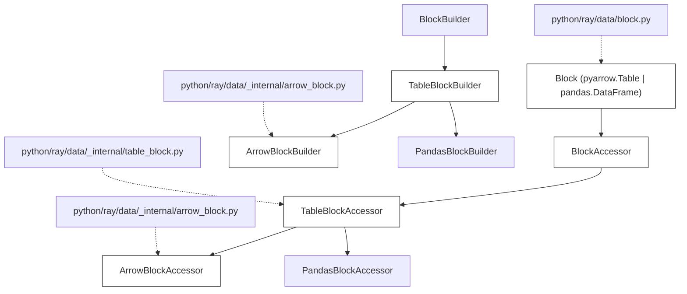
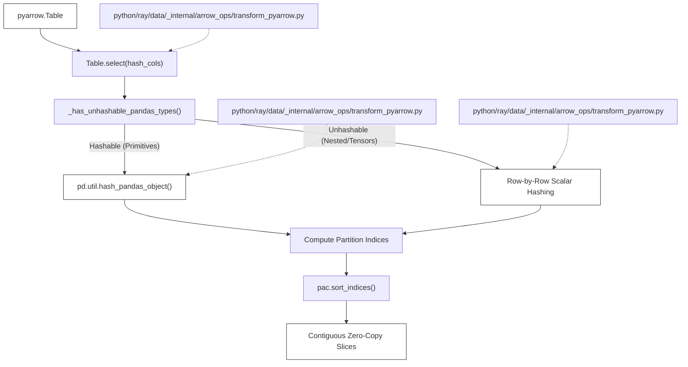

<!-- source: DeepWiki mcp.deepwiki.com · repo ray-project/ray · extra page Blocks, Arrow Integration, and Aggregations · fetched 2026-10-21 -->

# Blocks, Arrow Integration, and Aggregations

Relevant source files

The following files were used as context for generating this wiki page:

- [doc/source/data/api/aggregate.rst](doc/source/data/api/aggregate.rst)
- [python/ray/_private/arrow_serialization.py](python/ray/_private/arrow_serialization.py)
- [python/ray/air/util/tensor_extensions/arrow.py](python/ray/air/util/tensor_extensions/arrow.py)
- [python/ray/data/_internal/arrow_block.py](python/ray/data/_internal/arrow_block.py)
- [python/ray/data/_internal/arrow_ops/transform_pyarrow.py](python/ray/data/_internal/arrow_ops/transform_pyarrow.py)
- [python/ray/data/_internal/batcher.py](python/ray/data/_internal/batcher.py)
- [python/ray/data/_internal/datasource/__init__.py](python/ray/data/_internal/datasource/__init__.py)
- [python/ray/data/_internal/datasource/avro_datasource.py](python/ray/data/_internal/datasource/avro_datasource.py)
- [python/ray/data/_internal/datasource/kafka_datasink.py](python/ray/data/_internal/datasource/kafka_datasink.py)
- [python/ray/data/_internal/datasource/kafka_datasource.py](python/ray/data/_internal/datasource/kafka_datasource.py)
- [python/ray/data/_internal/execution/operators/map_transformer.py](python/ray/data/_internal/execution/operators/map_transformer.py)
- [python/ray/data/_internal/execution/operators/shuffle_operators/external_shuffle_tasks.py](python/ray/data/_internal/execution/operators/shuffle_operators/external_shuffle_tasks.py)
- [python/ray/data/_internal/output_buffer.py](python/ray/data/_internal/output_buffer.py)
- [python/ray/data/_internal/pandas_block.py](python/ray/data/_internal/pandas_block.py)
- [python/ray/data/_internal/planner/random_shuffle.py](python/ray/data/_internal/planner/random_shuffle.py)
- [python/ray/data/_internal/planner/repartition.py](python/ray/data/_internal/planner/repartition.py)
- [python/ray/data/_internal/table_block.py](python/ray/data/_internal/table_block.py)
- [python/ray/data/_internal/tensor_extensions/pandas.py](python/ray/data/_internal/tensor_extensions/pandas.py)
- [python/ray/data/_internal/util.py](python/ray/data/_internal/util.py)
- [python/ray/data/aggregate.py](python/ray/data/aggregate.py)
- [python/ray/data/block.py](python/ray/data/block.py)
- [python/ray/data/extensions/__init__.py](python/ray/data/extensions/__init__.py)
- [python/ray/data/extensions/object_extension.py](python/ray/data/extensions/object_extension.py)
- [python/ray/data/extensions/tensor_extension.py](python/ray/data/extensions/tensor_extension.py)
- [python/ray/data/preprocessor.py](python/ray/data/preprocessor.py)
- [python/ray/data/preprocessors/chain.py](python/ray/data/preprocessors/chain.py)
- [python/ray/data/preprocessors/concatenator.py](python/ray/data/preprocessors/concatenator.py)
- [python/ray/data/preprocessors/discretizer.py](python/ray/data/preprocessors/discretizer.py)
- [python/ray/data/preprocessors/encoder.py](python/ray/data/preprocessors/encoder.py)
- [python/ray/data/preprocessors/hasher.py](python/ray/data/preprocessors/hasher.py)
- [python/ray/data/preprocessors/imputer.py](python/ray/data/preprocessors/imputer.py)
- [python/ray/data/preprocessors/normalizer.py](python/ray/data/preprocessors/normalizer.py)
- [python/ray/data/preprocessors/scaler.py](python/ray/data/preprocessors/scaler.py)
- [python/ray/data/preprocessors/tokenizer.py](python/ray/data/preprocessors/tokenizer.py)
- [python/ray/data/preprocessors/torch.py](python/ray/data/preprocessors/torch.py)
- [python/ray/data/preprocessors/transformer.py](python/ray/data/preprocessors/transformer.py)
- [python/ray/data/preprocessors/utils.py](python/ray/data/preprocessors/utils.py)
- [python/ray/data/preprocessors/vectorizer.py](python/ray/data/preprocessors/vectorizer.py)
- [python/ray/data/stats.py](python/ray/data/stats.py)
- [python/ray/data/tests/datasource/test_kafka.py](python/ray/data/tests/datasource/test_kafka.py)
- [python/ray/data/tests/preprocessors/test_concatenator.py](python/ray/data/tests/preprocessors/test_concatenator.py)
- [python/ray/data/tests/preprocessors/test_encoder.py](python/ray/data/tests/preprocessors/test_encoder.py)
- [python/ray/data/tests/preprocessors/test_imputer.py](python/ray/data/tests/preprocessors/test_imputer.py)
- [python/ray/data/tests/preprocessors/test_preprocessors.py](python/ray/data/tests/preprocessors/test_preprocessors.py)
- [python/ray/data/tests/preprocessors/test_preprocessors_arrow_backed.py](python/ray/data/tests/preprocessors/test_preprocessors_arrow_backed.py)
- [python/ray/data/tests/preprocessors/test_scaler.py](python/ray/data/tests/preprocessors/test_scaler.py)
- [python/ray/data/tests/test_arrow_block.py](python/ray/data/tests/test_arrow_block.py)
- [python/ray/data/tests/test_arrow_serialization.py](python/ray/data/tests/test_arrow_serialization.py)
- [python/ray/data/tests/test_auto_batch_size.py](python/ray/data/tests/test_auto_batch_size.py)
- [python/ray/data/tests/test_batcher.py](python/ray/data/tests/test_batcher.py)
- [python/ray/data/tests/test_dataset_stats.py](python/ray/data/tests/test_dataset_stats.py)
- [python/ray/data/tests/test_map_transformer.py](python/ray/data/tests/test_map_transformer.py)
- [python/ray/data/tests/test_pandas_block.py](python/ray/data/tests/test_pandas_block.py)
- [python/ray/data/tests/test_strict_mode.py](python/ray/data/tests/test_strict_mode.py)
- [python/ray/data/tests/test_tensor.py](python/ray/data/tests/test_tensor.py)
- [python/ray/data/tests/test_tensor_extension.py](python/ray/data/tests/test_tensor_extension.py)
- [python/ray/data/tests/test_transform_pyarrow.py](python/ray/data/tests/test_transform_pyarrow.py)
- [python/ray/data/tests/test_util.py](python/ray/data/tests/test_util.py)
- [python/ray/data/tests/unit/test_arrow_serialization.py](python/ray/data/tests/unit/test_arrow_serialization.py)
- [python/ray/data/tests/unit/test_auto_batch_size.py](python/ray/data/tests/unit/test_auto_batch_size.py)
- [python/ray/data/tests/unit/test_transform_pyarrow.py](python/ray/data/tests/unit/test_transform_pyarrow.py)

## Purpose and Scope

This document details the core data structures and execution primitives underlying Ray Data. It covers the `Block` abstraction (`ArrowBlock`, `PandasBlock`, `TableBlock`) [python/ray/data/block.py:55-55] and its companion accessors and builders [python/ray/data/_internal/arrow_block.py:159-225], Apache Arrow transform utilities (`transform_pyarrow.py`, chunk combining, and hashing) [python/ray/data/_internal/arrow_ops/transform_pyarrow.py:47-146], custom tensor extension types for multi-dimensional arrays [python/ray/air/util/tensor_extensions/arrow.py:5-9], batching and iteration mechanisms [python/ray/data/block.py:84-104], distributed aggregation functions (`AggregateFn` and `AggregateFnV2`) [python/ray/data/aggregate.py:70-186], and the built-in feature engineering preprocessors library (`OrdinalEncoder`, etc.) [python/ray/data/preprocessors/encoder.py:72-78].

---

## 1. The Block Abstraction and Accessors

Ray Data processes datasets as a collection of immutable chunks of data called **Blocks**. A `Block` is physically represented as either a `pyarrow.Table` or a `pandas.DataFrame` [python/ray/data/block.py:55-55]. To provide a unified uniform interface over these differing underlying formats, Ray Data defines the `BlockAccessor` class hierarchy [python/ray/data/block.py:53-54].

### Block Hierarchy and Building

- **`Block`**: A type alias union representing `pyarrow.Table` or `pandas.DataFrame` [python/ray/data/block.py:55-55].
- **`BlockAccessor`**: An abstract base class providing uniform methods to query block length, column names, slice data, and iterate over rows or batches.
- **`TableBlockAccessor`**: Implements shared tabular operations for both Arrow and Pandas blocks [python/ray/data/_internal/table_block.py:168-170].
- **`ArrowBlockAccessor`**: Specialized accessor for `pyarrow.Table` blocks, managing `ArrowRow` creation and tensor column projections [python/ray/data/_internal/arrow_block.py:212-225].
- **`TableBlockBuilder` / `ArrowBlockBuilder`**: Incremental builders that buffer Python dictionaries or rows before compacting them into vectorized Arrow tables or Pandas dataframes [python/ray/data/_internal/table_block.py:51-72, python/ray/data/_internal/arrow_block.py:159-191].

*Diagram 1: Block Abstraction and Accessor Hierarchy bridging architectural concepts to `python/ray/data/block.py` and `python/ray/data/_internal/arrow_block.py`.*

Sources:
- `python/ray/data/block.py:53-81`
- `python/ray/data/_internal/arrow_block.py:159-225`
- `python/ray/data/_internal/table_block.py:51-170`

---

## 2. Arrow Integration and Transform Utilities

Ray Data relies heavily on Apache Arrow for zero-copy deserialization, columnar memory layout, and vectorized computation. When operations like sorting, hashing, or chunk joining are requested, Ray Data routes them through high-performance transform modules.

### Pyarrow Transform Operations

- **Sorting (`transform_pyarrow.py` / `transform_polars.py`)**: Computes sort indices via `pyarrow.compute.sort_indices` and materializes sorted tables using `take_table` [python/ray/data/_internal/arrow_ops/transform_pyarrow.py:58-62].
- **Hash Partitioning (`hash_partition`)**: Partitions an Arrow table into `num_partitions` by hashing specified columns (`hash_cols`) [python/ray/data/_internal/arrow_ops/transform_pyarrow.py:135-146]. It detects unhashable nested or tensor types and switches between vectorized pandas hashing (`pandas.util.hash_pandas_object`) and row-by-row PyArrow scalar hashing [python/ray/data/_internal/arrow_ops/transform_pyarrow.py:105-131].
- **Chunk Combining (`combine_chunked_array`)**: Recombines fragmented chunked arrays exceeding 2 GiB or fragment limits into contiguous memory chunks up to `INT32_MAX` to accelerate slicing operations [python/ray/data/tests/test_arrow_block.py:26-47].

*Diagram 2: Arrow Transform Pipeline for Hash Partitioning implemented in `python/ray/data/_internal/arrow_ops/transform_pyarrow.py`.*

### Tensor Extension Types

To support machine learning workloads involving multi-dimensional arrays (such as images and tensors), Ray Data implements custom Arrow extension types (`ArrowTensorType`, `ArrowTensorTypeV2`, `ArrowVariableShapedTensorType`, and `ArrowTensorArray`) [python/ray/air/util/tensor_extensions/arrow.py:5-9, python/ray/data/tests/test_transform_pyarrow.py:12-23]. These extensions wrap raw numeric buffers and allow zero-copy conversions between Ray datasets, PyArrow tables, and NumPy/PyTorch tensors.

Sources:
- `python/ray/data/_internal/arrow_ops/transform_pyarrow.py:47-168`
- `python/ray/air/util/tensor_extensions/arrow.py:1-10`
- `python/ray/data/tests/test_arrow_block.py:26-95`

---

## 3. Batching and Data Iteration

Ray Data supports batch processing via user-facing formats and internal batchers to feed machine learning training loops and UDF execution pipelines efficiently.

- **Batch Formats (`BatchFormat`, `DataBatch`)**: Users can specify batch formats as Pandas DataFrames (`pandas`), PyArrow Tables (`pyarrow`), NumPy dictionaries (`numpy`), or cuDF DataFrames (`cudf`) [python/ray/data/block.py:84-104].
- **Block Batching (`batch_blocks`)**: Combines and slices internal blocks to form uniform batch sizes defined by row counts or byte limits (e.g., `RAY_DATA_DEFAULT_BATCH_SIZE_BYTES`) [python/ray/data/_internal/execution/operators/map_transformer.py:20-33].

Sources:
- `python/ray/data/block.py:78-104`
- `python/ray/data/_internal/execution/operators/map_transformer.py:20-35`

---

## 4. Distributed Aggregation Functions

Ray Data provides a rich set of aggregations for grouped datasets (`dataset.groupby(...).aggregate(...)`). 

- **`AggregateFn` (Deprecated)**: The legacy class defining custom aggregations through `init`, `accumulate_row` or `accumulate_block`, `merge`, and `finalize` callables [python/ray/data/aggregate.py:70-156].
- **`AggregateFnV2`**: The modern base class designed for high-performance distributed aggregations, requiring subclasses to implement vectorized block accumulation and combination methods [python/ray/data/aggregate.py:180-186].
- **Arrow Aggregation Specs (`ArrowAggSpec`)**: Built-in aggregations (`sum_spec`, `mean_spec`, `count_spec`, `minmax_spec`, `distinct_spec`) push down execution directly into Apache Arrow compute kernels for maximal throughput [python/ray/data/aggregate.py:24-33].

Sources:
- `python/ray/data/aggregate.py:70-1944`
- `python/ray/data/_internal/arrow_aggregation.py`

---

## 5. Preprocessors Library

The `ray.data.preprocessors` library provides stateful feature engineering transformers built directly on top of the Dataset API. Preprocessors implement a `fit`, `transform`, and `fit_transform` lifecycle.

- **`Preprocessor`**: Base abstract class handling metadata collection and state persistence [python/ray/data/preprocessor.py].
- **`OrdinalEncoder`**: Encodes categorical features into ordinal integers ranging from $0$ to $n-1$, handling unseen values as `float("nan")` and supporting list-valued columns [python/ray/data/preprocessors/encoder.py:72-158].
- **Other Preprocessors**: Includes scalers (`StandardScaler`, `MinMaxScaler`), imputers (`SimpleImputer`), vectorizers, and concatenators.

Sources:
- `python/ray/data/preprocessor.py`
- `python/ray/data/preprocessors/encoder.py:72-191`

---

