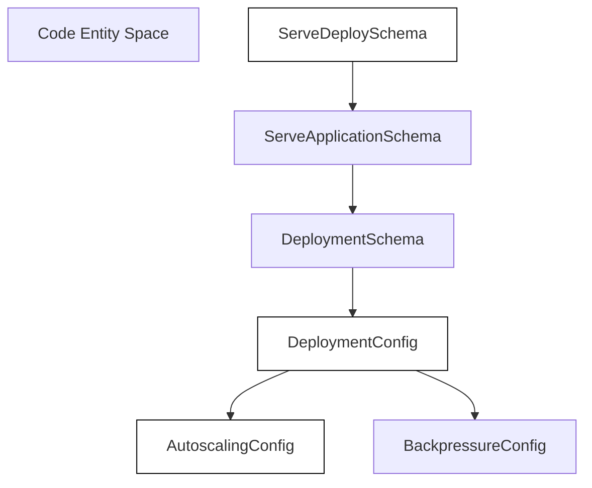
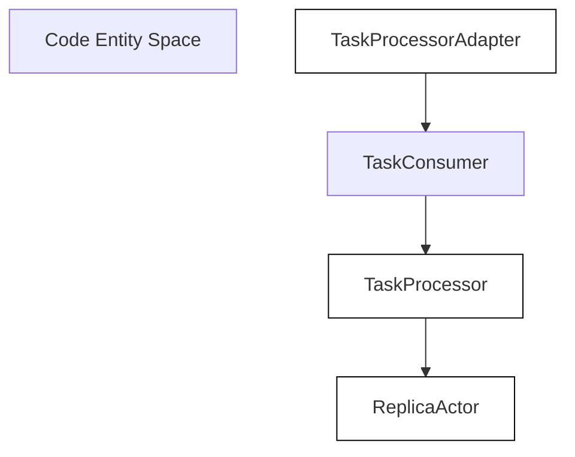
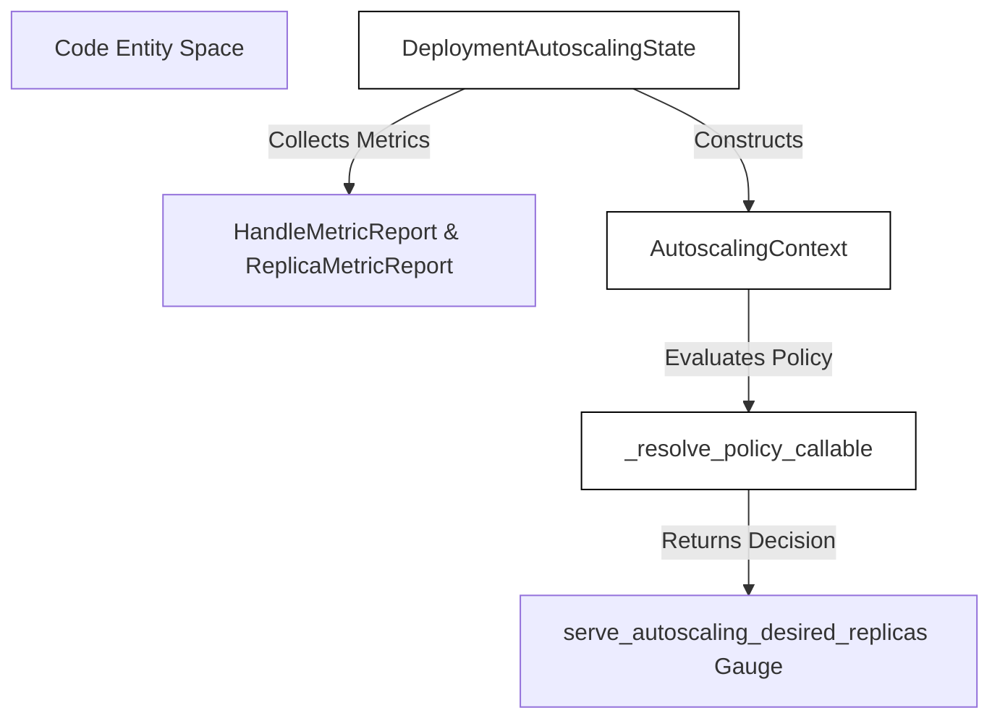

<!-- source: DeepWiki mcp.deepwiki.com · repo ray-project/ray · extra page Serve Configuration, CLI, and Autoscaling · fetched 2026-10-21 -->

# Serve Configuration, CLI, and Autoscaling

Relevant source files

The following files were used as context for generating this wiki page:

- [doc/source/serve/advanced-guides/advanced-autoscaling.md](doc/source/serve/advanced-guides/advanced-autoscaling.md)
- [doc/source/serve/advanced-guides/gang-scheduling.md](doc/source/serve/advanced-guides/gang-scheduling.md)
- [doc/source/serve/advanced-guides/images/gang-multi-pg.png](doc/source/serve/advanced-guides/images/gang-multi-pg.png)
- [doc/source/serve/advanced-guides/images/gang-single-pg.png](doc/source/serve/advanced-guides/images/gang-single-pg.png)
- [doc/source/serve/api/index.md](doc/source/serve/api/index.md)
- [doc/source/serve/doc_code/application_level_autoscaling.py](doc/source/serve/doc_code/application_level_autoscaling.py)
- [doc/source/serve/doc_code/application_level_autoscaling.yaml](doc/source/serve/doc_code/application_level_autoscaling.yaml)
- [doc/source/serve/doc_code/autoscaling_policy.py](doc/source/serve/doc_code/autoscaling_policy.py)
- [doc/source/serve/doc_code/custom_metrics_autoscaling.py](doc/source/serve/doc_code/custom_metrics_autoscaling.py)
- [doc/source/serve/doc_code/gang_scheduling.py](doc/source/serve/doc_code/gang_scheduling.py)
- [doc/source/serve/doc_code/scheduled_batch_processing.py](doc/source/serve/doc_code/scheduled_batch_processing.py)
- [doc/source/serve/production-guide/config.md](doc/source/serve/production-guide/config.md)
- [python/ray/dashboard/modules/serve/serve_head.py](python/ray/dashboard/modules/serve/serve_head.py)
- [python/ray/dashboard/modules/serve/tests/test_serve_dashboard.py](python/ray/dashboard/modules/serve/tests/test_serve_dashboard.py)
- [python/ray/dashboard/modules/serve/tests/test_serve_dashboard_2.py](python/ray/dashboard/modules/serve/tests/test_serve_dashboard_2.py)
- [python/ray/includes/timeseries_utils.pxi](python/ray/includes/timeseries_utils.pxi)
- [python/ray/serve/_private/api.py](python/ray/serve/_private/api.py)
- [python/ray/serve/_private/autoscaling_state.py](python/ray/serve/_private/autoscaling_state.py)
- [python/ray/serve/_private/benchmarks/common.py](python/ray/serve/_private/benchmarks/common.py)
- [python/ray/serve/_private/benchmarks/handle_noop_latency.py](python/ray/serve/_private/benchmarks/handle_noop_latency.py)
- [python/ray/serve/_private/config.py](python/ray/serve/_private/config.py)
- [python/ray/serve/_private/gang_scheduling_autoscaling_policy.py](python/ray/serve/_private/gang_scheduling_autoscaling_policy.py)
- [python/ray/serve/_private/metrics_utils.py](python/ray/serve/_private/metrics_utils.py)
- [python/ray/serve/_private/test_utils.py](python/ray/serve/_private/test_utils.py)
- [python/ray/serve/api.py](python/ray/serve/api.py)
- [python/ray/serve/autoscaling_policy.py](python/ray/serve/autoscaling_policy.py)
- [python/ray/serve/config.py](python/ray/serve/config.py)
- [python/ray/serve/deployment.py](python/ray/serve/deployment.py)
- [python/ray/serve/schema.py](python/ray/serve/schema.py)
- [python/ray/serve/scripts.py](python/ray/serve/scripts.py)
- [python/ray/serve/task_consumer.py](python/ray/serve/task_consumer.py)
- [python/ray/serve/task_processor.py](python/ray/serve/task_processor.py)
- [python/ray/serve/tests/conftest.py](python/ray/serve/tests/conftest.py)
- [python/ray/serve/tests/test_api.py](python/ray/serve/tests/test_api.py)
- [python/ray/serve/tests/test_autoscaling_policy.py](python/ray/serve/tests/test_autoscaling_policy.py)
- [python/ray/serve/tests/test_cli.py](python/ray/serve/tests/test_cli.py)
- [python/ray/serve/tests/test_cli_2.py](python/ray/serve/tests/test_cli_2.py)
- [python/ray/serve/tests/test_cli_3.py](python/ray/serve/tests/test_cli_3.py)
- [python/ray/serve/tests/test_controller.py](python/ray/serve/tests/test_controller.py)
- [python/ray/serve/tests/test_controller_benchmark.py](python/ray/serve/tests/test_controller_benchmark.py)
- [python/ray/serve/tests/test_deploy.py](python/ray/serve/tests/test_deploy.py)
- [python/ray/serve/tests/test_deploy_2.py](python/ray/serve/tests/test_deploy_2.py)
- [python/ray/serve/tests/test_deploy_app.py](python/ray/serve/tests/test_deploy_app.py)
- [python/ray/serve/tests/test_deploy_app_2.py](python/ray/serve/tests/test_deploy_app_2.py)
- [python/ray/serve/tests/test_gang_scheduling.py](python/ray/serve/tests/test_gang_scheduling.py)
- [python/ray/serve/tests/test_standalone.py](python/ray/serve/tests/test_standalone.py)
- [python/ray/serve/tests/test_task_processor.py](python/ray/serve/tests/test_task_processor.py)
- [python/ray/serve/tests/unit/test_autoscaling_policy.py](python/ray/serve/tests/unit/test_autoscaling_policy.py)
- [python/ray/serve/tests/unit/test_cli.py](python/ray/serve/tests/unit/test_cli.py)
- [python/ray/serve/tests/unit/test_config.py](python/ray/serve/tests/unit/test_config.py)
- [python/ray/serve/tests/unit/test_metrics_utils.py](python/ray/serve/tests/unit/test_metrics_utils.py)
- [python/ray/serve/tests/unit/test_schema.py](python/ray/serve/tests/unit/test_schema.py)
- [python/ray/serve/tests/unit/test_task_consumer.py](python/ray/serve/tests/unit/test_task_consumer.py)
- [release/runtime_env_tests/rte_gce_minimal.yaml](release/runtime_env_tests/rte_gce_minimal.yaml)
- [release/runtime_env_tests/rte_gce_small.yaml](release/runtime_env_tests/rte_gce_small.yaml)
- [release/runtime_env_tests/rte_minimal.yaml](release/runtime_env_tests/rte_minimal.yaml)
- [release/runtime_env_tests/rte_small.yaml](release/runtime_env_tests/rte_small.yaml)
- [release/serve_tests/compute_tpl_32_cpu.yaml](release/serve_tests/compute_tpl_32_cpu.yaml)
- [release/serve_tests/compute_tpl_32_cpu_gce.yaml](release/serve_tests/compute_tpl_32_cpu_gce.yaml)
- [release/serve_tests/compute_tpl_8_cpu_autoscaling.yaml](release/serve_tests/compute_tpl_8_cpu_autoscaling.yaml)
- [release/serve_tests/compute_tpl_gpu_node.yaml](release/serve_tests/compute_tpl_gpu_node.yaml)
- [release/serve_tests/compute_tpl_gpu_node_gce.yaml](release/serve_tests/compute_tpl_gpu_node_gce.yaml)
- [release/serve_tests/compute_tpl_single_node_16_cpu.yaml](release/serve_tests/compute_tpl_single_node_16_cpu.yaml)
- [release/serve_tests/workloads/microbenchmarks.py](release/serve_tests/workloads/microbenchmarks.py)
- [release/serve_tests/workloads/multi_deployment_1k_noop_replica.py](release/serve_tests/workloads/multi_deployment_1k_noop_replica.py)
- [release/serve_tests/workloads/serve_test_utils.py](release/serve_tests/workloads/serve_test_utils.py)
- [src/ray/protobuf/serve.proto](src/ray/protobuf/serve.proto)

This page documents Ray Serve's public API and schemas, command-line interface (CLI) and dashboard integration, task processor and consumer utilities, and metrics-based autoscaling policies including gang scheduling.

---

## 1. Serve Public API and Configuration Schemas

Ray Serve provides programmatic APIs for defining deployments and applications, backed by Pydantic schemas for declarative configuration (YAML or JSON) and REST API submission.

### Public Deployment API & Decorator
The primary entry point for authoring a Serve deployment is the `@serve.deployment` decorator defined in `python/ray/serve/api.py` and `python/ray/serve/deployment.py`. It wraps a Python function or class, returning a `Deployment` object that can be bound to arguments for application composition.

- `serve.deployment`: Accepts configuration options such as `num_replicas`, `ray_actor_options`, `user_config`, and `autoscaling_config` [python/ray/serve/api.py]().
- `serve.run()`: Deploys an application graph to the Ray cluster [python/ray/serve/api.py]().

### Schemas and Configuration Models
Declarative schemas are implemented using Pydantic models. The core configuration classes include:
- `ServeDeploySchema`: The top-level schema representing multi-application deployment configurations submitted via the REST API or CLI [python/ray/serve/schema.py]() and [python/ray/serve/tests/unit/test_config.py]().
- `DeploymentConfig`: Defines execution parameters for a single deployment, such as `max_ongoing_requests`, `max_queued_requests`, and `backpressure_config` [python/ray/serve/config.py]() and [python/ray/serve/tests/unit/test_config.py]().
- `LoggingConfig` and `TracingConfig`: Configure logging encoding (`TEXT` or `JSON`), log levels, directories, and OpenTelemetry distributed tracing [python/ray/serve/schema.py]().

*Figure 1: Hierarchical Pydantic schema structure for Serve deployment configurations.*

Sources: `python/ray/serve/api.py`, `python/ray/serve/config.py`, `python/ray/serve/schema.py`, `python/ray/serve/tests/unit/test_config.py`

---

## 2. Serve CLI and Dashboard Integration

### Serve CLI
The `serve` command-line interface (implemented in `python/ray/serve/scripts.py`) provides commands to deploy, inspect, and tear down Serve applications directly from the terminal. 
- `serve run`: Deploys an application from an import path.
- `serve status`: Queries the current status of all applications and deployments.
- `serve shutdown`: Shuts down Serve on the Ray cluster [python/ray/serve/api.py]().

### Dashboard Integration
Ray Serve integrates natively with the Ray Dashboard. The dashboard head module (`python/ray/dashboard/modules/serve/serve_head.py`) hosts HTTP endpoints under `/api/serve/applications/`:
- `PUT "/api/serve/applications/"`: Declaratively deploys applications using JSON payloads conforming to `ServeDeploySchema` [doc/source/serve/api/index.md]() and [python/ray/serve/tests/test_controller.py]().
- `GET "/api/serve/applications/"`: Returns cluster-level information and comprehensive details on all running applications, deployments, and replicas [doc/source/serve/api/index.md]().

Sources: `python/ray/serve/scripts.py`, `python/ray/dashboard/modules/serve/serve_head.py`, `doc/source/serve/api/index.md`, `python/ray/serve/tests/test_controller.py`

---

## 3. Task Processor and Consumer Utilities

Ray Serve provides queue-based task processing and consumer utilities (`python/ray/serve/task_processor.py`, `python/ray/serve/task_consumer.py`, and `TaskProcessorAdapter`) to support asynchronous ingestion, batching, and decoupled request execution [doc/source/serve/api/index.md]().

- **Task Processor**: Manages execution loops and concurrency for incoming items from a backing queue or broker.
- **Task Consumer**: Coordinates worker pools to consume tasks reliably with configurable concurrency (`DEFAULT_CONSUMER_CONCURRENCY`) [python/ray/serve/schema.py]().

*Figure 2: Task processing and consumer pipeline architecture.*

Sources: `python/ray/serve/task_processor.py`, `python/ray/serve/task_consumer.py`, `python/ray/serve/schema.py`, `doc/source/serve/api/index.md`

---

## 4. Metrics-Based Autoscaling Policies and Gang Scheduling

Ray Serve features a reactive autoscaling architecture that adjusts replica counts based on metrics like ongoing requests, queue lengths, or custom metrics reported by replicas and handles [python/ray/serve/_private/autoscaling_state.py]().

### Core Autoscaling Classes
- `AutoscalingConfig`: User-facing Pydantic configuration model defining `min_replicas`, `max_replicas`, `target_ongoing_requests`, `upscale_delay_s`, and `downscale_delay_s` [python/ray/serve/config.py]() and [python/ray/serve/tests/unit/test_config.py]().
- `AutoscalingContext`: Rich context object passed to custom autoscaling policies [python/ray/serve/config.py](). It exposes metrics (`total_num_requests`, `total_queued_requests`, `aggregated_metrics`, `raw_metrics`), current replica states, and policy state persistence.
- `DeploymentAutoscalingState`: Internal controller-side manager that ingests metric reports (`HandleMetricReport`, `ReplicaMetricReport`), executes the autoscaling policy, and records telemetry gauges (`serve_autoscaling_desired_replicas`, `serve_autoscaling_total_requests`) [python/ray/serve/_private/autoscaling_state.py]().

*Figure 3: Data flow for metrics collection and autoscaling policy evaluation.*

### Gang Scheduling
For workloads requiring coordinated provisioning (e.g., distributed training or multi-node model execution where replicas must be scheduled together), Ray Serve supports **gang scheduling** via `GangSchedulingConfig` and `GangSchedulingAutoscalingPolicy` [python/ray/serve/config.py]() and [python/ray/serve/_private/gang_scheduling_autoscaling_policy.py](). 

- `GangSchedulingConfig`: Configures placement strategies (`GangPlacementStrategy`) and runtime failure policies (`GangRuntimeFailurePolicy`) to ensure atomic scaling of replica groups [python/ray/serve/config.py]().
- `GangSchedulingAutoscalingPolicy`: Implements gang-aware scaling decisions, ensuring replicas are provisioned or deprovisioned in synchronized blocks [python/ray/serve/_private/gang_scheduling_autoscaling_policy.py]().

Sources: `python/ray/serve/config.py`, `python/ray/serve/_private/autoscaling_state.py`, `python/ray/serve/_private/gang_scheduling_autoscaling_policy.py`, `python/ray/serve/tests/unit/test_config.py`, `python/ray/serve/tests/test_autoscaling_policy.py`

---

