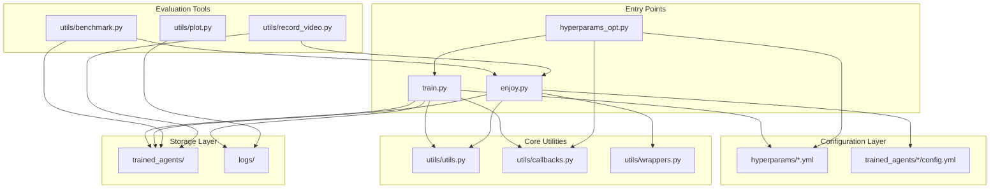
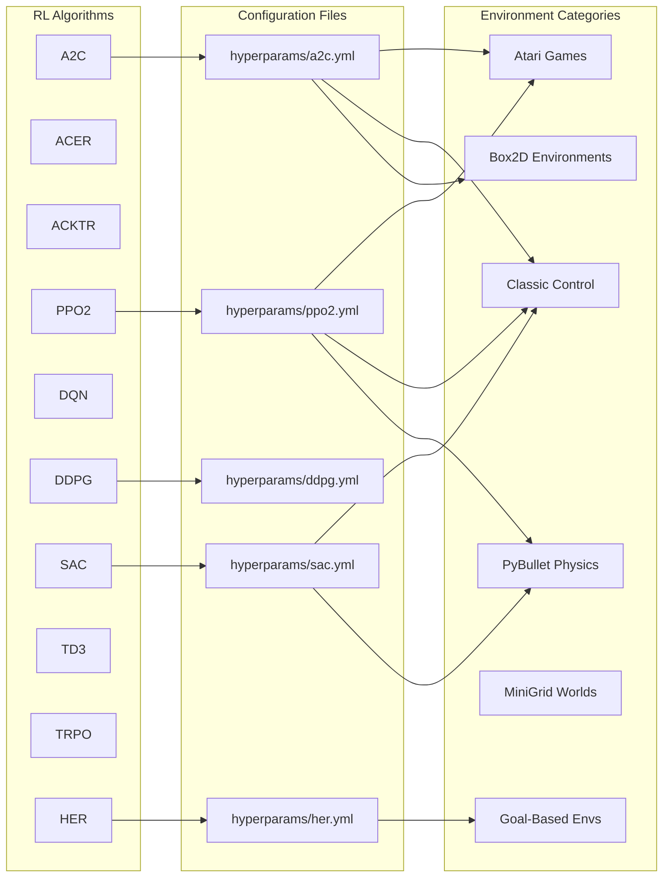

<!-- source: DeepWiki mcp.deepwiki.com · repo araffin/rl-baselines-zoo · page 1 Overview · fetched 2026-10-30 -->

# Overview

Relevant source files

The following files were used as context for generating this wiki page:

- [README.md](README.md)

## Purpose and Scope

The RL Baselines Zoo is a collection of pre-trained Reinforcement Learning (RL) agents with tuned hyperparameters, built on top of the [Stable Baselines](https://github.com/hill-a/stable-baselines) library. This repository serves as both a training infrastructure and a benchmark suite for various RL algorithms across multiple environment types.

**Note**: This repository is no longer actively maintained. Users should migrate to the [RL-Baselines3 Zoo](https://github.com/DLR-RM/rl-baselines3-zoo) which is powered by Stable-Baselines3.

The primary goals of this system are to:
- Provide a simple interface for training and evaluating RL agents
- Benchmark different RL algorithms across standardized environments  
- Supply pre-tuned hyperparameters for algorithm-environment combinations
- Offer a collection of over 120 pre-trained agents ready for use

For specific training workflows, see [Training Agents](#2.1). For evaluation procedures, see [Evaluating Trained Agents](#2.2). For hyperparameter optimization, see [Hyperparameter Optimization](#2.3).

Sources: [README.md:1-18]()

## System Architecture

The RL Baselines Zoo follows a modular architecture centered around three main entry points that orchestrate training, evaluation, and optimization workflows.

### Core System Components

This architecture separates concerns into distinct layers:
- **Entry Points**: Main scripts that users interact with directly
- **Configuration Layer**: YAML-based configuration management for algorithms and trained models
- **Core Utilities**: Shared functionality for environment creation, training callbacks, and environment wrappers
- **Storage Layer**: Persistent storage for trained models, logs, and evaluation results
- **Evaluation Tools**: Utilities for benchmarking, visualization, and video recording

Sources: [README.md:44-78](), System diagrams provided

### Algorithm and Environment Support

The system supports 10 major RL algorithms across 5+ environment categories. Each algorithm has its hyperparameters defined in corresponding YAML configuration files under the `hyperparams/` directory.

Sources: [README.md:144-260]()

## Main Components

### Training System (`train.py`)

The training system serves as the primary orchestrator for RL agent training. It loads algorithm configurations, creates environments with appropriate wrappers, and manages the training loop with callbacks for evaluation, checkpointing, and logging.

Key features:
- Hyperparameter loading from YAML configurations
- Environment creation with custom wrappers
- Integration with TensorBoard logging
- Checkpoint saving and model persistence
- Evaluation during training with configurable frequency

### Evaluation System (`enjoy.py`)

The evaluation system loads pre-trained agents and runs them in their target environments. It supports both pre-trained models from the zoo and user-trained models from log directories.

Key features:
- Model loading with normalization statistics
- Environment configuration restoration
- Video recording capabilities
- Performance evaluation metrics
- Support for custom environment arguments

### Hyperparameter Optimization (`hyperparams_opt.py`)

The optimization system uses Optuna to automatically tune hyperparameters for algorithm-environment combinations. It integrates with the training pipeline to evaluate candidate hyperparameter sets.

Key features:
- Integration with Optuna optimization framework
- Support for multiple sampling strategies (TPE, Random, etc.)
- Pruning of poorly performing trials
- Parallel optimization with multiple workers
- Automatic best model selection and saving

Sources: [README.md:44-92]()

## Repository Structure

The repository follows a clear organizational structure:

| Directory/File | Purpose |
|----------------|---------|
| `train.py` | Main training script and orchestrator |
| `enjoy.py` | Agent evaluation and demonstration script |
| `hyperparams_opt.py` | Hyperparameter optimization engine |
| `hyperparams/` | Algorithm-specific configuration files (YAML) |
| `trained_agents/` | Storage for pre-trained models and metadata |
| `utils/` | Core utilities, wrappers, callbacks, and tools |
| `logs/` | Training logs and experiment outputs |
| `tests/` | Test suite for validation |
| `docker/` | Docker containerization configurations |
| `scripts/` | Build and deployment automation scripts |

The `utils/` directory contains several important modules:
- `utils.py`: Environment creation and configuration utilities
- `callbacks.py`: Training callbacks for evaluation and checkpointing  
- `wrappers.py`: Custom environment wrappers
- `benchmark.py`: Performance benchmarking tools
- `record_video.py`: Video recording functionality
- `plot.py`: Visualization and plotting utilities

Sources: Repository structure analysis, [README.md:274-312]()

## Development Status and Usage

**Important**: This repository is deprecated and no longer maintained. The community has migrated to the RL-Baselines3 Zoo which offers improved functionality and active development.

The system provides over 120 pre-trained agents across multiple environment categories including Atari games, classic control problems, Box2D physics simulations, PyBullet robotics environments, and MiniGrid worlds. These agents represent state-of-the-art performance with carefully tuned hyperparameters.

For new projects, users should consider the successor repository while existing users can continue to use this codebase for reproducibility and comparison purposes.

Sources: [README.md:1](), [README.md:140-143]()

---

