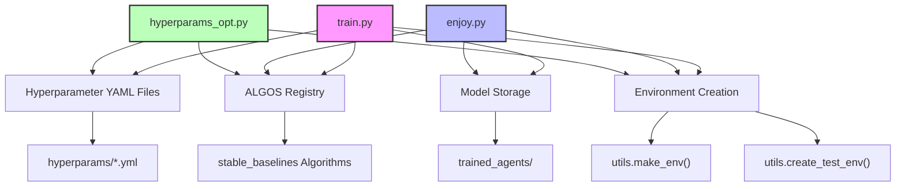
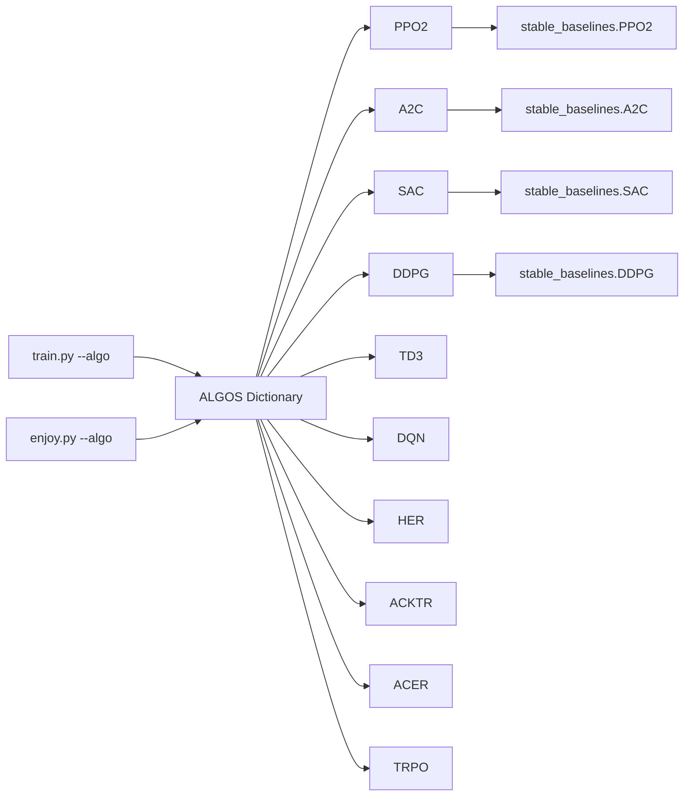
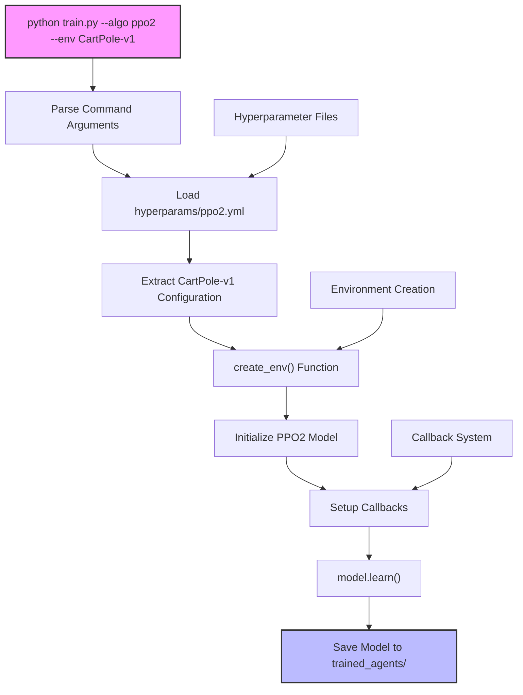
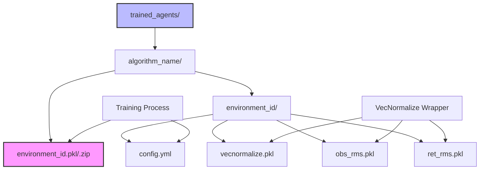

<!-- source: DeepWiki mcp.deepwiki.com · repo araffin/rl-baselines-zoo · page 2 Getting Started · fetched 2026-10-30 -->

# Getting Started

Relevant source files

The following files were used as context for generating this wiki page:

- [README.md](README.md)
- [train.py](train.py)
- [utils/utils.py](utils/utils.py)

This document provides an overview of the main workflows in the RL Baselines Zoo system: training reinforcement learning agents, evaluating trained models, and understanding the core system components. The RL Baselines Zoo provides a standardized interface for training and evaluating RL agents across multiple algorithms and environments using pre-tuned hyperparameters.

For detailed information about specific workflows, see [Training Agents](#2.1), [Evaluating Trained Agents](#2.2), and [Hyperparameter Optimization](#2.3). For configuration details, see [Configuration System](#3).

## Core System Overview

The RL Baselines Zoo consists of three primary workflows orchestrated by main entry point scripts:

**Training Workflow**: Users execute `train.py` to train RL agents using algorithm-specific hyperparameters defined in YAML configuration files.

**Evaluation Workflow**: Users execute `enjoy.py` to load and evaluate pre-trained agents, observing their behavior in target environments.

**Optimization Workflow**: Users execute `train.py --optimize` to automatically tune hyperparameters using Optuna-based optimization.

### Main System Components

Sources: [train.py:42-435](), [utils/utils.py:32-43](), [README.md:44-78]()

## Algorithm Registry and Environment Support

The system supports multiple RL algorithms through a centralized registry defined in `utils/utils.py`. Each algorithm integrates with Stable Baselines implementations:

The system automatically handles environment-specific configurations including Atari frame stacking, continuous control normalization, and custom wrappers through the `create_env()` function in `train.py`.

Sources: [utils/utils.py:32-43](), [train.py:147-156](), [train.py:228-291]()

## Training Agent Workflow

### Basic Training Command Structure

The primary training interface accepts several key parameters:

| Parameter | Purpose | Example |
|-----------|---------|---------|
| `--algo` | RL algorithm selection | `ppo2`, `sac`, `ddpg` |
| `--env` | Environment identifier | `CartPole-v1`, `HalfCheetah-v2` |
| `--n-timesteps` | Training duration override | `1000000` |
| `--tensorboard-log` | TensorBoard logging directory | `/tmp/tb_logs/` |
| `--eval-freq` | Evaluation frequency | `10000` |

### Training Process Flow

The training process loads algorithm-specific hyperparameters from YAML files, creates appropriate environment wrappers, initializes the selected RL algorithm, and saves the trained model with associated configuration files.

Sources: [train.py:130-158](), [train.py:400-435](), [train.py:228-291]()

## Model Storage Structure

Trained models are stored in a structured directory hierarchy under `trained_agents/` with associated metadata:

The storage system preserves both the trained model weights and the complete training configuration, including normalization statistics required for proper evaluation.

Sources: [train.py:410-435](), [utils/utils.py:316-346](), [train.py:361-368]()

## Evaluation Workflow Overview

Agent evaluation uses the `enjoy.py` script to load trained models and execute them in target environments. The evaluation system automatically handles model loading, environment recreation, and normalization parameter restoration.

Key evaluation parameters include environment rendering, episode count, and model selection (latest vs. best performing). The evaluation process reconstructs the exact training environment configuration using saved hyperparameters and normalization statistics.

For complete evaluation details, see [Evaluating Trained Agents](#2.2).

## Hyperparameter Configuration System

The system uses YAML configuration files in the `hyperparams/` directory to define algorithm-specific parameters for different environments. Each algorithm has its own configuration file (e.g., `hyperparams/ppo2.yml`, `hyperparams/sac.yml`) containing environment-specific hyperparameter sets.

The configuration system supports environment categorization (Atari, continuous control, discrete control) and allows runtime hyperparameter overrides via command-line arguments.

For configuration details, see [Configuration System](#3).

## Next Steps

- **Training**: Learn detailed training procedures in [Training Agents](#2.1)
- **Evaluation**: Understand model evaluation in [Evaluating Trained Agents](#2.2)  
- **Optimization**: Explore automated hyperparameter tuning in [Hyperparameter Optimization](#2.3)
- **Configuration**: Review system configuration in [Configuration System](#3)

Sources: [README.md:20-143](), [train.py:1-435](), [utils/utils.py:1-392]()

---

