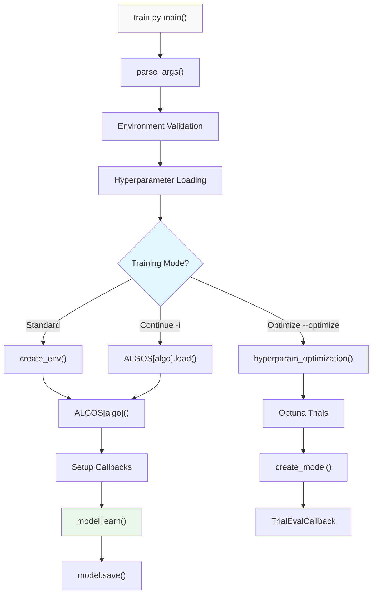
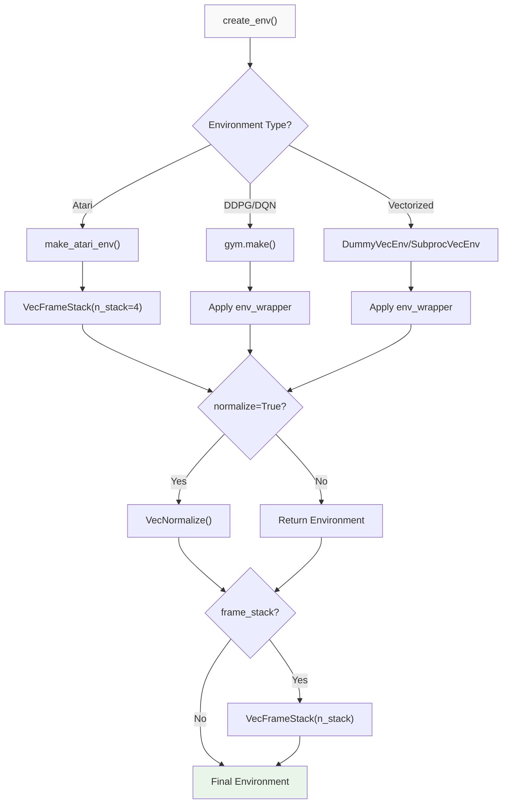
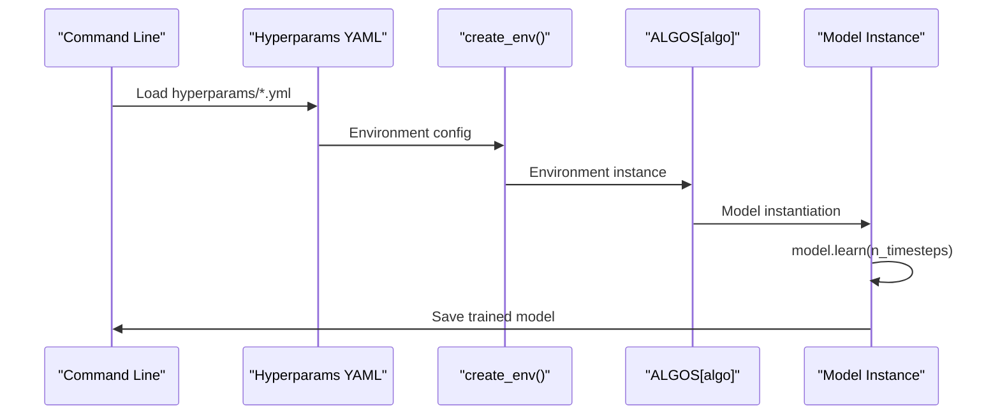
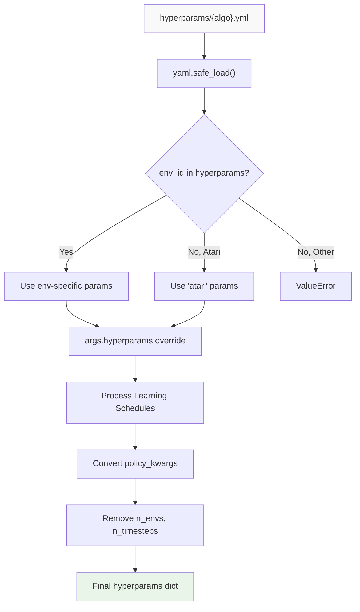
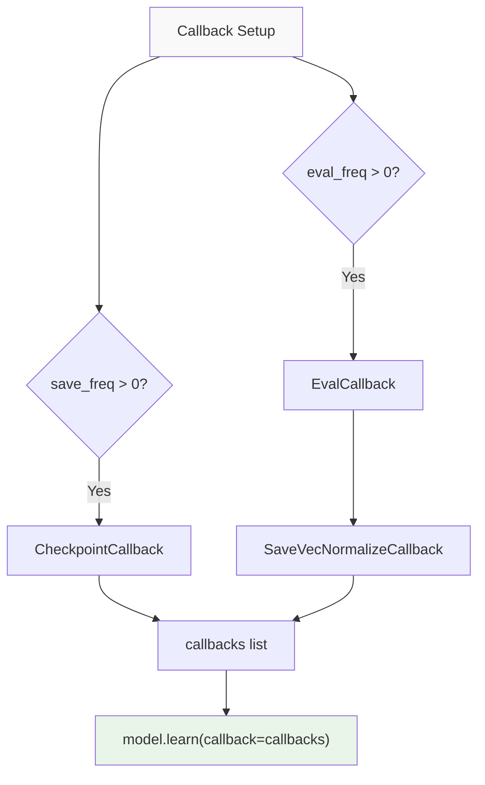
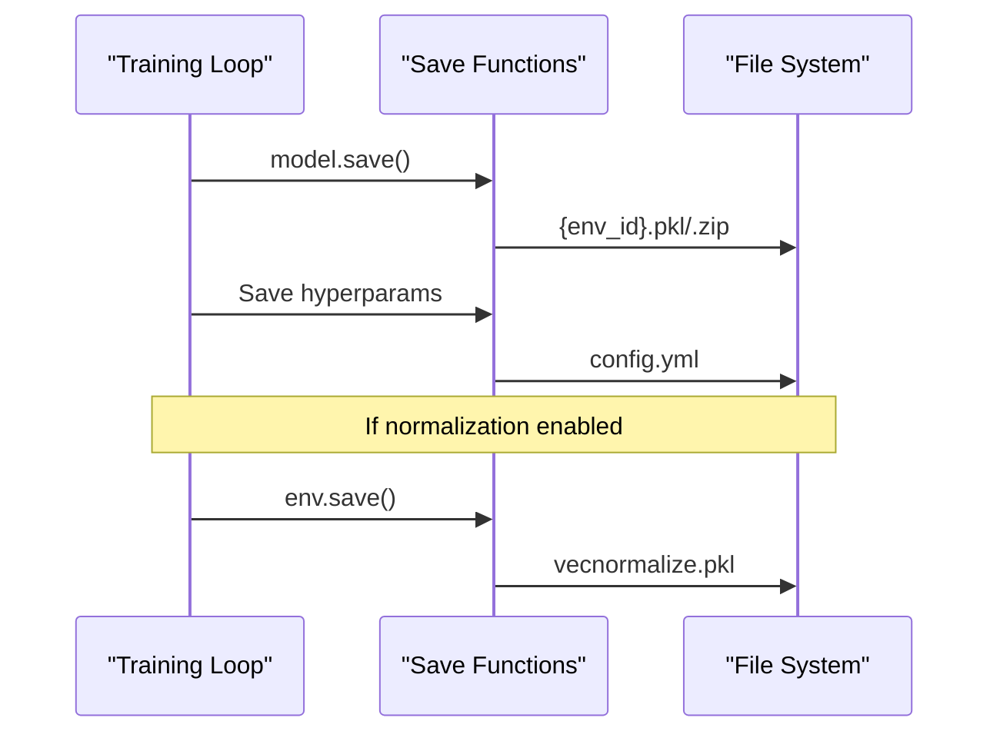

<!-- source: DeepWiki mcp.deepwiki.com · repo araffin/rl-baselines-zoo · page 2.1 Training Agents · fetched 2026-10-30 -->

# Training Agents

<details>
<summary>Relevant source files</summary>

The following files were used as context for generating this wiki page:

- [train.py](train.py)
- [utils/utils.py](utils/utils.py)

</details>


This document covers the core training functionality provided by the RL Baselines Zoo, focusing on how to train reinforcement learning agents using the `train.py` script. This includes standard training workflows, environment configuration, hyperparameter management, and various training modes.

For information about evaluating already-trained agents, see [Evaluating Trained Agents](#2.2). For automated hyperparameter optimization workflows, see [Hyperparameter Optimization](#2.3).

## Training Workflow Overview

The training system orchestrates the complete lifecycle of RL agent training, from environment creation to model persistence. The `train.py` script serves as the main entry point and coordinates all training components.

**Training System Architecture**


Sources: [train.py:42-435]()

## Command Line Interface

The `train.py` script accepts numerous command-line arguments to control training behavior:

### Core Training Arguments

| Argument | Type | Default | Description |
|----------|------|---------|-------------|
| `--env` | str | "CartPole-v1" | Environment ID |
| `--algo` | str | "ppo2" | RL Algorithm choice |
| `-n, --n-timesteps` | int | -1 | Override timesteps |
| `--seed` | int | 0 | Random seed |
| `-f, --log-folder` | str | "logs" | Log directory |

### Training Control Arguments

| Argument | Type | Default | Description |
|----------|------|---------|-------------|
| `--eval-freq` | int | 10000 | Evaluation frequency |
| `--eval-episodes` | int | 5 | Episodes per evaluation |
| `--save-freq` | int | -1 | Model checkpoint frequency |
| `--log-interval` | int | -1 | Logging interval override |

### Advanced Arguments

| Argument | Type | Description |
|----------|------|-------------|
| `-i, --trained-agent` | str | Path to pretrained model for continuation |
| `-params, --hyperparams` | dict | Override specific hyperparameters |
| `--env-kwargs` | dict | Environment constructor arguments |
| `-tb, --tensorboard-log` | str | Tensorboard logging directory |

Sources: [train.py:43-80]()

## Environment Setup and Configuration

The training system creates and configures environments through the `create_env()` function, which handles various environment types and applies necessary wrappers.

**Environment Creation Flow**


### Environment Wrapper System

The system supports flexible environment wrapping through the `get_wrapper_class()` function in `utils/utils.py`:

```yaml
# Example hyperparameter configuration
env_wrapper:
  - utils.wrappers.DoneOnSuccessWrapper:
      reward_offset: 1.0
  - utils.wrappers.TimeFeatureWrapper
```

Sources: [train.py:228-291](), [utils/utils.py:81-146]()

## Training Modes

The training system supports three distinct modes based on command-line arguments and available model files.

### Standard Training

Creates a new model from scratch using algorithm-specific hyperparameters:

**Standard Training Process**


### Continuation Training

Resumes training from a pretrained model using the `-i` flag:

```python
# Model loading process
model = ALGOS[args.algo].load(args.trained_agent, env=env,
                              tensorboard_log=tensorboard_log, 
                              verbose=args.verbose, **hyperparams)
```

The system automatically loads associated normalization statistics if available.

### Hyperparameter Optimization

Delegates to the `hyperparam_optimization()` function for automated tuning using Optuna.

Sources: [train.py:351-401](), [train.py:370-398]()

## Hyperparameter Management

Hyperparameters are loaded from YAML files in the `hyperparams/` directory and processed based on algorithm requirements.

**Hyperparameter Processing Flow**


### Schedule Processing

For algorithms like PPO2, SAC, and TD3, learning rate schedules are converted from string representations:

```python
# Example schedule processing
if isinstance(hyperparams[key], str):
    schedule, initial_value = hyperparams[key].split('_')
    initial_value = float(initial_value)
    hyperparams[key] = linear_schedule(initial_value)
```

Sources: [train.py:130-181](), [utils/utils.py:261-279]()

## Callback System and Monitoring

The training system uses a callback architecture for monitoring, evaluation, and model persistence.

**Callback Configuration**


### Key Callbacks

- **`CheckpointCallback`**: Periodic model saving at specified intervals
- **`EvalCallback`**: Regular evaluation on separate environment with best model saving
- **`SaveVecNormalizeCallback`**: Saves normalization statistics for reproducible evaluation

Sources: [train.py:219-308](), [utils/callbacks.py]()

## Model Persistence and Output

Training results are saved in a structured directory format under the log folder:

```
logs/{algorithm}/{env_id}_{run_id}/
├── {env_id}.pkl/.zip          # Trained model
├── {env_id}/
│   ├── config.yml             # Saved hyperparameters  
│   └── vecnormalize.pkl       # Normalization stats
└── best_model.zip             # Best model from evaluation
```

The system automatically creates unique run directories and saves complete training configurations for reproducibility.

**Model Saving Process**


Sources: [train.py:410-435](), [train.py:214-217]()

---

