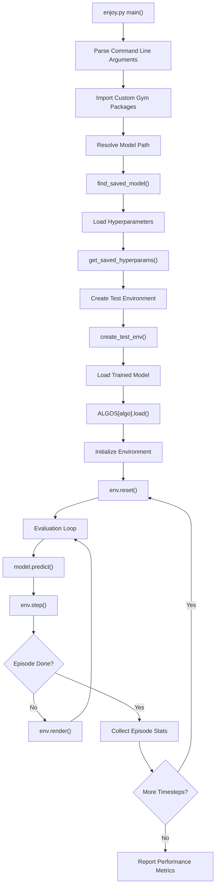
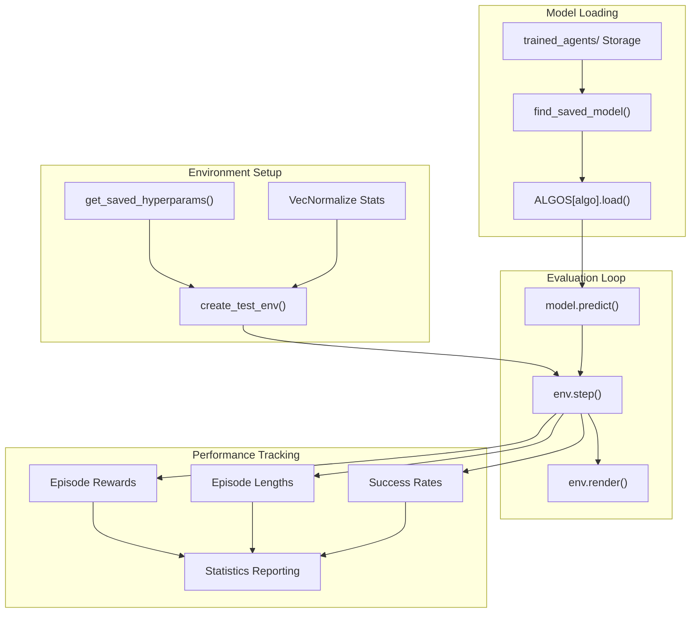
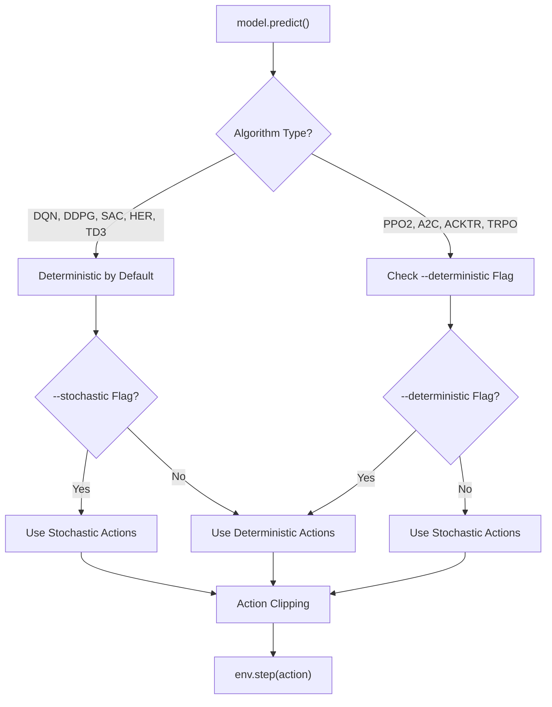

<!-- source: DeepWiki mcp.deepwiki.com · repo araffin/rl-baselines-zoo · page 2.2 Evaluating Trained Agents · fetched 2026-10-30 -->

# Evaluating Trained Agents

<details>
<summary>Relevant source files</summary>

The following files were used as context for generating this wiki page:

- [enjoy.py](enjoy.py)

</details>


This page covers how to run and evaluate trained reinforcement learning agents using the `enjoy.py` script. The evaluation system allows you to load saved models, run them in their training environments, collect performance statistics, and visually observe agent behavior.

For information about training agents, see [Training Agents](#2.1). For automated performance benchmarking across multiple models, see [Benchmarking and Performance Evaluation](#4.1).

## Purpose and Scope

The evaluation system provides tools to:
- Load trained models from the `trained_agents/` directory
- Run agents in their original training environments
- Collect episode-level performance metrics (rewards, episode lengths, success rates)
- Support both visual rendering and headless evaluation
- Handle environment normalization and preprocessing consistently with training
- Evaluate agents deterministically or stochastically

## Evaluation Workflow

The evaluation process follows a structured workflow from model loading to performance reporting:

**Agent Evaluation Process Flow**


Sources: [enjoy.py:26-182]()

## Core Evaluation Components

The evaluation system consists of several key components that work together to provide comprehensive agent assessment:

**Evaluation System Architecture**


Sources: [enjoy.py:77-101](), [enjoy.py:114-158]()

## Command Line Interface

The `enjoy.py` script provides extensive command-line options for configuring evaluation runs:

### Basic Usage Options

| Option | Type | Default | Description |
|--------|------|---------|-------------|
| `--env` | str | `'CartPole-v1'` | Environment ID to evaluate in |
| `--algo` | str | `'ppo2'` | RL algorithm name |
| `-f, --folder` | str | `'trained_agents'` | Directory containing saved models |
| `-n, --n-timesteps` | int | `1000` | Number of timesteps to run evaluation |
| `--exp-id` | int | `-1` | Experiment ID (-1: no exp folder, 0: latest) |

### Evaluation Control Options

| Option | Type | Default | Description |
|--------|------|---------|-------------|
| `--deterministic` | flag | `False` | Use deterministic actions |
| `--stochastic` | flag | `False` | Force stochastic actions for DDPG/DQN/SAC |
| `--load-best` | flag | `False` | Load best model instead of last model |
| `--no-render` | flag | `False` | Disable environment rendering |
| `--norm-reward` | flag | `False` | Apply reward normalization if trained with VecNormalize |

### Environment Configuration Options

| Option | Type | Default | Description |
|--------|------|---------|-------------|
| `--n-envs` | int | `1` | Number of parallel environments |
| `--seed` | int | `0` | Random seed for reproducibility |
| `--gym-packages` | str[] | `[]` | Additional Gym environment packages to import |
| `--env-kwargs` | dict | `{}` | Keyword arguments for environment constructor |

Sources: [enjoy.py:27-54]()

## Model Loading Process

The system implements a robust model loading process that handles different model formats and locations:

### Model Path Resolution

The model loading process follows this hierarchy:

1. **Experiment ID Resolution**: If `--exp-id=0`, automatically detect the latest experiment using `get_latest_run_id()`
2. **Path Construction**: Build the log path based on algorithm and experiment ID
3. **Model Discovery**: Use `find_saved_model()` to locate the appropriate model file
4. **Hyperparameter Loading**: Load training hyperparameters with `get_saved_hyperparams()`

```python
# Example path resolution logic from enjoy.py:64-77
if args.exp_id == 0:
    args.exp_id = get_latest_run_id(os.path.join(folder, algo), env_id)

if args.exp_id > 0:
    log_path = os.path.join(folder, algo, '{}_{}'.format(env_id, args.exp_id))
else:
    log_path = os.path.join(folder, algo)

model_path = find_saved_model(algo, log_path, env_id, load_best=args.load_best)
```

### Algorithm-Specific Loading

Different algorithms have specific loading requirements:

- **Off-policy algorithms** (`dqn`, `ddpg`, `sac`, `td3`): Force single environment (`n_envs=1`)
- **ACER**: Requires environment matching training setup (`load_env=None`)
- **On-policy algorithms**: Can use multiple environments for evaluation

Sources: [enjoy.py:64-101]()

## Environment Setup for Evaluation

The evaluation system recreates the exact environment configuration used during training:

### Test Environment Creation

The `create_test_env()` function handles:
- **Normalization Statistics**: Load VecNormalize statistics from training
- **Environment Wrappers**: Apply the same wrappers used during training
- **Atari Detection**: Automatically detect and configure Atari environments
- **Rendering Setup**: Configure rendering based on command-line flags

### Environment State Restoration

```python
# Hyperparameter and statistics loading from enjoy.py:86-96
stats_path = os.path.join(log_path, env_id)
hyperparams, stats_path = get_saved_hyperparams(stats_path, 
                                               norm_reward=args.norm_reward, 
                                               test_mode=True)

env = create_test_env(env_id, n_envs=args.n_envs, is_atari=is_atari,
                      stats_path=stats_path, seed=args.seed, log_dir=log_dir,
                      should_render=not args.no_render,
                      hyperparams=hyperparams, env_kwargs=env_kwargs)
```

Sources: [enjoy.py:84-96]()

## Performance Metrics Collection

The evaluation loop collects comprehensive performance statistics:

### Episode-Level Metrics

| Metric | Description | Collection Logic |
|--------|-------------|------------------|
| **Episode Rewards** | Cumulative reward per episode | Summed during episode, stored at episode end |
| **Episode Lengths** | Number of steps per episode | Incremented each step, stored at episode end |
| **Success Rates** | Percentage of successful episodes (HER) | Based on `is_success` info from environment |

### Statistics Reporting

The system provides summary statistics at the end of evaluation:

```python
# Performance reporting logic from enjoy.py:159-166
if len(successes) > 0:
    print("Success rate: {:.2f}%".format(100 * np.mean(successes)))

if len(episode_rewards) > 0:
    print("Mean reward: {:.2f} +/- {:.2f}".format(np.mean(episode_rewards), 
                                                   np.std(episode_rewards)))

if len(episode_lengths) > 0:
    print("Mean episode length: {:.2f} +/- {:.2f}".format(np.mean(episode_lengths), 
                                                           np.std(episode_lengths)))
```

### Atari-Specific Metrics

For Atari environments, the system extracts additional metrics from the `episode` info:

- **Atari Episode Score**: Raw game score (different from training reward)
- **Atari Episode Length**: Actual game length in frames

Sources: [enjoy.py:108-166]()

## Action Selection Modes

The evaluation system supports different action selection strategies:

### Deterministic vs Stochastic Actions

**Action Selection Logic**


### Action Clipping

For continuous control environments, actions are clipped to valid ranges:

```python
# Action clipping logic from enjoy.py:119-120
if isinstance(env.action_space, gym.spaces.Box):
    action = np.clip(action, env.action_space.low, env.action_space.high)
```

Sources: [enjoy.py:105-121]()

## Evaluation Examples

### Basic Evaluation

```bash
# Evaluate a PPO2 agent on CartPole for 5000 timesteps
python enjoy.py --env CartPole-v1 --algo ppo2 --n-timesteps 5000

# Evaluate the best saved model deterministically
python enjoy.py --env CartPole-v1 --algo ppo2 --load-best --deterministic
```

### Advanced Evaluation

```bash
# Evaluate with custom environment and normalization
python enjoy.py --env HalfCheetah-v2 --algo sac --norm-reward --exp-id 0

# Headless evaluation for automated testing
python enjoy.py --env CartPole-v1 --algo ppo2 --no-render --n-timesteps 10000

# Evaluate with custom gym packages
python enjoy.py --env MiniGrid-Empty-8x8-v0 --algo ppo2 --gym-packages gym_minigrid
```

Sources: [enjoy.py:26-182]()

---

