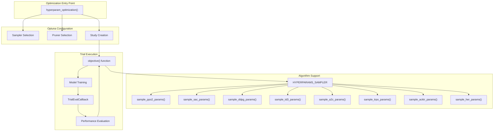
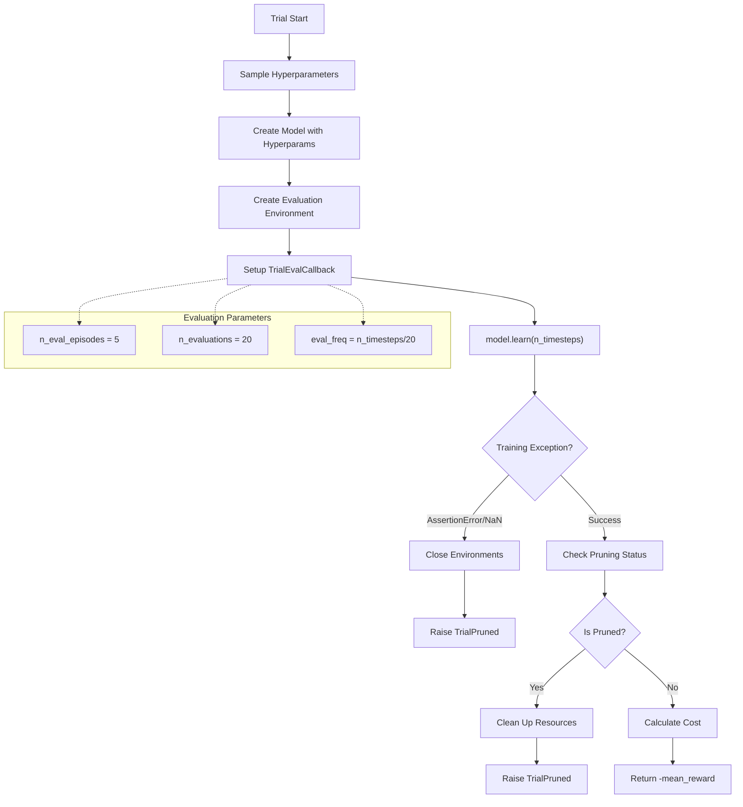
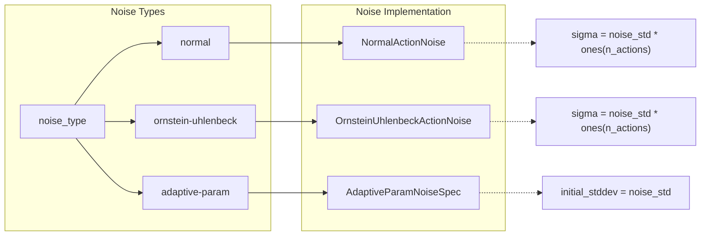
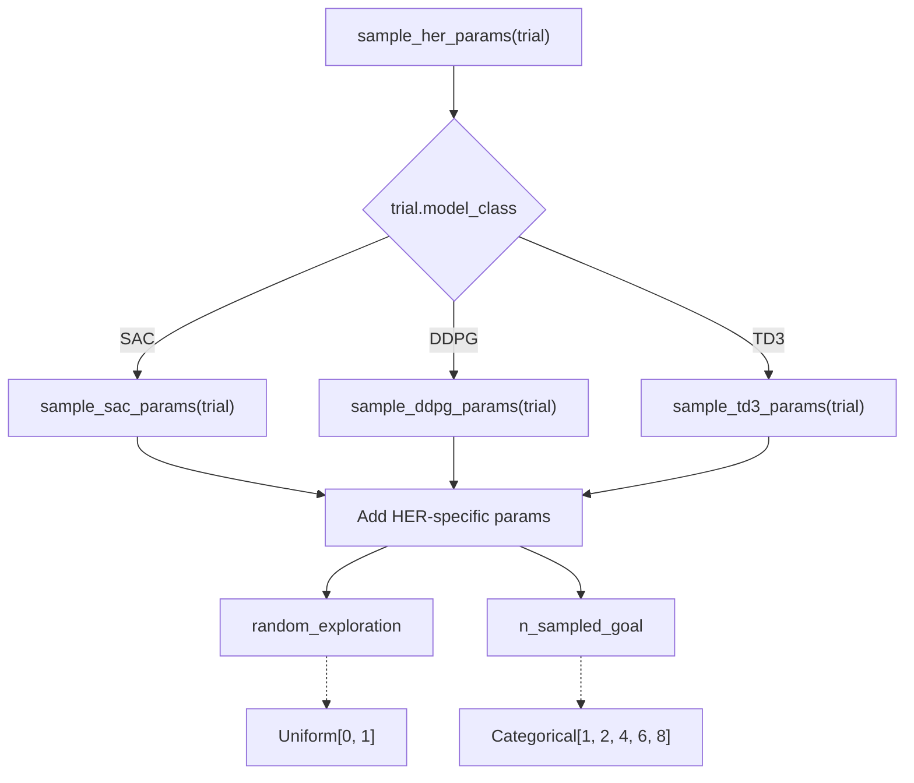

<!-- source: DeepWiki mcp.deepwiki.com · repo araffin/rl-baselines-zoo · page 2.3 Hyperparameter Optimization · fetched 2026-10-30 -->

# Hyperparameter Optimization

Relevant source files

The following files were used as context for generating this wiki page:

- [Makefile](Makefile)
- [setup.cfg](setup.cfg)
- [utils/hyperparams_opt.py](utils/hyperparams_opt.py)

This page covers the automated hyperparameter optimization system in RL Baselines Zoo, which uses Optuna to systematically search for optimal hyperparameters for reinforcement learning algorithms. The system provides samplers, pruners, and algorithm-specific parameter spaces to efficiently explore hyperparameter configurations.

For information about standard training workflows, see [Training Agents](#2.1). For details about algorithm configurations, see [Algorithm Configurations](#3.1).

## System Overview

The hyperparameter optimization system is built around the `hyperparam_optimization()` function in [utils/hyperparams_opt.py:25-146](), which integrates Optuna with the RL training pipeline. The system supports multiple sampling strategies, pruning methods, and provides algorithm-specific parameter spaces for efficient optimization.

**Sources:** [utils/hyperparams_opt.py:25-146](), [utils/hyperparams_opt.py:399-408]()

## Samplers and Pruners

The optimization system supports three sampling strategies and three pruning methods, configurable through the `sampler_method` and `pruner_method` parameters.

### Available Samplers

| Sampler | Class | Configuration | Use Case |
|---------|-------|---------------|----------|
| `random` | `RandomSampler` | `seed` parameter | Baseline random search |
| `tpe` | `TPESampler` | `n_startup_trials=10` | Tree-structured Parzen Estimator |
| `skopt` | `SkoptSampler` | Gaussian Process with GP hedge | Bayesian optimization |

### Available Pruners

| Pruner | Class | Configuration | Behavior |
|--------|-------|---------------|----------|
| `halving` | `SuccessiveHalvingPruner` | `min_resource=1, reduction_factor=4` | Aggressive early stopping |
| `median` | `MedianPruner` | `n_startup_trials=10, n_warmup_steps=n_evaluations//3` | Conservative pruning |
| `none` | `MedianPruner` | `n_startup_trials=n_trials` | No pruning |

**Sources:** [utils/hyperparams_opt.py:55-75]()

## Trial Evaluation Workflow

The optimization process evaluates each hyperparameter configuration through a structured trial system that balances evaluation accuracy with computational efficiency.

**Sources:** [utils/hyperparams_opt.py:83-127](), [utils/hyperparams_opt.py:47-52]()

## Algorithm-Specific Parameter Spaces

Each supported RL algorithm has a dedicated parameter sampling function that defines the search space for hyperparameter optimization. The functions are registered in the `HYPERPARAMS_SAMPLER` dictionary.

### PPO2 Parameter Space

The PPO2 sampler defines a comprehensive search space for policy gradient hyperparameters:

| Parameter | Type | Values/Range | Description |
|-----------|------|--------------|-------------|
| `batch_size` | Categorical | [32, 64, 128, 256] | Minibatch size for training |
| `n_steps` | Categorical | [16, 32, 64, 128, 256, 512, 1024, 2048] | Steps per environment |
| `gamma` | Categorical | [0.9, 0.95, 0.98, 0.99, 0.995, 0.999, 0.9999] | Discount factor |
| `learning_rate` | Log-uniform | [1e-5, 1] | Learning rate |
| `ent_coef` | Log-uniform | [1e-8, 0.1] | Entropy coefficient |
| `cliprange` | Categorical | [0.1, 0.2, 0.3, 0.4] | PPO clipping parameter |

**Sources:** [utils/hyperparams_opt.py:148-178]()

### SAC Parameter Space

The SAC sampler focuses on off-policy hyperparameters including buffer management and network architecture:

| Parameter | Type | Values/Range | Description |
|-----------|------|--------------|-------------|
| `batch_size` | Categorical | [16, 32, 64, 128, 256, 512] | Training batch size |
| `buffer_size` | Categorical | [1e4, 1e5, 1e6] | Replay buffer capacity |
| `learning_starts` | Categorical | [0, 1000, 10000, 20000] | Steps before training starts |
| `net_arch` | Categorical | ["small", "medium", "big"] | Network architecture |
| `ent_coef` | Categorical | ['auto', 0.5, 0.1, 0.05, 0.01, 0.0001] | Entropy regularization |

**Sources:** [utils/hyperparams_opt.py:230-270]()

### DDPG and TD3 Parameter Spaces

Both DDPG and TD3 samplers include action noise configuration:

**Sources:** [utils/hyperparams_opt.py:272-304](), [utils/hyperparams_opt.py:337-376]()

## HER Integration

The HER (Hindsight Experience Replay) sampler demonstrates the system's flexibility by delegating to underlying algorithm samplers based on the model class:

**Sources:** [utils/hyperparams_opt.py:379-396]()

## Integration with Training System

The hyperparameter optimization integrates with the main training pipeline through command-line interface flags and shares core utilities for environment creation and model instantiation.

The optimization system expects two factory functions:
- `model_fn(**kwargs)` - Creates model instances with given hyperparameters
- `env_fn(n_envs, eval_env)` - Creates training and evaluation environments

The system handles vectorized environments by adjusting evaluation frequency: `eval_freq_ = max(eval_freq // model.get_env().num_envs, 1)` for parallel environments.

**Sources:** [utils/hyperparams_opt.py:96-102]()

---

