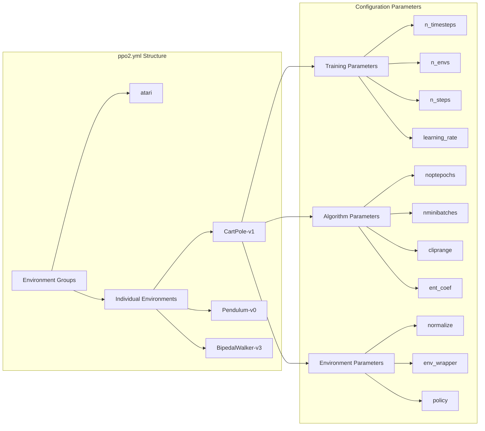
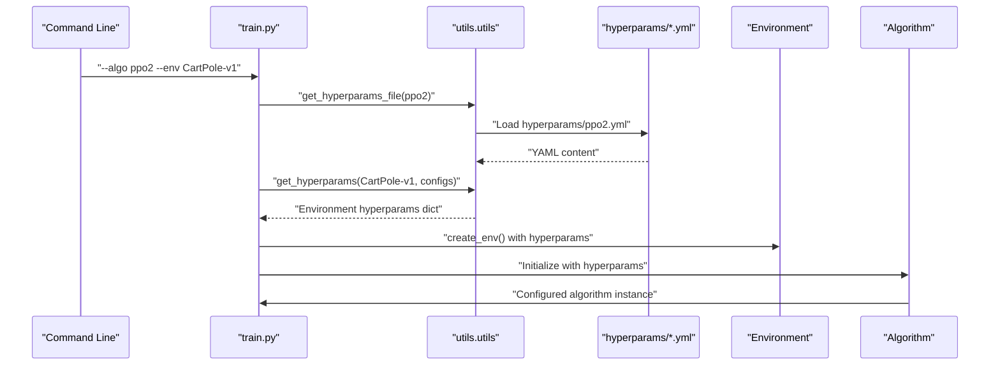

<!-- source: DeepWiki mcp.deepwiki.com · repo araffin/rl-baselines-zoo · page 3 Configuration System · fetched 2026-10-30 -->

# Configuration System

<details>
<summary>Relevant source files</summary>

The following files were used as context for generating this wiki page:

- [benchmark.md](benchmark.md)
- [hyperparams/ddpg.yml](hyperparams/ddpg.yml)
- [hyperparams/ppo2.yml](hyperparams/ppo2.yml)
- [hyperparams/sac.yml](hyperparams/sac.yml)

</details>


## Purpose and Scope

The Configuration System manages hyperparameters, environment settings, and algorithm-specific configurations across all reinforcement learning training and evaluation workflows in RL Baselines Zoo. This system enables reproducible training by storing algorithm-environment combinations with their optimized hyperparameters in structured YAML files.

For detailed information about algorithm-specific hyperparameter configurations, see [Algorithm Configurations](#3.1). For environment creation and wrapper management, see [Environment Management](#3.2).

## Configuration Architecture

The configuration system operates through a hierarchical structure that maps algorithms to environments with their respective hyperparameters:

```mermaid
graph TB
    subgraph "Configuration Files"
        A["hyperparams/ppo2.yml"]
        B["hyperparams/sac.yml"] 
        C["hyperparams/ddpg.yml"]
        D["hyperparams/a2c.yml"]
        E["hyperparams/dqn.yml"]
        F["hyperparams/td3.yml"]
        G["hyperparams/trpo.yml"]
        H["hyperparams/acktr.yml"]
        I["hyperparams/acer.yml"]
        J["hyperparams/her.yml"]
    end
    
    subgraph "Configuration Loading"
        K["train.py"]
        L["utils.utils.get_hyperparams_file()"]
        M["utils.utils.get_hyperparams()"]
    end
    
    subgraph "Environment Categories"
        N["Atari Games"]
        O["Classic Control"]
        P["Continuous Control"] 
        Q["Bullet Physics"]
        R["MiniGrid"]
        S["GoalEnv/HER"]
    end
    
    subgraph "Training Components"
        T["Algorithm Instance"]
        U["Environment Creation"]
        V["Policy Networks"]
        W["Callbacks"]
    end
    
    K --> L
    L --> A
    L --> B
    L --> C
    L --> D
    L --> E
    L --> F
    L --> G
    L --> H
    L --> I
    L --> J
    
    L --> M
    M --> N
    M --> O
    M --> P
    M --> Q
    M --> R
    M --> S
    
    M --> T
    M --> U
    M --> V
    M --> W
```



Sources: [hyperparams/ppo2.yml:1-344](), [hyperparams/sac.yml:1-184](), [hyperparams/ddpg.yml:1-87]()

## Configuration File Structure

Each algorithm configuration file follows a consistent YAML structure mapping environment names to hyperparameter dictionaries:



Sources: [hyperparams/ppo2.yml:1-50](), [hyperparams/ppo2.yml:68-103](), [hyperparams/ppo2.yml:154-169]()

## Configuration Categories

The system organizes configurations into distinct categories based on algorithm capabilities and environment types:

| Configuration Type | Description | Example Files |
|-------------------|-------------|---------------|
| **On-Policy Algorithms** | Algorithms that learn from current policy | `ppo2.yml`, `a2c.yml`, `acktr.yml`, `trpo.yml` |
| **Off-Policy Algorithms** | Algorithms that learn from replay buffer | `sac.yml`, `ddpg.yml`, `td3.yml`, `dqn.yml` |
| **Advanced Algorithms** | Specialized algorithms with unique requirements | `her.yml`, `acer.yml` |

### Environment-Specific Adaptations

Configurations adapt to environment characteristics through specialized parameters:

```mermaid
graph TD
    subgraph "Atari Games"
        A["CnnPolicy"]
        B["Frame Stacking"]
        C["Clipping Rewards"]
        D["8 Parallel Envs"]
    end
    
    subgraph "Continuous Control"
        E["MlpPolicy"]
        F["Normalization"]
        G["Custom Wrappers"]
        H["TimeFeatureWrapper"]
    end
    
    subgraph "Classic Control"  
        I["MlpPolicy"]
        J["Short Episodes"]
        K["High Env Count"]
        L["Simple Hyperparams"]
    end
    
    subgraph "Bullet Physics"
        M["CustomMlpPolicy"]
        N["Action/Obs Scaling"]
        O["Long Training"]
        P["Performance Tuning"]
    end
    
    A --> Q["Algorithm Configuration"]
    E --> Q
    I --> Q
    M --> Q
    
    B --> R["Environment Setup"]
    F --> R
    J --> R
    N --> R
    
    C --> S["Training Process"]
    G --> S
    K --> S
    O --> S
```



Sources: [hyperparams/ppo2.yml:1-12](), [hyperparams/sac.yml:49-62](), [hyperparams/ddpg.yml:38-48]()

## Configuration Loading and Application

The configuration system integrates with the training pipeline through a structured loading process:



Sources: [hyperparams/ppo2.yml:28-39]()

## Special Configuration Features

### Linear Schedule Parameters

The system supports dynamic parameter scheduling using the `lin_` prefix:

| Parameter Format | Description | Example |
|-----------------|-------------|---------|
| `lin_2.5e-4` | Linear decay from initial value to 0 | Learning rate scheduling |
| `lin_0.1` | Linear decay for clipping parameters | Cliprange scheduling |

### Normalization Settings

Environment normalization is configured through multiple approaches:

```yaml
# Boolean normalization
normalize: true

# Selective normalization  
normalize: "{'norm_obs': True, 'norm_reward': False}"
```

### Custom Environment Wrappers

Configurations can specify environment modifications:

```yaml
env_wrapper: utils.wrappers.TimeFeatureWrapper
env_wrapper: gym_minigrid.wrappers.FlatObsWrapper
```

Sources: [hyperparams/ppo2.yml:155](), [hyperparams/sac.yml:50](), [hyperparams/ppo2.yml:316]()

## Performance-Driven Configuration

The benchmark results demonstrate the effectiveness of the configuration system across algorithm-environment combinations:

| Algorithm | Best Performance Environments | Configuration Strategy |
|-----------|------------------------------|----------------------|
| **PPO2** | Atari, Bullet Physics | Balanced exploration-exploitation |
| **SAC** | Continuous Control | High sample efficiency |
| **DDPG** | Simple Continuous | Deterministic policies |
| **TD3** | Complex Continuous | Improved critic training |

The configuration system enables consistent performance across 9 algorithms and over 50 environments, with hyperparameters tuned for optimal results in each domain.

Sources: [benchmark.md:1-136]()

---

