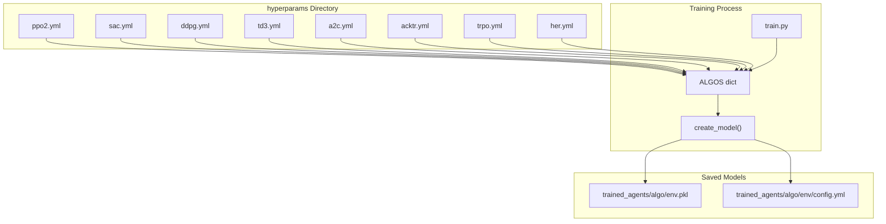
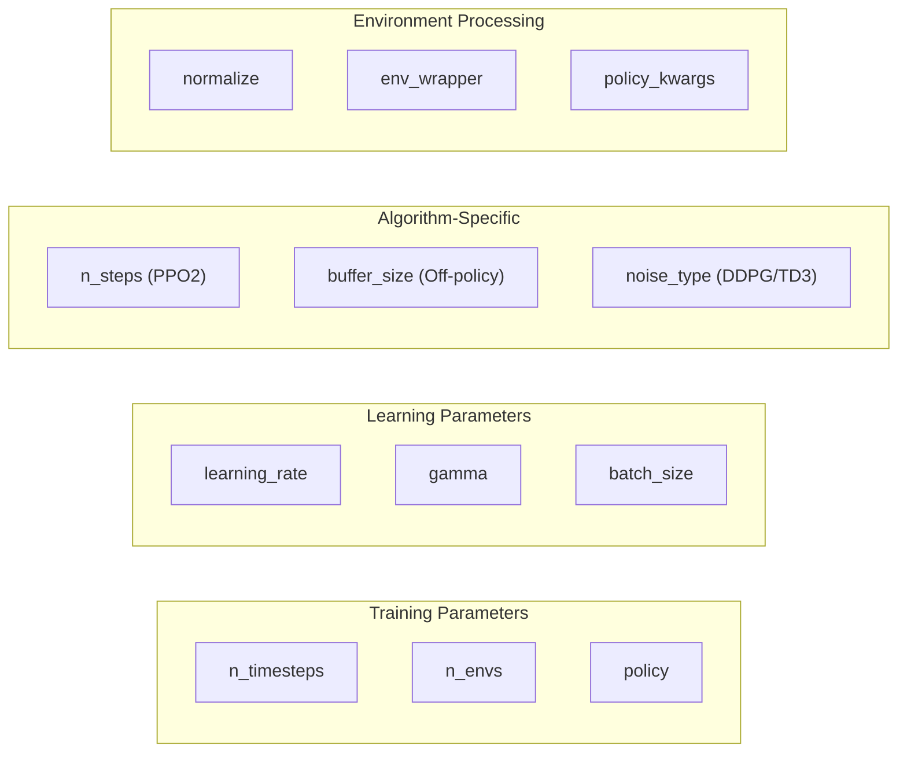
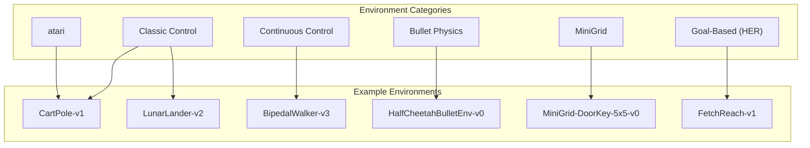
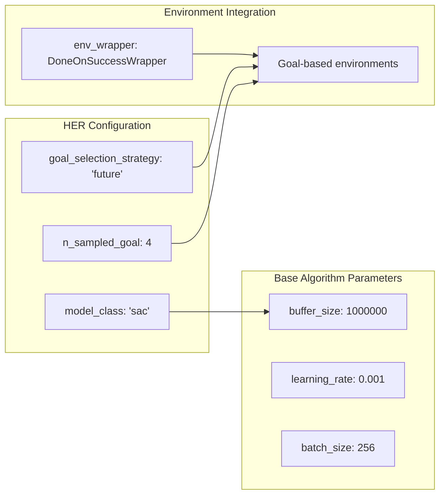
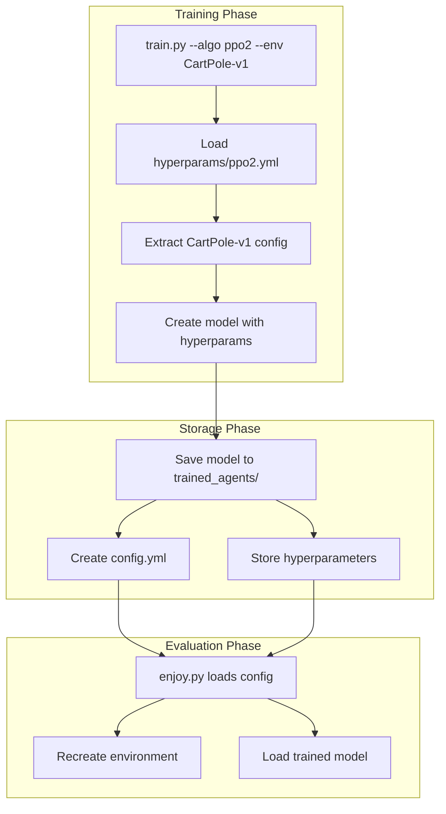

<!-- source: DeepWiki mcp.deepwiki.com · repo araffin/rl-baselines-zoo · page 3.1 Algorithm Configurations · fetched 2026-10-30 -->

# Algorithm Configurations

<details>
<summary>Relevant source files</summary>

The following files were used as context for generating this wiki page:

- [hyperparams/a2c.yml](hyperparams/a2c.yml)
- [hyperparams/acktr.yml](hyperparams/acktr.yml)
- [hyperparams/ddpg.yml](hyperparams/ddpg.yml)
- [hyperparams/her.yml](hyperparams/her.yml)
- [hyperparams/ppo2.yml](hyperparams/ppo2.yml)
- [hyperparams/td3.yml](hyperparams/td3.yml)
- [hyperparams/trpo.yml](hyperparams/trpo.yml)
- [trained_agents/a2c/BipedalWalkerHardcore-v3.pkl](trained_agents/a2c/BipedalWalkerHardcore-v3.pkl)
- [trained_agents/her/FetchPickAndPlace-v1.zip](trained_agents/her/FetchPickAndPlace-v1.zip)
- [trained_agents/her/FetchPickAndPlace-v1/config.yml](trained_agents/her/FetchPickAndPlace-v1/config.yml)
- [trained_agents/ppo2/BipedalWalkerHardcore-v3.pkl](trained_agents/ppo2/BipedalWalkerHardcore-v3.pkl)

</details>


This page documents the hyperparameter configuration system for RL algorithms in the RL Baselines Zoo. The configuration system uses YAML files to define algorithm-specific hyperparameters for different environments, enabling reproducible training and easy hyperparameter management.

For information about environment creation and wrapper configurations, see [Environment Management](#3.2). For the overall training workflow that uses these configurations, see [Training Agents](#2.1).

## Configuration File Structure

The algorithm configurations are stored in the `hyperparams/` directory, with each file corresponding to a specific RL algorithm. Each YAML file contains environment-specific hyperparameter sets that have been tuned for optimal performance.



**Sources:** [hyperparams/ppo2.yml:1-344](), [hyperparams/her.yml:1-144](), [hyperparams/ddpg.yml:1-87]()

## Supported Algorithms

The RL Baselines Zoo supports hyperparameter configurations for the following algorithms:

| Algorithm | File | Description |
|-----------|------|-------------|
| PPO2 | `ppo2.yml` | Proximal Policy Optimization |
| SAC | `sac.yml` | Soft Actor-Critic |
| DDPG | `ddpg.yml` | Deep Deterministic Policy Gradient |
| TD3 | `td3.yml` | Twin Delayed Deep Deterministic Policy Gradient |
| A2C | `a2c.yml` | Advantage Actor-Critic |
| ACKTR | `acktr.yml` | Actor-Critic using Kronecker-Factored Trust Region |
| TRPO | `trpo.yml` | Trust Region Policy Optimization |
| HER | `her.yml` | Hindsight Experience Replay (with base algorithms) |

**Sources:** [hyperparams/ppo2.yml:1](), [hyperparams/ddpg.yml:1](), [hyperparams/td3.yml:1](), [hyperparams/a2c.yml:1](), [hyperparams/acktr.yml:1](), [hyperparams/trpo.yml:1](), [hyperparams/her.yml:1]()

## Common Hyperparameter Categories

Algorithm configurations typically include the following categories of hyperparameters:



**Sources:** [hyperparams/ppo2.yml:14-39](), [hyperparams/ddpg.yml:1-21](), [hyperparams/a2c.yml:7-22]()

### Core Training Parameters

- **`n_timesteps`**: Total number of training timesteps (e.g., `!!float 1e7`)
- **`policy`**: Policy network architecture (`'MlpPolicy'`, `'CnnPolicy'`, `'LnMlpPolicy'`)
- **`n_envs`**: Number of parallel environments for training

### Learning Rate and Optimization

- **`learning_rate`**: Learning rate, can be constant or scheduled (e.g., `lin_2.5e-4` for linear decay)
- **`gamma`**: Discount factor for future rewards
- **`normalize`**: Whether to normalize observations and/or returns

### Algorithm-Specific Parameters

Each algorithm has specialized hyperparameters:

**PPO2 Parameters:**
- `n_steps`: Number of steps per environment per update
- `nminibatches`: Number of minibatches for each update
- `noptepochs`: Number of optimization epochs
- `cliprange`: Clipping parameter for policy updates
- `ent_coef`: Entropy coefficient
- `vf_coef`: Value function coefficient

**Off-Policy Algorithm Parameters (DDPG, SAC, TD3):**
- `buffer_size`: Size of the replay buffer
- `batch_size`: Minibatch size for training
- `learning_starts`: Number of steps before learning starts
- `train_freq`: Frequency of training updates

**Sources:** [hyperparams/ppo2.yml:28-39](), [hyperparams/ddpg.yml:23-36](), [hyperparams/td3.yml:52-65]()

## Environment-Specific Configurations

Each algorithm configuration file contains environment-specific hyperparameter sets. Environments are organized by categories:



**Sources:** [hyperparams/ppo2.yml:1-13](), [hyperparams/ppo2.yml:28-39](), [hyperparams/ppo2.yml:104-117](), [hyperparams/her.yml:107-119]()

### Atari Games

Atari environments use convolutional policies and specific hyperparameters optimized for visual input:

```yaml
atari:
  policy: 'CnnPolicy'
  n_envs: 8
  n_steps: 128
  noptepochs: 4
  nminibatches: 4
  n_timesteps: !!float 1e7
```

### Continuous Control

Continuous control tasks often require normalization and specific network architectures:

```yaml
BipedalWalker-v3:
  normalize: true
  n_envs: 16
  n_timesteps: !!float 5e6
  policy: 'MlpPolicy'
  n_steps: 2048
  nminibatches: 32
```

**Sources:** [hyperparams/ppo2.yml:1-12](), [hyperparams/ppo2.yml:104-116]()

## Special Algorithm Configurations

### Hindsight Experience Replay (HER)

HER configurations combine goal-based RL with underlying algorithms like DDPG, SAC, or TD3. The `her.yml` file specifies both HER-specific and base algorithm parameters:



**HER-Specific Parameters:**
- `model_class`: Underlying algorithm (`'ddpg'`, `'sac'`, `'td3'`)
- `n_sampled_goal`: Number of additional goals to sample
- `goal_selection_strategy`: Strategy for goal selection (`'future'`, `'final'`, `'episode'`)

**Sources:** [hyperparams/her.yml:76-90](), [hyperparams/her.yml:107-119]()

### Environment Wrappers

Many configurations specify custom environment wrappers:

- `env_wrapper: utils.wrappers.TimeFeatureWrapper`: Adds time features
- `env_wrapper: utils.wrappers.DoneOnSuccessWrapper`: Marks episodes done on success
- `env_wrapper: gym_minigrid.wrappers.FlatObsWrapper`: Flattens MiniGrid observations

**Sources:** [hyperparams/ppo2.yml:155](), [hyperparams/her.yml:77](), [hyperparams/ppo2.yml:316]()

## Configuration Usage and Storage

The configuration system integrates with the training and evaluation pipeline:



### Saved Model Configuration

When models are trained and saved, their configurations are preserved in `config.yml` files alongside the model files. This ensures reproducibility:

```yaml
!!python/object/apply:collections.OrderedDict
- - - buffer_size
    - 1000000
  - - ent_coef
    - auto
  - - gamma
    - 0.95
  - - n_timesteps
    - 4000000.0
  - - policy
    - MlpPolicy
```

**Sources:** [trained_agents/her/FetchPickAndPlace-v1/config.yml:1-24](), [trained_agents/her/FetchPickAndPlace-v1.zip:1-107]()

## YAML Syntax Features

The configuration files use advanced YAML features for flexible parameter specification:

- **Scientific notation**: `!!float 1e7` for large numbers
- **Linear scheduling**: `lin_2.5e-4` for learning rate decay
- **Python expressions**: `"dict(layers=[256, 256, 256])"` for policy kwargs
- **Comments**: `# Tuned` to indicate optimization status

**Sources:** [hyperparams/ppo2.yml:7-8](), [hyperparams/her.yml:16](), [hyperparams/ppo2.yml:27](), [hyperparams/ddpg.yml:22]()

---

