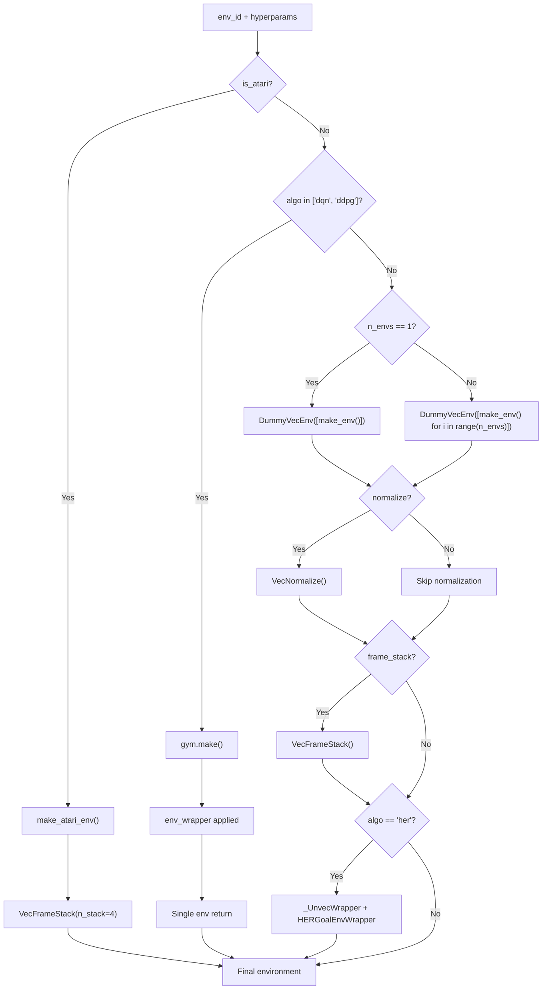
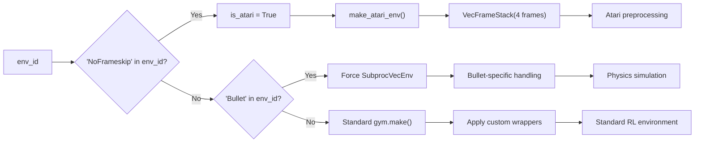
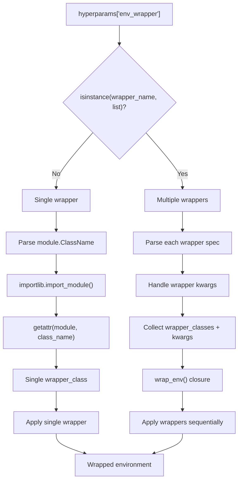
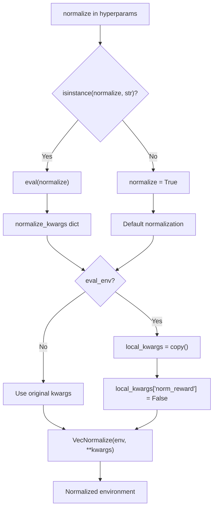

<!-- source: DeepWiki mcp.deepwiki.com · repo araffin/rl-baselines-zoo · page 3.2 Environment Management · fetched 2026-10-30 -->

# Environment Management

<details>
<summary>Relevant source files</summary>

The following files were used as context for generating this wiki page:

- [train.py](train.py)
- [trained_agents/ppo2/HalfCheetahBulletEnv-v0/config.yml](trained_agents/ppo2/HalfCheetahBulletEnv-v0/config.yml)
- [utils/__init__.py](utils/__init__.py)
- [utils/noise.py](utils/noise.py)
- [utils/record_video.py](utils/record_video.py)
- [utils/utils.py](utils/utils.py)
- [utils/wrappers.py](utils/wrappers.py)

</details>


This document covers how environments are created, configured, and wrapped in the RL Baselines Zoo. It explains the environment creation pipeline, wrapper system, normalization mechanisms, and special handling for different environment types. For algorithm-specific hyperparameter configurations, see [Algorithm Configurations](#3.1). For training orchestration that uses these environments, see [Training Agents](#2.1).

## Environment Creation Pipeline

The environment creation process follows a structured pipeline that handles different environment types, applies wrappers, and configures normalization. The system supports both training and evaluation environments with different configurations.

### Core Environment Creation Flow



Sources: [train.py:228-291](), [utils/utils.py:185-258]()

### Environment Factory Functions

The system provides two main environment creation functions with different purposes:

| Function | Purpose | Location | Key Features |
|----------|---------|----------|--------------|
| `make_env` | Creates individual env for multiprocessing | [utils/utils.py:148-182]() | Handles seeding, logging, wrapper application |
| `create_test_env` | Creates env for evaluation/testing | [utils/utils.py:185-258]() | Loads normalization stats, supports rendering |
| `create_env` (nested) | Creates env during training | [train.py:228-291]() | Handles training vs eval modes, normalization |

Sources: [utils/utils.py:148-258](), [train.py:228-291]()

## Environment Detection and Configuration

### Environment Type Detection

The system automatically detects environment types and applies appropriate configurations:



Sources: [train.py:123-126](), [utils/utils.py:222-235]()

### Hyperparameter-Driven Configuration

Environment settings are loaded from YAML configuration files and can be overridden via command line:

```python
# Environment kwargs from command line
env_kwargs = {} if args.env_kwargs is None else args.env_kwargs

# Wrapper specification from hyperparams
env_wrapper = get_wrapper_class(hyperparams)
```

Sources: [train.py:226](), [train.py:210]()

## Wrapper System

### Wrapper Class Resolution

The `get_wrapper_class` function dynamically loads wrapper classes from string specifications:



Sources: [utils/utils.py:81-145]()

### Built-in Custom Wrappers

The system includes several custom wrappers for specific use cases:

| Wrapper Class | Purpose | Configuration |
|---------------|---------|---------------|
| `DoneOnSuccessWrapper` | Reset on goal achievement | `reward_offset` parameter |
| `TimeFeatureWrapper` | Add time features to observations | `max_steps`, `test_mode` parameters |
| `FlattenDictWrapper` | Flatten dictionary observations | Automatic for dict obs spaces |

**DoneOnSuccessWrapper Implementation:**
```python
# Modifies episode termination and reward
done = done or info.get('is_success', False)
reward += self.reward_offset
```

**TimeFeatureWrapper Implementation:**
```python
# Adds remaining time as observation feature
time_feature = 1 - (self._current_step / self._max_steps)
return np.concatenate((obs, [time_feature]))
```

Sources: [utils/wrappers.py:6-75](), [utils/utils.py:75-78]()

## Normalization and Preprocessing

### VecNormalize Configuration

The system supports sophisticated observation and reward normalization:



**Normalization Features:**
- Observation normalization using running statistics
- Reward normalization (disabled for evaluation)
- Configurable via hyperparameters string or boolean
- Separate handling for training vs evaluation environments

Sources: [train.py:190-197](), [train.py:264-279]()

### Frame Stacking

Environments can be configured with frame stacking for temporal information:

```python
# Optional Frame-stacking
if hyperparams.get('frame_stack', False):
    n_stack = hyperparams['frame_stack']
    env = VecFrameStack(env, n_stack)
```

Sources: [train.py:282-285]()

## Environment Types and Special Handling

### Atari Environments

Atari environments receive special preprocessing:
- Automatic detection via `'NoFrameskip'` in environment ID
- `make_atari_env()` with built-in Atari wrappers
- Automatic 4-frame stacking via `VecFrameStack`
- No custom normalization support

Sources: [train.py:243-248]()

### Bullet Physics Environments

PyBullet environments have specific requirements:
- Forced `SubprocVecEnv` for proper physics simulation
- Special rendering considerations
- Custom closing procedures for resource management

Sources: [utils/utils.py:231-233](), [utils/record_video.py:79-84]()

### HER (Hindsight Experience Replay) Environments

Goal-based environments using HER require special wrapping:
- Unwrapping from vectorized environments
- `HERGoalEnvWrapper` application
- Dictionary observation space handling

```python
if args.algo == 'her':
    if isinstance(env, VecEnv):
        env = _UnvecWrapper(env)
    env = HERGoalEnvWrapper(env)
```

Sources: [train.py:286-290]()

### Environment Import System

Custom environment packages are dynamically imported:

```python
# Going through custom gym packages to let them register
for env_module in args.gym_packages:
    importlib.import_module(env_module)
```

The system validates environment registration and provides helpful error messages:

```python
if env_id not in registered_envs:
    closest_match = difflib.get_close_matches(env_id, registered_envs, n=1)[0]
    raise ValueError('{} not found in gym registry, you maybe meant {}?'.format(env_id, closest_match))
```

Sources: [train.py:82-95](), [utils/import_envs.py]()

---

