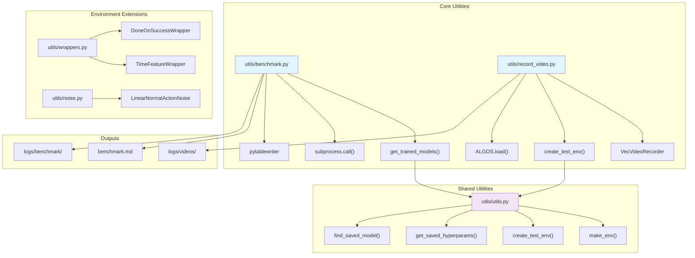
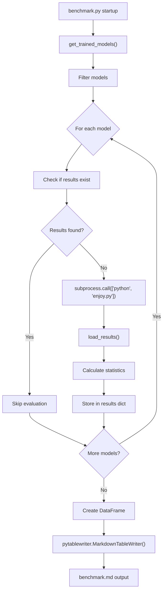
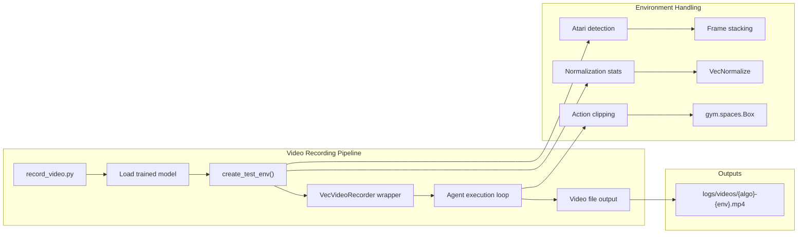

<!-- source: DeepWiki mcp.deepwiki.com · repo araffin/rl-baselines-zoo · page 4 Utilities and Tools · fetched 2026-10-30 -->

# Utilities and Tools

<details>
<summary>Relevant source files</summary>

The following files were used as context for generating this wiki page:

- [.coveragerc](.coveragerc)
- [trained_agents/ppo2/HalfCheetahBulletEnv-v0/config.yml](trained_agents/ppo2/HalfCheetahBulletEnv-v0/config.yml)
- [trained_agents/ppo2/InvertedDoublePendulumBulletEnv-v0.pkl](trained_agents/ppo2/InvertedDoublePendulumBulletEnv-v0.pkl)
- [trained_agents/ppo2/InvertedDoublePendulumBulletEnv-v0/obs_rms.pkl](trained_agents/ppo2/InvertedDoublePendulumBulletEnv-v0/obs_rms.pkl)
- [trained_agents/ppo2/InvertedDoublePendulumBulletEnv-v0/ret_rms.pkl](trained_agents/ppo2/InvertedDoublePendulumBulletEnv-v0/ret_rms.pkl)
- [trained_agents/ppo2/InvertedPendulumSwingupBulletEnv-v0.pkl](trained_agents/ppo2/InvertedPendulumSwingupBulletEnv-v0.pkl)
- [trained_agents/ppo2/InvertedPendulumSwingupBulletEnv-v0/obs_rms.pkl](trained_agents/ppo2/InvertedPendulumSwingupBulletEnv-v0/obs_rms.pkl)
- [trained_agents/ppo2/InvertedPendulumSwingupBulletEnv-v0/ret_rms.pkl](trained_agents/ppo2/InvertedPendulumSwingupBulletEnv-v0/ret_rms.pkl)
- [utils/__init__.py](utils/__init__.py)
- [utils/benchmark.py](utils/benchmark.py)
- [utils/noise.py](utils/noise.py)
- [utils/record_video.py](utils/record_video.py)
- [utils/wrappers.py](utils/wrappers.py)

</details>


This document covers the various utility tools and helper functions provided by RL Baselines Zoo for benchmarking, visualization, analysis, and development support. These tools complement the core training and evaluation workflows documented in [Getting Started](#2).

For information about Docker containerization and development infrastructure, see [Development and Deployment](#5). For details about custom callbacks and training extensions, see [Advanced Features](#6).

## Overview

The utilities system provides several categories of tools:

- **Benchmarking Tools**: Automated performance evaluation and comparison across trained models
- **Recording and Visualization**: Video capture and results plotting for agent analysis  
- **Environment Extensions**: Custom wrappers and modifications for specialized training scenarios
- **Noise and Exploration**: Action noise implementations for improved exploration
- **Development Helpers**: Utility functions for model management and environment creation

## Utility System Architecture



**Sources:** [utils/benchmark.py:1-133](), [utils/record_video.py:1-88](), [utils/wrappers.py:1-76](), [utils/noise.py:1-29](), [utils/__init__.py:1-4]()

## Benchmarking System

The benchmarking system provides automated performance evaluation across all trained models in the repository. The `benchmark.py` script orchestrates the entire process:



**Key Components:**

- **Model Discovery**: `get_trained_models()` scans the `trained_agents/` directory structure
- **Evaluation**: Subprocess calls to `enjoy.py` with standardized parameters  
- **Statistics Collection**: Mean reward, standard deviation, episode count, timestep count
- **Output Generation**: Markdown tables via `pytablewriter.MarkdownTableWriter`

**Algorithm-Specific Handling:**
```python
# Single environment algorithms
if algo in ['dqn', 'ddpg', 'sac', 'td3']:
    n_envs = 1
    n_timesteps *= args.n_envs
```

**Sources:** [utils/benchmark.py:33-51](), [utils/benchmark.py:89-123]()

## Video Recording System

The video recording system captures agent behavior for visual analysis and debugging:



**Key Features:**

- **Environment Recreation**: Uses `create_test_env()` with saved hyperparameters and normalization statistics
- **Video Wrapper**: `VecVideoRecorder` handles automatic recording triggers and file naming
- **Action Processing**: Proper clipping for continuous action spaces via `np.clip()`
- **Resource Management**: Careful cleanup of environment processes and video handles

**Sources:** [utils/record_video.py:55-87](), [utils/record_video.py:66-77]()

## Environment Wrappers

The wrapper system provides specialized environment modifications:

### DoneOnSuccessWrapper

Modifies episode termination for goal-based environments:

| Feature | Implementation |
|---------|----------------|
| **Purpose** | Reset on goal achievement for GoalEnv |
| **Termination** | `done = done or info.get('is_success', False)` |
| **Reward Offset** | Configurable positive offset for successful episodes |
| **Goal Environments** | HER-compatible reward computation |

### TimeFeatureWrapper  

Adds temporal information to observations:

| Feature | Implementation |
|---------|----------------|
| **Time Feature** | `time_feature = 1 - (current_step / max_steps)` |
| **Observation Space** | Extended by 1 dimension |
| **Test Mode** | Constant time feature (1.0) to test overfitting |
| **Use Case** | Fixed-length episodes requiring time awareness |

**Sources:** [utils/wrappers.py:6-24](), [utils/wrappers.py:26-75]()

## Noise Implementation

### LinearNormalActionNoise

Provides exploration noise with scheduled decay:

```python
class LinearNormalActionNoise(ActionNoise):
    def __call__(self):
        t = min(1.0, self._step / self._max_steps)
        sigma = (1 - t) * self._sigma + t * self._final_sigma
        self._step += 1
        return np.random.normal(self._mu, sigma)
```

**Features:**
- Linear interpolation between initial and final noise levels
- Step-based scheduling over training duration  
- Gaussian noise distribution
- Compatible with Stable-Baselines action noise interface

**Sources:** [utils/noise.py:6-28]()

## Core Utility Functions

The `utils/utils.py` module (referenced via imports) provides foundational functions used across the utilities:

| Function | Purpose |
|----------|---------|
| `make_env()` | Environment factory with wrapper application |
| `create_test_env()` | Test environment setup with normalization |
| `get_saved_hyperparams()` | Load hyperparameters from trained models |
| `find_saved_model()` | Locate model files by algorithm and environment |
| `get_trained_models()` | Scan and catalog available trained models |

**Sources:** [utils/__init__.py:1-3]()

---

