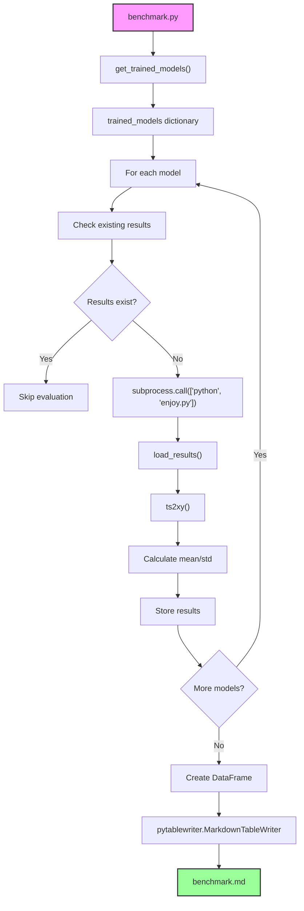
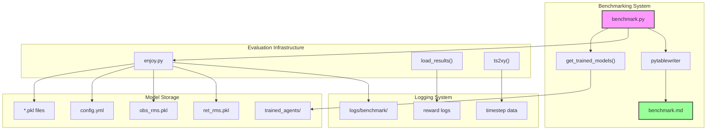
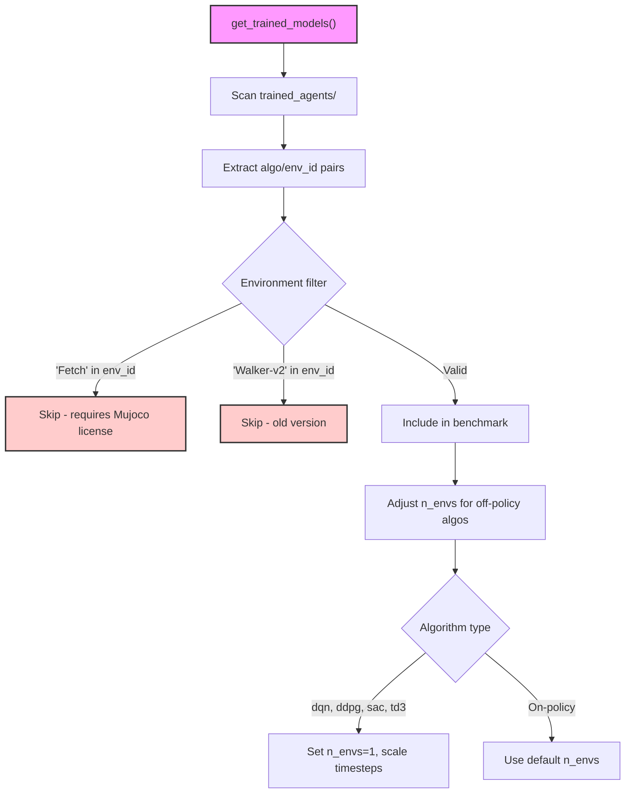
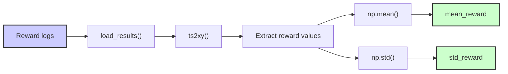
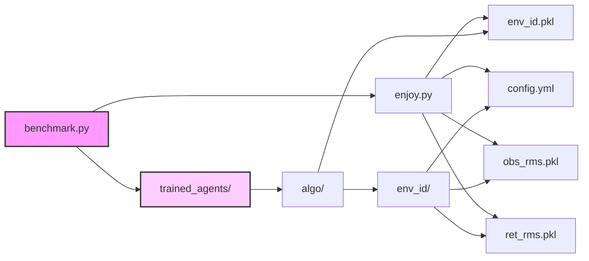

<!-- source: DeepWiki mcp.deepwiki.com · repo araffin/rl-baselines-zoo · page 4.1 Benchmarking and Performance Evaluation · fetched 2026-10-30 -->

# Benchmarking and Performance Evaluation

<details>
<summary>Relevant source files</summary>

The following files were used as context for generating this wiki page:

- [.coveragerc](.coveragerc)
- [benchmark.md](benchmark.md)
- [hyperparams/sac.yml](hyperparams/sac.yml)
- [trained_agents/ppo2/InvertedDoublePendulumBulletEnv-v0.pkl](trained_agents/ppo2/InvertedDoublePendulumBulletEnv-v0.pkl)
- [trained_agents/ppo2/InvertedDoublePendulumBulletEnv-v0/obs_rms.pkl](trained_agents/ppo2/InvertedDoublePendulumBulletEnv-v0/obs_rms.pkl)
- [trained_agents/ppo2/InvertedDoublePendulumBulletEnv-v0/ret_rms.pkl](trained_agents/ppo2/InvertedDoublePendulumBulletEnv-v0/ret_rms.pkl)
- [trained_agents/ppo2/InvertedPendulumSwingupBulletEnv-v0.pkl](trained_agents/ppo2/InvertedPendulumSwingupBulletEnv-v0.pkl)
- [trained_agents/ppo2/InvertedPendulumSwingupBulletEnv-v0/obs_rms.pkl](trained_agents/ppo2/InvertedPendulumSwingupBulletEnv-v0/obs_rms.pkl)
- [trained_agents/ppo2/InvertedPendulumSwingupBulletEnv-v0/ret_rms.pkl](trained_agents/ppo2/InvertedPendulumSwingupBulletEnv-v0/ret_rms.pkl)
- [utils/benchmark.py](utils/benchmark.py)

</details>


This document covers the benchmarking and performance evaluation system in RL Baselines Zoo, which provides automated testing of trained agents across multiple environments and algorithms to generate standardized performance metrics.

The benchmarking system evaluates trained models systematically, collecting performance statistics and generating comprehensive reports. For information about training agents, see [Training Agents](#2.1). For details on evaluating individual agents interactively, see [Evaluating Trained Agents](#2.2).

## System Architecture

The benchmarking system consists of several key components that work together to automate performance evaluation across the entire collection of trained models.

### Benchmarking Workflow



Sources: [utils/benchmark.py:1-133]()

### Integration with Core Systems



Sources: [utils/benchmark.py:17-133](), [utils/utils.py:1-18]()

## Benchmark Execution Process

### Command Line Interface

The benchmarking script accepts several configuration parameters:

| Parameter | Description | Default |
|-----------|-------------|---------|
| `--log-dir` | Root folder for trained models | `trained_agents/` |
| `--benchmark-dir` | Benchmark log output folder | `logs/benchmark/` |
| `-n, --n-timesteps` | Number of timesteps for evaluation | `150000` |
| `--n-envs` | Number of parallel environments | `1` |
| `--seed` | Random generator seed | `0` |
| `--test-mode` | Run single experiment only | `False` |

Sources: [utils/benchmark.py:19-31]()

### Model Discovery and Filtering

The system automatically discovers trained models and applies filtering logic:



Sources: [utils/benchmark.py:33-61]()

### Evaluation Process

For each valid model, the system executes the following evaluation sequence:

1. **Result Cache Check**: Verifies if evaluation results already exist
2. **Subprocess Execution**: Calls `enjoy.py` with specific parameters
3. **Result Collection**: Loads and processes evaluation logs
4. **Statistics Calculation**: Computes mean and standard deviation of rewards

```python
# Key parameters passed to enjoy.py
arguments = [
    '-n', str(n_timesteps),
    '--n-envs', str(n_envs),
    '-f', args.log_dir,
    '--algo', algo,
    '--env', env_id,
    '--no-render',
    '--seed', str(args.seed),
    '--verbose', '0',
    '--reward-log', reward_log
]
```

Sources: [utils/benchmark.py:63-90]()

## Results Format and Analysis

### Benchmark Results Structure

The benchmark generates a standardized table with the following columns:

| Column | Description | Type |
|--------|-------------|------|
| `algo` | Algorithm identifier | String |
| `env_id` | Environment identifier | String |
| `mean_reward` | Average reward across episodes | Float |
| `std_reward` | Standard deviation of rewards | Float |
| `n_timesteps` | Total timesteps evaluated | Integer |
| `n_episodes` | Number of episodes completed | Integer |

Sources: [utils/benchmark.py:35-42](), [benchmark.md:1-136]()

### Statistical Processing

The system calculates performance statistics using data from evaluation logs:



Sources: [utils/benchmark.py:92-104]()

### Output Generation

The benchmarking system generates multiple output formats:

1. **Markdown Table**: Primary human-readable format saved to `benchmark.md`
2. **DataFrame**: Structured data using pandas for further analysis
3. **Optional CSV**: Alternative format for data processing

The results are sorted by algorithm and environment ID for consistent presentation.

Sources: [utils/benchmark.py:113-132]()

## Performance Metrics

### Algorithm Performance Overview

Based on the current benchmark results, here are key performance patterns:

- **SAC**: Achieves highest mean rewards on continuous control tasks (e.g., `AntBulletEnv-v0`: 3485.228)
- **TD3**: Strong performance on robotic manipulation tasks
- **PPO2**: Consistent performance across diverse environment types
- **DQN**: Specialized for discrete action spaces (Atari games)

### Environment Categories

The benchmark covers several environment categories:

| Category | Examples | Characteristics |
|----------|----------|----------------|
| Atari | `*NoFrameskip-v4` | Discrete actions, visual input |
| Continuous Control | `*BulletEnv-v0` | Continuous actions, state-based |
| Classic Control | `CartPole-v1`, `Pendulum-v0` | Simple dynamics |
| Locomotion | `BipedalWalker-v2` | Complex continuous control |

Sources: [benchmark.md:1-136]()

## Integration Points

### Model Storage Integration

The benchmarking system integrates with the trained model storage system:



Sources: [utils/benchmark.py:33-45](), [trained_agents/ppo2/InvertedDoublePendulumBulletEnv-v0.pkl:1-5]()

### Logging System Integration

The benchmark system creates and manages evaluation logs:

- **Reward Logs**: Stored in `logs/benchmark/{model_name}/`
- **Result Caching**: Prevents redundant evaluations
- **Timestep Tracking**: Records evaluation progress

Sources: [utils/benchmark.py:62-90]()

---

