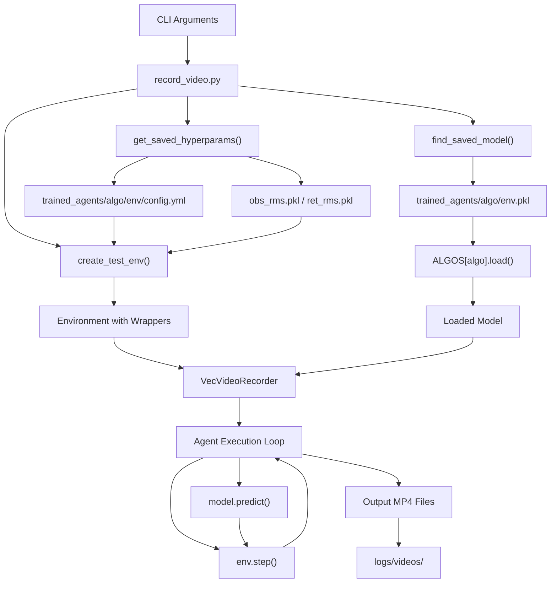
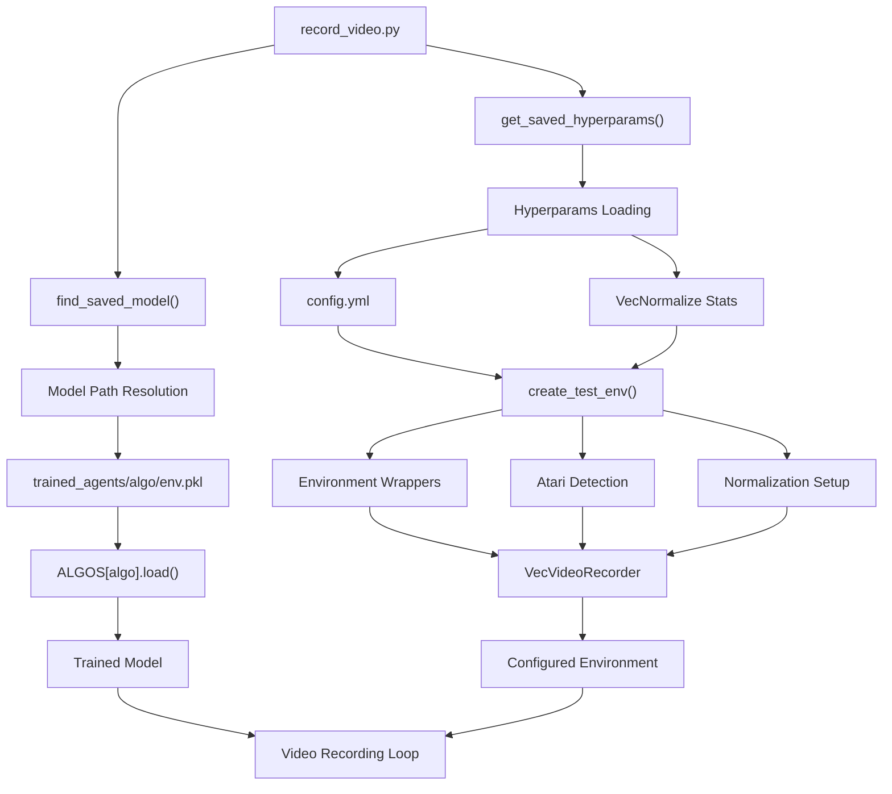
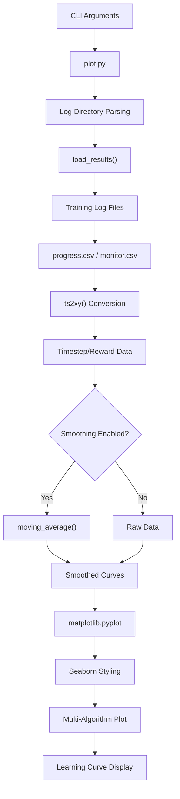
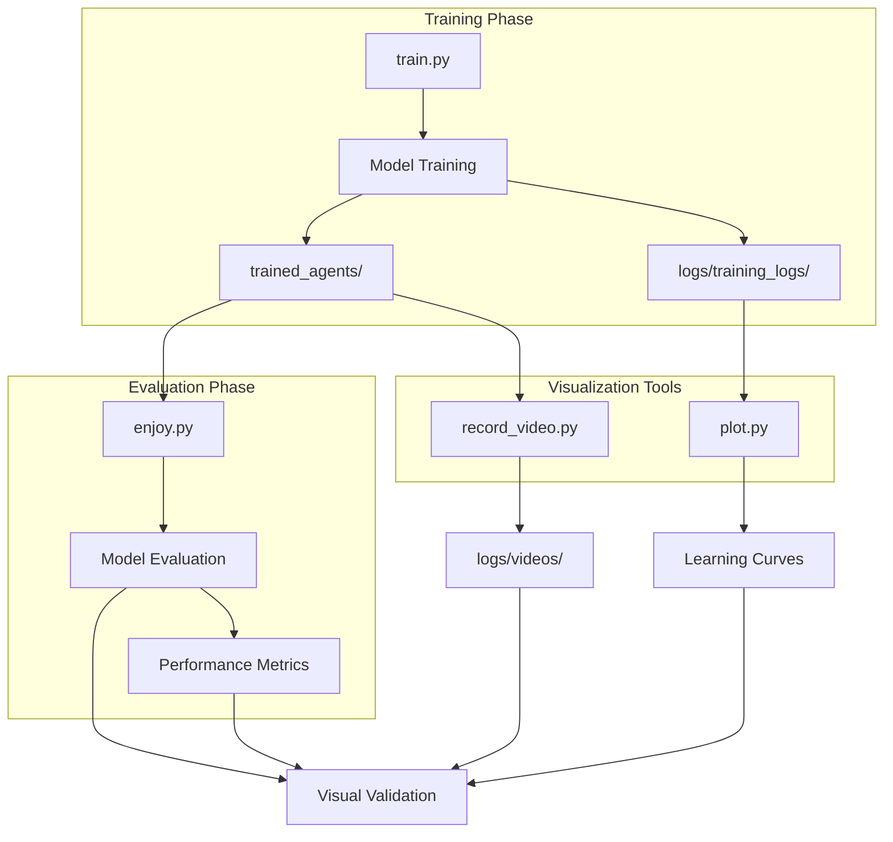

<!-- source: DeepWiki mcp.deepwiki.com · repo araffin/rl-baselines-zoo · page 4.2 Video Recording and Visualization · fetched 2026-10-30 -->

# Video Recording and Visualization

Relevant source files

The following files were used as context for generating this wiki page:

- [.github/ISSUE_TEMPLATE/issue-template.md](.github/ISSUE_TEMPLATE/issue-template.md)
- [tests/test_hyperparams_opt.py](tests/test_hyperparams_opt.py)
- [trained_agents/ppo2/HalfCheetahBulletEnv-v0/config.yml](trained_agents/ppo2/HalfCheetahBulletEnv-v0/config.yml)
- [utils/__init__.py](utils/__init__.py)
- [utils/noise.py](utils/noise.py)
- [utils/plot.py](utils/plot.py)
- [utils/record_video.py](utils/record_video.py)
- [utils/wrappers.py](utils/wrappers.py)

This document covers the video recording and visualization tools provided by RL Baselines Zoo for capturing agent behavior and analyzing training performance. These utilities enable users to generate videos of trained agents in action and create learning curve plots from training logs.

For information about benchmarking and performance evaluation metrics, see [Benchmarking and Performance Evaluation](#4.1). For details about trained agent storage and file formats, see [Trained Agent Storage and Management](#6.2).

## Video Recording System

The video recording system allows users to capture MP4 videos of trained RL agents performing in their environments. The primary tool is the `record_video.py` script which loads trained models and records their behavior.

### Video Recording Workflow

Sources: [utils/record_video.py:1-88]()

### Command Line Interface

The `record_video.py` script provides extensive command-line options for customizing video recording:

| Parameter | Description | Default | Example |
|-----------|-------------|---------|---------|
| `--env` | Environment ID | `CartPole-v1` | `--env HalfCheetahBulletEnv-v0` |
| `--algo` | RL Algorithm | `ppo2` | `--algo sac` |
| `-f, --folder` | Trained agents folder | `trained_agents` | `-f my_agents` |
| `-o, --output-folder` | Video output folder | `logs/videos/` | `-o recordings/` |
| `-n, --n-timesteps` | Video length in timesteps | `1000` | `-n 5000` |
| `--n-envs` | Number of parallel environments | `1` | `--n-envs 4` |
| `--deterministic` | Use deterministic actions | `False` | `--deterministic` |
| `--exp-id` | Experiment ID | `-1` | `--exp-id 3` |

Sources: [utils/record_video.py:12-29]()

### Model Loading and Environment Setup

The video recording system integrates with the trained model storage system to automatically configure environments with the correct wrappers and normalization statistics:

Sources: [utils/record_video.py:49-61](), [utils/utils.py:1-3]()

### Video Generation Process

The core video generation process uses Gym's `VecVideoRecorder` wrapper to capture agent behavior:

1. **Environment Wrapping**: The environment is wrapped with `VecVideoRecorder` configured to record from the first timestep
2. **Action Generation**: The trained model generates actions using `model.predict()` with optional determinism
3. **Action Clipping**: For continuous control environments, actions are clipped to the valid action space bounds
4. **Environment Cleanup**: Special handling for different environment types (Bullet, Atari, etc.) during cleanup

Sources: [utils/record_video.py:66-87]()

## Learning Curve Visualization

The `plot.py` utility provides tools for visualizing training progress and comparing algorithm performance through learning curve plots.

### Plotting System Architecture

Sources: [utils/plot.py:1-97]()

### Data Processing Pipeline

The plotting system processes training logs through several stages:

1. **Data Loading**: Uses `stable_baselines.results_plotter.load_results()` to read training logs
2. **Time Series Conversion**: Converts raw logs to timestep/reward pairs using `ts2xy()`
3. **Optional Smoothing**: Applies moving average smoothing with configurable window size
4. **Normalization**: Aligns different runs to the same timestep range for fair comparison

Sources: [utils/plot.py:22-48](), [utils/plot.py:63-82]()

### Visualization Features

| Feature | Function | Description |
|---------|----------|-------------|
| Smoothing | `smooth()` | Moving average smoothing with configurable window |
| Multi-Algorithm | Algorithm detection | Automatic legend generation from folder names |
| Time Formatting | `millions()` formatter | Human-readable timestep formatting (e.g., "2.5M") |
| Styling | Seaborn integration | Professional plot styling and color schemes |

Sources: [utils/plot.py:10-19](), [utils/plot.py:34-47](), [utils/plot.py:50-51]()

## Integration with Training Pipeline

Both video recording and visualization tools integrate seamlessly with the training and evaluation pipeline:

Sources: [utils/record_video.py:40-52](), [utils/plot.py:53-69]()

### Environment Compatibility

The video recording system handles various environment types through specialized logic:

- **Atari Environments**: Detected via `'NoFrameskip' in env_id` pattern
- **Bullet Physics**: Special cleanup handling for `'Bullet'` environments  
- **Continuous Control**: Action clipping for `gym.spaces.Box` action spaces
- **Vectorized Environments**: Support for multi-environment recording via `--n-envs`

Sources: [utils/record_video.py:55-87]()

### File Output Structure

Video files are saved with descriptive naming patterns:
- Format: `{algo}-{env_id}-episode-{episode_num}.mp4`
- Location: Configurable output folder (default: `logs/videos/`)
- Metadata: Video length and recording parameters preserved in filename

Sources: [utils/record_video.py:66-68]()

---

