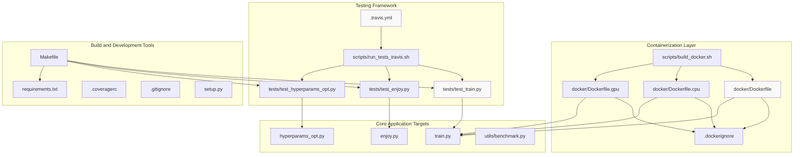
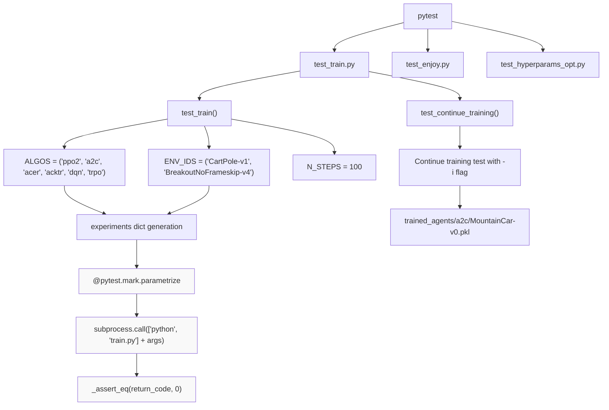
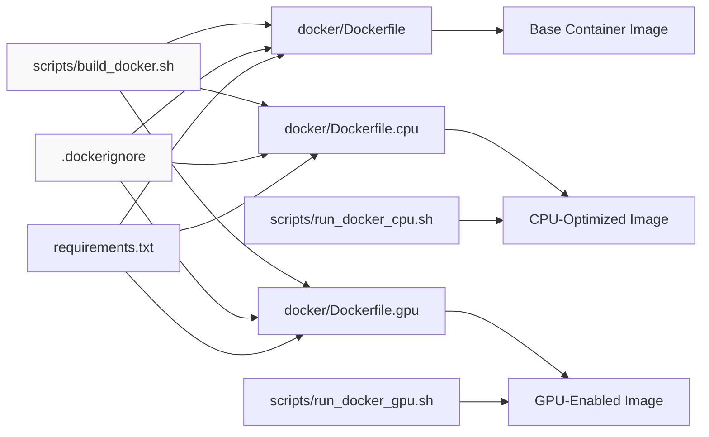
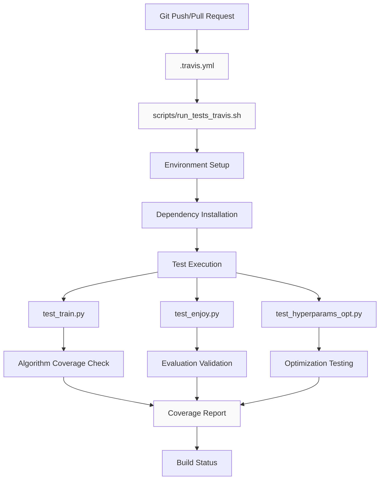

<!-- source: DeepWiki mcp.deepwiki.com · repo araffin/rl-baselines-zoo · page 5 Development and Deployment · fetched 2026-10-30 -->

# Development and Deployment

<details>
<summary>Relevant source files</summary>

The following files were used as context for generating this wiki page:

- [.dockerignore](.dockerignore)
- [tests/test_train.py](tests/test_train.py)

</details>


This section covers the infrastructure and tooling for developing, testing, and deploying the RL Baselines Zoo training system. It includes containerization with Docker, automated testing frameworks, and development workflow tools that ensure code quality and reproducible environments.

For specific Docker configuration details, see [Docker Setup and Containerization](#5.1). For testing implementation details, see [Testing Framework](#5.2). For build tools and repository configuration, see [Development Tools and Configuration](#5.3).

## Development Infrastructure Overview

The RL Baselines Zoo provides a comprehensive development infrastructure that supports both local development and production deployment scenarios. The system is designed around three core pillars: containerization for environment consistency, automated testing for quality assurance, and development tools for workflow automation.

### Development Infrastructure Components



Sources: [tests/test_train.py:1-62](), [.dockerignore:1-13]()

## Testing Architecture

The testing framework validates core functionality across different algorithms and environments using `pytest`. The test suite covers training workflows, model evaluation, and hyperparameter optimization processes.

### Test Execution Flow



Sources: [tests/test_train.py:8-62]()

### Test Configuration Matrix

The testing system uses a parametrized approach to validate multiple algorithm-environment combinations:

| Test Category | Algorithms | Environments | Purpose |
|---------------|------------|--------------|---------|
| Core Algorithms | `ppo2`, `a2c`, `acer`, `acktr`, `dqn`, `trpo` | `CartPole-v1`, `BreakoutNoFrameskip-v4` | Basic training validation |
| Continuous Control | `ddpg` | `MountainCarContinuous-v0` | DDPG-specific testing |
| SAC Algorithm | `sac` | `Pendulum-v0` | SAC-specific testing |
| Complex Environments | `ppo2` | `BipedalWalkerHardcore-v3` | VecNormalize and frame-stack testing |
| Continue Training | `a2c` | `MountainCar-v0` | Model loading and continuation |

Sources: [tests/test_train.py:14-30]()

## Docker Containerization System

The containerization system provides isolated, reproducible environments for training and evaluation. The Docker setup supports both CPU and GPU configurations with appropriate base images and dependency management.

### Docker Build Configuration



Sources: [.dockerignore:1-13]()

### Docker Exclusion Patterns

The `.dockerignore` file defines which files and directories are excluded from Docker build contexts to optimize build performance and container size:

```
__pycache__/         # Python bytecode cache
logs/                # Training logs
.pytest_cache/       # Test cache
.coverage            # Coverage reports
trained_agents/      # Pre-trained models
.git/                # Git repository data
```

Sources: [.dockerignore:1-13]()

## Development Workflow Integration

The development infrastructure integrates with continuous integration systems and provides automated validation of code changes. The workflow ensures that all core functionality remains operational across different environments and configurations.

### CI/CD Pipeline Structure



Sources: [tests/test_train.py:36-47]()

## Quality Assurance Mechanisms

The development infrastructure incorporates multiple quality assurance mechanisms including test parametrization, return code validation, and environment cleanup procedures.

### Test Validation Process

The testing framework uses subprocess calls to validate the actual command-line interface of the training system:

```python
return_code = subprocess.call(['python', 'train.py'] + args)
_assert_eq(return_code, 0)
```

This approach ensures that the testing validates the complete end-to-end workflow as users would experience it, rather than just testing individual functions in isolation.

Sources: [tests/test_train.py:46-47](), [tests/test_train.py:8-9]()

The test environment cleanup ensures consistent test execution by removing previous test artifacts before each test run, maintaining isolated test conditions across different algorithm and environment combinations.

Sources: [tests/test_train.py:31-33]()

---

