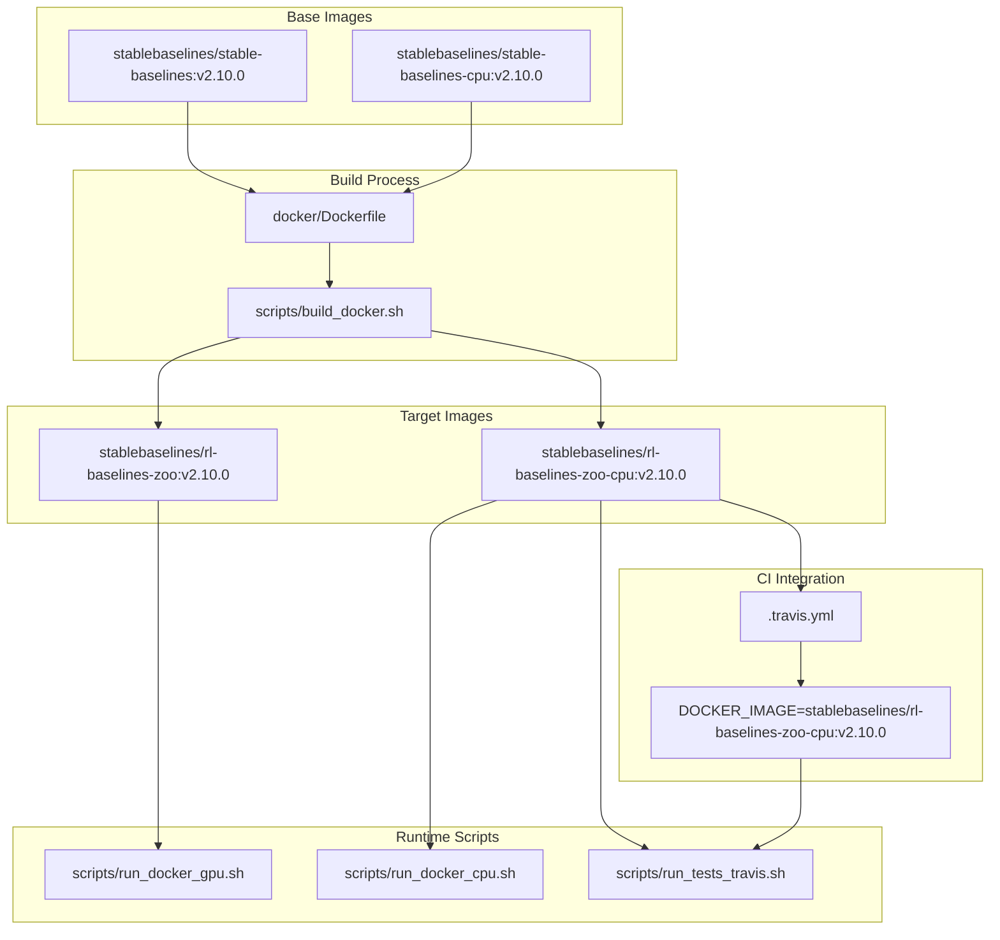
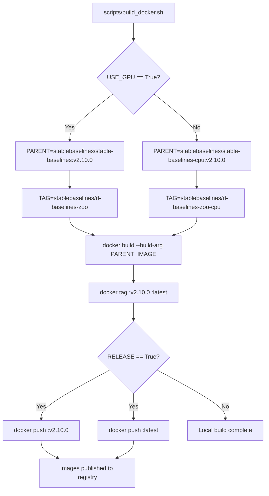
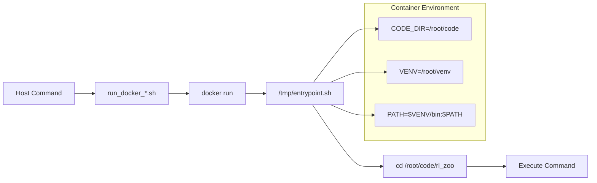
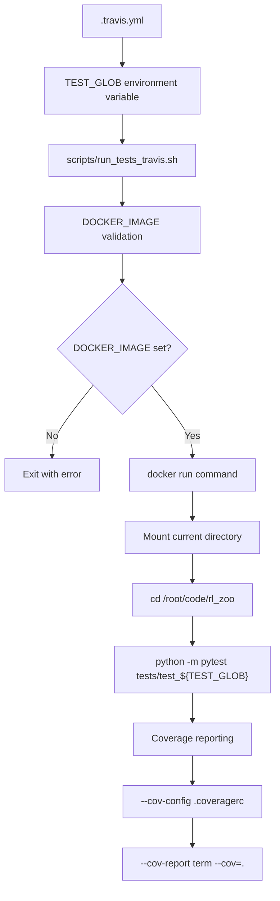

<!-- source: DeepWiki mcp.deepwiki.com · repo araffin/rl-baselines-zoo · page 5.1 Docker Setup and Containerization · fetched 2026-10-30 -->

# Docker Setup and Containerization

<details>
<summary>Relevant source files</summary>

The following files were used as context for generating this wiki page:

- [.dockerignore](.dockerignore)
- [.travis.yml](.travis.yml)
- [docker/Dockerfile](docker/Dockerfile)
- [scripts/build_docker.sh](scripts/build_docker.sh)
- [scripts/run_docker_cpu.sh](scripts/run_docker_cpu.sh)
- [scripts/run_docker_gpu.sh](scripts/run_docker_gpu.sh)
- [scripts/run_tests_travis.sh](scripts/run_tests_travis.sh)

</details>


This document covers the Docker containerization system used in RL Baselines Zoo for creating reproducible training environments. The Docker setup provides isolated environments with all necessary dependencies for RL training, supporting both CPU-only and GPU-accelerated configurations. For information about the testing framework that utilizes these containers, see [Testing Framework](#5.2).

## Docker Architecture Overview

The containerization system consists of a base Dockerfile that extends the stable-baselines Docker images, along with build and execution scripts that handle CPU/GPU variants and CI/CD integration.

### Container Build Structure



**Container Build and Execution Flow**
Sources: [docker/Dockerfile:1-36](), [scripts/build_docker.sh:1-22](), [scripts/run_docker_gpu.sh:1-12](), [scripts/run_docker_cpu.sh:1-12]()

## Container Configuration

### Dockerfile Structure

The main Dockerfile uses build arguments to support both CPU and GPU configurations:

| Build Argument | Purpose | Example Values |
|---|---|---|
| `PARENT_IMAGE` | Base stable-baselines image | `stablebaselines/stable-baselines:v2.10.0` |
| `USE_GPU` | GPU support flag | `True` or `False` |

The container setup includes system dependencies and Python packages:

**System Dependencies:** [docker/Dockerfile:5-12]()
- `ffmpeg` - Video processing for agent recordings
- `freeglut3-dev` - OpenGL support for rendering
- `swig` - Interface generator for C/C++ libraries  
- `xvfb` - Virtual framebuffer for headless rendering

**Python Environment:** [docker/Dockerfile:17-28]()
- `stable-baselines[mpi]==2.10.0` - Core RL algorithms
- `box2d-py==2.3.5` - Physics simulation environments
- `pybullet` - Bullet physics integration
- `gym-minigrid` - Grid world environments
- `scikit-optimize` and `optuna` - Hyperparameter optimization
- `pytablewriter` - Table formatting for reports

**Environment Configuration:** [docker/Dockerfile:14-15](), [docker/Dockerfile:30]()
```
CODE_DIR=/root/code
VENV=/root/venv
PATH=$VENV/bin:$PATH
```

Sources: [docker/Dockerfile:1-36]()

### Build Process

The build script `build_docker.sh` handles CPU/GPU image variants:



**Docker Image Build Logic**

The build script uses environment variables to determine image configuration: [scripts/build_docker.sh:8-13]()

Sources: [scripts/build_docker.sh:1-22]()

## Container Execution

### Runtime Scripts

Two execution scripts provide CPU and GPU container launching:

**GPU Container Execution:** [scripts/run_docker_gpu.sh:9-11]()
```bash
docker run -it --runtime=nvidia --rm --network host --ipc=host \
  --mount src=$(pwd),target=/root/code/rl_zoo,type=bind \
  stablebaselines/rl-baselines-zoo:v2.10.0
```

**CPU Container Execution:** [scripts/run_docker_cpu.sh:9-11]()
```bash
docker run -it --rm --network host --ipc=host \
  --mount src=$(pwd),target=/root/code/rl_zoo,type=bind \
  stablebaselines/rl-baselines-zoo-cpu:v2.10.0
```

**Key Runtime Parameters:**
- `--runtime=nvidia` - GPU access (GPU version only)
- `--network host --ipc=host` - Host network and IPC access
- `--mount type=bind` - Bind mount current directory to `/root/code/rl_zoo`
- `--rm` - Remove container after execution

Sources: [scripts/run_docker_gpu.sh:1-12](), [scripts/run_docker_cpu.sh:1-12]()

### Container Entry and Execution

The container uses an entrypoint script for initialization: [docker/Dockerfile:32-33]()



**Container Command Execution Flow**

Sources: [docker/Dockerfile:32-35](), [scripts/run_docker_gpu.sh:4-11](), [scripts/run_docker_cpu.sh:4-11]()

## CI/CD Integration

### Travis CI Configuration

The Docker containers are integrated into the continuous integration pipeline:

**Travis Environment:** [.travis.yml:8-10]()
```yaml
env:
  global:
    - DOCKER_IMAGE=stablebaselines/rl-baselines-zoo-cpu:v2.10.0
```

**Test Execution Strategy:** [.travis.yml:21-33]()
The test suite is split across multiple jobs to avoid Travis time limits:
- Unit Tests Train (`TEST_GLOB="train.py"`)
- Unit Tests Enjoy (`TEST_GLOB="enjoy.py"`)  
- Unit Tests Hyperparams opt (`TEST_GLOB="hyperparams_opt.py"`)

### Test Runner Implementation

The `run_tests_travis.sh` script executes tests within containers:



**Travis Test Execution Flow**

**Test Command Construction:** [scripts/run_tests_travis.sh:21-23]()
```bash
${DOCKER_CMD} ${DOCKER_IMAGE} \
    bash -c "${BASH_CMD} && \
             python -m pytest --cov-config .coveragerc --cov-report term --cov=. -v tests/test_${TEST_GLOB}"
```

Sources: [.travis.yml:1-33](), [scripts/run_tests_travis.sh:1-24]()

## Build Context Configuration

### Docker Ignore Rules

The `.dockerignore` file excludes development artifacts from the build context:

| Excluded Path | Purpose |
|---|---|
| `__pycache__/` | Python bytecode cache |
| `logs/` | Training logs and outputs |
| `.pytest_cache/` | Test framework cache |
| `.coverage*` | Code coverage reports |
| `trained_agents/` | Pre-trained model artifacts |
| `.git/` | Version control history |

This exclusion reduces build context size and prevents accidental inclusion of local artifacts in containers.

Sources: [.dockerignore:1-13]()

## Usage Examples

**Building Containers:**
```bash
# CPU version
USE_GPU=False ./scripts/build_docker.sh

# GPU version  
USE_GPU=True ./scripts/build_docker.sh
```

**Running Training:**
```bash
# CPU training
./scripts/run_docker_cpu.sh python train.py --algo ppo2 --env CartPole-v1

# GPU training
./scripts/run_docker_gpu.sh python train.py --algo sac --env BipedalWalker-v2
```

**Running Tests:**
```bash
# Manual test execution
./scripts/run_tests_travis.sh train.py
```

Sources: [scripts/build_docker.sh:8-16](), [scripts/run_docker_cpu.sh:4-11](), [scripts/run_docker_gpu.sh:4-11](), [scripts/run_tests_travis.sh:16-23]()

---

