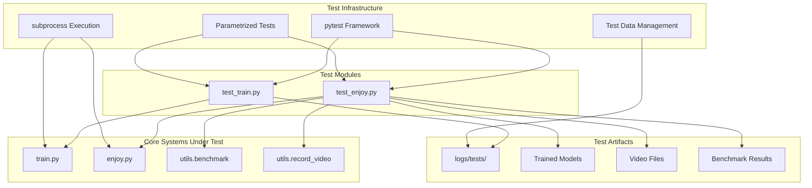
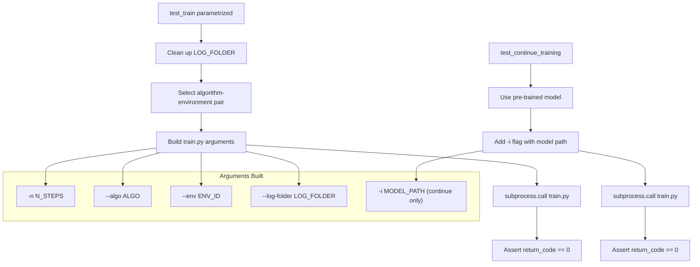
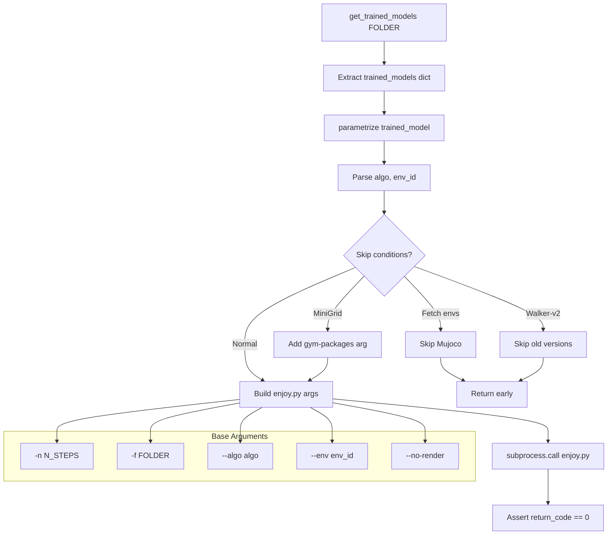
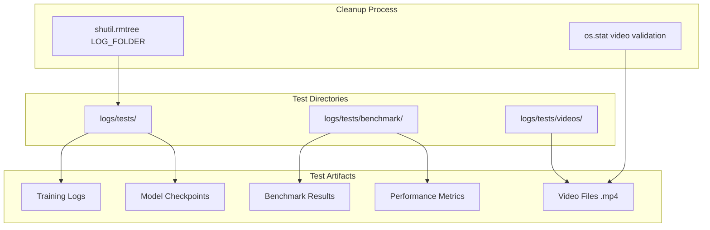

<!-- source: DeepWiki mcp.deepwiki.com · repo araffin/rl-baselines-zoo · page 5.2 Testing Framework · fetched 2026-10-30 -->

# Testing Framework

<details>
<summary>Relevant source files</summary>

The following files were used as context for generating this wiki page:

- [tests/test_enjoy.py](tests/test_enjoy.py)
- [tests/test_train.py](tests/test_train.py)
- [trained_agents/her/FetchReach-v1.pkl](trained_agents/her/FetchReach-v1.pkl)
- [trained_agents/her/FetchReach-v1/config.yml](trained_agents/her/FetchReach-v1/config.yml)

</details>


The testing framework provides automated validation for the core RL training and evaluation systems in the RL Baselines Zoo. It ensures that training workflows, model evaluation, benchmarking, and video recording functionality work correctly across different algorithms and environments.

For information about Docker-based development environments, see [Docker Setup and Containerization](#5.1). For details about development tools and build configuration, see [Development Tools and Configuration](#5.3).

## Test Architecture

The testing framework is built using pytest and organized around two main test modules that validate the core system components.

### Test Structure Overview



Sources: [tests/test_train.py:1-62](), [tests/test_enjoy.py:1-69]()

## Training System Tests

The training tests validate the core training pipeline across multiple algorithm-environment combinations using subprocess calls to `train.py`.

### Training Test Configuration

| Test Type | Algorithm | Environment | Purpose |
|-----------|-----------|-------------|---------|
| Basic Training | PPO2, A2C, ACER, ACKTR, DQN, TRPO | CartPole-v1, BreakoutNoFrameskip-v4 | Core algorithm validation |
| VecNormalize | PPO2 | BipedalWalkerHardcore-v3 | Environment wrapper testing |
| Continuous Control | DDPG | MountainCarContinuous-v0 | Continuous action spaces |
| Soft Actor-Critic | SAC | Pendulum-v0 | Modern algorithm validation |

The test configuration is defined in [tests/test_train.py:14-29]():

```python
ALGOS = ('ppo2', 'a2c', 'acer', 'acktr', 'dqn', 'trpo')
ENV_IDS = ('CartPole-v1', 'BreakoutNoFrameskip-v4')

experiments = {}
for algo in ALGOS:
    for env_id in ENV_IDS:
        experiments['{}-{}'.format(algo, env_id)] = (algo, env_id)
```

### Training Test Execution Flow



Sources: [tests/test_train.py:36-47](), [tests/test_train.py:50-61]()

## Evaluation System Tests

The evaluation tests validate model loading, environment execution, benchmarking, and video recording functionality.

### Evaluation Test Components

The evaluation tests cover three main areas using the `test_enjoy.py` module:

1. **Model Evaluation Tests**: Test trained model execution using `enjoy.py`
2. **Benchmarking Tests**: Validate performance measurement using `utils.benchmark`
3. **Video Recording Tests**: Test video capture using `utils.record_video`

### Model Evaluation Test Flow



Sources: [tests/test_enjoy.py:17-42]()

### Benchmarking and Video Recording Tests

The `test_benchmark()` function validates the benchmarking system:

```python
args = [
    '-n', str(N_STEPS),
    '--benchmark-dir', 'logs/tests/benchmark/',
    '--test-mode'
]
return_code = subprocess.call(['python', '-m', 'utils.benchmark'] + args)
```

The `test_record_video()` function validates video recording:

```python
args = [
    '-n', '100',
    '--algo', 'ppo2', 
    '--env', 'BipedalWalkerHardcore-v3',
    '-o', 'logs/tests/videos/'
]
return_code = subprocess.call(['python', '-m', 'utils.record_video'] + args)
```

Sources: [tests/test_enjoy.py:45-53](), [tests/test_enjoy.py:56-68]()

## Test Data and Environment Management

The testing framework includes mechanisms for managing test data, cleaning up artifacts, and handling environment-specific requirements.

### Test Directory Structure



Sources: [tests/test_train.py:16](), [tests/test_train.py:32-33](), [tests/test_enjoy.py:48](), [tests/test_enjoy.py:61]()

### Environment-Specific Test Handling

The tests include logic for handling different environment types and their requirements:

| Environment Type | Special Handling | Implementation |
|------------------|------------------|----------------|
| Mujoco/Fetch | Skip testing | `if 'Fetch' in trained_model: return` |
| Old BipedalWalker | Skip deprecated versions | `if 'Walker-v2' in trained_model: return` |
| MiniGrid | Add gym package | `args + ['--gym-packages', 'gym_minigrid']` |

This environment-specific handling ensures tests run reliably across different system configurations and avoid deprecated or problematic environments.

Sources: [tests/test_enjoy.py:30-39]()

## Test Execution Integration

The testing framework integrates with continuous integration systems and provides utilities for automated test execution.

### Test Validation Logic

All tests use a common assertion pattern implemented in the `_assert_eq()` helper function:

```python
def _assert_eq(left, right):
    assert left == right, '{} != {}'.format(left, right)
```

This function provides clear error messages when subprocess calls fail, making it easier to debug test failures in CI environments.

The tests primarily validate successful execution by checking subprocess return codes, ensuring that the core training and evaluation workflows complete without errors across the supported algorithm-environment combinations.

Sources: [tests/test_train.py:8-9](), [tests/test_enjoy.py:9-10]()

---

