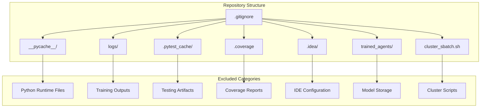
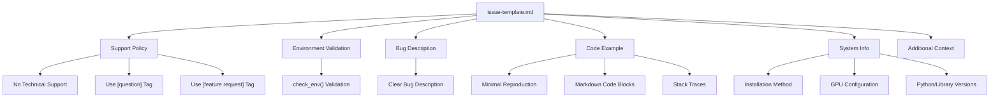
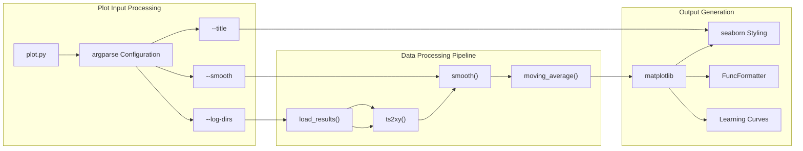
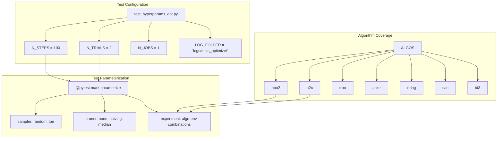
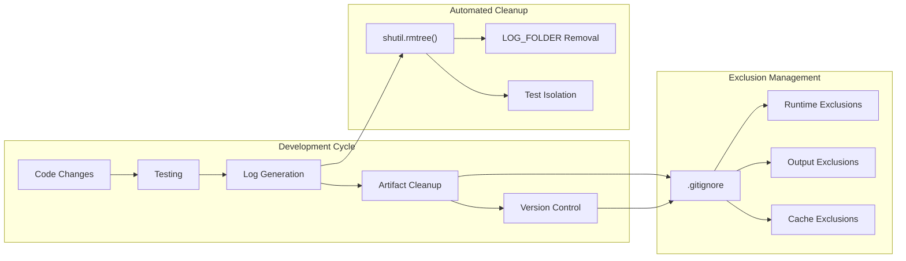

<!-- source: DeepWiki mcp.deepwiki.com · repo araffin/rl-baselines-zoo · page 5.3 Development Tools and Configuration · fetched 2026-10-30 -->

# Development Tools and Configuration

Relevant source files

The following files were used as context for generating this wiki page:

- [.github/ISSUE_TEMPLATE/issue-template.md](.github/ISSUE_TEMPLATE/issue-template.md)
- [.gitignore](.gitignore)
- [tests/test_hyperparams_opt.py](tests/test_hyperparams_opt.py)
- [utils/plot.py](utils/plot.py)

This document covers the development infrastructure, tooling, and repository configuration that support the RL Baselines Zoo development workflow. This includes version control configuration, issue templates, development utilities, and visualization tools used during development and debugging.

For information about the core testing framework, see [Testing Framework](#5.2). For Docker containerization and deployment tools, see [Docker Setup and Containerization](#5.1).

## Version Control Configuration

The repository uses comprehensive `.gitignore` patterns to exclude generated files, logs, and development artifacts from version control.

### Core Exclusion Patterns

The `.gitignore` file defines several categories of excluded content:

| Category | Patterns | Purpose |
|----------|----------|---------|
| Python Runtime | `__pycache__/`, `.pytest_cache/`, `.pytype/` | Exclude Python bytecode and testing cache |
| Coverage Data | `.coverage`, `.coverage.*` | Exclude code coverage reports |
| Development Tools | `.idea/` | Exclude IDE configuration files |
| Training Artifacts | `logs/`, `logs`, `trained_agents/` | Exclude training outputs and models |
| Version Control | `.git/` | Exclude git metadata |
| Cluster Scripts | `cluster_sbatch.sh`, `cluster_sbatch_mpi.sh` | Exclude local cluster configuration |

Sources: [.gitignore:1-13]()

## GitHub Issue Management

The repository provides structured issue templates to guide users in reporting bugs and requesting features effectively.

### Issue Template Structure

The issue template enforces a standardized format for bug reports and feature requests:

The template includes specific validation steps for custom gym environments using the `check_env()` function from stable-baselines, ensuring environment-related issues are properly diagnosed before reporting.

Sources: [.github/ISSUE_TEMPLATE/issue-template.md:1-55]()

## Development Utilities

### Plotting and Visualization Tools

The `utils/plot.py` module provides comprehensive plotting capabilities for analyzing training results and learning curves during development.

#### Plot Configuration and Data Processing

The plotting system supports multiple visualization options:

#### Key Plotting Functions

| Function | Purpose | Location |
|----------|---------|----------|
| `millions()` | Format large timestep values | [utils/plot.py:10-19]() |
| `moving_average()` | Smooth value sequences | [utils/plot.py:22-31]() |
| `smooth()` | Apply smoothing with window validation | [utils/plot.py:34-47]() |

The plotting system automatically handles different plot types (`timesteps`, `walltime_hrs`, `episodes`) and applies consistent formatting across multiple algorithm comparisons.

Sources: [utils/plot.py:1-97]()

### Testing Integration Support

The development tools integrate with the testing framework to support hyperparameter optimization testing.

#### Test Configuration Parameters

The hyperparameter optimization tests use standardized configuration:

The test framework generates comprehensive experiment combinations and validates that optimization runs complete successfully with various sampler and pruner configurations.

Sources: [tests/test_hyperparams_opt.py:12-58]()

## Development Workflow Integration

### File Organization and Cleanup

The development tools support automated cleanup and organization of development artifacts:

The testing framework automatically manages temporary directories and ensures clean test environments by removing previous test artifacts before execution.

Sources: [tests/test_hyperparams_opt.py:35-37](), [.gitignore:1-13]()

---

