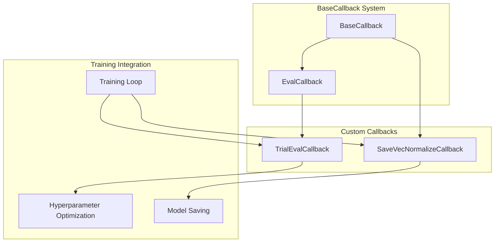
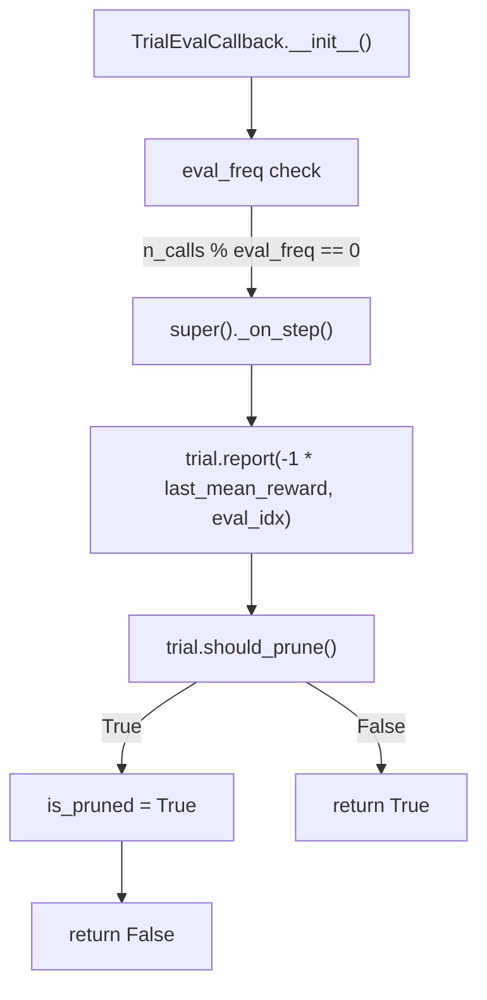
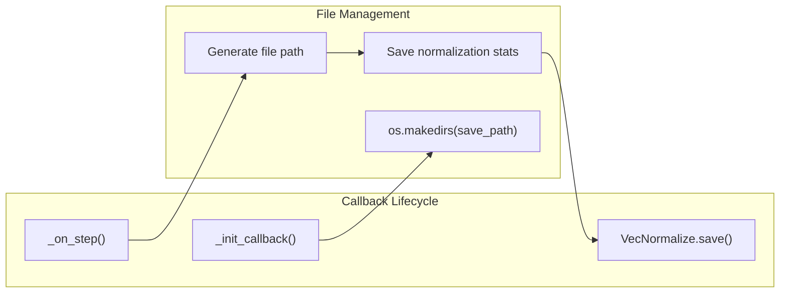
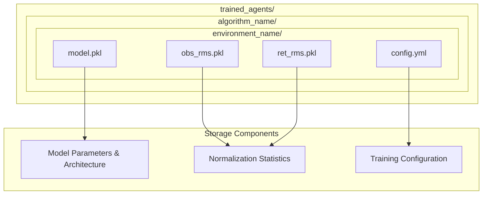
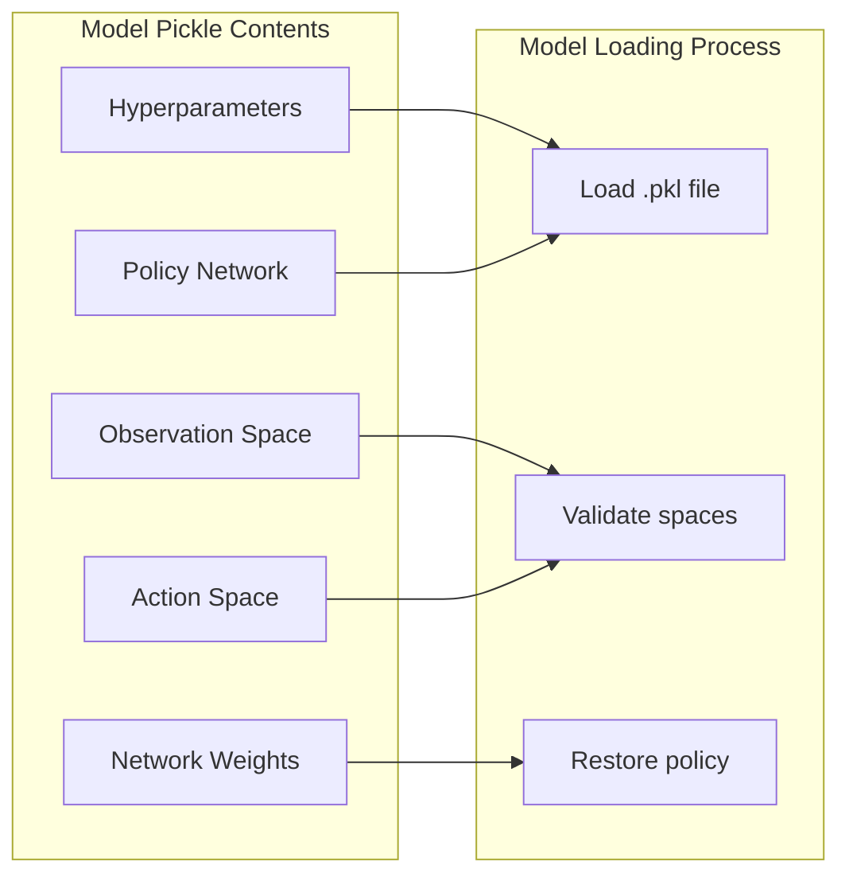
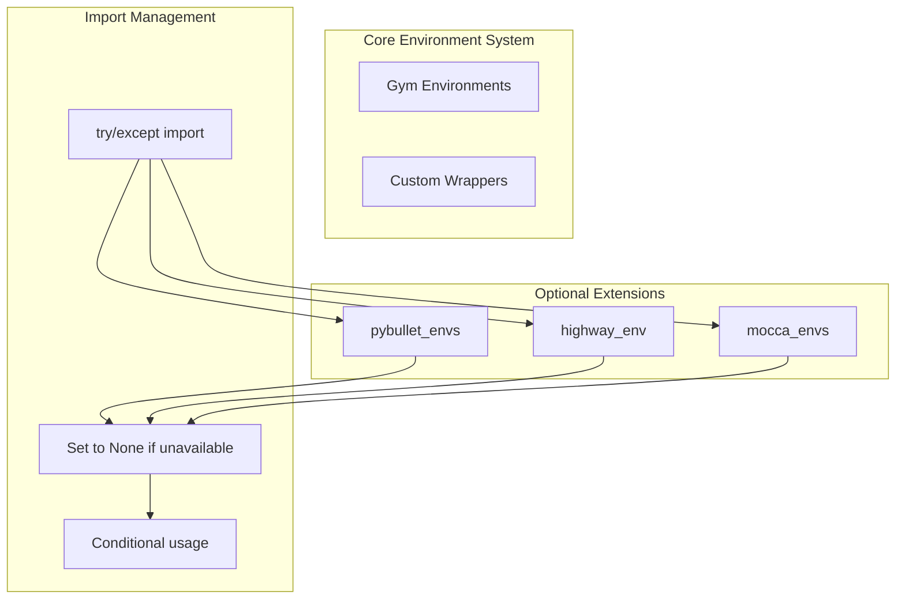
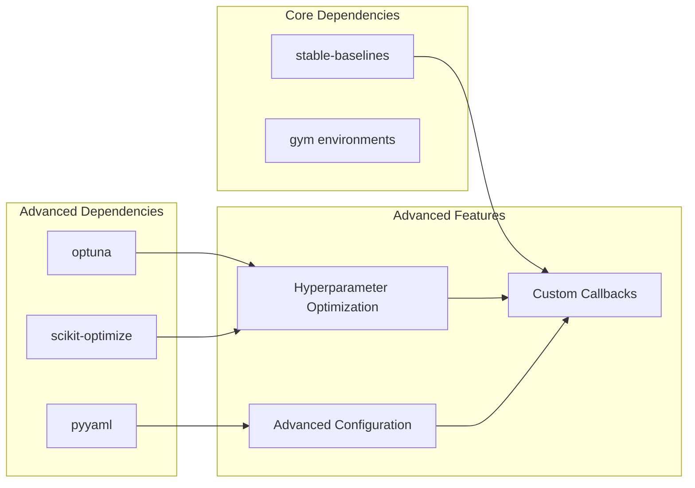

<!-- source: DeepWiki mcp.deepwiki.com · repo araffin/rl-baselines-zoo · page 6 Advanced Features · fetched 2026-10-30 -->

# Advanced Features

<details>
<summary>Relevant source files</summary>

The following files were used as context for generating this wiki page:

- [requirements.txt](requirements.txt)
- [trained_agents/dqn/BeamRiderNoFrameskip-v4.pkl](trained_agents/dqn/BeamRiderNoFrameskip-v4.pkl)
- [trained_agents/ppo2/BipedalWalkerHardcore-v2.pkl](trained_agents/ppo2/BipedalWalkerHardcore-v2.pkl)
- [trained_agents/ppo2/BipedalWalkerHardcore-v2/obs_rms.pkl](trained_agents/ppo2/BipedalWalkerHardcore-v2/obs_rms.pkl)
- [trained_agents/ppo2/BipedalWalkerHardcore-v2/ret_rms.pkl](trained_agents/ppo2/BipedalWalkerHardcore-v2/ret_rms.pkl)
- [utils/callbacks.py](utils/callbacks.py)
- [utils/import_envs.py](utils/import_envs.py)

</details>


This document covers advanced functionality in the RL Baselines Zoo that extends beyond basic training and evaluation workflows. It focuses on custom callbacks for training extensions, trained agent storage management, and advanced environment integration patterns.

For basic training and evaluation workflows, see [Getting Started](#2). For hyperparameter optimization, see [Hyperparameter Optimization](#2.3). For environment configuration basics, see [Environment Management](#3.2).

## Custom Callbacks and Training Extensions

The RL Baselines Zoo implements a sophisticated callback system that allows for custom training behavior, evaluation during training, and automated model management. The callback system is built on top of Stable Baselines' `BaseCallback` class and provides specialized implementations for different training scenarios.

### Training Callback Architecture



**Training Callback Integration Flow**

Sources: [utils/callbacks.py:1-68]()

### TrialEvalCallback Implementation

The `TrialEvalCallback` class extends the standard evaluation callback to support Optuna-based hyperparameter optimization trials. It provides automatic trial pruning based on performance metrics.

| Component | Function | Key Methods |
|-----------|----------|-------------|
| Trial Management | Integrates with Optuna trials | `__init__`, `_on_step` |
| Performance Reporting | Reports metrics to Optuna | `trial.report()` |
| Pruning Logic | Stops underperforming trials | `trial.should_prune()` |



**TrialEvalCallback Decision Flow**

Sources: [utils/callbacks.py:8-35]()

### SaveVecNormalizeCallback Implementation

The `SaveVecNormalizeCallback` handles automatic saving of vectorized environment normalization statistics during training. This ensures that observation and reward normalization parameters are preserved for later use during evaluation.



**SaveVecNormalizeCallback Process Flow**

The callback supports both timestamped saves and overwrite modes:

| Save Mode | Path Pattern | Use Case |
|-----------|-------------|----------|
| Timestamped | `{name_prefix}_{num_timesteps}_steps.pkl` | Training checkpoints |
| Overwrite | `vecnormalize.pkl` | Final model state |

Sources: [utils/callbacks.py:37-68]()

## Trained Agent Storage and Management

The RL Baselines Zoo implements a comprehensive storage system for trained agents that preserves all necessary information for model deployment and evaluation. The storage system maintains model artifacts, normalization statistics, and configuration metadata.

### Agent Storage Structure



**Trained Agent Storage Architecture**

Sources: [trained_agents/ppo2/BipedalWalkerHardcore-v2.pkl:1-10](), [trained_agents/ppo2/BipedalWalkerHardcore-v2/obs_rms.pkl:1-12](), [trained_agents/ppo2/BipedalWalkerHardcore-v2/ret_rms.pkl:1-9]()

### Normalization Statistics Management

The system automatically manages observation and return normalization statistics through the `RunningMeanStd` class. These statistics are critical for maintaining consistent preprocessing between training and evaluation phases.

| Statistic Type | File | Content | Usage |
|---------------|------|---------|--------|
| Observation Normalization | `obs_rms.pkl` | Mean, variance, count for each observation dimension | Input preprocessing |
| Return Normalization | `ret_rms.pkl` | Mean, variance, count for episode returns | Reward scaling |

### Model Serialization Format

The trained models are stored using Python's pickle format with the following key components:



**Model Serialization Components**

The model files contain algorithm-specific hyperparameters, network architectures, and learned parameters. The observation and action spaces are preserved to ensure compatibility during loading.

Sources: [trained_agents/ppo2/BipedalWalkerHardcore-v2.pkl:1-50]()

## Environment Extensions and Import System

The RL Baselines Zoo supports a modular environment extension system that allows integration with external environment packages. The system uses conditional imports to maintain compatibility across different installation configurations.

### Environment Import Architecture



**Environment Extension Import System**

### Conditional Environment Loading

The environment import system implements graceful degradation when optional dependencies are not available:

| Environment Package | Purpose | Fallback Behavior |
|---------------------|---------|-------------------|
| `pybullet_envs` | Physics simulation environments | Set to `None`, skip registration |
| `highway_env` | Autonomous driving scenarios | Set to `None`, skip registration |
| `mocca_envs` | Multi-object manipulation | Set to `None`, skip registration |

```python
# Pattern used for conditional imports
try:
    import pybullet_envs
except ImportError:
    pybullet_envs = None
```

This pattern ensures that the system remains functional even when specific environment packages are not installed, allowing for flexible deployment configurations.

Sources: [utils/import_envs.py:1-15]()

## Advanced Configuration Dependencies

The advanced features system integrates with several key dependencies that enable extended functionality:

### Required Dependencies for Advanced Features

| Package | Purpose | Advanced Features Enabled |
|---------|---------|---------------------------|
| `optuna` | Hyperparameter optimization | `TrialEvalCallback` trial management |
| `scikit-optimize` | Alternative optimization | Bayesian optimization support |
| `pyyaml>=5.1` | Configuration management | Advanced YAML parsing |
| `pytablewriter` | Report generation | Benchmark table formatting |
| `seaborn` | Visualization | Advanced plotting capabilities |

### Dependency Integration Flow



**Advanced Feature Dependency Graph**

Sources: [requirements.txt:1-10]()

The advanced features system provides a robust foundation for extending the basic RL training capabilities with custom callbacks, sophisticated model management, and flexible environment integration. These features enable production-ready deployments and advanced research workflows while maintaining backward compatibility and graceful degradation.

---

