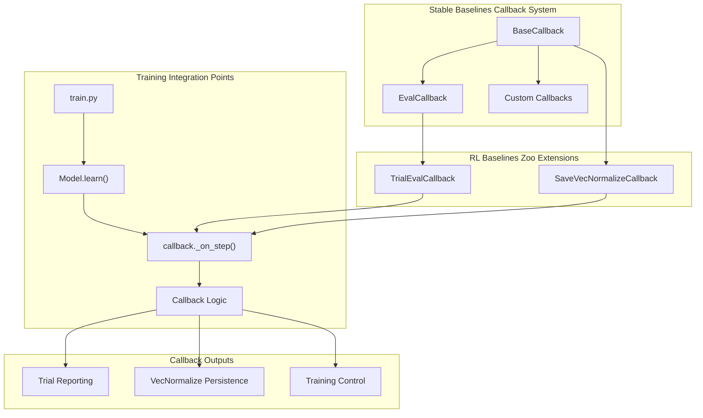
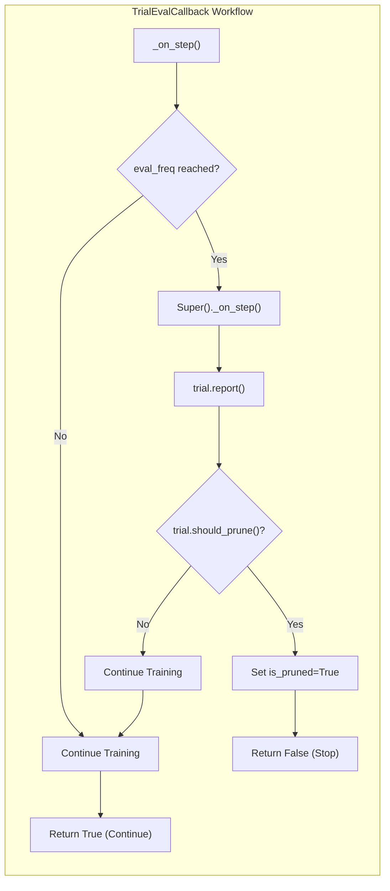
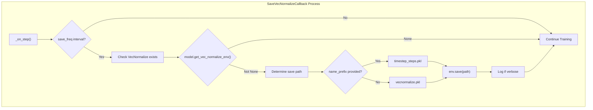
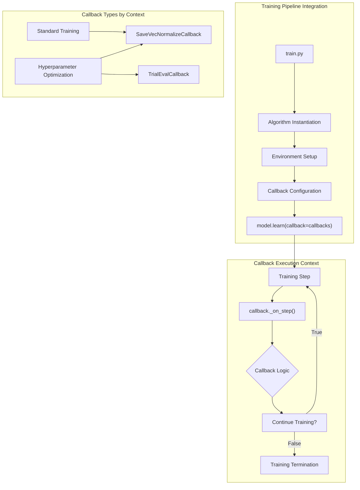

<!-- source: DeepWiki mcp.deepwiki.com · repo araffin/rl-baselines-zoo · page 6.1 Custom Callbacks and Training Extensions · fetched 2026-10-30 -->

# Custom Callbacks and Training Extensions

Relevant source files

The following files were used as context for generating this wiki page:

- [requirements.txt](requirements.txt)
- [utils/callbacks.py](utils/callbacks.py)
- [utils/import_envs.py](utils/import_envs.py)

This document covers the custom callback implementations provided by RL Baselines Zoo for extending the training process with specialized functionality. These callbacks handle evaluation during hyperparameter optimization trials and automatic saving of environment normalization statistics.

For general training workflows, see [Training Agents](#2.1). For hyperparameter optimization processes, see [Hyperparameter Optimization](#2.3).

## Callback System Overview

The RL Baselines Zoo extends the Stable Baselines callback system with custom implementations that integrate into the training pipeline. These callbacks provide automated evaluation reporting for optimization trials and persistent storage of environment normalization data.

The callback system follows the standard Stable Baselines architecture where callbacks inherit from `BaseCallback` or specialized callback classes and implement lifecycle hooks that execute during training.

**Sources:** [utils/callbacks.py:1-68]()

## Built-in Custom Callbacks

### TrialEvalCallback

The `TrialEvalCallback` extends `EvalCallback` to provide automated evaluation reporting for Optuna hyperparameter optimization trials. This callback evaluates the agent's performance periodically and reports results to the optimization framework.

| Property | Description |
|----------|-------------|
| **Base Class** | `EvalCallback` |
| **Primary Function** | Trial evaluation and pruning for hyperparameter optimization |
| **Key Methods** | `_on_step()` - Reports evaluation results and handles pruning |
| **Integration** | Used by `hyperparams_opt.py` during optimization trials |

The callback implements trial management by:
- Inheriting evaluation logic from `EvalCallback` [utils/callbacks.py:15-18]()
- Reporting negative mean reward to Optuna trial [utils/callbacks.py:29]()
- Implementing early stopping through pruning mechanism [utils/callbacks.py:31-33]()

**Sources:** [utils/callbacks.py:8-34]()

### SaveVecNormalizeCallback

The `SaveVecNormalizeCallback` provides automatic persistence of `VecNormalize` wrapper statistics during training. This ensures that observation and reward normalization parameters are preserved for consistent evaluation and deployment.

| Property | Description |
|----------|-------------|
| **Base Class** | `BaseCallback` |
| **Primary Function** | Periodic saving of VecNormalize statistics |
| **Key Methods** | `_on_step()` - Saves normalization data at specified intervals |
| **Output** | `.pkl` files containing normalization statistics |

The callback implements flexible file naming:
- Timestamped files when `name_prefix` is provided [utils/callbacks.py:60]()
- Single overwritten file when `name_prefix` is `None` [utils/callbacks.py:62]()
- Automatic directory creation during initialization [utils/callbacks.py:55]()

**Sources:** [utils/callbacks.py:37-67]()

## Callback Integration in Training

The custom callbacks integrate into the training pipeline through the standard Stable Baselines callback mechanism. They are instantiated and passed to the `model.learn()` method where they execute during training steps.

### Usage Patterns

The callbacks are used in different training contexts:

**Standard Training:**
- `SaveVecNormalizeCallback` preserves normalization statistics
- Integrated alongside other callbacks like `EvalCallback` and `CheckpointCallback`

**Hyperparameter Optimization:**
- `TrialEvalCallback` replaces standard `EvalCallback`
- Provides trial management and early stopping functionality
- Combined with `SaveVecNormalizeCallback` for complete training state preservation

**Sources:** [utils/callbacks.py:1-68]()

## Implementation Details

### Callback Lifecycle

Both custom callbacks follow the standard callback lifecycle:

1. **Initialization:** Constructor parameters configure behavior
2. **Setup:** `_init_callback()` performs initial setup (directory creation, etc.)
3. **Execution:** `_on_step()` executes callback logic during training
4. **Termination:** Return value controls training continuation

### Key Implementation Features

**TrialEvalCallback Specifics:**
- Maintains `eval_idx` counter for trial reporting [utils/callbacks.py:20]()
- Uses `is_pruned` flag to track pruning state [utils/callbacks.py:21]()
- Reports negative reward values to Optuna (minimization optimization) [utils/callbacks.py:29]()

**SaveVecNormalizeCallback Specifics:**
- Supports both single-file and timestamped saving modes [utils/callbacks.py:59-62]()
- Performs null-checks before saving [utils/callbacks.py:63]()
- Provides verbose logging for debugging [utils/callbacks.py:65-66]()

### Dependencies

The callback system requires:
- `stable-baselines[mpi,tests,docs]>=2.10.0` for base callback classes
- `optuna` for trial management in `TrialEvalCallback`
- `numpy` for numerical operations

**Sources:** [utils/callbacks.py:1-68](), [requirements.txt:1-10]()

---

