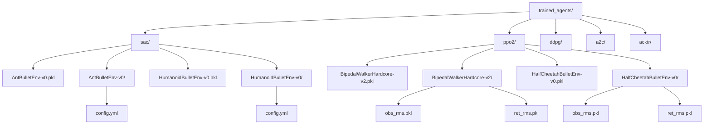
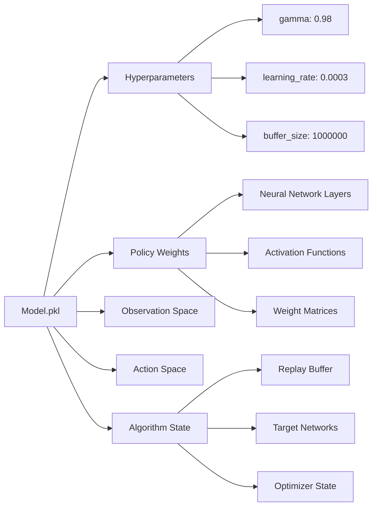
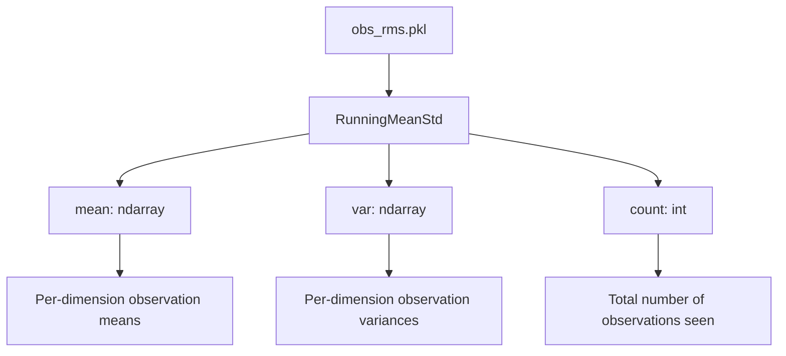
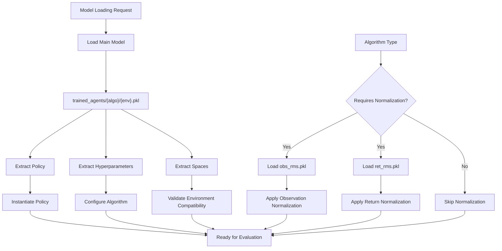

<!-- source: DeepWiki mcp.deepwiki.com · repo araffin/rl-baselines-zoo · page 6.2 Trained Agent Storage and Management · fetched 2026-10-30 -->

# Trained Agent Storage and Management

<details>
<summary>Relevant source files</summary>

The following files were used as context for generating this wiki page:

- [trained_agents/a2c/BipedalWalker-v3.pkl](trained_agents/a2c/BipedalWalker-v3.pkl)
- [trained_agents/acktr/BipedalWalker-v3.zip](trained_agents/acktr/BipedalWalker-v3.zip)
- [trained_agents/ddpg/BipedalWalker-v3.pkl](trained_agents/ddpg/BipedalWalker-v3.pkl)
- [trained_agents/dqn/BeamRiderNoFrameskip-v4.pkl](trained_agents/dqn/BeamRiderNoFrameskip-v4.pkl)
- [trained_agents/ppo2/BipedalWalker-v3.pkl](trained_agents/ppo2/BipedalWalker-v3.pkl)
- [trained_agents/ppo2/BipedalWalkerHardcore-v2.pkl](trained_agents/ppo2/BipedalWalkerHardcore-v2.pkl)
- [trained_agents/ppo2/BipedalWalkerHardcore-v2/obs_rms.pkl](trained_agents/ppo2/BipedalWalkerHardcore-v2/obs_rms.pkl)
- [trained_agents/ppo2/BipedalWalkerHardcore-v2/ret_rms.pkl](trained_agents/ppo2/BipedalWalkerHardcore-v2/ret_rms.pkl)
- [trained_agents/ppo2/HalfCheetahBulletEnv-v0.pkl](trained_agents/ppo2/HalfCheetahBulletEnv-v0.pkl)
- [trained_agents/ppo2/HalfCheetahBulletEnv-v0/obs_rms.pkl](trained_agents/ppo2/HalfCheetahBulletEnv-v0/obs_rms.pkl)
- [trained_agents/ppo2/HalfCheetahBulletEnv-v0/ret_rms.pkl](trained_agents/ppo2/HalfCheetahBulletEnv-v0/ret_rms.pkl)
- [trained_agents/ppo2/HopperBulletEnv-v0.pkl](trained_agents/ppo2/HopperBulletEnv-v0.pkl)
- [trained_agents/ppo2/HopperBulletEnv-v0/obs_rms.pkl](trained_agents/ppo2/HopperBulletEnv-v0/obs_rms.pkl)
- [trained_agents/ppo2/HopperBulletEnv-v0/ret_rms.pkl](trained_agents/ppo2/HopperBulletEnv-v0/ret_rms.pkl)
- [trained_agents/sac/AntBulletEnv-v0.pkl](trained_agents/sac/AntBulletEnv-v0.pkl)
- [trained_agents/sac/AntBulletEnv-v0/config.yml](trained_agents/sac/AntBulletEnv-v0/config.yml)
- [trained_agents/sac/BipedalWalkerHardcore-v2/config.yml](trained_agents/sac/BipedalWalkerHardcore-v2/config.yml)
- [trained_agents/sac/HopperBulletEnv-v0/config.yml](trained_agents/sac/HopperBulletEnv-v0/config.yml)
- [trained_agents/sac/HumanoidBulletEnv-v0.pkl](trained_agents/sac/HumanoidBulletEnv-v0.pkl)
- [trained_agents/sac/HumanoidBulletEnv-v0/config.yml](trained_agents/sac/HumanoidBulletEnv-v0/config.yml)
- [trained_agents/sac/Walker2DBulletEnv-v0/config.yml](trained_agents/sac/Walker2DBulletEnv-v0/config.yml)

</details>


This document covers the structure and management of trained reinforcement learning agent artifacts in the RL Baselines Zoo, including model serialization, configuration persistence, and normalization statistics storage. For information about the training process that generates these artifacts, see [Training Agents](#2.1). For details on how these stored models are loaded and evaluated, see [Evaluating Trained Agents](#2.2).

## Storage Directory Structure

The RL Baselines Zoo organizes trained agents in a hierarchical directory structure under `trained_agents/`, with separate directories for each algorithm and environment combination.



**Sources:** [trained_agents/sac/AntBulletEnv-v0.pkl](), [trained_agents/ppo2/BipedalWalkerHardcore-v2.pkl](), [trained_agents/sac/AntBulletEnv-v0/config.yml]()

## File Types and Contents

### Model Files (.pkl)

The primary model files contain the complete serialized agent state, including neural network parameters, hyperparameters, and policy configurations. These files use CloudPickle for serialization to handle complex Python objects.

| Component | Description | Example |
|-----------|-------------|---------|
| Hyperparameters | Training configuration values | `gamma`, `learning_rate`, `buffer_size` |
| Policy Object | Neural network architecture and weights | `CustomSACPolicy`, `MlpPolicy` |
| Observation Space | Environment observation specifications | `gym.spaces.Box` with shape and bounds |
| Action Space | Environment action specifications | Continuous or discrete action definitions |



**Sources:** [trained_agents/sac/AntBulletEnv-v0.pkl:1-47](), [trained_agents/ppo2/BipedalWalkerHardcore-v2.pkl:1-11]()

### Configuration Files (config.yml)

Algorithm-specific configuration files store the hyperparameters used during training in YAML format using `collections.OrderedDict`.

```yaml
!!python/object/apply:collections.OrderedDict
- - [batch_size, 256]
  - [buffer_size, 1000000]
  - [ent_coef, auto]
  - [learning_rate, 0.0003]
  - [n_timesteps, 2000000.0]
  - [policy, CustomSACPolicy]
```

**Sources:** [trained_agents/sac/AntBulletEnv-v0/config.yml:1-14](), [trained_agents/sac/HumanoidBulletEnv-v0/config.yml:1-11]()

## Normalization Statistics Management

For algorithms that normalize observations and returns (like PPO2), the system stores running statistics in separate pickle files to ensure consistent preprocessing during evaluation.

### Observation Normalization (obs_rms.pkl)

Contains `RunningMeanStd` objects that track the running mean and variance of observations:



**Sources:** [trained_agents/ppo2/BipedalWalkerHardcore-v2/obs_rms.pkl:1-12](), [trained_agents/ppo2/HalfCheetahBulletEnv-v0/obs_rms.pkl:1-13]()

### Return Normalization (ret_rms.pkl)

Stores statistics for normalizing episode returns:

```python
# Example structure from ret_rms.pkl
RunningMeanStd(
    mean=scalar_value,    # Average return
    var=variance_value,   # Return variance  
    count=episode_count   # Number of episodes
)
```

**Sources:** [trained_agents/ppo2/BipedalWalkerHardcore-v2/ret_rms.pkl:1-9](), [trained_agents/ppo2/HalfCheetahBulletEnv-v0/ret_rms.pkl:1-9]()

## Algorithm-Specific Storage Patterns

Different algorithms have varying storage requirements and formats:

| Algorithm | Main File | Config File | Normalization | Special Features |
|-----------|-----------|-------------|---------------|------------------|
| SAC | `.pkl` | `config.yml` | No | Custom policy classes |
| PPO2 | `.pkl` | No | `obs_rms.pkl`, `ret_rms.pkl` | Vector environment support |
| DDPG | `.pkl` | No | No | Deterministic policy |
| A2C | `.pkl` | No | No | On-policy learning |
| ACKTR | `.zip` | No | No | Natural gradients |

**Sources:** [trained_agents/sac/AntBulletEnv-v0.pkl](), [trained_agents/ppo2/BipedalWalkerHardcore-v2.pkl](), [trained_agents/acktr/BipedalWalker-v3.zip]()

## Model Loading Dependencies

The relationship between different stored components when loading a trained agent:



**Sources:** [trained_agents/ppo2/BipedalWalkerHardcore-v2.pkl:10-43](), [trained_agents/sac/AntBulletEnv-v0.pkl:1-10]()

## File Serialization Details

### CloudPickle Usage

The main model files use CloudPickle for serialization, which handles complex Python objects including:
- Lambda functions and closures (e.g., learning rate schedules)
- Custom policy classes
- TensorFlow/PyTorch computational graphs
- Numpy arrays and data structures

### Running Statistics Persistence

The `RunningMeanStd` class from `stable_baselines.common.running_mean_std` is used to maintain normalization statistics across training sessions, ensuring consistent preprocessing during evaluation.

**Sources:** [trained_agents/ppo2/BipedalWalkerHardcore-v2/obs_rms.pkl:1-3](), [trained_agents/ppo2/BipedalWalkerHardcore-v2/ret_rms.pkl:1-3]()