# Page: Overview

# Overview

<details>
<summary>Relevant source files</summary>

The following files were used as context for generating this wiki page:

- [README.md](README.md)

</details>


## Purpose and Scope

The RL Baselines Zoo is a collection of pre-trained Reinforcement Learning (RL) agents with tuned hyperparameters, built on top of the [Stable Baselines](https://github.com/hill-a/stable-baselines) library. This repository serves as both a training infrastructure and a benchmark suite for various RL algorithms across multiple environment types.

**Note**: This repository is no longer actively maintained. Users should migrate to the [RL-Baselines3 Zoo](https://github.com/DLR-RM/rl-baselines3-zoo) which is powered by Stable-Baselines3.

The primary goals of this system are to:
- Provide a simple interface for training and evaluating RL agents
- Benchmark different RL algorithms across standardized environments  
- Supply pre-tuned hyperparameters for algorithm-environment combinations
- Offer a collection of over 120 pre-trained agents ready for use

For specific training workflows, see [Training Agents](#2.1). For evaluation procedures, see [Evaluating Trained Agents](#2.2). For hyperparameter optimization, see [Hyperparameter Optimization](#2.3).

Sources: [README.md:1-18]()

## System Architecture

The RL Baselines Zoo follows a modular architecture centered around three main entry points that orchestrate training, evaluation, and optimization workflows.

### Core System Components

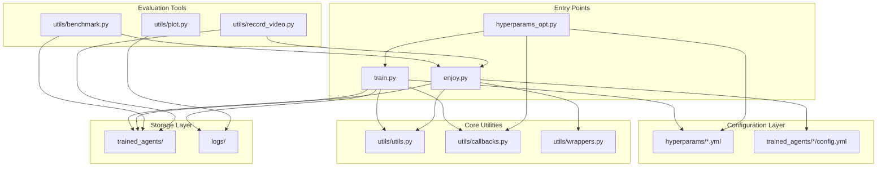

This architecture separates concerns into distinct layers:
- **Entry Points**: Main scripts that users interact with directly
- **Configuration Layer**: YAML-based configuration management for algorithms and trained models
- **Core Utilities**: Shared functionality for environment creation, training callbacks, and environment wrappers
- **Storage Layer**: Persistent storage for trained models, logs, and evaluation results
- **Evaluation Tools**: Utilities for benchmarking, visualization, and video recording

Sources: [README.md:44-78](), System diagrams provided

### Algorithm and Environment Support

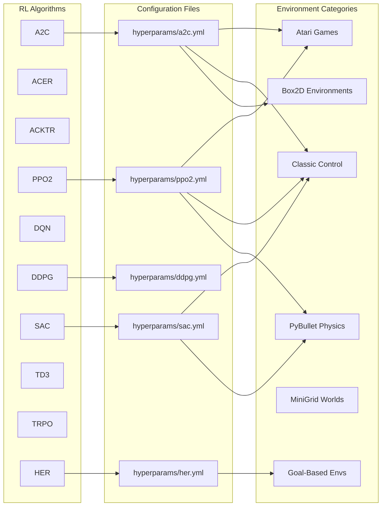

The system supports 10 major RL algorithms across 5+ environment categories. Each algorithm has its hyperparameters defined in corresponding YAML configuration files under the `hyperparams/` directory.

Sources: [README.md:144-260]()

## Main Components

### Training System (`train.py`)

The training system serves as the primary orchestrator for RL agent training. It loads algorithm configurations, creates environments with appropriate wrappers, and manages the training loop with callbacks for evaluation, checkpointing, and logging.

Key features:
- Hyperparameter loading from YAML configurations
- Environment creation with custom wrappers
- Integration with TensorBoard logging
- Checkpoint saving and model persistence
- Evaluation during training with configurable frequency

### Evaluation System (`enjoy.py`)

The evaluation system loads pre-trained agents and runs them in their target environments. It supports both pre-trained models from the zoo and user-trained models from log directories.

Key features:
- Model loading with normalization statistics
- Environment configuration restoration
- Video recording capabilities
- Performance evaluation metrics
- Support for custom environment arguments

### Hyperparameter Optimization (`hyperparams_opt.py`)

The optimization system uses Optuna to automatically tune hyperparameters for algorithm-environment combinations. It integrates with the training pipeline to evaluate candidate hyperparameter sets.

Key features:
- Integration with Optuna optimization framework
- Support for multiple sampling strategies (TPE, Random, etc.)
- Pruning of poorly performing trials
- Parallel optimization with multiple workers
- Automatic best model selection and saving

Sources: [README.md:44-92]()

## Repository Structure

The repository follows a clear organizational structure:

| Directory/File | Purpose |
|----------------|---------|
| `train.py` | Main training script and orchestrator |
| `enjoy.py` | Agent evaluation and demonstration script |
| `hyperparams_opt.py` | Hyperparameter optimization engine |
| `hyperparams/` | Algorithm-specific configuration files (YAML) |
| `trained_agents/` | Storage for pre-trained models and metadata |
| `utils/` | Core utilities, wrappers, callbacks, and tools |
| `logs/` | Training logs and experiment outputs |
| `tests/` | Test suite for validation |
| `docker/` | Docker containerization configurations |
| `scripts/` | Build and deployment automation scripts |

The `utils/` directory contains several important modules:
- `utils.py`: Environment creation and configuration utilities
- `callbacks.py`: Training callbacks for evaluation and checkpointing  
- `wrappers.py`: Custom environment wrappers
- `benchmark.py`: Performance benchmarking tools
- `record_video.py`: Video recording functionality
- `plot.py`: Visualization and plotting utilities

Sources: Repository structure analysis, [README.md:274-312]()

## Development Status and Usage

**Important**: This repository is deprecated and no longer maintained. The community has migrated to the RL-Baselines3 Zoo which offers improved functionality and active development.

The system provides over 120 pre-trained agents across multiple environment categories including Atari games, classic control problems, Box2D physics simulations, PyBullet robotics environments, and MiniGrid worlds. These agents represent state-of-the-art performance with carefully tuned hyperparameters.

For new projects, users should consider the successor repository while existing users can continue to use this codebase for reproducibility and comparison purposes.

Sources: [README.md:1](), [README.md:140-143]()

---

# Page: Getting Started

# Getting Started

<details>
<summary>Relevant source files</summary>

The following files were used as context for generating this wiki page:

- [README.md](README.md)
- [train.py](train.py)
- [utils/utils.py](utils/utils.py)

</details>


This document provides an overview of the main workflows in the RL Baselines Zoo system: training reinforcement learning agents, evaluating trained models, and understanding the core system components. The RL Baselines Zoo provides a standardized interface for training and evaluating RL agents across multiple algorithms and environments using pre-tuned hyperparameters.

For detailed information about specific workflows, see [Training Agents](#2.1), [Evaluating Trained Agents](#2.2), and [Hyperparameter Optimization](#2.3). For configuration details, see [Configuration System](#3).

## Core System Overview

The RL Baselines Zoo consists of three primary workflows orchestrated by main entry point scripts:

**Training Workflow**: Users execute `train.py` to train RL agents using algorithm-specific hyperparameters defined in YAML configuration files.

**Evaluation Workflow**: Users execute `enjoy.py` to load and evaluate pre-trained agents, observing their behavior in target environments.

**Optimization Workflow**: Users execute `train.py --optimize` to automatically tune hyperparameters using Optuna-based optimization.

### Main System Components

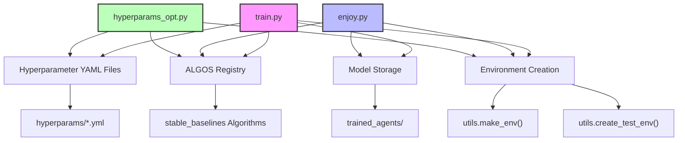

Sources: [train.py:42-435](), [utils/utils.py:32-43](), [README.md:44-78]()

## Algorithm Registry and Environment Support

The system supports multiple RL algorithms through a centralized registry defined in `utils/utils.py`. Each algorithm integrates with Stable Baselines implementations:

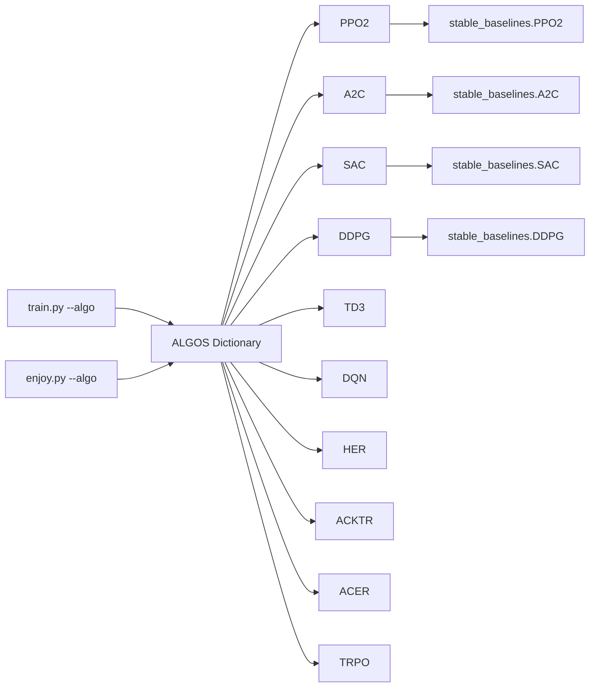

The system automatically handles environment-specific configurations including Atari frame stacking, continuous control normalization, and custom wrappers through the `create_env()` function in `train.py`.

Sources: [utils/utils.py:32-43](), [train.py:147-156](), [train.py:228-291]()

## Training Agent Workflow

### Basic Training Command Structure

The primary training interface accepts several key parameters:

| Parameter | Purpose | Example |
|-----------|---------|---------|
| `--algo` | RL algorithm selection | `ppo2`, `sac`, `ddpg` |
| `--env` | Environment identifier | `CartPole-v1`, `HalfCheetah-v2` |
| `--n-timesteps` | Training duration override | `1000000` |
| `--tensorboard-log` | TensorBoard logging directory | `/tmp/tb_logs/` |
| `--eval-freq` | Evaluation frequency | `10000` |

### Training Process Flow

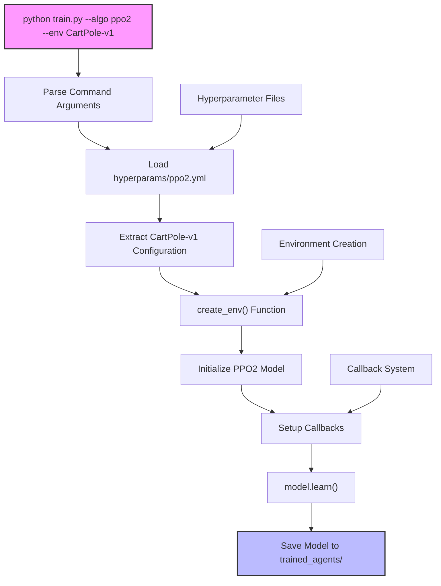

The training process loads algorithm-specific hyperparameters from YAML files, creates appropriate environment wrappers, initializes the selected RL algorithm, and saves the trained model with associated configuration files.

Sources: [train.py:130-158](), [train.py:400-435](), [train.py:228-291]()

## Model Storage Structure

Trained models are stored in a structured directory hierarchy under `trained_agents/` with associated metadata:

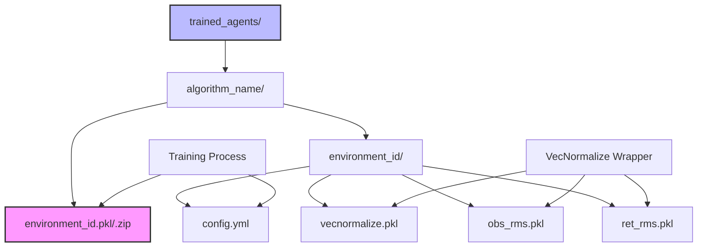

The storage system preserves both the trained model weights and the complete training configuration, including normalization statistics required for proper evaluation.

Sources: [train.py:410-435](), [utils/utils.py:316-346](), [train.py:361-368]()

## Evaluation Workflow Overview

Agent evaluation uses the `enjoy.py` script to load trained models and execute them in target environments. The evaluation system automatically handles model loading, environment recreation, and normalization parameter restoration.

Key evaluation parameters include environment rendering, episode count, and model selection (latest vs. best performing). The evaluation process reconstructs the exact training environment configuration using saved hyperparameters and normalization statistics.

For complete evaluation details, see [Evaluating Trained Agents](#2.2).

## Hyperparameter Configuration System

The system uses YAML configuration files in the `hyperparams/` directory to define algorithm-specific parameters for different environments. Each algorithm has its own configuration file (e.g., `hyperparams/ppo2.yml`, `hyperparams/sac.yml`) containing environment-specific hyperparameter sets.

The configuration system supports environment categorization (Atari, continuous control, discrete control) and allows runtime hyperparameter overrides via command-line arguments.

For configuration details, see [Configuration System](#3).

## Next Steps

- **Training**: Learn detailed training procedures in [Training Agents](#2.1)
- **Evaluation**: Understand model evaluation in [Evaluating Trained Agents](#2.2)  
- **Optimization**: Explore automated hyperparameter tuning in [Hyperparameter Optimization](#2.3)
- **Configuration**: Review system configuration in [Configuration System](#3)

Sources: [README.md:20-143](), [train.py:1-435](), [utils/utils.py:1-392]()

---

# Page: Training Agents

# Training Agents

<details>
<summary>Relevant source files</summary>

The following files were used as context for generating this wiki page:

- [train.py](train.py)
- [utils/utils.py](utils/utils.py)

</details>


This document covers the core training functionality provided by the RL Baselines Zoo, focusing on how to train reinforcement learning agents using the `train.py` script. This includes standard training workflows, environment configuration, hyperparameter management, and various training modes.

For information about evaluating already-trained agents, see [Evaluating Trained Agents](#2.2). For automated hyperparameter optimization workflows, see [Hyperparameter Optimization](#2.3).

## Training Workflow Overview

The training system orchestrates the complete lifecycle of RL agent training, from environment creation to model persistence. The `train.py` script serves as the main entry point and coordinates all training components.

**Training System Architecture**
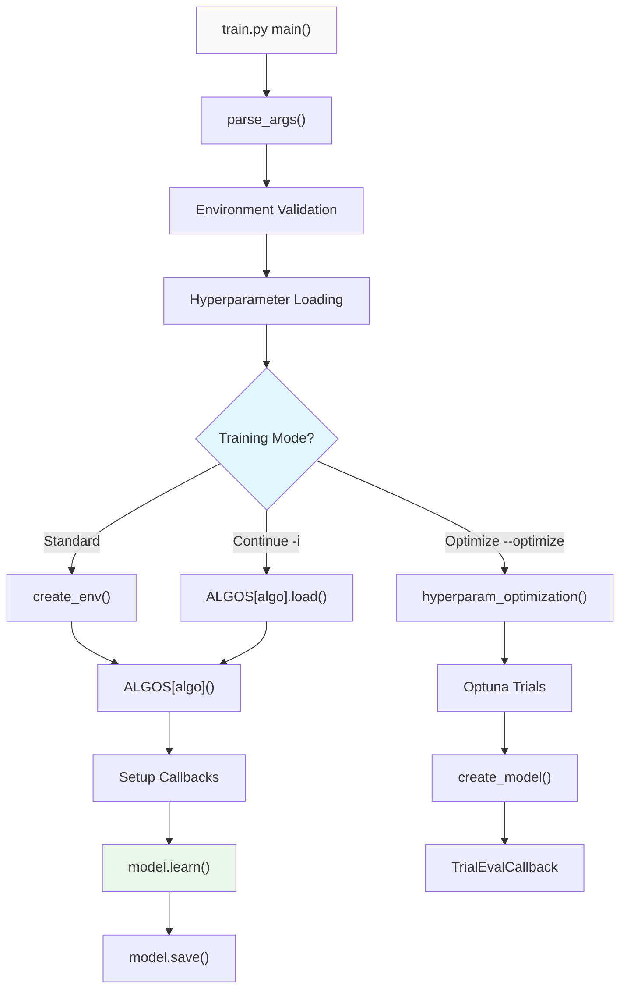

Sources: [train.py:42-435]()

## Command Line Interface

The `train.py` script accepts numerous command-line arguments to control training behavior:

### Core Training Arguments

| Argument | Type | Default | Description |
|----------|------|---------|-------------|
| `--env` | str | "CartPole-v1" | Environment ID |
| `--algo` | str | "ppo2" | RL Algorithm choice |
| `-n, --n-timesteps` | int | -1 | Override timesteps |
| `--seed` | int | 0 | Random seed |
| `-f, --log-folder` | str | "logs" | Log directory |

### Training Control Arguments

| Argument | Type | Default | Description |
|----------|------|---------|-------------|
| `--eval-freq` | int | 10000 | Evaluation frequency |
| `--eval-episodes` | int | 5 | Episodes per evaluation |
| `--save-freq` | int | -1 | Model checkpoint frequency |
| `--log-interval` | int | -1 | Logging interval override |

### Advanced Arguments

| Argument | Type | Description |
|----------|------|-------------|
| `-i, --trained-agent` | str | Path to pretrained model for continuation |
| `-params, --hyperparams` | dict | Override specific hyperparameters |
| `--env-kwargs` | dict | Environment constructor arguments |
| `-tb, --tensorboard-log` | str | Tensorboard logging directory |

Sources: [train.py:43-80]()

## Environment Setup and Configuration

The training system creates and configures environments through the `create_env()` function, which handles various environment types and applies necessary wrappers.

**Environment Creation Flow**
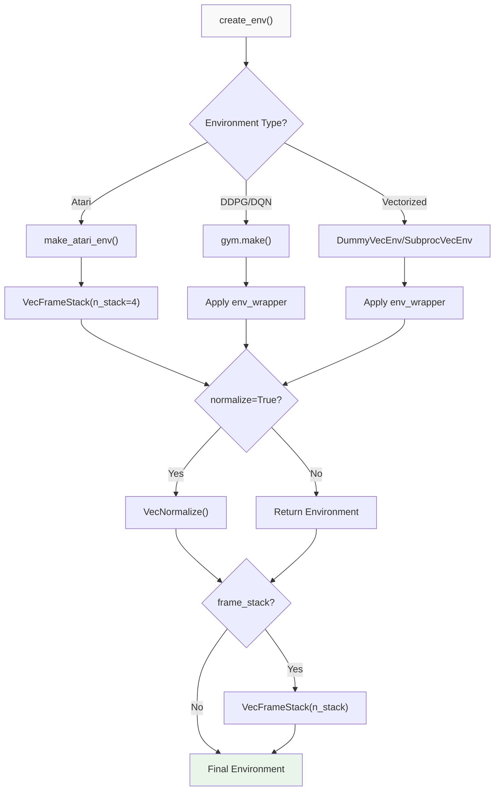

### Environment Wrapper System

The system supports flexible environment wrapping through the `get_wrapper_class()` function in `utils/utils.py`:

```yaml
# Example hyperparameter configuration
env_wrapper:
  - utils.wrappers.DoneOnSuccessWrapper:
      reward_offset: 1.0
  - utils.wrappers.TimeFeatureWrapper
```

Sources: [train.py:228-291](), [utils/utils.py:81-146]()

## Training Modes

The training system supports three distinct modes based on command-line arguments and available model files.

### Standard Training

Creates a new model from scratch using algorithm-specific hyperparameters:

**Standard Training Process**
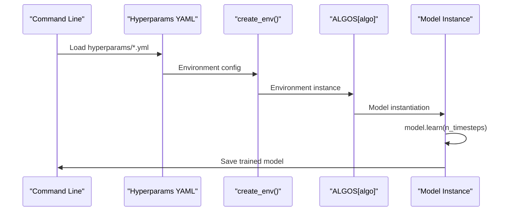

### Continuation Training

Resumes training from a pretrained model using the `-i` flag:

```python
# Model loading process
model = ALGOS[args.algo].load(args.trained_agent, env=env,
                              tensorboard_log=tensorboard_log, 
                              verbose=args.verbose, **hyperparams)
```

The system automatically loads associated normalization statistics if available.

### Hyperparameter Optimization

Delegates to the `hyperparam_optimization()` function for automated tuning using Optuna.

Sources: [train.py:351-401](), [train.py:370-398]()

## Hyperparameter Management

Hyperparameters are loaded from YAML files in the `hyperparams/` directory and processed based on algorithm requirements.

**Hyperparameter Processing Flow**
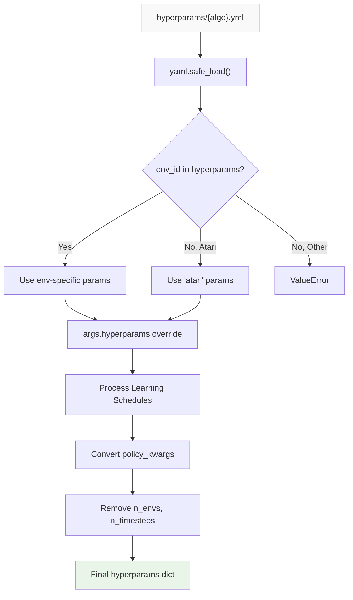

### Schedule Processing

For algorithms like PPO2, SAC, and TD3, learning rate schedules are converted from string representations:

```python
# Example schedule processing
if isinstance(hyperparams[key], str):
    schedule, initial_value = hyperparams[key].split('_')
    initial_value = float(initial_value)
    hyperparams[key] = linear_schedule(initial_value)
```

Sources: [train.py:130-181](), [utils/utils.py:261-279]()

## Callback System and Monitoring

The training system uses a callback architecture for monitoring, evaluation, and model persistence.

**Callback Configuration**
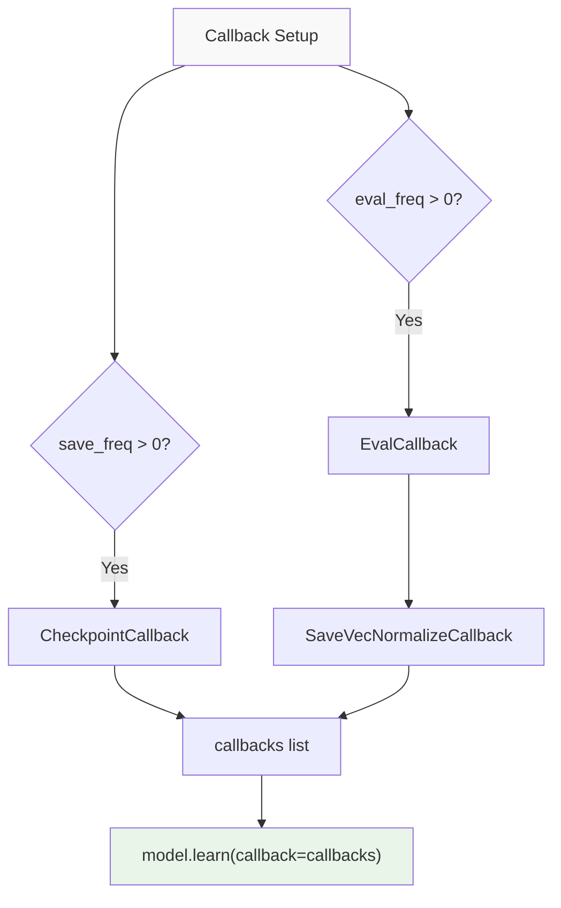

### Key Callbacks

- **`CheckpointCallback`**: Periodic model saving at specified intervals
- **`EvalCallback`**: Regular evaluation on separate environment with best model saving
- **`SaveVecNormalizeCallback`**: Saves normalization statistics for reproducible evaluation

Sources: [train.py:219-308](), [utils/callbacks.py]()

## Model Persistence and Output

Training results are saved in a structured directory format under the log folder:

```
logs/{algorithm}/{env_id}_{run_id}/
├── {env_id}.pkl/.zip          # Trained model
├── {env_id}/
│   ├── config.yml             # Saved hyperparameters  
│   └── vecnormalize.pkl       # Normalization stats
└── best_model.zip             # Best model from evaluation
```

The system automatically creates unique run directories and saves complete training configurations for reproducibility.

**Model Saving Process**
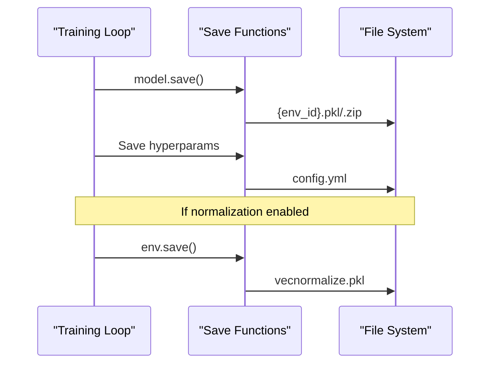

Sources: [train.py:410-435](), [train.py:214-217]()

---

# Page: Evaluating Trained Agents

# Evaluating Trained Agents

<details>
<summary>Relevant source files</summary>

The following files were used as context for generating this wiki page:

- [enjoy.py](enjoy.py)

</details>


This page covers how to run and evaluate trained reinforcement learning agents using the `enjoy.py` script. The evaluation system allows you to load saved models, run them in their training environments, collect performance statistics, and visually observe agent behavior.

For information about training agents, see [Training Agents](#2.1). For automated performance benchmarking across multiple models, see [Benchmarking and Performance Evaluation](#4.1).

## Purpose and Scope

The evaluation system provides tools to:
- Load trained models from the `trained_agents/` directory
- Run agents in their original training environments
- Collect episode-level performance metrics (rewards, episode lengths, success rates)
- Support both visual rendering and headless evaluation
- Handle environment normalization and preprocessing consistently with training
- Evaluate agents deterministically or stochastically

## Evaluation Workflow

The evaluation process follows a structured workflow from model loading to performance reporting:

**Agent Evaluation Process Flow**
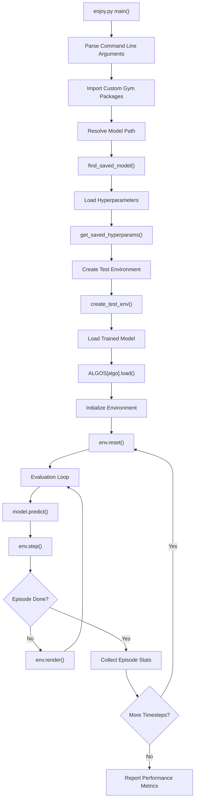

Sources: [enjoy.py:26-182]()

## Core Evaluation Components

The evaluation system consists of several key components that work together to provide comprehensive agent assessment:

**Evaluation System Architecture**
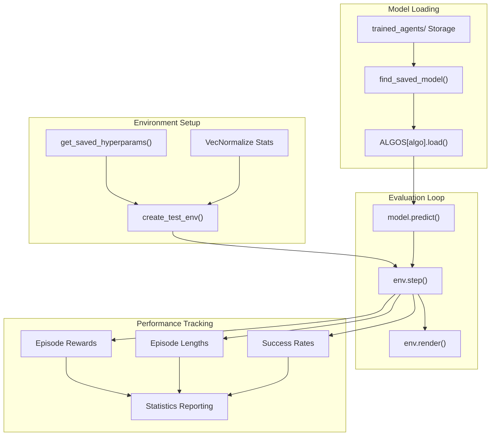

Sources: [enjoy.py:77-101](), [enjoy.py:114-158]()

## Command Line Interface

The `enjoy.py` script provides extensive command-line options for configuring evaluation runs:

### Basic Usage Options

| Option | Type | Default | Description |
|--------|------|---------|-------------|
| `--env` | str | `'CartPole-v1'` | Environment ID to evaluate in |
| `--algo` | str | `'ppo2'` | RL algorithm name |
| `-f, --folder` | str | `'trained_agents'` | Directory containing saved models |
| `-n, --n-timesteps` | int | `1000` | Number of timesteps to run evaluation |
| `--exp-id` | int | `-1` | Experiment ID (-1: no exp folder, 0: latest) |

### Evaluation Control Options

| Option | Type | Default | Description |
|--------|------|---------|-------------|
| `--deterministic` | flag | `False` | Use deterministic actions |
| `--stochastic` | flag | `False` | Force stochastic actions for DDPG/DQN/SAC |
| `--load-best` | flag | `False` | Load best model instead of last model |
| `--no-render` | flag | `False` | Disable environment rendering |
| `--norm-reward` | flag | `False` | Apply reward normalization if trained with VecNormalize |

### Environment Configuration Options

| Option | Type | Default | Description |
|--------|------|---------|-------------|
| `--n-envs` | int | `1` | Number of parallel environments |
| `--seed` | int | `0` | Random seed for reproducibility |
| `--gym-packages` | str[] | `[]` | Additional Gym environment packages to import |
| `--env-kwargs` | dict | `{}` | Keyword arguments for environment constructor |

Sources: [enjoy.py:27-54]()

## Model Loading Process

The system implements a robust model loading process that handles different model formats and locations:

### Model Path Resolution

The model loading process follows this hierarchy:

1. **Experiment ID Resolution**: If `--exp-id=0`, automatically detect the latest experiment using `get_latest_run_id()`
2. **Path Construction**: Build the log path based on algorithm and experiment ID
3. **Model Discovery**: Use `find_saved_model()` to locate the appropriate model file
4. **Hyperparameter Loading**: Load training hyperparameters with `get_saved_hyperparams()`

```python
# Example path resolution logic from enjoy.py:64-77
if args.exp_id == 0:
    args.exp_id = get_latest_run_id(os.path.join(folder, algo), env_id)

if args.exp_id > 0:
    log_path = os.path.join(folder, algo, '{}_{}'.format(env_id, args.exp_id))
else:
    log_path = os.path.join(folder, algo)

model_path = find_saved_model(algo, log_path, env_id, load_best=args.load_best)
```

### Algorithm-Specific Loading

Different algorithms have specific loading requirements:

- **Off-policy algorithms** (`dqn`, `ddpg`, `sac`, `td3`): Force single environment (`n_envs=1`)
- **ACER**: Requires environment matching training setup (`load_env=None`)
- **On-policy algorithms**: Can use multiple environments for evaluation

Sources: [enjoy.py:64-101]()

## Environment Setup for Evaluation

The evaluation system recreates the exact environment configuration used during training:

### Test Environment Creation

The `create_test_env()` function handles:
- **Normalization Statistics**: Load VecNormalize statistics from training
- **Environment Wrappers**: Apply the same wrappers used during training
- **Atari Detection**: Automatically detect and configure Atari environments
- **Rendering Setup**: Configure rendering based on command-line flags

### Environment State Restoration

```python
# Hyperparameter and statistics loading from enjoy.py:86-96
stats_path = os.path.join(log_path, env_id)
hyperparams, stats_path = get_saved_hyperparams(stats_path, 
                                               norm_reward=args.norm_reward, 
                                               test_mode=True)

env = create_test_env(env_id, n_envs=args.n_envs, is_atari=is_atari,
                      stats_path=stats_path, seed=args.seed, log_dir=log_dir,
                      should_render=not args.no_render,
                      hyperparams=hyperparams, env_kwargs=env_kwargs)
```

Sources: [enjoy.py:84-96]()

## Performance Metrics Collection

The evaluation loop collects comprehensive performance statistics:

### Episode-Level Metrics

| Metric | Description | Collection Logic |
|--------|-------------|------------------|
| **Episode Rewards** | Cumulative reward per episode | Summed during episode, stored at episode end |
| **Episode Lengths** | Number of steps per episode | Incremented each step, stored at episode end |
| **Success Rates** | Percentage of successful episodes (HER) | Based on `is_success` info from environment |

### Statistics Reporting

The system provides summary statistics at the end of evaluation:

```python
# Performance reporting logic from enjoy.py:159-166
if len(successes) > 0:
    print("Success rate: {:.2f}%".format(100 * np.mean(successes)))

if len(episode_rewards) > 0:
    print("Mean reward: {:.2f} +/- {:.2f}".format(np.mean(episode_rewards), 
                                                   np.std(episode_rewards)))

if len(episode_lengths) > 0:
    print("Mean episode length: {:.2f} +/- {:.2f}".format(np.mean(episode_lengths), 
                                                           np.std(episode_lengths)))
```

### Atari-Specific Metrics

For Atari environments, the system extracts additional metrics from the `episode` info:

- **Atari Episode Score**: Raw game score (different from training reward)
- **Atari Episode Length**: Actual game length in frames

Sources: [enjoy.py:108-166]()

## Action Selection Modes

The evaluation system supports different action selection strategies:

### Deterministic vs Stochastic Actions

**Action Selection Logic**
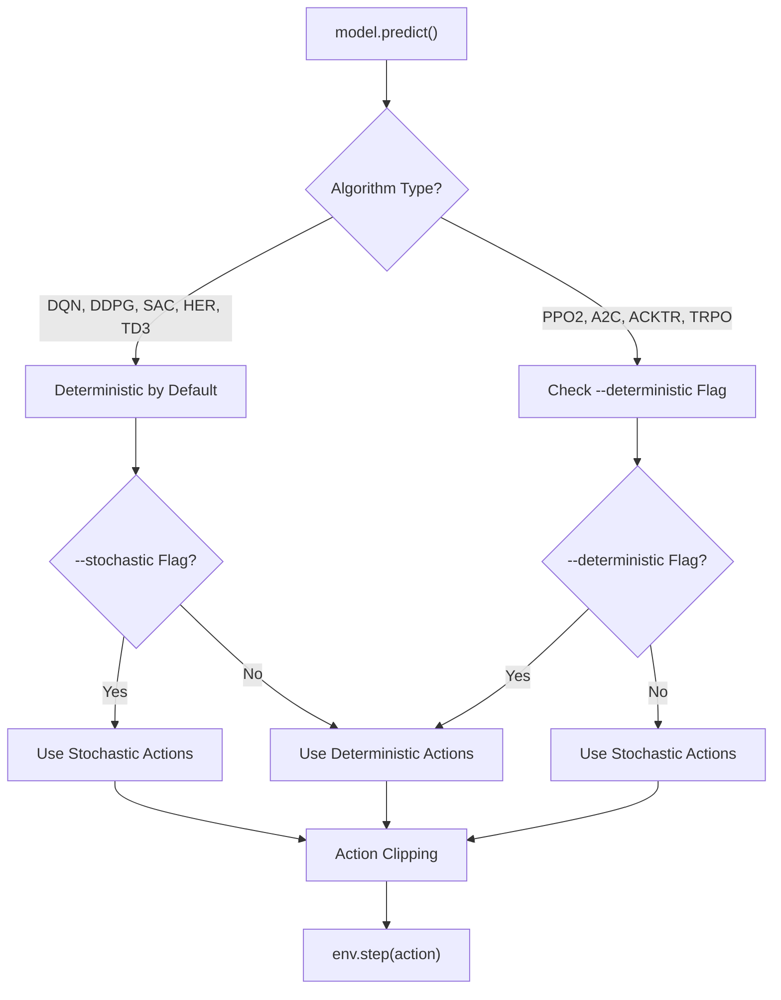

### Action Clipping

For continuous control environments, actions are clipped to valid ranges:

```python
# Action clipping logic from enjoy.py:119-120
if isinstance(env.action_space, gym.spaces.Box):
    action = np.clip(action, env.action_space.low, env.action_space.high)
```

Sources: [enjoy.py:105-121]()

## Evaluation Examples

### Basic Evaluation

```bash
# Evaluate a PPO2 agent on CartPole for 5000 timesteps
python enjoy.py --env CartPole-v1 --algo ppo2 --n-timesteps 5000

# Evaluate the best saved model deterministically
python enjoy.py --env CartPole-v1 --algo ppo2 --load-best --deterministic
```

### Advanced Evaluation

```bash
# Evaluate with custom environment and normalization
python enjoy.py --env HalfCheetah-v2 --algo sac --norm-reward --exp-id 0

# Headless evaluation for automated testing
python enjoy.py --env CartPole-v1 --algo ppo2 --no-render --n-timesteps 10000

# Evaluate with custom gym packages
python enjoy.py --env MiniGrid-Empty-8x8-v0 --algo ppo2 --gym-packages gym_minigrid
```

Sources: [enjoy.py:26-182]()

---

# Page: Hyperparameter Optimization

# Hyperparameter Optimization

<details>
<summary>Relevant source files</summary>

The following files were used as context for generating this wiki page:

- [Makefile](Makefile)
- [setup.cfg](setup.cfg)
- [utils/hyperparams_opt.py](utils/hyperparams_opt.py)

</details>


This page covers the automated hyperparameter optimization system in RL Baselines Zoo, which uses Optuna to systematically search for optimal hyperparameters for reinforcement learning algorithms. The system provides samplers, pruners, and algorithm-specific parameter spaces to efficiently explore hyperparameter configurations.

For information about standard training workflows, see [Training Agents](#2.1). For details about algorithm configurations, see [Algorithm Configurations](#3.1).

## System Overview

The hyperparameter optimization system is built around the `hyperparam_optimization()` function in [utils/hyperparams_opt.py:25-146](), which integrates Optuna with the RL training pipeline. The system supports multiple sampling strategies, pruning methods, and provides algorithm-specific parameter spaces for efficient optimization.

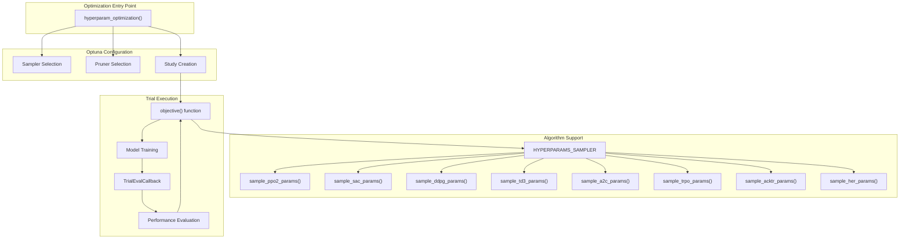

**Sources:** [utils/hyperparams_opt.py:25-146](), [utils/hyperparams_opt.py:399-408]()

## Samplers and Pruners

The optimization system supports three sampling strategies and three pruning methods, configurable through the `sampler_method` and `pruner_method` parameters.

### Available Samplers

| Sampler | Class | Configuration | Use Case |
|---------|-------|---------------|----------|
| `random` | `RandomSampler` | `seed` parameter | Baseline random search |
| `tpe` | `TPESampler` | `n_startup_trials=10` | Tree-structured Parzen Estimator |
| `skopt` | `SkoptSampler` | Gaussian Process with GP hedge | Bayesian optimization |

### Available Pruners

| Pruner | Class | Configuration | Behavior |
|--------|-------|---------------|----------|
| `halving` | `SuccessiveHalvingPruner` | `min_resource=1, reduction_factor=4` | Aggressive early stopping |
| `median` | `MedianPruner` | `n_startup_trials=10, n_warmup_steps=n_evaluations//3` | Conservative pruning |
| `none` | `MedianPruner` | `n_startup_trials=n_trials` | No pruning |

**Sources:** [utils/hyperparams_opt.py:55-75]()

## Trial Evaluation Workflow

The optimization process evaluates each hyperparameter configuration through a structured trial system that balances evaluation accuracy with computational efficiency.

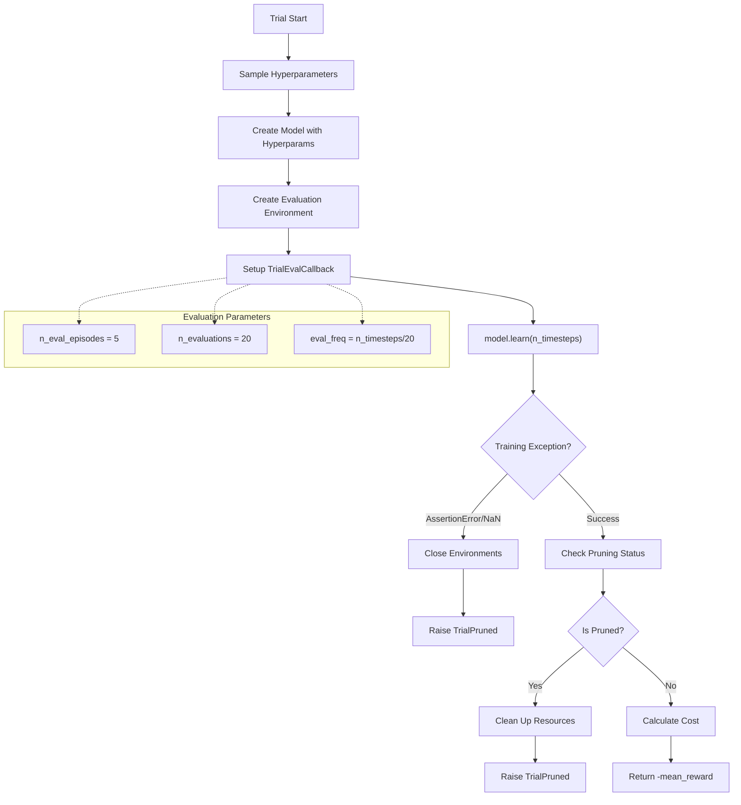

**Sources:** [utils/hyperparams_opt.py:83-127](), [utils/hyperparams_opt.py:47-52]()

## Algorithm-Specific Parameter Spaces

Each supported RL algorithm has a dedicated parameter sampling function that defines the search space for hyperparameter optimization. The functions are registered in the `HYPERPARAMS_SAMPLER` dictionary.

### PPO2 Parameter Space

The PPO2 sampler defines a comprehensive search space for policy gradient hyperparameters:

| Parameter | Type | Values/Range | Description |
|-----------|------|--------------|-------------|
| `batch_size` | Categorical | [32, 64, 128, 256] | Minibatch size for training |
| `n_steps` | Categorical | [16, 32, 64, 128, 256, 512, 1024, 2048] | Steps per environment |
| `gamma` | Categorical | [0.9, 0.95, 0.98, 0.99, 0.995, 0.999, 0.9999] | Discount factor |
| `learning_rate` | Log-uniform | [1e-5, 1] | Learning rate |
| `ent_coef` | Log-uniform | [1e-8, 0.1] | Entropy coefficient |
| `cliprange` | Categorical | [0.1, 0.2, 0.3, 0.4] | PPO clipping parameter |

**Sources:** [utils/hyperparams_opt.py:148-178]()

### SAC Parameter Space

The SAC sampler focuses on off-policy hyperparameters including buffer management and network architecture:

| Parameter | Type | Values/Range | Description |
|-----------|------|--------------|-------------|
| `batch_size` | Categorical | [16, 32, 64, 128, 256, 512] | Training batch size |
| `buffer_size` | Categorical | [1e4, 1e5, 1e6] | Replay buffer capacity |
| `learning_starts` | Categorical | [0, 1000, 10000, 20000] | Steps before training starts |
| `net_arch` | Categorical | ["small", "medium", "big"] | Network architecture |
| `ent_coef` | Categorical | ['auto', 0.5, 0.1, 0.05, 0.01, 0.0001] | Entropy regularization |

**Sources:** [utils/hyperparams_opt.py:230-270]()

### DDPG and TD3 Parameter Spaces

Both DDPG and TD3 samplers include action noise configuration:

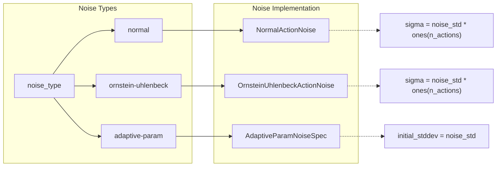

**Sources:** [utils/hyperparams_opt.py:272-304](), [utils/hyperparams_opt.py:337-376]()

## HER Integration

The HER (Hindsight Experience Replay) sampler demonstrates the system's flexibility by delegating to underlying algorithm samplers based on the model class:

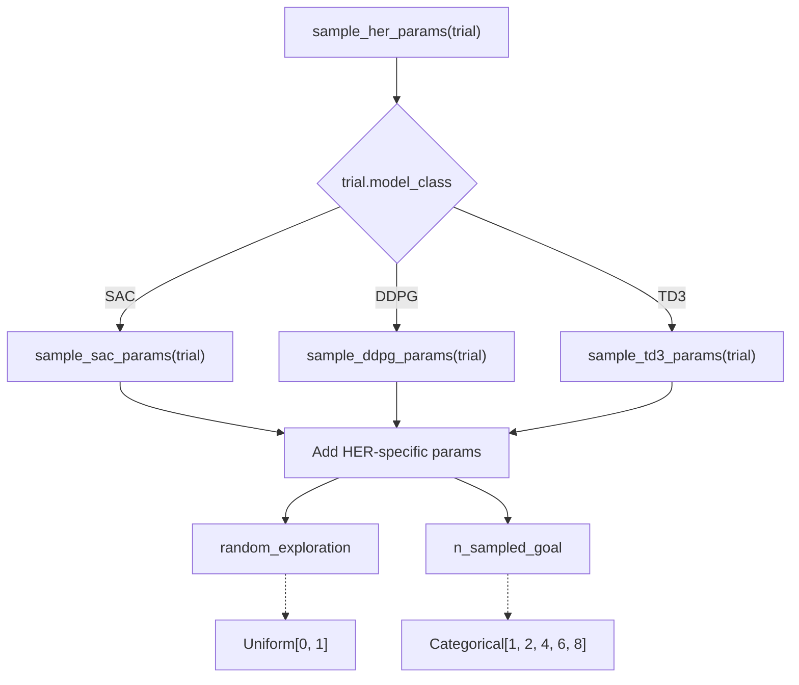

**Sources:** [utils/hyperparams_opt.py:379-396]()

## Integration with Training System

The hyperparameter optimization integrates with the main training pipeline through command-line interface flags and shares core utilities for environment creation and model instantiation.

The optimization system expects two factory functions:
- `model_fn(**kwargs)` - Creates model instances with given hyperparameters
- `env_fn(n_envs, eval_env)` - Creates training and evaluation environments

The system handles vectorized environments by adjusting evaluation frequency: `eval_freq_ = max(eval_freq // model.get_env().num_envs, 1)` for parallel environments.

**Sources:** [utils/hyperparams_opt.py:96-102]()

---

# Page: Configuration System

# Configuration System

<details>
<summary>Relevant source files</summary>

The following files were used as context for generating this wiki page:

- [benchmark.md](benchmark.md)
- [hyperparams/ddpg.yml](hyperparams/ddpg.yml)
- [hyperparams/ppo2.yml](hyperparams/ppo2.yml)
- [hyperparams/sac.yml](hyperparams/sac.yml)

</details>


## Purpose and Scope

The Configuration System manages hyperparameters, environment settings, and algorithm-specific configurations across all reinforcement learning training and evaluation workflows in RL Baselines Zoo. This system enables reproducible training by storing algorithm-environment combinations with their optimized hyperparameters in structured YAML files.

For detailed information about algorithm-specific hyperparameter configurations, see [Algorithm Configurations](#3.1). For environment creation and wrapper management, see [Environment Management](#3.2).

## Configuration Architecture

The configuration system operates through a hierarchical structure that maps algorithms to environments with their respective hyperparameters:

```mermaid
graph TB
    subgraph "Configuration Files"
        A["hyperparams/ppo2.yml"]
        B["hyperparams/sac.yml"] 
        C["hyperparams/ddpg.yml"]
        D["hyperparams/a2c.yml"]
        E["hyperparams/dqn.yml"]
        F["hyperparams/td3.yml"]
        G["hyperparams/trpo.yml"]
        H["hyperparams/acktr.yml"]
        I["hyperparams/acer.yml"]
        J["hyperparams/her.yml"]
    end
    
    subgraph "Configuration Loading"
        K["train.py"]
        L["utils.utils.get_hyperparams_file()"]
        M["utils.utils.get_hyperparams()"]
    end
    
    subgraph "Environment Categories"
        N["Atari Games"]
        O["Classic Control"]
        P["Continuous Control"] 
        Q["Bullet Physics"]
        R["MiniGrid"]
        S["GoalEnv/HER"]
    end
    
    subgraph "Training Components"
        T["Algorithm Instance"]
        U["Environment Creation"]
        V["Policy Networks"]
        W["Callbacks"]
    end
    
    K --> L
    L --> A
    L --> B
    L --> C
    L --> D
    L --> E
    L --> F
    L --> G
    L --> H
    L --> I
    L --> J
    
    L --> M
    M --> N
    M --> O
    M --> P
    M --> Q
    M --> R
    M --> S
    
    M --> T
    M --> U
    M --> V
    M --> W
```

Sources: [hyperparams/ppo2.yml:1-344](), [hyperparams/sac.yml:1-184](), [hyperparams/ddpg.yml:1-87]()

## Configuration File Structure

Each algorithm configuration file follows a consistent YAML structure mapping environment names to hyperparameter dictionaries:

```mermaid
graph LR
    subgraph "ppo2.yml Structure"
        A["Environment Groups"]
        B["atari"]
        C["Individual Environments"]
        D["CartPole-v1"]
        E["Pendulum-v0"]
        F["BipedalWalker-v3"]
    end
    
    subgraph "Configuration Parameters"
        G["Training Parameters"]
        H["n_timesteps"]
        I["n_envs"]
        J["n_steps"]
        K["learning_rate"]
        
        L["Algorithm Parameters"]
        M["noptepochs"]
        N["nminibatches"]
        O["cliprange"]
        P["ent_coef"]
        
        Q["Environment Parameters"]
        R["normalize"]
        S["env_wrapper"]
        T["policy"]
    end
    
    A --> B
    A --> C
    C --> D
    C --> E
    C --> F
    
    D --> G
    D --> L
    D --> Q
    
    G --> H
    G --> I
    G --> J
    G --> K
    
    L --> M
    L --> N
    L --> O
    L --> P
    
    Q --> R
    Q --> S
    Q --> T
```

Sources: [hyperparams/ppo2.yml:1-50](), [hyperparams/ppo2.yml:68-103](), [hyperparams/ppo2.yml:154-169]()

## Configuration Categories

The system organizes configurations into distinct categories based on algorithm capabilities and environment types:

| Configuration Type | Description | Example Files |
|-------------------|-------------|---------------|
| **On-Policy Algorithms** | Algorithms that learn from current policy | `ppo2.yml`, `a2c.yml`, `acktr.yml`, `trpo.yml` |
| **Off-Policy Algorithms** | Algorithms that learn from replay buffer | `sac.yml`, `ddpg.yml`, `td3.yml`, `dqn.yml` |
| **Advanced Algorithms** | Specialized algorithms with unique requirements | `her.yml`, `acer.yml` |

### Environment-Specific Adaptations

Configurations adapt to environment characteristics through specialized parameters:

```mermaid
graph TD
    subgraph "Atari Games"
        A["CnnPolicy"]
        B["Frame Stacking"]
        C["Clipping Rewards"]
        D["8 Parallel Envs"]
    end
    
    subgraph "Continuous Control"
        E["MlpPolicy"]
        F["Normalization"]
        G["Custom Wrappers"]
        H["TimeFeatureWrapper"]
    end
    
    subgraph "Classic Control"  
        I["MlpPolicy"]
        J["Short Episodes"]
        K["High Env Count"]
        L["Simple Hyperparams"]
    end
    
    subgraph "Bullet Physics"
        M["CustomMlpPolicy"]
        N["Action/Obs Scaling"]
        O["Long Training"]
        P["Performance Tuning"]
    end
    
    A --> Q["Algorithm Configuration"]
    E --> Q
    I --> Q
    M --> Q
    
    B --> R["Environment Setup"]
    F --> R
    J --> R
    N --> R
    
    C --> S["Training Process"]
    G --> S
    K --> S
    O --> S
```

Sources: [hyperparams/ppo2.yml:1-12](), [hyperparams/sac.yml:49-62](), [hyperparams/ddpg.yml:38-48]()

## Configuration Loading and Application

The configuration system integrates with the training pipeline through a structured loading process:

```mermaid
sequenceDiagram
    participant CLI as "Command Line"
    participant Train as "train.py"
    participant Utils as "utils.utils"
    participant Config as "hyperparams/*.yml"
    participant Env as "Environment"
    participant Algo as "Algorithm"
    
    CLI->>Train: "--algo ppo2 --env CartPole-v1"
    Train->>Utils: "get_hyperparams_file(ppo2)"
    Utils->>Config: "Load hyperparams/ppo2.yml"
    Config-->>Utils: "YAML content"
    Train->>Utils: "get_hyperparams(CartPole-v1, configs)"
    Utils-->>Train: "Environment hyperparams dict"
    Train->>Env: "create_env() with hyperparams"
    Train->>Algo: "Initialize with hyperparams"
    Algo->>Train: "Configured algorithm instance"
```

Sources: [hyperparams/ppo2.yml:28-39]()

## Special Configuration Features

### Linear Schedule Parameters

The system supports dynamic parameter scheduling using the `lin_` prefix:

| Parameter Format | Description | Example |
|-----------------|-------------|---------|
| `lin_2.5e-4` | Linear decay from initial value to 0 | Learning rate scheduling |
| `lin_0.1` | Linear decay for clipping parameters | Cliprange scheduling |

### Normalization Settings

Environment normalization is configured through multiple approaches:

```yaml
# Boolean normalization
normalize: true

# Selective normalization  
normalize: "{'norm_obs': True, 'norm_reward': False}"
```

### Custom Environment Wrappers

Configurations can specify environment modifications:

```yaml
env_wrapper: utils.wrappers.TimeFeatureWrapper
env_wrapper: gym_minigrid.wrappers.FlatObsWrapper
```

Sources: [hyperparams/ppo2.yml:155](), [hyperparams/sac.yml:50](), [hyperparams/ppo2.yml:316]()

## Performance-Driven Configuration

The benchmark results demonstrate the effectiveness of the configuration system across algorithm-environment combinations:

| Algorithm | Best Performance Environments | Configuration Strategy |
|-----------|------------------------------|----------------------|
| **PPO2** | Atari, Bullet Physics | Balanced exploration-exploitation |
| **SAC** | Continuous Control | High sample efficiency |
| **DDPG** | Simple Continuous | Deterministic policies |
| **TD3** | Complex Continuous | Improved critic training |

The configuration system enables consistent performance across 9 algorithms and over 50 environments, with hyperparameters tuned for optimal results in each domain.

Sources: [benchmark.md:1-136]()

---

# Page: Algorithm Configurations

# Algorithm Configurations

<details>
<summary>Relevant source files</summary>

The following files were used as context for generating this wiki page:

- [hyperparams/a2c.yml](hyperparams/a2c.yml)
- [hyperparams/acktr.yml](hyperparams/acktr.yml)
- [hyperparams/ddpg.yml](hyperparams/ddpg.yml)
- [hyperparams/her.yml](hyperparams/her.yml)
- [hyperparams/ppo2.yml](hyperparams/ppo2.yml)
- [hyperparams/td3.yml](hyperparams/td3.yml)
- [hyperparams/trpo.yml](hyperparams/trpo.yml)
- [trained_agents/a2c/BipedalWalkerHardcore-v3.pkl](trained_agents/a2c/BipedalWalkerHardcore-v3.pkl)
- [trained_agents/her/FetchPickAndPlace-v1.zip](trained_agents/her/FetchPickAndPlace-v1.zip)
- [trained_agents/her/FetchPickAndPlace-v1/config.yml](trained_agents/her/FetchPickAndPlace-v1/config.yml)
- [trained_agents/ppo2/BipedalWalkerHardcore-v3.pkl](trained_agents/ppo2/BipedalWalkerHardcore-v3.pkl)

</details>


This page documents the hyperparameter configuration system for RL algorithms in the RL Baselines Zoo. The configuration system uses YAML files to define algorithm-specific hyperparameters for different environments, enabling reproducible training and easy hyperparameter management.

For information about environment creation and wrapper configurations, see [Environment Management](#3.2). For the overall training workflow that uses these configurations, see [Training Agents](#2.1).

## Configuration File Structure

The algorithm configurations are stored in the `hyperparams/` directory, with each file corresponding to a specific RL algorithm. Each YAML file contains environment-specific hyperparameter sets that have been tuned for optimal performance.

```mermaid
graph TB
    subgraph "hyperparams Directory"
        A["ppo2.yml"]
        B["sac.yml"] 
        C["ddpg.yml"]
        D["td3.yml"]
        E["a2c.yml"]
        F["acktr.yml"]
        G["trpo.yml"]
        H["her.yml"]
    end
    
    subgraph "Training Process"
        I["train.py"]
        J["ALGOS dict"]
        K["create_model()"]
    end
    
    subgraph "Saved Models"
        L["trained_agents/algo/env.pkl"]
        M["trained_agents/algo/env/config.yml"]
    end
    
    A --> J
    B --> J
    C --> J
    D --> J
    E --> J
    F --> J
    G --> J
    H --> J
    
    I --> J
    J --> K
    K --> L
    K --> M
```

**Sources:** [hyperparams/ppo2.yml:1-344](), [hyperparams/her.yml:1-144](), [hyperparams/ddpg.yml:1-87]()

## Supported Algorithms

The RL Baselines Zoo supports hyperparameter configurations for the following algorithms:

| Algorithm | File | Description |
|-----------|------|-------------|
| PPO2 | `ppo2.yml` | Proximal Policy Optimization |
| SAC | `sac.yml` | Soft Actor-Critic |
| DDPG | `ddpg.yml` | Deep Deterministic Policy Gradient |
| TD3 | `td3.yml` | Twin Delayed Deep Deterministic Policy Gradient |
| A2C | `a2c.yml` | Advantage Actor-Critic |
| ACKTR | `acktr.yml` | Actor-Critic using Kronecker-Factored Trust Region |
| TRPO | `trpo.yml` | Trust Region Policy Optimization |
| HER | `her.yml` | Hindsight Experience Replay (with base algorithms) |

**Sources:** [hyperparams/ppo2.yml:1](), [hyperparams/ddpg.yml:1](), [hyperparams/td3.yml:1](), [hyperparams/a2c.yml:1](), [hyperparams/acktr.yml:1](), [hyperparams/trpo.yml:1](), [hyperparams/her.yml:1]()

## Common Hyperparameter Categories

Algorithm configurations typically include the following categories of hyperparameters:

```mermaid
graph LR
    subgraph "Training Parameters"
        A["n_timesteps"]
        B["n_envs"] 
        C["policy"]
    end
    
    subgraph "Learning Parameters"
        D["learning_rate"]
        E["gamma"]
        F["batch_size"]
    end
    
    subgraph "Algorithm-Specific"
        G["n_steps (PPO2)"]
        H["buffer_size (Off-policy)"]
        I["noise_type (DDPG/TD3)"]
    end
    
    subgraph "Environment Processing"
        J["normalize"]
        K["env_wrapper"]
        L["policy_kwargs"]
    end
```

**Sources:** [hyperparams/ppo2.yml:14-39](), [hyperparams/ddpg.yml:1-21](), [hyperparams/a2c.yml:7-22]()

### Core Training Parameters

- **`n_timesteps`**: Total number of training timesteps (e.g., `!!float 1e7`)
- **`policy`**: Policy network architecture (`'MlpPolicy'`, `'CnnPolicy'`, `'LnMlpPolicy'`)
- **`n_envs`**: Number of parallel environments for training

### Learning Rate and Optimization

- **`learning_rate`**: Learning rate, can be constant or scheduled (e.g., `lin_2.5e-4` for linear decay)
- **`gamma`**: Discount factor for future rewards
- **`normalize`**: Whether to normalize observations and/or returns

### Algorithm-Specific Parameters

Each algorithm has specialized hyperparameters:

**PPO2 Parameters:**
- `n_steps`: Number of steps per environment per update
- `nminibatches`: Number of minibatches for each update
- `noptepochs`: Number of optimization epochs
- `cliprange`: Clipping parameter for policy updates
- `ent_coef`: Entropy coefficient
- `vf_coef`: Value function coefficient

**Off-Policy Algorithm Parameters (DDPG, SAC, TD3):**
- `buffer_size`: Size of the replay buffer
- `batch_size`: Minibatch size for training
- `learning_starts`: Number of steps before learning starts
- `train_freq`: Frequency of training updates

**Sources:** [hyperparams/ppo2.yml:28-39](), [hyperparams/ddpg.yml:23-36](), [hyperparams/td3.yml:52-65]()

## Environment-Specific Configurations

Each algorithm configuration file contains environment-specific hyperparameter sets. Environments are organized by categories:

```mermaid
graph TB
    subgraph "Environment Categories"
        A["atari"]
        B["Classic Control"]
        C["Continuous Control"] 
        D["Bullet Physics"]
        E["MiniGrid"]
        F["Goal-Based (HER)"]
    end
    
    subgraph "Example Environments"
        G["CartPole-v1"]
        H["LunarLander-v2"]
        I["BipedalWalker-v3"]
        J["HalfCheetahBulletEnv-v0"]
        K["MiniGrid-DoorKey-5x5-v0"]
        L["FetchReach-v1"]
    end
    
    A --> G
    B --> G
    B --> H
    C --> I
    D --> J
    E --> K
    F --> L
```

**Sources:** [hyperparams/ppo2.yml:1-13](), [hyperparams/ppo2.yml:28-39](), [hyperparams/ppo2.yml:104-117](), [hyperparams/her.yml:107-119]()

### Atari Games

Atari environments use convolutional policies and specific hyperparameters optimized for visual input:

```yaml
atari:
  policy: 'CnnPolicy'
  n_envs: 8
  n_steps: 128
  noptepochs: 4
  nminibatches: 4
  n_timesteps: !!float 1e7
```

### Continuous Control

Continuous control tasks often require normalization and specific network architectures:

```yaml
BipedalWalker-v3:
  normalize: true
  n_envs: 16
  n_timesteps: !!float 5e6
  policy: 'MlpPolicy'
  n_steps: 2048
  nminibatches: 32
```

**Sources:** [hyperparams/ppo2.yml:1-12](), [hyperparams/ppo2.yml:104-116]()

## Special Algorithm Configurations

### Hindsight Experience Replay (HER)

HER configurations combine goal-based RL with underlying algorithms like DDPG, SAC, or TD3. The `her.yml` file specifies both HER-specific and base algorithm parameters:

```mermaid
graph LR
    subgraph "HER Configuration"
        A["model_class: 'sac'"]
        B["n_sampled_goal: 4"]
        C["goal_selection_strategy: 'future'"]
    end
    
    subgraph "Base Algorithm Parameters"  
        D["buffer_size: 1000000"]
        E["learning_rate: 0.001"]
        F["batch_size: 256"]
    end
    
    subgraph "Environment Integration"
        G["env_wrapper: DoneOnSuccessWrapper"]
        H["Goal-based environments"]
    end
    
    A --> D
    B --> H
    C --> H
    G --> H
```

**HER-Specific Parameters:**
- `model_class`: Underlying algorithm (`'ddpg'`, `'sac'`, `'td3'`)
- `n_sampled_goal`: Number of additional goals to sample
- `goal_selection_strategy`: Strategy for goal selection (`'future'`, `'final'`, `'episode'`)

**Sources:** [hyperparams/her.yml:76-90](), [hyperparams/her.yml:107-119]()

### Environment Wrappers

Many configurations specify custom environment wrappers:

- `env_wrapper: utils.wrappers.TimeFeatureWrapper`: Adds time features
- `env_wrapper: utils.wrappers.DoneOnSuccessWrapper`: Marks episodes done on success
- `env_wrapper: gym_minigrid.wrappers.FlatObsWrapper`: Flattens MiniGrid observations

**Sources:** [hyperparams/ppo2.yml:155](), [hyperparams/her.yml:77](), [hyperparams/ppo2.yml:316]()

## Configuration Usage and Storage

The configuration system integrates with the training and evaluation pipeline:

```mermaid
graph TB
    subgraph "Training Phase"
        A["train.py --algo ppo2 --env CartPole-v1"]
        B["Load hyperparams/ppo2.yml"]
        C["Extract CartPole-v1 config"]
        D["Create model with hyperparams"]
    end
    
    subgraph "Storage Phase"
        E["Save model to trained_agents/"]
        F["Create config.yml"]
        G["Store hyperparameters"]
    end
    
    subgraph "Evaluation Phase"
        H["enjoy.py loads config"]
        I["Recreate environment"]
        J["Load trained model"]
    end
    
    A --> B
    B --> C
    C --> D
    D --> E
    E --> F
    E --> G
    F --> H
    G --> H
    H --> I
    H --> J
```

### Saved Model Configuration

When models are trained and saved, their configurations are preserved in `config.yml` files alongside the model files. This ensures reproducibility:

```yaml
!!python/object/apply:collections.OrderedDict
- - - buffer_size
    - 1000000
  - - ent_coef
    - auto
  - - gamma
    - 0.95
  - - n_timesteps
    - 4000000.0
  - - policy
    - MlpPolicy
```

**Sources:** [trained_agents/her/FetchPickAndPlace-v1/config.yml:1-24](), [trained_agents/her/FetchPickAndPlace-v1.zip:1-107]()

## YAML Syntax Features

The configuration files use advanced YAML features for flexible parameter specification:

- **Scientific notation**: `!!float 1e7` for large numbers
- **Linear scheduling**: `lin_2.5e-4` for learning rate decay
- **Python expressions**: `"dict(layers=[256, 256, 256])"` for policy kwargs
- **Comments**: `# Tuned` to indicate optimization status

**Sources:** [hyperparams/ppo2.yml:7-8](), [hyperparams/her.yml:16](), [hyperparams/ppo2.yml:27](), [hyperparams/ddpg.yml:22]()

---

# Page: Environment Management

# Environment Management

<details>
<summary>Relevant source files</summary>

The following files were used as context for generating this wiki page:

- [train.py](train.py)
- [trained_agents/ppo2/HalfCheetahBulletEnv-v0/config.yml](trained_agents/ppo2/HalfCheetahBulletEnv-v0/config.yml)
- [utils/__init__.py](utils/__init__.py)
- [utils/noise.py](utils/noise.py)
- [utils/record_video.py](utils/record_video.py)
- [utils/utils.py](utils/utils.py)
- [utils/wrappers.py](utils/wrappers.py)

</details>


This document covers how environments are created, configured, and wrapped in the RL Baselines Zoo. It explains the environment creation pipeline, wrapper system, normalization mechanisms, and special handling for different environment types. For algorithm-specific hyperparameter configurations, see [Algorithm Configurations](#3.1). For training orchestration that uses these environments, see [Training Agents](#2.1).

## Environment Creation Pipeline

The environment creation process follows a structured pipeline that handles different environment types, applies wrappers, and configures normalization. The system supports both training and evaluation environments with different configurations.

### Core Environment Creation Flow

```mermaid
flowchart TD
    A["env_id + hyperparams"] --> B{"`is_atari?`"}
    B -->|Yes| C["make_atari_env()"]
    B -->|No| D{"`algo in ['dqn', 'ddpg']?`"}
    
    C --> E["VecFrameStack(n_stack=4)"]
    
    D -->|Yes| F["gym.make()"]
    D -->|No| G{"`n_envs == 1?`"}
    
    F --> H["env_wrapper applied"]
    
    G -->|Yes| I["DummyVecEnv([make_env()])"]
    G -->|No| J["DummyVecEnv([make_env() for i in range(n_envs)])"]
    
    I --> K{"`normalize?`"}
    J --> K
    H --> L["Single env return"]
    
    K -->|Yes| M["VecNormalize()"]
    K -->|No| N["Skip normalization"]
    
    M --> O{"`frame_stack?`"}
    N --> O
    
    O -->|Yes| P["VecFrameStack()"]
    O -->|No| Q{"`algo == 'her'?`"}
    
    P --> Q
    
    Q -->|Yes| R["_UnvecWrapper + HERGoalEnvWrapper"]
    Q -->|No| S["Final environment"]
    
    R --> S
    E --> S
    L --> S
```

Sources: [train.py:228-291](), [utils/utils.py:185-258]()

### Environment Factory Functions

The system provides two main environment creation functions with different purposes:

| Function | Purpose | Location | Key Features |
|----------|---------|----------|--------------|
| `make_env` | Creates individual env for multiprocessing | [utils/utils.py:148-182]() | Handles seeding, logging, wrapper application |
| `create_test_env` | Creates env for evaluation/testing | [utils/utils.py:185-258]() | Loads normalization stats, supports rendering |
| `create_env` (nested) | Creates env during training | [train.py:228-291]() | Handles training vs eval modes, normalization |

Sources: [utils/utils.py:148-258](), [train.py:228-291]()

## Environment Detection and Configuration

### Environment Type Detection

The system automatically detects environment types and applies appropriate configurations:

```mermaid
flowchart LR
    A["env_id"] --> B{"`'NoFrameskip' in env_id?`"}
    B -->|Yes| C["is_atari = True"]
    B -->|No| D{"`'Bullet' in env_id?`"}
    
    C --> E["make_atari_env()"]
    E --> F["VecFrameStack(4 frames)"]
    
    D -->|Yes| G["Force SubprocVecEnv"]
    D -->|No| H["Standard gym.make()"]
    
    G --> I["Bullet-specific handling"]
    H --> J["Apply custom wrappers"]
    
    F --> K["Atari preprocessing"]
    I --> L["Physics simulation"]
    J --> M["Standard RL environment"]
```

Sources: [train.py:123-126](), [utils/utils.py:222-235]()

### Hyperparameter-Driven Configuration

Environment settings are loaded from YAML configuration files and can be overridden via command line:

```python
# Environment kwargs from command line
env_kwargs = {} if args.env_kwargs is None else args.env_kwargs

# Wrapper specification from hyperparams
env_wrapper = get_wrapper_class(hyperparams)
```

Sources: [train.py:226](), [train.py:210]()

## Wrapper System

### Wrapper Class Resolution

The `get_wrapper_class` function dynamically loads wrapper classes from string specifications:

```mermaid
flowchart TD
    A["hyperparams['env_wrapper']"] --> B{"`isinstance(wrapper_name, list)?`"}
    
    B -->|No| C["Single wrapper"]
    B -->|Yes| D["Multiple wrappers"]
    
    C --> E["Parse module.ClassName"]
    D --> F["Parse each wrapper spec"]
    
    E --> G["importlib.import_module()"]
    F --> H["Handle wrapper kwargs"]
    
    G --> I["getattr(module, class_name)"]
    H --> J["Collect wrapper_classes + kwargs"]
    
    I --> K["Single wrapper_class"]
    J --> L["wrap_env() closure"]
    
    K --> M["Apply single wrapper"]
    L --> N["Apply wrappers sequentially"]
    
    M --> O["Wrapped environment"]
    N --> O
```

Sources: [utils/utils.py:81-145]()

### Built-in Custom Wrappers

The system includes several custom wrappers for specific use cases:

| Wrapper Class | Purpose | Configuration |
|---------------|---------|---------------|
| `DoneOnSuccessWrapper` | Reset on goal achievement | `reward_offset` parameter |
| `TimeFeatureWrapper` | Add time features to observations | `max_steps`, `test_mode` parameters |
| `FlattenDictWrapper` | Flatten dictionary observations | Automatic for dict obs spaces |

**DoneOnSuccessWrapper Implementation:**
```python
# Modifies episode termination and reward
done = done or info.get('is_success', False)
reward += self.reward_offset
```

**TimeFeatureWrapper Implementation:**
```python
# Adds remaining time as observation feature
time_feature = 1 - (self._current_step / self._max_steps)
return np.concatenate((obs, [time_feature]))
```

Sources: [utils/wrappers.py:6-75](), [utils/utils.py:75-78]()

## Normalization and Preprocessing

### VecNormalize Configuration

The system supports sophisticated observation and reward normalization:

```mermaid
flowchart TD
    A["normalize in hyperparams"] --> B{"`isinstance(normalize, str)?`"}
    
    B -->|Yes| C["eval(normalize)"]
    B -->|No| D["normalize = True"]
    
    C --> E["normalize_kwargs dict"]
    D --> F["Default normalization"]
    
    E --> G{"`eval_env?`"}
    F --> G
    
    G -->|Yes| H["local_kwargs = copy()"]
    G -->|No| I["Use original kwargs"]
    
    H --> J["local_kwargs['norm_reward'] = False"]
    I --> K["VecNormalize(env, **kwargs)"]
    J --> K
    
    K --> L["Normalized environment"]
```

**Normalization Features:**
- Observation normalization using running statistics
- Reward normalization (disabled for evaluation)
- Configurable via hyperparameters string or boolean
- Separate handling for training vs evaluation environments

Sources: [train.py:190-197](), [train.py:264-279]()

### Frame Stacking

Environments can be configured with frame stacking for temporal information:

```python
# Optional Frame-stacking
if hyperparams.get('frame_stack', False):
    n_stack = hyperparams['frame_stack']
    env = VecFrameStack(env, n_stack)
```

Sources: [train.py:282-285]()

## Environment Types and Special Handling

### Atari Environments

Atari environments receive special preprocessing:
- Automatic detection via `'NoFrameskip'` in environment ID
- `make_atari_env()` with built-in Atari wrappers
- Automatic 4-frame stacking via `VecFrameStack`
- No custom normalization support

Sources: [train.py:243-248]()

### Bullet Physics Environments

PyBullet environments have specific requirements:
- Forced `SubprocVecEnv` for proper physics simulation
- Special rendering considerations
- Custom closing procedures for resource management

Sources: [utils/utils.py:231-233](), [utils/record_video.py:79-84]()

### HER (Hindsight Experience Replay) Environments

Goal-based environments using HER require special wrapping:
- Unwrapping from vectorized environments
- `HERGoalEnvWrapper` application
- Dictionary observation space handling

```python
if args.algo == 'her':
    if isinstance(env, VecEnv):
        env = _UnvecWrapper(env)
    env = HERGoalEnvWrapper(env)
```

Sources: [train.py:286-290]()

### Environment Import System

Custom environment packages are dynamically imported:

```python
# Going through custom gym packages to let them register
for env_module in args.gym_packages:
    importlib.import_module(env_module)
```

The system validates environment registration and provides helpful error messages:

```python
if env_id not in registered_envs:
    closest_match = difflib.get_close_matches(env_id, registered_envs, n=1)[0]
    raise ValueError('{} not found in gym registry, you maybe meant {}?'.format(env_id, closest_match))
```

Sources: [train.py:82-95](), [utils/import_envs.py]()

---

# Page: Utilities and Tools

# Utilities and Tools

<details>
<summary>Relevant source files</summary>

The following files were used as context for generating this wiki page:

- [.coveragerc](.coveragerc)
- [trained_agents/ppo2/HalfCheetahBulletEnv-v0/config.yml](trained_agents/ppo2/HalfCheetahBulletEnv-v0/config.yml)
- [trained_agents/ppo2/InvertedDoublePendulumBulletEnv-v0.pkl](trained_agents/ppo2/InvertedDoublePendulumBulletEnv-v0.pkl)
- [trained_agents/ppo2/InvertedDoublePendulumBulletEnv-v0/obs_rms.pkl](trained_agents/ppo2/InvertedDoublePendulumBulletEnv-v0/obs_rms.pkl)
- [trained_agents/ppo2/InvertedDoublePendulumBulletEnv-v0/ret_rms.pkl](trained_agents/ppo2/InvertedDoublePendulumBulletEnv-v0/ret_rms.pkl)
- [trained_agents/ppo2/InvertedPendulumSwingupBulletEnv-v0.pkl](trained_agents/ppo2/InvertedPendulumSwingupBulletEnv-v0.pkl)
- [trained_agents/ppo2/InvertedPendulumSwingupBulletEnv-v0/obs_rms.pkl](trained_agents/ppo2/InvertedPendulumSwingupBulletEnv-v0/obs_rms.pkl)
- [trained_agents/ppo2/InvertedPendulumSwingupBulletEnv-v0/ret_rms.pkl](trained_agents/ppo2/InvertedPendulumSwingupBulletEnv-v0/ret_rms.pkl)
- [utils/__init__.py](utils/__init__.py)
- [utils/benchmark.py](utils/benchmark.py)
- [utils/noise.py](utils/noise.py)
- [utils/record_video.py](utils/record_video.py)
- [utils/wrappers.py](utils/wrappers.py)

</details>


This document covers the various utility tools and helper functions provided by RL Baselines Zoo for benchmarking, visualization, analysis, and development support. These tools complement the core training and evaluation workflows documented in [Getting Started](#2).

For information about Docker containerization and development infrastructure, see [Development and Deployment](#5). For details about custom callbacks and training extensions, see [Advanced Features](#6).

## Overview

The utilities system provides several categories of tools:

- **Benchmarking Tools**: Automated performance evaluation and comparison across trained models
- **Recording and Visualization**: Video capture and results plotting for agent analysis  
- **Environment Extensions**: Custom wrappers and modifications for specialized training scenarios
- **Noise and Exploration**: Action noise implementations for improved exploration
- **Development Helpers**: Utility functions for model management and environment creation

## Utility System Architecture

```mermaid
graph TB
    subgraph "Core Utilities"
        A[utils/benchmark.py] --> B["get_trained_models()"]
        A --> C["subprocess.call()"]
        A --> D[pytablewriter]
        
        E[utils/record_video.py] --> F[VecVideoRecorder]
        E --> G["create_test_env()"]
        E --> H["ALGOS.load()"]
    end
    
    subgraph "Environment Extensions"
        I[utils/wrappers.py] --> J[DoneOnSuccessWrapper]
        I --> K[TimeFeatureWrapper]
        
        L[utils/noise.py] --> M[LinearNormalActionNoise]
    end
    
    subgraph "Shared Utilities"
        N[utils/utils.py] --> O["make_env()"]
        N --> P["create_test_env()"]
        N --> Q["get_saved_hyperparams()"]
        N --> R["find_saved_model()"]
    end
    
    subgraph "Outputs"
        S[benchmark.md]
        T[logs/videos/]
        U[logs/benchmark/]
    end
    
    A --> S
    A --> U
    E --> T
    
    B --> N
    G --> N
    
    style A fill:#e1f5fe
    style E fill:#e1f5fe
    style N fill:#f3e5f5
```

**Sources:** [utils/benchmark.py:1-133](), [utils/record_video.py:1-88](), [utils/wrappers.py:1-76](), [utils/noise.py:1-29](), [utils/__init__.py:1-4]()

## Benchmarking System

The benchmarking system provides automated performance evaluation across all trained models in the repository. The `benchmark.py` script orchestrates the entire process:

```mermaid
flowchart TD
    A["benchmark.py startup"] --> B["get_trained_models()"]
    B --> C["Filter models"]
    C --> D{"For each model"}
    
    D --> E["Check if results exist"]
    E --> F{"Results found?"}
    F -->|Yes| G["Skip evaluation"]
    F -->|No| H["subprocess.call(['python', 'enjoy.py'])"]
    
    H --> I["load_results()"]
    I --> J["Calculate statistics"]
    J --> K["Store in results dict"]
    
    G --> L{"More models?"}
    K --> L
    L -->|Yes| D
    L -->|No| M["Create DataFrame"]
    
    M --> N["pytablewriter.MarkdownTableWriter()"]
    N --> O["benchmark.md output"]
```

**Key Components:**

- **Model Discovery**: `get_trained_models()` scans the `trained_agents/` directory structure
- **Evaluation**: Subprocess calls to `enjoy.py` with standardized parameters  
- **Statistics Collection**: Mean reward, standard deviation, episode count, timestep count
- **Output Generation**: Markdown tables via `pytablewriter.MarkdownTableWriter`

**Algorithm-Specific Handling:**
```python
# Single environment algorithms
if algo in ['dqn', 'ddpg', 'sac', 'td3']:
    n_envs = 1
    n_timesteps *= args.n_envs
```

**Sources:** [utils/benchmark.py:33-51](), [utils/benchmark.py:89-123]()

## Video Recording System

The video recording system captures agent behavior for visual analysis and debugging:

```mermaid
graph LR
    subgraph "Video Recording Pipeline"
        A["record_video.py"] --> B["Load trained model"]
        B --> C["create_test_env()"]
        C --> D["VecVideoRecorder wrapper"]
        D --> E["Agent execution loop"]
        E --> F["Video file output"]
    end
    
    subgraph "Environment Handling"
        G["Atari detection"] --> H["Frame stacking"]
        I["Normalization stats"] --> J["VecNormalize"]
        K["Action clipping"] --> L["gym.spaces.Box"]
    end
    
    C --> G
    C --> I
    E --> K
    
    subgraph "Outputs"
        M["logs/videos/{algo}-{env}.mp4"]
    end
    
    F --> M
```

**Key Features:**

- **Environment Recreation**: Uses `create_test_env()` with saved hyperparameters and normalization statistics
- **Video Wrapper**: `VecVideoRecorder` handles automatic recording triggers and file naming
- **Action Processing**: Proper clipping for continuous action spaces via `np.clip()`
- **Resource Management**: Careful cleanup of environment processes and video handles

**Sources:** [utils/record_video.py:55-87](), [utils/record_video.py:66-77]()

## Environment Wrappers

The wrapper system provides specialized environment modifications:

### DoneOnSuccessWrapper

Modifies episode termination for goal-based environments:

| Feature | Implementation |
|---------|----------------|
| **Purpose** | Reset on goal achievement for GoalEnv |
| **Termination** | `done = done or info.get('is_success', False)` |
| **Reward Offset** | Configurable positive offset for successful episodes |
| **Goal Environments** | HER-compatible reward computation |

### TimeFeatureWrapper  

Adds temporal information to observations:

| Feature | Implementation |
|---------|----------------|
| **Time Feature** | `time_feature = 1 - (current_step / max_steps)` |
| **Observation Space** | Extended by 1 dimension |
| **Test Mode** | Constant time feature (1.0) to test overfitting |
| **Use Case** | Fixed-length episodes requiring time awareness |

**Sources:** [utils/wrappers.py:6-24](), [utils/wrappers.py:26-75]()

## Noise Implementation

### LinearNormalActionNoise

Provides exploration noise with scheduled decay:

```python
class LinearNormalActionNoise(ActionNoise):
    def __call__(self):
        t = min(1.0, self._step / self._max_steps)
        sigma = (1 - t) * self._sigma + t * self._final_sigma
        self._step += 1
        return np.random.normal(self._mu, sigma)
```

**Features:**
- Linear interpolation between initial and final noise levels
- Step-based scheduling over training duration  
- Gaussian noise distribution
- Compatible with Stable-Baselines action noise interface

**Sources:** [utils/noise.py:6-28]()

## Core Utility Functions

The `utils/utils.py` module (referenced via imports) provides foundational functions used across the utilities:

| Function | Purpose |
|----------|---------|
| `make_env()` | Environment factory with wrapper application |
| `create_test_env()` | Test environment setup with normalization |
| `get_saved_hyperparams()` | Load hyperparameters from trained models |
| `find_saved_model()` | Locate model files by algorithm and environment |
| `get_trained_models()` | Scan and catalog available trained models |

**Sources:** [utils/__init__.py:1-3]()

---

# Page: Benchmarking and Performance Evaluation

# Benchmarking and Performance Evaluation

<details>
<summary>Relevant source files</summary>

The following files were used as context for generating this wiki page:

- [.coveragerc](.coveragerc)
- [benchmark.md](benchmark.md)
- [hyperparams/sac.yml](hyperparams/sac.yml)
- [trained_agents/ppo2/InvertedDoublePendulumBulletEnv-v0.pkl](trained_agents/ppo2/InvertedDoublePendulumBulletEnv-v0.pkl)
- [trained_agents/ppo2/InvertedDoublePendulumBulletEnv-v0/obs_rms.pkl](trained_agents/ppo2/InvertedDoublePendulumBulletEnv-v0/obs_rms.pkl)
- [trained_agents/ppo2/InvertedDoublePendulumBulletEnv-v0/ret_rms.pkl](trained_agents/ppo2/InvertedDoublePendulumBulletEnv-v0/ret_rms.pkl)
- [trained_agents/ppo2/InvertedPendulumSwingupBulletEnv-v0.pkl](trained_agents/ppo2/InvertedPendulumSwingupBulletEnv-v0.pkl)
- [trained_agents/ppo2/InvertedPendulumSwingupBulletEnv-v0/obs_rms.pkl](trained_agents/ppo2/InvertedPendulumSwingupBulletEnv-v0/obs_rms.pkl)
- [trained_agents/ppo2/InvertedPendulumSwingupBulletEnv-v0/ret_rms.pkl](trained_agents/ppo2/InvertedPendulumSwingupBulletEnv-v0/ret_rms.pkl)
- [utils/benchmark.py](utils/benchmark.py)

</details>


This document covers the benchmarking and performance evaluation system in RL Baselines Zoo, which provides automated testing of trained agents across multiple environments and algorithms to generate standardized performance metrics.

The benchmarking system evaluates trained models systematically, collecting performance statistics and generating comprehensive reports. For information about training agents, see [Training Agents](#2.1). For details on evaluating individual agents interactively, see [Evaluating Trained Agents](#2.2).

## System Architecture

The benchmarking system consists of several key components that work together to automate performance evaluation across the entire collection of trained models.

### Benchmarking Workflow

```mermaid
flowchart TD
    A["benchmark.py"] --> B["get_trained_models()"]
    B --> C["trained_models dictionary"]
    C --> D["For each model"]
    D --> E["Check existing results"]
    E --> F{Results exist?}
    F -->|Yes| G["Skip evaluation"]
    F -->|No| H["subprocess.call(['python', 'enjoy.py'])"]
    H --> I["load_results()"]
    I --> J["ts2xy()"]
    J --> K["Calculate mean/std"]
    K --> L["Store results"]
    L --> M{More models?}
    M -->|Yes| D
    M -->|No| N["Create DataFrame"]
    N --> O["pytablewriter.MarkdownTableWriter"]
    O --> P["benchmark.md"]
    
    style A fill:#f9f,stroke:#333,stroke-width:2px
    style P fill:#9f9,stroke:#333,stroke-width:2px
```

Sources: [utils/benchmark.py:1-133]()

### Integration with Core Systems

```mermaid
graph TB
    subgraph "Benchmarking System"
        A["benchmark.py"]
        B["get_trained_models()"]
        C["pytablewriter"]
        D["benchmark.md"]
    end
    
    subgraph "Evaluation Infrastructure"
        E["enjoy.py"]
        F["load_results()"]
        G["ts2xy()"]
    end
    
    subgraph "Model Storage"
        H["trained_agents/"]
        I["*.pkl files"]
        J["config.yml"]
        K["obs_rms.pkl"]
        L["ret_rms.pkl"]
    end
    
    subgraph "Logging System"
        M["logs/benchmark/"]
        N["reward logs"]
        O["timestep data"]
    end
    
    A --> B
    B --> H
    A --> E
    E --> I
    E --> J
    E --> K
    E --> L
    E --> M
    F --> N
    G --> O
    A --> C
    C --> D
    
    style A fill:#f9f,stroke:#333,stroke-width:2px
    style D fill:#9f9,stroke:#333,stroke-width:2px
```

Sources: [utils/benchmark.py:17-133](), [utils/utils.py:1-18]()

## Benchmark Execution Process

### Command Line Interface

The benchmarking script accepts several configuration parameters:

| Parameter | Description | Default |
|-----------|-------------|---------|
| `--log-dir` | Root folder for trained models | `trained_agents/` |
| `--benchmark-dir` | Benchmark log output folder | `logs/benchmark/` |
| `-n, --n-timesteps` | Number of timesteps for evaluation | `150000` |
| `--n-envs` | Number of parallel environments | `1` |
| `--seed` | Random generator seed | `0` |
| `--test-mode` | Run single experiment only | `False` |

Sources: [utils/benchmark.py:19-31]()

### Model Discovery and Filtering

The system automatically discovers trained models and applies filtering logic:

```mermaid
flowchart TD
    A["get_trained_models()"] --> B["Scan trained_agents/"]
    B --> C["Extract algo/env_id pairs"]
    C --> D{Environment filter}
    D -->|"'Fetch' in env_id"| E["Skip - requires Mujoco license"]
    D -->|"'Walker-v2' in env_id"| F["Skip - old version"]
    D -->|Valid| G["Include in benchmark"]
    G --> H["Adjust n_envs for off-policy algos"]
    H --> I{Algorithm type}
    I -->|"dqn, ddpg, sac, td3"| J["Set n_envs=1, scale timesteps"]
    I -->|On-policy| K["Use default n_envs"]
    
    style A fill:#f9f,stroke:#333,stroke-width:2px
    style E fill:#fcc,stroke:#333,stroke-width:2px
    style F fill:#fcc,stroke:#333,stroke-width:2px
```

Sources: [utils/benchmark.py:33-61]()

### Evaluation Process

For each valid model, the system executes the following evaluation sequence:

1. **Result Cache Check**: Verifies if evaluation results already exist
2. **Subprocess Execution**: Calls `enjoy.py` with specific parameters
3. **Result Collection**: Loads and processes evaluation logs
4. **Statistics Calculation**: Computes mean and standard deviation of rewards

```python
# Key parameters passed to enjoy.py
arguments = [
    '-n', str(n_timesteps),
    '--n-envs', str(n_envs),
    '-f', args.log_dir,
    '--algo', algo,
    '--env', env_id,
    '--no-render',
    '--seed', str(args.seed),
    '--verbose', '0',
    '--reward-log', reward_log
]
```

Sources: [utils/benchmark.py:63-90]()

## Results Format and Analysis

### Benchmark Results Structure

The benchmark generates a standardized table with the following columns:

| Column | Description | Type |
|--------|-------------|------|
| `algo` | Algorithm identifier | String |
| `env_id` | Environment identifier | String |
| `mean_reward` | Average reward across episodes | Float |
| `std_reward` | Standard deviation of rewards | Float |
| `n_timesteps` | Total timesteps evaluated | Integer |
| `n_episodes` | Number of episodes completed | Integer |

Sources: [utils/benchmark.py:35-42](), [benchmark.md:1-136]()

### Statistical Processing

The system calculates performance statistics using data from evaluation logs:

```mermaid
flowchart LR
    A["Reward logs"] --> B["load_results()"]
    B --> C["ts2xy()"]
    C --> D["Extract reward values"]
    D --> E["np.mean()"]
    D --> F["np.std()"]
    E --> G["mean_reward"]
    F --> H["std_reward"]
    
    style A fill:#ccf,stroke:#333,stroke-width:2px
    style G fill:#cfc,stroke:#333,stroke-width:2px
    style H fill:#cfc,stroke:#333,stroke-width:2px
```

Sources: [utils/benchmark.py:92-104]()

### Output Generation

The benchmarking system generates multiple output formats:

1. **Markdown Table**: Primary human-readable format saved to `benchmark.md`
2. **DataFrame**: Structured data using pandas for further analysis
3. **Optional CSV**: Alternative format for data processing

The results are sorted by algorithm and environment ID for consistent presentation.

Sources: [utils/benchmark.py:113-132]()

## Performance Metrics

### Algorithm Performance Overview

Based on the current benchmark results, here are key performance patterns:

- **SAC**: Achieves highest mean rewards on continuous control tasks (e.g., `AntBulletEnv-v0`: 3485.228)
- **TD3**: Strong performance on robotic manipulation tasks
- **PPO2**: Consistent performance across diverse environment types
- **DQN**: Specialized for discrete action spaces (Atari games)

### Environment Categories

The benchmark covers several environment categories:

| Category | Examples | Characteristics |
|----------|----------|----------------|
| Atari | `*NoFrameskip-v4` | Discrete actions, visual input |
| Continuous Control | `*BulletEnv-v0` | Continuous actions, state-based |
| Classic Control | `CartPole-v1`, `Pendulum-v0` | Simple dynamics |
| Locomotion | `BipedalWalker-v2` | Complex continuous control |

Sources: [benchmark.md:1-136]()

## Integration Points

### Model Storage Integration

The benchmarking system integrates with the trained model storage system:

```mermaid
graph LR
    A["trained_agents/"] --> B["algo/"]
    B --> C["env_id.pkl"]
    B --> D["env_id/"]
    D --> E["config.yml"]
    D --> F["obs_rms.pkl"]
    D --> G["ret_rms.pkl"]
    
    H["benchmark.py"] --> A
    H --> I["enjoy.py"]
    I --> C
    I --> E
    I --> F
    I --> G
    
    style A fill:#fcf,stroke:#333,stroke-width:2px
    style H fill:#f9f,stroke:#333,stroke-width:2px
```

Sources: [utils/benchmark.py:33-45](), [trained_agents/ppo2/InvertedDoublePendulumBulletEnv-v0.pkl:1-5]()

### Logging System Integration

The benchmark system creates and manages evaluation logs:

- **Reward Logs**: Stored in `logs/benchmark/{model_name}/`
- **Result Caching**: Prevents redundant evaluations
- **Timestep Tracking**: Records evaluation progress

Sources: [utils/benchmark.py:62-90]()

---

# Page: Video Recording and Visualization

# Video Recording and Visualization

<details>
<summary>Relevant source files</summary>

The following files were used as context for generating this wiki page:

- [.github/ISSUE_TEMPLATE/issue-template.md](.github/ISSUE_TEMPLATE/issue-template.md)
- [tests/test_hyperparams_opt.py](tests/test_hyperparams_opt.py)
- [trained_agents/ppo2/HalfCheetahBulletEnv-v0/config.yml](trained_agents/ppo2/HalfCheetahBulletEnv-v0/config.yml)
- [utils/__init__.py](utils/__init__.py)
- [utils/noise.py](utils/noise.py)
- [utils/plot.py](utils/plot.py)
- [utils/record_video.py](utils/record_video.py)
- [utils/wrappers.py](utils/wrappers.py)

</details>


This document covers the video recording and visualization tools provided by RL Baselines Zoo for capturing agent behavior and analyzing training performance. These utilities enable users to generate videos of trained agents in action and create learning curve plots from training logs.

For information about benchmarking and performance evaluation metrics, see [Benchmarking and Performance Evaluation](#4.1). For details about trained agent storage and file formats, see [Trained Agent Storage and Management](#6.2).

## Video Recording System

The video recording system allows users to capture MP4 videos of trained RL agents performing in their environments. The primary tool is the `record_video.py` script which loads trained models and records their behavior.

### Video Recording Workflow

```mermaid
flowchart TD
    A["CLI Arguments"] --> B["record_video.py"]
    B --> C["find_saved_model()"]
    B --> D["get_saved_hyperparams()"]
    B --> E["create_test_env()"]
    
    C --> F["trained_agents/algo/env.pkl"]
    D --> G["trained_agents/algo/env/config.yml"]
    D --> H["obs_rms.pkl / ret_rms.pkl"]
    
    F --> I["ALGOS[algo].load()"]
    G --> E
    H --> E
    
    E --> J["Environment with Wrappers"]
    I --> K["Loaded Model"]
    
    J --> L["VecVideoRecorder"]
    K --> L
    
    L --> M["Agent Execution Loop"]
    M --> N["model.predict()"]
    M --> O["env.step()"]
    
    N --> O
    O --> M
    
    M --> P["Output MP4 Files"]
    P --> Q["logs/videos/"]
```

Sources: [utils/record_video.py:1-88]()

### Command Line Interface

The `record_video.py` script provides extensive command-line options for customizing video recording:

| Parameter | Description | Default | Example |
|-----------|-------------|---------|---------|
| `--env` | Environment ID | `CartPole-v1` | `--env HalfCheetahBulletEnv-v0` |
| `--algo` | RL Algorithm | `ppo2` | `--algo sac` |
| `-f, --folder` | Trained agents folder | `trained_agents` | `-f my_agents` |
| `-o, --output-folder` | Video output folder | `logs/videos/` | `-o recordings/` |
| `-n, --n-timesteps` | Video length in timesteps | `1000` | `-n 5000` |
| `--n-envs` | Number of parallel environments | `1` | `--n-envs 4` |
| `--deterministic` | Use deterministic actions | `False` | `--deterministic` |
| `--exp-id` | Experiment ID | `-1` | `--exp-id 3` |

Sources: [utils/record_video.py:12-29]()

### Model Loading and Environment Setup

The video recording system integrates with the trained model storage system to automatically configure environments with the correct wrappers and normalization statistics:

```mermaid
graph TD
    A["record_video.py"] --> B["find_saved_model()"]
    A --> C["get_saved_hyperparams()"]
    
    B --> D["Model Path Resolution"]
    D --> E["trained_agents/algo/env.pkl"]
    
    C --> F["Hyperparams Loading"]
    F --> G["config.yml"]
    F --> H["VecNormalize Stats"]
    
    G --> I["create_test_env()"]
    H --> I
    
    I --> J["Environment Wrappers"]
    I --> K["Atari Detection"]
    I --> L["Normalization Setup"]
    
    J --> M["VecVideoRecorder"]
    K --> M
    L --> M
    
    E --> N["ALGOS[algo].load()"]
    N --> O["Trained Model"]
    
    M --> P["Configured Environment"]
    O --> Q["Video Recording Loop"]
    P --> Q
```

Sources: [utils/record_video.py:49-61](), [utils/utils.py:1-3]()

### Video Generation Process

The core video generation process uses Gym's `VecVideoRecorder` wrapper to capture agent behavior:

1. **Environment Wrapping**: The environment is wrapped with `VecVideoRecorder` configured to record from the first timestep
2. **Action Generation**: The trained model generates actions using `model.predict()` with optional determinism
3. **Action Clipping**: For continuous control environments, actions are clipped to the valid action space bounds
4. **Environment Cleanup**: Special handling for different environment types (Bullet, Atari, etc.) during cleanup

Sources: [utils/record_video.py:66-87]()

## Learning Curve Visualization

The `plot.py` utility provides tools for visualizing training progress and comparing algorithm performance through learning curve plots.

### Plotting System Architecture

```mermaid
flowchart TD
    A["CLI Arguments"] --> B["plot.py"]
    B --> C["Log Directory Parsing"]
    
    C --> D["load_results()"]
    D --> E["Training Log Files"]
    E --> F["progress.csv / monitor.csv"]
    
    F --> G["ts2xy() Conversion"]
    G --> H["Timestep/Reward Data"]
    
    H --> I{"Smoothing Enabled?"}
    I -->|Yes| J["moving_average()"]
    I -->|No| K["Raw Data"]
    
    J --> L["Smoothed Curves"]
    K --> L
    
    L --> M["matplotlib.pyplot"]
    M --> N["Seaborn Styling"]
    
    N --> O["Multi-Algorithm Plot"]
    O --> P["Learning Curve Display"]
```

Sources: [utils/plot.py:1-97]()

### Data Processing Pipeline

The plotting system processes training logs through several stages:

1. **Data Loading**: Uses `stable_baselines.results_plotter.load_results()` to read training logs
2. **Time Series Conversion**: Converts raw logs to timestep/reward pairs using `ts2xy()`
3. **Optional Smoothing**: Applies moving average smoothing with configurable window size
4. **Normalization**: Aligns different runs to the same timestep range for fair comparison

Sources: [utils/plot.py:22-48](), [utils/plot.py:63-82]()

### Visualization Features

| Feature | Function | Description |
|---------|----------|-------------|
| Smoothing | `smooth()` | Moving average smoothing with configurable window |
| Multi-Algorithm | Algorithm detection | Automatic legend generation from folder names |
| Time Formatting | `millions()` formatter | Human-readable timestep formatting (e.g., "2.5M") |
| Styling | Seaborn integration | Professional plot styling and color schemes |

Sources: [utils/plot.py:10-19](), [utils/plot.py:34-47](), [utils/plot.py:50-51]()

## Integration with Training Pipeline

Both video recording and visualization tools integrate seamlessly with the training and evaluation pipeline:

```mermaid
graph TD
    subgraph "Training Phase"
        A["train.py"] --> B["Model Training"]
        B --> C["trained_agents/"]
        B --> D["logs/training_logs/"]
    end
    
    subgraph "Evaluation Phase"
        E["enjoy.py"] --> F["Model Evaluation"]
        F --> G["Performance Metrics"]
    end
    
    subgraph "Visualization Tools"
        H["record_video.py"]
        I["plot.py"]
    end
    
    C --> H
    C --> E
    D --> I
    
    H --> J["logs/videos/"]
    I --> K["Learning Curves"]
    
    F --> L["Visual Validation"]
    G --> L
    J --> L
    K --> L
```

Sources: [utils/record_video.py:40-52](), [utils/plot.py:53-69]()

### Environment Compatibility

The video recording system handles various environment types through specialized logic:

- **Atari Environments**: Detected via `'NoFrameskip' in env_id` pattern
- **Bullet Physics**: Special cleanup handling for `'Bullet'` environments  
- **Continuous Control**: Action clipping for `gym.spaces.Box` action spaces
- **Vectorized Environments**: Support for multi-environment recording via `--n-envs`

Sources: [utils/record_video.py:55-87]()

### File Output Structure

Video files are saved with descriptive naming patterns:
- Format: `{algo}-{env_id}-episode-{episode_num}.mp4`
- Location: Configurable output folder (default: `logs/videos/`)
- Metadata: Video length and recording parameters preserved in filename

Sources: [utils/record_video.py:66-68]()

---

# Page: Development and Deployment

# Development and Deployment

<details>
<summary>Relevant source files</summary>

The following files were used as context for generating this wiki page:

- [.dockerignore](.dockerignore)
- [tests/test_train.py](tests/test_train.py)

</details>


This section covers the infrastructure and tooling for developing, testing, and deploying the RL Baselines Zoo training system. It includes containerization with Docker, automated testing frameworks, and development workflow tools that ensure code quality and reproducible environments.

For specific Docker configuration details, see [Docker Setup and Containerization](#5.1). For testing implementation details, see [Testing Framework](#5.2). For build tools and repository configuration, see [Development Tools and Configuration](#5.3).

## Development Infrastructure Overview

The RL Baselines Zoo provides a comprehensive development infrastructure that supports both local development and production deployment scenarios. The system is designed around three core pillars: containerization for environment consistency, automated testing for quality assurance, and development tools for workflow automation.

### Development Infrastructure Components

```mermaid
graph TB
    subgraph "Containerization Layer"
        A["docker/Dockerfile"]
        B["docker/Dockerfile.cpu"] 
        C["docker/Dockerfile.gpu"]
        D["scripts/build_docker.sh"]
        E[".dockerignore"]
    end
    
    subgraph "Testing Framework"
        F["tests/test_train.py"]
        G["tests/test_enjoy.py"]
        H["tests/test_hyperparams_opt.py"]
        I[".travis.yml"]
        J["scripts/run_tests_travis.sh"]
    end
    
    subgraph "Build and Development Tools"
        K["Makefile"]
        L["requirements.txt"]
        M[".coveragerc"]
        N[".gitignore"]
        O["setup.py"]
    end
    
    subgraph "Core Application Targets"
        P["train.py"]
        Q["enjoy.py"]
        R["hyperparams_opt.py"]
        S["utils/benchmark.py"]
    end
    
    A --> E
    B --> E
    C --> E
    D --> A
    D --> B
    D --> C
    
    F --> P
    G --> Q
    H --> R
    
    I --> J
    J --> F
    J --> G
    J --> H
    
    K --> F
    K --> G
    K --> H
    K --> L
    
    A --> P
    B --> P
    C --> P
    
    style I fill:#f9f9f9
    style A fill:#f9f9f9
    style F fill:#f9f9f9
```

Sources: [tests/test_train.py:1-62](), [.dockerignore:1-13]()

## Testing Architecture

The testing framework validates core functionality across different algorithms and environments using `pytest`. The test suite covers training workflows, model evaluation, and hyperparameter optimization processes.

### Test Execution Flow

```mermaid
flowchart TD
    A["pytest"] --> B["test_train.py"]
    A --> C["test_enjoy.py"] 
    A --> D["test_hyperparams_opt.py"]
    
    B --> E["test_train()"]
    B --> F["test_continue_training()"]
    
    E --> G["ALGOS = ('ppo2', 'a2c', 'acer', 'acktr', 'dqn', 'trpo')"]
    E --> H["ENV_IDS = ('CartPole-v1', 'BreakoutNoFrameskip-v4')"]
    E --> I["N_STEPS = 100"]
    
    G --> J["experiments dict generation"]
    H --> J
    
    J --> K["@pytest.mark.parametrize"]
    K --> L["subprocess.call(['python', 'train.py'] + args)"]
    
    F --> M["Continue training test with -i flag"]
    M --> N["trained_agents/a2c/MountainCar-v0.pkl"]
    
    L --> O["_assert_eq(return_code, 0)"]
    
    style K fill:#f9f9f9
    style L fill:#f9f9f9
    style O fill:#f9f9f9
```

Sources: [tests/test_train.py:8-62]()

### Test Configuration Matrix

The testing system uses a parametrized approach to validate multiple algorithm-environment combinations:

| Test Category | Algorithms | Environments | Purpose |
|---------------|------------|--------------|---------|
| Core Algorithms | `ppo2`, `a2c`, `acer`, `acktr`, `dqn`, `trpo` | `CartPole-v1`, `BreakoutNoFrameskip-v4` | Basic training validation |
| Continuous Control | `ddpg` | `MountainCarContinuous-v0` | DDPG-specific testing |
| SAC Algorithm | `sac` | `Pendulum-v0` | SAC-specific testing |
| Complex Environments | `ppo2` | `BipedalWalkerHardcore-v3` | VecNormalize and frame-stack testing |
| Continue Training | `a2c` | `MountainCar-v0` | Model loading and continuation |

Sources: [tests/test_train.py:14-30]()

## Docker Containerization System

The containerization system provides isolated, reproducible environments for training and evaluation. The Docker setup supports both CPU and GPU configurations with appropriate base images and dependency management.

### Docker Build Configuration

```mermaid
graph LR
    A["scripts/build_docker.sh"] --> B["docker/Dockerfile"]
    A --> C["docker/Dockerfile.cpu"]
    A --> D["docker/Dockerfile.gpu"]
    
    E[".dockerignore"] --> B
    E --> C
    E --> D
    
    F["requirements.txt"] --> B
    F --> C
    F --> D
    
    B --> G["Base Container Image"]
    C --> H["CPU-Optimized Image"]
    D --> I["GPU-Enabled Image"]
    
    J["scripts/run_docker_cpu.sh"] --> H
    K["scripts/run_docker_gpu.sh"] --> I
    
    style A fill:#f9f9f9
    style E fill:#f9f9f9
```

Sources: [.dockerignore:1-13]()

### Docker Exclusion Patterns

The `.dockerignore` file defines which files and directories are excluded from Docker build contexts to optimize build performance and container size:

```
__pycache__/         # Python bytecode cache
logs/                # Training logs
.pytest_cache/       # Test cache
.coverage            # Coverage reports
trained_agents/      # Pre-trained models
.git/                # Git repository data
```

Sources: [.dockerignore:1-13]()

## Development Workflow Integration

The development infrastructure integrates with continuous integration systems and provides automated validation of code changes. The workflow ensures that all core functionality remains operational across different environments and configurations.

### CI/CD Pipeline Structure

```mermaid
flowchart TB
    A["Git Push/Pull Request"] --> B[".travis.yml"]
    B --> C["scripts/run_tests_travis.sh"]
    
    C --> D["Environment Setup"]
    D --> E["Dependency Installation"]
    E --> F["Test Execution"]
    
    F --> G["test_train.py"]
    F --> H["test_enjoy.py"] 
    F --> I["test_hyperparams_opt.py"]
    
    G --> J["Algorithm Coverage Check"]
    H --> K["Evaluation Validation"]
    I --> L["Optimization Testing"]
    
    J --> M["Coverage Report"]
    K --> M
    L --> M
    
    M --> N["Build Status"]
    
    style B fill:#f9f9f9
    style C fill:#f9f9f9
    style M fill:#f9f9f9
```

Sources: [tests/test_train.py:36-47]()

## Quality Assurance Mechanisms

The development infrastructure incorporates multiple quality assurance mechanisms including test parametrization, return code validation, and environment cleanup procedures.

### Test Validation Process

The testing framework uses subprocess calls to validate the actual command-line interface of the training system:

```python
return_code = subprocess.call(['python', 'train.py'] + args)
_assert_eq(return_code, 0)
```

This approach ensures that the testing validates the complete end-to-end workflow as users would experience it, rather than just testing individual functions in isolation.

Sources: [tests/test_train.py:46-47](), [tests/test_train.py:8-9]()

The test environment cleanup ensures consistent test execution by removing previous test artifacts before each test run, maintaining isolated test conditions across different algorithm and environment combinations.

Sources: [tests/test_train.py:31-33]()

---

# Page: Docker Setup and Containerization

# Docker Setup and Containerization

<details>
<summary>Relevant source files</summary>

The following files were used as context for generating this wiki page:

- [.dockerignore](.dockerignore)
- [.travis.yml](.travis.yml)
- [docker/Dockerfile](docker/Dockerfile)
- [scripts/build_docker.sh](scripts/build_docker.sh)
- [scripts/run_docker_cpu.sh](scripts/run_docker_cpu.sh)
- [scripts/run_docker_gpu.sh](scripts/run_docker_gpu.sh)
- [scripts/run_tests_travis.sh](scripts/run_tests_travis.sh)

</details>


This document covers the Docker containerization system used in RL Baselines Zoo for creating reproducible training environments. The Docker setup provides isolated environments with all necessary dependencies for RL training, supporting both CPU-only and GPU-accelerated configurations. For information about the testing framework that utilizes these containers, see [Testing Framework](#5.2).

## Docker Architecture Overview

The containerization system consists of a base Dockerfile that extends the stable-baselines Docker images, along with build and execution scripts that handle CPU/GPU variants and CI/CD integration.

### Container Build Structure

```mermaid
graph TB
    subgraph "Base Images"
        A["stablebaselines/stable-baselines:v2.10.0"]
        B["stablebaselines/stable-baselines-cpu:v2.10.0"]
    end
    
    subgraph "Build Process"
        C["docker/Dockerfile"]
        D["scripts/build_docker.sh"]
    end
    
    subgraph "Target Images"
        E["stablebaselines/rl-baselines-zoo:v2.10.0"]
        F["stablebaselines/rl-baselines-zoo-cpu:v2.10.0"]
    end
    
    subgraph "Runtime Scripts"
        G["scripts/run_docker_gpu.sh"]
        H["scripts/run_docker_cpu.sh"]
        I["scripts/run_tests_travis.sh"]
    end
    
    A --> C
    B --> C
    C --> D
    D --> E
    D --> F
    
    E --> G
    F --> H
    F --> I
    
    subgraph "CI Integration"
        J[".travis.yml"]
        K["DOCKER_IMAGE=stablebaselines/rl-baselines-zoo-cpu:v2.10.0"]
    end
    
    F --> J
    J --> K
    K --> I
```

**Container Build and Execution Flow**
Sources: [docker/Dockerfile:1-36](), [scripts/build_docker.sh:1-22](), [scripts/run_docker_gpu.sh:1-12](), [scripts/run_docker_cpu.sh:1-12]()

## Container Configuration

### Dockerfile Structure

The main Dockerfile uses build arguments to support both CPU and GPU configurations:

| Build Argument | Purpose | Example Values |
|---|---|---|
| `PARENT_IMAGE` | Base stable-baselines image | `stablebaselines/stable-baselines:v2.10.0` |
| `USE_GPU` | GPU support flag | `True` or `False` |

The container setup includes system dependencies and Python packages:

**System Dependencies:** [docker/Dockerfile:5-12]()
- `ffmpeg` - Video processing for agent recordings
- `freeglut3-dev` - OpenGL support for rendering
- `swig` - Interface generator for C/C++ libraries  
- `xvfb` - Virtual framebuffer for headless rendering

**Python Environment:** [docker/Dockerfile:17-28]()
- `stable-baselines[mpi]==2.10.0` - Core RL algorithms
- `box2d-py==2.3.5` - Physics simulation environments
- `pybullet` - Bullet physics integration
- `gym-minigrid` - Grid world environments
- `scikit-optimize` and `optuna` - Hyperparameter optimization
- `pytablewriter` - Table formatting for reports

**Environment Configuration:** [docker/Dockerfile:14-15](), [docker/Dockerfile:30]()
```
CODE_DIR=/root/code
VENV=/root/venv
PATH=$VENV/bin:$PATH
```

Sources: [docker/Dockerfile:1-36]()

### Build Process

The build script `build_docker.sh` handles CPU/GPU image variants:

```mermaid
flowchart TD
    A["scripts/build_docker.sh"] --> B{USE_GPU == True?}
    
    B -->|Yes| C["PARENT=stablebaselines/stable-baselines:v2.10.0"]
    B -->|No| D["PARENT=stablebaselines/stable-baselines-cpu:v2.10.0"]
    
    C --> E["TAG=stablebaselines/rl-baselines-zoo"]
    D --> F["TAG=stablebaselines/rl-baselines-zoo-cpu"]
    
    E --> G["docker build --build-arg PARENT_IMAGE"]
    F --> G
    
    G --> H["docker tag :v2.10.0 :latest"]
    
    H --> I{RELEASE == True?}
    I -->|Yes| J["docker push :v2.10.0"]
    I -->|Yes| K["docker push :latest"]
    I -->|No| L["Local build complete"]
    
    J --> M["Images published to registry"]
    K --> M
```

**Docker Image Build Logic**

The build script uses environment variables to determine image configuration: [scripts/build_docker.sh:8-13]()

Sources: [scripts/build_docker.sh:1-22]()

## Container Execution

### Runtime Scripts

Two execution scripts provide CPU and GPU container launching:

**GPU Container Execution:** [scripts/run_docker_gpu.sh:9-11]()
```bash
docker run -it --runtime=nvidia --rm --network host --ipc=host \
  --mount src=$(pwd),target=/root/code/rl_zoo,type=bind \
  stablebaselines/rl-baselines-zoo:v2.10.0
```

**CPU Container Execution:** [scripts/run_docker_cpu.sh:9-11]()
```bash
docker run -it --rm --network host --ipc=host \
  --mount src=$(pwd),target=/root/code/rl_zoo,type=bind \
  stablebaselines/rl-baselines-zoo-cpu:v2.10.0
```

**Key Runtime Parameters:**
- `--runtime=nvidia` - GPU access (GPU version only)
- `--network host --ipc=host` - Host network and IPC access
- `--mount type=bind` - Bind mount current directory to `/root/code/rl_zoo`
- `--rm` - Remove container after execution

Sources: [scripts/run_docker_gpu.sh:1-12](), [scripts/run_docker_cpu.sh:1-12]()

### Container Entry and Execution

The container uses an entrypoint script for initialization: [docker/Dockerfile:32-33]()

```mermaid
graph LR
    A["Host Command"] --> B["run_docker_*.sh"]
    B --> C["docker run"]
    C --> D["/tmp/entrypoint.sh"]
    D --> E["cd /root/code/rl_zoo"]
    E --> F["Execute Command"]
    
    subgraph "Container Environment"
        G["CODE_DIR=/root/code"]
        H["VENV=/root/venv"]
        I["PATH=$VENV/bin:$PATH"]
    end
    
    D --> G
    D --> H
    D --> I
```

**Container Command Execution Flow**

Sources: [docker/Dockerfile:32-35](), [scripts/run_docker_gpu.sh:4-11](), [scripts/run_docker_cpu.sh:4-11]()

## CI/CD Integration

### Travis CI Configuration

The Docker containers are integrated into the continuous integration pipeline:

**Travis Environment:** [.travis.yml:8-10]()
```yaml
env:
  global:
    - DOCKER_IMAGE=stablebaselines/rl-baselines-zoo-cpu:v2.10.0
```

**Test Execution Strategy:** [.travis.yml:21-33]()
The test suite is split across multiple jobs to avoid Travis time limits:
- Unit Tests Train (`TEST_GLOB="train.py"`)
- Unit Tests Enjoy (`TEST_GLOB="enjoy.py"`)  
- Unit Tests Hyperparams opt (`TEST_GLOB="hyperparams_opt.py"`)

### Test Runner Implementation

The `run_tests_travis.sh` script executes tests within containers:

```mermaid
flowchart TD
    A[".travis.yml"] --> B["TEST_GLOB environment variable"]
    B --> C["scripts/run_tests_travis.sh"]
    
    C --> D["DOCKER_IMAGE validation"]
    D --> E{DOCKER_IMAGE set?}
    E -->|No| F["Exit with error"]
    E -->|Yes| G["docker run command"]
    
    G --> H["Mount current directory"]
    H --> I["cd /root/code/rl_zoo"]
    I --> J["python -m pytest tests/test_${TEST_GLOB}"]
    
    J --> K["Coverage reporting"]
    K --> L["--cov-config .coveragerc"]
    L --> M["--cov-report term --cov=."]
```

**Travis Test Execution Flow**

**Test Command Construction:** [scripts/run_tests_travis.sh:21-23]()
```bash
${DOCKER_CMD} ${DOCKER_IMAGE} \
    bash -c "${BASH_CMD} && \
             python -m pytest --cov-config .coveragerc --cov-report term --cov=. -v tests/test_${TEST_GLOB}"
```

Sources: [.travis.yml:1-33](), [scripts/run_tests_travis.sh:1-24]()

## Build Context Configuration

### Docker Ignore Rules

The `.dockerignore` file excludes development artifacts from the build context:

| Excluded Path | Purpose |
|---|---|
| `__pycache__/` | Python bytecode cache |
| `logs/` | Training logs and outputs |
| `.pytest_cache/` | Test framework cache |
| `.coverage*` | Code coverage reports |
| `trained_agents/` | Pre-trained model artifacts |
| `.git/` | Version control history |

This exclusion reduces build context size and prevents accidental inclusion of local artifacts in containers.

Sources: [.dockerignore:1-13]()

## Usage Examples

**Building Containers:**
```bash
# CPU version
USE_GPU=False ./scripts/build_docker.sh

# GPU version  
USE_GPU=True ./scripts/build_docker.sh
```

**Running Training:**
```bash
# CPU training
./scripts/run_docker_cpu.sh python train.py --algo ppo2 --env CartPole-v1

# GPU training
./scripts/run_docker_gpu.sh python train.py --algo sac --env BipedalWalker-v2
```

**Running Tests:**
```bash
# Manual test execution
./scripts/run_tests_travis.sh train.py
```

Sources: [scripts/build_docker.sh:8-16](), [scripts/run_docker_cpu.sh:4-11](), [scripts/run_docker_gpu.sh:4-11](), [scripts/run_tests_travis.sh:16-23]()

---

# Page: Testing Framework

# Testing Framework

<details>
<summary>Relevant source files</summary>

The following files were used as context for generating this wiki page:

- [tests/test_enjoy.py](tests/test_enjoy.py)
- [tests/test_train.py](tests/test_train.py)
- [trained_agents/her/FetchReach-v1.pkl](trained_agents/her/FetchReach-v1.pkl)
- [trained_agents/her/FetchReach-v1/config.yml](trained_agents/her/FetchReach-v1/config.yml)

</details>


The testing framework provides automated validation for the core RL training and evaluation systems in the RL Baselines Zoo. It ensures that training workflows, model evaluation, benchmarking, and video recording functionality work correctly across different algorithms and environments.

For information about Docker-based development environments, see [Docker Setup and Containerization](#5.1). For details about development tools and build configuration, see [Development Tools and Configuration](#5.3).

## Test Architecture

The testing framework is built using pytest and organized around two main test modules that validate the core system components.

### Test Structure Overview

```mermaid
graph TB
    subgraph "Test Modules"
        A["test_train.py"]
        B["test_enjoy.py"]
    end
    
    subgraph "Core Systems Under Test"
        C["train.py"]
        D["enjoy.py"]
        E["utils.benchmark"]
        F["utils.record_video"]
    end
    
    subgraph "Test Infrastructure"
        G["pytest Framework"]
        H["subprocess Execution"]
        I["Parametrized Tests"]
        J["Test Data Management"]
    end
    
    subgraph "Test Artifacts"
        K["logs/tests/"]
        L["Trained Models"]
        M["Video Files"]
        N["Benchmark Results"]
    end
    
    A --> C
    A --> K
    B --> D
    B --> E
    B --> F
    B --> L
    B --> M
    B --> N
    
    G --> A
    G --> B
    H --> C
    H --> D
    I --> A
    I --> B
    J --> K
```

Sources: [tests/test_train.py:1-62](), [tests/test_enjoy.py:1-69]()

## Training System Tests

The training tests validate the core training pipeline across multiple algorithm-environment combinations using subprocess calls to `train.py`.

### Training Test Configuration

| Test Type | Algorithm | Environment | Purpose |
|-----------|-----------|-------------|---------|
| Basic Training | PPO2, A2C, ACER, ACKTR, DQN, TRPO | CartPole-v1, BreakoutNoFrameskip-v4 | Core algorithm validation |
| VecNormalize | PPO2 | BipedalWalkerHardcore-v3 | Environment wrapper testing |
| Continuous Control | DDPG | MountainCarContinuous-v0 | Continuous action spaces |
| Soft Actor-Critic | SAC | Pendulum-v0 | Modern algorithm validation |

The test configuration is defined in [tests/test_train.py:14-29]():

```python
ALGOS = ('ppo2', 'a2c', 'acer', 'acktr', 'dqn', 'trpo')
ENV_IDS = ('CartPole-v1', 'BreakoutNoFrameskip-v4')

experiments = {}
for algo in ALGOS:
    for env_id in ENV_IDS:
        experiments['{}-{}'.format(algo, env_id)] = (algo, env_id)
```

### Training Test Execution Flow

```mermaid
flowchart TD
    A["test_train parametrized"] --> B["Clean up LOG_FOLDER"]
    B --> C["Select algorithm-environment pair"]
    C --> D["Build train.py arguments"]
    D --> E["subprocess.call train.py"]
    E --> F["Assert return_code == 0"]
    
    G["test_continue_training"] --> H["Use pre-trained model"]
    H --> I["Add -i flag with model path"]
    I --> J["subprocess.call train.py"]
    J --> K["Assert return_code == 0"]
    
    subgraph "Arguments Built"
        L["-n N_STEPS"]
        M["--algo ALGO"]
        N["--env ENV_ID"]
        O["--log-folder LOG_FOLDER"]
        P["-i MODEL_PATH (continue only)"]
    end
    
    D --> L
    D --> M
    D --> N
    D --> O
    I --> P
```

Sources: [tests/test_train.py:36-47](), [tests/test_train.py:50-61]()

## Evaluation System Tests

The evaluation tests validate model loading, environment execution, benchmarking, and video recording functionality.

### Evaluation Test Components

The evaluation tests cover three main areas using the `test_enjoy.py` module:

1. **Model Evaluation Tests**: Test trained model execution using `enjoy.py`
2. **Benchmarking Tests**: Validate performance measurement using `utils.benchmark`
3. **Video Recording Tests**: Test video capture using `utils.record_video`

### Model Evaluation Test Flow

```mermaid
flowchart TD
    A["get_trained_models FOLDER"] --> B["Extract trained_models dict"]
    B --> C["parametrize trained_model"]
    C --> D["Parse algo, env_id"]
    D --> E{"Skip conditions?"}
    
    E -->|"Fetch envs"| F["Skip Mujoco"]
    E -->|"Walker-v2"| G["Skip old versions"]
    E -->|"MiniGrid"| H["Add gym-packages arg"]
    E -->|"Normal"| I["Build enjoy.py args"]
    
    F --> J["Return early"]
    G --> J
    H --> I
    I --> K["subprocess.call enjoy.py"]
    K --> L["Assert return_code == 0"]
    
    subgraph "Base Arguments"
        M["-n N_STEPS"]
        N["-f FOLDER"]
        O["--algo algo"]
        P["--env env_id"]
        Q["--no-render"]
    end
    
    I --> M
    I --> N
    I --> O
    I --> P
    I --> Q
```

Sources: [tests/test_enjoy.py:17-42]()

### Benchmarking and Video Recording Tests

The `test_benchmark()` function validates the benchmarking system:

```python
args = [
    '-n', str(N_STEPS),
    '--benchmark-dir', 'logs/tests/benchmark/',
    '--test-mode'
]
return_code = subprocess.call(['python', '-m', 'utils.benchmark'] + args)
```

The `test_record_video()` function validates video recording:

```python
args = [
    '-n', '100',
    '--algo', 'ppo2', 
    '--env', 'BipedalWalkerHardcore-v3',
    '-o', 'logs/tests/videos/'
]
return_code = subprocess.call(['python', '-m', 'utils.record_video'] + args)
```

Sources: [tests/test_enjoy.py:45-53](), [tests/test_enjoy.py:56-68]()

## Test Data and Environment Management

The testing framework includes mechanisms for managing test data, cleaning up artifacts, and handling environment-specific requirements.

### Test Directory Structure

```mermaid
graph TB
    subgraph "Test Directories"
        A["logs/tests/"]
        B["logs/tests/benchmark/"]
        C["logs/tests/videos/"]
    end
    
    subgraph "Test Artifacts"
        D["Training Logs"]
        E["Model Checkpoints"]
        F["Benchmark Results"]
        G["Video Files .mp4"]
        H["Performance Metrics"]
    end
    
    subgraph "Cleanup Process"
        I["shutil.rmtree LOG_FOLDER"]
        J["os.stat video validation"]
    end
    
    A --> D
    A --> E
    B --> F
    B --> H
    C --> G
    
    I --> A
    J --> G
```

Sources: [tests/test_train.py:16](), [tests/test_train.py:32-33](), [tests/test_enjoy.py:48](), [tests/test_enjoy.py:61]()

### Environment-Specific Test Handling

The tests include logic for handling different environment types and their requirements:

| Environment Type | Special Handling | Implementation |
|------------------|------------------|----------------|
| Mujoco/Fetch | Skip testing | `if 'Fetch' in trained_model: return` |
| Old BipedalWalker | Skip deprecated versions | `if 'Walker-v2' in trained_model: return` |
| MiniGrid | Add gym package | `args + ['--gym-packages', 'gym_minigrid']` |

This environment-specific handling ensures tests run reliably across different system configurations and avoid deprecated or problematic environments.

Sources: [tests/test_enjoy.py:30-39]()

## Test Execution Integration

The testing framework integrates with continuous integration systems and provides utilities for automated test execution.

### Test Validation Logic

All tests use a common assertion pattern implemented in the `_assert_eq()` helper function:

```python
def _assert_eq(left, right):
    assert left == right, '{} != {}'.format(left, right)
```

This function provides clear error messages when subprocess calls fail, making it easier to debug test failures in CI environments.

The tests primarily validate successful execution by checking subprocess return codes, ensuring that the core training and evaluation workflows complete without errors across the supported algorithm-environment combinations.

Sources: [tests/test_train.py:8-9](), [tests/test_enjoy.py:9-10]()

---

# Page: Development Tools and Configuration

# Development Tools and Configuration

<details>
<summary>Relevant source files</summary>

The following files were used as context for generating this wiki page:

- [.github/ISSUE_TEMPLATE/issue-template.md](.github/ISSUE_TEMPLATE/issue-template.md)
- [.gitignore](.gitignore)
- [tests/test_hyperparams_opt.py](tests/test_hyperparams_opt.py)
- [utils/plot.py](utils/plot.py)

</details>


This document covers the development infrastructure, tooling, and repository configuration that support the RL Baselines Zoo development workflow. This includes version control configuration, issue templates, development utilities, and visualization tools used during development and debugging.

For information about the core testing framework, see [Testing Framework](#5.2). For Docker containerization and deployment tools, see [Docker Setup and Containerization](#5.1).

## Version Control Configuration

The repository uses comprehensive `.gitignore` patterns to exclude generated files, logs, and development artifacts from version control.

### Core Exclusion Patterns

The `.gitignore` file defines several categories of excluded content:

| Category | Patterns | Purpose |
|----------|----------|---------|
| Python Runtime | `__pycache__/`, `.pytest_cache/`, `.pytype/` | Exclude Python bytecode and testing cache |
| Coverage Data | `.coverage`, `.coverage.*` | Exclude code coverage reports |
| Development Tools | `.idea/` | Exclude IDE configuration files |
| Training Artifacts | `logs/`, `logs`, `trained_agents/` | Exclude training outputs and models |
| Version Control | `.git/` | Exclude git metadata |
| Cluster Scripts | `cluster_sbatch.sh`, `cluster_sbatch_mpi.sh` | Exclude local cluster configuration |

```mermaid
graph TB
    subgraph "Repository Structure"
        A[".gitignore"] --> B["__pycache__/"]
        A --> C["logs/"]
        A --> D[".pytest_cache/"]
        A --> E[".coverage"]
        A --> F[".idea/"]
        A --> G["trained_agents/"]
        A --> H["cluster_sbatch.sh"]
    end
    
    subgraph "Excluded Categories"
        I["Python Runtime Files"]
        J["Training Outputs"]
        K["Testing Artifacts"] 
        L["Coverage Reports"]
        M["IDE Configuration"]
        N["Model Storage"]
        O["Cluster Scripts"]
    end
    
    B --> I
    C --> J
    G --> N
    D --> K
    E --> L
    F --> M
    H --> O
```

Sources: [.gitignore:1-13]()

## GitHub Issue Management

The repository provides structured issue templates to guide users in reporting bugs and requesting features effectively.

### Issue Template Structure

The issue template enforces a standardized format for bug reports and feature requests:

```mermaid
flowchart TD
    A["issue-template.md"] --> B["Support Policy"]
    A --> C["Environment Validation"]
    A --> D["Bug Description"]
    A --> E["Code Example"]
    A --> F["System Info"]
    A --> G["Additional Context"]
    
    B --> H["No Technical Support"]
    B --> I["Use [question] Tag"]
    B --> J["Use [feature request] Tag"]
    
    C --> K["check_env() Validation"]
    
    D --> L["Clear Bug Description"]
    
    E --> M["Minimal Reproduction"]
    E --> N["Markdown Code Blocks"]
    E --> O["Stack Traces"]
    
    F --> P["Installation Method"]
    F --> Q["GPU Configuration"]
    F --> R["Python/Library Versions"]
```

The template includes specific validation steps for custom gym environments using the `check_env()` function from stable-baselines, ensuring environment-related issues are properly diagnosed before reporting.

Sources: [.github/ISSUE_TEMPLATE/issue-template.md:1-55]()

## Development Utilities

### Plotting and Visualization Tools

The `utils/plot.py` module provides comprehensive plotting capabilities for analyzing training results and learning curves during development.

#### Plot Configuration and Data Processing

The plotting system supports multiple visualization options:

```mermaid
graph LR
    subgraph "Plot Input Processing"
        A["plot.py"] --> B["argparse Configuration"]
        B --> C["--log-dirs"]
        B --> D["--title"]
        B --> E["--smooth"]
    end
    
    subgraph "Data Processing Pipeline"
        F["load_results()"] --> G["ts2xy()"]
        G --> H["smooth()"]
        H --> I["moving_average()"]
    end
    
    subgraph "Output Generation"
        J["matplotlib"] --> K["seaborn Styling"]
        J --> L["FuncFormatter"]
        J --> M["Learning Curves"]
    end
    
    C --> F
    D --> K
    E --> H
    F --> G
    I --> J
```

#### Key Plotting Functions

| Function | Purpose | Location |
|----------|---------|----------|
| `millions()` | Format large timestep values | [utils/plot.py:10-19]() |
| `moving_average()` | Smooth value sequences | [utils/plot.py:22-31]() |
| `smooth()` | Apply smoothing with window validation | [utils/plot.py:34-47]() |

The plotting system automatically handles different plot types (`timesteps`, `walltime_hrs`, `episodes`) and applies consistent formatting across multiple algorithm comparisons.

Sources: [utils/plot.py:1-97]()

### Testing Integration Support

The development tools integrate with the testing framework to support hyperparameter optimization testing.

#### Test Configuration Parameters

The hyperparameter optimization tests use standardized configuration:

```mermaid
graph TB
    subgraph "Test Configuration"
        A["test_hyperparams_opt.py"] --> B["N_STEPS = 100"]
        A --> C["N_TRIALS = 2"]
        A --> D["N_JOBS = 1"]
        A --> E["LOG_FOLDER = 'logs/tests_optimize/'"]
    end
    
    subgraph "Algorithm Coverage"
        F["ALGOS"] --> G["ppo2"]
        F --> H["a2c"]
        F --> I["trpo"]
        F --> J["acktr"]
        F --> K["ddpg"]
        F --> L["sac"]
        F --> M["td3"]
    end
    
    subgraph "Test Parameterization"
        N["@pytest.mark.parametrize"] --> O["sampler: random, tpe"]
        N --> P["pruner: none, halving, median"]
        N --> Q["experiment: algo-env combinations"]
    end
    
    B --> N
    C --> N
    G --> Q
    H --> Q
```

The test framework generates comprehensive experiment combinations and validates that optimization runs complete successfully with various sampler and pruner configurations.

Sources: [tests/test_hyperparams_opt.py:12-58]()

## Development Workflow Integration

### File Organization and Cleanup

The development tools support automated cleanup and organization of development artifacts:

```mermaid
flowchart LR
    subgraph "Development Cycle"
        A["Code Changes"] --> B["Testing"]
        B --> C["Log Generation"]
        C --> D["Artifact Cleanup"]
        D --> E["Version Control"]
    end
    
    subgraph "Automated Cleanup"
        F["shutil.rmtree()"] --> G["LOG_FOLDER Removal"]
        F --> H["Test Isolation"]
    end
    
    subgraph "Exclusion Management"
        I[".gitignore"] --> J["Runtime Exclusions"]
        I --> K["Output Exclusions"]
        I --> L["Cache Exclusions"]
    end
    
    C --> F
    D --> I
    E --> I
```

The testing framework automatically manages temporary directories and ensures clean test environments by removing previous test artifacts before execution.

Sources: [tests/test_hyperparams_opt.py:35-37](), [.gitignore:1-13]()

---

# Page: Advanced Features

# Advanced Features

<details>
<summary>Relevant source files</summary>

The following files were used as context for generating this wiki page:

- [requirements.txt](requirements.txt)
- [trained_agents/dqn/BeamRiderNoFrameskip-v4.pkl](trained_agents/dqn/BeamRiderNoFrameskip-v4.pkl)
- [trained_agents/ppo2/BipedalWalkerHardcore-v2.pkl](trained_agents/ppo2/BipedalWalkerHardcore-v2.pkl)
- [trained_agents/ppo2/BipedalWalkerHardcore-v2/obs_rms.pkl](trained_agents/ppo2/BipedalWalkerHardcore-v2/obs_rms.pkl)
- [trained_agents/ppo2/BipedalWalkerHardcore-v2/ret_rms.pkl](trained_agents/ppo2/BipedalWalkerHardcore-v2/ret_rms.pkl)
- [utils/callbacks.py](utils/callbacks.py)
- [utils/import_envs.py](utils/import_envs.py)

</details>


This document covers advanced functionality in the RL Baselines Zoo that extends beyond basic training and evaluation workflows. It focuses on custom callbacks for training extensions, trained agent storage management, and advanced environment integration patterns.

For basic training and evaluation workflows, see [Getting Started](#2). For hyperparameter optimization, see [Hyperparameter Optimization](#2.3). For environment configuration basics, see [Environment Management](#3.2).

## Custom Callbacks and Training Extensions

The RL Baselines Zoo implements a sophisticated callback system that allows for custom training behavior, evaluation during training, and automated model management. The callback system is built on top of Stable Baselines' `BaseCallback` class and provides specialized implementations for different training scenarios.

### Training Callback Architecture

```mermaid
graph TB
    subgraph "BaseCallback System"
        BC["BaseCallback"]
        EC["EvalCallback"]
    end
    
    subgraph "Custom Callbacks"
        TEC["TrialEvalCallback"]
        SVNC["SaveVecNormalizeCallback"]
    end
    
    subgraph "Training Integration"
        TL["Training Loop"]
        HP["Hyperparameter Optimization"]
        MS["Model Saving"]
    end
    
    BC --> EC
    EC --> TEC
    BC --> SVNC
    
    TEC --> HP
    SVNC --> MS
    TL --> TEC
    TL --> SVNC
```

**Training Callback Integration Flow**

Sources: [utils/callbacks.py:1-68]()

### TrialEvalCallback Implementation

The `TrialEvalCallback` class extends the standard evaluation callback to support Optuna-based hyperparameter optimization trials. It provides automatic trial pruning based on performance metrics.

| Component | Function | Key Methods |
|-----------|----------|-------------|
| Trial Management | Integrates with Optuna trials | `__init__`, `_on_step` |
| Performance Reporting | Reports metrics to Optuna | `trial.report()` |
| Pruning Logic | Stops underperforming trials | `trial.should_prune()` |

```mermaid
flowchart TD
    TECInit["TrialEvalCallback.__init__()"] --> EvalFreqCheck["eval_freq check"]
    EvalFreqCheck -->|"n_calls % eval_freq == 0"| SuperEval["super()._on_step()"]
    SuperEval --> ReportMetrics["trial.report(-1 * last_mean_reward, eval_idx)"]
    ReportMetrics --> PruneCheck["trial.should_prune()"]
    PruneCheck -->|"True"| SetPruned["is_pruned = True"]
    PruneCheck -->|"False"| Continue["return True"]
    SetPruned --> StopTraining["return False"]
```

**TrialEvalCallback Decision Flow**

Sources: [utils/callbacks.py:8-35]()

### SaveVecNormalizeCallback Implementation

The `SaveVecNormalizeCallback` handles automatic saving of vectorized environment normalization statistics during training. This ensures that observation and reward normalization parameters are preserved for later use during evaluation.

```mermaid
graph LR
    subgraph "Callback Lifecycle"
        Init["_init_callback()"]
        Step["_on_step()"]
        Save["VecNormalize.save()"]
    end
    
    subgraph "File Management"
        CheckPath["os.makedirs(save_path)"]
        GenPath["Generate file path"]
        SaveFile["Save normalization stats"]
    end
    
    Init --> CheckPath
    Step --> GenPath
    GenPath --> SaveFile
    SaveFile --> Save
```

**SaveVecNormalizeCallback Process Flow**

The callback supports both timestamped saves and overwrite modes:

| Save Mode | Path Pattern | Use Case |
|-----------|-------------|----------|
| Timestamped | `{name_prefix}_{num_timesteps}_steps.pkl` | Training checkpoints |
| Overwrite | `vecnormalize.pkl` | Final model state |

Sources: [utils/callbacks.py:37-68]()

## Trained Agent Storage and Management

The RL Baselines Zoo implements a comprehensive storage system for trained agents that preserves all necessary information for model deployment and evaluation. The storage system maintains model artifacts, normalization statistics, and configuration metadata.

### Agent Storage Structure

```mermaid
graph TB
    subgraph "trained_agents/"
        subgraph "algorithm_name/"
            subgraph "environment_name/"
                Model["model.pkl"]
                Config["config.yml"]
                ObsNorm["obs_rms.pkl"]
                RetNorm["ret_rms.pkl"]
            end
        end
    end
    
    subgraph "Storage Components"
        ModelData["Model Parameters & Architecture"]
        NormStats["Normalization Statistics"]
        ConfigData["Training Configuration"]
    end
    
    Model --> ModelData
    ObsNorm --> NormStats
    RetNorm --> NormStats
    Config --> ConfigData
```

**Trained Agent Storage Architecture**

Sources: [trained_agents/ppo2/BipedalWalkerHardcore-v2.pkl:1-10](), [trained_agents/ppo2/BipedalWalkerHardcore-v2/obs_rms.pkl:1-12](), [trained_agents/ppo2/BipedalWalkerHardcore-v2/ret_rms.pkl:1-9]()

### Normalization Statistics Management

The system automatically manages observation and return normalization statistics through the `RunningMeanStd` class. These statistics are critical for maintaining consistent preprocessing between training and evaluation phases.

| Statistic Type | File | Content | Usage |
|---------------|------|---------|--------|
| Observation Normalization | `obs_rms.pkl` | Mean, variance, count for each observation dimension | Input preprocessing |
| Return Normalization | `ret_rms.pkl` | Mean, variance, count for episode returns | Reward scaling |

### Model Serialization Format

The trained models are stored using Python's pickle format with the following key components:

```mermaid
flowchart LR
    subgraph "Model Pickle Contents"
        HP["Hyperparameters"]
        Policy["Policy Network"]
        ObsSpace["Observation Space"]
        ActSpace["Action Space"]
        Weights["Network Weights"]
    end
    
    subgraph "Model Loading Process"
        Load["Load .pkl file"]
        Validate["Validate spaces"]
        Restore["Restore policy"]
    end
    
    HP --> Load
    Policy --> Load
    ObsSpace --> Validate
    ActSpace --> Validate
    Weights --> Restore
```

**Model Serialization Components**

The model files contain algorithm-specific hyperparameters, network architectures, and learned parameters. The observation and action spaces are preserved to ensure compatibility during loading.

Sources: [trained_agents/ppo2/BipedalWalkerHardcore-v2.pkl:1-50]()

## Environment Extensions and Import System

The RL Baselines Zoo supports a modular environment extension system that allows integration with external environment packages. The system uses conditional imports to maintain compatibility across different installation configurations.

### Environment Import Architecture

```mermaid
graph TB
    subgraph "Core Environment System"
        GymEnvs["Gym Environments"]
        CustomWrappers["Custom Wrappers"]
    end
    
    subgraph "Optional Extensions"
        PybulletEnvs["pybullet_envs"]
        HighwayEnv["highway_env"]
        MoccaEnvs["mocca_envs"]
    end
    
    subgraph "Import Management"
        TryImport["try/except import"]
        NoneHandler["Set to None if unavailable"]
        ConditionalUse["Conditional usage"]
    end
    
    TryImport --> PybulletEnvs
    TryImport --> HighwayEnv
    TryImport --> MoccaEnvs
    
    PybulletEnvs --> NoneHandler
    HighwayEnv --> NoneHandler
    MoccaEnvs --> NoneHandler
    
    NoneHandler --> ConditionalUse
```

**Environment Extension Import System**

### Conditional Environment Loading

The environment import system implements graceful degradation when optional dependencies are not available:

| Environment Package | Purpose | Fallback Behavior |
|---------------------|---------|-------------------|
| `pybullet_envs` | Physics simulation environments | Set to `None`, skip registration |
| `highway_env` | Autonomous driving scenarios | Set to `None`, skip registration |
| `mocca_envs` | Multi-object manipulation | Set to `None`, skip registration |

```python
# Pattern used for conditional imports
try:
    import pybullet_envs
except ImportError:
    pybullet_envs = None
```

This pattern ensures that the system remains functional even when specific environment packages are not installed, allowing for flexible deployment configurations.

Sources: [utils/import_envs.py:1-15]()

## Advanced Configuration Dependencies

The advanced features system integrates with several key dependencies that enable extended functionality:

### Required Dependencies for Advanced Features

| Package | Purpose | Advanced Features Enabled |
|---------|---------|---------------------------|
| `optuna` | Hyperparameter optimization | `TrialEvalCallback` trial management |
| `scikit-optimize` | Alternative optimization | Bayesian optimization support |
| `pyyaml>=5.1` | Configuration management | Advanced YAML parsing |
| `pytablewriter` | Report generation | Benchmark table formatting |
| `seaborn` | Visualization | Advanced plotting capabilities |

### Dependency Integration Flow

```mermaid
graph LR
    subgraph "Core Dependencies"
        SB["stable-baselines"]
        Gym["gym environments"]
    end
    
    subgraph "Advanced Dependencies"
        Optuna["optuna"]
        SKOpt["scikit-optimize"]
        YAML["pyyaml"]
    end
    
    subgraph "Advanced Features"
        HPOpt["Hyperparameter Optimization"]
        CustomCB["Custom Callbacks"]
        AdvConfig["Advanced Configuration"]
    end
    
    Optuna --> HPOpt
    SKOpt --> HPOpt
    YAML --> AdvConfig
    SB --> CustomCB
    
    HPOpt --> CustomCB
    AdvConfig --> CustomCB
```

**Advanced Feature Dependency Graph**

Sources: [requirements.txt:1-10]()

The advanced features system provides a robust foundation for extending the basic RL training capabilities with custom callbacks, sophisticated model management, and flexible environment integration. These features enable production-ready deployments and advanced research workflows while maintaining backward compatibility and graceful degradation.

---

# Page: Custom Callbacks and Training Extensions

# Custom Callbacks and Training Extensions

<details>
<summary>Relevant source files</summary>

The following files were used as context for generating this wiki page:

- [requirements.txt](requirements.txt)
- [utils/callbacks.py](utils/callbacks.py)
- [utils/import_envs.py](utils/import_envs.py)

</details>


This document covers the custom callback implementations provided by RL Baselines Zoo for extending the training process with specialized functionality. These callbacks handle evaluation during hyperparameter optimization trials and automatic saving of environment normalization statistics.

For general training workflows, see [Training Agents](#2.1). For hyperparameter optimization processes, see [Hyperparameter Optimization](#2.3).

## Callback System Overview

The RL Baselines Zoo extends the Stable Baselines callback system with custom implementations that integrate into the training pipeline. These callbacks provide automated evaluation reporting for optimization trials and persistent storage of environment normalization data.

The callback system follows the standard Stable Baselines architecture where callbacks inherit from `BaseCallback` or specialized callback classes and implement lifecycle hooks that execute during training.

```mermaid
graph TB
    subgraph "Stable Baselines Callback System"
        A[BaseCallback] --> B[EvalCallback]
        A --> C["Custom Callbacks"]
    end
    
    subgraph "RL Baselines Zoo Extensions"
        B --> D[TrialEvalCallback]
        A --> E[SaveVecNormalizeCallback]
    end
    
    subgraph "Training Integration Points"
        F[train.py] --> G["Model.learn()"]
        G --> H["callback._on_step()"]
        H --> I["Callback Logic"]
    end
    
    D --> H
    E --> H
    
    subgraph "Callback Outputs"
        I --> J["Trial Reporting"]
        I --> K["VecNormalize Persistence"]
        I --> L["Training Control"]
    end
```

**Sources:** [utils/callbacks.py:1-68]()

## Built-in Custom Callbacks

### TrialEvalCallback

The `TrialEvalCallback` extends `EvalCallback` to provide automated evaluation reporting for Optuna hyperparameter optimization trials. This callback evaluates the agent's performance periodically and reports results to the optimization framework.

| Property | Description |
|----------|-------------|
| **Base Class** | `EvalCallback` |
| **Primary Function** | Trial evaluation and pruning for hyperparameter optimization |
| **Key Methods** | `_on_step()` - Reports evaluation results and handles pruning |
| **Integration** | Used by `hyperparams_opt.py` during optimization trials |

```mermaid
graph LR
    subgraph "TrialEvalCallback Workflow"
        A["_on_step()"] --> B{"eval_freq reached?"}
        B -->|Yes| C["Super()._on_step()"]
        B -->|No| D["Continue Training"]
        C --> E["trial.report()"]
        E --> F{"trial.should_prune()?"}
        F -->|Yes| G["Set is_pruned=True"]
        F -->|No| H["Continue Training"]
        G --> I["Return False (Stop)"]
        H --> D
        D --> J["Return True (Continue)"]
    end
```

The callback implements trial management by:
- Inheriting evaluation logic from `EvalCallback` [utils/callbacks.py:15-18]()
- Reporting negative mean reward to Optuna trial [utils/callbacks.py:29]()
- Implementing early stopping through pruning mechanism [utils/callbacks.py:31-33]()

**Sources:** [utils/callbacks.py:8-34]()

### SaveVecNormalizeCallback

The `SaveVecNormalizeCallback` provides automatic persistence of `VecNormalize` wrapper statistics during training. This ensures that observation and reward normalization parameters are preserved for consistent evaluation and deployment.

| Property | Description |
|----------|-------------|
| **Base Class** | `BaseCallback` |
| **Primary Function** | Periodic saving of VecNormalize statistics |
| **Key Methods** | `_on_step()` - Saves normalization data at specified intervals |
| **Output** | `.pkl` files containing normalization statistics |

```mermaid
graph TB
    subgraph "SaveVecNormalizeCallback Process"
        A["_on_step()"] --> B{"save_freq interval?"}
        B -->|Yes| C["Check VecNormalize exists"]
        B -->|No| D["Continue Training"]
        C --> E{"model.get_vec_normalize_env()"}
        E -->|Not None| F["Determine save path"]
        E -->|None| D
        F --> G{"name_prefix provided?"}
        G -->|Yes| H["timestep_steps.pkl"]
        G -->|No| I["vecnormalize.pkl"]
        H --> J["env.save(path)"]
        I --> J
        J --> K["Log if verbose"]
        K --> D
    end
```

The callback implements flexible file naming:
- Timestamped files when `name_prefix` is provided [utils/callbacks.py:60]()
- Single overwritten file when `name_prefix` is `None` [utils/callbacks.py:62]()
- Automatic directory creation during initialization [utils/callbacks.py:55]()

**Sources:** [utils/callbacks.py:37-67]()

## Callback Integration in Training

The custom callbacks integrate into the training pipeline through the standard Stable Baselines callback mechanism. They are instantiated and passed to the `model.learn()` method where they execute during training steps.

```mermaid
graph TB
    subgraph "Training Pipeline Integration"
        A[train.py] --> B["Algorithm Instantiation"]
        B --> C["Environment Setup"]
        C --> D["Callback Configuration"]
        D --> E["model.learn(callback=callbacks)"]
    end
    
    subgraph "Callback Execution Context"
        E --> F["Training Step"]
        F --> G["callback._on_step()"]
        G --> H{"Callback Logic"}
        H --> I["Continue Training?"]
        I -->|True| F
        I -->|False| J["Training Termination"]
    end
    
    subgraph "Callback Types by Context"
        K["Standard Training"] --> L[SaveVecNormalizeCallback]
        M["Hyperparameter Optimization"] --> N[TrialEvalCallback]
        M --> L
    end
```

### Usage Patterns

The callbacks are used in different training contexts:

**Standard Training:**
- `SaveVecNormalizeCallback` preserves normalization statistics
- Integrated alongside other callbacks like `EvalCallback` and `CheckpointCallback`

**Hyperparameter Optimization:**
- `TrialEvalCallback` replaces standard `EvalCallback`
- Provides trial management and early stopping functionality
- Combined with `SaveVecNormalizeCallback` for complete training state preservation

**Sources:** [utils/callbacks.py:1-68]()

## Implementation Details

### Callback Lifecycle

Both custom callbacks follow the standard callback lifecycle:

1. **Initialization:** Constructor parameters configure behavior
2. **Setup:** `_init_callback()` performs initial setup (directory creation, etc.)
3. **Execution:** `_on_step()` executes callback logic during training
4. **Termination:** Return value controls training continuation

### Key Implementation Features

**TrialEvalCallback Specifics:**
- Maintains `eval_idx` counter for trial reporting [utils/callbacks.py:20]()
- Uses `is_pruned` flag to track pruning state [utils/callbacks.py:21]()
- Reports negative reward values to Optuna (minimization optimization) [utils/callbacks.py:29]()

**SaveVecNormalizeCallback Specifics:**
- Supports both single-file and timestamped saving modes [utils/callbacks.py:59-62]()
- Performs null-checks before saving [utils/callbacks.py:63]()
- Provides verbose logging for debugging [utils/callbacks.py:65-66]()

### Dependencies

The callback system requires:
- `stable-baselines[mpi,tests,docs]>=2.10.0` for base callback classes
- `optuna` for trial management in `TrialEvalCallback`
- `numpy` for numerical operations

**Sources:** [utils/callbacks.py:1-68](), [requirements.txt:1-10]()

---

# Page: Trained Agent Storage and Management

# Trained Agent Storage and Management

<details>
<summary>Relevant source files</summary>

The following files were used as context for generating this wiki page:

- [trained_agents/a2c/BipedalWalker-v3.pkl](trained_agents/a2c/BipedalWalker-v3.pkl)
- [trained_agents/acktr/BipedalWalker-v3.zip](trained_agents/acktr/BipedalWalker-v3.zip)
- [trained_agents/ddpg/BipedalWalker-v3.pkl](trained_agents/ddpg/BipedalWalker-v3.pkl)
- [trained_agents/dqn/BeamRiderNoFrameskip-v4.pkl](trained_agents/dqn/BeamRiderNoFrameskip-v4.pkl)
- [trained_agents/ppo2/BipedalWalker-v3.pkl](trained_agents/ppo2/BipedalWalker-v3.pkl)
- [trained_agents/ppo2/BipedalWalkerHardcore-v2.pkl](trained_agents/ppo2/BipedalWalkerHardcore-v2.pkl)
- [trained_agents/ppo2/BipedalWalkerHardcore-v2/obs_rms.pkl](trained_agents/ppo2/BipedalWalkerHardcore-v2/obs_rms.pkl)
- [trained_agents/ppo2/BipedalWalkerHardcore-v2/ret_rms.pkl](trained_agents/ppo2/BipedalWalkerHardcore-v2/ret_rms.pkl)
- [trained_agents/ppo2/HalfCheetahBulletEnv-v0.pkl](trained_agents/ppo2/HalfCheetahBulletEnv-v0.pkl)
- [trained_agents/ppo2/HalfCheetahBulletEnv-v0/obs_rms.pkl](trained_agents/ppo2/HalfCheetahBulletEnv-v0/obs_rms.pkl)
- [trained_agents/ppo2/HalfCheetahBulletEnv-v0/ret_rms.pkl](trained_agents/ppo2/HalfCheetahBulletEnv-v0/ret_rms.pkl)
- [trained_agents/ppo2/HopperBulletEnv-v0.pkl](trained_agents/ppo2/HopperBulletEnv-v0.pkl)
- [trained_agents/ppo2/HopperBulletEnv-v0/obs_rms.pkl](trained_agents/ppo2/HopperBulletEnv-v0/obs_rms.pkl)
- [trained_agents/ppo2/HopperBulletEnv-v0/ret_rms.pkl](trained_agents/ppo2/HopperBulletEnv-v0/ret_rms.pkl)
- [trained_agents/sac/AntBulletEnv-v0.pkl](trained_agents/sac/AntBulletEnv-v0.pkl)
- [trained_agents/sac/AntBulletEnv-v0/config.yml](trained_agents/sac/AntBulletEnv-v0/config.yml)
- [trained_agents/sac/BipedalWalkerHardcore-v2/config.yml](trained_agents/sac/BipedalWalkerHardcore-v2/config.yml)
- [trained_agents/sac/HopperBulletEnv-v0/config.yml](trained_agents/sac/HopperBulletEnv-v0/config.yml)
- [trained_agents/sac/HumanoidBulletEnv-v0.pkl](trained_agents/sac/HumanoidBulletEnv-v0.pkl)
- [trained_agents/sac/HumanoidBulletEnv-v0/config.yml](trained_agents/sac/HumanoidBulletEnv-v0/config.yml)
- [trained_agents/sac/Walker2DBulletEnv-v0/config.yml](trained_agents/sac/Walker2DBulletEnv-v0/config.yml)

</details>


This document covers the structure and management of trained reinforcement learning agent artifacts in the RL Baselines Zoo, including model serialization, configuration persistence, and normalization statistics storage. For information about the training process that generates these artifacts, see [Training Agents](#2.1). For details on how these stored models are loaded and evaluated, see [Evaluating Trained Agents](#2.2).

## Storage Directory Structure

The RL Baselines Zoo organizes trained agents in a hierarchical directory structure under `trained_agents/`, with separate directories for each algorithm and environment combination.

```mermaid
graph TD
    A["trained_agents/"] --> B["sac/"]
    A --> C["ppo2/"]
    A --> D["ddpg/"]
    A --> E["a2c/"]
    A --> F["acktr/"]
    
    B --> G["AntBulletEnv-v0.pkl"]
    B --> H["AntBulletEnv-v0/"]
    B --> I["HumanoidBulletEnv-v0.pkl"]
    B --> J["HumanoidBulletEnv-v0/"]
    
    C --> K["BipedalWalkerHardcore-v2.pkl"]
    C --> L["BipedalWalkerHardcore-v2/"]
    C --> M["HalfCheetahBulletEnv-v0.pkl"]
    C --> N["HalfCheetahBulletEnv-v0/"]
    
    H --> O["config.yml"]
    J --> P["config.yml"]
    
    L --> Q["obs_rms.pkl"]
    L --> R["ret_rms.pkl"]
    N --> S["obs_rms.pkl"]
    N --> T["ret_rms.pkl"]
```

**Sources:** [trained_agents/sac/AntBulletEnv-v0.pkl](), [trained_agents/ppo2/BipedalWalkerHardcore-v2.pkl](), [trained_agents/sac/AntBulletEnv-v0/config.yml]()

## File Types and Contents

### Model Files (.pkl)

The primary model files contain the complete serialized agent state, including neural network parameters, hyperparameters, and policy configurations. These files use CloudPickle for serialization to handle complex Python objects.

| Component | Description | Example |
|-----------|-------------|---------|
| Hyperparameters | Training configuration values | `gamma`, `learning_rate`, `buffer_size` |
| Policy Object | Neural network architecture and weights | `CustomSACPolicy`, `MlpPolicy` |
| Observation Space | Environment observation specifications | `gym.spaces.Box` with shape and bounds |
| Action Space | Environment action specifications | Continuous or discrete action definitions |

```mermaid
graph LR
    A["Model.pkl"] --> B["Hyperparameters"]
    A --> C["Policy Weights"]
    A --> D["Observation Space"]
    A --> E["Action Space"]
    A --> F["Algorithm State"]
    
    B --> B1["gamma: 0.98"]
    B --> B2["learning_rate: 0.0003"]
    B --> B3["buffer_size: 1000000"]
    
    C --> C1["Neural Network Layers"]
    C --> C2["Activation Functions"]
    C --> C3["Weight Matrices"]
    
    F --> F1["Replay Buffer"]
    F --> F2["Target Networks"]
    F --> F3["Optimizer State"]
```

**Sources:** [trained_agents/sac/AntBulletEnv-v0.pkl:1-47](), [trained_agents/ppo2/BipedalWalkerHardcore-v2.pkl:1-11]()

### Configuration Files (config.yml)

Algorithm-specific configuration files store the hyperparameters used during training in YAML format using `collections.OrderedDict`.

```yaml
!!python/object/apply:collections.OrderedDict
- - [batch_size, 256]
  - [buffer_size, 1000000]
  - [ent_coef, auto]
  - [learning_rate, 0.0003]
  - [n_timesteps, 2000000.0]
  - [policy, CustomSACPolicy]
```

**Sources:** [trained_agents/sac/AntBulletEnv-v0/config.yml:1-14](), [trained_agents/sac/HumanoidBulletEnv-v0/config.yml:1-11]()

## Normalization Statistics Management

For algorithms that normalize observations and returns (like PPO2), the system stores running statistics in separate pickle files to ensure consistent preprocessing during evaluation.

### Observation Normalization (obs_rms.pkl)

Contains `RunningMeanStd` objects that track the running mean and variance of observations:

```mermaid
graph TD
    A["obs_rms.pkl"] --> B["RunningMeanStd"]
    B --> C["mean: ndarray"]
    B --> D["var: ndarray"] 
    B --> E["count: int"]
    
    C --> F["Per-dimension observation means"]
    D --> G["Per-dimension observation variances"]
    E --> H["Total number of observations seen"]
```

**Sources:** [trained_agents/ppo2/BipedalWalkerHardcore-v2/obs_rms.pkl:1-12](), [trained_agents/ppo2/HalfCheetahBulletEnv-v0/obs_rms.pkl:1-13]()

### Return Normalization (ret_rms.pkl)

Stores statistics for normalizing episode returns:

```python
# Example structure from ret_rms.pkl
RunningMeanStd(
    mean=scalar_value,    # Average return
    var=variance_value,   # Return variance  
    count=episode_count   # Number of episodes
)
```

**Sources:** [trained_agents/ppo2/BipedalWalkerHardcore-v2/ret_rms.pkl:1-9](), [trained_agents/ppo2/HalfCheetahBulletEnv-v0/ret_rms.pkl:1-9]()

## Algorithm-Specific Storage Patterns

Different algorithms have varying storage requirements and formats:

| Algorithm | Main File | Config File | Normalization | Special Features |
|-----------|-----------|-------------|---------------|------------------|
| SAC | `.pkl` | `config.yml` | No | Custom policy classes |
| PPO2 | `.pkl` | No | `obs_rms.pkl`, `ret_rms.pkl` | Vector environment support |
| DDPG | `.pkl` | No | No | Deterministic policy |
| A2C | `.pkl` | No | No | On-policy learning |
| ACKTR | `.zip` | No | No | Natural gradients |

**Sources:** [trained_agents/sac/AntBulletEnv-v0.pkl](), [trained_agents/ppo2/BipedalWalkerHardcore-v2.pkl](), [trained_agents/acktr/BipedalWalker-v3.zip]()

## Model Loading Dependencies

The relationship between different stored components when loading a trained agent:

```mermaid
graph TD
    A["Model Loading Request"] --> B["Load Main Model"]
    B --> C["trained_agents/{algo}/{env}.pkl"]
    
    C --> D["Extract Policy"]
    C --> E["Extract Hyperparameters"]
    C --> F["Extract Spaces"]
    
    G["Algorithm Type"] --> H{Requires Normalization?}
    H -->|Yes| I["Load obs_rms.pkl"]
    H -->|Yes| J["Load ret_rms.pkl"]
    H -->|No| K["Skip Normalization"]
    
    I --> L["Apply Observation Normalization"]
    J --> M["Apply Return Normalization"]
    
    D --> N["Instantiate Policy"]
    E --> O["Configure Algorithm"]
    F --> P["Validate Environment Compatibility"]
    
    N --> Q["Ready for Evaluation"]
    O --> Q
    P --> Q
    L --> Q
    M --> Q
    K --> Q
```

**Sources:** [trained_agents/ppo2/BipedalWalkerHardcore-v2.pkl:10-43](), [trained_agents/sac/AntBulletEnv-v0.pkl:1-10]()

## File Serialization Details

### CloudPickle Usage

The main model files use CloudPickle for serialization, which handles complex Python objects including:
- Lambda functions and closures (e.g., learning rate schedules)
- Custom policy classes
- TensorFlow/PyTorch computational graphs
- Numpy arrays and data structures

### Running Statistics Persistence

The `RunningMeanStd` class from `stable_baselines.common.running_mean_std` is used to maintain normalization statistics across training sessions, ensuring consistent preprocessing during evaluation.

**Sources:** [trained_agents/ppo2/BipedalWalkerHardcore-v2/obs_rms.pkl:1-3](), [trained_agents/ppo2/BipedalWalkerHardcore-v2/ret_rms.pkl:1-3]()