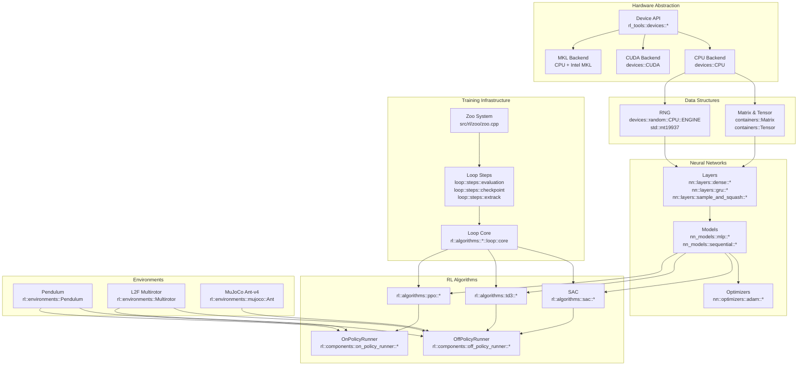
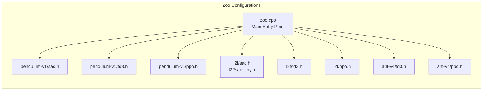
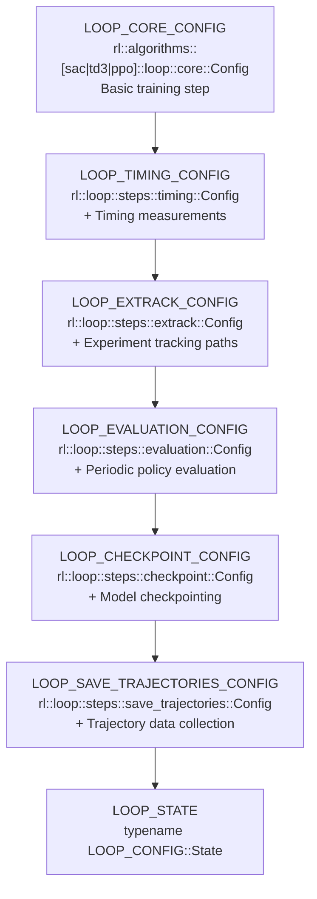
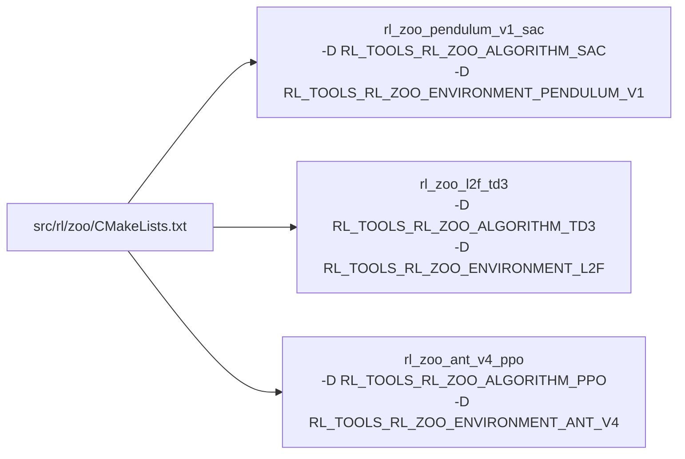
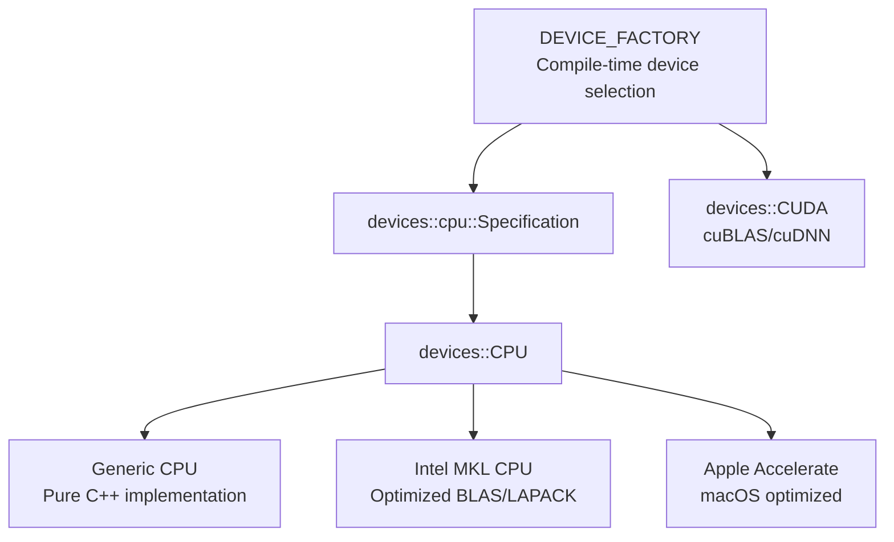
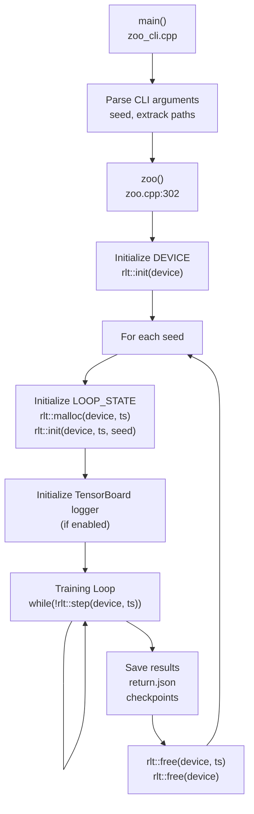

<!-- source: DeepWiki mcp.deepwiki.com · repo rl-tools/rl-tools · page 1 Overview · fetched 2026-10-30 -->

# Overview

<details>
<summary>Relevant source files</summary>

The following files were used as context for generating this wiki page:

- [include/rl_tools/devices/cpu.h](include/rl_tools/devices/cpu.h)
- [include/rl_tools/random/operations_cpu.h](include/rl_tools/random/operations_cpu.h)
- [include/rl_tools/rl/environments/pendulum/ui_xeus.h](include/rl_tools/rl/environments/pendulum/ui_xeus.h)
- [include/rl_tools/rl/loop/steps/extrack/operations_cpu.h](include/rl_tools/rl/loop/steps/extrack/operations_cpu.h)
- [include/rl_tools/rl/loop/steps/extrack/state.h](include/rl_tools/rl/loop/steps/extrack/state.h)
- [src/rl/environments/l2f/dr_sac/CMakeLists.txt](src/rl/environments/l2f/dr_sac/CMakeLists.txt)
- [src/rl/environments/l2f/dr_sac/l2f_dr_sac.cpp](src/rl/environments/l2f/dr_sac/l2f_dr_sac.cpp)
- [src/rl/zoo/CMakeLists.txt](src/rl/zoo/CMakeLists.txt)
- [src/rl/zoo/l2f/environment_tiny.h](src/rl/zoo/l2f/environment_tiny.h)
- [src/rl/zoo/l2f/plot_learning_curves.py](src/rl/zoo/l2f/plot_learning_curves.py)
- [src/rl/zoo/l2f/sac.h](src/rl/zoo/l2f/sac.h)
- [src/rl/zoo/l2f/sac_tiny.h](src/rl/zoo/l2f/sac_tiny.h)
- [src/rl/zoo/zoo.cpp](src/rl/zoo/zoo.cpp)
- [src/rl/zoo/zoo_cli.cpp](src/rl/zoo/zoo_cli.cpp)

</details>


## Purpose and Scope

This document provides a high-level introduction to **RLtools** (rl_tools), a header-only C++ reinforcement learning library designed for cross-platform deployment from high-performance servers to resource-constrained embedded systems. It explains the library's architecture, supported algorithms and environments, and deployment targets.

For step-by-step instructions on building and running experiments, see [Getting Started](#1.1). For detailed architectural concepts such as the device abstraction layer and template-based design patterns, see [Architecture Overview](#1.2) and [Core Concepts](#1.3).

---

## What is RLtools?

RLtools is a header-only C++ library that implements modern reinforcement learning algorithms with a focus on:

- **Multi-backend execution**: Seamless switching between CPU (generic/MKL/Accelerate), CUDA GPU, and embedded platforms
- **Zero-dependency core**: The library core requires only C++17, with optional dependencies for specific backends
- **Static memory allocation**: Support for stack-only allocation enabling deployment to microcontrollers (ARM Cortex, ESP32, etc.)
- **Cross-platform training and deployment**: Train on GPU/CPU, deploy to browsers (WebAssembly), autopilots (PX4), or drones (Crazyflie)

The library implements three production-ready RL algorithms—**SAC** (Soft Actor-Critic), **TD3** (Twin Delayed DDPG), and **PPO** (Proximal Policy Optimization)—and includes several environments such as the classic Pendulum-v1, a comprehensive multirotor simulation (L2F), and MuJoCo-based locomotion tasks.

**Sources:** [src/rl/zoo/zoo.cpp:1-475](), [include/rl_tools/devices/cpu.h:1-206]()

---

## High-Level System Architecture

The following diagram shows how the major components of RLtools interact:



**Sources:** [src/rl/zoo/zoo.cpp:12-92](), [include/rl_tools/devices/cpu.h:18-67]()

---

## Core Code Organization

The repository follows a clear structure mapping system components to file locations:

| Component | Location | Description |
|-----------|----------|-------------|
| Device abstraction | `include/rl_tools/devices/` | Hardware backends (CPU, CUDA) |
| Containers | `include/rl_tools/containers/` | Matrix and Tensor data structures |
| Neural network layers | `include/rl_tools/nn/layers/` | Dense, GRU, Sample&Squash, etc. |
| Neural network models | `include/rl_tools/nn_models/` | MLP, Sequential composition |
| RL algorithms | `include/rl_tools/rl/algorithms/` | SAC, TD3, PPO implementations |
| Environments | `include/rl_tools/rl/environments/` | Pendulum, L2F, MuJoCo |
| Training loops | `include/rl_tools/rl/loop/` | Core loop and decorator steps |
| Zoo entry points | `src/rl/zoo/` | Executable training scripts |
| Persistence | `include/rl_tools/persist/` | HDF5 save/load, code generation |

**Sources:** [src/rl/zoo/zoo.cpp:1-100]()

---

## Supported Algorithms and Environments

### Algorithm-Environment Compatibility Matrix

The following table shows which algorithms work with which environments:

| Environment | SAC | TD3 | PPO | Key Features |
|-------------|-----|-----|-----|--------------|
| **Pendulum-v1** | ✓ | ✓ | ✓ | Classic control, simple dynamics |
| **L2F Multirotor** | ✓ | ✓ | ✓ | Domain randomization, trajectory tracking, multi-task |
| **Ant-v4 (MuJoCo)** | - | ✓ | ✓ | Complex locomotion, 8-DOF morphology |
| **Flag** | ✓ | ✓ | ✓ | Custom environment |
| **Acrobot Swingup** | ✓ | - | - | Underactuated system |
| **Bottleneck-v0** | - | - | ✓ | Custom environment |

Each algorithm-environment pair has a dedicated configuration file:



**Sources:** [src/rl/zoo/zoo.cpp:52-77](), [src/rl/zoo/zoo.cpp:131-217]()

---

## Training Loop Architecture

RLtools uses a **decorator pattern** for composing training loops. The core algorithm loop is wrapped with additional functionality:



Each decorator adds functionality without modifying the core loop. The `step()` function cascades through the decorators:

**Sources:** [src/rl/zoo/zoo.cpp:227-261](), [include/rl_tools/rl/loop/steps/extrack/operations_cpu.h:1-44]()

---

## Zoo System: Central Training Entry Point

The **Zoo** system ([src/rl/zoo/zoo.cpp]()) is the main executable for running experiments. It:

1. Selects algorithm and environment via compile-time definitions
2. Initializes the training loop state
3. Configures experiment tracking (extrack)
4. Executes the training loop
5. Saves evaluation results and checkpoints

Key compile definitions control configuration:

| Definition | Purpose | Example |
|------------|---------|---------|
| `RL_TOOLS_RL_ZOO_ALGORITHM_*` | Select algorithm | `RL_TOOLS_RL_ZOO_ALGORITHM_SAC` |
| `RL_TOOLS_RL_ZOO_ENVIRONMENT_*` | Select environment | `RL_TOOLS_RL_ZOO_ENVIRONMENT_L2F` |
| `RL_TOOLS_RL_ZOO_BENCHMARK` | Disable logging for benchmarking | - |

**Example compilation targets:**



**Sources:** [src/rl/zoo/CMakeLists.txt:1-157](), [src/rl/zoo/zoo.cpp:131-217](), [src/rl/zoo/zoo.cpp:263-291]()

---

## Device Abstraction and Backend Selection

The library uses a device abstraction layer to support multiple backends without code duplication:



**Key classes:**

- `devices::DEVICE_FACTORY<>`: Template factory for device instantiation
- `devices::CPU<SPEC>`: CPU device with math, random, and logging components
- `devices::random::CPU::ENGINE<>`: Wraps `std::mt19937` for CPU RNG

**Sources:** [src/rl/zoo/zoo.cpp:110-121](), [include/rl_tools/devices/cpu.h:18-67](), [include/rl_tools/random/operations_cpu.h:1-55]()

---

## Deployment Targets

RLtools supports diverse deployment scenarios:

### Training Platforms

- **CPU (Generic)**: Pure C++17, no dependencies
- **CPU (MKL)**: Intel Math Kernel Library acceleration
- **CPU (Accelerate)**: Apple Accelerate framework (macOS)
- **CUDA**: NVIDIA GPU with cuBLAS

### Deployment Platforms

- **Desktop/Server**: Direct model execution
- **Embedded Autopilots**: PX4 (NuttX RTOS), Crazyflie (FreeRTOS)
- **Mobile**: iOS with CoreML integration
- **Microcontrollers**: ESP32, ARM Cortex-M
- **Web Browsers**: WebAssembly with rltools.js

**Static memory allocation** enables embedded deployment. When `RL_TOOLS_STATIC_MEM` is defined, all allocations use compile-time sizing and stack allocation, eliminating heap usage.

**Sources:** [src/rl/zoo/zoo.cpp:127-129](), [include/rl_tools/devices/cpu.h:1-206]()

---

## Main Training Function Flow

The primary training entry point is the `zoo()` function:



**Key steps:**

1. **Device initialization** [src/rl/zoo/zoo.cpp:329-330]()
2. **Loop state allocation** [src/rl/zoo/zoo.cpp:331-332]()
3. **Extrack configuration** [src/rl/zoo/zoo.cpp:317-328]()
4. **Training loop execution** [src/rl/zoo/zoo.cpp:362-400]()
5. **Result persistence** [src/rl/zoo/zoo.cpp:402-414]()

**Sources:** [src/rl/zoo/zoo.cpp:302-474](), [src/rl/zoo/zoo_cli.cpp:1-34]()

---

## Experiment Tracking (Extrack)

The **extrack** system provides structured experiment organization:

```mermaid
graph LR
    ExtrackConfig["extrack_config<br/>utils::extrack::Config"]
    
    ExtrackPaths["extrack_paths<br/>utils::extrack::Paths"]
    
    BasePath["base_path/<br/>Default: 'experiments'"]
    
    ExperimentPath["experiment/<br/>Timestamp + git hash"]
    
    PopulationPath["population_variates/<br/>e.g., 'environment_algorithm'"]
    
    PopulationValues["population_values/<br/>e.g., 'l2f_sac'"]
    
    SeedPath["seed/<br/>YYYY (4-digit seed)"]
    
    ExtrackConfig --> ExtrackPaths
    ExtrackPaths --> BasePath
    BasePath --> ExperimentPath
    ExperimentPath --> PopulationPath
    PopulationPath --> PopulationValues
    PopulationValues --> SeedPath
```



**Resulting directory structure:**

```
experiments/
└── 2024-12-09_13-30-20/
    └── d9384be_zoo_environment_algorithm/
        └── l2f_sac/
            ├── 0000/
            │   ├── return.json
            │   ├── checkpoints/
            │   └── trajectories/
            ├── 0001/
            └── ...
```

**Sources:** [include/rl_tools/rl/loop/steps/extrack/state.h:1-27](), [src/rl/zoo/zoo.cpp:317-328]()

---

## Key Takeaways

1. **Header-only design**: No separate compilation required for core functionality
2. **Template-based**: Compile-time device and algorithm selection
3. **Modular loop system**: Decorator pattern for composable training pipelines
4. **Multi-backend**: Single codebase runs on CPU, GPU, embedded, and browsers
5. **Zoo as central hub**: `src/rl/zoo/zoo.cpp` orchestrates all training experiments
6. **Static memory support**: Enables deployment to resource-constrained microcontrollers

For hands-on instructions, proceed to [Getting Started](#1.1). For deeper architectural details, see [Architecture Overview](#1.2) and [Core Concepts](#1.3).

**Sources:** [src/rl/zoo/zoo.cpp:1-475](), [src/rl/zoo/CMakeLists.txt:1-157](), [include/rl_tools/devices/cpu.h:1-206]()

---

