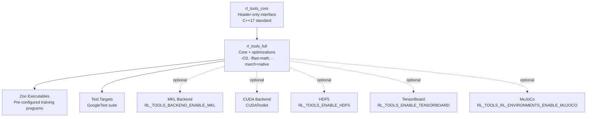
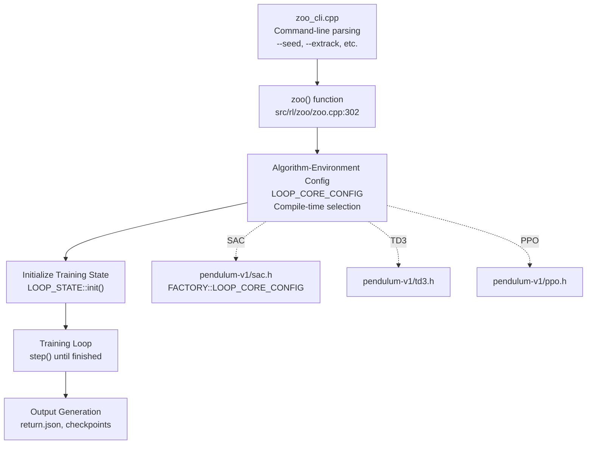
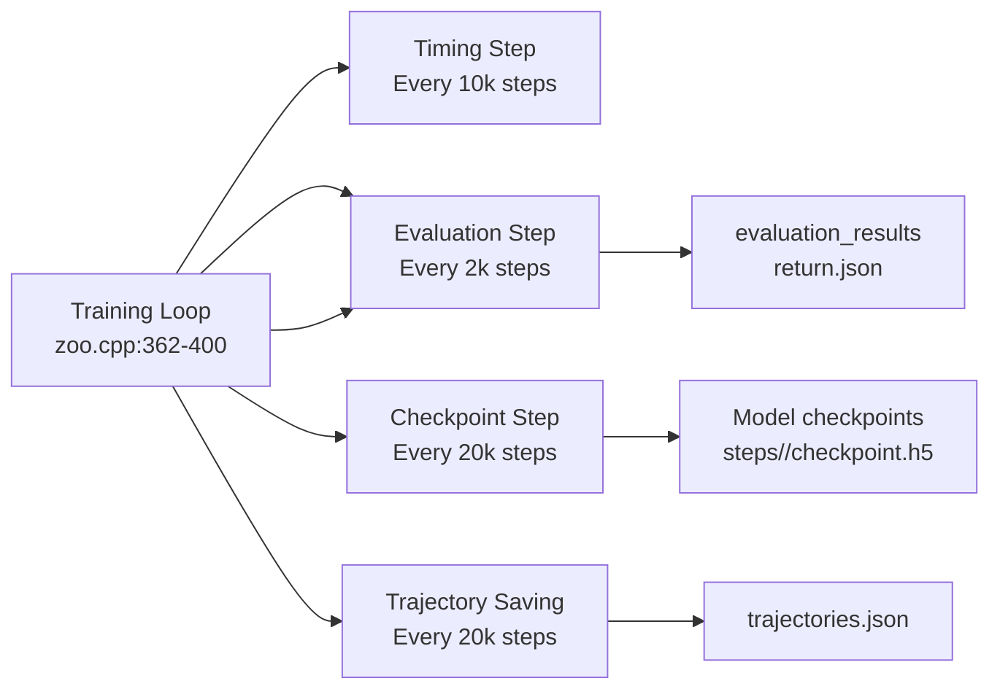

<!-- source: DeepWiki mcp.deepwiki.com · repo rl-tools/rl-tools · page 1.1 Getting Started · fetched 2026-10-30 -->

# Getting Started

<details>
<summary>Relevant source files</summary>

The following files were used as context for generating this wiki page:

- [.gitignore](.gitignore)
- [CMakeLists.txt](CMakeLists.txt)
- [include/rl_tools/rl/loop/steps/extrack/operations_cpu.h](include/rl_tools/rl/loop/steps/extrack/operations_cpu.h)
- [include/rl_tools/rl/loop/steps/extrack/state.h](include/rl_tools/rl/loop/steps/extrack/state.h)
- [src/rl/environments/l2f/dr_sac/CMakeLists.txt](src/rl/environments/l2f/dr_sac/CMakeLists.txt)
- [src/rl/environments/l2f/dr_sac/l2f_dr_sac.cpp](src/rl/environments/l2f/dr_sac/l2f_dr_sac.cpp)
- [src/rl/environments/mujoco/ant/CMakeLists.txt](src/rl/environments/mujoco/ant/CMakeLists.txt)
- [src/rl/environments/mujoco/ant/evaluate_actor.cpp](src/rl/environments/mujoco/ant/evaluate_actor.cpp)
- [src/rl/environments/mujoco/ant/ppo/cpu/CMakeLists.txt](src/rl/environments/mujoco/ant/ppo/cpu/CMakeLists.txt)
- [src/rl/environments/mujoco/ant/ppo/cpu/training.h](src/rl/environments/mujoco/ant/ppo/cpu/training.h)
- [src/rl/environments/mujoco/ant/ppo/cuda/CMakeLists.txt](src/rl/environments/mujoco/ant/ppo/cuda/CMakeLists.txt)
- [src/rl/environments/mujoco/ant/ppo/cuda/training_ppo.cu](src/rl/environments/mujoco/ant/ppo/cuda/training_ppo.cu)
- [src/rl/environments/mujoco/ant/ppo/parameters.h](src/rl/environments/mujoco/ant/ppo/parameters.h)
- [src/rl/environments/mujoco/ant/td3/CMakeLists.txt](src/rl/environments/mujoco/ant/td3/CMakeLists.txt)
- [src/rl/environments/mujoco/ant/td3/training.h](src/rl/environments/mujoco/ant/td3/training.h)
- [src/rl/environments/pendulum/sac/cuda/cuda_graph_export.h](src/rl/environments/pendulum/sac/cuda/cuda_graph_export.h)
- [src/rl/environments/pendulum/td3/cpu/CMakeLists.txt](src/rl/environments/pendulum/td3/cpu/CMakeLists.txt)
- [src/rl/zoo/CMakeLists.txt](src/rl/zoo/CMakeLists.txt)
- [src/rl/zoo/l2f/environment_tiny.h](src/rl/zoo/l2f/environment_tiny.h)
- [src/rl/zoo/l2f/plot_learning_curves.py](src/rl/zoo/l2f/plot_learning_curves.py)
- [src/rl/zoo/l2f/sac.h](src/rl/zoo/l2f/sac.h)
- [src/rl/zoo/l2f/sac_tiny.h](src/rl/zoo/l2f/sac_tiny.h)
- [src/rl/zoo/zoo.cpp](src/rl/zoo/zoo.cpp)
- [src/rl/zoo/zoo_cli.cpp](src/rl/zoo/zoo_cli.cpp)
- [tests/src/rl/algorithms/ppo/parameters_rl.h](tests/src/rl/algorithms/ppo/parameters_rl.h)

</details>


This document provides a quick introduction to getting started with RLtools, covering installation, basic compilation, and running your first examples. It focuses on the essential steps to get RLtools working on your system and demonstrates the core compilation patterns.

For detailed information about specific algorithms, see [Reinforcement Learning Algorithms](#2). For comprehensive build system configuration, see [Build System and Configuration](#6).

## Quick Start

RLtools is a header-only C++ library with a modular build system. The fastest way to get started is using CMake to build one of the Zoo examples, which provide pre-configured algorithm-environment combinations.

### Using CMake (Recommended)

Clone the repository and build the Pendulum-v1 SAC example:

```bash
git clone https://github.com/rl-tools/rl-tools.git
cd rl-tools
mkdir build && cd build
cmake .. -DCMAKE_BUILD_TYPE=Release
cmake --build . --target rl_zoo_pendulum_v1_sac
./src/rl/zoo/rl_zoo_pendulum_v1_sac 0
```

This builds and runs the Pendulum-v1 environment with the SAC algorithm using seed 0. The program will train a policy to swing up and balance the pendulum.

### Direct Compilation (Alternative)

For minimal setup without CMake, compile directly:

```bash
git clone https://github.com/rl-tools/rl-tools.git
cd rl-tools
g++ -std=c++17 -O3 -ffast-math -march=native -I include \
    src/rl/zoo/zoo_cli.cpp src/rl/zoo/zoo.cpp \
    -DRL_TOOLS_RL_ZOO_ALGORITHM_SAC \
    -DRL_TOOLS_RL_ZOO_ENVIRONMENT_PENDULUM_V1
./a.out 0
```

### Platform-Specific Optimizations

**macOS with Accelerate Framework:**
```bash
cmake .. -DCMAKE_BUILD_TYPE=Release \
         -DRL_TOOLS_BACKEND_ENABLE_ACCELERATE=ON
```

**Ubuntu with MKL:**
```bash
cmake .. -DCMAKE_BUILD_TYPE=Release \
         -DRL_TOOLS_BACKEND_ENABLE_MKL=ON
```

Sources: [CMakeLists.txt:1-24](), [src/rl/zoo/CMakeLists.txt:10-20](), [src/rl/zoo/zoo.cpp:302-474](), [src/rl/zoo/zoo_cli.cpp:8-34]()

## Build System Architecture

RLtools uses CMake with a layered target system. The core library is header-only, with optional dependencies for acceleration and features.

**CMake Target Hierarchy:**



### Zoo Executable Naming

Zoo executables follow the pattern `rl_zoo_<environment>_<algorithm>`:

| Executable | Environment | Algorithm | Source |
|------------|-------------|-----------|--------|
| `rl_zoo_pendulum_v1_sac` | Pendulum-v1 | SAC | [src/rl/zoo/CMakeLists.txt:16-20]() |
| `rl_zoo_pendulum_v1_td3` | Pendulum-v1 | TD3 | [src/rl/zoo/CMakeLists.txt:29-33]() |
| `rl_zoo_pendulum_v1_ppo` | Pendulum-v1 | PPO | [src/rl/zoo/CMakeLists.txt:10-14]() |
| `rl_zoo_l2f_sac` | L2F Multirotor | SAC | [src/rl/zoo/CMakeLists.txt:104-108]() |
| `rl_zoo_ant_v4_ppo` | Ant-v4 (MuJoCo) | PPO | [src/rl/zoo/CMakeLists.txt:143-147]() |

Sources: [CMakeLists.txt:6-24](), [src/rl/zoo/CMakeLists.txt:1-157]()

## CMake Configuration

### Basic Configuration

```bash
mkdir build && cd build
cmake .. -DCMAKE_BUILD_TYPE=Release
cmake --build . --target rl_zoo_pendulum_v1_sac
```

### Key Configuration Options

| Option | Purpose | Default |
|--------|---------|---------|
| `RL_TOOLS_ENABLE_TARGETS` | Build main executables | ON |
| `RL_TOOLS_ENABLE_TESTS` | Build test suite | OFF |
| `RL_TOOLS_BACKEND_ENABLE_MKL` | Intel MKL BLAS acceleration | OFF |
| `RL_TOOLS_BACKEND_ENABLE_ACCELERATE` | Apple Accelerate framework | OFF |
| `RL_TOOLS_ENABLE_HDF5` | Model checkpointing | OFF |
| `RL_TOOLS_ENABLE_TENSORBOARD` | Training visualization | OFF |
| `RL_TOOLS_RL_ENVIRONMENTS_ENABLE_MUJOCO` | MuJoCo environments | OFF |
| `RL_TOOLS_WARNINGS_AS_ERRORS` | Treat warnings as errors | ON |
| `RL_TOOLS_OFFLINE_BUILD` | Use cached dependencies | OFF |

### Backend Configuration Examples

**CPU with MKL (Linux):**
```bash
cmake .. -DCMAKE_BUILD_TYPE=Release \
         -DRL_TOOLS_BACKEND_ENABLE_MKL=ON \
         -DRL_TOOLS_ENABLE_HDF5=ON \
         -DRL_TOOLS_ENABLE_TENSORBOARD=ON
```

**CPU with Accelerate (macOS):**
```bash
cmake .. -DCMAKE_BUILD_TYPE=Release \
         -DRL_TOOLS_BACKEND_ENABLE_ACCELERATE=ON
```

**GPU with CUDA:**
```bash
cmake .. -DCMAKE_BUILD_TYPE=Release \
         -DRL_TOOLS_BACKEND_ENABLE_CUDA=ON
```

**MuJoCo Environments:**
```bash
cmake .. -DCMAKE_BUILD_TYPE=Release \
         -DRL_TOOLS_RL_ENVIRONMENTS_ENABLE_MUJOCO=ON
```

Sources: [CMakeLists.txt:10-19](), [cmake/autodetect/all.cmake:1-20]()

## Zoo System: Running Experiments

The Zoo system provides a unified interface for training different algorithm-environment combinations. Each Zoo executable is pre-configured for a specific pairing.

**Zoo Execution Flow:**



### Command-Line Interface

Zoo executables accept these arguments:

```bash
./rl_zoo_pendulum_v1_sac [options]
```

**Options** (when CLI11 enabled):

| Option | Description | Default |
|--------|-------------|---------|
| `-s, --seed` | Random seed for training | 0 |
| `-n, --n_seeds` | Number of seeds to run sequentially | 1 |
| `--e, --extrack` | Base path for experiment tracking | "" |
| `--ee, --extrack-experiment` | Experiment name | timestamp |
| `--eep, --extrack-experiment-path` | Full experiment path | "" |
| `-c, --config` | Config file path | "" |

### Running Multiple Seeds

Run multiple training runs with different seeds:

```bash
# Single seed
./rl_zoo_pendulum_v1_sac --seed 0

# Multiple seeds (0-9)
./rl_zoo_pendulum_v1_sac --seed 0 --n_seeds 10
```

### Output Structure

The Zoo system generates structured output using the ExTrack system:

```
experiments/
└── <timestamp>_<commit>_zoo_environment_algorithm/
    └── <environment>_<algorithm>/
        ├── 0000/  # seed 0
        │   ├── return.json
        │   ├── return.json.set
        │   └── steps/
        │       └── <step>/
        │           └── actor.h  # Exported C++ code
        ├── 0001/  # seed 1
        └── ...
```

Sources: [src/rl/zoo/zoo_cli.cpp:1-34](), [src/rl/zoo/zoo.cpp:302-474](), [include/rl_tools/rl/loop/steps/extrack/operations_cpu.h:1-44]()

## Running Your First Pendulum Experiment

### Step 1: Build the Target

```bash
cd build
cmake --build . --target rl_zoo_pendulum_v1_sac
```

### Step 2: Run Training

```bash
./src/rl/zoo/rl_zoo_pendulum_v1_sac --seed 0
```

**Expected Output:**
```
PID: <process_id> (use kill -SIGUSR1 <pid> to evaluate on demand)
Evaluation Interval: 2000
Checkpoint Interval: 20000
Save Trajectories Interval: 20000
...
Step: 0/200000
Step: 2000/200000 (evaluation...)
...
```

### Step 3: Monitor Progress

The training process logs key metrics:



### Step 4: Analyze Results

After training completes, examine the output:

```bash
cd experiments/<timestamp>_zoo_environment_algorithm/pendulum-v1_sac/0000/
cat return.json  # View training metrics
```

**return.json Structure:**
```json
[
  {
    "step": 0,
    "returns": [<100 episode returns>],
    "returns_mean": -1234.5,
    "returns_std": 123.4,
    "episode_length_mean": 200.0,
    ...
  },
  ...
]
```

### Visualization

Use the provided Python script to plot learning curves:

```bash
cd src/rl/zoo/l2f/
python plot_learning_curves.py
```

Sources: [src/rl/zoo/zoo.cpp:362-474](), [src/rl/zoo/l2f/plot_learning_curves.py:1-151]()

## Available Zoo Targets

### Pendulum Environment

| Target | Algorithm | Features |
|--------|-----------|----------|
| `rl_zoo_pendulum_v1_sac` | SAC | Stochastic policy, entropy regularization |
| `rl_zoo_pendulum_v1_td3` | TD3 | Deterministic policy, target smoothing |
| `rl_zoo_pendulum_v1_ppo` | PPO | On-policy, clipped objective |
| `rl_zoo_pendulum_v1_sac_benchmark` | SAC | Minimal logging for benchmarking |

### Learn to Fly (L2F) Multirotor

| Target | Algorithm | Features |
|--------|-----------|----------|
| `rl_zoo_l2f_sac` | SAC | Domain randomization, trajectory tracking |
| `rl_zoo_l2f_td3` | TD3 | Trajectory tracking control |
| `rl_zoo_l2f_ppo` | PPO | On-policy multirotor control |
| `rl_zoo_l2f_sac_benchmark` | SAC | Performance benchmarking |

### MuJoCo Environments (requires `RL_TOOLS_RL_ENVIRONMENTS_ENABLE_MUJOCO=ON`)

| Target | Algorithm | Environment |
|--------|-----------|-------------|
| `rl_zoo_ant_v4_ppo` | PPO | Ant-v4 locomotion |
| `rl_zoo_ant_v4_td3` | TD3 | Ant-v4 locomotion |

### Other Environments

| Target | Algorithm | Environment |
|--------|-----------|-------------|
| `rl_zoo_flag_sac` | SAC | Flag environment |
| `rl_zoo_flag_td3` | TD3 | Flag environment |
| `rl_zoo_flag_ppo` | PPO | Flag environment |
| `rl_zoo_acrobot_swingup_v0_sac` | SAC | Acrobot swing-up |

Sources: [src/rl/zoo/CMakeLists.txt:8-154]()

## Dependencies and Setup

### Required Dependencies

- **C++17 compiler** (GCC 9+, Clang 10+, MSVC 2019+)
- **CMake 3.19+** (for HDF5 support)

### Optional Dependencies

RLtools uses FetchContent to automatically download optional dependencies:

| Dependency | Purpose | Auto-fetched | CMake Option |
|------------|---------|--------------|--------------|
| CLI11 | Command-line parsing | Yes | `RL_TOOLS_ENABLE_CLI11` |
| HDF5 | Model persistence | No | `RL_TOOLS_ENABLE_HDF5` |
| GoogleTest | Testing framework | Yes | `RL_TOOLS_ENABLE_GTEST` |
| TensorBoard Logger | Training visualization | Yes | `RL_TOOLS_ENABLE_TENSORBOARD` |
| MuJoCo | Physics simulation | No | `RL_TOOLS_RL_ENVIRONMENTS_ENABLE_MUJOCO` |

### FetchContent Configuration

Dependencies are cached in `.dependencies/<build_dir>` for offline builds:

```bash
# Normal build (downloads dependencies)
cmake .. -DCMAKE_BUILD_TYPE=Release

# Offline build (uses cached dependencies)
cmake .. -DCMAKE_BUILD_TYPE=Release \
         -DRL_TOOLS_OFFLINE_BUILD=ON
```

The base directory for FetchContent can be customized:

```cmake
set(FETCHCONTENT_BASE_DIR "/path/to/cache" CACHE PATH "Base dir")
```

### Installing System Dependencies

**Ubuntu/Debian:**
```bash
# For MKL backend
sudo apt install intel-mkl

# For HDF5 support
sudo apt install libhdf5-dev
```

**macOS:**
```bash
# Accelerate framework is built-in
# For HDF5 support
brew install hdf5
```

Sources: [CMakeLists.txt:55-78](), [cmake/autodetect/all.cmake:1-20](), [cmake/optional/googletest.cmake:1-20]()

## Next Steps

After successfully compiling and running your first examples:

1. **Explore Algorithms**: Try different RL algorithms - see [Reinforcement Learning Algorithms](#2)
2. **Custom Environments**: Create your own environments - see [Creating Custom Environments](#4.4)
3. **Advanced Configuration**: Configure backends and optimizations - see [Backend Configuration](#6.2)
4. **Performance Testing**: Run benchmarks and tests - see [Testing and Benchmarking](#7)

The header-only design makes RLtools easy to integrate into existing projects, while the layered CMake system allows you to include only the features you need.

---

