<!-- source: DeepWiki mcp.deepwiki.com · repo rl-tools/rl-tools · page 1.2 Architecture Overview · fetched 2026-10-30 -->

# Architecture Overview

<details>
<summary>Relevant source files</summary>

The following files were used as context for generating this wiki page:

- [include/rl_tools/devices/cpu.h](include/rl_tools/devices/cpu.h)
- [include/rl_tools/random/operations_cpu.h](include/rl_tools/random/operations_cpu.h)
- [include/rl_tools/rl/environments/l2f/multirotor.h](include/rl_tools/rl/environments/l2f/multirotor.h)
- [include/rl_tools/rl/environments/l2f/operations_cpu.h](include/rl_tools/rl/environments/l2f/operations_cpu.h)
- [include/rl_tools/rl/environments/l2f/operations_generic.h](include/rl_tools/rl/environments/l2f/operations_generic.h)
- [include/rl_tools/rl/environments/l2f/operations_generic/10_sample_initial_parameters.h](include/rl_tools/rl/environments/l2f/operations_generic/10_sample_initial_parameters.h)
- [include/rl_tools/rl/environments/l2f/operations_generic/30_sample_initial_state.h](include/rl_tools/rl/environments/l2f/operations_generic/30_sample_initial_state.h)
- [include/rl_tools/rl/environments/l2f/operations_generic/70_post_integration.h](include/rl_tools/rl/environments/l2f/operations_generic/70_post_integration.h)
- [include/rl_tools/rl/environments/l2f/operations_multitask_generic.h](include/rl_tools/rl/environments/l2f/operations_multitask_generic.h)
- [include/rl_tools/rl/environments/l2f/operations_multitask_generic_forward.h](include/rl_tools/rl/environments/l2f/operations_multitask_generic_forward.h)
- [include/rl_tools/rl/environments/l2f/parameters/default.h](include/rl_tools/rl/environments/l2f/parameters/default.h)
- [include/rl_tools/rl/environments/l2f/parameters/trajectories/lissajous.h](include/rl_tools/rl/environments/l2f/parameters/trajectories/lissajous.h)
- [include/rl_tools/rl/environments/pendulum/ui_xeus.h](include/rl_tools/rl/environments/pendulum/ui_xeus.h)
- [src/rl/zoo/l2f/environment.h](src/rl/zoo/l2f/environment.h)
- [src/rl/zoo/l2f/environment_big.h](src/rl/zoo/l2f/environment_big.h)
- [src/rl/zoo/l2f/ppo.h](src/rl/zoo/l2f/ppo.h)
- [src/rl/zoo/l2f/sac_big.h](src/rl/zoo/l2f/sac_big.h)

</details>


## Purpose and Scope

This document explains the high-level architecture of RLtools: how major system components are organized, how they interact through well-defined interfaces, and the key design patterns that enable multi-platform deployment. The focus is on structural organization and composition mechanisms rather than individual algorithm or environment details.

For specific information about RL algorithms, see [Reinforcement Learning Algorithms](#2). For environment implementations, see [Environments](#4). For build system details, see [Build System and Configuration](#6).

---

## Design Philosophy

RLtools is architected as a **header-only C++ library** using template metaprogramming to achieve three primary goals:

1. **Zero-cost abstraction**: All polymorphism resolved at compile-time through templates
2. **Multi-backend portability**: Same high-level code runs on CPU, CUDA, embedded systems, and WebAssembly
3. **Static memory support**: Optional stack-only allocation for resource-constrained embedded platforms

The architecture employs a **functional programming style** where operations are stateless free functions rather than class methods, enabling easy backend dispatch and minimal binary size.

Sources: [include/rl_tools/devices/cpu.h:1-70](), [include/rl_tools/version.h]()

---

## Core Architectural Patterns

### Device Abstraction Layer

The device abstraction is the foundational pattern enabling multi-backend support. All compute operations are parameterized by a `DEVICE` type that provides math, random, and logging capabilities.

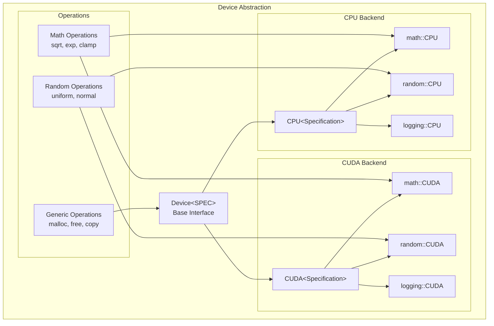

**Device Structure**:
- `devices::CPU<SPEC>`: Generic CPU backend with `math`, `random`, `logger` members
- `devices::CUDA<SPEC>`: GPU backend with cuBLAS/cuDNN integration
- `devices::DefaultCPU`: Convenience typedef using default specification

Operations are dispatched through the device parameter:
```cpp
template<typename DEVICE, typename T, typename RNG>
T sample(DEVICE& device, T mean, T std, RNG& rng);
```

Sources: [include/rl_tools/devices/cpu.h:17-67](), [include/rl_tools/random/operations_cpu.h:14-52]()

### Template-Based Design and Specification Pattern

Every major component is defined by a **Specification struct** containing compile-time configuration. This enables:
- Type parameterization (float vs double)
- Dimension configuration (layer sizes, buffer capacities)
- Behavioral flags (static allocation, domain randomization)

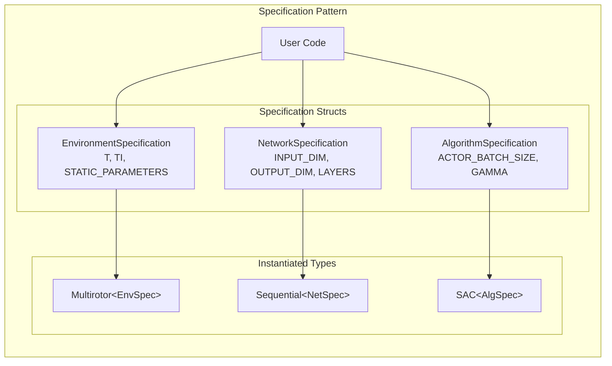

**Example**: L2F Environment Configuration
```cpp
struct ENVIRONMENT_STATIC_PARAMETERS {
    static constexpr TI N_SUBSTEPS = 1;
    static constexpr TI ACTION_HISTORY_LENGTH = 16;
    static constexpr TI EPISODE_STEP_LIMIT = 500;
    using STATE_TYPE = StateTrajectory<...>;
    using OBSERVATION_TYPE = DefaultActionHistoryObservation<...>;
    using PARAMETERS = PARAMETERS_TYPE;
};
```

Sources: [include/rl_tools/rl/environments/l2f/multirotor.h:14-243](), [src/rl/zoo/l2f/environment.h:134-158]()

### Operations Pattern

Operations are **free functions** templated on device and type specifications, not class methods. This pattern:
- Enables backend specialization through template specialization
- Keeps types lightweight (data only, no vtables)
- Allows operations to be added in separate headers

**Dispatch Mechanism**:
```cpp
// Generic declaration
template<typename DEVICE, typename SPEC, typename RNG>
void sample_initial_state(DEVICE&, Multirotor<SPEC>&, STATE&, RNG&);

// Backend-specific implementations
namespace cpu { /* CPU implementation */ }
namespace cuda { /* CUDA implementation */ }
```

**Composition Dispatch**: L2F uses a dispatch pattern for composed state/observation types:

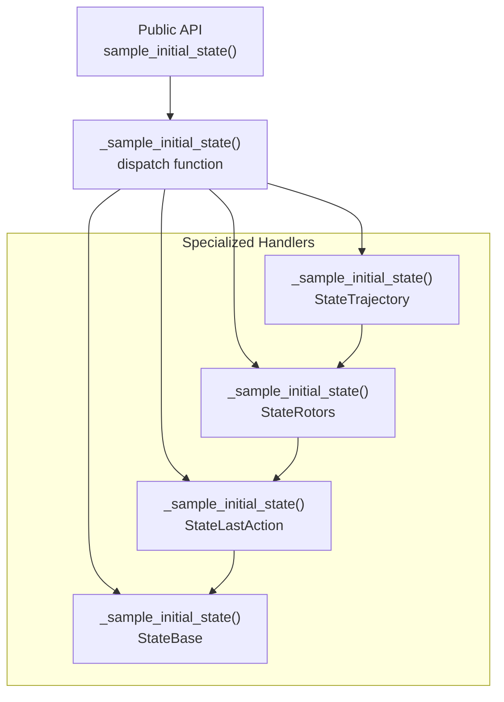

Sources: [include/rl_tools/rl/environments/l2f/operations_generic.h:22-92](), [include/rl_tools/rl/environments/l2f/operations_generic/30_sample_initial_state.h:16-217]()

---

## Component Hierarchy

### Devices and Compute Backends

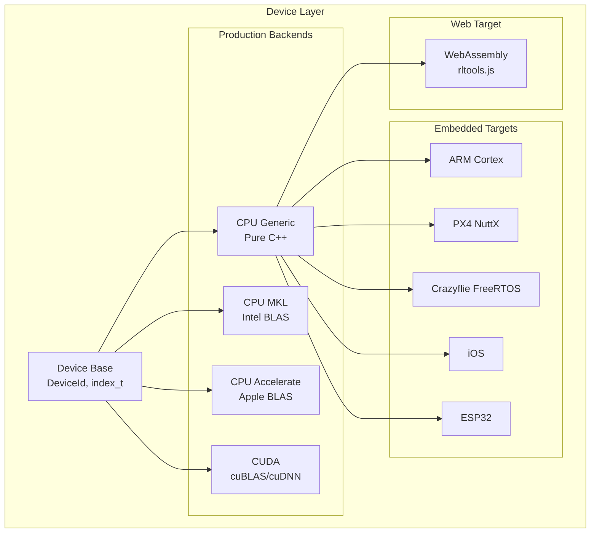

**Backend Selection**:
- Compile-time through template instantiation
- Runtime configuration minimal (device initialization, RNG seeding)
- Static memory mode: `RL_TOOLS_STATIC_MEM` flag eliminates heap allocation

Sources: [include/rl_tools/devices/cpu.h:18-67]()

### Container System

The container system provides a unified interface for tensors and matrices with compile-time or runtime sizing.

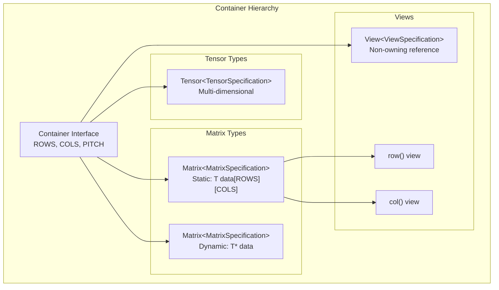

**Key Design Points**:
- **Specification-based**: `MatrixSpecification<T, TI, ROWS, COLS, PITCH>` defines layout
- **Allocation mode**: Controlled by `RL_TOOLS_STATIC_MEM` and specification
- **Operations**: `malloc()`, `free()`, `copy()`, `set()`, `get()` parameterized by device

Sources: [src/rl/zoo/l2f/environment.h:1-165]()

### Neural Network Architecture

Neural networks are built by composing layer modules into sequential or custom architectures.

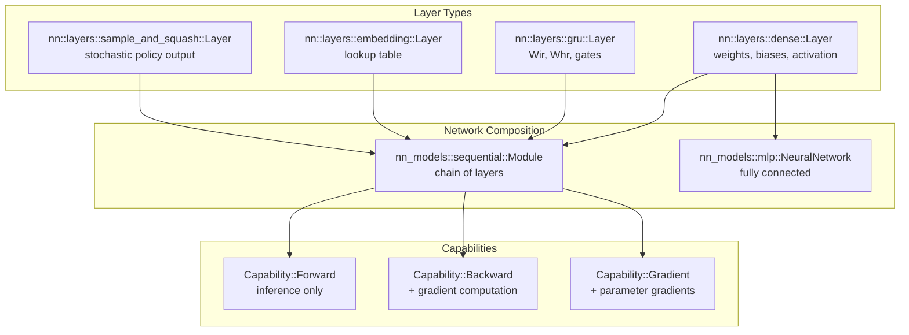

**Capability System**: Operations are enabled based on capability:
- `forward()`: Available for `Capability::Forward`
- `backward()`: Available for `Capability::Backward`
- `reset_optimizer_state()`: Available for `Capability::Gradient`

Sources: [src/rl/zoo/l2f/sac_big.h:1-81]()

### RL Algorithm Configuration

Algorithms are configured through nested specification structs defining hyperparameters and network architectures.

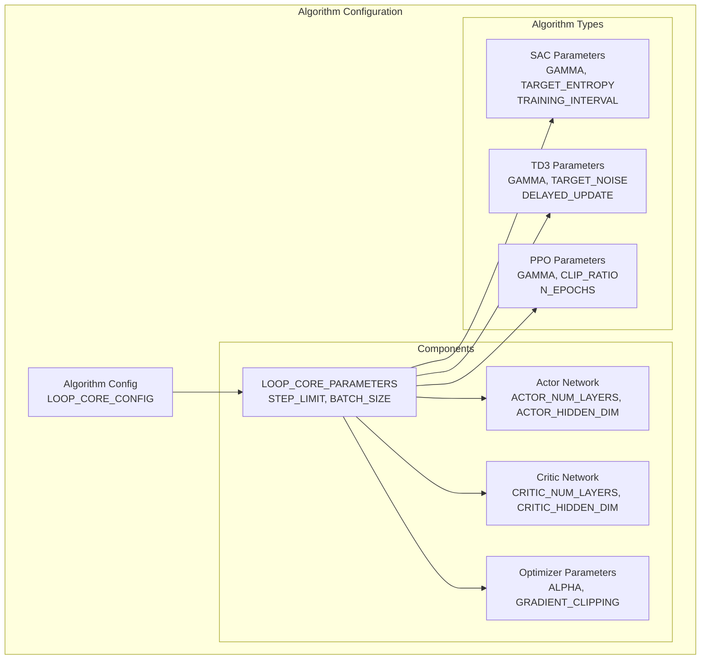

**Example**: SAC Configuration
```cpp
struct LOOP_CORE_PARAMETERS {
    struct SAC_PARAMETERS {
        static constexpr TI ACTOR_BATCH_SIZE = 512;
        static constexpr TI CRITIC_BATCH_SIZE = 512;
        static constexpr T GAMMA = 0.99;
        static constexpr T TARGET_ENTROPY = -2.0;
    };
    static constexpr TI ACTOR_NUM_LAYERS = 3;
    static constexpr TI ACTOR_HIDDEN_DIM = 32;
    static constexpr TI CRITIC_NUM_LAYERS = 3;
    static constexpr TI CRITIC_HIDDEN_DIM = 256;
};
```

Sources: [src/rl/zoo/l2f/sac_big.h:20-78](), [src/rl/zoo/l2f/ppo.h:25-49]()

---

## Composition Mechanisms

### State Composition via Linked-List Pattern

States, observations, and parameters use a **linked-list composition pattern** where each component references a `NEXT_COMPONENT` type, enabling arbitrary feature combinations.

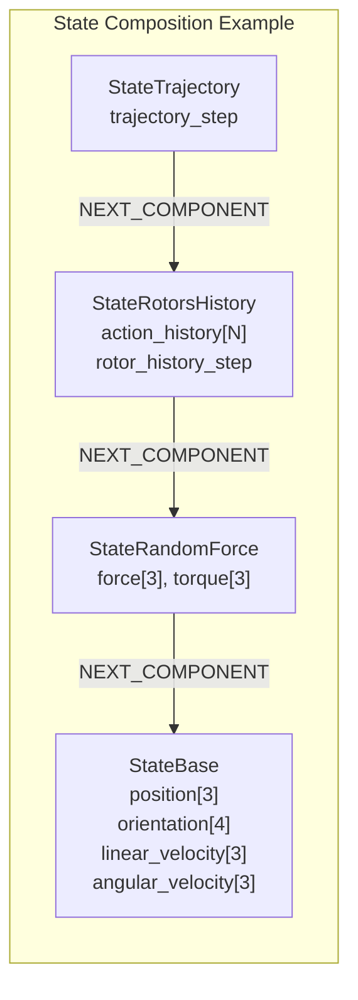

**Specification Structure**:
```cpp
template <typename T_SPEC>
struct StateBase {
    using SPEC = T_SPEC;
    using T = typename SPEC::T;
    static constexpr TI DIM = 13;
    T position[3];
    T orientation[4];
    T linear_velocity[3];
    T angular_velocity[3];
};

template <typename T_SPEC>
struct StateLastAction: T_SPEC::NEXT_COMPONENT {
    using SPEC = T_SPEC;
    using NEXT_COMPONENT = typename SPEC::NEXT_COMPONENT;
    static constexpr TI DIM = 4 + NEXT_COMPONENT::DIM;
    T last_action[4];
};
```

This pattern enables:
- **Modular features**: Each state component adds specific functionality
- **Automatic dimension calculation**: `DIM = CURRENT_DIM + NEXT_COMPONENT::DIM`
- **Composition dispatch**: Operations recursively call next component's handler

Sources: [include/rl_tools/rl/environments/l2f/multirotor.h:624-718]()

### Observation Composition

Observations follow the same linked-list pattern with additional support for privileged observations (critic-only).

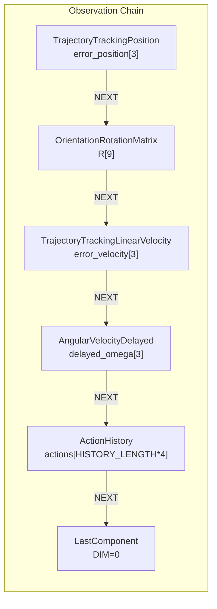

**Privileged Observations**: Marked with `PRIVILEGED = true` flag, accessible only to critic network for asymmetric actor-critic.

Sources: [include/rl_tools/rl/environments/l2f/multirotor.h:236-614](), [src/rl/zoo/l2f/environment_big.h:125-132]()

### Parameter Composition

Environment parameters compose domain randomization, disturbances, trajectories, and base dynamics using the same pattern.

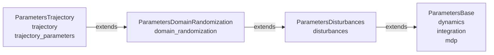

This enables sampling different parameter configurations at episode initialization through recursive dispatch:
- `sample_initial_parameters()` traverses the composition chain
- Each level samples its specific parameters
- Domain randomization adjusts base parameters (mass, inertia, thrust curves)

Sources: [include/rl_tools/rl/environments/l2f/multirotor.h:136-220](), [include/rl_tools/rl/environments/l2f/operations_generic/10_sample_initial_parameters.h:16-207]()

---

## Configuration System

### Factory Pattern for Type Construction

The codebase uses factory structs to construct fully-configured types from high-level parameters.

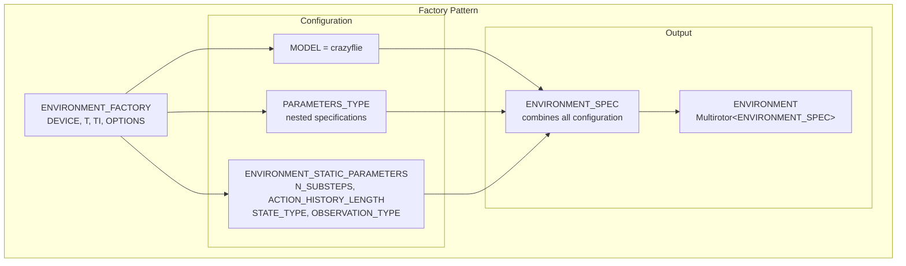

**Example**: Environment Factory
```cpp
template <typename DEVICE, typename TYPE_POLICY, typename TI, typename OPTIONS>
struct ENVIRONMENT_BIG_FACTORY {
    using T = typename TYPE_POLICY::DEFAULT;
    static constexpr auto MODEL = parameters::dynamics::REGISTRY::soft_rigid;
    
    struct ENVIRONMENT_STATIC_PARAMETERS {
        static constexpr TI N_SUBSTEPS = 1;
        static constexpr TI ACTION_HISTORY_LENGTH = 8;
        using STATE_TYPE = StateTrajectory<...>;
        using OBSERVATION_TYPE = observation::TrajectoryTrackingPosition<...>;
    };
    
    using ENVIRONMENT_SPEC = Specification<T, TI, ENVIRONMENT_STATIC_PARAMETERS>;
    using ENVIRONMENT = Multirotor<ENVIRONMENT_SPEC>;
};
```

Sources: [src/rl/zoo/l2f/environment_big.h:18-149](), [src/rl/zoo/l2f/environment.h:18-162]()

### Static vs Dynamic Allocation

Allocation strategy is controlled by `RL_TOOLS_STATIC_MEM` flag and specification:

**Static Mode** (embedded):
- All memory on stack
- Array sizes compile-time constants
- No `malloc()` calls
- Enabled by `RL_TOOLS_STATIC_MEM` macro

**Dynamic Mode** (desktop/server):
- Heap allocation for large buffers
- Runtime-sized structures
- Smaller binary size
- Default mode

The same code works in both modes through template specialization of `malloc()` and `free()`.

Sources: [include/rl_tools/rl/environments/l2f/operations_generic.h:38-46]()

### Configuration Flow

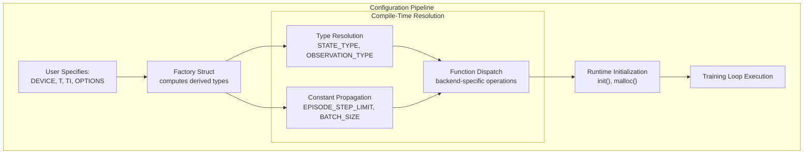

All configuration is compile-time except:
- RNG seed
- Device initialization
- Buffer allocation (if dynamic mode)

This enables aggressive compiler optimization and small binary sizes.

Sources: [src/rl/zoo/l2f/sac_big.h:8-80](), [src/rl/zoo/l2f/ppo.h:14-51]()

---

## Integration Points

### Zoo System as Central Orchestrator

The `zoo.cpp` system serves as the main entry point, composing algorithm, environment, and training loop configurations.

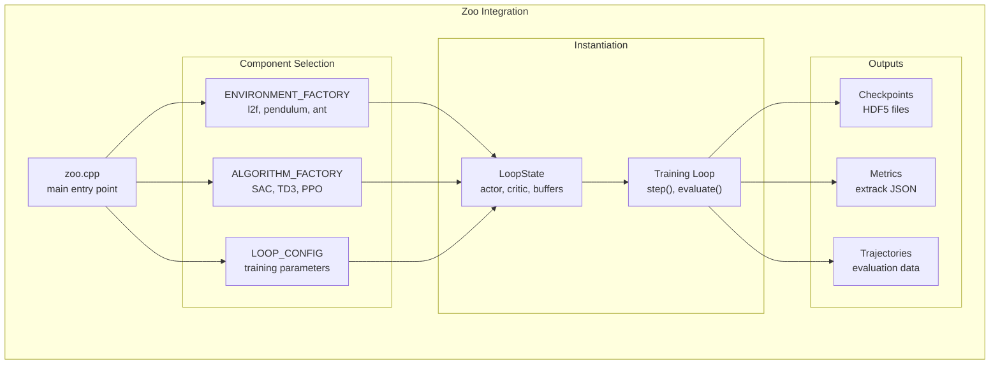

The zoo pattern enables:
- Compile-time selection of algorithm-environment pairs
- Shared training infrastructure across combinations
- Reproducible experiments with fixed configurations

Sources: [src/rl/zoo/l2f/sac_big.h:7-81](), [src/rl/zoo/l2f/ppo.h:12-52]()

### Multi-Platform Build Pipeline

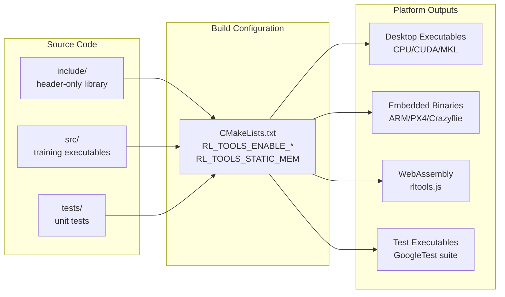

**Key Build Features**:
- Header-only core: No compilation required for basic usage
- Platform-specific compilation units in `src/`
- CMake options control backend and features
- Static memory mode for embedded targets

Sources: [src/rl/zoo/l2f/environment.h:1-165]()

---

## Summary

The RLtools architecture achieves portability and performance through:

1. **Device abstraction**: Unified interface across CPU, GPU, embedded, and web backends
2. **Template metaprogramming**: Zero-cost abstractions with compile-time polymorphism
3. **Specification pattern**: All configuration as compile-time constants
4. **Operations pattern**: Free functions enable backend specialization
5. **Composition mechanisms**: Linked-list pattern for modular features
6. **Factory pattern**: High-level construction of complex types

This architecture enables the same algorithm code to run efficiently on a desktop GPU, a Crazyflie drone, and in a web browser, with minimal code duplication and no runtime polymorphism overhead.

Sources: [include/rl_tools/devices/cpu.h:1-70](), [include/rl_tools/rl/environments/l2f/multirotor.h:1-718](), [include/rl_tools/rl/environments/l2f/operations_generic.h:1-189](), [src/rl/zoo/l2f/environment_big.h:1-151]()

---

