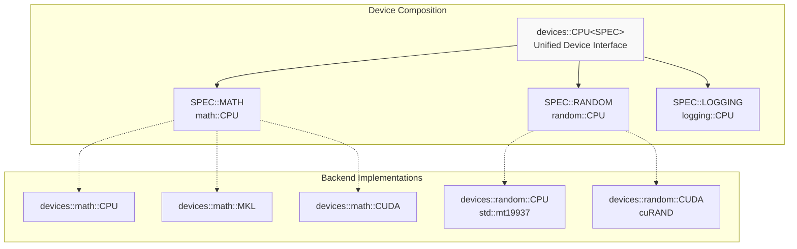
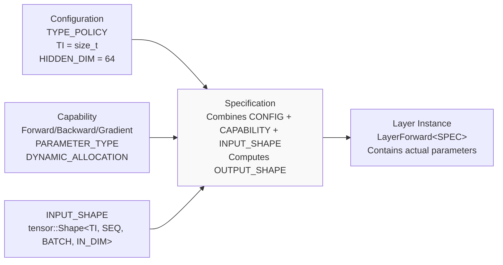
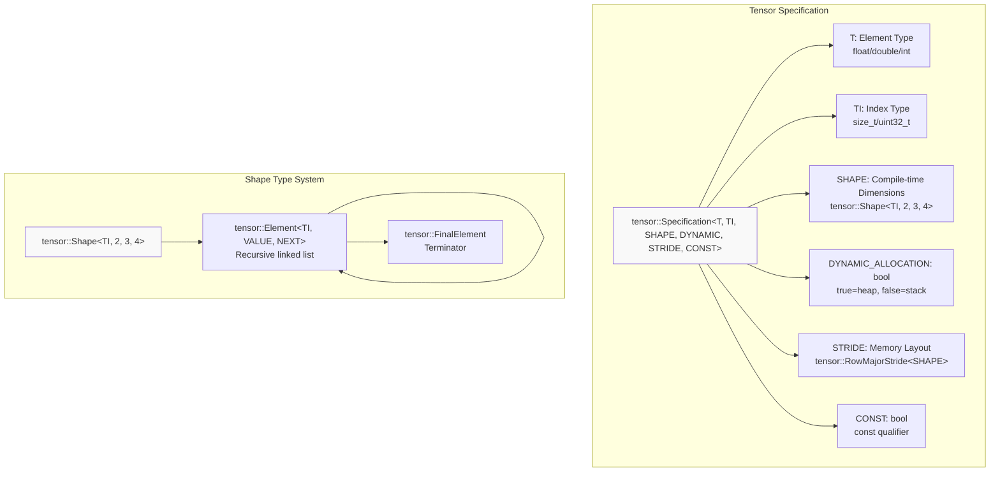
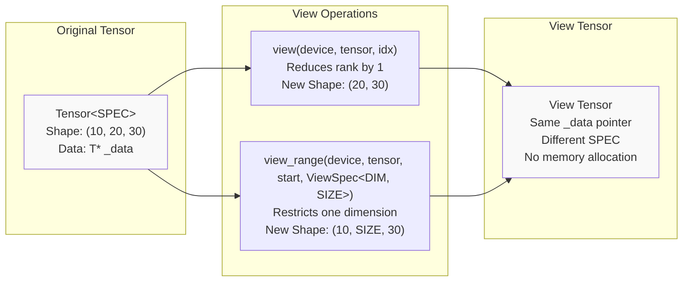
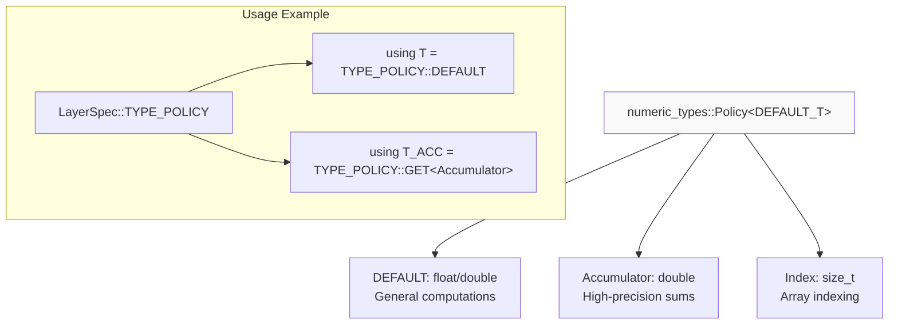

<!-- source: DeepWiki mcp.deepwiki.com · repo rl-tools/rl-tools · page 1.3 Core Concepts · fetched 2026-10-30 -->

# Core Concepts

<details>
<summary>Relevant source files</summary>

The following files were used as context for generating this wiki page:

- [include/rl_tools/containers/tensor/operations_generic.h](include/rl_tools/containers/tensor/operations_generic.h)
- [include/rl_tools/containers/tensor/tensor.h](include/rl_tools/containers/tensor/tensor.h)
- [include/rl_tools/devices/cpu.h](include/rl_tools/devices/cpu.h)
- [include/rl_tools/nn/layers/embedding/layer.h](include/rl_tools/nn/layers/embedding/layer.h)
- [include/rl_tools/nn/layers/embedding/operations_generic.h](include/rl_tools/nn/layers/embedding/operations_generic.h)
- [include/rl_tools/nn/layers/gru/layer.h](include/rl_tools/nn/layers/gru/layer.h)
- [include/rl_tools/nn/layers/gru/operations_generic.h](include/rl_tools/nn/layers/gru/operations_generic.h)
- [include/rl_tools/random/operations_cpu.h](include/rl_tools/random/operations_cpu.h)
- [include/rl_tools/rl/environments/pendulum/ui_xeus.h](include/rl_tools/rl/environments/pendulum/ui_xeus.h)
- [tests/src/container/tensor.cpp](tests/src/container/tensor.cpp)
- [tests/src/nn/layers/gru/CMakeLists.txt](tests/src/nn/layers/gru/CMakeLists.txt)
- [tests/src/nn/layers/gru/gru.cpp](tests/src/nn/layers/gru/gru.cpp)
- [tests/src/nn/layers/gru/gru_model.h](tests/src/nn/layers/gru/gru_model.h)
- [tests/src/nn/layers/gru/gru_training.cpp](tests/src/nn/layers/gru/gru_training.cpp)
- [tests/src/nn/layers/gru/jax/jax_test.py](tests/src/nn/layers/gru/jax/jax_test.py)

</details>


## Purpose and Scope

This page explains the fundamental design patterns and abstractions that form the foundation of RL Tools. These concepts appear throughout the codebase and understanding them is essential for using or extending the library.

**Topics covered:**
- Device abstraction for multi-backend support
- The specification pattern for compile-time configuration
- Tensor and container system with shapes and strides
- Static vs dynamic memory allocation strategies
- Type policies for numeric precision control

**Related pages:**
- For neural network components built on these concepts, see [Neural Network Components](#3)
- For RL algorithm implementations, see [Reinforcement Learning Algorithms](#2)
- For build configuration and backend selection, see [Build System and Configuration](#6)

---

## Device Abstraction

The device abstraction layer provides a unified interface across different hardware backends (CPU, CUDA, embedded platforms) while maintaining zero-cost abstractions. A device is composed of three orthogonal components: math operations, random number generation, and logging.

### Device Structure



**Device Composition Pattern**

Sources: [include/rl_tools/devices/cpu.h:18-67]()

The device is assembled via template specialization at compile time:

```cpp
namespace rl_tools::devices::cpu {
    template <typename T_MATH, typename T_RANDOM, typename T_LOGGING>
    struct Specification{
        using MATH = T_MATH;
        using RANDOM = T_RANDOM;
        using LOGGING = T_LOGGING;
        using index_t = size_t;
    };
}

template <typename T_SPEC>
struct CPU: Device<T_SPEC> {
    typename SPEC::MATH math;
    typename SPEC::RANDOM random;
    typename SPEC::LOGGING logger;
};
```

Each component (`MATH`, `RANDOM`, `LOGGING`) is an independent policy that can be swapped. For example, `devices::math::CPU` provides generic implementations, while `devices::math::MKL` uses Intel MKL for optimized BLAS operations.

**Device-Specific Operations**

Operations are dispatched based on the device type passed as the first parameter. This enables the same high-level code to run on different backends:

```cpp
// Generic signature for device-dispatched operations
template<typename DEVICE, typename SPEC>
void malloc(DEVICE& device, Tensor<SPEC>& tensor);

template<typename DEVICE, typename SPEC>
void randn(DEVICE& device, Tensor<SPEC>& tensor, RNG& rng);
```

Sources: [include/rl_tools/devices/cpu.h:18-67](), [include/rl_tools/random/operations_cpu.h:15-51]()

---

## The Specification Pattern

RL Tools uses a pervasive **specification pattern** where types are configured entirely at compile-time through template parameters. Specifications are distinct from instances: a specification defines *what* something is, while an instance is the actual object.

### Specification Flow



**Specification Components**

Every major component follows this pattern. For example, GRU layers:

| Component | Purpose | Example |
|-----------|---------|---------|
| **Configuration** | Problem-specific parameters | `gru::Configuration<TYPE_POLICY, TI, HIDDEN_DIM>` |
| **Capability** | Required operations (Forward/Backward/Gradient) | `capability::Gradient<parameters::Adam>` |
| **Input Shape** | Tensor dimensions | `tensor::Shape<TI, SEQUENCE_LENGTH, BATCH_SIZE, INPUT_DIM>` |
| **Specification** | Combines above + derives output shape | `gru::Specification<CONFIG, CAPABILITY, INPUT_SHAPE>` |
| **Layer Type** | Actual instance type | `gru::LayerGradient<SPEC>` or `gru::LayerForward<SPEC>` |

Sources: [include/rl_tools/nn/layers/gru/layer.h:10-21](), [include/rl_tools/nn/layers/gru/layer.h:22-37]()

**Why Specifications?**

1. **Compile-time optimization**: All dimensions, strides, and type information known at compile time enables aggressive inlining and optimization
2. **Static dispatch**: No virtual function overhead
3. **Type safety**: Mismatched dimensions caught at compile time
4. **Generic programming**: Same code works for different configurations via template instantiation
5. **Zero-cost abstractions**: No runtime penalty for the abstraction

---

## Tensor and Container System

Tensors are the primary data structure, generalizing matrices to arbitrary dimensions. The tensor system uses compile-time shape and stride information for zero-overhead abstractions.

### Tensor Specification Anatomy



Sources: [include/rl_tools/containers/tensor/tensor.h:224-235](), [include/rl_tools/containers/tensor/tensor.h:38-62]()

### Shape and Stride Types

Shapes and strides are represented as recursive compile-time types, not runtime arrays:

```cpp
// Shape is a recursive type, not a runtime array
template <typename TI, TI... T_DIMS>
struct Shape: Tuple<TI, T_DIMS...> {};

// Shape<size_t, 2, 3, 4> represents a 3D tensor
// Recursively: Element<2, Element<3, Element<4, FinalElement>>>
```

This enables compile-time operations:

```cpp
constexpr auto LENGTH = length(Shape<TI, 2, 3, 4>{}); // 3
constexpr auto DIM0 = get<0>(Shape<TI, 2, 3, 4>{}); // 2
constexpr auto DIM2 = get<2>(Shape<TI, 2, 3, 4>{}); // 4
constexpr auto PRODUCT = product(Shape<TI, 2, 3, 4>{}); // 24
```

**Row-Major Stride Calculation**

Strides are computed from shapes to support different memory layouts:

```cpp
// For shape (2, 3, 4), row-major stride is (12, 4, 1)
using SHAPE = tensor::Shape<TI, 2, 3, 4>;
using STRIDE = tensor::RowMajorStride<SHAPE>;
// Expands to: Stride<TI, 12, 4, 1>
```

The stride indicates the memory offset between consecutive elements along each dimension.

Sources: [include/rl_tools/containers/tensor/tensor.h:75-82](), [include/rl_tools/containers/tensor/tensor.h:206-207]()

### Tensor Views

Views provide zero-cost access to tensor slices without copying data:



**View Implementation**

```cpp
// Point view: select a single index along a dimension (reduces rank)
template <auto DIM=0, typename DEVICE, typename SPEC>
auto view(DEVICE& device, Tensor<SPEC>& tensor, typename DEVICE::index_t index) {
    auto offset = index * get<DIM>(typename SPEC::STRIDE{});
    using NEW_SHAPE = tensor::Remove<typename SPEC::SHAPE, DIM>;
    using NEW_STRIDE = tensor::Remove<typename SPEC::STRIDE, DIM>;
    using NEW_SPEC = tensor::Specification<...NEW_SHAPE, ...NEW_STRIDE...>;
    Tensor<NEW_SPEC> view{{data(tensor) + offset}};
    return view;
}
```

Views are returned by value but only contain a pointer, so there's no copying overhead. The view's `SPEC` encodes the modified shape and stride at compile time.

Sources: [include/rl_tools/containers/tensor/operations_generic.h:106-133](), [include/rl_tools/containers/tensor/operations_generic.h:67-95]()

### Common Tensor Operations

| Operation | Purpose | Signature |
|-----------|---------|-----------|
| `malloc/free` | Allocate/deallocate memory | `malloc(device, tensor)` |
| `set/get` | Element access with multi-index | `set(device, tensor, value, i, j, k)` |
| `copy` | Copy between tensors | `copy(from_device, to_device, from_tensor, to_tensor)` |
| `view` | Create slice (reduces rank) | `view(device, tensor, index, ViewSpec<DIM>{})` |
| `view_range` | Create sub-range view | `view_range(device, tensor, start, ViewSpec<DIM, SIZE>{})` |
| `permute` | Transpose dimensions | `permute(device, tensor, PermutationSpec<DIM1, DIM2>{})` |
| `randn/rand` | Fill with random values | `randn(device, tensor, rng)` |

Sources: [include/rl_tools/containers/tensor/operations_generic.h:11-355]()

---

## Static vs Dynamic Memory Allocation

RL Tools supports both heap-based dynamic allocation and stack-based static allocation. Static allocation is critical for embedded platforms with no heap or limited memory.

### Allocation Strategy Comparison

```mermaid
graph TB
    subgraph "Dynamic Allocation"
        DynSpec["SPEC::DYNAMIC_ALLOCATION = true"]
        DynContainer["tensor::TensorDynamic&lt;T, TI, SIZE&gt;<br/>T* _data = nullptr"]
        DynMalloc["malloc: _data = new T[SIZE]"]
        DynFree["free: delete[] _data"]
        
        DynSpec --> DynContainer
        DynContainer --> DynMalloc
        DynMalloc --> DynFree
    end
    
    subgraph "Static Allocation"
        StaticSpec["SPEC::DYNAMIC_ALLOCATION = false"]
        StaticContainer["tensor::TensorStatic&lt;T, TI, SIZE&gt;<br/>T _data[SIZE]"]
        StaticMalloc["malloc: no-op"]
        StaticFree["free: no-op"]
        
        StaticSpec --> StaticContainer
        StaticContainer --> StaticMalloc
        StaticMalloc --> StaticFree
    end
    
    style DynContainer fill:#f9f9f9
    style StaticContainer fill:#f9f9f9
```



**Implementation**

The same `Tensor<SPEC>` type conditionally inherits from either `TensorDynamic` or `TensorStatic`:

```cpp
template <typename T_SPEC>
struct Tensor: utils::typing::conditional_t<
    T_SPEC::DYNAMIC_ALLOCATION, 
    tensor::TensorDynamic<T, TI, SIZE>,  // Heap: T* _data
    tensor::TensorStatic<T, TI, SIZE>     // Stack: T _data[SIZE]
> {
    using SPEC = T_SPEC;
};

// Dynamic variant
template <typename T, typename TI, TI SIZE>
struct TensorDynamic {
    T* _data = nullptr;
};

// Static variant
template <typename T, typename TI, TI SIZE>
struct TensorStatic {
    T _data[SIZE];
};
```

Operations like `malloc` and `free` are specialized for each variant. For static tensors, they become no-ops.

Sources: [include/rl_tools/containers/tensor/tensor.h:320-354](), [include/rl_tools/containers/tensor/operations_generic.h:11-26]()

### Enabling Static Memory

Static memory is enabled globally via the `RL_TOOLS_STATIC_MEM` compilation flag. This affects all containers throughout the system:

```bash
# CMake flag
cmake -DRL_TOOLS_STATIC_MEM=ON ..

# Direct compilation
g++ -DRL_TOOLS_STATIC_MEM=1 ...
```

When enabled, all `DYNAMIC_ALLOCATION` template parameters default to `false`, causing all tensors, matrices, and buffers to use stack allocation.

**Trade-offs**

| Aspect | Dynamic Allocation | Static Allocation |
|--------|-------------------|-------------------|
| **Memory Location** | Heap | Stack |
| **Malloc/Free** | Runtime overhead | Compile-time (zero cost) |
| **Memory Size** | Flexible at runtime | Fixed at compile time |
| **Embedded Support** | Requires heap | Works without heap |
| **Stack Usage** | Minimal | Can overflow with large sizes |
| **Use Case** | General-purpose training | Embedded inference |

Sources: [include/rl_tools/containers/tensor/tensor.h:320-341](), [CMakeLists.txt context from diagrams]()

---

## Type Policies

Type policies control numeric types used throughout the system. They enable using different precisions for different operations (e.g., `float` for most computations, `double` for accumulators).

### Type Policy Structure



**Defining a Type Policy**

```cpp
namespace rl_tools::numeric_types {
    template <typename T_DEFAULT>
    struct Policy {
        using DEFAULT = T_DEFAULT;
        
        template <typename CATEGORY>
        struct GET {
            // Specializations for different categories
        };
    };
}

// Usage in layer specifications
template <typename TYPE_POLICY, typename TI, ...>
struct Configuration {
    using TYPE_POLICY = T_TYPE_POLICY;
    using T = typename TYPE_POLICY::DEFAULT;
    using T_ACC = typename TYPE_POLICY::template GET<numeric_types::categories::Accumulator>;
};
```

This allows layers to use `float` for parameters but `double` for gradient accumulation, improving numerical stability while maintaining memory efficiency.

**Type Categories**

Common categories include:
- **Default**: Standard computation type (`float` or `double`)
- **Accumulator**: High-precision type for sums and accumulations
- **Index**: Integer type for indexing (`size_t`, `uint32_t`)

Sources: [include/rl_tools/nn/layers/gru/layer.h:11-21](), [tests/src/nn/layers/gru/gru_training.cpp:44-56]()

---

## Integration Example

Here's how these concepts work together in a typical usage:

```cpp
// 1. Define type policy
using TYPE_POLICY = rl_tools::numeric_types::Policy<float>;

// 2. Create device
using DEVICE_SPEC = devices::cpu::Specification<
    devices::math::CPU, 
    devices::random::CPU, 
    devices::logging::CPU
>;
using DEVICE = devices::CPU<DEVICE_SPEC>;
DEVICE device;
rl_tools::init(device);

// 3. Define tensor specification
using TI = typename DEVICE::index_t;
using SHAPE = tensor::Shape<TI, 10, 20, 30>;
using TENSOR_SPEC = tensor::Specification<
    typename TYPE_POLICY::DEFAULT,  // float
    TI,                              // size_t
    SHAPE,                           // (10, 20, 30)
    true,                            // dynamic allocation
    tensor::RowMajorStride<SHAPE>,   // row-major layout
    false                            // not const
>;

// 4. Create and use tensor
Tensor<TENSOR_SPEC> tensor;
malloc(device, tensor);
randn(device, tensor, rng);

// 5. Create view (zero-cost)
auto slice = view(device, tensor, 5);  // Shape: (20, 30)
// slice._data == tensor._data + offset, no allocation
```

All type information flows through template parameters, enabling the compiler to optimize away abstractions completely.

Sources: [tests/src/nn/layers/gru/gru_training.cpp:43-58](), [tests/src/container/tensor.cpp:285-308]()

---

## Summary of Core Patterns

| Pattern | Purpose | Key Files |
|---------|---------|-----------|
| **Device Abstraction** | Multi-backend hardware support | [include/rl_tools/devices/cpu.h:18-67]() |
| **Specification Pattern** | Compile-time configuration | [include/rl_tools/nn/layers/gru/layer.h:22-37]() |
| **Shape/Stride Types** | Compile-time tensor dimensions | [include/rl_tools/containers/tensor/tensor.h:75-82]() |
| **Static/Dynamic Allocation** | Flexible memory strategies | [include/rl_tools/containers/tensor/tensor.h:320-341]() |
| **Type Policies** | Numeric type control | [include/rl_tools/nn/layers/gru/layer.h:11-21]() |
| **Views** | Zero-cost tensor slicing | [include/rl_tools/containers/tensor/operations_generic.h:106-133]() |

These patterns enable RL Tools to be simultaneously:
- **High-performance**: Zero-overhead abstractions with aggressive compile-time optimization
- **Portable**: Same code runs on CPU, GPU, and embedded platforms
- **Type-safe**: Dimension mismatches caught at compile time
- **Flexible**: Easy to swap backends, precisions, and allocation strategies

---

